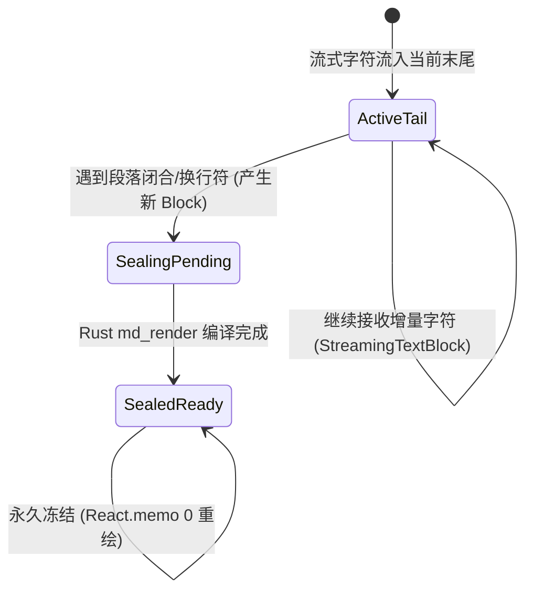

# 02-分维实现详案：前端真流式分块渲染组件架构详案

> **所属战役**：`docs/markdown-stream-refactor/`  
> **核心目标**：借鉴 Streamdown 的词法分块与 Memo 优化思想，结合 Conex 的 Rust 原生 `md_render` 引擎，实现渐进式封口与零跳变渲染，消除正文纯文字化与全屏重绘闪烁。  
> **涉及文件**：
> - `apps/crish-desktop/src/api/markdown/parseMarkdownIntoBlocks.ts` (新建)
> - `apps/crish-desktop/src/components/chat-message-row/StreamingMarkdownView.tsx` (新建)
> - `apps/crish-desktop/src/components/chat-message-row/MarkdownBlockItem.tsx` (新建)
> - `apps/crish-desktop/src/components/chat-message/MessageContent.tsx` (重构挂接)
> - `apps/crish-desktop/src/components/chat-message-row/ChatMessageRow.module.css` (样式盒模型对齐)

---

## 1. 词法分块引擎：`parseMarkdownIntoBlocks`

从 `reference/streamdown` 提炼纯算法，基于 Markdown 顶层词法边界（段落、标题、代码块、表格、列表）将累积的流式字符串动态切分为 Block 序列：

```typescript
export function parseMarkdownIntoBlocks(markdown: string): string[] {
  if (!markdown) return [];
  // 1. 脚注保护：存在未定义/引用脚注时退化为单块，避免跨块引用断裂
  if (hasFootnote(markdown)) return [markdown];

  // 2. 词法 Token 提取
  const tokens = Lexer.lex(markdown, { gfm: true });
  const mergedBlocks: string[] = [];
  const htmlStack: string[] = [];
  let previousTokenWasCode = false;

  for (const token of tokens) {
    const raw = token.raw;
    // 3. HTML 嵌套标签跨空行合并
    if (htmlStack.length > 0) {
      mergedBlocks[mergedBlocks.length - 1] += raw;
      updateHtmlStack(htmlStack, raw);
      continue;
    }
    // 4. LaTeX $$ 块合并（防止单行 '=' 被误认为 Setext 标题）
    if (mergedBlocks.length > 0 && !previousTokenWasCode) {
      if (countDoubleDollars(mergedBlocks[mergedBlocks.length - 1]) % 2 === 1) {
        mergedBlocks[mergedBlocks.length - 1] += raw;
        continue;
      }
    }
    mergedBlocks.push(raw);
    previousTokenWasCode = token.type === 'code';
  }
  return mergedBlocks;
}
```

---

## 2. 双轨渐进分块架构与生命周期



### 块分类与渲染分工

1. **已封口历史块（Sealed Blocks，索引 `0 .. N-2`）**：
   - 文本内容已定型，触发 `useAsyncMarkdownHtml` 调用 Rust `core_md_render` 编译为安全 HTML。
   - 结果进入 LRU 缓存，`React.memo` 比较器锁定，后续流式帧重渲染次数恒等于 **0**。
2. **活跃末尾块（Active Tail Block，索引 `N-1`）**：
   - 处于实时生成阶段，采用 `StreamingTextBlock`（DOM `appendText`）极速响应，并在末尾附加打字机 Caret。

---

## 3. 零视觉跳变与高度平滑机制 (Zero Layout Shift)

1. **双缓冲 DOM 垫片（Double-Buffered Promotion）**：
   - 当末尾块闭合跃迁为 `SealingPending` 时，在 Rust 异步编译完成前，**严格保留纯文本 DOM 垫片，绝不渲染骨架屏（`<div class="skeletonLine" />`）**。
   - 编译完成后，通过 `requestAnimationFrame` 原地无缝替换为渲染后的 HTML，彻底消除容器高度坍缩。
2. **CSS 盒模型预对齐（Box-Model Parity）**：
   - 在 `ChatMessageRow.module.css` 中为 `.isStreaming`（草稿态）与 `.md-rendered`（完成态）统一排版基础参数：
     ```css
     .assistantText {
       font-size: 14px;
       line-height: 1.65;
       margin-bottom: 0.85em;
     }
     ```
3. **动态 Caret 流动锚点**：
   - Caret 仅作为末尾活跃块的 `::after` 伪元素挂载，随段落自然向下推移，已封口块无任何光标残留。

---

## 4. 交付验收断言

- **断言 1**：在长文流式输出时，已生成的第 1、2 段即时呈现加粗、标题与代码高亮，而非等待整篇结束后才呈现。
- **断言 2**：流式全过程中，已封口历史块的 React Re-render 计数严格恒等于 0。
- **断言 3**：流式完成时，页面整体布局位移（CLS）$\le 0.01$，无整页重绘闪烁。
