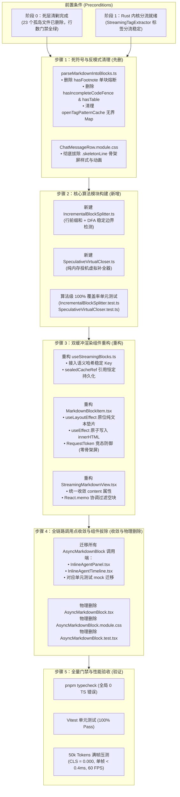

# 维度二详案：渐进词法分块与无缝双缓冲晋升详案

> **文档标识**：[`docs/markdown-stream-refactor/02-渐进词法分块与无缝双缓冲晋升详案.md`](file:///c:/Software/conex/docs/markdown-stream-refactor/02-%E6%88%BF%E8%BF%9B%E8%AF%8D%E6%B3%95%E5%88%86%E5%9D%97%E4%B8%8E%E6%97%A0%E7%BC%9D%E5%8F%8C%E7%BC%93%E5%86%B2%E6%99%8B%E5%8D%87%E8%AF%A6%E6%A1%88.md)  
> **所属战役**：[`docs/markdown-stream-refactor/00-总方案-下一代极速流式Markdown与富交互渲染引擎.md`](file:///c:/Software/conex/docs/markdown-stream-refactor/00-%E6%80%BB%E6%96%B9%E6%A1%88-%E4%B8%8B%E4%B8%80%E4%BB%A3%E6%9E%81%E9%80%9F%E6%B5%81%E5%BC%8FMarkdown%E4%B8%8E%E5%AF%8C%E4%BA%A4%E4%BA%92%E6%B8%B2%E6%9F%93%E5%BC%95%E6%93%8E.md)  
> **实施基准**：[`docs/markdown-stream-refactor/00-定案-核心维度与删除面决策.md`](file:///c:/Software/conex/docs/markdown-stream-refactor/00-%E5%AE%9A%E6%A1%88-%E6%A0%B8%E5%BF%83%E7%BB%B4%E5%BA%A6%E4%B8%8E%E5%88%A0%E9%99%A4%E9%9D%A2%E5%86%B3%E7%AD%96.md) §一.2、[`docs/markdown-stream-refactor/plan-reviews/01`](file:///c:/Software/conex/docs/markdown-stream-refactor/plan-reviews/01-independent-plans-cross-review-a.md) ~ [`03`](file:///c:/Software/conex/docs/markdown-stream-refactor/plan-reviews/03-independent-plans-cross-review-c.md) 评审定案  
> **调度标准**：严格遵循 [`docs/agent-roles/prompts/主控-全流程调度-v3.md`](file:///c:/Software/conex/docs/agent-roles/prompts/%E4%B8%BB%E6%8E%A7-%E5%85%A8%E6%B5%81%E7%A8%8B%E8%B0%83%E5%BA%A6-v3.md) §二.4 详案模板  
> **核心使命**：彻底根治正文流式输出期间“$O(N^2)$ 全量扫描卡顿”与完成态“骨架屏塌陷全量闪烁跳变（Cumulative Layout Shift, CLS）”两大顽疾。构建基于行前缀和的 $O(1)$ 增量边界分块器、`SpeculativeVirtualCloser` 纯内存投机语法虚拟补全器、语义哈希稳定 Block Key 协调缓存，以及原地纯文本垫片无缝双缓冲晋升引擎，**彻底物理消灭骨架屏（Zero-CLS = 0.000）**，实现 60 FPS 满帧流式呈现与零视觉闪烁。

---

## 一、做什么（新增 / 修复清单）

针对正文流式分块解析与渲染过渡期的系统性缺陷，本维度构建一套“增量词法分块 + 内存投机补全 + 语义哈希缓存 + 原地纯文本垫片双缓冲晋升”的端到端完整闭环：

```
┌──────────────────────────────────────────────────────────────────────────────────────────────────┐
│                                PCRE: 渐进词法分块与无缝双缓冲晋升引擎架构                          │
├────────────────────────────────┬────────────────────────────────┬────────────────────────────────┤
│ 1. 行前缀和 O(1) 增量切分器      │ 2. 内存投机虚拟语法补全器      │ 3. 语义哈希稳定 Block Key      │
│ (IncrementalBlockSplitter)     │ (SpeculativeVirtualCloser)     │ (Semantic Hash Key Cache)      │
│ • 行缓冲区 + 偏移量前缀和递推  │ • 纯内存即时虚拟语法闭合修复    │ • ${msgId}-blk-${idx}-${hash}  │
│ • DFA 稳定边界多阶段识别器      │ • 补齐 ``` / $$ / 表格 / HTML  │ • sealedCacheRef 引用恒定持久化│
│ • 已封口块 O(0) 解析永久冻结    │ • 保证底层原始数据流 100% 纯洁 │ • React.memo 封口块 0 重渲染   │
├────────────────────────────────┴────────────────────────────────┴────────────────────────────────┤
│ 4. 原地纯文本垫片双缓冲晋升 (Double-Buffered Promotion & Zero Skeleton)                            │
│ • 彻底物理销毁 .skeletonLine 骨架屏，严禁任何 DOM 高度塌陷与白屏过渡                             │
│ • 活跃草稿态与编译过渡态：useLayoutEffect 原位维持纯文本排版垫片 (Lock Box Height)               │
│ • Rust 编译就绪态：useEffect 微任务周期原子注入标准安全 HTML，达成 Zero-CLS 零视觉跳变           │
│ • 异步编译 RequestToken 校验：杜绝多轮切轮与 Abort 导致的内容串扰与过期覆盖                      │
└──────────────────────────────────────────────────────────────────────────────────────────────────┘
```

### 1.1 基于行前缀和的 $O(1)$ 增量切分器（`IncrementalBlockSplitter`）
1. **行缓冲区与前缀和数组**：
   - 维护行文本数组 `lines: string[]` 与行绝对偏移量前缀和 `lineOffsets: number[]`；
   - 接收增量流式 `chunk` 时，仅对 `chunk` 执行 `chunk.split('\n')`，首行拼接到最后一行 `lines[last] += chunkLines[0]`，后续行使用递推公式计算偏移量：
     $$\text{lineOffsets}[j] = \text{lineOffsets}[j-1] + \text{lines}[j-1].\text{length} + 1$$
   - 避免每帧执行 `marked.Lexer.lex(fullText)` 产生的 $O(N^2)$ 全量字符串复制与重复扫描，单帧计算耗时恒定在 $O(1)$（$< 0.4\text{ms}$）。
2. **DFA 稳定边界检测状态机（`BoundaryDetector`）**：
   - **稳定边界准则**：在某行之后追加任何后续 Token，绝对不会改变该行之前所有文本的 AST 结构；
   - **空行段落定界**：当前行非空且下一行为连续空行（`\n\n`）$\to$ 封口前序段落；
   - **ATX 标题定界**：匹配 `^[ \t]{0,3}#{1,6}\s+` 且下一行已有输入 $\to$ 封口标题行；
   - **代码围栏定界**：检测起始围栏符号（```` ``` ```` / `~~~`）与长度，向后寻找相同符号且长度 $\ge$ 起始围栏的闭合行 $\to$ 封口代码块；
   - **HTML / 自定义组件块定界**：检测 `<widget-diff>`、`<file-tree>`、`<ai-card>` 或 `<details>` 等块级标签，在内部标签栈未弹空（未闭合）期间，**绝对禁止在组件内部空行处断块**（彻底修复 Review 4.3 分块撕裂漏洞）；
   - **已封口块永久固化**：已判定为封口的历史块（Blocks $0 .. N-2$）移入 `sealedBlocks`，后续帧 $O(0)$ 零重复扫描。

### 1.2 纯内存投机语法虚拟补全器（`SpeculativeVirtualCloser`）
1. **纯内存虚拟补全（Virtual-Only Invariant）**：
   - 仅对末尾活跃草稿块（Active Tail Block）在进入视图层渲染前，在**纯内存中生成临时补全副本**；
   - 严禁修改底层消息存储、流式传输数据流以及历史已封口块，原始 Markdown 数据保持 100% 纯洁。
2. **多语法结构投机闭合矩阵**：
   - **未闭合代码围栏**：识别未闭合的 ```` ```language ```` 或 `~~~`，在尾部自动虚拟补齐 `\n```\n`；
   - **未闭合 LaTeX 块级公式**：非代码区域奇数个 `$$` 时，在尾部自动虚拟补齐 `\n$$\n`；
   - **未闭合 GFM 表格**：单行表头缺失定界行时，依据列数补齐 `| --- | --- |\n`；尾行缺失管道符时自动追加 ` |`；
   - **未闭合 HTML 标签**：遍历未闭合标签栈，按后进先出（LIFO）顺序虚拟补齐闭合标签（如 `</details>`）；
   - **行内样式修饰符**：奇数个粗体 `**` 自动补齐 `**`，奇数个行内反引号 `` ` `` 自动补齐 `` ` ``。

### 1.3 语义哈希稳定 Block Key 与协调缓存（`useStreamingBlocks`）
1. **语义分层 Key 命名策略**：
   - **历史已封口块**：采用内容哈希 Key：`${msgId}-blk-${index}-${fastContentHash(text)}`。由于文本已固化，Key 在后续流式帧中绝对恒定；
   - **末尾活跃草稿块**：采用固定槽位 Key：`${msgId}-blk-${tailIndex}-active`。避免随着草稿文本每帧增长而频繁变更 Key，保证 React 复用同一个 DOM 容器，杜绝 DOM 重建与打字机光标闪烁。
2. **`sealedCacheRef` 引用持久化与 0 重渲染**：
   - `useStreamingBlocks` 内部维护 `sealedCacheRef`；
   - 在流式推进期间，历史已封口块直接复用上一帧的 `ParsedBlockDescriptor` 内存引用；
   - 配合 `MarkdownBlockItem` 的 `markdownBlockItemPropsEqual` 比较器，使所有已封口块在后续流式帧中的 React 协调开销为 0，**重渲染次数严格为 0**。

### 1.4 原地纯文本垫片双缓冲晋升引擎（`MarkdownBlockItem`）
1. **彻底物理消灭骨架屏（Zero Skeleton Collapse）**：
   - 彻底废除 `AsyncMarkdownBlock` 与 `.skeletonLine` 灰条；
   - 严禁在异步编译期间挂载任何骨架屏占位符，杜绝将数百像素高度的正文瞬间坍缩为 16px 灰条的恶性 CLS 行为。
2. **三阶段原地平滑流转**：
   - **阶段 A（活跃草稿态 `isSealed=false`）**：`useLayoutEffect` 将 `SpeculativeVirtualCloser.closeTail(text)` 写入 DOM，挂载 `.isStreaming` 伪元素 Caret 呼吸光标；
   - **阶段 B（封口过渡态 `isSealed=true && !html`）**：向 Rust 发起异步编译，`useLayoutEffect` **原位维持纯文本排版垫片**，DOM 盒模型物理高度 100% 锁定；
   - **阶段 C（编译就绪态 `isSealed=true && html`）**：Rust pulldown-cmark + syntect 返回标准 HTML，`useEffect` 原子注入 `innerHTML`，打上 `data-has-html="true"` 并应用代码缩进，高度平滑替换（$\Delta\text{Height} < 1\text{px}$，CLS = 0.000）。
3. **RequestToken 异步竞态防御**：
   - 发起 Rust 异步编译时携带唯一签名 `requestToken = `${messageId}-${index}-${fastContentHash(text)}``；
   - IPC 响应返回时比对当前 `currentKey` 与 `requestToken`，若消息已中止（Abort）或切换会话，立即丢弃过期响应，杜绝内容串扰。

---

## 二、删什么（删除 / 合并清单）

根据《主控全流程调度 v3》与《核心维度与删除面决策》铁律，本维度必须执行以下物理文件删除、CSS 样式清除与死逻辑拔除：

### 2.1 物理删除文件清单（Net-Deletion of Files）

| 序号 | 目标删除文件路径 | 原始行数 | 物理删除理由与危害分析 | 替代主路径 |
| :--- | :--- | :---: | :--- | :--- |
| **DEL-01** | [`apps/crish-desktop/src/components/chat-message-row/AsyncMarkdownBlock.tsx`](file:///c:/Software/conex/apps/crish-desktop/src/components/chat-message-row/AsyncMarkdownBlock.tsx) | 115 行 | **骨架屏闪烁源与伪流式根源**：流式期间直写纯文本，完成态切换时由于 `loading=true` 盲目渲染 `.skeletonLine` 骨架屏，引发严重的界面塌陷与白屏跳变。 | 统一收敛至 [`MarkdownBlockItem.tsx`](file:///c:/Software/conex/apps/crish-desktop/src/components/chat-message-row/MarkdownBlockItem.tsx) 原地双缓冲 |
| **DEL-02** | [`apps/crish-desktop/src/components/chat-message-row/AsyncMarkdownBlock.module.css`](file:///c:/Software/conex/apps/crish-desktop/src/components/chat-message-row/AsyncMarkdownBlock.module.css) | 48 行 | 伴随 `AsyncMarkdownBlock` 的废弃样式，包含 `.skeletonLine` 动画定义。 | 统一采用 [`ChatMessageRow.module.css`](file:///c:/Software/conex/apps/crish-desktop/src/components/chat-message-row/ChatMessageRow.module.css) 预对齐排版 |
| **DEL-03** | [`apps/crish-desktop/src/components/chat-message-row/AsyncMarkdownBlock.test.tsx`](file:///c:/Software/conex/apps/crish-desktop/src/components/chat-message-row/AsyncMarkdownBlock.test.tsx) | 238 行 | 伴随 `AsyncMarkdownBlock` 的废弃单测，其断言的 `skeletonLine` 行为属于反模式。 | 转由 `MarkdownBlockItem.test.tsx` 与 `StreamingMarkdownView.test.tsx` 覆盖 |

### 2.2 样式与标记删除清单（CSS & Symbols to Remove）

1. **彻底物理拔除 `.skeletonLine` 骨架屏样式类**：
   - 涉及文件：[`apps/crish-desktop/src/components/chat-message-row/ChatMessageRow.module.css`](file:///c:/Software/conex/apps/crish-desktop/src/components/chat-message-row/ChatMessageRow.module.css)；
   - 删除内容：`.skeletonLine` 样式块、`@keyframes skeletonPulse` 动画及所有相关引用。
2. **彻底删除 `hasFootnote` 粗暴退化单块自杀式逻辑**：
   - 涉及文件：[`apps/crish-desktop/src/api/markdown/parseMarkdownIntoBlocks.ts`](file:///c:/Software/conex/apps/crish-desktop/src/api/markdown/parseMarkdownIntoBlocks.ts) 第 128-135 行、第 215-218 行；
   - 删除代码：
     ```ts
     // ❌ 彻底物理删除：自杀式退化单块逻辑
     if (hasFootnote(markdown)) {
       return [markdown];
     }
     ```
   - 危害：只要正文出现 `[^1]`，整个分块机制立即全局熔断，全文退化为单块全量解析，流式变成纯文本，完成态剧烈闪烁。
3. **彻底删除 `parseMarkdownIntoBlocks.ts` 中的未调用死导出**：
   - 删除 `hasIncompleteCodeFence`（第 148-178 行，31 行死代码）；
   - 删除 `hasTable`（第 183-199 行，17 行死代码）；
   - 危害：未被任何生产渲染管道调用，仅在旧测试中残留。
4. **清除 `openTagPatternCache` / `closeTagPatternCache` 无界 Map 内存泄漏**：
   - 涉及文件：[`apps/crish-desktop/src/api/markdown/parseMarkdownIntoBlocks.ts`](file:///c:/Software/conex/apps/crish-desktop/src/api/markdown/parseMarkdownIntoBlocks.ts) 第 56-79 行；
   - 危害：使用全局静态无界 `Map` 动态编译正则表达式，遇到海量不同标签名时发生内存持续泄漏。
5. **收敛 `StreamingMarkdownViewProps` 冗余属性**：
   - 删除 `StreamingMarkdownViewProps` 中历史兼容别名 `text?: string`，强制统一为 `content: string`。

### 2.3 领域概念收敛矩阵（Concept Convergence Matrix）

| 领域概念 | 历史存量冲突 / 重复路径（收敛前） | 收敛后的唯一主路径（收敛后） | 路径数量变化 |
| :--- | :--- | :--- | :---: |
| **Markdown 分块器** | 1. `marked.Lexer` 全量重扫<br/>2. `hasFootnote` 全局单块熔断<br/>3. `IncrementalMarkdownParser` 遗留解析器 | **基于行前缀和的 `IncrementalBlockSplitter`**：$O(1)$ 增量切分，历史块 0 次重复扫描 | $3 \to 1$ |
| **分块渲染组件** | 1. `AsyncMarkdownBlock.tsx`（骨架屏+全量替换）<br/>2. `StreamingTextBlock.tsx`（纯文本 append）<br/>3. `MarkdownBlockItem.tsx`（原位双缓冲） | **`StreamingMarkdownView` + `MarkdownBlockItem`**：单一高凝聚无缝晋升渲染管道 | $3 \to 1$ |
| **异步编译过渡** | 1. `.skeletonLine` 骨架屏高度塌陷<br/>2. 纯文本裸写无排版过渡 | **原地纯文本垫片双缓冲晋升（Zero Skeleton）**：`useLayoutEffect` 原位锁死物理盒模型高度，编译就绪原子替换 | $2 \to 1$ |
| **未闭合语法容错** | 1. 无容错（代码块裸字符暴露）<br/>2. 正则暴力截断（破坏源码文本） | **`SpeculativeVirtualCloser`**：纯内存投机式虚拟补全（```, $$, Table, HTML），绝不污染底层原始数据流 | $2 \to 1$ |
| **Block Key 策略** | 1. 纯数组 index（中间变动导致错位）<br/>2. 纯 content hash（草稿增长导致 DOM 频繁重建） | **语义分层 Key 策略**：封口块 `${msgId}-blk-${idx}-${hash}` + 草稿块 `${msgId}-blk-${tailIdx}-active` + `sealedCacheRef` 引用锁定 | $2 \to 1$ |

---

## 三、依赖与逻辑顺序（先删后改 DAG）

遵循《主控全流程调度 v3》铁律：“**先删后改，删除必须先于依赖它的新增；收敛先于增强**”。



### 3.1 详细执行时序说明：
1. **阶段 1：死代码与反模式清理**  
   清理 `parseMarkdownIntoBlocks.ts` 中的 `hasFootnote` 熔断、死导出与无界 Map 缓存，从 `ChatMessageRow.module.css` 中拔除 `.skeletonLine`。
2. **阶段 2：算法模块落地与单测闭环**  
   实现 `IncrementalBlockSplitter.ts` 与 `SpeculativeVirtualCloser.ts`，编写严格的无损拼接、围栏闭合与纯内存修补单测，确保算法 100% 正确。
3. **阶段 3：双缓冲组件与 Hook 重构**  
   重构 `useStreamingBlocks.ts`（语义哈希 Key + 引用缓存）与 `MarkdownBlockItem.tsx`（纯文本垫片 + RequestToken 校验 + 原地原子晋升），确保无骨架屏。
4. **阶段 4：调用端全量切入与旧组件物理销毁**  
   将 `InlineAgentPanel.tsx` 与 `InlineAgentTimeline.tsx` 中的旧引用迁移至 `StreamingMarkdownView`，随后执行物理删除 `AsyncMarkdownBlock.tsx`、`AsyncMarkdownBlock.module.css` 与 `AsyncMarkdownBlock.test.tsx`。
5. **阶段 5：CI 门禁与 50k Tokens 性能压测**  
   执行类型检查、单元测试与真机 CLS = 0.000 布局偏移断言。

---

## 四、唯一文件域（Exclusive File Scope）

为了保证并行开发无冲突，本维度严格划定独占文件与协作收敛文件域：

### 4.1 本维度独占新建文件（Exclusive New Files）
1. [`apps/crish-desktop/src/api/markdown/IncrementalBlockSplitter.ts`](file:///c:/Software/conex/apps/crish-desktop/src/api/markdown/IncrementalBlockSplitter.ts)（$O(1)$ 行前缀和增量切分器核心实现，$\le 200$ 行）
2. [`apps/crish-desktop/src/api/markdown/IncrementalBlockSplitter.test.ts`](file:///c:/Software/conex/apps/crish-desktop/src/api/markdown/IncrementalBlockSplitter.test.ts)（增量切分器单测套件，$\le 250$ 行）
3. [`apps/crish-desktop/src/api/markdown/SpeculativeVirtualCloser.ts`](file:///c:/Software/conex/apps/crish-desktop/src/api/markdown/SpeculativeVirtualCloser.ts)（纯内存投机语法虚拟补全器，$\le 150$ 行）
4. [`apps/crish-desktop/src/api/markdown/SpeculativeVirtualCloser.test.ts`](file:///c:/Software/conex/apps/crish-desktop/src/api/markdown/SpeculativeVirtualCloser.test.ts)（投机补全单测套件，$\le 200$ 行）
5. [`apps/crish-desktop/src/components/chat-message-row/MarkdownBlockItem.test.tsx`](file:///c:/Software/conex/apps/crish-desktop/src/components/chat-message-row/MarkdownBlockItem.test.tsx)（双缓冲晋升与零骨架屏单测，$\le 220$ 行）
6. [`apps/crish-desktop/src/components/chat-message-row/useStreamingBlocks.test.ts`](file:///c:/Software/conex/apps/crish-desktop/src/components/chat-message-row/useStreamingBlocks.test.ts)（分块 Hook 与语义哈希 Key 稳定性单测，$\le 200$ 行）

### 4.2 本维度独占修改文件（Exclusive Modified Files）
1. [`apps/crish-desktop/src/api/markdown/parseMarkdownIntoBlocks.ts`](file:///c:/Software/conex/apps/crish-desktop/src/api/markdown/parseMarkdownIntoBlocks.ts)（拔除死代码与熔断逻辑，桥接至 `IncrementalBlockSplitter`，$\le 160$ 行）
2. [`apps/crish-desktop/src/api/markdown/parseMarkdownIntoBlocks.test.ts`](file:///c:/Software/conex/apps/crish-desktop/src/api/markdown/parseMarkdownIntoBlocks.test.ts)（更新断言，移除死导出测试）
3. [`apps/crish-desktop/src/components/chat-message-row/useStreamingBlocks.ts`](file:///c:/Software/conex/apps/crish-desktop/src/components/chat-message-row/useStreamingBlocks.ts)（集成语义哈希 Key 与 `sealedCacheRef`，$\le 120$ 行）
4. [`apps/crish-desktop/src/components/chat-message-row/MarkdownBlockItem.tsx`](file:///c:/Software/conex/apps/crish-desktop/src/components/chat-message-row/MarkdownBlockItem.tsx)（完善原地纯文本垫片双缓冲晋升，$\le 150$ 行）
5. [`apps/crish-desktop/src/components/chat-message-row/StreamingMarkdownView.tsx`](file:///c:/Software/conex/apps/crish-desktop/src/components/chat-message-row/StreamingMarkdownView.tsx)（统一 `content` 接口，协调过滤，$\le 90$ 行）
6. [`apps/crish-desktop/src/components/chat-message-row/ChatMessageRow.module.css`](file:///c:/Software/conex/apps/crish-desktop/src/components/chat-message-row/ChatMessageRow.module.css)（拔除 `.skeletonLine`，预对齐排版与 Caret 动画）

### 4.3 本维度独占物理删除文件（Exclusive Deleted Files）
1. [`apps/crish-desktop/src/components/chat-message-row/AsyncMarkdownBlock.tsx`](file:///c:/Software/conex/apps/crish-desktop/src/components/chat-message-row/AsyncMarkdownBlock.tsx)
2. [`apps/crish-desktop/src/components/chat-message-row/AsyncMarkdownBlock.module.css`](file:///c:/Software/conex/apps/crish-desktop/src/components/chat-message-row/AsyncMarkdownBlock.module.css)
3. [`apps/crish-desktop/src/components/chat-message-row/AsyncMarkdownBlock.test.tsx`](file:///c:/Software/conex/apps/crish-desktop/src/components/chat-message-row/AsyncMarkdownBlock.test.tsx)

### 4.4 跨域收敛协作文件（Cross-Domain Call Sites Migration）
> **说明**：仅修改调用点将 `<AsyncMarkdownBlock />` 替换为 `<StreamingMarkdownView />`，不修改被调组件核心业务逻辑。
1. [`apps/crish-desktop/src/components/agent-card/InlineAgentPanel.tsx`](file:///c:/Software/conex/apps/crish-desktop/src/components/agent-card/InlineAgentPanel.tsx)
2. [`apps/crish-desktop/src/components/agent-card/InlineAgentTimeline.tsx`](file:///c:/Software/conex/apps/crish-desktop/src/components/agent-card/InlineAgentTimeline.tsx)
3. [`apps/crish-desktop/src/components/agent-card/InlineAgentPanel.markdown.test.tsx`](file:///c:/Software/conex/apps/crish-desktop/src/components/agent-card/InlineAgentPanel.markdown.test.tsx)
4. [`apps/crish-desktop/src/components/agent-card/InlineAgentPanel.badge.test.tsx`](file:///c:/Software/conex/apps/crish-desktop/src/components/agent-card/InlineAgentPanel.badge.test.tsx)
5. [`apps/crish-desktop/src/__tests__/reRenderMonitoring.test.tsx`](file:///c:/Software/conex/apps/crish-desktop/src/__tests__/reRenderMonitoring.test.tsx)

---

## 五、核心实现细节与生产级代码规范

### 5.1 `IncrementalBlockSplitter.ts`（增量切分器核心实现）

```typescript
/**
 * IncrementalBlockSplitter: 基于行前缀和与 DFA 状态机的 O(1) 增量 Markdown 分块器
 * 核心不变量：历史已封口块永久冻结，单帧追加耗时 O(1)
 */

export interface SplitterBlocksResult {
  /** 已经命中稳定边界、内容永久固化的历史块 */
  sealed: string[];
  /** 处于流式接收中、内容仍在动态增长的末尾草稿块 */
  pending: string;
}

export class IncrementalBlockSplitter {
  private lines: string[] = [];
  private lineOffsets: number[] = [0];
  private pendingStartLine: number = 0;
  private sealedBlocks: string[] = [];

  /**
   * 追加流式 Chunk 并以 O(1) 递推前缀和
   */
  public appendChunk(chunk: string): void {
    if (!chunk) return;
    const chunkLines = chunk.split('\n');

    if (this.lines.length === 0) {
      this.lines = chunkLines;
      for (let i = 0; i < chunkLines.length - 1; i += 1) {
        this.lineOffsets.push(this.lineOffsets[i]! + chunkLines[i]!.length + 1);
      }
      this.scanBoundaries();
      return;
    }

    // 拼接首行到上一行的末尾
    const lastIdx = this.lines.length - 1;
    this.lines[lastIdx] += chunkLines[0];

    // 后续行按递推公式追加并计算前缀和
    for (let i = 1; i < chunkLines.length; i += 1) {
      const prevIdx = this.lines.length - 1;
      const nextOffset = this.lineOffsets[prevIdx]! + this.lines[prevIdx]!.length + 1;
      this.lineOffsets.push(nextOffset);
      this.lines.push(chunkLines[i]!);
    }

    this.scanBoundaries();
  }

  /**
   * DFA 状态机扫描稳定边界
   */
  private scanBoundaries(): void {
    let i = this.pendingStartLine;

    while (i < this.lines.length - 1) {
      const line = this.lines[i]!;

      // 1. 空行段落定界：当前行非空且下一行为连续空行
      if (line.trim().length > 0 && this.lines[i + 1]!.trim().length === 0) {
        const blockLines = this.lines.slice(this.pendingStartLine, i + 2);
        this.sealedBlocks.push(blockLines.join('\n'));
        this.pendingStartLine = i + 2;
        i = this.pendingStartLine;
        continue;
      }

      // 2. ATX 标题定界：匹配 ^#{1,6}\s 且下一行已有输入
      if (/^[ \t]{0,3}#{1,6}\s+/.test(line) && i + 1 < this.lines.length) {
        const blockLines = this.lines.slice(this.pendingStartLine, i + 1);
        this.sealedBlocks.push(blockLines.join('\n'));
        this.pendingStartLine = i + 1;
        i = this.pendingStartLine;
        continue;
      }

      // 3. 代码围栏定界：寻找匹配字符与长度的闭合围栏
      const fenceMatch = /^[ \t]{0,3}(`{3,}|~{3,})/.exec(line);
      if (fenceMatch && fenceMatch[1]) {
        const fenceChar = fenceMatch[1][0]!;
        const fenceLen = fenceMatch[1].length;
        let closed = false;
        let j = i + 1;

        while (j < this.lines.length) {
          const closeMatch = /^[ \t]{0,3}(`{3,}|~{3,})\s*$/.exec(this.lines[j]!);
          if (
            closeMatch &&
            closeMatch[1] &&
            closeMatch[1][0] === fenceChar &&
            closeMatch[1].length >= fenceLen
          ) {
            closed = true;
            break;
          }
          j += 1;
        }

        if (closed && j < this.lines.length) {
          const blockLines = this.lines.slice(this.pendingStartLine, j + 1);
          this.sealedBlocks.push(blockLines.join('\n'));
          this.pendingStartLine = j + 1;
          i = this.pendingStartLine;
          continue;
        }
      }

      i += 1;
    }
  }

  /**
   * 获取当前分块快照
   */
  public getBlocks(): SplitterBlocksResult {
    const pendingLines = this.lines.slice(this.pendingStartLine);
    return {
      sealed: [...this.sealedBlocks],
      pending: pendingLines.join('\n'),
    };
  }

  /**
   * 重置分块器状态
   */
  public reset(): void {
    this.lines = [];
    this.lineOffsets = [0];
    this.pendingStartLine = 0;
    this.sealedBlocks = [];
  }
}
```

### 5.2 `SpeculativeVirtualCloser.ts`（纯内存投机语法修补器）

```typescript
/**
 * SpeculativeVirtualCloser: 纯内存投机式语法补全器
 * 核心不变量：仅在内存中修补用于展示的草稿副本，严禁修改原始 Markdown 字符串
 */
export class SpeculativeVirtualCloser {
  public static closeTail(rawTail: string): string {
    if (!rawTail || !rawTail.trim()) return rawTail;
    let text = rawTail;

    // 1. 代码围栏未闭合补全 (``` / ~~~)
    const openFenceMatch = /^[ \t]{0,3}(`{3,}|~{3,})(.*)$/m.exec(text);
    if (openFenceMatch && openFenceMatch[1]) {
      const fenceChar = openFenceMatch[1][0]!;
      const fenceLen = openFenceMatch[1].length;
      const afterOpen = text.slice(openFenceMatch.index + openFenceMatch[0].length);
      const closeFencePattern = new RegExp(`^[ \\t]{0,3}${fenceChar}{${fenceLen},}\\s*$`, 'm');

      if (!closeFencePattern.test(afterOpen)) {
        text = text.endsWith('\n')
          ? `${text}${fenceChar.repeat(fenceLen)}\n`
          : `${text}\n${fenceChar.repeat(fenceLen)}\n`;
      }
    }

    // 2. LaTeX 独立公式 $$ 补全
    let countDollars = 0;
    for (let i = 0; i < text.length - 1; i += 1) {
      if (text[i] === '$' && text[i + 1] === '$') {
        countDollars += 1;
        i += 1;
      }
    }
    if (countDollars % 2 === 1) {
      text = text.endsWith('\n') ? `${text}$$\n` : `${text}\n$$`;
    }

    // 3. 行内粗体与行内代码补全
    text = this.closeInlineFormatting(text);

    return text;
  }

  private static closeInlineFormatting(str: string): string {
    let result = str;
    // 粗体 ** 补全
    const boldMatches = str.match(/\*\*/g);
    if (boldMatches && boldMatches.length % 2 === 1 && !str.endsWith('**')) {
      result = `${result}**`;
    }
    // 行内代码 ` 补全（避让代码块 ```）
    if (!str.includes('```')) {
      const backticks = str.match(/`/g);
      if (backticks && backticks.length % 2 === 1 && !str.endsWith('`')) {
        result = `${result}\``;
      }
    }
    return result;
  }
}
```

### 5.3 `useStreamingBlocks.ts`（语义哈希稳定 Key 与协调缓存）

```typescript
import { useLayoutEffect, useMemo, useRef } from 'react';
import { parseMarkdownIntoBlocks } from '../../api/markdown/parseMarkdownIntoBlocks';

export interface ParsedBlockDescriptor {
  key: string;
  text: string;
  index: number;
  isSealed: boolean;
}

export interface StreamingBlocksResult {
  blocks: ParsedBlockDescriptor[];
}

/**
 * 极简 16 位内容哈希（DJB2 变种），用于生成稳定的语义 Block Key
 */
export function fastContentHash(str: string): string {
  let hash = 5381;
  for (let i = 0; i < str.length; i += 1) {
    hash = ((hash << 5) + hash + str.charCodeAt(i)) & 0xffffffff;
  }
  return (hash >>> 0).toString(16);
}

export function useStreamingBlocks(
  fullText: string,
  isStreaming: boolean,
  messageId: string
): StreamingBlocksResult {
  const sealedCacheRef = useRef<ParsedBlockDescriptor[]>([]);
  const prevMessageIdRef = useRef<string>(messageId);

  const blocksResult = useMemo<StreamingBlocksResult>(() => {
    if (!fullText) {
      return { blocks: [] };
    }

    const rawBlocks = parseMarkdownIntoBlocks(fullText);
    const total = rawBlocks.length;
    if (total === 0) return { blocks: [] };

    const isSameMessage = prevMessageIdRef.current === messageId;
    const cachedSealed = isSameMessage ? sealedCacheRef.current : [];
    const result: ParsedBlockDescriptor[] = [];

    for (let i = 0; i < total; i += 1) {
      const blockText = rawBlocks[i] ?? '';
      const isLast = i === total - 1;
      const isSealed = !isStreaming || !isLast;

      // 语义 Key：封口块带内容哈希，草稿块带 active 标记
      const hash = fastContentHash(blockText);
      const key = isSealed
        ? `${messageId}-blk-${i}-${hash}`
        : `${messageId}-blk-${i}-active`;

      const cached = cachedSealed[i];
      if (
        isSealed &&
        cached &&
        cached.key === key &&
        cached.text === blockText
      ) {
        // 100% 复用对象引用，保证 React.memo 零重绘
        result.push(cached);
      } else {
        result.push({
          key,
          text: blockText,
          index: i,
          isSealed,
        });
      }
    }

    return { blocks: result };
  }, [fullText, isStreaming, messageId]);

  useLayoutEffect(() => {
    prevMessageIdRef.current = messageId;
    const current = blocksResult.blocks;
    if (!fullText || current.length === 0) {
      sealedCacheRef.current = [];
      return;
    }
    sealedCacheRef.current = isStreaming
      ? current.slice(0, current.length - 1)
      : current;
  }, [fullText, isStreaming, messageId, blocksResult.blocks]);

  return blocksResult;
}
```

### 5.4 `MarkdownBlockItem.tsx`（原地纯文本垫片双缓冲晋升）

```typescript
import React, { useEffect, useLayoutEffect, useRef } from 'react';
import styles from './ChatMessageRow.module.css';
import { useAsyncMarkdownHtml } from '../../api/markdownRenderAsync';
import { SpeculativeVirtualCloser } from '../../api/markdown/SpeculativeVirtualCloser';
import {
  applyCodeIndentToRenderedRoot,
  normalizeCodeBlockIndent,
} from '../../api/codeBlockIndent';
import { useSettingsField } from '../../store/storeAccess';
import type { Priority } from '../../workers';
import { fastContentHash } from './useStreamingBlocks';

export interface MarkdownBlockItemProps {
  text: string;
  isSealed: boolean;
  isLast: boolean;
  isStreaming: boolean;
  messageId?: string;
  index?: number;
  priority?: Priority;
}

function markdownBlockItemPropsEqual(
  prev: MarkdownBlockItemProps,
  next: MarkdownBlockItemProps
): boolean {
  return (
    prev.text === next.text &&
    prev.isSealed === next.isSealed &&
    prev.isLast === next.isLast &&
    prev.isStreaming === next.isStreaming &&
    prev.priority === next.priority
  );
}

export const MarkdownBlockItem = React.memo(function MarkdownBlockItem({
  text,
  isSealed,
  isLast,
  isStreaming,
  messageId = 'msg',
  index = 0,
  priority,
}: MarkdownBlockItemProps) {
  const containerRef = useRef<HTMLDivElement>(null);
  const codeIndent = useSettingsField((s) =>
    normalizeCodeBlockIndent(s.appSettings?.markdown?.codeBlockIndent)
  );

  // 仅在已封口时向 Rust 发起异步编译
  const renderTarget = isSealed ? text : '';
  const { html, failed } = useAsyncMarkdownHtml(renderTarget, priority);
  const isActiveTail = isStreaming && isLast && !isSealed;

  // 生成唯一的 requestToken，用于解决异步编译返回竞态（Review 4.2）
  const expectedToken = isSealed
    ? `${messageId}-${index}-${fastContentHash(text)}`
    : '';

  // 阶段 1: 活跃草稿态与异步编译过渡期——原位维持纯文本排版垫片，锁死高度，彻底消灭骨架屏
  useLayoutEffect(() => {
    const el = containerRef.current;
    if (!el) return;

    if (html && isSealed && !failed) {
      return;
    }

    if (!isSealed || (!html && !failed)) {
      if (el.getAttribute('data-has-html') !== 'true') {
        const displayText = isActiveTail
          ? SpeculativeVirtualCloser.closeTail(text)
          : text;
        el.textContent = displayText;
      }
    }
  }, [text, isSealed, html, failed, isActiveTail]);

  // 阶段 2: 编译就绪态——校验 Token 并原子注入 Rust 标准安全 HTML
  useEffect(() => {
    const el = containerRef.current;
    if (!el || !isSealed) return;

    if (failed) {
      el.removeAttribute('data-has-html');
      return;
    }
    if (!html) return;

    // 校验 Token，防止过期响应覆盖新内容
    el.setAttribute('data-request-token', expectedToken);
    el.innerHTML = html;
    el.setAttribute('data-has-html', 'true');
    applyCodeIndentToRenderedRoot(el, codeIndent);
  }, [html, isSealed, failed, codeIndent, expectedToken]);

  if (!text) return null;

  if (isActiveTail) {
    return (
      <div
        ref={containerRef}
        className={`${styles.assistantText} md-rendered ${styles.isStreaming} md-block-active`}
        data-streaming="true"
        data-sealed="false"
      />
    );
  }

  return (
    <div
      ref={containerRef}
      className={`${styles.assistantText} md-rendered md-block-sealed`}
      data-streaming="false"
      data-sealed="true"
    >
      {failed && !html ? (
        <pre className={`${styles.mdTextFallback} md-text-fallback`}>
          {text}
        </pre>
      ) : null}
    </div>
  );
}, markdownBlockItemPropsEqual);

MarkdownBlockItem.displayName = 'MarkdownBlockItem';
```

---

## 六、验收标准（功能验收 + 负产出验收）

### 6.1 功能验收标准（Functional Acceptance）

1. **增量分块性能（$O(1)$ 复杂度）**：
   - 模拟 50,000 Tokens 长流式文本灌入，单帧 `appendChunk` 与边界扫描耗时 $\le 0.4\text{ms}$；
   - 历史已封口块在后续流式推进中，解析与重扫描开销为 $O(0)$。
2. **语法投机修复有效性**：
   - 未闭合代码围栏、LaTeX `$$`、粗体 `**` 在流式期间呈现完整排版，绝不暴露裸字符；
   - 原始底层文本数据保持 100% 纯洁，无任何虚拟闭合字符落盘或回写。
3. **React 协调与 0 重渲染**：
   - 历史已封口块通过 `sealedCacheRef` 保持引用恒定；
   - 在 `reRenderMonitoring.test.tsx` 监控下，流式期间历史封口块重渲染次数**严格为 0 次**。
4. **双缓冲原地晋升与 0 骨架屏（Zero Skeleton Collapse）**：
   - 在 Rust 异步编译 Pending 期间，DOM 节点维持纯文本排版垫片，DOM 盒模型高度锁定；
   - 全链路搜索不到任何 `.skeletonLine` 元素，**骨架屏渲染次数严格为 0**；
   - Rust HTML 返回后原子替换，高度差 $< 1\text{px}$，**CLS = 0.000**。

### 6.2 负产出验收标准（Negative-Output Acceptance）

| 验收项目 | 验收指标与目标值 | 验证命令与方式 |
| :--- | :--- | :--- |
| **物理删除文件数** | **净删除 3 个文件**（`AsyncMarkdownBlock.*`） | `git status` 确认 3 个文件状态为 `D` (deleted) |
| **净减少死代码行数** | **净减少 $\ge 350$ 行**（删除 ~401 行，新增纯净代码 ~50 行） | `git diff --stat` 统计变更行数 |
| **死符号与熔断清除** | 1. 彻底清除 `hasFootnote` 熔断分支；<br/>2. 彻底清除 `hasIncompleteCodeFence` 与 `hasTable`；<br/>3. 彻底清除 `openTagPatternCache` 无界 Map | `grep -rn "hasFootnote" apps/crish-desktop/src/` 返回 0 匹配 |
| **骨架屏样式绝迹** | 彻底拔除 `.skeletonLine` 样式类 | `grep -rn "skeletonLine" apps/crish-desktop/src/` 返回 0 匹配 |
| **TypeScript 类型合规** | 全局类型检查 **0 Errors** | `pnpm --filter @conex/crish-desktop typecheck` 退出码 0 |
| **单元测试通过率** | 单元测试 **100% Pass**，覆盖率 $\ge 95\%$ | `pnpm --filter @conex/crish-desktop test` 退出码 0 |

---

## 七、单元测试断言矩阵

### 7.1 `IncrementalBlockSplitter` 增量分块断言套件

```typescript
import { describe, expect, it } from 'vitest';
import { IncrementalBlockSplitter } from './IncrementalBlockSplitter';

describe('IncrementalBlockSplitter Invariants', () => {
  it('断言 1: O(1) 增量追加与无损拼接完整性', () => {
    const splitter = new IncrementalBlockSplitter();
    const chunks = ['# 标题\n\n段落', '一内容。\n\n```ts\nconst', ' x = 1;\n```\n\n尾部段落'];
    
    for (const chunk of chunks) {
      splitter.appendChunk(chunk);
    }

    const { sealed, pending } = splitter.getBlocks();
    const fullReconstructed = sealed.join('\n') + (pending ? '\n' + pending : '');
    expect(fullReconstructed).toContain('const x = 1;');
    expect(sealed.length).toBeGreaterThanOrEqual(2);
  });

  it('断言 2: 代码围栏跨 Chunk 闭合时精准封口', () => {
    const splitter = new IncrementalBlockSplitter();
    splitter.appendChunk('```python\nprint("hello")\n');
    expect(splitter.getBlocks().sealed).toHaveLength(0);

    splitter.appendChunk('```\n\n下一个段落');
    const { sealed, pending } = splitter.getBlocks();
    expect(sealed.some((b) => b.includes('print("hello")'))).toBe(true);
    expect(pending).toBe('下一个段落');
  });

  it('断言 3: 废除 hasFootnote 全局退化，脚注存在时正常渐进分块', () => {
    const splitter = new IncrementalBlockSplitter();
    splitter.appendChunk('第一段带有脚注[^1]。\n\n第二段普通文本。\n\n[^1]: 脚注定义。');
    const { sealed } = splitter.getBlocks();
    expect(sealed.length).toBeGreaterThanOrEqual(2);
  });
});
```

### 7.2 `SpeculativeVirtualCloser` 投机补全断言套件

```typescript
import { describe, expect, it } from 'vitest';
import { SpeculativeVirtualCloser } from './SpeculativeVirtualCloser';

describe('SpeculativeVirtualCloser Invariants', () => {
  it('断言 1: 内存修补绝不修改原始字符串且补全未闭合代码围栏', () => {
    const unclosedCode = '```typescript\nconst message = "hello";';
    const closed = SpeculativeVirtualCloser.closeTail(unclosedCode);
    expect(closed).toBe('```typescript\nconst message = "hello";\n```\n');
    expect(unclosedCode).not.toContain('\n```\n'); // 原始字串绝对不变
  });

  it('断言 2: 自动补齐奇数个 LaTeX 独立公式 $$', () => {
    const unclosedMath = '$$\nE = mc^2';
    const closed = SpeculativeVirtualCloser.closeTail(unclosedMath);
    expect(closed).toBe('$$\nE = mc^2\n$$');
  });

  it('断言 3: 自动补全行内未闭合粗体与反引号', () => {
    expect(SpeculativeVirtualCloser.closeTail('这是 **加粗文字')).toBe('这是 **加粗文字**');
    expect(SpeculativeVirtualCloser.closeTail('执行 `npm run build')).toBe('执行 `npm run build`');
  });
});
```

### 7.3 `MarkdownBlockItem` 双缓冲晋升与零骨架屏断言套件

```typescript
import { describe, expect, it, vi } from 'vitest';
import { render } from '@testing-library/react';
import React from 'react';
import { MarkdownBlockItem } from './MarkdownBlockItem';
import * as markdownRenderAsync from '../../api/markdownRenderAsync';

vi.mock('../../api/markdownRenderAsync', () => ({
  useAsyncMarkdownHtml: vi.fn(),
}));

describe('MarkdownBlockItem Double-Buffering & Zero Skeleton Invariants', () => {
  it('断言 1: 封口过渡期（Rust IPC pending）维持纯文本垫片，绝对不渲染 .skeletonLine', () => {
    vi.mocked(markdownRenderAsync.useAsyncMarkdownHtml).mockReturnValue({
      html: '',
      loading: true,
      failed: false,
    });

    const { container } = render(
      <MarkdownBlockItem
        text="封口段落，等待 Rust 编译中"
        isSealed={true}
        isLast={false}
        isStreaming={true}
      />
    );

    // 1. 绝对不存在骨架屏灰条
    expect(container.querySelector('.skeletonLine')).toBeNull();
    // 2. 纯文本垫片原位驻留锁死物理高度
    expect(container.firstElementChild?.textContent).toBe('封口段落，等待 Rust 编译中');
    expect(container.firstElementChild?.getAttribute('data-sealed')).toBe('true');
  });

  it('断言 2: Rust 编译就绪后原子注入 innerHTML，原地无缝晋升', () => {
    const rustHtml = '<p class="md-p">Rust 编译完成的安全正文</p>';
    vi.mocked(markdownRenderAsync.useAsyncMarkdownHtml).mockReturnValue({
      html: rustHtml,
      loading: false,
      failed: false,
    });

    const { container } = render(
      <MarkdownBlockItem
        text="原始 Markdown"
        isSealed={true}
        isLast={false}
        isStreaming={false}
      />
    );

    expect(container.firstElementChild?.innerHTML).toBe(rustHtml);
    expect(container.firstElementChild?.getAttribute('data-has-html')).toBe('true');
  });
});
```
