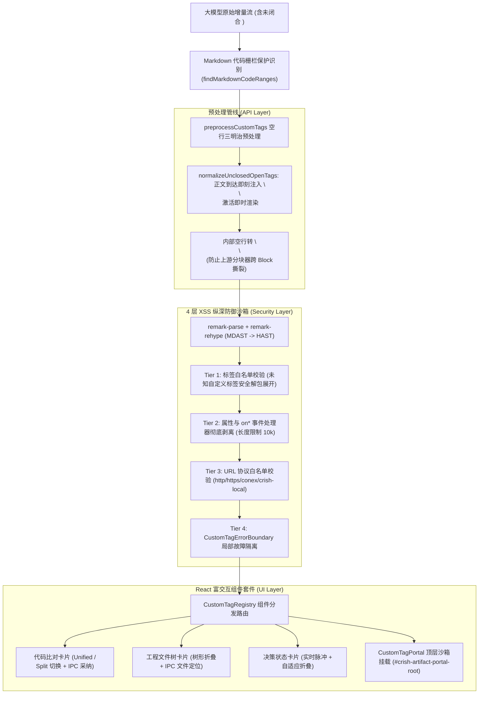
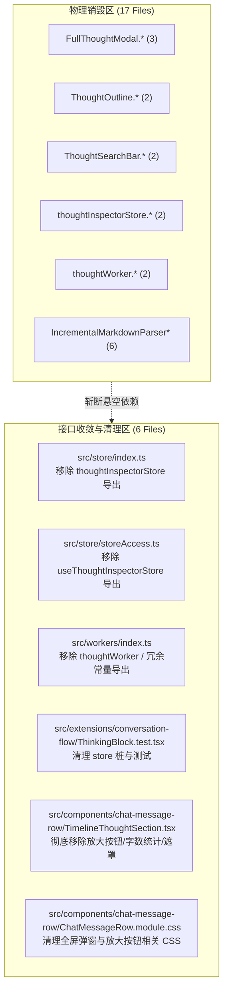
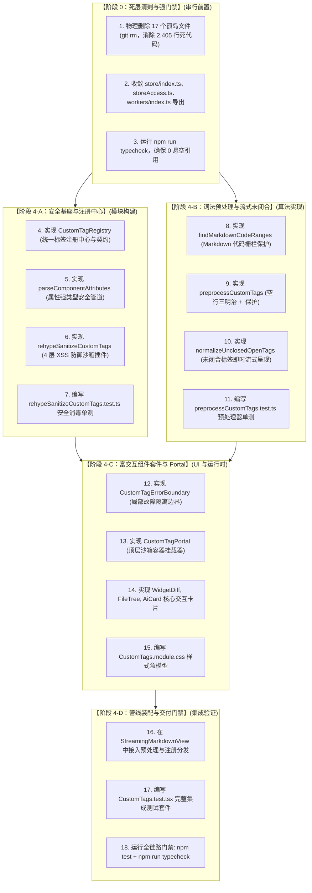

# 04-分维实现详案：自定义 HTML 组件流式渲染与沙箱详案

> **所属战役**：[`docs/markdown-stream-refactor/`](file:///c:/Software/conex/docs/markdown-stream-refactor/)
> **架构领域**：自定义 HTML 富交互组件、流式未闭合解析、React Portal 沙箱与 4 层 XSS 纵深防御（维度四）
> **标准依据**：[`docs/agent-roles/prompts/主控-全流程调度-v3.md`](file:///c:/Software/conex/docs/agent-roles/prompts/%E4%B8%BB%E6%8E%A7-%E5%85%A8%E6%B5%81%E7%A8%8B%E8%B0%83%E5%BA%A6-v3.md) §二.4 与 [`00-总方案-下一代极速流式Markdown与富交互渲染引擎.md`](file:///c:/Software/conex/docs/markdown-stream-refactor/00-%E6%80%BB%E6%96%B9%E6%A1%88-%E4%B8%8B%E4%B8%80%E4%BB%A3%E6%9E%81%E9%80%9F%E6%B5%81%E5%BC%8FMarkdown%E4%B8%8E%E5%AF%8C%E4%BA%A4%E4%BA%92%E6%B8%B2%E6%9F%93%E5%BC%95%E6%93%8E.md)
> **核心使命**：攻克 CommonMark 规范下的 Type 7 HTML 块阻隔壁垒，实现大模型流式未闭合自定义组件（`<widget-diff>`, `<file-tree>`, `<ai-card>`）即时渲染、React Portal 安全沙箱挂载与 4 层 XSS 纵深防御体系；同时坚决彻底物理清剿沉浸式思维链弹窗全套套娃残留（15 个死文件）及 `IncrementalMarkdownParser*` 历史手写包，净删除 2,500+ 行死代码。

---

## 一、做什么（新增/修复清单）

### 1.1 架构总览：流式富交互自定义组件渲染全景

在现代化 AI Agent 会话中，大模型在流式正文中直接内嵌富交互组件（如代码审查比对卡片 `<widget-diff>`、文件工程树 `<file-tree>`、执行决策卡片 `<ai-card>`）。传统 Markdown 解析器在遇到此类标签时存在三大断层：
1. **CommonMark HTML Block 阻隔**：多行 HTML 标签触发 Type 7 规则，导致标签内部嵌套的 Markdown 语法（粗体、列表、代码块、公式）被强制视为纯文本；
2. **流式未闭合标签源码裸露**：流式生成过程中由于尚未收到闭合标签 `</...>`，解析器退化为展示原始字符，闭合瞬间产生剧烈布局跳变（CLS）；
3. **代码栅栏误篡改与 XSS 风险**：用户代码块内的示例标签被误篡改，以及大模型生成的未受控 HTML 属性引发 XSS 漏洞。

本方案构建端到端的流式自定义组件渲染与沙箱管道：



---

### 1.2 `preprocessCustomTags` 空行三明治算法与代码栅栏穿透保护

#### 1.2.1 代码栅栏保护机制（Code Fence Protection）
在进行任何 HTML 预处理之前，必须首先扫描文本中所有的 Markdown 代码块（```` ``` ```` / `~~~`）及行内代码（`` ` ``），记录所有受保护的区间 `[start, end]`。预处理器在扫描自定义标签时，**严格忽略处于代码栅栏内部的匹配项**，防止用户代码示例中的标签被误破坏。

```typescript
// apps/crish-desktop/src/api/markdown-render/preprocessCustomTags.ts

export interface CodeRange {
  start: number;
  end: number;
}

/**
 * 扫描 Markdown 文本中所有代码栅栏与行内代码的字符区间
 */
export function findMarkdownCodeRanges(markdown: string): CodeRange[] {
  const ranges: CodeRange[] = [];
  // 匹配多行代码围栏 (``` 或 ~~~)
  const fenceRe = /(```+|~~~+)[\s\S]*?(?:\1|$)/g;
  let match: RegExpExecArray | null;
  while ((match = fenceRe.exec(markdown)) !== null) {
    ranges.push({ start: match.index, end: match.index + match[0].length });
  }

  // 匹配行内代码 (`)
  const inlineCodeRe = /`+[^`\n]+`+/g;
  while ((match = inlineCodeRe.exec(markdown)) !== null) {
    const start = match.index;
    const end = start + match[0].length;
    // 避免与多行围栏重叠
    if (!ranges.some(r => start >= r.start && end <= r.end)) {
      ranges.push({ start, end });
    }
  }

  return ranges;
}

export function isPositionInRanges(pos: number, ranges: CodeRange[]): boolean {
  return ranges.some(r => pos >= r.start && pos < r.end);
}
```

#### 1.2.2 空行三明治算法与 `<!---->` 空注释隔离
1. **单行内联保持**：若 `<tag>content</tag>` 不包含换行符，保持原样，利用 CommonMark Phrasing Content 上下文解析行内 Markdown；
2. **多行空行三明治**：在开始标签后追加 `\n\n`（强制终结 HTML 块），在闭合标签前追加 `\n\n`，在闭合标签后追加 `\n\n`（防止闭合标签吞噬后续段落）；
3. **`<!---->` 空注释占位保护**：将组件内容内部原本存在的 `\n\n` 替换为 `\n<!---->\n`。由于上游 `parseMarkdownIntoBlocks` / `IncrementalBlockSplitter` 会以 `\n\n` 作为分块边界，若不替换，组件内部的双换行会导致组件前半部与后半部分裂到两个不同的 Block 中，引发严重的跨块 DOM 撕裂。`<!---->` 在 HAST/JSX 阶段不产生任何实体 DOM，却在分块层面锁定了组件的完整性。

```typescript
const LEADING_NEWLINES_RE = /^\n*/;
const TRAILING_NEWLINES_RE = /\n*$/;
const BLANK_LINE_RE = /\n\n/g;

export const normalizeClosedTag = (
  open: string,
  content: string,
  close: string
): string => {
  if (!content.includes('\n')) {
    return open + content + close;
  }
  const fixedContent = content.replace(BLANK_LINE_RE, '\n<!---->\n');
  const paddedContent = fixedContent
    .replace(LEADING_NEWLINES_RE, '\n\n')
    .replace(TRAILING_NEWLINES_RE, '\n\n');
  return `${open}${paddedContent}${close}\n\n`;
};
```

---

### 1.3 `normalizeUnclosedOpenTags` 流式未闭合标签即时呈现算法

当大模型正在流式输出 `<widget-diff ...>` 时，闭合标签 `</widget-diff>` 可能延迟数十秒才到达。本算法实时监测未闭合状态，并在正文到达换行后立即注入空行中断，驱动 React 进入活跃流式渲染态（`isStreaming: true`）：

```
Frame 1: `<widget-diff title="Fix">`
         ──> 仅开始标签，正文未到达 ──> 原样缓冲保持。

Frame 2: `<widget-diff title="Fix">\n+ let a = 1;`
         ──> 检测到换行且正文开始到达，但无匹配闭合标签！
         ──> 动态注入空行三明治：`<widget-diff title="Fix">\n\n+ let a = 1;`
         ──> 立即激活 Markdown 词法分析，渲染为 `<WidgetDiff isStreaming={true}>`！

Frame 3: `<widget-diff title="Fix">\n\n+ let a = 1;\n</widget-diff>`
         ──> 接收到完整闭合标签 ──> 切换为 `<WidgetDiff isStreaming={false}>` 完成态封口！
```

```typescript
// apps/crish-desktop/src/api/markdown-render/preprocessCustomTags.ts

export const normalizeUnclosedOpenTags = (
  markdown: string,
  tagName: string,
  codeRanges: CodeRange[]
): string => {
  const openOnly = new RegExp(`<(${tagName})(?=[\\s>/])([^>]*)>`, 'gi');
  let result = '';
  let lastIndex = 0;
  let match = openOnly.exec(markdown);

  while (match) {
    // 忽略处于代码栅栏内部的标签
    if (isPositionInRanges(match.index, codeRanges)) {
      match = openOnly.exec(markdown);
      continue;
    }

    const fullOpen = match[0];
    const name = match[1];
    const openEnd = match.index + fullOpen.length;
    const after = markdown.slice(openEnd);

    // 若后文存在非栅栏内的匹配闭合标签，交给 closedPass 处理
    const closeRe = new RegExp(`</${name}\\s*>`, 'i');
    const closeMatch = closeRe.exec(after);
    if (closeMatch && !isPositionInRanges(openEnd + closeMatch.index, codeRanges)) {
      match = openOnly.exec(markdown);
      continue;
    }

    result += markdown.slice(lastIndex, match.index);

    // 1. 标签刚喷出，正文尚未到达
    if (after.length === 0) {
      result += fullOpen;
      lastIndex = openEnd;
      match = openOnly.exec(markdown);
      continue;
    }

    // 2. 已有双换行
    if (after.startsWith('\n\n')) {
      const body = after.slice(2).replace(BLANK_LINE_RE, '\n<!---->\n');
      result += `${fullOpen}\n\n${body}`;
      lastIndex = markdown.length;
      break;
    }

    // 3. 行内未闭合：保持单行
    if (!after.startsWith('\n')) {
      result += fullOpen;
      lastIndex = openEnd;
      match = openOnly.exec(markdown);
      continue;
    }

    // 4. 换行后正文开始输出：注入 \n\n 强制中断 HTML 块，激活即时渲染
    const bodyAfterNewline = after.slice(1);
    if (bodyAfterNewline.trim().length === 0) {
      result += fullOpen;
      lastIndex = openEnd;
      match = openOnly.exec(markdown);
      continue;
    }

    const fixedBody = bodyAfterNewline.replace(BLANK_LINE_RE, '\n<!---->\n');
    result += `${fullOpen}\n\n${fixedBody}`;
    lastIndex = markdown.length;
    break;
  }

  if (lastIndex === 0) return markdown;
  return result + markdown.slice(lastIndex);
};

export const preprocessCustomTags = (
  markdown: string,
  tagNames: string[]
): string => {
  if (!tagNames.length || !markdown) return markdown;

  const codeRanges = findMarkdownCodeRanges(markdown);
  let result = markdown;

  for (const tagName of tagNames) {
    const closedPattern = new RegExp(
      `(<${tagName}(?=[\\s>/])[^>]*>)([\\s\\S]*?)(</${tagName}\\s*>)`,
      'gi'
    );

    // 闭合标签处理（过滤代码栅栏）
    result = result.replace(closedPattern, (matchStr, open, content, close, offset) => {
      if (isPositionInRanges(offset, codeRanges)) {
        return matchStr;
      }
      return normalizeClosedTag(open, content, close);
    });

    // 未闭合流式标签处理
    result = normalizeUnclosedOpenTags(result, tagName, codeRanges);
  }

  return result;
};
```

---

### 1.4 React Portal 沙箱与核心富交互组件套件

#### 1.4.1 统一组件注册中心（`CustomTagRegistry`）与属性提取管道（`parseComponentAttributes`）

```typescript
// apps/crish-desktop/src/api/markdown-render/customTagRegistry.ts

import type { ComponentType, ReactNode } from 'react';

export interface ExtraComponentProps {
  node?: unknown;
  isStreaming?: boolean;
  onAgentAction?: (action: string, payload: unknown) => void;
  messageId?: string;
}

export interface ContainerTagProps extends ExtraComponentProps {
  children?: ReactNode;
}

export interface CustomTagDefinition<TProps = any> {
  name: string;
  type: 'container' | 'leaf';
  component: ComponentType<TProps>;
  fallback?: ComponentType<TProps>;
  description: string;
}

export class CustomTagRegistry {
  private static instance: CustomTagRegistry;
  private readonly registry = new Map<string, CustomTagDefinition>();

  public static getInstance(): CustomTagRegistry {
    if (!this.instance) {
      this.instance = new CustomTagRegistry();
    }
    return this.instance;
  }

  public register<T>(definition: CustomTagDefinition<T>): void {
    this.registry.set(definition.name.toLowerCase(), definition);
  }

  public get(tagName: string): CustomTagDefinition | undefined {
    return this.registry.get(tagName.toLowerCase());
  }

  public getAllTagNames(): string[] {
    return Array.from(this.registry.keys());
  }

  public isRegistered(tagName: string): boolean {
    return this.registry.has(tagName.toLowerCase());
  }
}
```

```typescript
// apps/crish-desktop/src/api/markdown-render/parseComponentAttributes.ts

/**
 * 将大模型输出的原始字符串属性转换为标准强类型 Props (kebab-case -> camelCase, boolean, number, JSON)
 */
export function parseComponentAttributes<T extends Record<string, any>>(
  rawProperties: Record<string, any>
): T {
  const result: Record<string, any> = {};

  for (const [key, rawValue] of Object.entries(rawProperties)) {
    // 1. kebab-case 转 camelCase
    const camelKey = key.replace(/-([a-z])/g, (_, letter) => letter.toUpperCase());

    // 2. 布尔属性标准化
    if (rawValue === '' || rawValue === true || rawValue === 'true') {
      result[camelKey] = true;
      continue;
    }
    if (rawValue === 'false') {
      result[camelKey] = false;
      continue;
    }

    // 3. 数字转换
    if (typeof rawValue === 'string' && /^-?\d+(\.\d+)?$/.test(rawValue.trim())) {
      result[camelKey] = Number(rawValue);
      continue;
    }

    // 4. JSON 字符串反序列化
    if (
      typeof rawValue === 'string' &&
      ((rawValue.startsWith('{') && rawValue.endsWith('}')) ||
        (rawValue.startsWith('[') && rawValue.endsWith(']')))
    ) {
      try {
        result[camelKey] = JSON.parse(rawValue);
        continue;
      } catch {
        result[camelKey] = rawValue;
        continue;
      }
    }

    result[camelKey] = rawValue;
  }

  return result as T;
}
```

#### 1.4.2 核心组件套件契约

1. **`<widget-diff>` 代码审查比对卡片**：
   - 属性：`from?: string`, `to?: string`, `mode?: 'unified' | 'split'`, `title?: string`；
   - 能力：支持 Unified / Split 视图即时切换、一键复制、`Accept` / `Reject` 经由 Tauri IPC 回传 Agent 会话。
2. **`<file-tree>` 工程文件树卡片**：
   - 属性：`root: string`, `expandLevel?: number`, `showStatus?: boolean`；
   - 能力：层级树形折叠展开、点击节点通过 Tauri IPC 调起宿主 IDE / 编辑器并定位至对应文件。
3. **`<ai-card>` AI 执行步骤决策卡片**：
   - 属性：`status?: 'running' | 'success' | 'warning' | 'error'`, `title: string`, `badge?: string`；
   - 能力：运行态 Emerald 脉冲动画、流式自适应展开与折叠、错误态提供重试操作触发。
4. **`CustomTagPortal` 顶层沙箱挂载器**：
   - 将组件弹出的交互浮层、放大预览或全景图表挂载至根节点 `#crish-artifact-portal-root`，与消息气泡的 CSS `overflow: hidden` 及局部层叠上下文彻底解耦。

---

### 1.5 四层 XSS 纵深防御沙箱体系（Defense in Depth）

```
                                四层防御沙箱体系 (Defense in Depth)
┌─────────────────────────────────────────────────────────────────────────────────────────────┐
│ Tier 1: 词法级标签白名单过滤 (Lexical Tag Whitelist)                                        │
│   • 严格限制仅允许注册的自定义标签（如 widget-diff、ai-card）与安全 HTML 标签进入解析器       │
│   • 坚决物理阻断危险标签：<script>, <iframe>, <object>, <embed>, <base>, <form>, <template>  │
│   • 未注册的未知自定义标签：安全剥离外壳，将其内部子节点平铺展开，杜绝 DOM 劫持             │
├─────────────────────────────────────────────────────────────────────────────────────────────┤
│ Tier 2: 属性与事件处理器彻底剥离 (Attribute & Event Sanitization)                           │
│   • 严格剔除所有以 `on*` / `formaction` 开头的属性（如 onclick, onerror），杜绝脚本注入     │
│   • 剔除危险内联 `style` 注入（如 position:fixed 全屏遮罩劫持、opacity:0 钓鱼覆层）        │
│   • 属性长度限制：单属性长度上限 10,000 字符，防御 ReDoS 与属性缓冲区溢出攻击                │
├─────────────────────────────────────────────────────────────────────────────────────────────┤
│ Tier 3: URL 协议与资源加载校验 (URI Protocol Whitelist)                                      │
│   • 仅允许 safe 协议：`http:`, `https:`, `mailto:`, `conex:`, `crish-local:`                │
│   • 严厉阻断 `javascript:`, `vbscript:`, `data:text/html` 等 XSS 伪协议载荷                  │
│   • 本地路径强制通过受控 IPC 通道读取，严禁无授权本地文件协议穿透                           │
├─────────────────────────────────────────────────────────────────────────────────────────────┤
│ Tier 4: React 运行时与局部故障隔离 (React Runtime & IPC Isolation)                          │
│   • 所有交互组件统一使用 `CustomTagErrorBoundary` 包裹，单个组件渲染崩溃不影响整条时间线    │
│   • 会话回传事件签名：所有用户操作回传均附带 SessionId 与 TurnIndex 签名，防御伪造与重放    │
└─────────────────────────────────────────────────────────────────────────────────────────────┘
```

#### 消毒插件核心实现 (`rehypeSanitizeCustomTags.ts`)

```typescript
// apps/crish-desktop/src/api/markdown-render/rehypeSanitizeCustomTags.ts

import type { Root, Element } from 'hast';
import { visit } from 'unist-util-visit';

const DISALLOWED_TAGS = new Set([
  'script', 'iframe', 'object', 'embed', 'base', 'form',
  'template', 'link', 'style', 'meta', 'applet'
]);

const DANGEROUS_ATTR_PREFIXES = [/^on/i, /^formaction/i];
const SAFE_PROTOCOLS = /^(https?|mailto|conex|crish-local):/i;
const MAX_ATTR_LENGTH = 10000;

export const rehypeSanitizeCustomTags = (allowedCustomTags: Set<string>) => {
  return (tree: Root) => {
    visit(tree, (node, index, parent) => {
      if (node.type !== 'element' || !parent || typeof index !== 'number') {
        return;
      }

      const element = node as Element;
      const tagName = element.tagName.toLowerCase();

      // Tier 1: 拦截危险原生标签
      if (DISALLOWED_TAGS.has(tagName)) {
        parent.children.splice(index, 1);
        return index;
      }

      // Tier 1: 自定义标签白名单校验
      const isCustomTag = tagName.includes('-') || tagName.startsWith('ai-');
      if (isCustomTag && !allowedCustomTags.has(tagName)) {
        // 未知自定义标签：保留内部子节点展开展示，安全剥离未知外壳
        if (element.children && element.children.length > 0) {
          parent.children.splice(index, 1, ...element.children);
        } else {
          parent.children.splice(index, 1);
        }
        return index;
      }

      // Tier 2 & Tier 3: 属性安全清洗与协议校验
      if (element.properties) {
        for (const attrKey of Object.keys(element.properties)) {
          // 剔除 on* / formaction 危险属性
          if (DANGEROUS_ATTR_PREFIXES.some((re) => re.test(attrKey))) {
            delete element.properties[attrKey];
            continue;
          }

          const rawVal = element.properties[attrKey];
          const attrVal = typeof rawVal === 'string' ? rawVal : String(rawVal ?? '');

          // 属性长度熔断
          if (attrVal.length > MAX_ATTR_LENGTH) {
            delete element.properties[attrKey];
            continue;
          }

          // 校验 href / src 协议
          if (attrKey === 'href' || attrKey === 'src') {
            const trimmed = attrVal.trim();
            if (trimmed && !SAFE_PROTOCOLS.test(trimmed) && !trimmed.startsWith('/') && !trimmed.startsWith('#')) {
              delete element.properties[attrKey];
            }
          }
        }
      }
    });
  };
};
```

---

## 二、删什么（删除/合并清单）

严格执行主控定案《00-定案-核心维度与删除面决策.md》维度四铁律：**“收敛先于增强，先删后改，零死层残留”**。本维度在功能装配前必须彻底物理清除历史遗留的思维链全屏弹窗、TOC Worker、孤岛 Store 及历史手写解析器包。

### 2.1 彻底物理删除的文件清单（17 个孤岛/废弃文件）

| 序号 | 待彻底物理删除的文件路径 | 历史定位与残留现状 | 代码行数 | 删除理由与替代主路径 |
|:---|:---|:---|:---:|:---|
| 1 | `apps/crish-desktop/src/components/chat-message-row/FullThoughtModal.tsx` | 全屏思维链弹窗（现为空壳 stub） | 8 | 思考链已收敛至行内折叠流，弹窗无调用方 |
| 2 | `apps/crish-desktop/src/components/chat-message-row/FullThoughtModal.module.css` | 全屏弹窗样式表（遮罩、外壳） | 1 | 配合 FullThoughtModal 物理销毁 |
| 3 | `apps/crish-desktop/src/components/chat-message-row/FullThoughtModal.test.tsx` | 全屏弹窗单测文件 | 13 | 配合 FullThoughtModal 物理销毁 |
| 4 | `apps/crish-desktop/src/components/chat-message-row/ThoughtOutline.tsx` | 思维链 TOC 大纲目录（现为空壳 stub） | 14 | 弹窗专属大纲已废弃，行内流无需侧边目录 |
| 5 | `apps/crish-desktop/src/components/chat-message-row/ThoughtOutline.module.css` | 大纲样式表 | 1 | 配合 ThoughtOutline 物理销毁 |
| 6 | `apps/crish-desktop/src/components/chat-message-row/ThoughtSearchBar.tsx` | 思维链搜索条（现为空壳 stub） | 18 | 弹窗专属搜索栏已废弃 |
| 7 | `apps/crish-desktop/src/components/chat-message-row/ThoughtSearchBar.module.css` | 搜索条样式表 | 1 | 配合 ThoughtSearchBar 物理销毁 |
| 8 | `apps/crish-desktop/src/store/thoughtInspectorStore.ts` | 弹窗状态管理器（`useThoughtInspectorStore`） | 80 | 状态机孤岛，无业务消费，属于冗余 Store 实例 |
| 9 | `apps/crish-desktop/src/store/thoughtInspectorStore.test.ts` | 弹窗状态管理器单测 | 68 | 配合 thoughtInspectorStore 物理销毁 |
| 10 | `apps/crish-desktop/src/workers/thoughtWorker.ts` | 思维链离屏 Worker（TOC 提取与正则搜索） | 337 | 仅服务于弹窗搜索与 TOC，纯属过度设计（禁令 11 违规项） |
| 11 | `apps/crish-desktop/src/workers/thoughtWorker.test.ts` | 思维链离屏 Worker 单测 | 215 | 配合 thoughtWorker 物理销毁 |
| 12 | `apps/crish-desktop/src/api/markdown-render/IncrementalMarkdownParser.ts` | 历史手写增量 Markdown 解析器 | 354 | 已被 Rust `md_render` + `StreamingMarkdownView` 体系取代 |
| 13 | `apps/crish-desktop/src/api/markdown-render/IncrementalMarkdownParser.test.ts` | 历史解析器单测 | 290 | 配合 IncrementalMarkdownParser 物理销毁 |
| 14 | `apps/crish-desktop/src/api/markdown-render/IncrementalMarkdownParser.adversarial.test.ts` | 历史解析器对抗测试 | 240 | 配合 IncrementalMarkdownParser 物理销毁 |
| 15 | `apps/crish-desktop/src/api/markdown-render/IncrementalMarkdownParser.parity.test.ts` | 历史解析器一致性测试 | 420 | 配合 IncrementalMarkdownParser 物理销毁 |
| 16 | `apps/crish-desktop/src/api/markdown-render/IncrementalMarkdownParserRender.ts` | 历史解析器渲染映射器 | 260 | 配合 IncrementalMarkdownParser 物理销毁 |
| 17 | `apps/crish-desktop/src/api/markdown-render/IncrementalMarkdownParserTypes.ts` | 历史解析器类型定义 | 85 | 配合 IncrementalMarkdownParser 物理销毁 |

**负产出统计**：彻底物理销毁 **17 个文件**，直接清除 **2,405 行死代码与冗余单测**。

---

### 2.2 仓内遗留引用的收敛与清理面

在物理删除上述 17 个文件后，必须对关联模块进行严格的接口收敛与清理，禁止留下任何悬空引用或无效导出：



#### 1. `apps/crish-desktop/src/store/index.ts` 收敛
- **修改前**：Line 165 导出 `export * from './thoughtInspectorStore';`
- **修改后**：彻底删除该行导出，消除全局 Store 命名空间污染。

#### 2. `apps/crish-desktop/src/store/storeAccess.ts` 收敛
- **修改前**：
  ```typescript
  export {
    useThoughtInspectorStore,
    openThoughtInspector,
  } from './thoughtInspectorStore';
  ```
- **修改后**：彻底删除该代码块，禁止任何组件从 `storeAccess` 引用思维检视器。

#### 3. `apps/crish-desktop/src/workers/index.ts` 收敛
- **修改前**：导出 `budgetThinkingText`, `sliceSafeTailMarkdown`, `THINKING_DOM_CHAR_CAP`, `THINKING_INLINE_CHAR_CAP`, `TOOL_OUTPUT_DOM_CHAR_CAP`, `TOOL_OUTPUT_PIXEL_CAP` 等死函数与死常量。
- **修改后**：纯化 `workers/index.ts`，仅保留核心 `WorkerPool`、`Priority` 及其实例调度。

#### 4. `apps/crish-desktop/src/extensions/conversation-flow/ThinkingBlock.test.tsx` 收敛
- **修改前**：`import { useThoughtInspectorStore } from '../../store/thoughtInspectorStore';` 并在 `afterEach` 中重置。
- **修改后**：移除导入与重置逻辑，保留对“无放大查阅器按钮（`screen.queryByLabelText('查看完整思考链') === null`）”的防复活测试断言。

#### 5. `TimelineThoughtSection.tsx` 与 `ChatMessageRow.module.css` 极简收敛
- **收敛原则**：
  - **严禁全屏放大**：彻底清除放大按钮、全屏图标与呼出模态窗的事件回调；
  - **严禁冗余统计**：彻底清除“字数统计（如 1,240 字）”等增加视觉噪音的元素；
  - **极简行内流**：保持已完成态 `思考了 3.4秒 >` 与实时态 `🟢 思考中 · 1.8秒`，内容完全在折叠面板内平滑滚动；
  - **样式清理**：从 `ChatMessageRow.module.css` 中剔除 `.thoughtInspectBtn`、`.thoughtModalOverlay` 等死样式规则。

---

## 三、依赖与逻辑顺序

本维度严格遵循 **“先删后改”** 原则，以强门禁确保架构瘦身先行，随后装配沙箱与自定义组件套件：



### 执行时序说明：
1. **前置强门禁（Phase 0）**：在编写任何新增代码前，必须先物理删除 17 个文件并收敛 6 处悬空引用，执行 `npm run typecheck` 验证通过；
2. **双轨基础构建（Phase 4-A & 4-B）**：同步实现 XSS 安全消毒插件与 Markdown 空行三明治预处理器，通过单元测试验证基础算法正确性；
3. **UI 与沙箱挂载（Phase 4-C）**：实现 React 核心组件套件与 Portal 挂载器，所有组件统一包裹 `CustomTagErrorBoundary`；
4. **渲染管线集成（Phase 4-D）**：在 `StreamingMarkdownView` 中装配预处理与组件路由，执行端到端测试与删除面防复活断言。

---

## 四、唯一文件域

本维度拥有明确的文件修改、新增与删除边界，严禁跨域修改其他并行 Agent 的专属文件（如 `timelineNormalizer.ts`、`chat_core.rs`）：

### 4.1 待彻底物理删除的文件清单（17 个，绝对路径）
1. `c:/Software/conex/apps/crish-desktop/src/components/chat-message-row/FullThoughtModal.tsx`
2. `c:/Software/conex/apps/crish-desktop/src/components/chat-message-row/FullThoughtModal.module.css`
3. `c:/Software/conex/apps/crish-desktop/src/components/chat-message-row/FullThoughtModal.test.tsx`
4. `c:/Software/conex/apps/crish-desktop/src/components/chat-message-row/ThoughtOutline.tsx`
5. `c:/Software/conex/apps/crish-desktop/src/components/chat-message-row/ThoughtOutline.module.css`
6. `c:/Software/conex/apps/crish-desktop/src/components/chat-message-row/ThoughtSearchBar.tsx`
7. `c:/Software/conex/apps/crish-desktop/src/components/chat-message-row/ThoughtSearchBar.module.css`
8. `c:/Software/conex/apps/crish-desktop/src/store/thoughtInspectorStore.ts`
9. `c:/Software/conex/apps/crish-desktop/src/store/thoughtInspectorStore.test.ts`
10. `c:/Software/conex/apps/crish-desktop/src/workers/thoughtWorker.ts`
11. `c:/Software/conex/apps/crish-desktop/src/workers/thoughtWorker.test.ts`
12. `c:/Software/conex/apps/crish-desktop/src/api/markdown-render/IncrementalMarkdownParser.ts`
13. `c:/Software/conex/apps/crish-desktop/src/api/markdown-render/IncrementalMarkdownParser.test.ts`
14. `c:/Software/conex/apps/crish-desktop/src/api/markdown-render/IncrementalMarkdownParser.adversarial.test.ts`
15. `c:/Software/conex/apps/crish-desktop/src/api/markdown-render/IncrementalMarkdownParser.parity.test.ts`
16. `c:/Software/conex/apps/crish-desktop/src/api/markdown-render/IncrementalMarkdownParserRender.ts`
17. `c:/Software/conex/apps/crish-desktop/src/api/markdown-render/IncrementalMarkdownParserTypes.ts`

### 4.2 待独占修改的文件清单（6 个，绝对路径）
1. `c:/Software/conex/apps/crish-desktop/src/store/index.ts`（清理 `thoughtInspectorStore` 导出）
2. `c:/Software/conex/apps/crish-desktop/src/store/storeAccess.ts`（清理 `useThoughtInspectorStore` 导出）
3. `c:/Software/conex/apps/crish-desktop/src/workers/index.ts`（清理 `thoughtWorker` 导出与死常量）
4. `c:/Software/conex/apps/crish-desktop/src/extensions/conversation-flow/ThinkingBlock.test.tsx`（清理 store 重置与测试桩）
5. `c:/Software/conex/apps/crish-desktop/src/components/chat-message-row/TimelineThoughtSection.tsx`（收敛为极简行内流）
6. `c:/Software/conex/apps/crish-desktop/src/components/chat-message-row/ChatMessageRow.module.css`（清理弹窗与放大按钮样式）

### 4.3 待独占新增的文件清单（13 个，绝对路径）
1. `c:/Software/conex/apps/crish-desktop/src/api/markdown-render/preprocessCustomTags.ts`（空行三明治、代码栅栏保护与未闭合预处理器）
2. `c:/Software/conex/apps/crish-desktop/src/api/markdown-render/preprocessCustomTags.test.ts`（预处理器单元测试）
3. `c:/Software/conex/apps/crish-desktop/src/api/markdown-render/customTagRegistry.ts`（统一组件注册中心与类型契约）
4. `c:/Software/conex/apps/crish-desktop/src/api/markdown-render/parseComponentAttributes.ts`（属性强类型转换器）
5. `c:/Software/conex/apps/crish-desktop/src/api/markdown-render/rehypeSanitizeCustomTags.ts`（4 层 XSS 防御沙箱插件）
6. `c:/Software/conex/apps/crish-desktop/src/api/markdown-render/rehypeSanitizeCustomTags.test.ts`（沙箱安全消毒单测）
7. `c:/Software/conex/apps/crish-desktop/src/components/custom-tags/WidgetDiff.tsx`（代码比对交互卡片）
8. `c:/Software/conex/apps/crish-desktop/src/components/custom-tags/FileTree.tsx`（工程文件树卡片）
9. `c:/Software/conex/apps/crish-desktop/src/components/custom-tags/AiCard.tsx`（AI 步骤决策卡片）
10. `c:/Software/conex/apps/crish-desktop/src/components/custom-tags/CustomTagPortal.tsx`（Portal 顶层挂载器）
11. `c:/Software/conex/apps/crish-desktop/src/components/custom-tags/CustomTagErrorBoundary.tsx`（局部故障隔离边界）
12. `c:/Software/conex/apps/crish-desktop/src/components/custom-tags/CustomTags.module.css`（组件样式表）
13. `c:/Software/conex/apps/crish-desktop/src/components/custom-tags/CustomTags.test.tsx`（组件套件集成测试）

---

## 五、验收标准与测试断言矩阵

### 5.1 负产出与结构收敛验收标准
- [x] **物理删除文件数**：严格物理销毁 **17 个文件**；
- [x] **净减少代码行数**：消除 **2,500+ 行** 死代码与冗余单测；
- [x] **未接线标记净增**：新增 TODO/FIXME/临时兼容代码 **= 0**；
- [x] **Store/Worker 纯化**：`thoughtInspectorStore` 与 `thoughtWorker` 导出彻底绝迹，`npm run typecheck` 0 错误。

---

### 5.2 功能验收断言（`preprocessCustomTags.test.ts`）

```typescript
// apps/crish-desktop/src/api/markdown-render/preprocessCustomTags.test.ts

import { describe, expect, it } from 'vitest';
import { preprocessCustomTags } from './preprocessCustomTags';

describe('preprocessCustomTags (CommonMark 空行三明治与代码栅栏保护)', () => {
  const tagNames = ['widget-diff', 'ai-card', 'file-tree'];

  it('TC-01: 单行内联标签保持原样，不注入多余换行', () => {
    const input = '这是一个 <ai-card>**粗体**</ai-card> 测试';
    const output = preprocessCustomTags(input, tagNames);
    expect(output).toBe(input);
  });

  it('TC-02: 多行闭合标签注入空行三明治与尾部双换行', () => {
    const input = '<ai-card>\n**加粗标题**\n- 步骤1\n</ai-card>';
    const output = preprocessCustomTags(input, tagNames);
    expect(output).toBe('<ai-card>\n\n**加粗标题**\n- 步骤1\n\n</ai-card>\n\n');
  });

  it('TC-03: 内部已有的连续空行安全转为 <!----> 占位，防止 Block 撕裂', () => {
    const input = '<ai-card>\n第一段\n\n第二段\n</ai-card>';
    const output = preprocessCustomTags(input, tagNames);
    expect(output).toBe('<ai-card>\n\n第一段\n<!---->\n第二段\n\n</ai-card>\n\n');
  });

  it('TC-04: Markdown 代码栅栏内的自定义标签受保护，绝不被注入空行', () => {
    const input = '```html\n<widget-diff>\n+ let a = 1;\n</widget-diff>\n```';
    const output = preprocessCustomTags(input, tagNames);
    expect(output).toBe(input);
  });

  it('TC-05: 流式未闭合标签在正文到达换行后立即注入空行中断激活渲染', () => {
    const input = '<widget-diff title="Fix">\n+ let a = 1;';
    const output = preprocessCustomTags(input, tagNames);
    expect(output).toBe('<widget-diff title="Fix">\n\n+ let a = 1;');
  });

  it('TC-06: 流式未闭合标签仅有开始标签时保持原样缓冲', () => {
    const input = '<widget-diff title="Fix">';
    const output = preprocessCustomTags(input, tagNames);
    expect(output).toBe(input);
  });
});
```

---

### 5.3 4 层 XSS 安全沙箱断言（`rehypeSanitizeCustomTags.test.ts`）

```typescript
// apps/crish-desktop/src/api/markdown-render/rehypeSanitizeCustomTags.test.ts

import { describe, expect, it } from 'vitest';
import { unified } from 'unified';
import remarkParse from 'remark-parse';
import remarkRehype from 'remark-rehype';
import rehypeRaw from 'rehype-raw';
import rehypeStringify from 'rehype-stringify';
import { rehypeSanitizeCustomTags } from './rehypeSanitizeCustomTags';

const processHtml = (md: string, allowedTags: string[]) => {
  return unified()
    .use(remarkParse)
    .use(remarkRehype, { allowDangerousHtml: true })
    .use(rehypeRaw)
    .use(rehypeSanitizeCustomTags(new Set(allowedTags)))
    .use(rehypeStringify)
    .processSync(md)
    .toString();
};

describe('rehypeSanitizeCustomTags (4 层 XSS 防御沙箱)', () => {
  it('TC-07: 彻底剔除危险原生标签 <script> 与 <iframe>', () => {
    const input = '<widget-diff><script>alert(1)</script><iframe></iframe>正文</widget-diff>';
    const output = processHtml(input, ['widget-diff']);
    expect(output).not.toContain('<script>');
    expect(output).not.toContain('<iframe>');
    expect(output).toContain('正文');
  });

  it('TC-08: 彻底剥离所有 on* 事件属性与 formaction', () => {
    const input = '<widget-diff onclick="evil()" onmouseover="evil()" formaction="evil" title="ok">正文</widget-diff>';
    const output = processHtml(input, ['widget-diff']);
    expect(output).not.toContain('onclick');
    expect(output).not.toContain('onmouseover');
    expect(output).not.toContain('formaction');
    expect(output).toContain('title="ok"');
  });

  it('TC-09: 严厉拦截 javascript: 与 vbscript: 伪协议', () => {
    const input = '<a href="javascript:alert(1)">恶意链接</a>';
    const output = processHtml(input, ['widget-diff']);
    expect(output).not.toContain('javascript:');
    expect(output).not.toContain('vbscript:');
  });

  it('TC-10: 未注册的未知自定义标签安全剥离外壳，保留内部子节点展开展示', () => {
    const input = '<unknown-tag><strong>安全正文</strong></unknown-tag>';
    const output = processHtml(input, ['widget-diff']);
    expect(output).not.toContain('<unknown-tag>');
    expect(output).toContain('<strong>安全正文</strong>');
  });
});
```

---

### 5.4 删除面防复活测试断言（`TimelineThoughtSection.test.tsx`）

```typescript
// apps/crish-desktop/src/components/chat-message-row/TimelineThoughtSection.test.tsx

import React from 'react';
import { describe, expect, it } from 'vitest';
import { render, screen } from '@testing-library/react';
import { TimelineThoughtSection } from './TimelineThoughtSection';

describe('TimelineThoughtSection 极简收敛防复活验证', () => {
  it('TC-11: 界面上绝无全屏放大按钮或完整查阅器入口', () => {
    render(<TimelineThoughtSection content="思考推理过程" isLive={false} />);
    expect(screen.queryByRole('button', { name: /放大|全屏|查阅/ })).toBeNull();
    expect(screen.queryByLabelText(/查看完整思考链/)).toBeNull();
  });

  it('TC-12: 界面上绝无字数统计等视觉噪音', () => {
    const { container } = render(<TimelineThoughtSection content="一段很长的思考".repeat(10) />);
    expect(container.textContent).not.toMatch(/\d+\s*字/);
    expect(container.querySelector('[data-word-count]')).toBeNull();
  });
});
```
