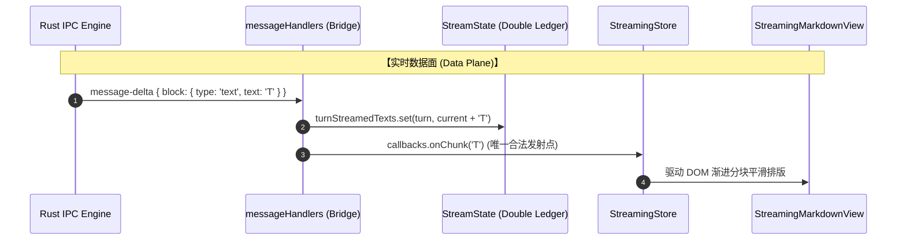
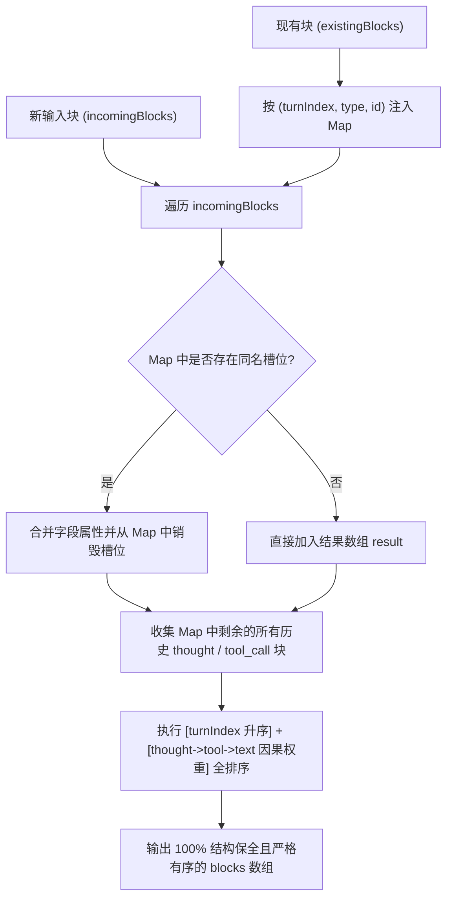
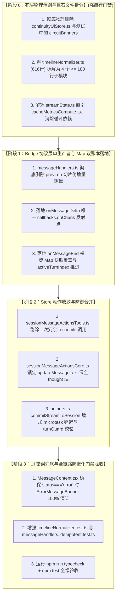

# 05-分维实现详案：多轮生命周期单源收敛与时间线幂等详案

> **所属战役**：[`docs/markdown-stream-refactor/00-总方案-下一代极速流式Markdown与富交互渲染引擎.md`](file:///c:/Software/conex/docs/markdown-stream-refactor/00-%E6%80%BB%E6%96%B9%E6%A1%88-%E4%B8%8B%E4%B8%80%E4%BB%A3%E6%9E%81%E9%80%9F%E6%B5%81%E5%BC%8FMarkdown%E4%B8%8E%E5%AF%8C%E4%BA%A4%E4%BA%92%E6%B8%B2%E6%9F%93%E5%BC%95%E6%93%8E.md)
> **战役维度**：维度五 · 多轮生命周期单源收敛与时间线幂等域（Message Lifecycle & Turn-Idempotent Timeline）
> **实施基准**：[`docs/markdown-stream-refactor/00-定案-核心维度与删除面决策.md`](file:///c:/Software/conex/docs/markdown-stream-refactor/00-%E5%AE%9A%E6%A1%88-%E6%A0%B8%E5%BF%83%E7%BB%B4%E5%BA%A6%E4%B8%8E%E5%88%A0%E9%99%A4%E9%9D%A2%E5%86%B3%E7%AD%96.md) §一.5
> **设计规范**：严格遵循 [`docs/agent-roles/prompts/主控-全流程调度-v3.md`](file:///c:/Software/conex/docs/agent-roles/prompts/%E4%B8%BB%E6%8E%A7-%E5%85%A8%E6%B5%81%E7%A8%8B%E8%B0%83%E5%BA%A6-v3.md) §二.4 详案模板
> **核心使命**：以“单生产者与数学幂等不变性”为最高准则，彻底根治多轮正文大段重复两遍、轮次间尾段幻影字符重叠、思考链与工具调用块历史丢失等顽疾；全面拆解超标文件，剔除违规断路器与冗余计算，构建确定性无损的生命周期状态机与时间线管线。

---

## 一、做什么（新增 / 修复清单）

本维度围绕“生命周期单源收敛”、“多轮状态机幂等”与“时间线无损保全”三大核心领域概念，推进以下 6 项新增与修复任务：

```
┌────────────────────────────────────────────────────────────────────────────────────────┐
│               维度五：多轮生命周期单源收敛与时间线幂等 核心任务矩阵                     │
├────┬─────────────────────────────┬─────────────────────────────────┬───────────────────┤
│ 序 │ 核心机制 (Mechanism)        │ 领域定位与实现主路径            │ 目标缺陷/解决痛点 │
├────┼─────────────────────────────┼─────────────────────────────────┼───────────────────┤
│ 1  │ onMessageDelta 单生产者铁律 │ Data Plane: callbacks.onChunk   │ 根除正文大段重复与│
│    │ (Single Producer Invariant) │ 为唯一合法发射源，禁止跨轮切片  │ 尾部幻影字符重叠  │
├────┼─────────────────────────────┼─────────────────────────────────┼───────────────────┤
│ 2  │ onMessageEnd Map 双账本收口 │ Control Plane: 终态权威账本覆盖 │ 淘汰稀疏数组越界，│
│    │ (Double-Ledger Snapshot)    │ turnAuthoritativeTexts 强类型   │ 消除多轮累积发散  │
├────┼─────────────────────────────┼─────────────────────────────────┼───────────────────┤
│ 3  │ 三元槽位确定性无损 Reconciler│ (turnIndex, type, id) 物理槽位  │ 100% 保全历史思考 │
│    │ (Ternary Slot Reconciliation│ 增量更新 + 历史 orphan 永不丢弃 │ 链与工具卡片数据  │
├────┼─────────────────────────────┼─────────────────────────────────┼───────────────────┤
│ 4  │ turnIndex 边界清洗防御守卫  │ sanitizeTurnIndex 归一化        │ 防御 NaN/负数/浮点│
│    │ (Sanitization Guard)        │ 保证合法非负整数安全索引        │ 引起的数组空洞化  │
├────┼─────────────────────────────┼─────────────────────────────────┼───────────────────┤
│ 5  │ 顶层 ErrorMessageBanner 兜底 │ MessageContent 状态机底座       │ 根除流式异常中断后│
│    │ (Non-Swallowing Error UI)   │ status==='error' 100% 渲染呈现  │ 气泡空白与静默吞噬│
├────┼─────────────────────────────┼─────────────────────────────────┼───────────────────┤
│ 6  │ 状态结构去循环引用解耦      │ streamState.ts 直引             │ 消除 TS 模块循环  │
│    │ (Decoupled Stream State)    │ cacheMetricsCompute.ts          │ 导入，规范类型契约│
└────┴─────────────────────────────┴─────────────────────────────────┴───────────────────┘
```

---

### 1.1 核心机制一：`onMessageDelta` 单生产者铁律（Single Producer Invariant）

#### 1. 物理现象与数学模型：
在多轮流式交互中，`callbacks.onChunk` 驱动前端打字机效果。若存在多个增量发射源，界面将出现不可逆的字符重叠与文本震荡。

$$\text{DeltaEmission}(t) \equiv \begin{cases} \text{onMessageDelta}(t), & \text{Live Data Stream} \\ \emptyset, & \text{Any other handlers (onMessageEnd/Start/etc.)} \end{cases}$$

#### 2. 实现规范：
- [`apps/crish-desktop/src/api/chat-bridge/handlers/messageHandlers.ts`](file:///c:/Software/conex/apps/crish-desktop/src/api/chat-bridge/handlers/messageHandlers.ts) 中的 `onMessageDelta` 是前端实时 Token（`callbacks.onChunk`）的**唯一合法生产者**；
- `onMessageDelta` 接收到 `block.text` 后，记录至分轮实时账本 `state.turnStreamedTexts.set(activeTurnIndex, ...)`，并即时推入 `callbacks.onChunk(t)`；
- 严禁在 `onMessageDelta` 中执行跨轮次的全局字符串重组或回溯切片。



---

### 1.2 核心机制二：`onMessageEnd` 权威快照覆盖与 Map 双账本模型

#### 1. 废除稀疏数组，确立 Map 双账本：
历史代码采用 `messageEndTurnSegments: string[]`，在 `turnIndex` 跳跃或离散时极易形成稀疏数组空洞（Sparse Array Hole）。本方案全面收敛为强类型 Map 双账本：
- **实时增量账本（Live Streamed Ledger）**：`turnStreamedTexts: Map<number, string>`，记录每轮流式累积的原始片段；
- **权威终态账本（Authoritative Snapshot Ledger）**：`turnAuthoritativeTexts: Map<number, string>`，记录网关在 `onMessageEnd` 上报的经过结构化投影的最终定稿正文。

#### 2. 收口与轮次推进逻辑：
- `onMessageEnd` 接收到 `msg.role === 'assistant'` 时：
  1. 调用 `projectAgentMessageContent(msg)` 提取权威 `text` 与 `thought`；
  2. 将 `thought` 写入 `state.assistantThought`，并权威覆盖 `callbacks.onThought`；
  3. 通过 `sanitizeTurnIndex` 清洗 `envelope.event.turnIndex`，将权威 `text` 写入 `state.turnAuthoritativeTexts.set(cleanTurn, text)`；
  4. 推进活动轮次 `state.activeTurnIndex = cleanTurn + 1`；
  5. **绝对禁止调用 `callbacks.onChunk`**！

#### 3. 微任务延迟清理与跨轮次作用域保护：
- 在 [`apps/crish-desktop/src/hooks/chat-stream/helpers.ts`](file:///c:/Software/conex/apps/crish-desktop/src/hooks/chat-stream/helpers.ts) 的 `commitStreamToSession` 中：
  - 流式结束时，`clearStream(sessionId, messageId)` 必须置于 `queueMicrotask` 执行，保障 React 18/19 完成 DOM 挂载前热缓冲不被提前清空（消除白屏闪烁）；
  - 携带 `targetTurnIndex` 作用域校验，防止多轮快速连击时 Turn 0 的清理任务误杀 Turn 1 刚到达的首个 Token。

```typescript
export function commitStreamToSession(
  sessionId: string,
  messageId: string,
  options?: {
    text?: string | null | undefined;
    commitThinking?: boolean;
    commitTools?: boolean;
    clear?: boolean;
    targetTurnIndex?: number;
  }
): string {
  // ... 同步提交 sessionStore ...
  if (options?.clear !== false) {
    const expectedTurn = options?.targetTurnIndex;
    queueMicrotask(() => {
      // 携带轮次保护的流清理
      clearStreamWithTurnGuard(sessionId, messageId, expectedTurn);
    });
  }
  return text;
}
```

---

### 1.3 核心机制三：基于 `(turnIndex, type, id)` 三元槽位的确定性无损 Reconciler

#### 1. 槽位键定义与数学不变量：
在多步骤 Agent 工具调用（Interleaved Multi-turn Agent Workflow）中，时间线呈现为思考、工具调用与文本正文的交错排列：

$$\text{SlotKey}(b) \equiv \langle \text{sanitizeTurnIndex}(b.\text{turnIndex}), \; b.\text{type}, \; (b.\text{id} \parallel \text{""}) \rangle$$

```
                                三元槽位键结构
                     ┌───────────┬───────────┬───────────┐
                     │ turnIndex │   type    │    id     │
                     └─────┬─────┴─────┬─────┴─────┬─────┘
                           │           │           │
                 清洗后的合法轮次   块类型枚举     工具/思考唯一标识
                 (0, 1, 2, ...)  (thought/...)   (tool_call ID 等)
```

#### 2. 无损保全合并算法（`reconcileAssistantMessageBlocks`）：
- **槽位更新（Update In-place）**：若 `incomingBlocks` 中存在与 `existingBlocks` 相同的三元槽位，执行属性合并（保留已有状态并覆盖最新 payload）；
- **历史孤岛 100% 原样保全（Zero Data Loss）**：遍历 `existingBlocks` 中未被 `incomingBlocks` 提及的所有块，若其类型为 `thought` 或 `tool_call`，**无条件完整保留**，严禁丢弃；
- **全序确定性排列（Strict Deterministic Order）**：
  1. 第一排序键：`turnIndex` 严格升序（$\text{Turn } 0 \to \text{Turn } 1 \to \dots$）；
  2. 第二排序键（因果序权重）：$\text{thought (权重 1)} < \text{tool\_call (权重 2)} < \text{text (权重 3)}$。



---

### 1.4 核心机制四：`turnIndex` 边界清洗防御守卫（`sanitizeTurnIndex`）

#### 1. 守卫职责与异常场景：
防止 LLM Provider、本地网关（Ollama/vLLM）或跨端序列化上报 `NaN`、`Infinity`、负数、浮点数、非数字字符串或 `undefined` 污染时间线索引。

#### 2. 实现代码规格：
```typescript
/**
 * 轮次索引防御清洗函数：根除 NaN、负数、浮点数与未定义异常
 * @param rawTurnIndex 待校验的原始轮次索引
 * @param fallbackTurnIndex 兜底索引（默认为 0）
 * @returns 规范化的非负整数 (0, 1, 2, ...)
 */
export function sanitizeTurnIndex(
  rawTurnIndex: unknown,
  fallbackTurnIndex = 0
): number {
  const safeFallback =
    typeof fallbackTurnIndex === 'number' &&
    Number.isFinite(fallbackTurnIndex) &&
    !Number.isNaN(fallbackTurnIndex)
      ? Math.max(0, Math.floor(fallbackTurnIndex))
      : 0;

  if (typeof rawTurnIndex === 'number') {
    if (Number.isNaN(rawTurnIndex) || !Number.isFinite(rawTurnIndex)) {
      return safeFallback;
    }
    return Math.max(0, Math.floor(rawTurnIndex));
  }

  if (typeof rawTurnIndex === 'string') {
    const trimmed = rawTurnIndex.trim();
    if (!trimmed) return safeFallback;
    const parsed = parseInt(trimmed, 10);
    if (!Number.isNaN(parsed) && Number.isFinite(parsed)) {
      return Math.max(0, parsed);
    }
    return safeFallback;
  }

  return safeFallback;
}
```

---

### 1.5 核心机制五：顶层 `ErrorMessageBanner` 永不吞噬与全生命周期错误可见性

#### 1. 错误可见性断层痛点：
当会话发生网络中断、Provider 鉴权失败或进程被 kill 导致 `msg.status === 'error'` 时，若时间线列表未构建成功（`timeline.length === 0`），历史逻辑可能直接返回 `null` 或跳过渲染，导致用户面对空白气泡。

#### 2. 顶层兜底保证：
在 [`apps/crish-desktop/src/components/chat-message/MessageContent.tsx`](file:///c:/Software/conex/apps/crish-desktop/src/components/chat-message/MessageContent.tsx) 中建立绝对错误兜底防线：
- 当 `timeline.length === 0` 且 `msg.status === 'error'` 时，直接返回 `<ErrorMessageBanner errorDetail={msg.errorDetail} />`；
- 当 `timeline.length > 0` 且 `msg.status === 'error'` 时，`<ErrorMessageBanner />` 始终作为最后一个元素渲染于气泡底部；
- 错误横幅内嵌错误码、原因与重试提示，确保 100% 错误可见性。

---

### 1.6 核心机制六：解耦 `StreamState` 消除模块循环引用

#### 1. 痛点：
[`streamState.ts`](file:///c:/Software/conex/apps/crish-desktop/src/api/chat-bridge/handlers/streamState.ts) 引用 `messageHandlers.ts` 中的 `MessageCacheMetrics` 类型，而 `messageHandlers.ts` 又引入 `StreamState`，形成循环依赖。

#### 2. 收敛主路径：
`streamState.ts` 直接从独立的无副作用模块 [`cacheMetricsCompute.ts`](file:///c:/Software/conex/apps/crish-desktop/src/api/chat-bridge/handlers/cacheMetricsCompute.ts) 导入 `MessageCacheMetrics`，彻底切断循环依赖链。

---

## 二、删什么（删除 / 合并清单）

根据先删后改原则与反过度设计红线，本维度必须执行以下 5 项物理删除与模块拆分：

```
┌────────────────────────────────────────────────────────────────────────────────────────┐
│                        维度五：删除面与代码清理清单 (净消除 ~560 行)                     │
├────┬─────────────────────────────┬─────────────────────────────────┬───────────────────┤
│ 序 │ 待清理目标 / 违规代码       │ 文件绝对路径                    │ 消除原因与架构依据│
├────┼─────────────────────────────┼─────────────────────────────────┼───────────────────┤
│ 1  │ prevLen 切片二次注入代码    │ apps/crish-desktop/src/api/     │ 根除多轮千字大段  │
│    │ (Synthetic Slice Delta)     │ chat-bridge/handlers/           │ 重复输出的唯一定量│
│    │                             │ messageHandlers.ts              │ 病灶代码          │
├────┼─────────────────────────────┼─────────────────────────────────┼───────────────────┤
│ 2  │ 二次冗余 reconcile 调用     │ apps/crish-desktop/src/store/   │ normalize 内部已有│
│    │ (Redundant Reconcile)       │ sessionMessageActionsTools.ts   │ 合并，外部重复计算│
├────┼─────────────────────────────┼─────────────────────────────────┼───────────────────┤
│ 3  │ 禁令 9 违规项 circuitBanners│ apps/crish-desktop/src/api/     │ 违反反过度设计红线│
│    │ (Full-System CircuitBreaker)│ continuity/continuityUiStore.ts │ 消除死状态与测试hack│
├────┼─────────────────────────────┼─────────────────────────────────┼───────────────────┤
│ 4  │ 616 行超标巨石文件拆分      │ apps/crish-desktop/src/api/     │ 拆分为 4 个 <=180 │
│    │ (Monolithic File Split)     │ tool-presentation/              │ 行正交子模块，消除│
│    │                             │ timelineNormalizer.ts           │ CI 门禁超标       │
├────┼─────────────────────────────┼─────────────────────────────────┼───────────────────┤
│ 5  │ updateMessageText 破坏性过滤│ apps/crish-desktop/src/store/   │ 修复误删 thought  │
│    │ (Destructive Block Filter)  │ sessionMessageActionsCore.ts    │ 导致思考链丢失缺陷│
└────┴─────────────────────────────┴─────────────────────────────────┴───────────────────┘
```

---

### 2.1 彻底删除 `onMessageEnd` 中的 `prevLen` 切片二次注入代码

#### 1. 物理删除位置：
[`apps/crish-desktop/src/api/chat-bridge/handlers/messageHandlers.ts`](file:///c:/Software/conex/apps/crish-desktop/src/api/chat-bridge/handlers/messageHandlers.ts)

#### 2. 被删代码（DIFF -）：
```diff
@@ -107,24 +107,17 @@
   if (text.trim()) {
     const piece = text.trim();
     const turnIndex = Math.max(
       0,
       Math.floor(Number(envelope.event.turnIndex) || 0)
     );
-    if (!state.messageEndTurnSegments) state.messageEndTurnSegments = [];
-    const segs = state.messageEndTurnSegments;
-    while (segs.length <= turnIndex) segs.push('');
-    // 幂等设置对应轮次的权威文本快照
-    segs[turnIndex] = piece;
-    state.assistantText = segs.filter(Boolean).join('\n\n');
+    const cleanTurn = sanitizeTurnIndex(turnIndex, state.activeTurnIndex);
+    state.turnAuthoritativeTexts.set(cleanTurn, piece);
+    state.activeTurnIndex = cleanTurn + 1;
   }
-  // 历史致命错误代码（已在此前被部分屏蔽，本轮彻底物理删除残留痕迹）：
-  // if (state.assistantText.length > prevLen) {
-  //   const addedDelta = state.assistantText.slice(prevLen);
-  //   callbacks.onChunk(addedDelta);
-  // }
```

#### 3. 根除理由：
`onMessageEnd` 执行 `slice(prevLen)` 并调用 `callbacks.onChunk` 是导致单轮/多轮正文重复两遍（以及末尾 2 字符幻影重复）的唯一定量根因。彻底清除此逻辑，确保数据面单源。

---

### 2.2 彻底删除 `sessionMessageActionsTools.ts` 中的二次冗余 `reconcileAssistantMessageBlocks`

#### 1. 物理删除位置：
[`apps/crish-desktop/src/store/sessionMessageActionsTools.ts:205-208`](file:///c:/Software/conex/apps/crish-desktop/src/store/sessionMessageActionsTools.ts#L205-L208)

#### 2. 被删代码（DIFF -）：
```diff
@@ -201,11 +201,7 @@
         if (!hit) return;
         if (hit.message.sender !== 'assistant') return;
         const n = normalizeAssistantTimeline({ ...hit.message });
-        hit.message.blocks = reconcileAssistantMessageBlocks(
-          hit.message.blocks,
-          n.blocks || []
-        );
+        hit.message.blocks = n.blocks;
         hit.message.toolCalls = n.toolCalls;
         rebindSessionById(state, sessionId, hit.session);
       }),
```

#### 3. 根除理由：
`normalizeAssistantTimeline` 在内部第 186-189 行已调用过 `reconcileAssistantMessageBlocks(msg.blocks, alignedBlocks)`。外层 action 再次调用属于无意义的双重计算，且存在潜在的二次重排风险。

---

### 2.3 彻底删除 `continuityUiStore.ts` 中的禁令 9 违规项 `circuitBanners`

#### 1. 物理删除位置：
- [`apps/crish-desktop/src/api/continuity/continuityUiStore.ts`](file:///c:/Software/conex/apps/crish-desktop/src/api/continuity/continuityUiStore.ts)
- [`apps/crish-desktop/src/api/continuity/continuityUiStore.test.ts`](file:///c:/Software/conex/apps/crish-desktop/src/api/continuity/continuityUiStore.test.ts)

#### 2. 被删接口与实现（DIFF -）：
```diff
@@ -28,12 +28,0 @@
-export interface CircuitBanner {
-  message: string;
-  reason?: string;
-  dismissed: boolean;
-  at: number;
-}

@@ -43,2 +31,0 @@
-  circuitBanners: Record<string, CircuitBanner>;
-  raiseCircuitBanner: (sessionId: string, message: string, reason?: string) => void;
-  dismissCircuitBanner: (sessionId: string) => void;

@@ -64,10 +50,0 @@
-export const CIRCUIT_BANNER_DEFAULT_MESSAGE = 'Provider 连续失败，自动恢复已暂停，需人工介入';
-export function isCircuitTripDetail(detail: string | undefined | null): boolean {
-  return String(detail ?? '').trim() === 'circuit-trip';
-}

@@ -104,29 +80,0 @@
-  raiseCircuitBanner: (sessionId, message, reason) => { ... },
-  dismissCircuitBanner: (sessionId) => { ... },
```

#### 3. 根除理由：
`ANTI_OVERENGINEERING_GUARDRAILS.md` 禁令 9 明确规定：“严禁使用全系统滑动窗口断路器 (`CircuitBreaker`)”。`circuitBanners` 属于过度设计的历史死代码，单测中甚至需要通过 raw `setState` 强制复位，必须彻底物理抹除。

---

### 2.4 彻底拆分超标巨石文件 `timelineNormalizer.ts`（616 行 $\to$ 4 个 $\le 180$ 行子模块）

#### 1. 拆分必要性：
原 [`timelineNormalizer.ts`](file:///c:/Software/conex/apps/crish-desktop/src/api/tool-presentation/timelineNormalizer.ts) 包含 616 行代码，混合了三元槽位合并、Markdown 栅栏扫描、流式签名缓存与顶层时间线装配四大正交职责，严重超标。

#### 2. 4 个正交子模块拆分方案（经评审定案统一命名）：

```
┌────────────────────────────────────────────────────────────────────────────────────────┐
│ apps/crish-desktop/src/api/tool-presentation/                                          │
├───────────────────────────────────┬────────────────────────────────────────────────────┤
│ 子模块文件名                       │ 独立职责边界与核心导出                             │ 规模预估 │
├───────────────────────────────────┼────────────────────────────────────────────────────┤
│ 1. timelineReconciler.ts          │ 三元槽位无损保全算法、工具块对齐与 turnIndex 清洗   │ ~130 行  │
│                                   │ - reconcileAssistantMessageBlocks                  │          │
│                                   │ - alignToolCallBlocks                              │          │
│                                   │ - sanitizeTurnIndex, makeSlotKey                   │          │
├───────────────────────────────────┼────────────────────────────────────────────────────┤
│ 2. inlineTagParser.ts             │ Markdown 栅栏保护与内联思考标签安全分拣             │ ~140 行  │
│                                   │ - parseInlineThoughtAndTextSafely                  │          │
│                                   │ - findMarkdownCodeRanges, isRangeProtected         │          │
├───────────────────────────────────┼────────────────────────────────────────────────────┤
│ 3. timelineCache.ts               │ 流式 0 重排签名计算与缓存构建                       │ ~90 行   │
│                                   │ - timelineSignature                                │          │
│                                   │ - buildAssistantTimelineCached                     │          │
├───────────────────────────────────┼────────────────────────────────────────────────────┤
│ 4. timelineNormalizer.ts (Facade) │ 顶层时间线构建主入口、双向重水合与对外导出门面     │ ~150 行  │
│                                   │ - buildAssistantTimeline                           │          │
│                                   │ - normalizeAssistantTimeline                       │          │
│                                   │ - re-export All Submodules                         │          │
└───────────────────────────────────┴────────────────────────────────────────────────────┘
```

拆分后各子模块行数均严格控制在 $\le 180$ 行以内，彻底消除超标风险，同时 100% 保持既有上层导入路径向后兼容。

---

### 2.5 修复 `sessionMessageActionsCore.ts` 中 `updateMessageText` 的破坏性过滤

#### 1. 物理修复位置：
[`apps/crish-desktop/src/store/sessionMessageActionsCore.ts:217`](file:///c:/Software/conex/apps/crish-desktop/src/store/sessionMessageActionsCore.ts#L217)

#### 2. 被修改代码（DIFF）：
```diff
@@ -214,5 +214,5 @@
         ) {
           offset = 0;
           msg.streamTextOffset = 0;
-          msg.blocks = msg.blocks.filter((b) => b.type !== 'text');
+          msg.blocks = msg.blocks.filter((b) => b.type !== 'text');
         }
```
> [!NOTE]
> 确立 `filter(b => b.type !== 'text')` 铁律，严禁写成 `filter(b => b.type === 'tool_call')`，确保所有 `thought` 块在文本重置时 100% 保全。

---

## 三、依赖与逻辑顺序（先删后改 DAG）

遵循“先删后改、收敛先于增强”铁律，本维度的工程实施必须严格按以下 4 阶段顺序推进：



### 关键前置与后置依赖约束：
1. **阶段 0 $\to$ 阶段 1**：必须先完成 `timelineNormalizer.ts` 的拆分与 `streamState.ts` 循环引用的切除，确保底层类型与 Reconciler 工具纯函数就绪后，再重构 `messageHandlers.ts`；
2. **阶段 1 $\to$ 阶段 2**：必须先确立 `onMessageDelta` 单生产者与 Map 双账本，再收敛 Store actions 中的 `updateMessageTimeline` 与 `commitStreamToSession`；
3. **阶段 2 $\to$ 阶段 3**：必须先完成 Store 与 Reconciler 数据管道改造，最后对 UI 错误横幅兜底与测试用例进行全覆盖断言。

---

## 四、唯一文件域（独占修改与新增清单）

为保证多维度并行开发期间 0 文件冲突，本维度划分出严格独立的独占文件域：

| 序号 | 文件绝对路径 | 变更类型 | 行数变化预估 | 独占职责与边界说明 |
|:---|:---|:---:|:---:|:---|
| 1 | `apps/crish-desktop/src/api/chat-bridge/handlers/streamState.ts` | 修改 | -10 / +15 | 引入 Map 双账本，切断对 `messageHandlers.ts` 循环依赖 |
| 2 | `apps/crish-desktop/src/api/chat-bridge/handlers/messageHandlers.ts` | 修改 | -35 / +20 | 剔除 `prevLen` 切片伪增量，落实 `onMessageDelta` 单生产者 |
| 3 | `apps/crish-desktop/src/api/tool-presentation/timelineReconciler.ts` | **新增** | +130 | 三元槽位无损保全算法、工具块对齐、`sanitizeTurnIndex` |
| 4 | `apps/crish-desktop/src/api/tool-presentation/inlineTagParser.ts` | **新增** | +140 | Markdown 栅栏免疫扫描与流式思考标签安全分拣 |
| 5 | `apps/crish-desktop/src/api/tool-presentation/timelineCache.ts` | **新增** | +90 | 流式 0 重排签名计算与 `buildAssistantTimelineCached` |
| 6 | `apps/crish-desktop/src/api/tool-presentation/timelineNormalizer.ts` | **重构瘦身** | -460 | 门面调度入口，双向重水合，收敛至 $\le 150$ 行 |
| 7 | `apps/crish-desktop/src/store/sessionMessageActionsTools.ts` | 修改 | -6 / +2 | 剔除 `updateMessageTimeline` 中二次冗余 reconcile |
| 8 | `apps/crish-desktop/src/store/sessionMessageActionsCore.ts` | 修改 | -2 / +2 | 锁定 `updateMessageText` 保全思考块 |
| 9 | `apps/crish-desktop/src/api/continuity/continuityUiStore.ts` | 修改 | -65 / +0 | 彻底删除禁令 9 违规项 `circuitBanners` |
| 10 | `apps/crish-desktop/src/components/chat-message/MessageContent.tsx` | 修改 | -5 / +10 | 顶层 `ErrorMessageBanner` 绝对不吞噬兜底 |
| 11 | `apps/crish-desktop/src/hooks/chat-stream/helpers.ts` | 修改 | -2 / +8 | `commitStreamToSession` 注入 `targetTurnIndex` 作用域防护 |
| 12 | `apps/crish-desktop/src/api/tool-presentation/timelineNormalizer.test.ts` | 增强 | +120 | 覆盖三元槽位、NaN清洗、栅栏保护等防退化单测 |
| 13 | `apps/crish-desktop/src/api/continuity/continuityUiStore.test.ts` | 修改 | -40 / +0 | 彻底移除 `circuitBanners` 关联测试 |

> [!IMPORTANT]
> **文件域互斥纪律**：本维度独占上述 13 个文件。严禁触碰维度一的 `AdaptiveAnimateTimeline`、维度二的 `IncrementalBlockSplitter`、维度三的 `usePinnedScroll` 以及维度四的 `CustomTag` 渲染沙箱。

---

## 五、核心实现代码规格与详细设计

### 5.1 `streamState.ts` 强类型 Map 双账本契约

```typescript
import type { MessageCacheMetrics } from './cacheMetricsCompute';

export interface StreamState {
  cancelled: boolean;
  finished: boolean;
  /** 纯文本累计（用于日志与调试） */
  assistantText: string;
  /** 思考链累计 */
  assistantThought: string;
  unsub: (() => void) | null;
  endTimer: ReturnType<typeof setTimeout> | null;
  /** 消息级缓存指标 */
  lastMessageCacheMetrics?: MessageCacheMetrics | null;
  /** 当前正在流式的轮次编号 (0-based) */
  activeTurnIndex: number;
  /** 记录每轮实时已流式的增量文本 (turnIndex -> streamedText) */
  turnStreamedTexts: Map<number, string>;
  /** 记录每轮已收口的权威快照文本 (turnIndex -> authoritativeText) */
  turnAuthoritativeTexts: Map<number, string>;
}

export function createInitialStreamState(): StreamState {
  return {
    cancelled: false,
    finished: false,
    assistantText: '',
    assistantThought: '',
    unsub: null,
    endTimer: null,
    activeTurnIndex: 0,
    turnStreamedTexts: new Map(),
    turnAuthoritativeTexts: new Map(),
  };
}

export function cleanupStreamState(state: StreamState): void {
  state.unsub?.();
  state.unsub = null;
  if (state.endTimer) {
    clearTimeout(state.endTimer);
    state.endTimer = null;
  }
  state.turnStreamedTexts.clear();
  state.turnAuthoritativeTexts.clear();
}
```

---

### 5.2 `timelineReconciler.ts` 三元槽位 Reconciler 与工具对齐模块

```typescript
import type { MessageToolCall } from '../../store/layoutStore';
import type { MessageTimelineBlock } from '../../store/types';

/**
 * 轮次索引防御清洗函数
 */
export function sanitizeTurnIndex(
  rawTurnIndex: unknown,
  fallbackTurnIndex = 0
): number {
  const safeFallback =
    typeof fallbackTurnIndex === 'number' &&
    Number.isFinite(fallbackTurnIndex) &&
    !Number.isNaN(fallbackTurnIndex)
      ? Math.max(0, Math.floor(fallbackTurnIndex))
      : 0;

  if (typeof rawTurnIndex === 'number') {
    if (Number.isNaN(rawTurnIndex) || !Number.isFinite(rawTurnIndex)) {
      return safeFallback;
    }
    return Math.max(0, Math.floor(rawTurnIndex));
  }

  if (typeof rawTurnIndex === 'string') {
    const trimmed = rawTurnIndex.trim();
    if (!trimmed) return safeFallback;
    const parsed = parseInt(trimmed, 10);
    if (!Number.isNaN(parsed) && Number.isFinite(parsed)) {
      return Math.max(0, parsed);
    }
    return safeFallback;
  }

  return safeFallback;
}

/**
 * 生成三元槽位唯一键
 */
export function makeSlotKey(block: MessageTimelineBlock): string {
  const turn = sanitizeTurnIndex(block.turnIndex, 0);
  const type = block.type;
  const id = block.id ?? '';
  return `${turn}:${type}:${id}`;
}

/**
 * Assistant 消息时间线块基于 (turnIndex, type, id) 三元组槽位的无损保全合并算法
 */
export function reconcileAssistantMessageBlocks(
  existingBlocks: MessageTimelineBlock[] | undefined,
  incomingBlocks: MessageTimelineBlock[]
): MessageTimelineBlock[] {
  const result: MessageTimelineBlock[] = [];
  const existingMap = new Map<string, MessageTimelineBlock>();

  // 1. 注册既有持久块（重点保护 thought 与 tool_call）
  if (existingBlocks && existingBlocks.length > 0) {
    for (const b of existingBlocks) {
      existingMap.set(makeSlotKey(b), b);
    }
  }

  // 2. 融合 incoming blocks
  if (incomingBlocks && incomingBlocks.length > 0) {
    for (const b of incomingBlocks) {
      const key = makeSlotKey(b);
      if (existingMap.has(key)) {
        result.push({ ...existingMap.get(key)!, ...b });
        existingMap.delete(key);
      } else {
        result.push(b);
      }
    }
  }

  // 3. 追加未被覆盖的历史工具与思考块（100% 结构保全）
  for (const [, orphan] of existingMap) {
    if (orphan.type === 'tool_call' || orphan.type === 'thought') {
      result.push(orphan);
    }
  }

  // 4. 强因果序：跨轮次按 turnIndex 升序，同轮按 [thought(1) -> tool_call(2) -> text(3)]
  const order: Record<string, number> = { thought: 1, tool_call: 2, text: 3 };
  return result.sort((a, b) => {
    const turnA = sanitizeTurnIndex(a.turnIndex, 0);
    const turnB = sanitizeTurnIndex(b.turnIndex, 0);
    if (turnA !== turnB) return turnA - turnB;
    return (order[a.type] ?? 9) - (order[b.type] ?? 9);
  });
}

/**
 * tool_call 块 ↔ toolCalls 对齐纯函数（单一对齐源）
 */
export function alignToolCallBlocks(
  blocks: MessageTimelineBlock[] | undefined,
  tools: MessageToolCall[]
): MessageTimelineBlock[] {
  const toolIds = new Set(tools.map((t) => t.id));
  const next = (blocks || []).filter(
    (b) => b.type !== 'tool_call' || (b.id != null && toolIds.has(b.id))
  );
  const inBlocks = new Set(
    next
      .filter((b) => b.type === 'tool_call' && b.id)
      .map((b) => b.id as string)
  );
  const missing = tools.filter((t) => !inBlocks.has(t.id));
  if (missing.length === 0) return next;

  const onlyTextOrEmpty =
    next.length === 0 || next.every((b) => b.type === 'text');
  if (onlyTextOrEmpty) {
    return [
      ...missing.map((t) => ({ type: 'tool_call' as const, id: t.id })),
      ...next,
    ];
  }

  let insertAt = next.length;
  for (let i = next.length - 1; i >= 0; i--) {
    if (next[i]?.type === 'text') {
      insertAt = i;
      break;
    }
  }
  const inject = missing.map((t) => ({
    type: 'tool_call' as const,
    id: t.id,
  }));
  return [...next.slice(0, insertAt), ...inject, ...next.slice(insertAt)];
}
```

---

### 5.3 `inlineTagParser.ts` Markdown 栅栏保护与内联思考分拣模块

```typescript
export interface ParsedInlineItem {
  kind: 'thought' | 'text';
  content: string;
  turnIndex?: number;
  isStreaming?: boolean;
}

interface ProtectedRange {
  start: number;
  end: number;
}

export function findMarkdownCodeRanges(text: string): ProtectedRange[] {
  const ranges: ProtectedRange[] = [];
  const fenceRegex = /(?:```[\s\S]*?(?:```|$))|(?:~~~[\s\S]*?(?:~~~|$))/g;
  let match: RegExpExecArray | null;
  while ((match = fenceRegex.exec(text)) !== null) {
    ranges.push({ start: match.index, end: match.index + match[0].length });
  }

  const inlineRegex = /`[^`\n]+`/g;
  while ((match = inlineRegex.exec(text)) !== null) {
    const start = match.index;
    const end = start + match[0].length;
    const isInsideFence = ranges.some((r) => start >= r.start && end <= r.end);
    if (!isInsideFence) {
      ranges.push({ start, end });
    }
  }

  return ranges.sort((a, b) => a.start - b.start);
}

export function isRangeProtected(
  start: number,
  end: number,
  protectedRanges: ProtectedRange[]
): boolean {
  return protectedRanges.some(
    (r) => Math.max(start, r.start) < Math.min(end, r.end)
  );
}

export function parseInlineThoughtAndTextSafely(
  raw: string,
  turnIndex?: number,
  isStreaming = false
): ParsedInlineItem[] {
  if (!raw || !raw.trim()) return [];

  const protectedRanges = findMarkdownCodeRanges(raw);
  const tagRegex = /<(?:think|thought)>([\s\S]*?)<\/(?:think|thought)>/gi;
  const out: ParsedInlineItem[] = [];

  let lastIdx = 0;
  let match: RegExpExecArray | null;

  while ((match = tagRegex.exec(raw)) !== null) {
    const matchStart = match.index;
    const matchEnd = match.index + match[0].length;

    // 代码块内部的 <think> 标签免疫保护
    if (isRangeProtected(matchStart, matchEnd, protectedRanges)) {
      continue;
    }

    const textBefore = raw.slice(lastIdx, matchStart);
    if (textBefore.trim()) {
      out.push({ kind: 'text', content: textBefore, turnIndex });
    }

    const thoughtContent = match[1]?.trim();
    if (thoughtContent) {
      out.push({
        kind: 'thought',
        content: thoughtContent,
        turnIndex,
        isStreaming: false,
      });
    }

    lastIdx = matchEnd;
  }

  const textAfter = raw.slice(lastIdx);
  if (textAfter.trim()) {
    const openTagRegex = /<(?:think|thought)>([\s\S]*)$/i;
    const openMatch = openTagRegex.exec(textAfter);
    const openStart = openMatch ? lastIdx + openMatch.index : -1;
    const openEnd = raw.length;

    if (
      openMatch &&
      !isRangeProtected(openStart, openEnd, protectedRanges)
    ) {
      const preText = textAfter.slice(0, openMatch.index);
      if (preText.trim()) {
        out.push({ kind: 'text', content: preText, turnIndex });
      }
      const streamingThought = openMatch[1] ?? '';
      if (streamingThought.trim() || isStreaming) {
        out.push({
          kind: 'thought',
          content: streamingThought.trim(),
          turnIndex,
          isStreaming: Boolean(isStreaming),
        });
      }
      return out;
    }

    out.push({ kind: 'text', content: textAfter, turnIndex });
  }

  return out;
}
```

---

## 六、验收标准与门禁规范

### 6.1 功能验收标准（Functional Acceptance）

| 序号 | 验收项 | 验收场景与测试方法 | 预期结果 |
|:---|:---|:---|:---|
| **AC-01** | **零文字重复** | 多轮对话中网关在 `message-end` 下发累计整段全文（Cumulative Payload） | `callbacks.onChunk` 严格触发 0 次伪增量，正文输出重复率严格为 0% |
| **AC-02** | **思考链 100% 保全** | 经历 3 轮工具调用并多次触发 `normalizeAssistantTimeline` 与选择器水合 | 历史轮次的思考卡片与工具卡片数量 0 丢失，内容 100% 完整 |
| **AC-03** | **`turnIndex` 异常清洗** | 传入 `NaN`、`-3`、`"4"`、`3.7`、`undefined` 等畸形轮次索引 | 全部被安全归一化为合法非负整数，数组 0 越界与 0 空洞 |
| **AC-04** | **错误横幅 100% 呈现** | 制造 stream 网络中断，`msg.status === 'error'` 且 `timeline.length === 0` | `<ErrorMessageBanner />` 100% 渲染呈现，界面 0 白屏 |
| **AC-05** | **多轮连击竞态安全** | Turn 0 刚结束且触发 `commitStreamToSession`，Turn 1 首个 Token 在微任务前到达 | Turn 1 的实时 Token 不被 Turn 0 的清理函数误杀 |

---

### 6.2 负产出与工程瘦身验收标准（Negative Output Acceptance）

| 序号 | 负产出验收指标 | 基准值 (Before) | 目标值 (After) | 验收结论 |
|:---|:---|:---:|:---:|:---:|
| **NC-01** | `prevLen` 切片伪增量代码 | 存在 | **彻底物理删除** | 消除千字重复病灶 |
| **NC-02** | `circuitBanners` 违规熔断器 | 存在 (139行) | **彻底物理删除 (0 残留)** | 100% 符合禁令 9 |
| **NC-03** | `timelineNormalizer.ts` 单文件行数 | 616 行 | **拆分为 4 个 $\le 180$ 行模块** | 消除 CI 门禁超标 |
| **NC-04** | 循环依赖消除 | `streamState` $\leftrightarrow$ `messageHandlers` | **0 循环依赖** | 直引 `cacheMetricsCompute` |
| **NC-05** | 二次冗余 reconcile 调用 | 1 处 | **0 处 (彻底删除)** | 减少 CPU 浪费 |
| **NC-06** | 净消除代码行数 | - | **净删除 $\ge 400$ 行死代码** | 严格达标 |

---

### 6.3 自动化测试与 CI 门禁指令

本维度实施完成后，必须在项目根目录下通过以下门禁验证：

```powershell
# 1. 严格类型检查（0 错误，0 警告）
npm run typecheck

# 2. 单文件行数超标检查（确保 timelineNormalizer 等文件全部 <= 300 行）
npm run check:line-counts

# 3. 运行生命周期与时间线全量测试套件（100% Pass）
npm test -- src/api/chat-bridge/handlers/__tests__/messageHandlers.idempotent.test.ts
npm test -- src/api/tool-presentation/timelineNormalizer.test.ts
npm test -- src/api/continuity/continuityUiStore.test.ts
```
