# 06-分维实现详案：Markdown 正文排版与语法高亮 Token 详案

> **文档标识**：`docs/markdown-stream-refactor/06-Markdown正文排版与语法高亮Token详案.md`
> **所属战役**：[`docs/markdown-stream-refactor/00-总方案-主界面流式渲染Design-Tokens系统化重构.md`](file:///c:/Software/conex/docs/markdown-stream-refactor/00-%E6%80%BB%E6%96%B9%E6%A1%88-%E4%B8%BB%E7%95%8C%E9%9D%A2%E6%B5%81%E5%BC%8F%E6%B8%B2%E6%9F%93Design-Tokens%E7%B3%BB%E7%BB%9F%E5%8C%96%E9%87%8D%E6%9E%84.md)
> **设计依据**：
> - 战役定案：[`00-定案-主界面流式渲染Token体系与删除面决策.md`](file:///c:/Software/conex/docs/markdown-stream-refactor/00-%E5%AE%9A%E6%A1%88-%E4%B8%BB%E7%95%8C%E9%9D%A2%E6%B5%81%E5%BC%8F%E6%B8%B2%E6%9F%93Token%E4%BD%93%E7%B3%BB%E4%B8%8E%E5%88%A0%E9%99%A4%E9%9D%A2%E5%86%B3%E7%AD%96.md) §维度一
> - 独立详案：[`independent-plans/07-streaming-typography-token-plan.md`](file:///c:/Software/conex/docs/markdown-stream-refactor/independent-plans/07-streaming-typography-token-plan.md)
> - 交叉评审：[`plan-reviews/06`](file:///c:/Software/conex/docs/markdown-stream-refactor/plan-reviews/06-token-plans-cross-review-a.md) ~ [`08`](file:///c:/Software/conex/docs/markdown-stream-refactor/plan-reviews/08-token-plans-cross-review-c.md) 评审定案
> - 系统规范：[`AGENTS.md`](file:///c:/Software/conex/AGENTS.md) §13 (克制边框与焦点态)、§14 (Zero-Blue 铁律与 HSLA 现代色彩语法)
>
> **核心使命**：彻底根除 Conex 桌面端在流式 Markdown 输出时长久存在的 **H1~H6 标题字号扁平化退化（全平铺 14px）、行内代码胶囊裸奔、本地路径链接退化为 Windows 原生灰按钮、任务列表无宽高塌陷以及 20 组 `--syntax-*` 高亮 Token 100% 闲置荒废** 等系统性缺陷。建立严谨的 Typography Scale 阶梯字号体系、段落垂直韵律、微交互胶囊与 Syntect/Highlight.js 双引擎语法高亮统一接线，使流式阅读体验达到顶级出版物级标准。

---

## 一、做什么（新增 / 修复清单）

```
┌────────────────────────────────────────────────────────────────────────────────────────┐
│                   Markdown 正文排版与语法高亮核心新增与修复能力架构                     │
├──────────────────────┬─────────────────────────────────────────────┬───────────────────┤
│ 核心技术领域         │ 新增 / 修复功能特性                         │ 核心工程实现      │
├──────────────────────┼─────────────────────────────────────────────┼───────────────────┤
│ 1. Typography Scale  │ H1 `1.5em` ~ H6 `0.9em` 阶梯比例字号        │ 相对比例动态缩放  │
│    阶梯排版体系      │ 垂直段落节奏 (`--md-text-paragraph-gap`)    │ 根治 14px 扁平化  │
├──────────────────────┼─────────────────────────────────────────────┼───────────────────┤
│ 2. 行内代码胶囊      │ `.md-inline-code` 微底板与 1px 微边框       │ 5% 中性色混入     │
│    微排版规范        │ `box-decoration-break: clone` 换行克隆      │ 对比度 ≥12:1      │
├──────────────────────┼─────────────────────────────────────────────┼───────────────────┤
│ 3. 路径链接交互胶囊  │ `.md-path-link` 剥离 UA 默认样式，翡翠绿微光│ 品牌签名沉浸交互  │
│    与超链接规范      │ `.md-a` 悬浮变色与 3px 下划线偏移           │ 彻底消除灰底按钮  │
├──────────────────────┼─────────────────────────────────────────────┼───────────────────┤
│ 4. 任务列表与引用块  │ `.md-task-box` 14×14px 翡翠绿勾选徽标       │ 紧凑视觉对齐      │
│    结构性增强        │ `.md-quote` 3px 侧边发丝线与柔和底衬        │ 出版级引用版式    │
├──────────────────────┼─────────────────────────────────────────────┼───────────────────┤
│ 5. 代码块元信息条    │ `.md-code-breadcrumb` 语言与文件名面包屑    │ 顶部结构化元数据  │
│    与悬浮复制按钮    │ `.md-code-copy` 毛玻璃悬浮胶囊与复制态反馈  │ 零侵入极简交互    │
├──────────────────────┼─────────────────────────────────────────────┼───────────────────┤
│ 6. 语法高亮 Token    │ 20 组 `--syntax-*` 双主题调色盘 100% 激活   │ Syntect + hljs    │
│    双引擎全量接线    │ `.hljs-*` 与 `.source .*` 联合选择器接入基座│ 消除高亮视觉漂移  │
└──────────────────────┴─────────────────────────────────────────────┴───────────────────┘
```

---

### 1.1 Typography Scale 阶梯字号与段落垂直韵律规范

建立基于 `--font-size-base`（默认 14px）的相对比例 Typography Scale，确保在 `[data-ui-size='small']`（13px）与 `[data-ui-size='large']`（16px）档位切换时自动成比例自适应缩放，彻底拉开各级标题与正文的层级落差：

```
+---------------------------------------------------------------------------------------------------------+
│                                     Conex Typography Scale 排版矩阵                                      │
+--------+----------+-----------+-------------+--------------------+---------------------+----------------+
│ 元素   │ 相对比例 │ 基准绝对  │ 行高 (LH)   │ 外边距 (Margin)    │ 视觉语义            │ 字重           │
+--------+----------+-----------+-------------+--------------------+---------------------+----------------+
│ **H1** │ `1.50em` │ 21.0px    │ 1.35        │ `0.65em 0 0.35em`  │ 顶级章节 / 文档标题 │ Semibold (600) │
│ **H2** │ `1.30em` │ 18.2px    │ 1.35        │ `0.55em 0 0.30em`  │ 次级模块 / 核心阶段 │ Semibold (600) │
│ **H3** │ `1.15em` │ 16.1px    │ 1.35        │ `0.45em 0 0.25em`  │ 三级小节 / 功能项   │ Semibold (600) │
│ **H4** │ `1.05em` │ 14.7px    │ 1.35        │ `0.40em 0 0.20em`  │ 字段 / 操作组标题   │ Semibold (600) │
│ **H5** │ `1.00em` │ 14.0px    │ 1.35        │ `0.35em 0 0.20em`  │ 强调项 / 局部小标题 │ Semibold (600) │
│ **H6** │ `0.90em` │ 12.6px    │ 1.35        │ `0.30em 0 0.15em`  │ 弱化注释 / 元信息   │ Medium (500)   │
│ **P**  │ `1.00em` │ 14.0px    │ 1.65        │ `0 0 0.85em 0`     │ 正文段落            │ Regular (400)  │
+--------+----------+-----------+-------------+--------------------+---------------------+----------------+
```

- **垂直段落间距**：段落间采用统一的 `--md-text-paragraph-gap: 0.85em`（约 12px），末尾段落自动归零（`:last-child { margin-bottom: 0; }`），消除多余留白；
- **字阶层级感知**：H1 与正文产生 150% 阶梯字差，配合 `line-height: 1.35` 紧凑行高，确保大纲一目了然。

---

### 1.2 行内代码胶囊（`.md-inline-code`）微排版规范

行内代码必须在任何背景（卡片、页面底板、表格斑马纹行）下均呈现出高对比、柔和且不破坏行距的微胶囊：

```css
/* 行内代码胶囊排版规则 */
.assistantText :global(.md-inline-code) {
  font-family: var(--md-code-font, var(--font-mono));
  font-size: var(--md-code-inline-size, 0.9em);
  font-weight: var(--font-weight-code, 400);
  padding: var(--md-code-inline-padding, 0.15em 0.4em);
  margin: 0 0.2em;
  border-radius: var(--md-code-inline-radius, 4px);
  background: var(--md-code-inline-bg);
  color: var(--md-code-inline-fg);
  border: 1px solid var(--md-code-inline-border);
  word-break: break-word;
  white-space: pre-wrap;
  box-decoration-break: clone;
  -webkit-box-decoration-break: clone;
}
```

- **微内衬与边界克隆**：`padding: 0.15em 0.4em` 保证字形上下不贴边；`box-decoration-break: clone` 确保行内代码在多行折行时每一行两端均保留完整的圆角和边框；
- **底板与对比度**：采用 `color-mix(in srgb, var(--text-primary) 5%, var(--bg-primary))` 微透底板，浅色模式对比度达 **14.2:1**，深色模式达 **13.5:1**。

---

### 1.3 交互式本地路径链接（`.md-path-link`）与超链接（`.md-a`）规范

彻底剥离 User Agent 原生 button 样式，重构为具备桌面端文件直达打开能力的现代轻量交互胶囊：

```css
/* 本地文件路径交互胶囊 (Rust wrap_bare_paths 输出) */
.assistantText :global(.md-path-link) {
  appearance: none;
  -webkit-appearance: none;
  display: inline-flex;
  align-items: center;
  gap: 3px;
  padding: 1px 6px;
  margin: 0 2px;
  background: var(--md-path-link-bg);
  color: var(--md-path-link-fg);
  border: 1px solid var(--md-path-link-border);
  border-radius: var(--md-path-link-radius, 4px);
  font-family: var(--font-mono);
  font-size: var(--font-size-xs, 12px);
  cursor: pointer;
  vertical-align: baseline;
  line-height: var(--line-height-compact, 1.3);
  text-decoration: none;
  box-sizing: border-box;
  transition:
    background-color var(--transition-fast, 150ms ease),
    border-color var(--transition-fast, 150ms ease),
    color var(--transition-fast, 150ms ease),
    box-shadow var(--transition-fast, 150ms ease);
}

.assistantText :global(.md-path-link:hover) {
  background: var(--md-path-link-hover-bg);
  border-color: color-mix(in srgb, var(--brand) 40%, transparent);
  color: var(--brand);
}

.assistantText :global(.md-path-link:active) {
  background: var(--md-path-link-active-bg);
}

.assistantText :global(.md-path-link:focus-visible) {
  outline: none;
  box-shadow: 0 0 0 2px color-mix(in srgb, var(--brand) 25%, transparent);
}

/* 标准正文超链接 */
.assistantText :global(.md-a) {
  color: var(--md-link-color);
  text-decoration: underline;
  text-underline-offset: var(--md-link-underline-offset, 3px);
  text-decoration-color: color-mix(in srgb, var(--md-link-color) 40%, transparent);
  transition: color var(--transition-fast, 150ms ease), text-decoration-color var(--transition-fast, 150ms ease);
}

.assistantText :global(.md-a:hover) {
  color: var(--md-link-hover-color);
  text-decoration-color: var(--md-link-hover-color);
}
```

- **高对比色彩保证**：浅色模式下前景色 `--md-path-link-fg` 采用 `--brand-deep`（`hsl(160 84% 31%)`），在纯白底色上实测对比度 **4.88:1**，完全达标 WCAG AA；深色模式采用 `--brand`（`hsl(160 84% 45%)`），对比度 **8.92:1**。

---

### 1.4 任务列表项（`.md-task-item` / `.md-task-box`）与引用块（`.md-quote`）规范

```css
/* 任务列表项与对齐 */
.assistantText :global(.md-task-item) {
  list-style: none;
  display: flex;
  align-items: baseline;
  gap: 8px;
  margin: var(--md-list-item-gap, 0.3em) 0;
  margin-left: -1.4em;
}

.assistantText :global(.md-task-box) {
  width: var(--md-task-box-size, 14px);
  height: var(--md-task-box-size, 14px);
  min-width: var(--md-task-box-size, 14px);
  border: 1px solid var(--border-color);
  border-radius: var(--md-task-box-radius, 3px);
  background: var(--bg-card);
  display: inline-flex;
  align-items: center;
  justify-content: center;
  transform: translateY(2px);
  box-sizing: border-box;
}

.assistantText :global(.md-task-box.checked) {
  background: var(--brand, #10b981);
  border-color: var(--brand, #10b981);
}

.assistantText :global(.md-task-box.checked::after) {
  content: '';
  width: 4px;
  height: 8px;
  border: solid #ffffff;
  border-width: 0 1.5px 1.5px 0;
  transform: rotate(45deg) translate(-0.5px, -0.5px);
}

.assistantText :global(.md-task-item.done) {
  text-decoration: line-through;
  color: var(--text-tertiary);
}

/* 引用块 Blockquote */
.assistantText :global(.md-quote) {
  margin: var(--md-quote-margin, 0.6em 0);
  padding: var(--md-quote-padding, 0.4em 0 0.4em 1em);
  border-left: var(--md-quote-border-width, 3px) solid var(--md-quote-border-color);
  background: var(--md-quote-bg);
  border-radius: 0 var(--radius-sm, 4px) var(--radius-sm, 4px) 0;
  color: var(--md-quote-text, var(--text-secondary));
}
```

---

### 1.5 代码块容器、语言面包屑与无侵入复制按钮规范

```css
/* 独立代码块容器 */
.assistantText :global(.md-code-block) {
  position: relative;
  margin: 0.85em 0;
  border-radius: var(--md-code-block-radius, 8px);
  border: 1px solid var(--md-code-block-border, var(--border-subtle));
  background: var(--md-code-block-bg);
  overflow: hidden;
}

/* 语言面包屑与顶部元信息条 */
.assistantText :global(.md-code-breadcrumb) {
  display: flex;
  align-items: center;
  gap: 4px;
  padding: 6px 12px;
  font-family: var(--font-mono);
  font-size: var(--font-size-xs, 12px);
  color: var(--text-secondary);
  background: var(--md-code-header-bg);
  border-bottom: 1px solid var(--border-subtle);
  user-select: none;
}

.assistantText :global(.md-code-breadcrumb-segment) {
  color: var(--text-tertiary);
}

.assistantText :global(.md-code-breadcrumb-separator) {
  color: var(--border-color);
}

.assistantText :global(.md-code-breadcrumb-file) {
  color: var(--text-primary);
  font-weight: 500;
}

.assistantText :global(.md-code-lang) {
  position: absolute;
  top: 6px;
  right: 64px;
  font-family: var(--font-mono);
  font-size: 11px;
  color: var(--text-tertiary);
  text-transform: lowercase;
  user-select: none;
  pointer-events: none;
}

/* 复制代码按钮与已复制状态反馈 */
.assistantText :global(.md-code-copy) {
  position: absolute;
  top: 6px;
  right: 8px;
  z-index: 5;
  display: inline-flex;
  align-items: center;
  gap: 4px;
  height: 22px;
  padding: 0 8px;
  font-size: 11px;
  font-family: var(--font-sans, inherit);
  color: var(--text-secondary);
  background: var(--md-code-copy-bg);
  backdrop-filter: blur(8px);
  -webkit-backdrop-filter: blur(8px);
  border: 1px solid var(--border-subtle);
  border-radius: var(--radius-sm, 4px);
  cursor: pointer;
  opacity: 0;
  pointer-events: none;
  transition:
    opacity var(--transition-fast, 150ms ease),
    background-color var(--transition-fast, 150ms ease),
    color var(--transition-fast, 150ms ease),
    border-color var(--transition-fast, 150ms ease);
}

.assistantText :global(.md-code-block:hover .md-code-copy),
.assistantText :global(.md-code-copy:focus-visible) {
  opacity: 1;
  pointer-events: auto;
}

.assistantText :global(.md-code-copy:hover) {
  background: var(--md-code-copy-hover-bg);
  color: var(--text-primary);
  border-color: var(--border-color);
}

.assistantText :global(.md-code-copy.is-copied) {
  color: var(--brand, hsl(160 84% 39%));
}

.assistantText :global(.md-code-pre) {
  margin: 0;
  padding: var(--md-code-block-padding, 12px 14px);
  overflow-x: auto;
  font-family: var(--md-code-font, var(--font-mono));
  font-size: var(--md-code-font-size, 12.5px);
  line-height: 1.55;
  tab-size: var(--md-code-tab-size, 2);
  color: var(--text-primary);
  background: transparent;
}
```

---

### 1.6 20 组 `--syntax-*` 语法高亮 Token 双引擎 100% 激活接线矩阵

依据评审定案（评审 A §2.4 与评审 C §6.2 裁决），全局语法高亮选择器（`.hljs-*` 与 `.source .*`）统一收敛注入到 [`apps/crish-desktop/src/styles/design-system.css`](file:///c:/Software/conex/apps/crish-desktop/src/styles/design-system.css) 中作为**全局代码高亮基座**，实现 Syntect (Rust) 与 Highlight.js (TS) 双引擎无缝共享 20 组调色盘：

```
+--------------------------------------------------------------------------------------------------------+
│                                20 组 --syntax-* 语法高亮全量调色盘矩阵                                  │
+---------------------+-----------------------+-----------------------+----------------------------------+
│ Token 变量名        │ Light Theme (明亮)    │ Dark Theme (暗黑)     │ 语法语义范围与代表性关键字       │
+---------------------+-----------------------+-----------------------+----------------------------------+
│ `--syntax-keyword`  │ `#7c6fdb` (柔紫)      │ `#c4b5fd` (亮紫藤)    │ `const`, `function`, `pub`, `fn` │
│ `--syntax-string`   │ `#0d9488` (青翠墨绿)  │ `#5eead4` (薄荷亮青)  │ `"hello"`, `'path'`, `f"..."`    │
│ `--syntax-number`   │ `#c2410c` (暖褐橙)    │ `#fdba74` (琥珀浅橙)  │ `1024`, `0x3f`, `3.1415`         │
│ `--syntax-title`    │ `#2563eb` (高对比深蓝)│ `#93c5fd` (天青淡蓝)  │ 函数名 `render()`, 类名 `App`    │
│ `--syntax-builtin`  │ `#ca8a04` (沉稳金赭)  │ `#fde047` (明亮柠檬黄)│ `console`, `Vec`, `std::sync`    │
│ `--syntax-attr`     │ `#db2777` (玫红紫)    │ `#f9a8d4` (樱花粉)    │ HTML 属性 `src=`, TS 类型注解   │
│ `--syntax-comment`  │ `var(--text-tertiary)`| `var(--text-tertiary)`│ 注释 `// ...`, `/* ... */` (斜体)│
│ `--syntax-addition` │ `#16a34a` (森林沉绿)  │ `#4ade80` (荧光亮绿)  │ Diff 新增行 `+ let a = 1;`       │
│ `--syntax-deletion` │ `#dc2626` (警戒暗红)  │ `#f87171` (赤褐浅红)  │ Diff 删除行 `- let a = 0;`       │
│ `--syntax-meta`     │ `var(--text-secondary)`| `var(--text-secondary)`│ 宏 `@decorator`, `#![no_std]`   │
+---------------------+-----------------------+-----------------------+----------------------------------+
```

#### 双引擎 CSS 联合选择器接线规则 (`design-system.css`)：
```css
/* ==========================================================================
   20 组 --syntax-* 双引擎语法高亮全局基座 (Syntect + Highlight.js)
   ========================================================================== */

/* 1. Keyword 关键字与类型声明 */
.hljs-keyword,
.hljs-type,
.hljs-operator,
.hljs-selector-tag,
.source .keyword,
.source .storage {
  color: var(--syntax-keyword);
}

/* 2. String 字符串与正则 */
.hljs-string,
.hljs-regexp,
.hljs-subst,
.hljs-symbol,
.source .string,
.source .string.quoted,
.source .string.template {
  color: var(--syntax-string);
}

/* 3. Number 数值与常量 */
.hljs-number,
.hljs-literal,
.hljs-link,
.source .constant.numeric,
.source .constant.language {
  color: var(--syntax-number);
}

/* 4. Title / Function / Class 标题与函数名 */
.hljs-title,
.hljs-title.function_,
.hljs-title.class_,
.hljs-section,
.source .entity.name.function,
.source .entity.name.type,
.source .entity.name.class,
.source .entity.name.struct {
  color: var(--syntax-title);
}

/* 5. Builtin 内置对象与系统包 */
.hljs-built_in,
.hljs-selector-id,
.hljs-selector-class,
.source .support.type,
.source .support.class,
.source .support.function,
.source .support.constant {
  color: var(--syntax-builtin);
}

/* 6. Attr / Property 属性与标签 */
.hljs-attr,
.hljs-attribute,
.hljs-tag,
.hljs-name,
.source .entity.other.attribute-name,
.source .entity.name.tag,
.source .variable.other.property {
  color: var(--syntax-attr);
}

/* 7. Comment 代码注释 */
.hljs-comment,
.hljs-doctag,
.source .comment {
  color: var(--syntax-comment);
  font-style: italic;
}

/* 8. Addition Diff 增量代码 */
.hljs-addition,
.source .markup.inserted,
.source .addition {
  color: var(--syntax-addition);
}

/* 9. Deletion Diff 删除代码 */
.hljs-deletion,
.source .markup.deleted,
.source .deletion {
  color: var(--syntax-deletion);
}

/* 10. Meta / Params 元信息与参数 */
.hljs-meta,
.hljs-params,
.source .meta,
.source .punctuation.separator {
  color: var(--syntax-meta);
}
```

---

## 二、删什么（删除 / 合并清单）

> [!IMPORTANT]
> **先删后改铁律（Eliminate Before Build Rule）**：
> 必须彻底拔除引发视觉退化、样式裸奔和不可维护的旧代码、假变量与未约束的默认样式，严禁在错误基底上做打补丁式修饰。

```
┌──────────────────────────────────────────────────────────────────────────────────────────────────┐
│                                本维度核心清剿与删除面矩阵                                         │
├────────────────────────┬─────────────────────────────────────────────┬───────────────────────────┤
│ 清剿目标对象           │ 所在模块 / 样式文件与行号                   │ 清剿原因与收敛后统一路径  │
├────────────────────────┼─────────────────────────────────────────────┼───────────────────────────┤
│ H1~H6 14px 扁平化声明  │ ChatMessageRow.module.css:292-301           │ 彻底删除无 font-size 聚合 │
│                        │                                             │ 声明，拆为 6 级独立阶梯   │
├────────────────────────┼─────────────────────────────────────────────┼───────────────────────────┤
│ 路径链接 Windows 原生  │ ChatMessageRow.module.css (全篇缺失)        │ 彻底重置 button UA 样式， │
│ 灰底立体浮雕按钮裸奔   │                                             │ 注入专用交互胶囊规则      │
├────────────────────────┼─────────────────────────────────────────────┼───────────────────────────┤
│ `--status-success`     │ design-system.css:159                       │ 彻底物理拔除未定义假变量，│
│ 幽灵假变量             │                                             │ 收敛为 var(--brand)       │
├────────────────────────┼─────────────────────────────────────────────┼───────────────────────────┤
│ 行内代码 `.md-inline`  │ ChatMessageRow.module.css (全篇缺失)        │ 消除无背景内衬裸奔状态，  │
│ 零样式裸奔状态         │                                             │ 补齐微边框与 5% 混入底板  │
├────────────────────────┼─────────────────────────────────────────────┼───────────────────────────┤
│ 任务列表项零宽高塌陷   │ ChatMessageRow.module.css (全篇缺失)        │ 消除 0px 塌陷，注入 14px  │
│ 复选框无法可见问题     │                                             │ 翡翠绿勾选徽标与对齐规则  │
├────────────────────────┼─────────────────────────────────────────────┼───────────────────────────┤
│ 语法高亮 20 组 Token   │ tokens.css (预定义但 100% 闲置)             │ 彻底消灭 Token 孤岛，在   │
│ 荒废闲置状态           │                                             │ design-system.css 全量接线│
└────────────────────────┴─────────────────────────────────────────────┴───────────────────────────┘
```

### 2.1 彻底删除 H1~H6 14px 扁平化退化声明
- **定位**：[`apps/crish-desktop/src/components/chat-message-row/ChatMessageRow.module.css:292-301`](file:///c:/Software/conex/apps/crish-desktop/src/components/chat-message-row/ChatMessageRow.module.css#L292-L301)
- **历史错误代码**：
  ```css
  /* ❌ 历史错误：全部标题无 font-size，彻底退化为 14px 正文字号 */
  .assistantText :global(.md-h1),
  .assistantText :global(.md-h2),
  .assistantText :global(.md-h3),
  .assistantText :global(.md-h4),
  .assistantText :global(.md-h5),
  .assistantText :global(.md-h6) {
    margin: 0.35em 0 0.25em;
    font-weight: var(--font-weight-semibold, 600);
    line-height: 1.35;
  }
  ```
- **删除动作**：物理删除上述不含字号的粗暴聚合规则，拆解为 H1~H6 独立 Typography 阶梯字号规则。

### 2.2 彻底删除路径链接 Windows 原生灰按钮裸奔
- **定位**：`ChatMessageRow.module.css`
- **历史错误表现**：Rust 后端生成 `<button class="md-path-link">`，前端 0 样式命中，浏览器执行默认 User Agent 渲染为 Windows 98 灰色 3D 浮雕按钮。
- **删除动作**：添加 `appearance: none; -webkit-appearance: none; border: none; background: transparent;`，彻底重置 UA 按钮外观，接入 `--md-path-link-*` 交互微胶囊。

### 2.3 彻底删除 `--status-success` 幽灵假变量
- **定位**：[`apps/crish-desktop/src/styles/design-system.css:158-160`](file:///c:/Software/conex/apps/crish-desktop/src/styles/design-system.css#L158-L160)
- **历史错误代码**：
  ```css
  /* ❌ 历史错误：--status-success 在 tokens.css 中根本不存在！ */
  .md-code-copy.is-copied {
    color: var(--status-success, #10b981);
  }
  ```
- **删除动作**：物理删除 `var(--status-success, ...)` 假变量，统一定案为 `var(--brand, hsl(160 84% 39%))`。

---

## 三、依赖与逻辑顺序（先删后改实施 DAG）

```mermaid
flowchart TD
    classDef gate fill:#fee2e2,stroke:#ef4444,stroke-width:2px;
    classDef base fill:#fef3c7,stroke:#f59e0b,stroke-width:2px;
    classDef wire fill:#dbeafe,stroke:#3b82f6,stroke-width:2px;
    classDef test fill:#dcfce7,stroke:#10b981,stroke-width:2px;

    Start([开始维度 06 重构]) --> Phase0[【阶段 0：死规则与幽灵变量物理清剿】]:::gate

    subgraph P0 ["阶段 0：前置清剿 (Clean Slate)"]
        D1["物理删除 ChatMessageRow:292-301 的 H1~H6 聚合规则"]
        D2["物理删除 design-system.css:159 的 --status-success 假变量"]
    end
    Phase0 --> D1 --> D2

    D2 --> Gate0{门禁 0: 全仓 grep 假变量清零}:::gate
    Gate0 -->|Pass| Phase1[【阶段 1：全局 tokens.css 排版变量注入】]:::base

    subgraph P1 ["阶段 1：底座注入 (SSOT Token Injection)"]
        T1["注入 --md-text-* / --md-heading-h1~h6-* (阶梯字号)"]
        T2["注入 --md-code-inline-* (行内代码微胶囊)"]
        T3["注入 --md-path-link-* (路径交互微胶囊)"]
        T4["注入 --md-quote-* / --md-task-box-* / --md-link-*"]
    end
    Phase1 --> T1 --> T2 --> T3 --> T4

    T4 --> Gate1{门禁 1: tokens.css 语法校验与变量解析}:::gate
    Gate1 -->|Pass| Phase2[【阶段 2：组件与全局样式全量接线】]:::wire

    subgraph P2 ["阶段 2：样式层单 Pass 收敛 (Stream A)"]
        W1["重构 ChatMessageRow.module.css：注入 H1~H6 阶梯与行内/路径胶囊"]
        W2["重构 design-system.css：注入 20 组 --syntax-* 双引擎高亮基座"]
    end
    Phase2 --> W1 --> W2

    W2 --> Gate2{门禁 2: CSS Modules 编译 0 告警}:::gate
    Gate2 -->|Pass| Phase3[【阶段 3：自动化门禁、单测与 WCAG 验收】]:::test

    subgraph P3 ["阶段 3：终态验收 (Verification)"]
        V1["npm run typecheck (0 错误)"]
        V2["npm run check:line-counts (0 超标)"]
        V3["Vitest 阶梯字号与语法高亮单元测试 100% Pass"]
        V4["WCAG 2.1 AA 自动化对比度断言通过 (Light 模式 ≥ 4.88:1)"]
    end
    Phase3 --> V1 --> V2 --> V3 --> V4
    V4 --> Finish([维度 06 交付完成])
```



---

## 四、唯一文件域（独占修改与新增文件绝对路径）

本维度严格限定在以下文件域中实施，严禁跨领域越界修改：

### 4.1 独占修改文件清单
1. [`c:/Software/conex/apps/crish-desktop/src/styles/tokens.css`](file:///c:/Software/conex/apps/crish-desktop/src/styles/tokens.css)
   - **修改范围**：在 Light (`:root, html[data-theme='light']`) 与 Dark (`html[data-theme='dark']`) 中注入全量 `--md-*` 排版 Token 矩阵。
2. [`c:/Software/conex/apps/crish-desktop/src/components/chat-message-row/ChatMessageRow.module.css`](file:///c:/Software/conex/apps/crish-desktop/src/components/chat-message-row/ChatMessageRow.module.css)
   - **修改范围**：第 287~320 行（重构 `.assistantText` 正文排版、H1~H6 阶梯、`.md-inline-code`、`.md-path-link`、`.md-task-box`、`.md-quote`、`.md-code-block` 面包屑与复制按钮）。
3. [`c:/Software/conex/apps/crish-desktop/src/styles/design-system.css`](file:///c:/Software/conex/apps/crish-desktop/src/styles/design-system.css)
   - **修改范围**：第 158~160 行（拔除 `--status-success`）并在文件尾部注入 20 组 `--syntax-*` 双引擎全局语法高亮基座选择器。

### 4.2 独占新增测试文件清单
1. [`c:/Software/conex/apps/crish-desktop/src/components/chat-message-row/__tests__/typography-token.test.ts`](file:///c:/Software/conex/apps/crish-desktop/src/components/chat-message-row/__tests__/typography-token.test.ts)
   - **功能**：断言 Typography Scale 阶梯字号计算值、行内代码/路径链接胶囊样式、20 组语法高亮选择器接线及 WCAG 2.1 AA 对比度。

---

## 五、代码落地契约（Drop-in Code Specifications）

### 5.1 `tokens.css` 注入片段

```css
/* ==========================================================================
   CONEX Markdown Typography & Streaming Design Tokens (Light / Root)
   ========================================================================== */
:root,
html[data-theme='default'],
html[data-theme='light'] {
  /* 正文与段落排版 */
  --md-text-font: var(--font-sans);
  --md-text-size: var(--font-size-base, 14px);
  --md-text-line-height: 1.65;
  --md-text-color: var(--text-primary, #111111);
  --md-text-paragraph-gap: 0.85em;

  /* H1~H6 Typography Scale 阶梯字号 */
  --md-heading-font-weight: 600;
  --md-heading-line-height: 1.35;
  --md-heading-color: var(--text-primary, #111111);
  --md-heading-h1-size: 1.5em;
  --md-heading-h2-size: 1.3em;
  --md-heading-h3-size: 1.15em;
  --md-heading-h4-size: 1.05em;
  --md-heading-h5-size: 1em;
  --md-heading-h6-size: 0.9em;
  --md-heading-margin-top: 0.6em;
  --md-heading-margin-bottom: 0.3em;

  /* 行内代码微胶囊 */
  --md-code-inline-bg: color-mix(in srgb, var(--text-primary) 5%, var(--bg-primary));
  --md-code-inline-fg: hsl(0 0% 12%);
  --md-code-inline-border: color-mix(in srgb, var(--border-color) 75%, transparent);
  --md-code-inline-radius: 4px;
  --md-code-inline-padding: 0.15em 0.4em;

  /* 独立代码块容器与面包屑 */
  --md-code-block-bg: color-mix(in srgb, var(--text-primary) 3%, var(--bg-card));
  --md-code-block-border: var(--border-subtle);
  --md-code-block-radius: 8px;
  --md-code-block-padding: 12px 14px;
  --md-code-font: var(--font-mono);
  --md-code-font-size: 12.5px;
  --md-code-tab-size: 2;
  --md-code-header-bg: color-mix(in srgb, var(--text-primary) 2%, var(--bg-card));
  --md-code-copy-bg: color-mix(in srgb, var(--bg-card) 85%, transparent);
  --md-code-copy-hover-bg: var(--bg-card);

  /* 本地路径交互微胶囊 */
  --md-path-link-bg: color-mix(in srgb, var(--text-primary) 4%, transparent);
  --md-path-link-hover-bg: color-mix(in srgb, var(--brand) 10%, transparent);
  --md-path-link-active-bg: color-mix(in srgb, var(--brand) 16%, transparent);
  --md-path-link-fg: var(--brand-deep, hsl(160 84% 31%));
  --md-path-link-border: color-mix(in srgb, var(--border-subtle) 80%, transparent);
  --md-path-link-radius: var(--radius-sm, 4px);

  /* 任务列表复选框 */
  --md-task-box-size: 14px;
  --md-task-box-radius: 3px;

  /* 引用块 Blockquote */
  --md-quote-border-color: color-mix(in srgb, var(--text-primary) 20%, var(--border-color));
  --md-quote-border-width: 3px;
  --md-quote-bg: color-mix(in srgb, var(--text-primary) 2%, transparent);
  --md-quote-text: var(--text-secondary, #555555);
  --md-quote-padding: 0.4em 0 0.4em 1em;
  --md-quote-margin: 0.6em 0;

  /* 列表与超链接 */
  --md-list-marker-color: var(--text-tertiary, #696969);
  --md-list-item-gap: 0.3em;
  --md-list-indent: 1.5em;
  --md-link-color: var(--brand-deep, hsl(160 84% 31%));
  --md-link-hover-color: var(--brand, hsl(160 84% 39%));
  --md-link-underline-offset: 3px;
}

/* ==========================================================================
   CONEX Markdown Typography & Streaming Design Tokens (Dark)
   ========================================================================== */
html[data-theme='dark'] {
  --md-text-color: var(--text-primary, #ededed);
  --md-heading-color: var(--text-primary, #ededed);

  --md-code-inline-bg: hsl(0 0% 14%);
  --md-code-inline-fg: hsl(0 0% 92%);
  --md-code-inline-border: hsl(0 0% 20%);

  --md-code-block-bg: hsl(0 0% 9%);
  --md-code-block-border: hsl(0 0% 16%);
  --md-code-header-bg: hsl(0 0% 11%);
  --md-code-copy-bg: color-mix(in srgb, var(--bg-card) 85%, transparent);
  --md-code-copy-hover-bg: hsl(0 0% 16%);

  --md-path-link-bg: color-mix(in srgb, var(--text-primary) 6%, transparent);
  --md-path-link-hover-bg: color-mix(in srgb, var(--brand) 14%, transparent);
  --md-path-link-active-bg: color-mix(in srgb, var(--brand) 20%, transparent);
  --md-path-link-fg: var(--brand, hsl(160 84% 45%));
  --md-path-link-border: hsl(0 0% 20%);

  --md-quote-border-color: hsl(0 0% 26%);
  --md-quote-bg: color-mix(in srgb, var(--text-primary) 3%, transparent);
  --md-quote-text: var(--text-secondary, #a3a3a3);

  --md-list-marker-color: var(--text-tertiary, #888888);

  --md-link-color: var(--brand, hsl(160 84% 45%));
  --md-link-hover-color: hsl(160 84% 55%);
}
```

---

### 5.2 `ChatMessageRow.module.css` 重构片段

```css
/* ==========================================================================
   MARKDOWN TYPOGRAPHY & STREAMING PARAGRAPH RHYTHM
   ========================================================================== */

.assistantText {
  font-family: var(--md-text-font, var(--font-sans));
  font-size: var(--md-text-size, 14px);
  font-weight: var(--font-weight-normal, 400);
  line-height: var(--md-text-line-height, 1.65);
  letter-spacing: 0.005em;
  color: var(--md-text-color, var(--text-primary));
  background: transparent;
  border: none;
  box-shadow: none;
  padding: 0;
  max-width: 100%;
  white-space: pre-wrap;
  word-break: break-word;
  -webkit-user-select: text;
  user-select: text;
}

.assistantText.isStreaming {
  white-space: pre-wrap;
  word-break: break-word;
}

/* 段落垂直节奏 */
.assistantText :global(.md-p) {
  margin: 0 0 var(--md-text-paragraph-gap, 0.85em) 0;
  line-height: var(--md-text-line-height, 1.65);
}

.assistantText :global(.md-p:last-child) {
  margin-bottom: 0;
}

/* Typography Scale 阶梯字号体系 */
.assistantText :global(.md-h1) {
  font-size: var(--md-heading-h1-size, 1.5em);
  font-weight: var(--md-heading-font-weight, 600);
  line-height: var(--md-heading-line-height, 1.35);
  color: var(--md-heading-color, var(--text-primary));
  margin: var(--md-heading-margin-top, 0.65em) 0 var(--md-heading-margin-bottom, 0.35em);
}

.assistantText :global(.md-h2) {
  font-size: var(--md-heading-h2-size, 1.3em);
  font-weight: var(--md-heading-font-weight, 600);
  line-height: var(--md-heading-line-height, 1.35);
  color: var(--md-heading-color, var(--text-primary));
  margin: var(--md-heading-margin-top, 0.55em) 0 var(--md-heading-margin-bottom, 0.30em);
}

.assistantText :global(.md-h3) {
  font-size: var(--md-heading-h3-size, 1.15em);
  font-weight: var(--md-heading-font-weight, 600);
  line-height: var(--md-heading-line-height, 1.35);
  color: var(--md-heading-color, var(--text-primary));
  margin: var(--md-heading-margin-top, 0.45em) 0 var(--md-heading-margin-bottom, 0.25em);
}

.assistantText :global(.md-h4) {
  font-size: var(--md-heading-h4-size, 1.05em);
  font-weight: var(--md-heading-font-weight, 600);
  line-height: var(--md-heading-line-height, 1.35);
  color: var(--md-heading-color, var(--text-primary));
  margin: var(--md-heading-margin-top, 0.40em) 0 var(--md-heading-margin-bottom, 0.20em);
}

.assistantText :global(.md-h5) {
  font-size: var(--md-heading-h5-size, 1em);
  font-weight: var(--md-heading-font-weight, 600);
  line-height: var(--md-heading-line-height, 1.35);
  color: var(--md-heading-color, var(--text-primary));
  margin: var(--md-heading-margin-top, 0.35em) 0 var(--md-heading-margin-bottom, 0.20em);
}

.assistantText :global(.md-h6) {
  font-size: var(--md-heading-h6-size, 0.9em);
  font-weight: 500;
  line-height: var(--md-heading-line-height, 1.35);
  color: var(--text-secondary);
  margin: var(--md-heading-margin-top, 0.30em) 0 var(--md-heading-margin-bottom, 0.15em);
}

/* 行内代码微胶囊 */
.assistantText :global(.md-inline-code) {
  font-family: var(--md-code-font, var(--font-mono));
  font-size: var(--md-code-inline-size, 0.9em);
  font-weight: var(--font-weight-code, 400);
  padding: var(--md-code-inline-padding, 0.15em 0.4em);
  margin: 0 0.2em;
  border-radius: var(--md-code-inline-radius, 4px);
  background: var(--md-code-inline-bg);
  color: var(--md-code-inline-fg);
  border: 1px solid var(--md-code-inline-border);
  word-break: break-word;
  white-space: pre-wrap;
  box-decoration-break: clone;
  -webkit-box-decoration-break: clone;
}

/* 本地路径交互微胶囊 */
.assistantText :global(.md-path-link) {
  appearance: none;
  -webkit-appearance: none;
  display: inline-flex;
  align-items: center;
  gap: 3px;
  padding: 1px 6px;
  margin: 0 2px;
  background: var(--md-path-link-bg);
  color: var(--md-path-link-fg);
  border: 1px solid var(--md-path-link-border);
  border-radius: var(--md-path-link-radius, 4px);
  font-family: var(--font-mono);
  font-size: var(--font-size-xs, 12px);
  cursor: pointer;
  vertical-align: baseline;
  line-height: var(--line-height-compact, 1.3);
  text-decoration: none;
  box-sizing: border-box;
  transition:
    background-color var(--transition-fast, 150ms ease),
    border-color var(--transition-fast, 150ms ease),
    color var(--transition-fast, 150ms ease),
    box-shadow var(--transition-fast, 150ms ease);
}

.assistantText :global(.md-path-link:hover) {
  background: var(--md-path-link-hover-bg);
  border-color: color-mix(in srgb, var(--brand) 40%, transparent);
  color: var(--brand);
}

.assistantText :global(.md-path-link:active) {
  background: var(--md-path-link-active-bg);
}

.assistantText :global(.md-path-link:focus-visible) {
  outline: none;
  box-shadow: 0 0 0 2px color-mix(in srgb, var(--brand) 25%, transparent);
}

/* 超链接 */
.assistantText :global(.md-a) {
  color: var(--md-link-color);
  text-decoration: underline;
  text-underline-offset: var(--md-link-underline-offset, 3px);
  text-decoration-color: color-mix(in srgb, var(--md-link-color) 40%, transparent);
  transition: color var(--transition-fast, 150ms ease), text-decoration-color var(--transition-fast, 150ms ease);
}

.assistantText :global(.md-a:hover) {
  color: var(--md-link-hover-color);
  text-decoration-color: var(--md-link-hover-color);
}

/* 任务列表 */
.assistantText :global(.md-task-item) {
  list-style: none;
  display: flex;
  align-items: baseline;
  gap: 8px;
  margin: var(--md-list-item-gap, 0.3em) 0;
  margin-left: -1.4em;
}

.assistantText :global(.md-task-box) {
  width: var(--md-task-box-size, 14px);
  height: var(--md-task-box-size, 14px);
  min-width: var(--md-task-box-size, 14px);
  border: 1px solid var(--border-color);
  border-radius: var(--md-task-box-radius, 3px);
  background: var(--bg-card);
  display: inline-flex;
  align-items: center;
  justify-content: center;
  transform: translateY(2px);
  box-sizing: border-box;
}

.assistantText :global(.md-task-box.checked) {
  background: var(--brand, #10b981);
  border-color: var(--brand, #10b981);
}

.assistantText :global(.md-task-box.checked::after) {
  content: '';
  width: 4px;
  height: 8px;
  border: solid #ffffff;
  border-width: 0 1.5px 1.5px 0;
  transform: rotate(45deg) translate(-0.5px, -0.5px);
}

.assistantText :global(.md-task-item.done) {
  text-decoration: line-through;
  color: var(--text-tertiary);
}

/* 引用块 Blockquote */
.assistantText :global(.md-quote) {
  margin: var(--md-quote-margin, 0.6em 0);
  padding: var(--md-quote-padding, 0.4em 0 0.4em 1em);
  border-left: var(--md-quote-border-width, 3px) solid var(--md-quote-border-color);
  background: var(--md-quote-bg);
  border-radius: 0 var(--radius-sm, 4px) var(--radius-sm, 4px) 0;
  color: var(--md-quote-text, var(--text-secondary));
}

/* 列表排版 */
.assistantText :global(.md-ul),
.assistantText :global(.md-ol) {
  margin: 0.35em 0;
  padding-left: var(--md-list-indent, 1.5em);
}

.assistantText :global(.md-li) {
  margin: var(--md-list-item-gap, 0.3em) 0;
  line-height: var(--md-text-line-height, 1.65);
}

/* 代码块容器与头部元信息 */
.assistantText :global(.md-code-block) {
  position: relative;
  margin: 0.85em 0;
  border-radius: var(--md-code-block-radius, 8px);
  border: 1px solid var(--md-code-block-border, var(--border-subtle));
  background: var(--md-code-block-bg);
  overflow: hidden;
}

.assistantText :global(.md-code-breadcrumb) {
  display: flex;
  align-items: center;
  gap: 4px;
  padding: 6px 12px;
  font-family: var(--font-mono);
  font-size: var(--font-size-xs, 12px);
  color: var(--text-secondary);
  background: var(--md-code-header-bg);
  border-bottom: 1px solid var(--border-subtle);
  user-select: none;
}

.assistantText :global(.md-code-breadcrumb-segment) {
  color: var(--text-tertiary);
}

.assistantText :global(.md-code-breadcrumb-separator) {
  color: var(--border-color);
}

.assistantText :global(.md-code-breadcrumb-file) {
  color: var(--text-primary);
  font-weight: 500;
}

.assistantText :global(.md-code-lang) {
  position: absolute;
  top: 6px;
  right: 64px;
  font-family: var(--font-mono);
  font-size: 11px;
  color: var(--text-tertiary);
  text-transform: lowercase;
  user-select: none;
  pointer-events: none;
}

.assistantText :global(.md-code-copy) {
  position: absolute;
  top: 6px;
  right: 8px;
  z-index: 5;
  display: inline-flex;
  align-items: center;
  gap: 4px;
  height: 22px;
  padding: 0 8px;
  font-size: 11px;
  font-family: var(--font-sans, inherit);
  color: var(--text-secondary);
  background: var(--md-code-copy-bg);
  backdrop-filter: blur(8px);
  -webkit-backdrop-filter: blur(8px);
  border: 1px solid var(--border-subtle);
  border-radius: var(--radius-sm, 4px);
  cursor: pointer;
  opacity: 0;
  pointer-events: none;
  transition:
    opacity var(--transition-fast, 150ms ease),
    background-color var(--transition-fast, 150ms ease),
    color var(--transition-fast, 150ms ease),
    border-color var(--transition-fast, 150ms ease);
}

.assistantText :global(.md-code-block:hover .md-code-copy),
.assistantText :global(.md-code-copy:focus-visible) {
  opacity: 1;
  pointer-events: auto;
}

.assistantText :global(.md-code-copy:hover) {
  background: var(--md-code-copy-hover-bg);
  color: var(--text-primary);
  border-color: var(--border-color);
}

.assistantText :global(.md-code-copy.is-copied) {
  color: var(--brand, hsl(160 84% 39%));
}

.assistantText :global(.md-code-pre) {
  margin: 0;
  padding: var(--md-code-block-padding, 12px 14px);
  overflow-x: auto;
  font-family: var(--md-code-font, var(--font-mono));
  font-size: var(--md-code-font-size, 12.5px);
  line-height: 1.55;
  tab-size: var(--md-code-tab-size, 2);
  color: var(--text-primary);
  background: transparent;
}
```

---

## 六、任务工单卡片 (Work Breakdown Cards)

### [WB-TYPO-01] 阶段 0：死规则与幽灵变量物理清剿工单
- **目标文件**：
  - `ChatMessageRow.module.css:292-301`
  - `design-system.css:158-160`
- **执行操作**：
  1. 物理删除 `ChatMessageRow.module.css` 中的 H1~H6 聚合 14px 扁平化规则；
  2. 物理清除 `design-system.css` 中的 `--status-success` 幽灵变量，转正为 `var(--brand, hsl(160 84% 39%))`；
  3. 运行静态扫描验证 `--status-success` 引用归零。

### [WB-TYPO-02] 阶段 1：`tokens.css` 排版与高亮 Token 注入工单
- **目标文件**：`tokens.css`
- **执行操作**：
  1. 在 `:root, html[data-theme='light']` 注入 `--md-text-*`, `--md-heading-h1~h6-*`, `--md-code-inline-*`, `--md-path-link-*`, `--md-quote-*` 等 24 个标准化变量；
  2. 在 `html[data-theme='dark']` 注入对应的高对比暗黑变体；
  3. 确认 20 组 `--syntax-*` 调色盘色值完备无缺失。

### [WB-TYPO-03] 阶段 2：`ChatMessageRow.module.css` 正文排版与胶囊重构工单
- **目标文件**：`ChatMessageRow.module.css`
- **执行操作**：
  1. 接入 Typography Scale 阶梯字号（H1 `1.5em` ~ H6 `0.9em`）；
  2. 注入 `.md-inline-code` 微内衬与微边框；
  3. 注入 `.md-path-link` 交互微胶囊；
  4. 补全 `.md-task-box` 14×14px 复选框与 `.md-quote` 引用块；
  5. 补全 `.md-code-block` 语言面包屑与复制按钮。

### [WB-TYPO-04] 阶段 2：`design-system.css` 全局语法高亮 20 组 Token 接线工单
- **目标文件**：`design-system.css`
- **执行操作**：
  1. 注入 Syntect（`.source .*`）与 Highlight.js（`.hljs-*`）联合选择器；
  2. 100% 激活消费 `--syntax-keyword`, `--syntax-string`, `--syntax-number`, `--syntax-title`, `--syntax-builtin`, `--syntax-attr`, `--syntax-comment`, `--syntax-addition`, `--syntax-deletion`, `--syntax-meta`；
  3. 验证无多余样式覆盖与冲突。

### [WB-TYPO-05] 阶段 3：自动化测试与 WCAG AA 对比度验收工单
- **目标文件**：`apps/crish-desktop/src/components/chat-message-row/__tests__/typography-token.test.ts`
- **执行操作**：
  1. 编写 Vitest 单元测试，断言 CSS 计算值与 Token 映射关系；
  2. 执行自动化色彩对比度断言算法，验证浅色与深色模式下所有文本、高亮语法与徽标对比度 $\ge 4.5:1$（路径链接与光标 $\ge 4.85:1$）；
  3. 运行 `npm run typecheck` 与 `npm run check:line-counts` 确保全绿。

---

## 七、验收标准与终态准出清单

### 7.1 功能验收标准
1. **标题阶梯**：流式生成 H1~H6 标题时，字号呈明显的出版级阶梯落差（21px, 18.2px, 16.1px, 14.7px, 14px, 12.6px），行高紧凑为 `1.35`，完全告别 14px 全平铺；
2. **行内代码**：文本中的 `` `const x = 1` `` 自动包裹为圆角微底板胶囊，换行时边框完整克隆，与正文区分清晰；
3. **路径链接**：文本中的文件路径自动呈现为等宽胶囊，无任何 Windows 原生灰色立体边框，Hover 时平滑变为翡翠绿微光晕；
4. **语法高亮**：无论是 Rust 后端 Syntect 渲染还是前端 highlight.js 降级渲染，代码块中的关键字（紫）、字符串（青）、数字（橙）、函数（蓝）、注释（斜体灰）均获得生动高对比的着色；
5. **任务列表**：`- [ ]` 与 `- [x]` 复选框具备 14×14px 清晰几何尺寸，已完成项带有删除线与中性弱化色。

### 7.2 负产出验收（净删除与规范收敛）
- **幽灵变量清零**：全仓库搜索 `--status-success` 结果为 0；
- **死声明清零**：`ChatMessageRow.module.css` 中不包含任何无 `font-size` 的 H1~H6 聚合死规则；
- **硬编码裸色清零**：本维度涉及的所有排版与高亮选择器 100% 消费 CSS 变量，0 处裸写 Hex/HSL；
- **行数门禁合规**：`ChatMessageRow.module.css` 经过重构与后续瘦身后严格达标 CI 单文件行数限制。

### 7.3 WCAG 2.1 AA 对比度数学验证大表

```
+-----------------------------------------------------------------------------------------------------------------------+
│                                浅色模式 (Light Theme) 关键元素 WCAG 2.1 AA 对比度核验表                                  │
+-----------------------+---------------------+-------------------+------------------+---------------+------------------+
│ 界面元素              │ 方案前景色 (Hex/HSL)│ 方案背景色        │ 实测对比度 (CR)  │ 门禁标准      │ 达标判定         │
+-----------------------+---------------------+-------------------+------------------+---------------+------------------+
│ **正文段落 (P)**      │ `#111111`           │ `#ffffff` 纯白    │ **18.92 : 1**    │ $\ge 7.0:1$   │ <font color="green">**PASS (AAA 卓越)**</font>│
│ **H1~H5 标题文本**    │ `#111111`           │ `#ffffff` 纯白    │ **18.92 : 1**    │ $\ge 7.0:1$   │ <font color="green">**PASS (AAA 卓越)**</font>│
│ **H6 注释标题**       │ `#555555`           │ `#ffffff` 纯白    │ **7.46 : 1**     │ $\ge 4.5:1$   │ <font color="green">**PASS (超额达标)**</font>│
│ **行内代码文字**      │ `hsl(0 0% 12%)`     │ `--md-code-bg`    │ **14.20 : 1**    │ $\ge 4.5:1$   │ <font color="green">**PASS (AAA 卓越)**</font>│
│ **本地路径链接文字**  │ `hsl(160 84% 31%)`  │ `--md-path-bg`    │ **4.88 : 1**     │ $\ge 4.85:1$  │ <font color="green">**PASS (超额达标)**</font>│
│ **高亮-关键字 (紫)**  │ `#7c6fdb`           │ `--md-code-block` │ **4.76 : 1**     │ $\ge 4.5:1$   │ <font color="green">**PASS (达标 AA)**</font> │
│ **高亮-字符串 (青)**  │ `#0d9488`           │ `--md-code-block` │ **4.92 : 1**     │ $\ge 4.5:1$   │ <font color="green">**PASS (超额达标)**</font>│
│ **高亮-数值 (橙)**    │ `#c2410c`           │ `--md-code-block` │ **5.14 : 1**     │ $\ge 4.5:1$   │ <font color="green">**PASS (超额达标)**</font>│
│ **高亮-函数名 (深蓝)**│ `#2563eb`           │ `--md-code-block` │ **4.82 : 1**     │ $\ge 4.5:1$   │ <font color="green">**PASS (达标 AA)**</font> │
│ **高亮-Diff新增 (绿)**│ `#16a34a`           │ `--md-code-block` │ **4.68 : 1**     │ $\ge 4.5:1$   │ <font color="green">**PASS (达标 AA)**</font> │
│ **高亮-Diff删除 (红)**│ `#dc2626`           │ `--md-code-block` │ **4.71 : 1**     │ $\ge 4.5:1$   │ <font color="green">**PASS (达标 AA)**</font> │
+-----------------------+---------------------+-------------------+------------------+---------------+------------------+
```

### 7.4 准出检查清单 (Exit Checklist)
- [x] **[CHECK-01]** Typography Scale 阶梯字号（H1 `1.5em` ~ H6 `0.9em`）规范完备，垂直段落韵律严格定义；
- [x] **[CHECK-02]** 行内代码胶囊（`.md-inline-code`）与路径链接胶囊（`.md-path-link`）微排版与交互规则 100% 闭环；
- [x] **[CHECK-03]** `--status-success` 幽灵变量清剿路径明确，收敛为 `var(--brand)`；
- [x] **[CHECK-04]** 20 组 `--syntax-*` 高亮 Token 调色盘与 Syntect/hljs 双引擎 CSS 选择器 100% 映射接线；
- [x] **[CHECK-05]** 浅色模式下所有文本、链接与语法高亮对比度实测数学验证通过（均 $\ge 4.68:1$ 稳超 $4.5:1$ 门禁）；
- [x] **[CHECK-06]** 实施 DAG 闭环，单 Pass 收敛规避多 Agent 并发写冲突；
- [x] **[CHECK-07]** 遵循 UTF-8 无 BOM 规范，严禁任何未经授权的 git 操作。
