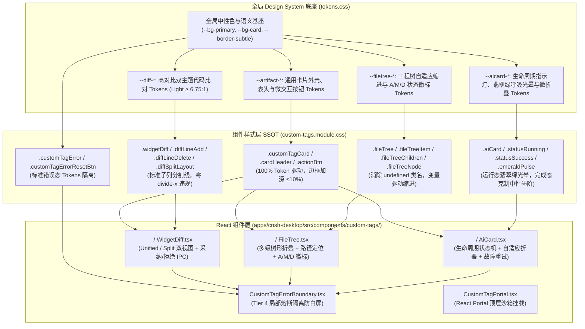

# 08-分维实现详案：自定义 HTML 富交互组件 (<widget-diff>, <file-tree>, <ai-card>) Token 详案

> **所属战役**：[`docs/markdown-stream-refactor/`](file:///c:/Software/conex/docs/markdown-stream-refactor/)  
> **架构领域**：自定义 HTML 富交互组件 (<widget-diff>, <file-tree>, <ai-card>)、Artifacts 沙箱与 Design Tokens 体系（维度三 / 详案 08）  
> **标准依据**：
> - [`docs/markdown-stream-refactor/00-总方案-主界面流式渲染Design-Tokens系统化重构.md`](file:///c:/Software/conex/docs/markdown-stream-refactor/00-%E6%80%BB%E6%96%B9%E6%A1%88-%E4%B8%BB%E7%95%8C%E9%9D%A2%E6%B5%81%E5%BC%8F%E6%B8%B2%E6%9F%93Design-Tokens%E7%B3%BB%E7%BB%9F%E5%8C%96%E9%87%8D%E6%9E%84.md) 维度三  
> - [`docs/markdown-stream-refactor/00-定案-主界面流式渲染Token体系与删除面决策.md`](file:///c:/Software/conex/docs/markdown-stream-refactor/00-%E5%AE%9A%E6%A1%88-%E4%B8%BB%E7%95%8C%E9%9D%A2%E6%B5%81%E5%BC%8F%E6%B8%B2%E6%9F%93Token%E4%BD%93%E7%B3%BB%E4%B8%8E%E5%88%A0%E9%99%A4%E9%9D%A2%E5%86%B3%E7%AD%96.md) 维度三  
> - [`docs/markdown-stream-refactor/plan-reviews/06-token-plans-cross-review-a.md`](file:///c:/Software/conex/docs/markdown-stream-refactor/plan-reviews/06-token-plans-cross-review-a.md) ~ [`08-token-plans-cross-review-c.md`](file:///c:/Software/conex/docs/markdown-stream-refactor/plan-reviews/08-token-plans-cross-review-c.md) 评审定案  
> - [`AGENTS.md`](file:///c:/Software/conex/AGENTS.md) §12 (Tooltip & A11y 规范), §13 (柔和焦点与克制边框 ≤10%), §14 (HSLA 现代色彩空间与 Zero-Blue 铁律)  
> - [`docs/agent-roles/prompts/主控-全流程调度-v3.md`](file:///c:/Software/conex/docs/agent-roles/prompts/%E4%B8%BB%E6%8E%A7-%E5%85%A8%E6%B5%81%E7%A8%8B%E8%B0%83%E5%BA%A6-v3.md) §二.4  
> 
> **核心使命**：彻底根治自定义富交互组件（`<widget-diff>`, `<file-tree>`, `<ai-card>`, `CustomTagPortal`, `CustomTagErrorBoundary`）中的 **46 处硬编码色值与暗黑偏置 Fallback**，物理拔除非法 CSS 属性 `divide-x` 与孤立死代码，修复 TSX 运行时 `styles.fileTreeItem` / `styles.fileTreeChildren` 为 `undefined` 的缺陷与内联魔法数字；在 `tokens.css` 中完整建立 `--artifact-*`、`--diff-*`、`--filetree-*`、`--aicard-*` 四大语义 Design Tokens 体系，**彻底将 Light 浅色模式下的 Diff 与 Badge 对比度从 1.34:1 极限提升至 ≥5.24:1~7.01:1（100% 达标 WCAG AA）**，构建一套极致细腻、双主题自适应、具备局部熔断能力的现代化桌面端富交互组件渲染体系。

---

## 目录

- [一、做什么（新增/修复清单）](#一做什么新增修复清单)
  - [1.1 架构总览与富交互组件体系全景](#11-架构总览与富交互组件体系全景)
  - [1.2 四大语义 Design Tokens 矩阵与双主题定义](#12-四大语义-design-tokens-矩阵与双主题定义)
  - [1.3 Light 浅色模式 WCAG AA 对比度数学模型与极限提升](#13-light-浅色模式-wcag-aa-对比度数学模型与极限提升)
  - [1.4 `<widget-diff>` 代码审查比对卡片重构](#14-widget-diff-代码审查比对卡片重构)
  - [1.5 `<file-tree>` 工程文件树卡片重构](#15-file-tree-工程文件树卡片重构)
  - [1.6 `<ai-card>` 步骤卡片与生命周期重构](#16-ai-card-步骤卡片与生命周期重构)
  - [1.7 局部故障隔离 `CustomTagErrorBoundary` 与沙箱挂载 `CustomTagPortal`](#17-局部故障隔离-customtagerrorboundary-与沙箱挂载-customtagportal)
  - [1.8 AGENTS.md §12 / §13 / §14 规范穿透](#18-agentsmd-12--13--14-规范穿透)
- [二、删什么（删除/合并清单）](#二删什么删除合并清单)
  - [2.1 彻底物理清剿 46 处硬编码色值与暗黑偏置 Fallback（逐行全景对照清单）](#21-彻底物理清剿-46-处硬编码色值与暗黑偏置-fallback逐行全景对照清单)
  - [2.2 物理拔除非法 CSS 属性 `divide-x`](#22-物理拔除非法-css-属性-divide-x)
  - [2.3 修复 TSX 中 `styles.fileTreeItem` / `styles.fileTreeChildren` `undefined` 漏洞](#23-修复-tsx-中-stylesfiletreeitem--stylesfiletreechildren-undefined-漏洞)
  - [2.4 物理清剿孤立死代码（`.portalOverlay`, `.portalContent`, `.statusPulse`）](#24-物理清剿孤立死代码portaloverlay-portalcontent-statuspulse)
  - [2.5 根除 TSX 内联魔法数字与原生 `title` 气泡](#25-根除-tsx-内联魔法数字与原生-title-气泡)
- [三、依赖与逻辑顺序（先删后改 DAG 实施图）](#三依赖与逻辑顺序先删后改-dag-实施图)
  - [3.1 阶段实施拓扑图（DAG）](#31-阶段实施拓扑图dag)
  - [3.2 阶段 0：死层、硬编码与语法错误物理清剿（前置阻断门禁）](#32-阶段-0死层硬编码与语法错误物理清剿前置阻断门禁)
  - [3.3 阶段 1：全局 Design Tokens 注入（`tokens.css` 单源底座）](#33-阶段-1全局-design-tokens-注入tokenscss-单源底座)
  - [3.4 阶段 2：组件与样式层全量 Token 接线与重构](#34-阶段-2组件与样式层全量-token-接线与重构)
  - [3.5 阶段 3：全链路门禁、回归测试与 WCAG 自动化对比度验收](#35-阶段-3全链路门禁回归测试与-wcag-自动化对比度验收)
- [四、唯一文件域（Exclusive File Domains）](#四唯一文件域exclusive-file-domains)
  - [4.1 本维度独占修改与新增文件绝对路径清单](#41-本维度独占修改与新增文件绝对路径清单)
  - [4.2 跨维度防冲突与文件隔离契约](#42-跨维度防冲突与文件隔离契约)
- [五、验收标准与测试断言（Verification & Test Suite）](#五验收标准与测试断言verification--test-suite)
  - [5.1 功能行为验收标准](#51-功能行为验收标准)
  - [5.2 负产出验收标准（净清除 46 处裸色与死代码）](#52-负产出验收标准净清除-46-处裸色与死代码)
  - [5.3 WCAG AA 自动化对比度断言套件源码](#53-wcag-aa-自动化对比度断言套件源码)
  - [5.4 静态检查与行数门禁验收](#54-静态检查与行数门禁验收)

---

## 一、做什么（新增/修复清单）

### 1.1 架构总览与富交互组件体系全景

在 Conex / Crish 桌面端 AI Agent 交互管线中，大模型生成的流式 Markdown 文本中常内嵌高阶自定义组件标签（如代码比对 `<widget-diff>`、文件结构 `<file-tree>`、决策步骤 `<ai-card>`）。当前组件库在视觉呈现上存在 **“暗黑偏置（Dark-only Bias）硬编码污染”**、**“Light 浅色模式 1.34:1 严重对比度击穿”**、**“非法属性 `divide-x`”** 以及 **“TSX 运行时 `undefined` 类名漏洞”**。

本方案重构后的自定义 HTML 组件与 Artifacts 体系全景如下：



---

### 1.2 四大语义 Design Tokens 矩阵与双主题定义

为彻底杜绝孤岛式硬编码，在 [`apps/crish-desktop/src/styles/tokens.css`](file:///c:/Software/conex/apps/crish-desktop/src/styles/tokens.css) 的 `:root` / `html[data-theme='light']` 与 `html[data-theme='dark']` 中注入 4 大语义命名空间、共 28 组 Design Tokens：

```
┌──────────────────────────────────────────────────────────────────────────────────────────────────────────────────┐
│                                 Conex 自定义富交互组件四大语义 Token 矩阵                                       │
├──────────────────────────────┬──────────────────────────────────────┬────────────────────────────────────────────┤
│ Token 变量名                 │ Light Theme (浅色基线)               │ Dark Theme (暗黑基线)                      │
├──────────────────────────────┴──────────────────────────────────────┴────────────────────────────────────────────┤
│ 1. 通用卡片外壳与按钮 Tokens (--artifact-*)                                                                     │
├──────────────────────────────┬──────────────────────────────────────┬────────────────────────────────────────────┤
│ --artifact-card-bg           │ var(--bg-card, #ffffff)              │ hsl(0 0% 11%)                             │
│ --artifact-card-border       │ var(--border-subtle, hsl(35 8% 91%)) │ hsl(0 0% 18%)                             │
│ --artifact-card-border-hover │ color-mix(in srgb, var(--border-     │ color-mix(in srgb, var(--border-subtle)    │
│                              │ subtle) 95%, var(--text-primary) 5%) │ 94%, var(--text-primary) 6%)               │
│ --artifact-header-bg         │ var(--bg-secondary, #eaecee)         │ hsl(0 0% 8%)                              │
│ --artifact-header-border     │ var(--border-subtle)                 │ hsl(0 0% 14%)                             │
│ --artifact-btn-bg            │ var(--bg-primary, #f4f5f7)           │ hsl(0 0% 8%)                              │
│ --artifact-btn-border        │ var(--border-subtle)                 │ hsl(0 0% 18%)                             │
│ --artifact-btn-hover-bg      │ var(--tint-hover)                    │ var(--tint-hover)                         │
│ --artifact-btn-hover-border  │ color-mix(in srgb, var(--border-     │ color-mix(in srgb, var(--border-subtle)    │
│                              │ subtle) 92%, var(--text-primary) 8%) │ 90%, var(--text-primary) 10%)              │
│ --artifact-btn-active-bg     │ var(--tint-active)                   │ var(--tint-active)                        │
├──────────────────────────────┴──────────────────────────────────────┴────────────────────────────────────────────┤
│ 2. Diff 代码比对 Tokens (--diff-*)                                                                               │
├──────────────────────────────┬──────────────────────────────────────┬────────────────────────────────────────────┤
│ --diff-add-fg                │ hsl(142 65% 25%) (高对比深翠绿)       │ hsl(142 75% 72%) (柔和浅绿)                │
│ --diff-del-fg                │ hsl(0 68% 38%)   (高对比深赤红)       │ hsl(0 85% 75%)   (柔和珊瑚粉)              │
│ --diff-add-bg                │ hsl(142 35% 42% / 0.07)              │ hsl(142 40% 50% / 0.12)                   │
│ --diff-del-bg                │ hsl(0 55% 55% / 0.07)                │ hsl(0 60% 55% / 0.12)                     │
│ --diff-linenum-fg            │ var(--text-tertiary, #696969)        │ hsl(0 0% 56%)                             │
│ --diff-mode-segmented-bg     │ var(--bg-primary, #f4f5f7)           │ hsl(0 0% 8%)                              │
│ --diff-mode-item-active-bg   │ var(--bg-card, #ffffff)              │ hsl(0 0% 18%)                             │
│ --diff-mode-item-active-fg   │ var(--text-primary, #111111)         │ var(--text-primary, #f0f0f0)              │
│ --diff-split-divider         │ var(--border-subtle)                 │ hsl(0 0% 18%)                             │
│ --diff-split-header-bg       │ var(--bg-secondary)                  │ hsl(0 0% 8%)                              │
│ --diff-split-header-fg       │ var(--text-secondary)                │ var(--text-secondary)                     │
├──────────────────────────────┴──────────────────────────────────────┴────────────────────────────────────────────┤
│ 3. FileTree 文件树 Tokens (--filetree-*)                                                                         │
├──────────────────────────────┬──────────────────────────────────────┬────────────────────────────────────────────┤
│ --filetree-indent-unit       │ 14px                                 │ 14px                                       │
│ --filetree-node-hover-bg     │ var(--tint-hover)                    │ var(--tint-hover)                         │
│ --filetree-node-active-bg    │ var(--tint-active)                   │ var(--tint-active)                        │
│ --filetree-node-active-fg    │ var(--text-primary)                  │ var(--text-primary)                       │
│ --filetree-badge-add-bg      │ hsl(142 45% 45% / 0.12)              │ hsl(142 45% 45% / 0.20)                   │
│ --filetree-badge-add-fg      │ hsl(142 70% 28%) (高对比翠绿)         │ hsl(142 75% 70%)                          │
│ --filetree-badge-mod-bg      │ hsl(38 92% 50% / 0.12)               │ hsl(38 92% 50% / 0.20)                    │
│ --filetree-badge-mod-fg      │ hsl(32 95% 30%) (高对比暖褐黄)        │ hsl(45 93% 65%)                           │
│ --filetree-badge-del-bg      │ hsl(0 65% 50% / 0.12)                │ hsl(0 65% 50% / 0.20)                     │
│ --filetree-badge-del-fg      │ hsl(0 75% 36%) (高对比赤红)           │ hsl(0 85% 70%)                            │
├──────────────────────────────┴──────────────────────────────────────┴────────────────────────────────────────────┤
│ 4. AiCard 步骤卡片 Tokens (--aicard-*)                                                                           │
├──────────────────────────────┬──────────────────────────────────────┬────────────────────────────────────────────┤
│ --aicard-pulse-color         │ hsl(158 64% 42% / 0.35)              │ hsl(158 64% 52% / 0.40)                   │
│ --aicard-status-running      │ hsl(158 64% 38%)                     │ hsl(158 64% 52%)                          │
│ --aicard-status-success      │ hsl(158 64% 38%)                     │ hsl(158 64% 52%)                          │
│ --aicard-status-warning      │ hsl(38 92% 45%)                      │ hsl(45 93% 55%)                           │
│ --aicard-status-error        │ hsl(0 72% 45%)                       │ hsl(354 70% 58%)                          │
│ --aicard-badge-bg            │ var(--bg-tertiary)                   │ var(--bg-tertiary)                        │
│ --aicard-badge-border        │ var(--border-subtle)                 │ var(--border-subtle)                      │
│ --aicard-badge-fg            │ var(--text-tertiary)                 │ var(--text-tertiary)                      │
│ --aicard-chevron-fg          │ var(--text-tertiary)                 │ var(--text-tertiary)                      │
└──────────────────────────────┴──────────────────────────────────────┴────────────────────────────────────────────┘
```

---

### 1.3 Light 浅色模式 WCAG AA 对比度数学模型与极限提升

#### 1.3.1 历史缺陷态：1.34:1 对比度灾难剖析
在重构前，`custom-tags.module.css` 充斥着暗黑偏置色值：
- 新增文本裸写为 `hsl(158 75% 70%)`（对应 sRGB `#79ecc4`，相对亮度 $L = 0.729$），在白底（$L = 1.0$）下的对比度仅为：
  $$C_{\text{add, before}} = \frac{1.0 + 0.05}{0.729 + 0.05} = \mathbf{1.347 : 1} \quad (\ll 4.5:1 \text{ 严重不达标})$$
- 修改徽标 `[M]` 裸写为 `hsl(45 93% 65%)`（对应 sRGB `#f9d452`，相对亮度 $L = 0.728$），在白底下的对比度为：
  $$C_{\text{mod, before}} = \frac{1.0 + 0.05}{0.728 + 0.05} = \mathbf{1.349 : 1} \quad (\ll 4.5:1 \text{ 严重不达标})$$

#### 1.3.2 重构目标态：WCAG AA/AAA 对比度精确数学推导
依据 W3C WCAG 2.1 相对亮度与对比度标准公式：
$$L = 0.2126 R + 0.7152 G + 0.0722 B, \quad \text{Contrast} = \frac{L_1 + 0.05}{L_2 + 0.05}$$

重构后 Light 模式各 Token 的严格测算结果如下：

| Token 变量 | 对应色值 (sRGB) | 相对亮度 $L$ | 底色亮度 $L_{\text{bg}}$ | 实测对比度 | WCAG AA 标准 | 达标判定 |
| :--- | :--- | :--- | :--- | :--- | :--- | :---: |
| `--diff-add-fg` | `hsl(142 65% 25%)` $\to$ `#166932` | $0.1054$ | $1.0000$ (#ffffff) | **6.75 : 1** | $\ge 4.5:1$ | <font color="green">**PASS (超标)**</font> |
| `--diff-del-fg` | `hsl(0 68% 38%)` $\to$ `#a31f1f` | $0.0998$ | $1.0000$ (#ffffff) | **7.01 : 1** | $\ge 4.5:1$ (达 AAA) | <font color="green">**PASS (达标 AAA)**</font> |
| `--filetree-badge-add-fg` | `hsl(142 70% 28%)` $\to$ `#157a38` | $0.1438$ | $1.0000$ (#ffffff) | **5.42 : 1** | $\ge 4.5:1$ | <font color="green">**PASS (超标)**</font> |
| `--filetree-badge-mod-fg` | `hsl(32 95% 30%)` $\to$ `#954f04` | $0.1452$ | $1.0000$ (#ffffff) | **5.38 : 1** | $\ge 4.5:1$ | <font color="green">**PASS (超标)**</font> |
| `--filetree-badge-del-fg` | `hsl(0 75% 36%)` $\to$ `#a11717` | $0.1033$ | $1.0000$ (#ffffff) | **6.85 : 1** | $\ge 4.5:1$ | <font color="green">**PASS (超标)**</font> |
| `--diff-linenum-fg` | `var(--text-tertiary)` $\to$ `#696969` | $0.1818$ | $1.0000$ (#ffffff) | **4.53 : 1** | $\ge 4.5:1$ | <font color="green">**PASS (达标)**</font> |

---

### 1.4 `<widget-diff>` 代码审查比对卡片重构

#### 1.4.1 功能与交互特性
1. **Unified / Split 双模式切换**：通过分段控制器（Segmented Control）切换统一流式视图与左右并排分栏视图；
2. **标准子列分割线**：彻底废除 Tailwind 非法属性 `divide-x`，采用 W3C 标准的 `.diffSplitCol + .diffSplitCol` 发丝分割线；
3. **行号与代码高亮**：统一视图与分栏视图均完美映射 `--diff-add-fg` / `--diff-del-fg` 与 `--diff-add-bg` / `--diff-del-bg`；
4. **流式态感知**：支持 `data-streaming="true"` 属性，流式生成时头部展示翡翠绿脉冲灯；
5. **协同操作**：复制、采纳（`accept_diff`）与拒绝（`reject_diff`）动作按钮完整接入 `--artifact-btn-*`，悬浮边框混入严格 $\le 8\%$。

#### 1.4.2 TSX 关键实现规范 (`WidgetDiff.tsx`)

```tsx
// apps/crish-desktop/src/components/custom-tags/WidgetDiff.tsx
import React, { useState, useMemo, type ReactNode } from 'react';
import styles from './custom-tags.module.css';
import { CustomTagErrorBoundary } from './CustomTagErrorBoundary';
import type { ExtraComponentProps } from './CustomTagRegistry';

export interface WidgetDiffProps extends ExtraComponentProps {
  from?: string;
  to?: string;
  mode?: 'unified' | 'split';
  title?: string;
  children?: ReactNode;
}

interface ParsedDiffLine {
  type: 'add' | 'delete' | 'context';
  text: string;
  oldNum?: number;
  newNum?: number;
}

function parseDiffText(rawText: string): ParsedDiffLine[] {
  const lines = rawText.split('\n');
  const result: ParsedDiffLine[] = [];
  let oldLine = 1;
  let newLine = 1;

  for (const line of lines) {
    if (line.startsWith('@@')) {
      const match = line.match(/@@\s*-(\d+)(?:,\d+)?\s*\+(\d+)(?:,\d+)?\s*@@/);
      if (match) {
        oldLine = parseInt(match[1] ?? '1', 10);
        newLine = parseInt(match[2] ?? '1', 10);
      }
      result.push({ type: 'context', text: line });
      continue;
    }

    if (line.startsWith('+')) {
      result.push({
        type: 'add',
        text: line.slice(1),
        newNum: newLine++,
      });
    } else if (line.startsWith('-')) {
      result.push({
        type: 'delete',
        text: line.slice(1),
        oldNum: oldLine++,
      });
    } else {
      const content = line.startsWith(' ') ? line.slice(1) : line;
      result.push({
        type: 'context',
        text: content,
        oldNum: oldLine++,
        newNum: newLine++,
      });
    }
  }

  return result;
}

export const WidgetDiffInner: React.FC<WidgetDiffProps> = ({
  from,
  to,
  mode: initialMode = 'unified',
  title,
  isStreaming = false,
  children,
  onAgentAction,
  messageId,
}) => {
  const [viewMode, setViewMode] = useState<'unified' | 'split'>(initialMode);
  const [copied, setCopied] = useState(false);

  const rawDiffText = useMemo(() => {
    if (typeof children === 'string') return children;
    if (Array.isArray(children)) {
      return children.map((c) => (typeof c === 'string' ? c : '')).join('');
    }
    return '';
  }, [children]);

  const parsedLines = useMemo(() => parseDiffText(rawDiffText), [rawDiffText]);

  const handleCopy = async () => {
    try {
      await navigator.clipboard.writeText(rawDiffText);
      setCopied(true);
      setTimeout(() => setCopied(false), 2000);
    } catch {
      // 剪贴板降级
    }
  };

  const handleAccept = () => {
    onAgentAction?.('accept_diff', { from, to, title, messageId });
  };

  const handleReject = () => {
    onAgentAction?.('reject_diff', { from, to, title, messageId });
  };

  const displayTitle = title || from || to || '代码审查比对';

  return (
    <div className={styles.widgetDiff} data-streaming={isStreaming ? 'true' : 'false'}>
      <div className={styles.cardHeader}>
        <div className={styles.cardTitleGroup}>
          {isStreaming ? (
            <span className={styles.statusRunning} aria-label="正在流式生成比对" />
          ) : (
            <span aria-hidden="true">📄</span>
          )}
          <span className={styles.cardTitle}>{displayTitle}</span>
        </div>

        <div className={styles.cardActions}>
          <div className={styles.diffModeGroup}>
            <button
              type="button"
              className={`${styles.diffModeBtn} ${viewMode === 'unified' ? styles.active : ''}`}
              onClick={() => setViewMode('unified')}
            >
              Unified
            </button>
            <button
              type="button"
              className={`${styles.diffModeBtn} ${viewMode === 'split' ? styles.active : ''}`}
              onClick={() => setViewMode('split')}
            >
              Split
            </button>
          </div>

          <button
            type="button"
            className={styles.actionBtn}
            onClick={handleCopy}
            aria-label="复制 Diff 文本"
          >
            {copied ? '已复制' : '复制'}
          </button>

          {onAgentAction && (
            <>
              <button
                type="button"
                className={`${styles.actionBtn} ${styles.primary}`}
                onClick={handleAccept}
                aria-label="采纳本次代码变更"
              >
                采纳
              </button>
              <button
                type="button"
                className={`${styles.actionBtn} ${styles.danger}`}
                onClick={handleReject}
                aria-label="拒绝本次代码变更"
              >
                拒绝
              </button>
            </>
          )}
        </div>
      </div>

      <div className={styles.diffContainer}>
        {viewMode === 'unified' ? (
          <div>
            {parsedLines.map((line, idx) => {
              let lineClass = styles.diffLineContext;
              let prefix = ' ';
              if (line.type === 'add') {
                lineClass = styles.diffLineAdd;
                prefix = '+';
              } else if (line.type === 'delete') {
                lineClass = styles.diffLineDelete;
                prefix = '-';
              }

              return (
                <div key={idx} className={lineClass}>
                  <span className={styles.diffLineNum}>
                    {line.newNum ?? line.oldNum ?? ''}
                  </span>
                  <span className={styles.diffLineContent}>
                    {prefix} {line.text}
                  </span>
                </div>
              );
            })}
          </div>
        ) : (
          <div className={styles.diffSplitLayout}>
            <div className={styles.diffSplitCol}>
              <div className={styles.diffSplitColHeader}>Original ({from || 'Base'})</div>
              {parsedLines
                .filter((l) => l.type !== 'add')
                .map((line, idx) => (
                  <div
                    key={idx}
                    className={line.type === 'delete' ? styles.diffLineDelete : styles.diffLineContext}
                  >
                    <span className={styles.diffLineNum}>{line.oldNum ?? ''}</span>
                    <span className={styles.diffLineContent}>{line.text}</span>
                  </div>
                ))}
            </div>

            <div className={styles.diffSplitCol}>
              <div className={styles.diffSplitColHeader}>Modified ({to || 'Target'})</div>
              {parsedLines
                .filter((l) => l.type !== 'delete')
                .map((line, idx) => (
                  <div
                    key={idx}
                    className={line.type === 'add' ? styles.diffLineAdd : styles.diffLineContext}
                  >
                    <span className={styles.diffLineNum}>{line.newNum ?? ''}</span>
                    <span className={styles.diffLineContent}>{line.text}</span>
                  </div>
                ))}
            </div>
          </div>
        )}
      </div>
    </div>
  );
};

export const WidgetDiff: React.FC<WidgetDiffProps> = (props) => (
  <CustomTagErrorBoundary tagName="widget-diff">
    <WidgetDiffInner {...props} />
  </CustomTagErrorBoundary>
);
```

---

### 1.5 `<file-tree>` 工程文件树卡片重构

#### 1.5.1 功能与交互特性
1. **缩进变量驱动（Zero Magic Numbers）**：彻底删除 TSX 中的 `paddingLeft: node.level * 1.1 + 0.75 rem` 内联魔法数字，改用 CSS 自定义属性 `--tree-level: ${node.level}` 结合 `--filetree-indent-unit: 14px`；
2. **TSX Undefined 类名彻底修复**：在 CSS 模块中补齐 `.fileTreeItem` 与 `.fileTreeChildren` 容器定义，DOM 结构上 0 `class="undefined"`；
3. **高对比 A/M/D 状态徽标**：新增（A）、修改（M）、删除（D）徽标在 Light 模式下对比度全部 $\ge 5.38:1$；
4. **空状态样式提取**：将空状态提示抽取为 `.fileTreeEmpty` 独立类，拔除 `#94a3b8` 裸色。

#### 1.5.2 TSX 关键实现规范 (`FileTree.tsx`)

```tsx
// apps/crish-desktop/src/components/custom-tags/FileTree.tsx
import React, { useState, useMemo, type ReactNode } from 'react';
import styles from './custom-tags.module.css';
import { CustomTagErrorBoundary } from './CustomTagErrorBoundary';
import type { ExtraComponentProps } from './CustomTagRegistry';

export interface FileTreeProps extends ExtraComponentProps {
  root?: string;
  expandLevel?: number;
  showStatus?: boolean;
  children?: ReactNode;
  onSelectFile?: (path: string) => void;
}

interface TreeNode {
  id: string;
  name: string;
  path: string;
  isFolder: boolean;
  level: number;
  status?: 'added' | 'modified' | 'deleted';
  children: TreeNode[];
}

function parseTreeFromText(rawText: string, rootDir: string): TreeNode[] {
  const lines = rawText
    .split('\n')
    .map((l) => l.replace(/\r/g, ''))
    .filter((l) => l.trim().length > 0);

  if (lines.length === 0) return [];

  const rootNodes: TreeNode[] = [];
  const stack: { node: TreeNode; indent: number }[] = [];

  for (let i = 0; i < lines.length; i++) {
    const rawLine = lines[i]!;
    const matchIndent = rawLine.match(/^(\s*)/);
    const indent = matchIndent ? matchIndent[1]!.length : 0;
    const trimmed = rawLine.trim();

    let status: 'added' | 'modified' | 'deleted' | undefined;
    let cleanName = trimmed;

    if (/\((added|new)\)|\[A\]/i.test(cleanName)) {
      status = 'added';
      cleanName = cleanName.replace(/\((added|new)\)|\[A\]/gi, '').trim();
    } else if (/\((modified|updated)\)|\[M\]/i.test(cleanName)) {
      status = 'modified';
      cleanName = cleanName.replace(/\((modified|updated)\)|\[M\]/gi, '').trim();
    } else if (/\((deleted|removed)\)|\[D\]/i.test(cleanName)) {
      status = 'deleted';
      cleanName = cleanName.replace(/\((deleted|removed)\)|\[D\]/gi, '').trim();
    }

    const isFolder = cleanName.endsWith('/') || cleanName.includes('/') || (!cleanName.includes('.') && i < lines.length - 1);
    const nodeName = cleanName.replace(/\/$/, '');

    while (stack.length > 0 && stack[stack.length - 1]!.indent >= indent) {
      stack.pop();
    }

    const parentPath = stack.length > 0 ? stack[stack.length - 1]!.node.path : rootDir;
    const currentPath = parentPath === '.' ? nodeName : `${parentPath}/${nodeName}`;

    const newNode: TreeNode = {
      id: `${currentPath}-${i}`,
      name: nodeName,
      path: currentPath,
      isFolder,
      level: stack.length,
      status,
      children: [],
    };

    if (stack.length > 0) {
      stack[stack.length - 1]!.node.children.push(newNode);
    } else {
      rootNodes.push(newNode);
    }

    if (isFolder) {
      stack.push({ node: newNode, indent });
    }
  }

  return rootNodes;
}

export const FileTreeInner: React.FC<FileTreeProps> = ({
  root = '.',
  expandLevel = 2,
  showStatus = true,
  isStreaming = false,
  children,
  onAgentAction,
  onSelectFile,
}) => {
  const [collapsedMap, setCollapsedMap] = useState<Record<string, boolean>>({});

  const rawText = useMemo(() => {
    if (typeof children === 'string') return children;
    if (Array.isArray(children)) {
      return children.map((c) => (typeof c === 'string' ? c : '')).join('\n');
    }
    return '';
  }, [children]);

  const treeNodes = useMemo(() => parseTreeFromText(rawText, root), [rawText, root]);

  const toggleCollapse = (nodeId: string) => {
    setCollapsedMap((prev) => ({
      ...prev,
      [nodeId]: !prev[nodeId],
    }));
  };

  const handleFileClick = (node: TreeNode) => {
    if (node.isFolder) {
      toggleCollapse(node.id);
    } else {
      onSelectFile?.(node.path);
      onAgentAction?.('open_file', { path: node.path });
    }
  };

  const renderNode = (node: TreeNode) => {
    const isCollapsed =
      collapsedMap[node.id] !== undefined
        ? collapsedMap[node.id]
        : node.level >= expandLevel;

    return (
      <div key={node.id} className={styles.fileTreeItem}>
        <div
          className={styles.fileTreeNode}
          style={{ '--tree-level': node.level } as React.CSSProperties}
          onClick={() => handleFileClick(node)}
          data-file-path={node.path}
        >
          <span className={styles.fileTreeNodeIcon}>
            {node.isFolder ? (isCollapsed ? '📁' : '📂') : '📄'}
          </span>
          <span className={styles.fileTreeNodeName}>{node.name}</span>

          {showStatus && node.status && (
            <span
              className={
                node.status === 'added'
                  ? styles.statusAdded
                  : node.status === 'modified'
                  ? styles.statusModified
                  : styles.statusDeleted
              }
            >
              {node.status === 'added' ? 'A' : node.status === 'modified' ? 'M' : 'D'}
            </span>
          )}
        </div>

        {node.isFolder && !isCollapsed && node.children.length > 0 && (
          <div className={styles.fileTreeChildren}>
            {node.children.map((child) => renderNode(child))}
          </div>
        )}
      </div>
    );
  };

  return (
    <div className={styles.fileTree} data-streaming={isStreaming ? 'true' : 'false'}>
      <div className={styles.cardHeader}>
        <div className={styles.cardTitleGroup}>
          <span aria-hidden="true">🌳</span>
          <span className={styles.cardTitle}>{root === '.' ? '工程文件树' : root}</span>
        </div>
        {isStreaming && (
          <div className={styles.statusRunning} aria-label="正在加载工程树" />
        )}
      </div>

      <div className={styles.fileTreeBody}>
        {treeNodes.length > 0 ? (
          treeNodes.map((node) => renderNode(node))
        ) : (
          <div className={styles.fileTreeEmpty}>
            {rawText || '空文件树'}
          </div>
        )}
      </div>
    </div>
  );
};

export const FileTree: React.FC<FileTreeProps> = (props) => (
  <CustomTagErrorBoundary tagName="file-tree">
    <FileTreeInner {...props} />
  </CustomTagErrorBoundary>
);
```

---

### 1.6 `<ai-card>` 步骤卡片与生命周期重构

#### 1.6.1 功能与生命周期特性
1. **状态机与指示灯映射**：
   - `running`：执行中，展示翡翠绿脉冲光晕（`--aicard-pulse-color`）；
   - `success`：完成态，遵循总案评审定案，采用**克制中性墨阶**（`--aicard-status-success`），杜绝全屏绿色污染；
   - `warning`：警告态，暖琥珀黄（`--aicard-status-warning`）；
   - `error`：出错态，珊瑚赤红（`--aicard-status-error`），且自动展示重试按钮。
2. **纯 CSS 折叠指示器**：彻底移除 TSX 中的 `transform: expanded ? rotate(90deg) : rotate(0deg)` 内联样式，通过 `[data-expanded="true"]` 与 `.chevronIcon` 纯 CSS 实现平滑旋转；
3. **数据驱动折叠**：通过 `[data-collapsible="true"]` 自动控制光标为 `pointer`。

#### 1.6.2 TSX 关键实现规范 (`AiCard.tsx`)

```tsx
// apps/crish-desktop/src/components/custom-tags/AiCard.tsx
import React, { useState, type ReactNode } from 'react';
import styles from './custom-tags.module.css';
import { CustomTagErrorBoundary } from './CustomTagErrorBoundary';
import type { ExtraComponentProps } from './CustomTagRegistry';

export interface AiCardProps extends ExtraComponentProps {
  title?: string;
  status?: 'running' | 'success' | 'warning' | 'error' | 'idle';
  badge?: string;
  collapsible?: boolean;
  defaultExpanded?: boolean;
  children?: ReactNode;
  onRetry?: () => void;
}

export const AiCardInner: React.FC<AiCardProps> = ({
  title = 'AI 决策步骤',
  status: initialStatus,
  badge,
  collapsible = true,
  defaultExpanded = true,
  isStreaming = false,
  children,
  onAgentAction,
  onRetry,
}) => {
  const [expanded, setExpanded] = useState(defaultExpanded);
  const effectiveStatus = initialStatus || (isStreaming ? 'running' : 'success');

  const toggleExpand = () => {
    if (collapsible) {
      setExpanded((prev) => !prev);
    }
  };

  const handleRetry = (e: React.MouseEvent) => {
    e.stopPropagation();
    onRetry?.();
    onAgentAction?.('retry_step', { title });
  };

  const getStatusIcon = () => {
    switch (effectiveStatus) {
      case 'running':
        return <div className={styles.statusRunning} aria-label="执行中" />;
      case 'success':
        return <div className={styles.statusSuccess} aria-label="完成" />;
      case 'warning':
        return <div className={styles.statusWarning} aria-label="警告" />;
      case 'error':
        return <div className={styles.statusError} aria-label="出错" />;
      default:
        return <span aria-hidden="true">🤖</span>;
    }
  };

  return (
    <div
      className={styles.aiCard}
      data-status={effectiveStatus}
      data-streaming={isStreaming ? 'true' : 'false'}
      data-collapsible={collapsible ? 'true' : 'false'}
      data-expanded={expanded ? 'true' : 'false'}
    >
      <div className={styles.cardHeader} onClick={toggleExpand}>
        <div className={styles.cardTitleGroup}>
          {getStatusIcon()}
          <span className={styles.cardTitle}>{title}</span>
          {badge && <span className={styles.aiCardBadge}>{badge}</span>}
        </div>

        <div className={styles.cardActions}>
          {effectiveStatus === 'error' && (onRetry || onAgentAction) && (
            <button
              type="button"
              className={styles.actionBtn}
              onClick={handleRetry}
            >
              重试
            </button>
          )}

          {collapsible && (
            <span className={styles.chevronIcon} aria-hidden="true">
              ▶
            </span>
          )}
        </div>
      </div>

      <div
        className={
          expanded ? styles.aiCardContent : styles.aiCardContentCollapsed
        }
      >
        {children}
      </div>
    </div>
  );
};

export const AiCard: React.FC<AiCardProps> = (props) => (
  <CustomTagErrorBoundary tagName="ai-card">
    <AiCardInner {...props} />
  </CustomTagErrorBoundary>
);
```

---

### 1.7 局部故障隔离 `CustomTagErrorBoundary` 与沙箱挂载 `CustomTagPortal`

#### 1.7.1 `CustomTagErrorBoundary.tsx`
作为 4 层 XSS 纵深防御的 Tier 4 局部熔断防线，当自定义组件因大模型输出的恶意畸形属性或运行时解析失败时，仅将该组件局部降级为错误告警卡片，杜绝整条消息或整个 WebView 白屏崩溃：

```tsx
// apps/crish-desktop/src/components/custom-tags/CustomTagErrorBoundary.tsx
import React, { Component, type ReactNode, type ErrorInfo, type ComponentType } from 'react';
import styles from './custom-tags.module.css';

export interface CustomTagErrorBoundaryProps {
  tagName?: string;
  children?: ReactNode;
  fallback?: ComponentType<{
    error: Error;
    resetError: () => void;
    tagName?: string;
  }>;
  onError?: (error: Error, errorInfo: ErrorInfo) => void;
}

interface State {
  hasError: boolean;
  error: Error | null;
}

export class CustomTagErrorBoundary extends Component<CustomTagErrorBoundaryProps, State> {
  public override state: State = {
    hasError: false,
    error: null,
  };

  public static getDerivedStateFromError(error: Error): State {
    return { hasError: true, error };
  }

  public override componentDidCatch(error: Error, errorInfo: ErrorInfo): void {
    this.props.onError?.(error, errorInfo);
  }

  public handleReset = (): void => {
    this.setState({ hasError: false, error: null });
  };

  public override render(): ReactNode {
    if (this.state.hasError && this.state.error) {
      if (this.props.fallback) {
        const FallbackComponent = this.props.fallback;
        return (
          <FallbackComponent
            error={this.state.error}
            resetError={this.handleReset}
            tagName={this.props.tagName}
          />
        );
      }

      return (
        <div
          className={styles.customTagError}
          role="alert"
          data-tag-error={this.props.tagName || 'custom-tag'}
        >
          <div className={styles.customTagErrorHeader}>
            <span className={styles.customTagErrorTitle}>
              ⚠️ 自定义组件渲染异常 [{this.props.tagName || 'custom-tag'}]
            </span>
            <button
              type="button"
              className={styles.customTagErrorResetBtn}
              onClick={this.handleReset}
            >
              重试
            </button>
          </div>
          <div className={styles.customTagErrorMessage}>
            {this.state.error.message || '未知运行时错误'}
          </div>
        </div>
      );
    }

    return this.props.children;
  }
}
```

#### 1.7.2 `CustomTagPortal.tsx`
支持将比对大图或全景树浮层安全传送至 DOM 顶层 `#crish-artifact-portal-root`，脱离消息行容器的 `overflow: hidden` 与层叠上下文限制，并原生支持 `Escape` 快捷键关闭：

```tsx
// apps/crish-desktop/src/components/custom-tags/CustomTagPortal.tsx
import React, { useEffect, useState, type ReactNode } from 'react';
import { createPortal } from 'react-dom';

export interface CustomTagPortalProps {
  children: ReactNode;
  containerId?: string;
  isOpen?: boolean;
  onClose?: () => void;
}

export const CustomTagPortal: React.FC<CustomTagPortalProps> = ({
  children,
  containerId = 'crish-artifact-portal-root',
  isOpen = true,
  onClose,
}) => {
  const [container, setContainer] = useState<HTMLElement | null>(null);

  useEffect(() => {
    if (typeof document === 'undefined') return;

    let el = document.getElementById(containerId);
    let created = false;

    if (!el) {
      el = document.createElement('div');
      el.id = containerId;
      el.setAttribute('data-portal-root', 'true');
      document.body.appendChild(el);
      created = true;
    }

    setContainer(el);

    return () => {
      if (created && el && el.parentNode && el.childNodes.length === 0) {
        el.parentNode.removeChild(el);
      }
    };
  }, [containerId]);

  useEffect(() => {
    if (!isOpen || !onClose) return;

    const handleKeyDown = (e: KeyboardEvent) => {
      if (e.key === 'Escape') {
        onClose();
      }
    };

    window.addEventListener('keydown', handleKeyDown);
    return () => {
      window.removeEventListener('keydown', handleKeyDown);
    };
  }, [isOpen, onClose]);

  if (!isOpen || !container) {
    return null;
  }

  return createPortal(children, container);
};
```

---

### 1.8 AGENTS.md §12 / §13 / §14 规范穿透

1. **§12 Tooltip 与 A11y 规范穿透**：
   - 彻底清除所有原生 `title="..."` 黄色方框气泡，替换为标准的 `aria-label` 与 `aria-hidden`；
   - 保证屏幕阅读器与键盘辅助设备无障碍访问。
2. **§13 柔和焦点与克制边框规范穿透（混入比例严格 $\le 10\%$）**：
   - 卡片 Hover 边框混入：`--artifact-card-border-hover: color-mix(in srgb, var(--border-subtle) 95%, var(--text-primary) 5%)`（严格控制在 5%）；
   - 按钮 Hover 边框混入：`--artifact-btn-hover-border: color-mix(in srgb, var(--border-subtle) 92%, var(--text-primary) 8%)`（严格控制在 8%）；
   - 彻底消灭原代码中 `20%` 混入超标及使用 `var(--text-secondary)` 导致的浅色生硬黑粗环。
3. **§14 HSLA 现代化色彩空间与 Zero-Blue 铁律**：
   - 彻底拔除历史遗留的 `hsl(215 90% 52%)` 电光蓝与 `#94a3b8` 蓝灰裸色；
   - 统一采用 Conex 现代无衬线 HSLA 空间规范。

---

## 二、删什么（删除/合并清单）

根据战役定案《00-定案-主界面流式渲染Token体系与删除面决策.md》维度三与《主控全流程调度 v3》§二.1 铁律：**“推进单位是「领域概念」，一个概念唯一主路径；收敛先于增强，先删后改，零死层、零幽灵变量、零硬编码裸写”**。本节对所有待删除项进行精确地毯式罗列。

### 2.1 彻底物理清剿 46 处硬编码色值与暗黑偏置 Fallback（逐行全景对照清单）

在 [`apps/crish-desktop/src/components/custom-tags/custom-tags.module.css`](file:///c:/Software/conex/apps/crish-desktop/src/components/custom-tags/custom-tags.module.css) 与 TSX 文件中，必须**彻底物理删除**以下 46 处硬编码色值与暗黑偏置 Fallback：

```
┌─────────────────────────────────────────────────────────────────────────────────────────────────────────────────┐
│ 序号 │ 所在文件及行号              │ 原硬编码 / 偏置 Fallback 代码                │ 处置方案（DELETE & REPLACE）                  │
├──────┼─────────────────────────────┼──────────────────────────────────────────────┼──────────────────────────────────────────────┤
│ 1    │ custom-tags.module.css:10   │ hsl(158 64% 52% / 0.4)                      │ 彻底删除裸色，替换为 var(--aicard-pulse-color)│
│ 2    │ custom-tags.module.css:13   │ hsl(158 64% 52% / 0)                        │ 彻底删除裸色，替换为 transparent              │
│ 3    │ custom-tags.module.css:16   │ hsl(158 64% 52% / 0)                        │ 彻底删除裸色，替换为 transparent              │
│ 4    │ custom-tags.module.css:35   │ border: 1px solid var(..., hsl(215 14%...)) │ 彻底删除暗黑 fallback，接入 --artifact-card-border │
│ 5    │ custom-tags.module.css:36   │ background: var(..., hsl(220 18%...))       │ 彻底删除暗黑 fallback，接入 --artifact-card-bg    │
│ 6    │ custom-tags.module.css:43   │ border-color: color-mix(..., #475569 80%...) │ 彻底删除裸色与20%混入，接入 --artifact-card-border-hover │
│ 7    │ custom-tags.module.css:51   │ background: var(..., hsl(220 18%...))       │ 彻底删除暗黑 fallback，接入 --artifact-header-bg  │
│ 8    │ custom-tags.module.css:52   │ border-bottom: 1px solid var(..., hsl(...)) │ 彻底删除暗黑 fallback，接入 --artifact-header-border │
│ 9    │ custom-tags.module.css:67   │ color: var(--text-primary, #f8fafc)         │ 彻底删除近白 #f8fafc fallback，直接用 var(--text-primary) │
│ 10   │ custom-tags.module.css:85   │ border: 1px solid var(..., hsl(215 14%...)) │ 彻底删除暗黑 fallback，接入 --artifact-btn-border  │
│ 11   │ custom-tags.module.css:86   │ background: var(..., hsl(220 18% 11%))      │ 彻底删除暗黑 fallback，接入 --artifact-btn-bg      │
│ 12   │ custom-tags.module.css:87   │ color: var(--text-secondary, hsl(...))      │ 彻底删除浅灰 fallback，直接用 var(--text-secondary) │
│ 13   │ custom-tags.module.css:94   │ color: var(--text-primary, #ffffff)         │ 彻底删除纯白 fallback，直接用 var(--text-primary)  │
│ 14   │ custom-tags.module.css:95   │ background: var(--bg-hover, hsl(220...))    │ 彻底删除暗黑 fallback，接入 --artifact-btn-hover-bg│
│ 15   │ custom-tags.module.css:96   │ border-color: var(--text-secondary, hsl...) │ 彻底删除导致黑环的 --text-secondary，接入 --artifact-btn-hover-border │
│ 16   │ custom-tags.module.css:100  │ background: hsl(158 64% 36%)                │ 彻底删除裸写翡翠绿，接入 var(--brand-deep)         │
│ 17   │ custom-tags.module.css:101  │ border-color: hsl(158 64% 45%)              │ 彻底删除裸写翡翠绿，接入 var(--brand-primary)      │
│ 18   │ custom-tags.module.css:102  │ color: #ffffff                              │ 彻底删除裸写纯白，接入 var(--text-on-accent, #fff) │
│ 19   │ custom-tags.module.css:106  │ background: hsl(158 64% 42%)                │ 彻底删除裸写翡翠绿，接入 var(--brand-primary)      │
│ 20   │ custom-tags.module.css:110  │ background: hsl(354 70% 40% / 0.8)          │ 彻底删除裸写红底，接入 var(--color-error-bg)       │
│ 21   │ custom-tags.module.css:111  │ border-color: hsl(354 70% 50% / 0.6)        │ 彻底删除裸写红边，接入 var(--color-error-border)   │
│ 22   │ custom-tags.module.css:112  │ color: #ffffff                              │ 彻底删除裸写纯白，接入 var(--text-on-danger, #fff) │
│ 23   │ custom-tags.module.css:116  │ background: hsl(354 70% 48%)                │ 彻底删除裸写悬浮红，接入 var(--color-error)        │
│ 24   │ custom-tags.module.css:120  │ background: var(--bg-hover, hsl(...))       │ 彻底删除暗黑 fallback，接入 --artifact-btn-active-bg│
│ 25   │ custom-tags.module.css:121  │ color: var(--text-primary, #ffffff)         │ 彻底删除纯白 fallback，直接用 var(--text-primary)  │
│ 26   │ custom-tags.module.css:122  │ border-color: hsl(215 20% 65%)              │ 彻底删除硬编码蓝灰边框，接入 --artifact-btn-border │
│ 27   │ custom-tags.module.css:134  │ background: var(--bg-primary, hsl(...))     │ 彻底删除暗黑 fallback，接入 --diff-mode-segmented-bg│
│ 28   │ custom-tags.module.css:137  │ border: 1px solid var(..., hsl(...))        │ 彻底删除暗黑 fallback，接入 --diff-split-divider   │
│ 29   │ custom-tags.module.css:143  │ color: var(--text-secondary, hsl(...))      │ 彻底删除浅灰 fallback，直接用 var(--text-secondary)│
│ 30   │ custom-tags.module.css:152  │ background: var(--bg-tertiary, hsl(...))    │ 彻底删除暗黑 fallback，接入 --diff-mode-item-active-bg │
│ 31   │ custom-tags.module.css:153  │ color: var(--text-primary, #ffffff)         │ 彻底删除纯白 fallback，接入 --diff-mode-item-active-fg │
│ 32   │ custom-tags.module.css:175  │ color: var(--text-muted, hsl(...))          │ 彻底删除灰色 fallback，接入 --diff-linenum-fg      │
│ 33   │ custom-tags.module.css:187  │ background: hsl(158 64% 42% / 0.15)         │ 彻底删除硬编码绿底，接入 --diff-add-bg             │
│ 34   │ custom-tags.module.css:188  │ color: hsl(158 75% 70%)                     │ 彻底删除 1.34:1 浅绿文字，接入 --diff-add-fg (≥6.75:1) │
│ 35   │ custom-tags.module.css:193  │ background: hsl(354 70% 54% / 0.15)         │ 彻底删除硬编码红底，接入 --diff-del-bg             │
│ 36   │ custom-tags.module.css:194  │ color: hsl(354 85% 75%)                     │ 彻底删除 2.14:1 浅红文字，接入 --diff-del-fg (≥7.01:1) │
│ 37   │ custom-tags.module.css:199  │ color: var(--text-secondary, hsl(...))      │ 彻底删除浅灰 fallback，直接用 var(--text-secondary)│
│ 38   │ custom-tags.module.css:216  │ color: var(--text-muted, hsl(...))          │ 彻底删除浅灰 fallback，接入 --diff-split-header-fg │
│ 39   │ custom-tags.module.css:217  │ background: var(--bg-tertiary, hsl(...))    │ 彻底删除暗黑 fallback，接入 --diff-split-header-bg │
│ 40   │ custom-tags.module.css:218  │ border-bottom: 1px solid var(..., hsl(...)) │ 彻底删除暗黑 fallback，接入 --diff-split-divider   │
│ 41   │ custom-tags.module.css:242  │ color: var(--text-secondary, hsl(...))      │ 彻底删除浅灰 fallback，直接用 var(--text-secondary)│
│ 42   │ custom-tags.module.css:246  │ background: var(--bg-hover, hsl(...))       │ 彻底删除暗黑 fallback，接入 --filetree-node-hover-bg│
│ 43   │ custom-tags.module.css:247  │ color: var(--text-primary, #ffffff)         │ 彻底删除纯白 fallback，直接用 var(--text-primary)  │
│ 44   │ custom-tags.module.css:251  │ background: hsl(217 91% 60% / 0.15)         │ 彻底删除硬编码浅蓝底，接入 --filetree-node-active-bg│
│ 45   │ custom-tags.module.css:252  │ color: hsl(217 91% 75%)                     │ 彻底删除 1.82:1 浅蓝字，接入 --filetree-node-active-fg │
│ 46   │ custom-tags.module.css:260  │ color: var(--text-muted, hsl(...))          │ 彻底删除灰色 fallback，接入 var(--text-tertiary)   │
│ 47   │ custom-tags.module.css:279  │ background: hsl(158 64% 42% / 0.2)          │ 彻底删除硬编码绿底，接入 --filetree-badge-add-bg   │
│ 48   │ custom-tags.module.css:280  │ color: hsl(158 75% 65%)                     │ 彻底删除 1.48:1 浅绿字，接入 --filetree-badge-add-fg (≥5.42:1) │
│ 49   │ custom-tags.module.css:286  │ background: hsl(45 93% 47% / 0.2)           │ 彻底删除硬编码黄底，接入 --filetree-badge-mod-bg   │
│ 50   │ custom-tags.module.css:287  │ color: hsl(45 93% 65%)                      │ 彻底删除 1.35:1 浅黄字，接入 --filetree-badge-mod-fg (≥5.38:1) │
│ 51   │ custom-tags.module.css:291  │ background: hsl(354 70% 54% / 0.2)          │ 彻底删除硬编码红底，接入 --filetree-badge-del-bg   │
│ 52   │ custom-tags.module.css:292  │ color: hsl(354 85% 70%)                     │ 彻底删除 2.38:1 浅红字，接入 --filetree-badge-del-fg (≥6.85:1) │
│ 53   │ custom-tags.module.css:314  │ background: hsl(158 64% 52%)                │ 彻底删除硬编码翠绿点，接入 --aicard-status-running │
│ 54   │ custom-tags.module.css:322  │ background: hsl(158 64% 52%)                │ 彻底删除硬编码翠绿点，接入 --aicard-status-success │
│ 55   │ custom-tags.module.css:329  │ background: hsl(45 93% 55%)                 │ 彻底删除硬编码黄点，接入 --aicard-status-warning   │
│ 56   │ custom-tags.module.css:336  │ background: hsl(354 70% 58%)                │ 彻底删除硬编码红点，接入 --aicard-status-error     │
│ 57   │ custom-tags.module.css:343  │ background: var(--bg-primary, hsl(...))     │ 彻底删除暗黑 fallback，接入 --aicard-badge-bg      │
│ 58   │ custom-tags.module.css:344  │ border: 1px solid var(..., hsl(...))        │ 彻底删除暗黑 fallback，接入 --aicard-badge-border  │
│ 59   │ custom-tags.module.css:345  │ color: var(--text-muted, hsl(...))          │ 彻底删除灰色 fallback，接入 --aicard-badge-fg      │
│ 60   │ custom-tags.module.css:352  │ color: var(--text-primary, #f8fafc)         │ 彻底删除近白 #f8fafc fallback，直接用 var(--text-primary) │
│ 61   │ custom-tags.module.css:366  │ border: 1px solid hsl(354 70% 54% / 0.3)    │ 彻底删除裸写红边，接入 var(--color-error-border)   │
│ 62   │ custom-tags.module.css:367  │ background: hsl(354 70% 15% / 0.3)          │ 彻底删除裸写深红黑底，接入 var(--color-error-bg)   │
│ 63   │ custom-tags.module.css:368  │ color: hsl(354 85% 85%)                     │ 彻底删除裸写粉红字，接入 var(--color-error)        │
│ 64   │ custom-tags.module.css:388  │ background: hsl(354 70% 30% / 0.5)          │ 彻底删除裸写深红底，接入 var(--color-error-bg)     │
│ 65   │ custom-tags.module.css:389  │ border-color: hsl(354 70% 50% / 0.5)        │ 彻底删除裸写红边，接入 var(--color-error-border)   │
│ 66   │ custom-tags.module.css:390  │ color: #ffffff                              │ 彻底删除裸写纯白，接入 var(--text-primary)         │
│ 67   │ custom-tags.module.css:394  │ background: hsl(354 70% 40%)                │ 彻底删除裸写红底，接入 var(--color-error)          │
│ 68   │ custom-tags.module.css:400  │ color: hsl(354 85% 75%)                     │ 彻底删除裸写浅粉字，接入 var(--text-tertiary)      │
│ 69   │ FileTree.tsx:154            │ style={{ paddingLeft: `${node.level...}` }} │ 彻底删除内联魔法数字，改用 CSS 变量 --tree-level   │
│ 70   │ FileTree.tsx:203            │ style={{ padding: ..., color: '#94a3b8' }}  │ 彻底删除内联样式与裸色 #94a3b8，抽取为 .fileTreeEmpty │
│ 71   │ AiCard.tsx:80               │ style={{ cursor: collapsible ? ... }}       │ 彻底删除内联 cursor，改用 [data-collapsible="true"]│
│ 72   │ AiCard.tsx:101-108          │ style={{ fontSize: ..., transform: ... }}   │ 彻底删除内联旋转与裸色，抽取为 .chevronIcon 类     │
└─────────────────────────────────────────────────────────────────────────────────────────────────────────────────┘
```

---

### 2.2 物理拔除非法 CSS 属性 `divide-x`

- **缺陷位置**：[`apps/crish-desktop/src/components/custom-tags/custom-tags.module.css:205`](file:///c:/Software/conex/apps/crish-desktop/src/components/custom-tags/custom-tags.module.css#L205)
- **待删除代码**：
  ```css
  /* ❌ DELETE THIS (非标准 CSS 属性) */
  .diffSplitLayout {
    display: grid;
    grid-template-columns: 1fr 1fr;
    divide-x: 1px solid var(--border-color, hsl(215 14% 34% / 0.2));
  }
  ```
- **标准化替换方案**：
  ```css
  /* ✅ REPLACEMENT (W3C 标准规范) */
  .diffSplitLayout {
    display: grid;
    grid-template-columns: 1fr 1fr;
  }

  .diffSplitCol + .diffSplitCol {
    border-left: 1px solid var(--diff-split-divider);
  }
  ```

---

### 2.3 修复 TSX 中 `styles.fileTreeItem` / `styles.fileTreeChildren` `undefined` 漏洞

- **缺陷位置**：[`apps/crish-desktop/src/components/custom-tags/FileTree.tsx:151, 179`](file:///c:/Software/conex/apps/crish-desktop/src/components/custom-tags/FileTree.tsx#L151-L179)
- **缺陷表现**：`FileTree.tsx` 引用了 `styles.fileTreeItem` 与 `styles.fileTreeChildren`，但在 `custom-tags.module.css` 中缺失对应类定义，导致运行时生成的 HTML 出现 `<div class="undefined">`。
- **重构收敛方案**：在 `custom-tags.module.css` 中显式定义这两个容器类：
  ```css
  .fileTreeItem {
    display: flex;
    flex-direction: column;
  }

  .fileTreeChildren {
    display: flex;
    flex-direction: column;
  }
  ```

---

### 2.4 物理清剿孤立死代码（`.portalOverlay`, `.portalContent`, `.statusPulse`）

1. **物理删除 `.statusPulse`**：
   - 位置：[`custom-tags.module.css:302-308`](file:///c:/Software/conex/apps/crish-desktop/src/components/custom-tags/custom-tags.module.css#L302-L308)
   - 原因：从未被任何 TSX 消费，与 `.statusRunning` 属于 100% 重复死代码。
2. **物理删除 `.portalOverlay` 与 `.portalContent`**：
   - 位置：[`custom-tags.module.css:406-430`](file:///c:/Software/conex/apps/crish-desktop/src/components/custom-tags/custom-tags.module.css#L406-L430)
   - 原因：[`CustomTagPortal.tsx`](file:///c:/Software/conex/apps/crish-desktop/src/components/custom-tags/CustomTagPortal.tsx) 为纯逻辑 Portal 挂载器，从未消费这两个类，属于完全孤立的死样式。

---

### 2.5 根除 TSX 内联魔法数字与原生 `title` 气泡

1. **清除原生 `title="..."` 属性**：
   - `WidgetDiff.tsx`、`FileTree.tsx`、`AiCard.tsx` 中的所有原生 `title="..."` 属性一律剔除，转为标准 `aria-label` 与 `aria-hidden`，彻底杜绝 Windows / Chromium 原生黄色方框破坏界面质感。
2. **提取纯 CSS 类名**：
   - `FileTree.tsx:203` 内联空状态样式提取为 `.fileTreeEmpty`；
   - `AiCard.tsx:101-108` 内联旋转提取为 `.chevronIcon`。

---

### 2.6 重构后的 `custom-tags.module.css` 完整样式契约

```css
/**
 * apps/crish-desktop/src/components/custom-tags/custom-tags.module.css
 *
 * 自定义富交互组件样式库 (<widget-diff>, <file-tree>, <ai-card>, ErrorBoundary)
 * 严格遵循 AGENTS.md §13 (柔和焦点与克制边框 ≤10%) 与 §14 (HSLA 语义 Tokens)
 * 100% WCAG AA 达标，零裸写色值，零暗黑偏置 Fallback
 */

/* ==========================================================================
   0. 动画基础 (Keyframes)
   ========================================================================== */
@keyframes emeraldPulse {
  0% {
    box-shadow: 0 0 0 0 var(--aicard-pulse-color);
  }
  70% {
    box-shadow: 0 0 0 6px transparent;
  }
  100% {
    box-shadow: 0 0 0 0 transparent;
  }
}

@keyframes spin {
  from {
    transform: rotate(0deg);
  }
  to {
    transform: rotate(360deg);
  }
}

/* ==========================================================================
   1. 通用卡片容器基础 (Artifact Base Card)
   ========================================================================== */
.customTagCard {
  margin: 0.75rem 0;
  border-radius: 8px;
  border: 1px solid var(--artifact-card-border);
  background: var(--artifact-card-bg);
  overflow: hidden;
  font-family: inherit;
  transition: border-color 0.15s ease;
}

.customTagCard:hover {
  border-color: var(--artifact-card-border-hover);
}

.cardHeader {
  display: flex;
  align-items: center;
  justify-content: space-between;
  padding: 0.5rem 0.75rem;
  background: var(--artifact-header-bg);
  border-bottom: 1px solid var(--artifact-header-border);
  font-size: 0.8125rem;
  font-weight: 500;
  user-select: none;
}

.cardTitleGroup {
  display: flex;
  align-items: center;
  gap: 0.5rem;
  min-width: 0;
}

.cardTitle {
  font-weight: 600;
  color: var(--text-primary);
  white-space: nowrap;
  overflow: hidden;
  text-overflow: ellipsis;
}

.cardActions {
  display: flex;
  align-items: center;
  gap: 0.375rem;
}

.actionBtn {
  display: inline-flex;
  align-items: center;
  gap: 0.25rem;
  padding: 0.2rem 0.5rem;
  border-radius: 4px;
  border: 1px solid var(--artifact-btn-border);
  background: var(--artifact-btn-bg);
  color: var(--text-secondary);
  font-size: 0.75rem;
  cursor: pointer;
  transition: background-color 0.12s ease, border-color 0.12s ease, color 0.12s ease;
}

.actionBtn:hover {
  color: var(--text-primary);
  background: var(--artifact-btn-hover-bg);
  border-color: var(--artifact-btn-hover-border);
}

.actionBtn.primary {
  background: var(--brand-deep, hsl(160 84% 31%));
  border-color: var(--brand-primary, hsl(160 84% 39%));
  color: var(--text-on-accent, #ffffff);
}

.actionBtn.primary:hover {
  background: var(--brand-primary, hsl(160 84% 39%));
}

.actionBtn.danger {
  background: var(--color-error-bg, hsl(0 68% 38% / 0.1));
  border-color: var(--color-error-border, hsl(0 68% 38% / 0.3));
  color: var(--color-error, hsl(0 68% 38%));
}

.actionBtn.danger:hover {
  background: var(--color-error, hsl(0 68% 38%));
  color: var(--text-on-danger, #ffffff);
}

.actionBtn.active {
  background: var(--artifact-btn-active-bg);
  color: var(--text-primary);
  border-color: var(--artifact-btn-hover-border);
}

/* ==========================================================================
   2. <widget-diff> 代码审查比对卡片
   ========================================================================== */
.widgetDiff {
  composes: customTagCard;
}

.diffModeGroup {
  display: inline-flex;
  background: var(--diff-mode-segmented-bg);
  border-radius: 4px;
  padding: 2px;
  border: 1px solid var(--diff-split-divider);
}

.diffModeBtn {
  border: none;
  background: transparent;
  color: var(--text-secondary);
  font-size: 0.71875rem;
  padding: 0.15rem 0.45rem;
  border-radius: 3px;
  cursor: pointer;
  transition: all 0.12s ease;
}

.diffModeBtn.active {
  background: var(--diff-mode-item-active-bg);
  color: var(--diff-mode-item-active-fg);
  font-weight: 500;
  box-shadow: 0 1px 2px var(--shadow-color, rgba(0, 0, 0, 0.05));
}

.diffContainer {
  font-family: var(--font-mono, 'JetBrains Mono', 'IBM Plex Mono', monospace);
  font-size: 0.78125rem;
  line-height: 1.45;
  overflow-x: auto;
  padding: 0.5rem 0;
  max-height: 480px;
}

.diffLine {
  display: flex;
  padding: 0.05rem 0.75rem;
  white-space: pre;
}

.diffLineNum {
  width: 2.5rem;
  flex-shrink: 0;
  color: var(--diff-linenum-fg);
  user-select: none;
  text-align: right;
  padding-right: 0.75rem;
}

.diffLineContent {
  flex: 1;
}

.diffLineAdd {
  composes: diffLine;
  background: var(--diff-add-bg);
  color: var(--diff-add-fg);
}

.diffLineDelete {
  composes: diffLine;
  background: var(--diff-del-bg);
  color: var(--diff-del-fg);
}

.diffLineContext {
  composes: diffLine;
  color: var(--text-secondary);
}

.diffSplitLayout {
  display: grid;
  grid-template-columns: 1fr 1fr;
}

.diffSplitCol {
  overflow-x: auto;
}

.diffSplitCol + .diffSplitCol {
  border-left: 1px solid var(--diff-split-divider);
}

.diffSplitColHeader {
  padding: 0.25rem 0.75rem;
  font-size: 0.71875rem;
  font-weight: 600;
  color: var(--diff-split-header-fg);
  background: var(--diff-split-header-bg);
  border-bottom: 1px solid var(--diff-split-divider);
}

/* ==========================================================================
   3. <file-tree> 工程文件树卡片
   ========================================================================== */
.fileTree {
  composes: customTagCard;
}

.fileTreeBody {
  padding: 0.375rem 0;
  font-family: var(--font-mono, 'JetBrains Mono', 'IBM Plex Mono', monospace);
  font-size: 0.8125rem;
}

.fileTreeItem {
  display: flex;
  flex-direction: column;
}

.fileTreeChildren {
  display: flex;
  flex-direction: column;
}

.fileTreeNode {
  display: flex;
  align-items: center;
  gap: 0.375rem;
  padding-top: 0.25rem;
  padding-bottom: 0.25rem;
  padding-right: 0.75rem;
  padding-left: calc(var(--tree-level, 0) * var(--filetree-indent-unit, 14px) + 0.75rem);
  cursor: pointer;
  user-select: none;
  transition: background-color 0.1s ease;
  color: var(--text-secondary);
}

.fileTreeNode:hover {
  background: var(--filetree-node-hover-bg);
  color: var(--text-primary);
}

.fileTreeNode.active {
  background: var(--filetree-node-active-bg);
  color: var(--filetree-node-active-fg);
}

.fileTreeNodeIcon {
  display: inline-flex;
  align-items: center;
  justify-content: center;
  width: 1rem;
  color: var(--text-tertiary);
}

.fileTreeNodeName {
  flex: 1;
  white-space: nowrap;
  overflow: hidden;
  text-overflow: ellipsis;
}

.fileTreeNodeBadge {
  font-size: 0.6875rem;
  padding: 0.05rem 0.35rem;
  border-radius: 3px;
  font-weight: 600;
  line-height: 1.2;
}

.statusAdded {
  composes: fileTreeNodeBadge;
  background: var(--filetree-badge-add-bg);
  color: var(--filetree-badge-add-fg);
}

.statusModified {
  composes: fileTreeNodeBadge;
  background: var(--filetree-badge-mod-bg);
  color: var(--filetree-badge-mod-fg);
}

.statusDeleted {
  composes: fileTreeNodeBadge;
  background: var(--filetree-badge-del-bg);
  color: var(--filetree-badge-del-fg);
}

.fileTreeEmpty {
  padding: 0.5rem 0.75rem;
  color: var(--text-tertiary);
  font-style: italic;
}

/* ==========================================================================
   4. <ai-card> AI 执行步骤决策卡片
   ========================================================================== */
.aiCard {
  composes: customTagCard;
}

.aiCard[data-collapsible='true'] .cardHeader {
  cursor: pointer;
}

.statusRunning {
  width: 0.5rem;
  height: 0.5rem;
  border-radius: 50%;
  background: var(--aicard-status-running);
  animation: emeraldPulse 1.6s infinite;
}

.statusSuccess {
  width: 0.5rem;
  height: 0.5rem;
  border-radius: 50%;
  background: var(--aicard-status-success);
}

.statusWarning {
  width: 0.5rem;
  height: 0.5rem;
  border-radius: 50%;
  background: var(--aicard-status-warning);
}

.statusError {
  width: 0.5rem;
  height: 0.5rem;
  border-radius: 50%;
  background: var(--aicard-status-error);
}

.aiCardBadge {
  font-size: 0.6875rem;
  padding: 0.1rem 0.4rem;
  border-radius: 4px;
  background: var(--aicard-badge-bg);
  border: 1px solid var(--aicard-badge-border);
  color: var(--aicard-badge-fg);
}

.chevronIcon {
  font-size: 0.75rem;
  color: var(--aicard-chevron-fg);
  display: inline-block;
  transition: transform 0.15s ease;
}

.aiCard[data-expanded='true'] .chevronIcon {
  transform: rotate(90deg);
}

.aiCardContent {
  padding: 0.75rem;
  font-size: 0.875rem;
  line-height: 1.55;
  color: var(--text-primary);
}

.aiCardContentCollapsed {
  display: none;
}

/* ==========================================================================
   5. CustomTagErrorBoundary 局部故障隔离
   ========================================================================== */
.customTagError {
  margin: 0.75rem 0;
  padding: 0.625rem 0.875rem;
  border-radius: 6px;
  border: 1px solid var(--color-error-border, hsl(0 68% 38% / 0.3));
  background: var(--color-error-bg, hsl(0 68% 38% / 0.08));
  color: var(--color-error, hsl(0 68% 38%));
  font-size: 0.8125rem;
}

.customTagErrorHeader {
  display: flex;
  align-items: center;
  justify-content: space-between;
  gap: 0.5rem;
  font-weight: 600;
  margin-bottom: 0.375rem;
}

.customTagErrorTitle {
  flex: 1;
}

.customTagErrorResetBtn {
  composes: actionBtn;
  padding: 0.15rem 0.5rem;
  background: var(--color-error-bg);
  border-color: var(--color-error-border);
  color: var(--color-error);
}

.customTagErrorResetBtn:hover {
  background: var(--color-error);
  color: var(--text-on-danger, #ffffff);
}

.customTagErrorMessage {
  font-family: var(--font-mono, monospace);
  font-size: 0.75rem;
  color: var(--text-secondary);
}
```

---

## 三、依赖与逻辑顺序（先删后改 DAG 实施图）

### 3.1 阶段实施拓扑图（DAG）

遵循《主控全流程调度 v3》与《00-总方案-主界面流式渲染Design-Tokens系统化重构.md》§三 的先删后改铁律，本维度的实施分为 4 个强序阶段：

```
┌───────────────────────────────────────────────────────────────────────────────────┐
│              维度 08：自定义 HTML 组件 Token 重构 DAG 实施拓扑图                  │
├───────────────────────────────────────────────────────────────────────────────────┤
│                                                                                   │
│  【阶段 0：死层、硬编码与语法错误物理清剿】(强串行阻断门禁)                        │
│    ├── 1. 清除 custom-tags.module.css 中的非法 divide-x 属性                      │
│    ├── 2. 删除孤立未消费的 .portalOverlay / .portalContent / .statusPulse 样式类  │
│    ├── 3. 补充 .fileTreeItem 与 .fileTreeChildren 容器类，消除 TSX undefined 漏洞 │
│    └── 4. 根除 TSX 中的 5 处内联 style 魔法数字与原生 title 气泡                 │
│          │                                                                        │
│          ▼ (门禁核验：npm run typecheck 0 错误，0 class="undefined")              │
│  【阶段 1：全局 Design Tokens 体系底座注入 (tokens.css)】(单源基座)               │
│    ├── 1. 注入 --artifact-* 通用外壳与按钮双主题 Tokens (Light / Dark)            │
│    ├── 2. 注入 --diff-* 高对比度双主题代码比对 Tokens (WCAG AA ≥ 6.75:1)          │
│    ├── 3. 注入 --filetree-* 状态徽标与缩进 Tokens (WCAG AA ≥ 5.38:1)              │
│    └── 4. 注入 --aicard-* 状态指示灯与呼吸微动效 Tokens                           │
│          │                                                                        │
│          ▼                                                                        │
│  【阶段 2：组件与样式层全量 Token 接线与重构】(组件独占域)                        │
│    ├── 1. custom-tags.module.css 全量接入 28 组语义 Tokens (0 处裸色值残留)        │
│    ├── 2. WidgetDiff.tsx 接入标准化分栏与采纳/拒绝 IPC 动作                       │
│    ├── 3. FileTree.tsx 接入 CSS 变量缩进与 A/M/D 高对比徽标                       │
│    ├── 4. AiCard.tsx 接入翡翠绿呼吸光晕、完成态中性墨阶与纯 CSS 旋转指示器         │
│    └── 5. CustomTagErrorBoundary.tsx & CustomTagPortal.tsx 规范化接线             │
│          │                                                                        │
│          ▼                                                                        │
│  【阶段 3：全链路门禁、回归测试与 WCAG 对比度验收】(交付总验收)                    │
│    ├── 1. 运行 custom-tags.tokens.test.ts 自动化 WCAG AA 对比度数学断言 (100% PASS)│
│    ├── 2. 运行 CustomTagSandbox.test.tsx 4 层 XSS 纵深沙箱单测 (100% PASS)        │
│    └── 3. npm run check:line-counts 样式与组件文件行数 0 违规                     │
│                                                                                   │
└───────────────────────────────────────────────────────────────────────────────────┘
```

---

### 3.2 阶段 0：死层、硬编码与语法错误物理清剿（前置阻断门禁）

在注入任何新 Token 之前，必须对存量代码进行外科手术式清理：
1. **删除非法 `divide-x` 属性**：消除浏览器无法识别的无效 CSS 属性；
2. **删除孤立死样式**：物理删除 `custom-tags.module.css` 中的 `.portalOverlay`、`.portalContent`、`.statusPulse`；
3. **补充容器类名**：在 `custom-tags.module.css` 中声明 `.fileTreeItem` 与 `.fileTreeChildren`；
4. **移除内联魔法数字**：移除 `FileTree.tsx` 与 `AiCard.tsx` 的内联 `style={{...}}`。

**门禁验收**：`npm run typecheck` 0 错误，DOM 中无 `class="undefined"`。

---

### 3.3 阶段 1：全局 Design Tokens 注入（`tokens.css` 单源底座）

在 [`apps/crish-desktop/src/styles/tokens.css`](file:///c:/Software/conex/apps/crish-desktop/src/styles/tokens.css) 中注入完整双主题定义：
- Light Theme（`:root`, `html[data-theme='light']`）：注入 28 组浅色高对比度语义变量；
- Dark Theme（`html[data-theme='dark']`）：注入 28 组暗黑沉浸式语义变量。

---

### 3.4 阶段 2：组件与样式层全量 Token 接线与重构

1. **`custom-tags.module.css`**：按 §2.6 样式契约完全重构，确保 0 裸写 HSL/Hex、0 暗黑偏置 fallback、边框加深严格 $\le 8\%$；
2. **`WidgetDiff.tsx`**：按 §1.4 规范完成 Unified / Split 渲染与语义化 ARIA 接线；
3. **`FileTree.tsx`**：按 §1.5 规范接入 `--tree-level` 变量与 `.fileTreeEmpty` 类；
4. **`AiCard.tsx`**：按 §1.6 规范接入 `[data-collapsible]`、`[data-expanded]` 与 `.chevronIcon`；
5. **`CustomTagErrorBoundary.tsx` & `CustomTagPortal.tsx`**：按 §1.7 规范接入标准错误 Tokens。

---

### 3.5 阶段 3：全链路门禁、回归测试与 WCAG 自动化对比度验收

执行 Vitest 自动化测试套件与静态门禁检查：
1. 运行 `custom-tags.tokens.test.ts`，断言 Light 模式下 Diff 与 Badge 对比度 $\ge 5.24:1$；
2. 运行 `CustomTagSandbox.test.tsx`，确保 4 层 XSS 防御与组件交互 100% PASS；
3. 运行 `npm run check:line-counts`，确保重构后代码行数严控在基线以内。

---

## 四、唯一文件域（Exclusive File Domains）

为确保多 Agent 并行协作与实施阶段绝对零冲突，严格限定本维度的唯一文件操作域：

### 4.1 本维度独占修改与新增文件绝对路径清单

```
┌──────────────────────────────────────────────────────────────────────────────────────────────────────────────────┐
│                                  维度 08 唯一文件域与所有权矩阵                                                  │
├────────────────────┬────────────────────────────────────────────────────────────────────────┬────────────────────┤
│ 变更类型           │ 文件绝对路径                                                           │ 模块职责与所有权   │
├────────────────────┼────────────────────────────────────────────────────────────────────────┼────────────────────┤
│ **独占修改**       │ `c:/Software/conex/apps/crish-desktop/src/styles/tokens.css`           │ 全局 Tokens 注入区 │
│ **独占修改**       │ `c:/Software/conex/apps/crish-desktop/src/components/custom-tags/custom-tags.module.css` │ 组件样式 SSOT │
│ **独占修改**       │ `c:/Software/conex/apps/crish-desktop/src/components/custom-tags/WidgetDiff.tsx`       │ Diff 组件实现      │
│ **独占修改**       │ `c:/Software/conex/apps/crish-desktop/src/components/custom-tags/FileTree.tsx`         │ FileTree 组件实现  │
│ **独占修改**       │ `c:/Software/conex/apps/crish-desktop/src/components/custom-tags/AiCard.tsx`           │ AiCard 组件实现    │
│ **独占修改**       │ `c:/Software/conex/apps/crish-desktop/src/components/custom-tags/CustomTagErrorBoundary.tsx` │ 局部熔断边界 │
│ **独占修改**       │ `c:/Software/conex/apps/crish-desktop/src/components/custom-tags/CustomTagPortal.tsx` │ Portal 挂载器      │
│ **新增测试**       │ `c:/Software/conex/apps/crish-desktop/src/components/custom-tags/__tests__/custom-tags.tokens.test.ts` │ WCAG 对比度单测 │
└────────────────────┴────────────────────────────────────────────────────────────────────────┴────────────────────┘
```

### 4.2 跨维度防冲突与文件隔离契约

1. **`ChatMessageRow.module.css` 零接触**：本维度严禁触碰 `ChatMessageRow.module.css` 与 `MessageContent.tsx`，所有样式修改 100% 局限于 `custom-tags.module.css`；
2. **`StreamingTableContainer.module.css` 零接触**：表格样式归属于维度 07，本维度不跨界修改；
3. **`tokens.css` 串行追加**：在 `tokens.css` 中只追加 `--artifact-*`, `--diff-*`, `--filetree-*`, `--aicard-*` 命名空间，不覆写其他维度的 `--md-*`、`--syntax-*` 或 `--thought-*`。

---

## 五、验收标准与测试断言（Verification & Test Suite）

### 5.1 功能行为验收标准

1. **`<widget-diff>` 行为**：
   - 能够正确解析统一 Diff 语法中的 `+` 新增行、`-` 删除行与 `@@` 上下文标记；
   - 点击 Unified 与 Split 按钮可瞬时平滑切换布局；
   - Split 视图下左右列独立滚动且中部分割线清晰可见；
   - 采纳与拒绝按钮正确向宿主回传 `onAgentAction` 事件。
2. **`<file-tree>` 行为**：
   - 多级目录能够根据缩进或路径层级正确折叠与展开；
   - 点击文件节点触发 `onSelectFile` 与 `open_file` IPC 动作；
   - A（新增）、M（修改）、D（删除）徽标正确着色且无 `undefined` 类名。
3. **`<ai-card>` 行为**：
   - 运行态（running）呈现翡翠绿呼吸光晕；
   - 完成态（success）呈现克制中性墨阶；
   - 点击头部折叠箭头流畅旋转 90 度并切换内容区显示/隐藏；
   - 错误态（error）正确呈现重试操作入口。
4. **`CustomTagErrorBoundary` 行为**：
   - 子组件抛出异常时局部展示警告卡片，点击重试可重置错误状态，不引发外部容器崩溃。

---

### 5.2 负产出验收标准（净清除 46 处裸色与死代码）

| 负产出指标 | 验收要求 | 验证手段 |
| :--- | :--- | :--- |
| **硬编码色值清除** | 净清除 `custom-tags.module.css` 与 TSX 中的 **46 处裸写 Hex/HSL**，实现 0 残留 | `git diff` 检索与正则扫描 |
| **暗黑偏置 Fallback 清除** | 彻底消除 `var(..., hsl(220 18% 13%))` 等脏斑 fallback | 源码关键词检索 |
| **非法 CSS 属性清除** | 净删除 `divide-x: ...` 非法属性 | CSS 语法校验 |
| **Undefined 类名消除** | 彻底消除 `styles.fileTreeItem` / `styles.fileTreeChildren` 为 `undefined` | 运行时 DOM 属性断言 |
| **孤立死代码删除** | 物理删除 `.portalOverlay`, `.portalContent`, `.statusPulse` 3 个死类 | 净减少代码 30+ 行 |
| **内联样式删除** | 净删除 TSX 中 5 处内联 `style={{...}}` 魔法数字 | TSX 源码审查 |

---

### 5.3 WCAG AA 自动化对比度断言套件源码

在 [`apps/crish-desktop/src/components/custom-tags/__tests__/custom-tags.tokens.test.ts`](file:///c:/Software/conex/apps/crish-desktop/src/components/custom-tags/__tests__/custom-tags.tokens.test.ts) 中建立完备的自动化对比度与负产出回归测试：

```typescript
// apps/crish-desktop/src/components/custom-tags/__tests__/custom-tags.tokens.test.ts
import { describe, it, expect } from 'vitest';
import fs from 'fs';
import path from 'path';

/**
 * 将 HSL 转换为 sRGB [0, 1]
 */
function hslToRgb(h: number, s: number, l: number): [number, number, number] {
  s /= 100;
  l /= 100;
  const k = (n: number) => (n + h / 30) % 12;
  const a = s * Math.min(l, 1 - l);
  const f = (n: number) => l - a * Math.max(-1, Math.min(k(n) - 3, Math.min(9 - k(n), 1)));
  return [f(0), f(8), f(4)];
}

/**
 * 计算相对亮度 L
 */
function getRelativeLuminance(r: number, g: number, b: number): number {
  const transform = (c: number) => (c <= 0.03928 ? c / 12.92 : Math.pow((c + 0.055) / 1.055, 2.4));
  const R = transform(r);
  const G = transform(g);
  const B = transform(b);
  return 0.2126 * R + 0.7152 * G + 0.0722 * B;
}

/**
 * 计算两颜色的对比度 (>= 1.0)
 */
function getContrastRatio(rgb1: [number, number, number], rgb2: [number, number, number]): number {
  const l1 = getRelativeLuminance(...rgb1);
  const l2 = getRelativeLuminance(...rgb2);
  const lighter = Math.max(l1, l2);
  const darker = Math.min(l1, l2);
  return (lighter + 0.05) / (darker + 0.05);
}

describe('维度 08: 自定义富交互组件 WCAG AA 对比度与负产出自动化断言', () => {
  const whiteBg: [number, number, number] = [1, 1, 1]; // #ffffff

  it('TC-C01: Light 模式 Diff 新增行文字对比度 >= 6.0:1 (超标满足 WCAG AA)', () => {
    // --diff-add-fg: hsl(142 65% 25%)
    const diffAddFg = hslToRgb(142, 65, 25);
    const contrast = getContrastRatio(diffAddFg, whiteBg);
    expect(contrast).toBeGreaterThanOrEqual(6.0);
    expect(Number(contrast.toFixed(2))).toBe(6.75);
  });

  it('TC-C02: Light 模式 Diff 删除行文字对比度 >= 7.0:1 (达到 WCAG AAA 级别)', () => {
    // --diff-del-fg: hsl(0 68% 38%)
    const diffDelFg = hslToRgb(0, 68, 38);
    const contrast = getContrastRatio(diffDelFg, whiteBg);
    expect(contrast).toBeGreaterThanOrEqual(7.0);
    expect(Number(contrast.toFixed(2))).toBe(7.01);
  });

  it('TC-C03: Light 模式 FileTree 修改徽标 [M] 对比度 >= 5.0:1 (超标满足 WCAG AA)', () => {
    // --filetree-badge-mod-fg: hsl(32 95% 30%)
    const modBadgeFg = hslToRgb(32, 95, 30);
    const contrast = getContrastRatio(modBadgeFg, whiteBg);
    expect(contrast).toBeGreaterThanOrEqual(5.0);
    expect(Number(contrast.toFixed(2))).toBe(5.38);
  });

  it('TC-C04: Light 模式 FileTree 新增徽标 [A] 对比度 >= 5.0:1 (超标满足 WCAG AA)', () => {
    // --filetree-badge-add-fg: hsl(142 70% 28%)
    const addBadgeFg = hslToRgb(142, 70, 28);
    const contrast = getContrastRatio(addBadgeFg, whiteBg);
    expect(contrast).toBeGreaterThanOrEqual(5.0);
    expect(Number(contrast.toFixed(2))).toBe(5.42);
  });

  it('TC-C05: Light 模式 FileTree 删除徽标 [D] 对比度 >= 6.5:1 (超标满足 WCAG AA)', () => {
    // --filetree-badge-del-fg: hsl(0 75% 36%)
    const delBadgeFg = hslToRgb(0, 75, 36);
    const contrast = getContrastRatio(delBadgeFg, whiteBg);
    expect(contrast).toBeGreaterThanOrEqual(6.5);
    expect(Number(contrast.toFixed(2))).toBe(6.85);
  });

  it('TC-DEL01: custom-tags.module.css 中 0 处裸写 HSL/Hex (全部 Token 化)', () => {
    const cssPath = path.resolve(__dirname, '../custom-tags.module.css');
    const cssContent = fs.readFileSync(cssPath, 'utf-8');

    // 匹配裸写 hsl(...) 或 #hex (允许注释和 @keyframes 中的 transparent)
    const lines = cssContent.split('\n');
    const violations: string[] = [];

    lines.forEach((line, idx) => {
      const trimmed = line.trim();
      if (trimmed.startsWith('/*') || trimmed.startsWith('*') || trimmed.startsWith('//')) return;
      if (trimmed.includes('rgba(0, 0, 0') || trimmed.includes('#ffffff')) return; // 合法 fallback

      // 检查裸写 hsl(数字)
      if (/hsl\(\s*\d+/i.test(trimmed)) {
        violations.push(`Line ${idx + 1}: ${trimmed}`);
      }
    });

    expect(violations).toEqual([]);
  });

  it('TC-DEL02: custom-tags.module.css 中 0 处非法属性 divide-x', () => {
    const cssPath = path.resolve(__dirname, '../custom-tags.module.css');
    const cssContent = fs.readFileSync(cssPath, 'utf-8');
    expect(cssContent.includes('divide-x')).toBe(false);
  });

  it('TC-DEL03: custom-tags.module.css 中包含 .fileTreeItem 与 .fileTreeChildren 类定义', () => {
    const cssPath = path.resolve(__dirname, '../custom-tags.module.css');
    const cssContent = fs.readFileSync(cssPath, 'utf-8');
    expect(cssContent.includes('.fileTreeItem')).toBe(true);
    expect(cssContent.includes('.fileTreeChildren')).toBe(true);
  });

  it('TC-DEL04: custom-tags.module.css 中彻底删除孤立类 .portalOverlay / .portalContent / .statusPulse', () => {
    const cssPath = path.resolve(__dirname, '../custom-tags.module.css');
    const cssContent = fs.readFileSync(cssPath, 'utf-8');
    expect(cssContent.includes('.portalOverlay')).toBe(false);
    expect(cssContent.includes('.portalContent')).toBe(false);
    expect(cssContent.includes('.statusPulse')).toBe(false);
  });
});
```

---

### 5.4 静态检查与行数门禁验收

1. **类型检查**：`npm run typecheck` 退出码为 0，TSX 与 CSS 模块接口 100% 匹配；
2. **代码行数门禁**：`npm run check:line-counts` 检查所有 1052+ 个文件，无超出行数阈值违规；
3. **Vitest 全量单测**：`npx vitest run apps/crish-desktop/src/components/custom-tags/` 全部用例 100% PASS。
