# 维度详案 09：思考链折叠与状态横幅 Token 详案

> **文档标识**：[`docs/markdown-stream-refactor/09-思考链折叠与状态横幅Token详案.md`](file:///c:/Software/conex/docs/markdown-stream-refactor/09-%E6%80%BB%E6%96%B9%E6%A1%88-%E4%B8%BB%E7%95%8C%E9%9D%A2%E6%B5%81%E5%BC%8F%E6%B8%B2%E6%9F%93Design-Tokens%E7%B3%BB%E7%BB%9F%E5%8C%96%E9%87%8D%E6%9E%84.md)  
> **所属战役**：[`docs/markdown-stream-refactor/00-总方案-主界面流式渲染Design-Tokens系统化重构.md`](file:///c:/Software/conex/docs/markdown-stream-refactor/00-%E6%80%BB%E6%96%B9%E6%A1%88-%E4%B8%BB%E7%95%8C%E9%9D%A2%E6%B5%81%E5%BC%8F%E6%B8%B2%E6%9F%93Design-Tokens%E7%B3%BB%E7%BB%9F%E5%8C%96%E9%87%8D%E6%9E%84.md)  
> **领域概念**：思考链折叠容器、时间线指示与状态横幅 Token 体系（`Thought Chain Collapse & Status Banner Design Tokens Domain`）  
> **标准依据**：
> - [`docs/agent-roles/prompts/主控-全流程调度-v3.md`](file:///c:/Software/conex/docs/agent-roles/prompts/%E4%B8%BB%E6%8E%A7-%E5%85%A8%E6%B5%81%E7%A8%8B%E8%B0%83%E5%BA%A6-v3.md) §二.4（详案模板）
> - [`00-定案-主界面流式渲染Token体系与删除面决策.md`](file:///c:/Software/conex/docs/markdown-stream-refactor/00-%E5%AE%9A%E6%A1%88-%E4%B8%BB%E7%95%8C%E9%9D%A2%E6%B5%81%E5%BC%8F%E6%B8%B2%E6%9F%93Token%E4%BD%93%E7%B3%BB%E4%B8%8E%E5%88%A0%E9%99%A4%E9%9D%A2%E5%86%B3%E7%AD%96.md) §一.4、§二 阶段 0~3
> - 独立方案与评审定案：[`independent-plans/10-thought-and-banner-token-plan.md`](file:///c:/Software/conex/docs/markdown-stream-refactor/independent-plans/10-thought-and-banner-token-plan.md)、[`plan-reviews/06`](file:///c:/Software/conex/docs/markdown-stream-refactor/plan-reviews/06-token-plans-cross-review-a.md) ~ [`08`](file:///c:/Software/conex/docs/markdown-stream-refactor/plan-reviews/08-token-plans-cross-review-c.md)
> - 规范红线：[`ANTI_OVERENGINEERING_GUARDRAILS.md`](file:///c:/Software/conex/ANTI_OVERENGINEERING_GUARDRAILS.md)、[`AGENTS.md`](file:///c:/Software/conex/AGENTS.md) §13（焦点与悬浮对比度加深 $\le 10\%$）、§14（HSLA 现代色彩空间与 Zero-Blue 铁律）  
> **核心使命**：彻底剥离寄生于 `ChatMessageRow.module.css` 中的思考链样式并建立物理独立模块 `TimelineThoughtSection.module.css`（样式表净瘦身 230+ 行）；全量注入 `--thought-*` 与 `--banner-error-*` 双主题 Design Tokens；彻底根除 `MessageContent.tsx` 中 8 处内联 `style={{...}}` 魔法对象；拔除 `--bg-error-subtle` 及 10 余个幽灵 `--flow-*` 变量；消灭暗黑模式下对比度仅 1.76:1 的不可读文字 fallback `#4a4a4a` 与白雾渐变，实现 100% 达标 WCAG 2.1 AA 的高质感视觉交互体系。

---

## 目录

- [一、领域概念收敛矩阵与核心设计目标](#一领域概念收敛矩阵与核心设计目标)
- [二、做什么（新增与修复清单）](#二做什么新增与修复清单)
  - [2.1 物理独立样式文件 `TimelineThoughtSection.module.css` 架构设计](#21-物理独立样式文件-timelinethoughtsectionmodulecss-架构设计)
  - [2.2 `--thought-*` 命名空间标准设计与明暗双主题注入](#22---thought--命名空间标准设计与明暗双主题注入)
  - [2.3 `--banner-error-*` 命名空间标准设计与错误横幅视觉工程](#23---banner-error--命名空间标准设计与错误横幅视觉工程)
  - [2.4 `ErrorMessageBanner` 组件 Memo 化与 Class 纯净化重构](#24-errormessagebanner-组件-memo-化与-class-纯净化重构)
  - [2.5 `TimelineThoughtSection.tsx` 与 `ThinkingTimer.tsx` 纯净化重构](#25-timelinethoughtsectiontsx-与-thinkingtimertsx-纯净化重构)
  - [2.6 `tabular-nums` 计时防抖与标准时间格式化协议](#26-tabular-nums-计时防抖与标准时间格式化协议)
  - [2.7 CSS Grid 高度折叠动画与 GPU Compositor 硬件加速脉冲](#27-css-grid-高度折叠动画与-gpu-compositor-硬件加速脉冲)
  - [2.8 抹平 `ThinkingBlock.tsx` 与 `narrative.module.css` 双轨视觉分叉](#28-抹平-thinkingblocktsx-与-narrativemodulecss-双轨视觉分叉)
- [三、删什么（删除/合并/收敛清单）](#三删什么删除合并收敛清单)
  - [3.1 彻底根除 `MessageContent.tsx` 中 8 处内联 `style={{...}}` 魔法属性](#31-彻底根除-messagecontenttsx-中-8-处内联-style-魔法属性)
  - [3.2 彻底拔除幽灵变量 `--bg-error-subtle` 与 10 余个未定义 `--flow-*` 变量簇](#32-彻底拔除幽灵变量---bg-error-subtle-与-10-余个未定义---flow--变量簇)
  - [3.3 彻底删除暗黑模式下对比度仅 1.76:1 的不可读文字 fallback `#4a4a4a` 与 Hover 逆向变暗反模式](#33-彻底删除暗黑模式下对比度仅-1761-的不可读文字-fallback-4a4a4a-与-hover-逆向变暗反模式)
  - [3.4 彻底删除暗黑穿透白雾遮罩与渐变插值脏灰色带](#34-彻底删除暗黑穿透白雾遮罩与渐变插值脏灰色带)
  - [3.5 彻底消除思考链中英文单位混用与实时计时宽度跳动](#35-彻底消除思考链中英文单位混用与实时计时宽度跳动)
  - [3.6 负产出与代码瘦身量化统计](#36-负产出与代码瘦身量化统计)
- [四、依赖与逻辑顺序（先删后改 DAG 图谱）](#四依赖与逻辑顺序先删后改-dag-图谱)
  - [4.1 阶段实施拓扑图谱 (DAG)](#41-阶段实施拓扑图谱-dag)
  - [4.2 步骤级执行次序与准入门禁](#42-步骤级执行次序与准入门禁)
- [五、唯一文件域（Exclusive File Manifest）](#五唯一文件域exclusive-file-manifest)
  - [5.1 独占修改与新增文件绝对路径表](#51-独占修改与新增文件绝对路径表)
  - [5.2 跨领域接口契约与依赖边界](#52-跨领域接口契约与依赖边界)
- [六、完整工程代码蓝图与重构契约](#六完整工程代码蓝图与重构契约)
  - [6.1 `tokens.css` 思考链与状态横幅 Token 契约](#61-tokenscss-思考链与状态横幅-token-契约)
  - [6.2 `TimelineThoughtSection.module.css` 完整样式实现](#62-timelinethoughtsectionmodulecss-完整样式实现)
  - [6.3 `TimelineThoughtSection.tsx` 完整重构代码契约](#63-timelinethoughtsectiontsx-完整重构代码契约)
  - [6.4 `ThinkingTimer.tsx` 完整重构代码契约](#64-thinkingtimertsx-完整重构代码契约)
  - [6.5 `ErrorMessageBanner` 类模块化完整重构代码契约](#65-errormessagebanner-类模块化完整重构代码契约)
  - [6.6 `narrative.module.css` 与 `ThinkingBlock.tsx` 修复契约](#66-narrativemodulecss-与-thinkingblocktsx-修复契约)
  - [6.7 `InlineAgentPanel.module.css` 幽灵变量清剿补丁](#67-inlineagentpanelmodulecss-幽灵变量清剿补丁)
- [七、验收标准与基准断言](#七验收标准与基准断言)
  - [7.1 功能验收矩阵 (TC-THOUGHT-01 ~ TC-THOUGHT-08)](#71-功能验收矩阵-tc-thought-01--tc-thought-08)
  - [7.2 负产出与代码瘦身刚性门禁](#72-负产出与代码瘦身刚性门禁)
  - [7.3 WCAG 2.1 AA 对比度数学验证大表](#73-wcag-21-aa-对比度数学验证大表)
  - [7.4 Vitest 单元与组件渲染测试用例套件](#74-vitest-单元与组件渲染测试用例套件)
  - [7.5 准出检查清单 (Exit Checklist)](#75-准出检查清单-exit-checklist)

---

## 一、领域概念收敛矩阵与核心设计目标

思考链（Thought Chain）折叠容器与状态/错误横幅（Status & Error Banner）是 AI 交互时间线中高频流式刷新的核心视觉元素。根据审查与代码基线审计，当前存在 5 大结构性缺陷：
1. **样式宿主寄生与文件膨胀**：`TimelineThoughtSection` 无独立样式文件，寄生在 [`ChatMessageRow.module.css`](file:///c:/Software/conex/apps/crish-desktop/src/components/chat-message-row/ChatMessageRow.module.css)（612~825 行），导致样式表膨胀至 **1086 行**，职责高度污染；
2. **React 渲染性能反模式**：`MessageContent.tsx` 中 `ErrorMessageBanner` 散落 8 处内联 `style={{...}}` 魔法对象，每次流式文本推送均在堆上重新分配对象，摧毁子组件浅比较；
3. **假变量系统与幽灵渗漏**：`--bg-error-subtle` 在 `tokens.css` 中完全未定义，被迫回落至低透明度 RGBA；同时散落 10 余个未定义的 `--flow-*` 幽灵变量；
4. **WCAG 对比度严重违规**：文字 fallback `#4a4a4a` 在暗黑底色（`#0c0c0b`）下对比度仅 **1.76:1**，且 Hover 态反向变暗至 `#2a2a2a`（**1.28:1**）；
5. **排版抖动与视觉分叉**：实时计时无 `tabular-nums` 导致字符每秒变动触发整行抖动；中英文单位 `秒` / `s` 混用；暗色遮罩采用 `#ffffff` 导致白雾穿透。

```
┌────────────────────────────────────────────────────────────────────────────────────────┐
│                   思考链与状态横幅 Token 体系 (Dimension 09) 概念收敛矩阵              │
├─────────────────┬───────────────────────────────┬──────────────────────────────────────┤
│ 领域概念 (Domain)│ 历史旧有多条割裂路径 (Before) │ 收敛后的唯一主路径 (After)           │
├─────────────────┼───────────────────────────────┼──────────────────────────────────────┤
│ 1. 思考链样式宿主│ • 寄生于 ChatMessageRow 巨石表│ • 物理独立 TimelineThoughtSection.css│
│    与文件组织   │ • 1086 行混合大文件，职责污染 │ • 净瘦身 230+ 行，模块高内聚自治     │
├─────────────────┼───────────────────────────────┼──────────────────────────────────────┤
│ 2. 状态横幅架构 │ • 8 处内联 style 声明魔法数字 │ • .errorBannerWrapper / .errorBanner │
│    与性能规范   │ • 每次流式刷新堆分配 style 对象│ • React.memo + Class 模块化，0 内联  │
├─────────────────┼───────────────────────────────┼──────────────────────────────────────┤
│ 3. 变量系统与   │ • --bg-error-subtle 幽灵假变量│ • --thought-* 与 --banner-error-* 矩阵│
│    Design Token │ • 10 余个未定义 --flow-* 变量  │ • 100% 声明于 tokens.css，0 幽灵变量  │
├─────────────────┼───────────────────────────────┼──────────────────────────────────────┤
│ 4. 可访问性与   │ • 暗黑模式 fallback #4a4a4a   │ • WCAG AA 达标色阶 (Light/Dark ≥7.1:1)│
│    对比度规范   │ • 对比度 1.76:1，悬浮反向变暗  │ • 遵循 AGENTS.md §13/§14，柔和高对比 │
├─────────────────┼───────────────────────────────┼──────────────────────────────────────┤
│ 5. 排版防抖与   │ • 计时数字宽度跳变，中英文混用│ • tabular-nums 防抖，统一 2.4s 规范   │
│    动效硬件加速 │ • 渐变白雾穿透与插值脏灰色带  │ • color-mix 动态遮罩，GPU 合成器加速 │
└─────────────────┴───────────────────────────────┴──────────────────────────────────────┘
```

---

## 二、做什么（新增与修复清单）

```
┌────────────────────────────────────────────────────────────────────────────────────────┐
│                     思考链折叠与状态横幅 Token 详案核心新增与修复能力架构               │
├──────────────────────┬─────────────────────────────────────────────┬───────────────────┤
│ 核心技术领域         │ 新增 / 修复功能特性                         │ 核心工程实现      │
├──────────────────────┼─────────────────────────────────────────────┼───────────────────┤
│ 1. 物理样式模块独立  │ 创建 TimelineThoughtSection.module.css      │ 剥离 230+ 行样式，│
│                      │ 专职管理折叠头、指示条、展开体与脉冲圆点    │ 根除巨石样式表膨胀│
├──────────────────────┼─────────────────────────────────────────────┼───────────────────┤
│ 2. --thought-* 体系  │ 注入 15 组 Light/Dark 思考链专用 Tokens     │ tokens.css 单源注入│
│                      │ 覆盖折叠头、微光指示条、正文、遮罩与徽章    │ 严控对比度 ≥7.19:1│
├──────────────────────┼─────────────────────────────────────────────┼───────────────────┤
│ 3. --banner-error-*  │ 注入 8 组 Light/Dark 错误状态横幅专用 Tokens│ 现代 color-mix 语法│
│                      │ 覆盖背景、发丝边框、图标、文字与间距        │ 严格遵循 AGENTS §14│
├──────────────────────┼─────────────────────────────────────────────┼───────────────────┤
│ 4. 状态横幅模块化    │ ErrorMessageBanner 纯净化与 React.memo 化   │ 根除 8 处内联 style│
│                      │ 移入 ChatMessageRow.module.css 专用类名     │ 提升 React 渲染性能│
├──────────────────────┼─────────────────────────────────────────────┼───────────────────┤
│ 5. 计时防抖与规范化  │ 全量挂载 font-variant-numeric: tabular-nums │ 统一 format 规范  │
│                      │ 统一输出 2.4s 标准时间缩写，0px 宽度抖动    │ 消除中英文单位混用│
├──────────────────────┼─────────────────────────────────────────────┼───────────────────┤
│ 6. 纯 CSS 网格折叠   │ grid-template-rows: 0fr -> 1fr 丝滑折叠动画  │ 零 JS scrollHeight│
│                      │ 左侧 2px 微光指示条 (Shimmer Rail) 视觉收敛 │ 60 FPS 硬件加速   │
└──────────────────────┴─────────────────────────────────────────────┴───────────────────┘
```

### 2.1 物理独立样式文件 `TimelineThoughtSection.module.css` 架构设计

在 [`apps/crish-desktop/src/components/chat-message-row/TimelineThoughtSection.module.css`](file:///c:/Software/conex/apps/crish-desktop/src/components/chat-message-row/TimelineThoughtSection.module.css) 创建全新的专属独立样式表：
- **职责边界**：仅包含思考链折叠头、时间线指示圆点、网格折叠动画、左侧对齐指示条、正文滚动视口以及上下渐变遮罩蒙版；
- **零全局泄漏**：所有类名均通过 CSS Modules 进行哈希隔离；
- **零硬编码**：100% 消费 `tokens.css` 中声明的标准 `--thought-*` 变量。

### 2.2 `--thought-*` 命名空间标准设计与明暗双主题注入

在 [`tokens.css`](file:///c:/Software/conex/apps/crish-desktop/src/styles/tokens.css) 中注入完整的 `--thought-*` 命名空间矩阵：

| Token 名称 | Light Theme (明亮模式) | Dark Theme (暗黑模式) | 语义说明与使用场景 |
| :--- | :--- | :--- | :--- |
| **`--thought-header-fg`** | `var(--text-secondary, #555555)` | `var(--text-secondary, #a3a3a3)` | 思考链折叠头默认文字颜色 |
| **`--thought-header-hover-fg`** | `var(--text-primary, #111111)` | `var(--text-primary, #f0f0f0)` | 悬浮或聚焦时文字高亮颜色 |
| **`--thought-header-font-size`** | `var(--font-size-sm, 13px)` | `var(--font-size-sm, 13px)` | 折叠头统一字号 |
| **`--thought-header-line-height`**| `1.5` | `1.5` | 折叠头舒适行高 |
| **`--thought-live-title-fg`** | `var(--brand-deep, #059669)` | `var(--brand, #10b981)` | 实时思考态「思考中」标题文字色 |
| **`--thought-live-dot`** | `var(--brand, #10b981)` | `var(--brand, #10b981)` | 实时思考态翡翠绿脉冲圆点 |
| **`--thought-live-glow`** | `0 0 0 2.5px color-mix(in srgb, var(--brand, #10b981) 20%, transparent)` | `0 0 0 2.5px color-mix(in srgb, var(--brand, #10b981) 25%, transparent)` | 脉冲圆点柔和微光圈 |
| **`--thought-chevron-fg`** | `var(--text-tertiary, #696969)` | `var(--text-tertiary, #8f8f8f)` | 折叠指示箭头 `›` 默认颜色 |
| **`--thought-chevron-hover-fg`** | `var(--text-secondary, #555555)` | `var(--text-secondary, #a3a3a3)` | 悬浮时折叠箭头颜色 |
| **`--thought-rail-color`** | `color-mix(in srgb, var(--text-primary) 10%, transparent)` | `color-mix(in srgb, var(--text-primary) 14%, transparent)` | 展开内容左侧微光对齐线 (Rail) |
| **`--thought-rail-width`** | `2px` | `2px` | 左侧对齐线宽度 |
| **`--thought-body-fg`** | `var(--text-secondary, #555555)` | `var(--text-secondary, #a3a3a3)` | 展开后思考链正文主文字颜色 |
| **`--thought-body-font-size`** | `var(--font-size-sm, 13px)` | `var(--font-size-sm, 13px)` | 思考链正文字号 |
| **`--thought-body-line-height`** | `1.65` | `1.65` | 思考链正文行高 |
| **`--thought-scroll-max-h`** | `180px` | `180px` | 思考链滚动视口最大限制高度 |
| **`--thought-mask-bg`** | `var(--bg-card, #ffffff)` | `var(--bg-card, hsl(0 0% 11%))` | 上下渐变滚动边缘遮罩底色 |
| **`--thought-badge-bg`** | `color-mix(in srgb, var(--text-primary) 5%, transparent)` | `color-mix(in srgb, var(--text-primary) 7%, transparent)` | 耗时徽章背景 |
| **`--thought-badge-fg`** | `var(--text-tertiary, #696969)` | `var(--text-tertiary, #8f8f8f)` | 耗时徽章文字色（配合 tabular-nums） |

### 2.3 `--banner-error-*` 命名空间标准设计与错误横幅视觉工程

在 [`tokens.css`](file:///c:/Software/conex/apps/crish-desktop/src/styles/tokens.css) 中注入符合 AGENTS.md §14 规范的 `--banner-error-*` 命名空间矩阵：

| Token 名称 | Light Theme (明亮模式) | Dark Theme (暗黑模式) | 语义说明与使用场景 |
| :--- | :--- | :--- | :--- |
| **`--banner-error-bg`** | `color-mix(in srgb, var(--accent-red) 6%, var(--bg-card))` | `color-mix(in srgb, var(--accent-red) 12%, var(--bg-card))` | 错误横幅容器背景色（轻透质感底板） |
| **`--banner-error-border`** | `color-mix(in srgb, var(--accent-red) 22%, transparent)` | `color-mix(in srgb, var(--accent-red) 32%, transparent)` | 错误横幅外框线（克制发丝线） |
| **`--banner-error-fg`** | `var(--text-primary, #111111)` | `var(--text-primary, #f0f0f0)` | 错误描述正文文本颜色（高对比度阅读） |
| **`--banner-error-icon`** | `var(--color-error, #ef4444)` | `hsl(0 60% 65%)` | 错误警告图标着色（`AlertCircle`） |
| **`--banner-error-radius`** | `var(--radius-md, 6px)` | `var(--radius-md, 6px)` | 横幅圆角 |
| **`--banner-error-padding`**| `var(--space-2, 8px) var(--space-3, 12px)` | `var(--space-2, 8px) var(--space-3, 12px)` | 横幅内衬填充间距 |
| **`--banner-error-gap`** | `var(--space-2, 8px)` | `var(--space-2, 8px)` | 图标与文字之间的横向间距 |
| **`--banner-error-font-size`**| `var(--font-size-sm, 13px)` | `var(--font-size-sm, 13px)` | 错误文字字号 |

### 2.4 `ErrorMessageBanner` 组件 Memo 化与 Class 纯净化重构

在 [`MessageContent.tsx`](file:///c:/Software/conex/apps/crish-desktop/src/components/chat-message/MessageContent.tsx) 中彻底根除所有内联 `style={{...}}`，采用 `React.memo` 封装，并直接绑定 `ChatMessageRow.module.css` 中的模块化类名：
- 外层容器：`.errorBannerWrapper { width: 100%; margin: var(--space-1, 4px) 0; box-sizing: border-box; }`；
- 内容卡片：`.errorBanner` 挂载 `role="alert"`，绑定 `--banner-error-*`；
- 图标类：`.errorBannerIcon` 规范尺寸为 `size={14}` 并绑定 `--banner-error-icon`。

### 2.5 `TimelineThoughtSection.tsx` 与 `ThinkingTimer.tsx` 纯净化重构

- **解绑寄生样式**：将 `import styles from './ChatMessageRow.module.css'` 替换为 `import styles from './TimelineThoughtSection.module.css'`；
- **根除内联样式**：移除实时流式态下的内联 `style={{ whiteSpace: 'pre-wrap', wordBreak: 'break-word' }}`，移入 `.thoughtLiveContent` 专用类；
- **吸底稳定性**：保留基于 `useLayoutEffect` 与 `userScrolledUpRef` 的丝滑吸底机制，确保多步骤实时生成时自动追尾吸底且不干扰用户向上回滚。

### 2.6 `tabular-nums` 计时防抖与标准时间格式化协议

- **排版防抖**：所有计时与耗时展示元素（`.thoughtMeta`, `.thoughtDuration`, `.thinkingSec`, `.thinkingTick`）强制应用 `font-variant-numeric: tabular-nums`，字符宽度完全等宽，彻底根除实时计时每秒跳动引起的整行排版抖动（0px Layout Jitter）；
- **统一时间格式化**：废除条件分支下的中英文混用（`秒` / `s`），统一由 `durationMs` 计算格式化为 `${(durationMs / 1000).toFixed(1)}s`（如 `2.4s`、`12.0s`），实时计时器统一输出 `${seconds}s`。

### 2.7 CSS Grid 高度折叠动画与 GPU Compositor 硬件加速脉冲

- **60 FPS 网格高度动画**：使用现代纯 CSS 方案：
  ```css
  .thoughtAccordion {
    display: grid;
    grid-template-rows: 0fr;
    transition: grid-template-rows 200ms cubic-bezier(0.16, 1, 0.3, 1);
  }
  .thoughtAccordion[data-expanded='true'] {
    grid-template-rows: 1fr;
  }
  .thoughtAccordionInner {
    overflow: hidden;
  }
  ```
  杜绝任何 JS `scrollHeight` 的计算与回流，保证极其流畅的折叠展开；
- **左侧微光对齐线（Shimmer Rail）**：展开态下 `.thoughtAccordion` 激活 `border-left: var(--thought-rail-width) solid var(--thought-rail-color)` 与 `padding-left: 10px`，使长推理过程与正文具备清晰的层次纵深感；
- **Compositor 硬件加速脉冲圆点**：`.thoughtLiveDot` 动画仅驱动 `transform` 与 `opacity`，配合 `will-change: transform, opacity`，合成器硬件加速，CPU 零开销。

### 2.8 抹平 `ThinkingBlock.tsx` 与 `narrative.module.css` 双轨视觉分叉

- 对齐 `ThinkingBlock.tsx` 中的脉冲圆点与计时逻辑，注入 `font-variant-numeric: tabular-nums`；
- 移除 `ThinkingBlock.tsx` 中的内联 `--flow-output-max` 注入；
- 修复 `narrative.module.css` 中的 `.previewFade`，从 `hsl(0 0% 100% / 0)` 替换为 `color-mix(in srgb, var(--bg-card) 0%, transparent)`，彻底消除 sRGB 空间下的脏灰色带。

---

## 三、删什么（删除/合并/收敛清单）

> **红线原则**：先删后改，零死层、零幽灵变量、零硬编码裸写。

### 3.1 彻底根除 `MessageContent.tsx` 中 8 处内联 `style={{...}}` 魔法属性

在 [`apps/crish-desktop/src/components/chat-message/MessageContent.tsx:47-68`](file:///c:/Software/conex/apps/crish-desktop/src/components/chat-message/MessageContent.tsx#L47-L68) 中，存在严重违背 React 渲染规范的内联样式对象。**必须 100% 物理剔除**：

```diff
- const ErrorMessageBanner: React.FC<{
-   errorDetail?: SessionMessage['errorDetail'];
-   className?: string;
- }> = ({ errorDetail, className }) => (
-   <div
-     className={`${styles.timelineText} ${className || ''}`}
-     style={{ width: '100%' }}
-   >
-     <div
-       style={{
-         padding: '10px 14px',
-         background: 'var(--bg-error-subtle, rgba(239, 68, 68, 0.04))',
-         border: '1px solid var(--border-color)',
-         borderRadius: 6,
-         fontSize: 13,
-         color: 'var(--text-secondary)',
-         display: 'inline-flex',
-         alignItems: 'center',
-         gap: 8,
-       }}
-     >
-       <AlertCircle size={13} style={{ color: 'var(--color-error)' }} />
-       <span>
-         {errorDetail?.message || '服务暂时不可用，请检查网络或后端配置'}
-       </span>
-     </div>
-   </div>
- );
```

#### 8 处内联魔法属性删除对照表：

| 序号 | 移除的内联属性 | 原始违规裸值 | 缺陷定性 | 收敛替代方案 |
| :---: | :--- | :--- | :--- | :--- |
| **1** | `style={{ width: '100%' }}` | `100%` 布局直写 | 破坏 CSS Module 声明纯净性 | 归入 `.errorBannerWrapper { width: 100%; }` |
| **2** | `padding` | `'10px 14px'` | 魔法数字 padding | 使用 `padding: var(--banner-error-padding);` (8px 12px) |
| **3** | `background` | `var(--bg-error-subtle, rgba(...))` | 幽灵变量 + Tailwind RGBA | 使用 `background: var(--banner-error-bg);` |
| **4** | `border` | `'1px solid var(--border-color)'` | 语义错误（应为错误专属边框）| 使用 `border: 1px solid var(--banner-error-border);` |
| **5** | `borderRadius` | `6` | 裸写像素数字 | 使用 `border-radius: var(--banner-error-radius);` |
| **6** | `fontSize` | `13` | 裸写像素字号 | 使用 `font-size: var(--banner-error-font-size);` |
| **7** | `color` | `'var(--text-secondary)'` | 错误文本误用次级文本色 | 使用 `color: var(--banner-error-fg);` |
| **8** | `gap` | `8` | 魔法数字间距 | 使用 `gap: var(--banner-error-gap);` |
| **+1**| `<AlertCircle style={{ color }} />` | `style={{ color: 'var(--color-error)' }}` | 内联样式 + 非标尺寸 13 | 移入 `.errorBannerIcon` 类，尺寸规范为 `size={14}` |

### 3.2 彻底拔除幽灵变量 `--bg-error-subtle` 与 10 余个未定义 `--flow-*` 变量簇

在全仓库全局样式系统 [`apps/crish-desktop/src/styles/tokens.css`](file:///c:/Software/conex/apps/crish-desktop/src/styles/tokens.css) 中，以下变量**从未在 `:root` 或 `html[data-theme]` 中定义**，属于假变量。本次重构全面物理拔除：

```
【待拔除幽灵变量清单 (Ghost Tokens)】
  ❌ --bg-error-subtle          (在 MessageContent.tsx 中裸写)
  ❌ --flow-summary-indent      (在 ChatMessageRow.module.css 与 InlineAgentPanel.module.css 中散落)
  ❌ --flow-font-meta           (在 ChatMessageRow.module.css 与 InlineAgentPanel.module.css 中散落)
  ❌ --flow-meta                (在 ChatMessageRow.module.css 与 InlineAgentPanel.module.css 中散落)
  ❌ --flow-meta-hover          (在 ChatMessageRow.module.css 与 InlineAgentPanel.module.css 中散落)
  ❌ --flow-meta-soft           (在 ChatMessageRow.module.css 与 InlineAgentPanel.module.css 中散落)
  ❌ --flow-chevron-color       (在 ChatMessageRow.module.css 中散落)
  ❌ --flow-chevron-hover       (在 ChatMessageRow.module.css 中散落)
  ❌ --flow-thinking-max-h      (在 ChatMessageRow.module.css 中散落)
  ❌ --flow-font-plan-title     (在 ChatMessageRow.module.css 中散落)
  ❌ --flow-output-max          (在 ThinkingBlock/ActionRow 内联注入并回落)
```

#### 幽灵变量收敛映射表：

| 幽灵变量名称 | 历史污染位置 | 缺陷定性 | 收敛统一标准 Token 映射 |
| :--- | :--- | :--- | :--- |
| **`--bg-error-subtle`** | `MessageContent.tsx:54` | 假变量导致 Tailwind RGBA 回退 | `--banner-error-bg` |
| **`--flow-summary-indent`** | `ChatMessageRow.module.css:618` | 非标 0.35em 负偏置 | 彻底废除，改用 2px Rail 对齐线 |
| **`--flow-font-meta`** | `ChatMessageRow.module.css:636` | 未声明字体变量 | `--thought-header-font-size` (`var(--font-size-sm, 13px)`) |
| **`--flow-meta`** | `ChatMessageRow.module.css:638` | 未声明文本颜色 | `--thought-header-fg` (`var(--text-secondary)`) |
| **`--flow-meta-hover`** | `ChatMessageRow.module.css:649` | 未声明悬浮颜色 | `--thought-header-hover-fg` (`var(--text-primary)`) |
| **`--flow-meta-soft`** | `InlineAgentPanel.module.css:62` | 未声明弱化颜色 | `var(--text-tertiary)` |
| **`--flow-chevron-color`** | `ChatMessageRow.module.css:737` | 未声明箭头颜色 | `--thought-chevron-fg` (`var(--text-tertiary)`) |
| **`--flow-chevron-hover`** | `ChatMessageRow.module.css:745` | 未声明箭头悬浮 | `--thought-chevron-hover-fg` (`var(--text-secondary)`) |
| **`--flow-thinking-max-h`** | `ChatMessageRow.module.css:774` | 未声明限高变量 | `--thought-scroll-max-h` (`180px`) |
| **`--flow-font-plan-title`** | `ChatMessageRow.module.css:835` | 未声明步骤标题 | `--thought-header-font-size` (`var(--font-size-sm, 13px)`) |
| **`--flow-output-max`** | `ThinkingBlock.tsx:51` | 内联注入魔术变量 | 移入 CSS 类声明 `max-height: 600px;` |

### 3.3 彻底删除暗黑模式下对比度仅 1.76:1 的不可读文字 fallback `#4a4a4a` 与 Hover 逆向变暗反模式

在 [`ChatMessageRow.module.css`](file:///c:/Software/conex/apps/crish-desktop/src/components/chat-message-row/ChatMessageRow.module.css) 历史代码中，思考链选择器使用了大量硬编码 HEX 作为 fallback：

```css
/* ❌ 历史违规代码示例 (严重违反 WCAG AA 4.5:1 门禁) */
.thoughtHeaderBtn {
  color: var(--flow-meta, var(--text-secondary, #4a4a4a)); /* ❌ Dark 下对比度仅 1.76:1 */
}
.thoughtHeaderBtn:hover {
  color: var(--flow-meta-hover, var(--text-primary, #2a2a2a)); /* ❌ 悬浮反而变黑，Dark 下对比度仅 1.28:1 */
}
.thoughtChevron {
  color: var(--flow-chevron-color, var(--text-tertiary, #a3a3a3)); /* ❌ 浅色模式对比度仅 2.45:1 */
}
```

#### 彻底删除项：
1. **删除所有 `#4a4a4a` 与 `#2a2a2a` 回落**：严禁在样式表中编写固定死色阶 fallback；
2. **删除 Hover 逆向变暗逻辑**：悬浮态必须保证向高对比度演进（Light 模式更深、Dark 模式更亮），由 Token 体系统一派发。

### 3.4 彻底删除暗黑穿透白雾遮罩与渐变插值脏灰色带

1. **删除硬编码 `#ffffff` 渐变遮罩**（[`ChatMessageRow.module.css:790-808`](file:///c:/Software/conex/apps/crish-desktop/src/components/chat-message-row/ChatMessageRow.module.css#L790-L808)）：
   ```diff
   - background: linear-gradient(
   -   to bottom,
   -   var(--bg-page, #ffffff) 0%,
   -   color-mix(in srgb, var(--bg-page, #ffffff) 88%, transparent) 40%,
   -   transparent 100%
   - );
   + background: linear-gradient(
   +   to bottom,
   +   var(--thought-mask-bg) 0%,
   +   color-mix(in srgb, var(--thought-mask-bg) 85%, transparent) 45%,
   +   transparent 100%
   + );
   ```
   **删除原因**：当组件置于暗黑底色或卡片底色时，`#ffffff` 回落导致严重的白雾穿透遮挡问题。

2. **删除 `hsl(0 0% 100% / 0)` 渐变脏灰色带**（[`narrative.module.css:202-206`](file:///c:/Software/conex/apps/crish-desktop/src/extensions/conversation-flow/narrative.module.css#L202-L206)）：
   ```diff
   - background: linear-gradient(
   -   to right,
   -   hsl(0 0% 100% / 0),
   -   var(--bg-primary)
   - );
   + background: linear-gradient(
   +   to right,
   +   color-mix(in srgb, var(--bg-card) 0%, transparent),
   +   var(--bg-card)
   + );
   ```
   **删除原因**：在默认 sRGB 空间中从白色透明（`hsl(0 0% 100% / 0)`）向深黑色（`#0c0c0b`）插值时，中点会出现严重的脏灰色带（Premultiplied Alpha 插值缺陷）。

### 3.5 彻底消除思考链中英文单位混用与实时计时宽度跳动

1. **消除单位混用**：彻底删除 `TimelineThoughtSection.tsx` 中 `turnIndex != null ? `${sec}s` : `${sec}秒`` 以及 `ThinkingTimer.tsx` 中 `${seconds}秒` 的混用，统一使用国际化标准缩写 `s`（如 `2.4s`）；
2. **根除宽度跳动**：彻底删除未声明 `tabular-nums` 的普通字体渲染，消除每秒数字变动引起的布局抖动。

### 3.6 负产出与代码瘦身量化统计

| 负产出治理维度 | 治理前基线 (Baseline) | 治理后指标 (Target) | 净瘦身 / 削减量 |
| :--- | :---: | :---: | :---: |
| **`ChatMessageRow.module.css` 行数** | 1086 行 | 约 850 行 | **净瘦身 230+ 行** (-21.5%) |
| **内联 `style={{...}}` 声明数** | 9 处（8 处横幅 + 1 处思考链） | **0 处** | **彻底清零 (-100%)** |
| **幽灵变量引用数 (`--flow-*`, `--bg-error-subtle`)** | 12 个 | **0 个** | **彻底拔除 (-100%)** |
| **不可读文字 Fallback (`#4a4a4a`, `#2a2a2a`)** | 6 处 | **0 处** | **彻底消灭 (-100%)** |
| **白雾穿透与渐变脏灰缺陷** | 3 处 | **0 处** | **彻底修复 (-100%)** |

---

## 四、依赖与逻辑顺序（先删后改 DAG 图谱）

### 4.1 阶段实施拓扑图谱 (DAG)

```mermaid
flowchart TD
    classDef purge fill:#fee2e2,stroke:#ef4444,stroke-width:2px;
    classDef token fill:#fef3c7,stroke:#f59e0b,stroke-width:2px;
    classDef modular fill:#dbeafe,stroke:#3b82f6,stroke-width:2px;
    classDef gate fill:#dcfce7,stroke:#10b981,stroke-width:2px;

    subgraph Step0 ["【阶段 0：死层、硬编码与幽灵变量清剿】(强串行门禁)"]
        direction TB
        DEL_INLINE["0.1 彻底根除 MessageContent.tsx 8 处内联 style<br/>• 移除 width/padding/border/radius/fontSize 等内联字面量"]:::purge
        DEL_GHOST["0.2 拔除幽灵变量与非法色值<br/>• 剔除 --bg-error-subtle 与 rgba(239, 68, 68, 0.04)<br/>• 剔除 10 余个未定义的 --flow-* 变量"]:::purge
        DEL_CONTRAST["0.3 剔除低对比度 Hex 与白雾遮罩<br/>• 删除 #4a4a4a (1.76:1) 与 Hover #2a2a2a (1.28:1)<br/>• 移除 #ffffff 白雾渐变与 hsl(0 0% 100% / 0) 脏灰色带"]:::purge
    end

    subgraph Step1 ["【阶段 1：全局 Design Tokens 注入 (tokens.css)】"]
        direction TB
        TOK_THOUGHT["1.1 注入 --thought-* 命名空间 (Light & Dark)<br/>• --thought-header-fg, --thought-rail, --thought-bg-body..."]:::token
        TOK_BANNER["1.2 注入 --banner-error-* 命名空间 (Light & Dark)<br/>• --banner-error-bg, --banner-error-border, --banner-error-fg..."]:::token
        TOK_JITTER["1.3 规范 font-variant-numeric: tabular-nums 与统一时间单位契约"]:::token
    end

    subgraph Step2 ["【阶段 2：组件物理隔离与模块化重构】"]
        direction TB
        CSS_SPLIT["2.1 创建物理文件 TimelineThoughtSection.module.css<br/>• 从 ChatMessageRow.module.css 剥离 230+ 行思考链样式"]:::modular
        TSX_THOUGHT["2.2 重构 TimelineThoughtSection.tsx 与 ThinkingTimer.tsx<br/>• 引入专属样式表，移除 pre-wrap 内联，接入左侧微光对齐条"]:::modular
        TSX_BANNER["2.3 重构 ErrorMessageBanner 类模块化<br/>• 移入 ChatMessageRow.module.css .errorBanner，绑定标准 Token"]:::modular
        SYNC_NARRATIVE["2.4 抹平 ThinkingBlock.tsx 与 narrative.module.css 视觉分叉"]:::modular
        PATCH_AGENT["2.5 清剿 InlineAgentPanel.module.css 幽灵变量残留"]:::modular
    end

    subgraph Step3 ["【阶段 3：全链路测试门禁与 WCAG 对比度验收】"]
        direction TB
        TEST_TYPECHECK["3.1 运行 npm run typecheck (0 错误)"]:::gate
        TEST_LINECOUNTS["3.2 运行 npm run check:line-counts (0 超标，净瘦身 230+ 行)"]:::gate
        TEST_UNIT["3.3 运行 Vitest 单元与组件渲染测试 (100% Pass)"]:::gate
        TEST_WCAG["3.4 WCAG AA 对比度数学验证 (Light & Dark 全部 ≥4.5:1)"]:::gate
    end

    DEL_INLINE --> DEL_GHOST --> DEL_CONTRAST
    DEL_CONTRAST --> TOK_THOUGHT --> TOK_BANNER --> TOK_JITTER
    TOK_JITTER --> CSS_SPLIT --> TSX_THOUGHT --> TSX_BANNER --> SYNC_NARRATIVE --> PATCH_AGENT
    PATCH_AGENT --> TEST_TYPECHECK --> TEST_LINECOUNTS --> TEST_UNIT --> TEST_WCAG
```



### 4.2 步骤级执行次序与准入门禁

1. **Step 0.1 ~ 0.3（清剿先行）**：锁定并清除所有内联硬编码、幽灵变量与低对比度 Hex，为 Token 体系注入扫清障碍；
2. **Step 1.1 ~ 1.3（Token 底座注入）**：在 `tokens.css` 中完整声明 `--thought-*` 与 `--banner-error-*`，作为下游唯一定义真相源；
3. **Step 2.1 ~ 2.5（模块拆分与组件重构）**：创建 `TimelineThoughtSection.module.css`，瘦身 `ChatMessageRow.module.css`，完成 TSX 组件解绑与类名接线；
4. **Step 3.1 ~ 3.4（全链路验收）**：通过类型检查、行数门禁、单元测试与 WCAG AA 对比度自动化验证。

---

## 五、唯一文件域（Exclusive File Manifest）

### 5.1 独占修改与新增文件绝对路径表

本维度任务严格锁定以下 **8 个文件**，不得越界修改其他领域独占文件：

| 文件绝对路径 | 变动类型 | 独占职责说明 | 预计行数变动 |
| :--- | :---: | :--- | :---: |
| [`c:/Software/conex/apps/crish-desktop/src/styles/tokens.css`](file:///c:/Software/conex/apps/crish-desktop/src/styles/tokens.css) | 修改 | 注入 `--thought-*` 与 `--banner-error-*` Light/Dark 命名空间 | +48 行 |
| [`c:/Software/conex/apps/crish-desktop/src/components/chat-message-row/TimelineThoughtSection.module.css`](file:///c:/Software/conex/apps/crish-desktop/src/components/chat-message-row/TimelineThoughtSection.module.css) | **新增** | 物理独立思考链样式模块（含指示条、折叠网格、遮罩蒙版与硬件加速动画） | +160 行 |
| [`c:/Software/conex/apps/crish-desktop/src/components/chat-message-row/ChatMessageRow.module.css`](file:///c:/Software/conex/apps/crish-desktop/src/components/chat-message-row/ChatMessageRow.module.css) | 修改 | 剥离 230+ 行思考链样式，清理 `--flow-*` 幽灵变量，注入 `.errorBanner` 类 | -235 行 / +35 行 |
| [`c:/Software/conex/apps/crish-desktop/src/components/chat-message-row/TimelineThoughtSection.tsx`](file:///c:/Software/conex/apps/crish-desktop/src/components/chat-message-row/TimelineThoughtSection.tsx) | 修改 | 切换至专属 CSS Module，根除内联样式，统一耗时格式化 | ~20 行重构 |
| [`c:/Software/conex/apps/crish-desktop/src/components/chat-message-row/ThinkingTimer.tsx`](file:///c:/Software/conex/apps/crish-desktop/src/components/chat-message-row/ThinkingTimer.tsx) | 修改 | 引入 `TimelineThoughtSection.module.css`，接入统一计时类 | ~10 行重构 |
| [`c:/Software/conex/apps/crish-desktop/src/components/chat-message/MessageContent.tsx`](file:///c:/Software/conex/apps/crish-desktop/src/components/chat-message/MessageContent.tsx) | 修改 | 彻底根除 `ErrorMessageBanner` 8 处内联 `style`，使用 Memo + Class 模块化 | ~35 行重构 |
| [`c:/Software/conex/apps/crish-desktop/src/components/agent-card/InlineAgentPanel.module.css`](file:///c:/Software/conex/apps/crish-desktop/src/components/agent-card/InlineAgentPanel.module.css) | 修改 | 拔除 7 处 `--flow-*` 幽灵变量与 `#4a4a4a` 低对比 fallback | ~15 行重构 |
| [`c:/Software/conex/apps/crish-desktop/src/extensions/conversation-flow/narrative.module.css`](file:///c:/Software/conex/apps/crish-desktop/src/extensions/conversation-flow/narrative.module.css) | 修改 | 注入 `tabular-nums`，修复 `.previewFade` 脏灰色带插值缺陷 | ~15 行重构 |
| [`c:/Software/conex/apps/crish-desktop/src/extensions/conversation-flow/ThinkingBlock.tsx`](file:///c:/Software/conex/apps/crish-desktop/src/extensions/conversation-flow/ThinkingBlock.tsx) | 修改 | 移除 `--flow-output-max` 内联注入，统一时间格式与视觉语言 | ~10 行重构 |

### 5.2 跨领域接口契约与依赖边界

1. **与全局 Token 底座（`tokens.css`）边界**：本方案仅新增 `--thought-*` 与 `--banner-error-*` 命名空间，消费全局既有的 `--brand`, `--brand-deep`, `--text-primary`, `--text-secondary`, `--text-tertiary`, `--accent-red`, `--radius-md`；
2. **与消息行样式（`ChatMessageRow.module.css`）边界**：本方案负责剥离 612~825 行思考链样式，并新增 `.errorBannerWrapper`, `.errorBanner`, `.errorBannerIcon`, `.errorBannerText` 类；正文排版（H1~H6）由维度一负责，表格由维度二负责，光标动效由维度五负责；
3. **与消息渲染壳（`MessageContent.tsx`）边界**：本方案仅重构内部辅助组件 `ErrorMessageBanner`，不变更 `TimelineBody` 或 `useNarrativeRenderSlots` 的流式逻辑。

---

## 六、完整工程代码蓝图与重构契约

### 6.1 `tokens.css` 思考链与状态横幅 Token 契约

在 [`apps/crish-desktop/src/styles/tokens.css`](file:///c:/Software/conex/apps/crish-desktop/src/styles/tokens.css) 中注入的生产级代码：

```css
/* ==========================================================================
   CONEX UI TOKENS — THOUGHT CHAIN & ERROR BANNER EXTENSION (LIGHT & DARK)
   ========================================================================== */

:root,
html[data-theme='default'],
html[data-theme='light'] {
  /* --- Thought Chain Tokens (Light) --- */
  --thought-header-fg: var(--text-secondary);
  --thought-header-hover-fg: var(--text-primary);
  --thought-header-font-size: var(--font-size-sm, 13px);
  --thought-header-line-height: 1.5;
  --thought-live-title-fg: var(--brand-deep, #059669);
  --thought-live-dot: var(--brand, #10b981);
  --thought-live-glow: 0 0 0 2.5px color-mix(in srgb, var(--brand, #10b981) 20%, transparent);
  --thought-chevron-fg: var(--text-tertiary);
  --thought-chevron-hover-fg: var(--text-secondary);
  --thought-rail-color: color-mix(in srgb, var(--text-primary) 10%, transparent);
  --thought-rail-width: 2px;
  --thought-body-fg: var(--text-secondary);
  --thought-body-font-size: var(--font-size-sm, 13px);
  --thought-body-line-height: 1.65;
  --thought-scroll-max-h: 180px;
  --thought-mask-bg: var(--bg-card, #ffffff);
  --thought-badge-bg: color-mix(in srgb, var(--text-primary) 5%, transparent);
  --thought-badge-fg: var(--text-tertiary);

  /* --- Error Banner Tokens (Light) --- */
  --banner-error-bg: color-mix(in srgb, var(--accent-red) 6%, var(--bg-card));
  --banner-error-border: color-mix(in srgb, var(--accent-red) 22%, transparent);
  --banner-error-fg: var(--text-primary);
  --banner-error-icon: var(--color-error, #ef4444);
  --banner-error-radius: var(--radius-md, 6px);
  --banner-error-padding: var(--space-2, 8px) var(--space-3, 12px);
  --banner-error-gap: var(--space-2, 8px);
  --banner-error-font-size: var(--font-size-sm, 13px);
}

html[data-theme='dark'] {
  /* --- Thought Chain Tokens (Dark) --- */
  --thought-header-fg: var(--text-secondary);
  --thought-header-hover-fg: var(--text-primary);
  --thought-header-font-size: var(--font-size-sm, 13px);
  --thought-header-line-height: 1.5;
  --thought-live-title-fg: var(--brand, #10b981);
  --thought-live-dot: var(--brand, #10b981);
  --thought-live-glow: 0 0 0 2.5px color-mix(in srgb, var(--brand, #10b981) 25%, transparent);
  --thought-chevron-fg: var(--text-tertiary);
  --thought-chevron-hover-fg: var(--text-secondary);
  --thought-rail-color: color-mix(in srgb, var(--text-primary) 14%, transparent);
  --thought-rail-width: 2px;
  --thought-body-fg: var(--text-secondary);
  --thought-body-font-size: var(--font-size-sm, 13px);
  --thought-body-line-height: 1.65;
  --thought-scroll-max-h: 180px;
  --thought-mask-bg: var(--bg-card, hsl(0 0% 11%));
  --thought-badge-bg: color-mix(in srgb, var(--text-primary) 7%, transparent);
  --thought-badge-fg: var(--text-tertiary);

  /* --- Error Banner Tokens (Dark) --- */
  --banner-error-bg: color-mix(in srgb, var(--accent-red) 12%, var(--bg-card));
  --banner-error-border: color-mix(in srgb, var(--accent-red) 32%, transparent);
  --banner-error-fg: var(--text-primary);
  --banner-error-icon: hsl(0 60% 65%);
  --banner-error-radius: var(--radius-md, 6px);
  --banner-error-padding: var(--space-2, 8px) var(--space-3, 12px);
  --banner-error-gap: var(--space-2, 8px);
  --banner-error-font-size: var(--font-size-sm, 13px);
}
```

### 6.2 `TimelineThoughtSection.module.css` 完整样式实现

新建独立物理文件 [`apps/crish-desktop/src/components/chat-message-row/TimelineThoughtSection.module.css`](file:///c:/Software/conex/apps/crish-desktop/src/components/chat-message-row/TimelineThoughtSection.module.css)：

```css
/**
 * TimelineThoughtSection.module.css
 * 思考链折叠容器专属独立样式表（高内聚、零幽灵变量、零硬编码裸色）。
 */

.thoughtTimelineSection {
  margin: 0;
  min-width: 0;
  border: none;
  background: transparent;
  padding: 0;
  box-sizing: border-box;
  max-width: 100%;
}

/* ───── 折叠头按钮 ───── */
.thoughtHeaderBtn {
  display: flex;
  align-items: center;
  gap: 4px;
  width: 100%;
  max-width: 100%;
  min-height: 22px;
  padding: 0;
  margin: 0;
  border: none;
  background: transparent;
  cursor: pointer;
  font-family: inherit;
  font-size: var(--thought-header-font-size);
  line-height: var(--thought-header-line-height);
  color: var(--thought-header-fg);
  text-align: left;
  box-sizing: border-box;
  user-select: none;
  -webkit-font-smoothing: antialiased;
  -moz-osx-font-smoothing: grayscale;
  text-rendering: optimizeLegibility;
  transition: color var(--transition-fast, 150ms ease);
}

.thoughtHeaderBtn:hover {
  color: var(--thought-header-hover-fg);
  background: transparent;
}

.thoughtHeaderBtn:focus-visible {
  outline: none;
  color: var(--thought-header-hover-fg);
}

/* ───── 翡翠绿脉冲呼吸圆点 (Compositor 硬件加速) ───── */
.thoughtLiveDot {
  width: 5px;
  height: 5px;
  min-width: 5px;
  min-height: 5px;
  border-radius: 50%;
  background: var(--thought-live-dot);
  box-shadow: var(--thought-live-glow);
  animation: thought-dot-pulse 1.4s ease-in-out infinite;
  display: inline-block;
  flex-shrink: 0;
  margin-right: 2px;
  will-change: transform, opacity;
}

@keyframes thought-dot-pulse {
  0%, 100% {
    transform: scale(0.85);
    opacity: 0.75;
  }
  50% {
    transform: scale(1.15);
    opacity: 1;
    box-shadow: 0 0 0 4.5px color-mix(in srgb, var(--thought-live-dot) 30%, transparent);
  }
}

.thoughtTimelineSection.isLive .thoughtTitle {
  color: var(--thought-live-title-fg);
  font-weight: 500;
}

.thoughtTitle {
  font-weight: 400;
  color: inherit;
  flex: 0 0 auto;
  pointer-events: none;
}

.thoughtMeta {
  display: inline-flex;
  align-items: center;
  gap: 2px;
  color: inherit;
  font-size: var(--thought-header-font-size);
  font-variant-numeric: tabular-nums;
  flex: 0 1 auto;
}

.thoughtDuration {
  color: inherit;
  font-variant-numeric: tabular-nums;
}

.thinkingSec {
  display: inline-flex;
  align-items: baseline;
  color: inherit;
  font-variant-numeric: tabular-nums;
}

.thinkingSep {
  margin: 0 2px;
  color: inherit;
  opacity: 0.6;
}

.thinkingTick {
  font-variant-numeric: tabular-nums;
  display: inline-block;
}

/* ───── 折叠指示箭头 ───── */
.thoughtChevron {
  display: inline-flex;
  align-items: center;
  justify-content: center;
  width: 12px;
  height: 12px;
  margin-left: 2px;
  color: var(--thought-chevron-fg);
  transition:
    transform var(--transition-fast, 150ms ease),
    color var(--transition-fast, 150ms ease);
  flex-shrink: 0;
}

.thoughtHeaderBtn:hover .thoughtChevron {
  color: var(--thought-chevron-hover-fg);
}

.thoughtChevron.isOpen {
  transform: rotate(90deg);
}

/* ───── 网格折叠容器与左侧微光对齐条 ───── */
.thoughtAccordion {
  display: grid;
  grid-template-rows: 0fr;
  padding-left: 10px;
  margin-left: 2px;
  border-left: var(--thought-rail-width) solid transparent;
  transition:
    grid-template-rows 200ms cubic-bezier(0.16, 1, 0.3, 1),
    border-color 200ms ease;
}

.thoughtAccordion[data-expanded='true'] {
  grid-template-rows: 1fr;
  border-left-color: var(--thought-rail-color);
}

.thoughtAccordionInner {
  overflow: hidden;
  opacity: 0;
  transition: opacity 150ms ease;
}

.thoughtAccordion[data-expanded='true'] .thoughtAccordionInner {
  opacity: 1;
}

/* ───── 滚动容器与上下遮罩蒙版 ───── */
.thinkingBodyContainer {
  position: relative;
  max-height: var(--thought-scroll-max-h);
  overflow: hidden;
}

.thinkingBodyContainer::before,
.thinkingBodyContainer::after {
  content: '';
  position: absolute;
  left: 0;
  right: 0;
  height: 18px;
  pointer-events: none;
  z-index: 2;
  transition: opacity var(--transition-fast, 150ms ease);
}

.thinkingBodyContainer::before {
  top: 0;
  background: linear-gradient(
    to bottom,
    var(--thought-mask-bg) 0%,
    color-mix(in srgb, var(--thought-mask-bg) 85%, transparent) 45%,
    transparent 100%
  );
}

.thinkingBodyContainer::after {
  bottom: 0;
  background: linear-gradient(
    to top,
    var(--thought-mask-bg) 0%,
    color-mix(in srgb, var(--thought-mask-bg) 85%, transparent) 45%,
    transparent 100%
  );
}

.thoughtScrollBody {
  max-height: var(--thought-scroll-max-h);
  box-sizing: border-box;
  overflow-y: auto;
  padding: 6px 0 10px;
  margin: 0;
  font-size: var(--thought-body-font-size);
  line-height: var(--thought-body-line-height);
  color: var(--thought-body-fg);
  white-space: pre-wrap;
  word-break: break-word;
  overscroll-behavior-y: auto;
  border: none;
  background: transparent;
}

.thoughtLiveContent {
  white-space: pre-wrap;
  word-break: break-word;
  color: inherit;
  font-size: inherit;
  line-height: inherit;
}
```

### 6.3 `TimelineThoughtSection.tsx` 完整重构代码契约

重构 [`apps/crish-desktop/src/components/chat-message-row/TimelineThoughtSection.tsx`](file:///c:/Software/conex/apps/crish-desktop/src/components/chat-message-row/TimelineThoughtSection.tsx)：

```tsx
/**
 * TimelineThoughtSection.tsx
 * 交错多步骤时间线中的行内思维链组件（规范化独立样式与 Token 驱动）。
 */
import React, { useLayoutEffect, useRef, useState, useMemo } from 'react';
import styles from './TimelineThoughtSection.module.css';
import { StreamingMarkdownView } from './StreamingMarkdownView';
import { Priority } from '../../workers';
import { ThinkingTimer } from './ThinkingTimer';

export interface TimelineThoughtSectionProps {
  content: string;
  isLive?: boolean;
  durationMs?: number;
  turnIndex?: number;
  messageId?: string;
  defaultExpanded?: boolean;
}

export const TimelineThoughtSection: React.FC<TimelineThoughtSectionProps> = ({
  content,
  isLive = false,
  durationMs,
  turnIndex,
  defaultExpanded,
}) => {
  const [isOpen, setIsOpen] = useState(defaultExpanded ?? isLive);
  const bodyRef = useRef<HTMLDivElement>(null);
  const userScrolledUpRef = useRef(false);
  const prevIsLiveRef = useRef(isLive);

  useLayoutEffect(() => {
    if (!prevIsLiveRef.current && isLive) {
      userScrolledUpRef.current = false;
    }
    prevIsLiveRef.current = isLive;
  }, [isLive]);

  useLayoutEffect(() => {
    if (!isLive || !isOpen || !bodyRef.current) return;
    const el = bodyRef.current;
    if (!userScrolledUpRef.current) {
      el.scrollTop = el.scrollHeight;
    }
  }, [content, isLive, isOpen]);

  const handleScroll = () => {
    if (!bodyRef.current || !isLive) return;
    const { scrollTop, scrollHeight, clientHeight } = bodyRef.current;
    userScrolledUpRef.current = scrollHeight - (scrollTop + clientHeight) > 36;
  };

  const durationLabel = useMemo(() => {
    if (durationMs != null && durationMs > 0) {
      const sec = (durationMs / 1000).toFixed(1);
      return `${sec}s`;
    }
    return null;
  }, [durationMs]);

  const titleText = isLive
    ? '思考中'
    : turnIndex != null
      ? `第 ${turnIndex + 1} 阶段思考`
      : durationLabel
        ? `思考了 ${durationLabel}`
        : '思考过程';

  return (
    <div
      className={`${styles.thoughtTimelineSection} ${isLive ? styles.isLive : ''} ${isOpen ? styles.isOpen : ''}`}
      data-kind="thought"
      data-live={isLive ? 'true' : undefined}
    >
      <div
        className={styles.thoughtHeaderBtn}
        onClick={() => setIsOpen((prev) => !prev)}
        role="button"
        tabIndex={0}
        aria-expanded={isOpen}
      >
        {isLive ? (
          <span className={styles.thoughtLiveDot} aria-hidden />
        ) : null}

        <span className={styles.thoughtTitle}>{titleText}</span>

        {isLive ? (
          <ThinkingTimer isLive />
        ) : (
          <span className={styles.thoughtMeta}>
            {turnIndex != null && durationLabel ? (
              <span className={styles.thoughtDuration}> · {durationLabel}</span>
            ) : null}
          </span>
        )}

        <span
          className={`${styles.thoughtChevron} ${isOpen ? styles.isOpen : ''}`}
          aria-hidden
        >
          ›
        </span>
      </div>

      <div
        className={styles.thoughtAccordion}
        data-expanded={isOpen ? 'true' : 'false'}
      >
        <div className={styles.thoughtAccordionInner}>
          <div className={styles.thinkingBodyContainer}>
            <div
              ref={bodyRef}
              onScroll={handleScroll}
              className={styles.thoughtScrollBody}
            >
              {isLive ? (
                <div className={styles.thoughtLiveContent}>
                  {content}
                </div>
              ) : (
                <StreamingMarkdownView
                  text={content}
                  isStreaming={false}
                  priority={Priority.Low}
                />
              )}
            </div>
          </div>
        </div>
      </div>
    </div>
  );
};

TimelineThoughtSection.displayName = 'TimelineThoughtSection';
```

### 6.4 `ThinkingTimer.tsx` 完整重构代码契约

重构 [`apps/crish-desktop/src/components/chat-message-row/ThinkingTimer.tsx`](file:///c:/Software/conex/apps/crish-desktop/src/components/chat-message-row/ThinkingTimer.tsx)：

```tsx
/**
 * ThinkingTimer.tsx
 * 实时思考计时器微组件（tabular-nums 独立排版防抖）。
 */
import React, { useEffect, useState } from 'react';
import styles from './TimelineThoughtSection.module.css';

export type ThinkingTimerProps = {
  isLive: boolean;
};

export const ThinkingTimer: React.FC<ThinkingTimerProps> = React.memo(
  ({ isLive }) => {
    const [seconds, setSeconds] = useState(0);

    useEffect(() => {
      if (!isLive) {
        setSeconds(0);
        return;
      }
      setSeconds(0);
      const startTime = Date.now();
      const id = window.setInterval(() => {
        setSeconds(Math.max(0, Math.floor((Date.now() - startTime) / 1000)));
      }, 1000);
      return () => window.clearInterval(id);
    }, [isLive]);

    if (!isLive) return null;

    return (
      <span className={styles.thinkingSec}>
        <span className={styles.thinkingSep}> · </span>
        <span className={styles.thinkingTick}>{seconds}s</span>
      </span>
    );
  }
);

ThinkingTimer.displayName = 'ThinkingTimer';
```

### 6.5 `ErrorMessageBanner` 类模块化完整重构代码契约

在 [`ChatMessageRow.module.css`](file:///c:/Software/conex/apps/crish-desktop/src/components/chat-message-row/ChatMessageRow.module.css) 中定义标准错误类，并在 [`MessageContent.tsx`](file:///c:/Software/conex/apps/crish-desktop/src/components/chat-message/MessageContent.tsx) 中消费：

#### CSS 定义 (注入 `ChatMessageRow.module.css`)：
```css
/* ───── Error Message Banner (Standard Token Driven) ───── */
.errorBannerWrapper {
  width: 100%;
  margin: var(--space-1, 4px) 0;
  box-sizing: border-box;
}

.errorBanner {
  display: inline-flex;
  align-items: center;
  gap: var(--banner-error-gap);
  padding: var(--banner-error-padding);
  background: var(--banner-error-bg);
  border: 1px solid var(--banner-error-border);
  border-radius: var(--banner-error-radius);
  font-size: var(--banner-error-font-size);
  color: var(--banner-error-fg);
  box-sizing: border-box;
  max-width: 100%;
  line-height: 1.45;
}

.errorBannerIcon {
  color: var(--banner-error-icon);
  flex-shrink: 0;
}

.errorBannerText {
  color: inherit;
  font-size: inherit;
  word-break: break-word;
}
```

#### TSX 实现 (`MessageContent.tsx` 内声明)：
```tsx
export const ErrorMessageBanner: React.FC<{
  errorDetail?: SessionMessage['errorDetail'];
  className?: string;
}> = React.memo(({ errorDetail, className }) => (
  <div className={`${styles.errorBannerWrapper} ${className || ''}`}>
    <div className={styles.errorBanner} role="alert">
      <AlertCircle size={14} className={styles.errorBannerIcon} aria-hidden />
      <span className={styles.errorBannerText}>
        {errorDetail?.message || '服务暂时不可用，请检查网络或后端配置'}
      </span>
    </div>
  </div>
));

ErrorMessageBanner.displayName = 'ErrorMessageBanner';
```

### 6.6 `narrative.module.css` 与 `ThinkingBlock.tsx` 修复契约

#### `narrative.module.css` 修复补丁：
```css
/* 修复耗时徽章 tabular-nums 防抖 */
.meta {
  font-size: var(--font-size-xs, 11px);
  color: var(--text-tertiary);
  font-variant-numeric: tabular-nums;
  margin-left: auto;
}

/* 修复暗色渐变插值脏灰色带缺陷 */
.previewFade {
  position: absolute;
  inset: 0 0 0 auto;
  width: 56px;
  background: linear-gradient(
    to right,
    color-mix(in srgb, var(--bg-card) 0%, transparent),
    var(--bg-card)
  );
  pointer-events: none;
}
```

#### `ThinkingBlock.tsx` 修复补丁：
```tsx
// 移除内联 outputMax 注入，纯净渲染
<div className={styles.thinkingFull} data-flow-thinking-full="">
  {content}
</div>
```

### 6.7 `InlineAgentPanel.module.css` 幽灵变量清剿补丁

在 [`apps/crish-desktop/src/components/agent-card/InlineAgentPanel.module.css`](file:///c:/Software/conex/apps/crish-desktop/src/components/agent-card/InlineAgentPanel.module.css) 中清理所有 `--flow-*` 幽灵变量：
```diff
.flowSubagent {
  margin: 2px 0;
  min-width: 0;
- padding-left: var(--flow-summary-indent, 0.35em);
+ padding-left: 0;
  box-sizing: border-box;
}

.flowSubagentLine1 {
  font-size: var(--font-size-sm, 13px);
- color: var(--flow-meta, var(--text-secondary, #4a4a4a));
+ color: var(--text-secondary);
}

.flowSubagentLine1:hover {
- color: var(--flow-meta-hover, var(--text-primary, #2a2a2a));
+ color: var(--text-primary);
}

.flowSubagentStatus {
- color: var(--flow-meta-soft, var(--text-tertiary, #5c5c5c));
- font-size: var(--flow-font-meta, 13px);
+ color: var(--text-tertiary);
+ font-size: var(--font-size-sm, 13px);
}
```

---

## 七、验收标准与基准断言

### 7.1 功能验收矩阵 (TC-THOUGHT-01 ~ TC-THOUGHT-08)

| 用例编号 | 验收项 | 输入 / 触发场景 | 预期断言与判定标准 | 状态 |
| :--- | :--- | :--- | :--- | :---: |
| **TC-THOUGHT-01** | 折叠头渲染 | `TimelineThoughtSection` 默认折叠 | 折叠头展示「思考过程」或耗时，指示箭头 `›` 处于未旋转态 | 必过 |
| **TC-THOUGHT-02** | 实时运行态 | `isLive === true` | 展示「思考中」+ 翡翠绿脉冲圆点 + 实时秒数递增（`ThinkingTimer`） | 必过 |
| **TC-THOUGHT-03** | 展开与指示条 | 点击折叠头展开 | `data-expanded="true"`，左侧呈现 2px `--thought-rail-color` 对齐条 | 必过 |
| **TC-THOUGHT-04** | 流式自动吸底 | `isLive === true` 且持续推送 | 容器 `scrollTop === scrollHeight` 自动追尾吸底 | 必过 |
| **TC-THOUGHT-05** | 用户上滑防抖 | 用户在实时生成中向上滚动 $>36\text{px}$ | 暂停吸底，保持用户视口绝对稳定；流式结束不强行拉回 | 必过 |
| **TC-THOUGHT-06** | 计时排版防抖 | 耗时从 `9s` 变为 `10s` | 挂载 `tabular-nums`，折叠头宽度跳动 $\Delta w = 0\text{px}$ | 必过 |
| **TC-THOUGHT-07** | 错误横幅渲染 | `ErrorMessageBanner` 传入错误文本 | 正确挂载 `role="alert"`，图标 `AlertCircle` 尺寸为 14px | 必过 |
| **TC-THOUGHT-08** | 双主题切换 | 在 Light 与 Dark 之间切换 | 遮罩蒙版与文字色随主题平滑切换，0 白雾穿透，0 脏灰色带 | 必过 |

### 7.2 负产出与代码瘦身刚性门禁

- [ ] **样式文件净瘦身**：`ChatMessageRow.module.css` 净减少 $\ge 230$ 行（总行数受控在 850 行以内）；
- [ ] **内联样式清零**：`MessageContent.tsx` 中 `style={{` 命中为 0，`TimelineThoughtSection.tsx` 中内联 `style` 为 0；
- [ ] **幽灵变量归零**：全仓库源码正则检索 `--flow-` 与 `--bg-error-subtle`，匹配项总数为 0；
- [ ] **不可读文字清剿**：全仓库样式检索 `#4a4a4a` 与 `#2a2a2a`，在思考链与横幅中出现次数为 0；
- [ ] **CI 门禁双绿**：`npm run typecheck` 0 错误，`npm run check:line-counts` 100% 通过。

### 7.3 WCAG 2.1 AA 对比度数学验证大表

依据相对亮度公式 $L = 0.2126 R + 0.7152 G + 0.0722 B$ 与对比度比率公式 $C = \frac{L_1 + 0.05}{L_2 + 0.05}$：

| 界面元素 | 背景色 (Light / Dark) | 实施前色值与对比度 | 实施后 Token 规范色值 | 实施后对比度 (Target) | WCAG AA 门禁 (4.5:1) |
| :--- | :--- | :---: | :--- | :---: | :---: |
| **思考折叠头默认文字** | Light: `#ffffff`<br/>Dark: `#0c0c0b` | Light: `#4a4a4a` (8.52:1)<br/>Dark: `#4a4a4a` (**1.76:1** 🔴) | Light: `var(--text-secondary)` (`#555555`)<br/>Dark: `var(--text-secondary)` (`#a3a3a3`) | Light: **7.46:1**<br/>Dark: **7.19:1** | ✅ 100% 达标 |
| **思考折叠头悬浮文字** | Light: `#ffffff`<br/>Dark: `#0c0c0b` | Light: `#2a2a2a` (13.2:1)<br/>Dark: `#2a2a2a` (**1.28:1** 🔴) | Light: `var(--text-primary)` (`#111111`)<br/>Dark: `var(--text-primary)` (`#f0f0f0`) | Light: **17.8:1**<br/>Dark: **16.14:1** | ✅ 100% 达标 |
| **折叠指示箭头 `›`** | Light: `#ffffff`<br/>Dark: `#0c0c0b` | Light: `#a3a3a3` (**2.45:1** 🔴)<br/>Dark: `#a3a3a3` (4.91:1) | Light: `var(--text-tertiary)` (`#696969`)<br/>Dark: `var(--text-tertiary)` (`#8f8f8f`) | Light: **4.78:1**<br/>Dark: **6.02:1** | ✅ 100% 达标 |
| **错误横幅背景可见性** | Light: `#ffffff`<br/>Dark: `#0c0c0b` | Light: `rgba(239,68,68,0.04)`<br/>Dark: `rgba(239,68,68,0.04)` (**1.05:1** 🔴) | Light: `--banner-error-bg` (`hsl(0 55% 97.5%)`)<br/>Dark: `--banner-error-bg` (`hsl(0 50% 12% / 0.45)`) | Light: **清晰质感底板**<br/>Dark: **质感深红微光** | ✅ 100% 达标 |
| **错误横幅描述文本** | Light: `--banner-error-bg`<br/>Dark: `--banner-error-bg` | Light: `#555555` (6.8:1)<br/>Dark: `#555555` (**2.1:1** 🔴) | Light: `var(--text-primary)` (`#111111`)<br/>Dark: `var(--text-primary)` (`#f0f0f0`) | Light: **16.5:1**<br/>Dark: **14.2:1** | ✅ 100% 达标 |

### 7.4 Vitest 单元与组件渲染测试用例套件

在 [`apps/crish-desktop/src/components/chat-message-row/__tests__/TimelineThoughtSection.test.tsx`](file:///c:/Software/conex/apps/crish-desktop/src/components/chat-message-row/__tests__/TimelineThoughtSection.test.tsx) 与配套测试中实施以下自动化门禁断言：

```tsx
import { render, screen } from '@testing-library/react';
import { describe, it, expect } from 'vitest';
import React from 'react';
import { TimelineThoughtSection } from '../TimelineThoughtSection';
import { ThinkingTimer } from '../ThinkingTimer';
import { ErrorMessageBanner } from '../../chat-message/MessageContent';

describe('Dimension 09: Thought Section & Error Banner Token Governance', () => {
  it('ErrorMessageBanner does not render inline style attributes', () => {
    const { container } = render(
      <ErrorMessageBanner errorDetail={{ message: 'Service unavailable' }} />
    );
    const banner = container.querySelector('[role="alert"]');
    expect(banner).toBeDefined();
    expect(banner?.getAttribute('style')).toBeNull();
    const icon = banner?.querySelector('svg');
    expect(icon?.getAttribute('style')).toBeNull();
    expect(icon?.getAttribute('width')).toBe('14');
  });

  it('TimelineThoughtSection uses isolated module classes and 0 inline styles', () => {
    const { container } = render(
      <TimelineThoughtSection content="Step 1 thinking" isLive={true} />
    );
    const section = container.querySelector('[data-kind="thought"]');
    expect(section).toBeDefined();
    expect(section?.getAttribute('style')).toBeNull();
    const liveContent = container.querySelector('[data-expanded="true"] div');
    expect(liveContent?.getAttribute('style')).toBeNull();
  });

  it('ThinkingTimer renders with tabular-nums class and standard "s" suffix', () => {
    const { container } = render(<ThinkingTimer isLive={true} />);
    const tick = container.querySelector('span');
    expect(tick).toBeDefined();
  });
});
```

### 7.5 准出检查清单 (Exit Checklist)

- [ ] **物理文件交付**：`TimelineThoughtSection.module.css` 落地，`ChatMessageRow.module.css` 净瘦身 230+ 行；
- [ ] **内联样式清零**：`ErrorMessageBanner` 8 处内联 `style` 彻底清零；
- [ ] **幽灵变量归零**：全仓库 `--flow-*` 与 `--bg-error-subtle` 为 0；
- [ ] **WCAG AA 100% 达标**：Light / Dark 对比度全部 $\ge 4.78:1$（最高达 17.8:1）；
- [ ] **防抖核验**：实时计时递增时，容器宽度抖动为 0px；
- [ ] **Git 纪律**：严禁执行 git 命令，提交留由主控统一执行。
