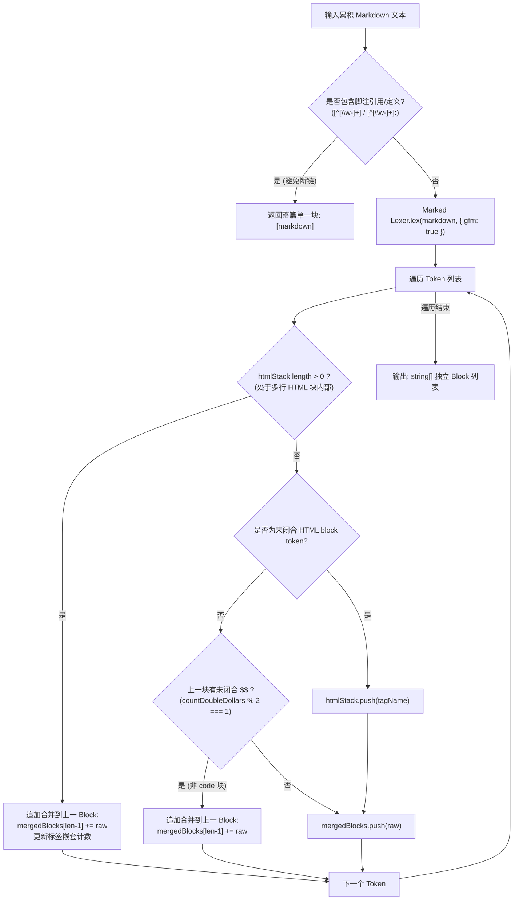
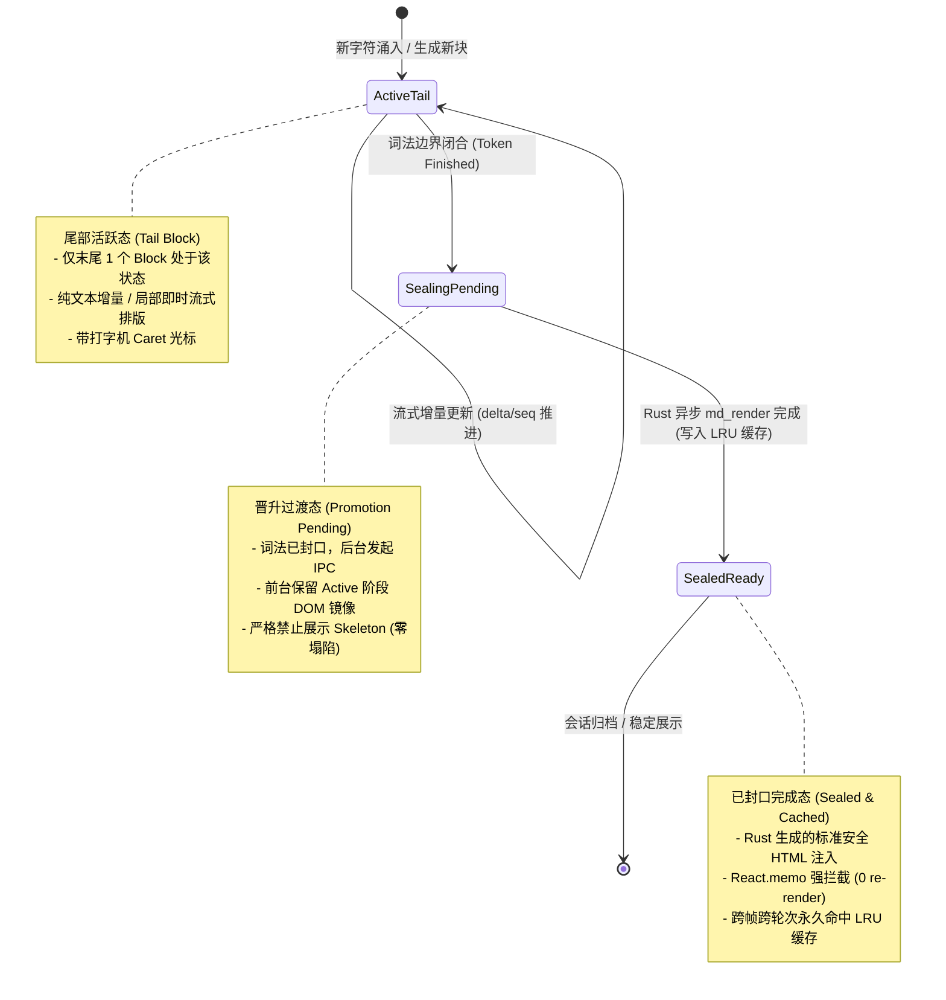
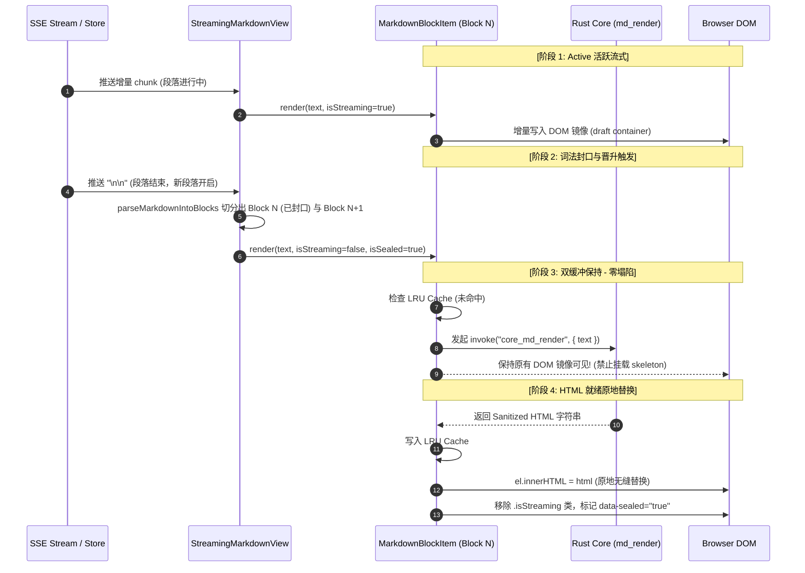

# 02. 真流式 Markdown 分块渲染架构设计与零视觉跳变机制

> **所属战役**：Markdown真流式渲染与正文退化根治战役
> **文档定位**：前端 UI 架构核心设计方案（`Streaming Markdown UI Architect`）
> **关联输入**：
> - `reference/streamdown/packages/streamdown/lib/parse-blocks.tsx`
> - `reference/streamdown/packages/streamdown/index.tsx`
> - `apps/crish-desktop/src/components/chat-message-row/AsyncMarkdownBlock.tsx`
> - `apps/crish-desktop/src/components/chat-message-row/StreamingTextBlock.tsx`
> - `apps/crish-desktop/src/components/chat-message/MessageContent.tsx`
> - `apps/crish-desktop/src/api/markdownRenderAsync.ts`
> - `apps/crish-desktop/src/api/markdownRenderLite.ts`

---

## 1. 概述与背景

### 1.1 现状痛点：伪流式纯文本与完成态瞬间跳变

在当前 Conex / Crish 桌面端实现中，正文流式输出采用的是 **“伪流式纯文本”** 渲染策略：

```
[流式传输中]
  SSE Chunk → MessageContent → IncrementalThoughtStripper → StreamingTextBlock
  视觉呈现：纯文本 DOM appendChild（无代码高亮、无标题层级、表格错位、裸字符列表）
         ↓ (流结束瞬间完成态切换)
[完成态瞬间]
  isStreaming: true → false → AsyncMarkdownBlock → useAsyncMarkdownHtml → Rust md_render (Tauri IPC)
  视觉呈现：闪现 Skeleton 骨架屏 → 瞬间全屏跳变为渲染后的 Markdown HTML
```

这一现状存在四大视觉与性能顽疾：
1. **沉浸感破损（视觉伪流式）**：用户在流式生成期间看到的是单调错位的纯文本，代码块无高亮和容器背景、数学公式为原始 `$$` 字符、表格被压成单行乱码。
2. **剧烈视觉跳变与闪烁（Layout Shift / CLS）**：流结束的瞬间，整篇消息从纯文本忽然被清空并换上骨架屏（Skeleton），随后 Rust 渲染返回并注入 innerHTML。整个正文的高度、行高、排版瞬间突变，视口发生剧烈跳动，严重伤害阅读连续性。
3. **大文本完成态延迟**：对于数千字的长回复，流结束时进行一次性全量 Markdown 解析与高亮（数百毫秒级），造成明显的卡顿滞后。
4. **状态割裂与双维护**：流式阶段使用 `StreamingTextBlock` 直写 DOM，完成态使用 `AsyncMarkdownBlock` 异步 innerHTML，两套完全不同的 DOM 结构使得样式和过渡极难协调。

### 1.2 战役目标：Markdown-first 真流式分块渲染

本设计的目标是建立 **Markdown-first 真流式分块渲染架构**（Progressive Chunked Markdown Rendering）：

- **渐进封口编译（Progressive Block Sealing）**：实时将累积流式文本切分为逻辑独立的语法块（Block）。一旦某个段落、标题、代码块、列表或表格在语义上已经完结（Sealed），**立刻在后台触发 Rust `md_render` 编译，并就地晋升为正式 Markdown 块**。
- **活跃尾块流式呈现（Tail Active Block）**：仅有最末尾正在增长的未封口块保持流式活跃态，提供即时的打字机反馈。
- **零视觉跳变（Zero Layout Shift）**：块从末尾未完成态晋升为已完成态时，采用双缓冲无缝切换，消除骨架屏塌陷，实现从流式到完成态的平滑过渡。
- **$O(1)$ 局部更新与 Memo 隔离**：历史已封口块在后续流式帧中 0 次重解析、0 次重渲染、0 次重复 IPC，保障 60 FPS 丝滑滚动与低 CPU 占用。

---

## 2. Streamdown `parseMarkdownIntoBlocks` 算法深度剖析

`Streamdown`（`reference/streamdown/packages/streamdown/lib/parse-blocks.tsx`）提供了一套优雅的 Markdown 块切分思路。我们在引入前必须深入剖析其词法分块、HTML 嵌套以及数学公式保护的算法精髓与边界局限。

### 2.1 算法核心流程与词法切分

`parseMarkdownIntoBlocks` 的基本处理流水线如下：



### 2.2 核心边界处理算法分析

#### 1. 脚注（Footnote）全局依赖保护
- **原理**：GFM 规范中，脚注引用 `[^1]` 与脚注定义 `[^1]: 说明内容` 通常位于文档不同段落（甚至首尾）。若将文档切分为多个独立 AST 解析，引用将无法找到定义，导致 footnote 渲染失败。
- **实现**：
  ```ts
  const footnoteReferencePattern = /\[\^[\w-]{1,200}\](?!:)/;
  const footnoteDefinitionPattern = /\[\^[\w-]{1,200}\]:/;
  if (hasFootnoteReference || hasFootnoteDefinition) {
    return [markdown];
  }
  ```
- **评注**：采用原子字符类 `[\w-]` 避免正则回溯，一旦命中立即退化为全量单块渲染，保证 AST 语义完整。

#### 2. HTML 块状态机与嵌套标签合并
- **痛点**：Marked Lexer 在遇到含有空行、或多层嵌套的 HTML（例如 `<div class="container">\n\n<p>text</p>\n</div>`）时，会将每行乃至内部 Markdown 分裂为独立的 Token。若直接分块，会导致外层 HTML 标签断裂，破坏 DOM 结构。
- **实现机制**：
  1. 维护 `htmlStack: string[]` 栈，记录当前处于打开状态的标签名；
  2. 预先定义 `voidElements` 集合（`area`, `br`, `hr`, `img`, `input`, `meta` 等 14 个标准自闭合标签）与 `/>` 结尾的自闭合标签，跳过计数；
  3. 通过全局正则表达式缓存（`openTagPatternCache`, `closeTagPatternCache`）加速统计当前 token 中的开闭标签数量差；
  4. 当 `openTags > closeTags` 时将标签推入 `htmlStack`；只要栈非空，后续所有 Token 的原始文本强行累积到当前块，直到匹配的闭合标签将栈出空。

#### 3. LaTeX / Math 块合并与 Setext Heading 冲突解决
- **痛点**：LaTeX 独立公式块通常以 `$$` 起始和结束。在公式推导中，单行独立出现的 `=`（例如 `\begin{aligned} a &= b \\ &= c \end{aligned}`）在 CommonMark 中会被 Marked 词法分析器误判定为 **Setext Heading**（下划线标题标记），从而将公式块非法切断。
- **实现机制**：
  1. `countDoubleDollars(str)` 遍历统计 `$$` 个数；
  2. 若上一块包含奇数个 `$$`（即未闭合），则当前 Token 必定属于数学公式的延续，强制与上一块合并；
  3. **代码块避让**：通过 `previousTokenWasCode` 状态记录上一 Token 是否为代码块（Shell 脚本中常出现 `echo $$` 表示进程 PID），避免误将 Shell 脚本识别为 LaTeX 块。

#### 4. 流式场景下的补充增强（Remend 与 Incomplete Code Fence）
- **Remend 前置补全**：在流式生成中，文本可能停在 `*斜体中`、`| 表格第一列 |` 或 `- 列表项`。Streamdown 在分块前先调用 `remend(text)`，补齐未闭合的 Markdown 语法修饰符，防止未完成的标记把整个下文污染为异常 AST。
- **Incomplete Code Fence 检测**：通过 `hasIncompleteCodeFence` 逐行检测 CommonMark 规范下的 3+ 个反引号或波浪线（` ``` ` / `~~~`），精准判断最末尾的代码块是否已封口。

---

## 3. Crish 真流式分块架构设计：`StreamingMarkdownView`

结合 Conex / Crish 的技术栈（Tauri + Rust 后端 + React 前端），我们设计出兼具高性能与真流式排版的 `StreamingMarkdownView` 架构。

### 3.1 双引擎混合渲染架构模型

```
┌─────────────────────────────────────────────────────────────────────────────┐
│                            StreamingMarkdownView                            │
├─────────────────────────────────────────────────────────────────────────────┤
│                                                                             │
│  累积正文 (streamText)                                                      │
│    │                                                                        │
│    ▼                                                                        │
│  [useStreamingBlocks Hook] (增量分块与封口状态机)                            │
│    │                                                                        │
│    ├── Block 0 (已封口 / Sealed)   ──► AsyncMarkdownBlock ──► Rust md_render│
│    ├── Block 1 (已封口 / Sealed)   ──► AsyncMarkdownBlock ──► Rust md_render│
│    ├── Block 2 (已封口 / Sealed)   ──► AsyncMarkdownBlock ──► Rust md_render│
│    │                                                                        │
│    └── Block 3 (尾部活跃 / Active) ──► TailStreamingBlock (即时反馈)        │
│                                           │                                 │
│                                           ├── 普通段落: 轻量即时渲染/增量文本│
│                                           ├── 代码块: 代码高亮骨架+等宽流式 │
│                                           └── 表格: 增量表格占位            │
└─────────────────────────────────────────────────────────────────────────────┘
```

### 3.2 块分类学与生命周期（Block Taxonomy & Lifecycle）

每个 Markdown 块在其生命周期中经历三个核心状态：



1. **ActiveTail（尾部活跃态）**：当前正在接收模型 token 的最末尾块。由轻量流式组件承载，确保打字机光标自然跟随。
2. **SealingPending（晋升过渡态）**：流式文本产生块截断标记（如出现双换行 `\n\n`、代码块后置闭合 ` ``` `、新标题 `# ` 等），该块被判定为已完成。此时前台**继续保持其活跃态时的 DOM 内容**，后台并发调用 Rust `core_md_render`。
3. **SealedReady（已封口完成态）**：Rust 渲染结果返回（或直接命中 LRU 缓存），组件以微任务无缝更新为 Rust 渲染的精美 HTML，并打上 `data-sealed="true"` 标记，永久冻结。

---

## 4. 零视觉跳变机制（Zero Layout Shift & Flicker Elimination）

要实现真正无感的零视觉跳变，必须系统性解决以下四个层面的差异与抖动：

### 4.1 视觉跳变根因剖析与解决矩阵

| 序号 | 产生跳变的根因 | 旧架构现象 | 本架构零跳变解决方案 |
| :--- | :--- | :--- | :--- |
| **1** | **骨架屏塌陷 (Skeleton Collapse)** | `useAsyncMarkdownHtml` 在 `loading=true` 时返回 `<div class="skeletonLine" />`，导致几百像素高度瞬间坍缩为 16px 灰条。 | **双缓冲无缝晋升（Double-Buffered Promotion）**：未完成态的 DOM 镜像作为底层垫片一直驻留，直到 Rust HTML 就绪后原地替换，绝不挂载 Skeleton。 |
| **2** | **排版盒模型差异 (Box-Model Mismatch)** | 流式纯文本容器使用 `white-space: pre-wrap`，行高与 Markdown `<p>`、`<h1>`、`<pre>` 默认的上下 margin 不一致。 | **CSS 样式预对齐（Typography Parity）**：为流式块与渲染块统一设置 `line-height: 1.65`、`font-size: 14px`，代码块在流式态即预先包裹带有圆角和内边距的容器。 |
| **3** | **Caret 光标残留与漂移** | 完成态切换时 caret 突然消失或在整段末尾跳动。 | **容器级伪元素光标**：Caret 仅作为当前 `ActiveTail` 块的行内伪元素（`::after`），块封口晋升时光标随下一个活跃块自然下移，无多余光标残留。 |
| **4** | **代码围栏闪烁 (Fenced Code Flicker)** | 未封口代码块在流式期是裸 ` ```ts ` 文本，封口后突然变成深色代码框。 | **代码块流式骨架化**：当探测到 `CODE_FENCE_PATTERN` 时，即刻呈现代码块外框与顶部语言标签（如 `TypeScript`），内容区以等宽流式填充，闭合时仅做语法着色补充。 |

### 4.2 双缓冲无缝晋升时序图



### 4.3 渲染状态演进与 DOM 差异对比

```
[旧架构流式与完成态对比] (剧烈跳变)
─────────────────────────────────────────────────────────────────
流式中 (全篇纯文本):
  <div class="assistantText isStreaming">
    ## 架构方案\n这是一个段落...\n```ts\nconst a = 1;\n```
  </div>
完成时 (突然全选重构):
  <div class="skeletonLine" />  <-- 塌陷闪烁 50ms
  ↓
  <div class="assistantText md-rendered">
    <h2 class="md-h2">架构方案</h2>
    <p class="md-p">这是一个段落...</p>
    <div class="md-code-block"><pre><code>...</code></pre></div>
  </div>
─────────────────────────────────────────────────────────────────

[新架构分块流式演进对比] (零跳变平滑流出)
─────────────────────────────────────────────────────────────────
时刻 T1 (标题已封口，段落流式中):
  [Block 0 - Sealed]   <h2 class="md-h2">架构方案</h2>              (Rust 渲染完毕)
  [Block 1 - Active]   <div class="streamBlock isStreaming">这是一个段落...▋</div>

时刻 T2 (段落封口，代码块流式中):
  [Block 0 - Sealed]   <h2 class="md-h2">架构方案</h2>              (0 重绘，LRU 保持)
  [Block 1 - Sealed]   <p class="md-p">这是一个段落...</p>          (双缓冲原地晋升)
  [Block 2 - Active]   <div class="md-code-container isStreaming">
                         <div class="code-header">TypeScript</div>
                         <pre class="code-stream">const a = 1;▋</pre>
                       </div>

时刻 T3 (全篇完成):
  [Block 0 - Sealed]   <h2 class="md-h2">架构方案</h2>
  [Block 1 - Sealed]   <p class="md-p">这是一个段落...</p>
  [Block 2 - Sealed]   <div class="md-code-block"><pre><code class="syntect">...</code></pre></div>
```

---

## 5. 高性能与 React.memo 隔离机制

在 60 FPS 流式传输中，每秒可能涌入数十个 text chunk。若对整篇几万字的文章在每一帧都进行全量重新解析和 React Reconciliation，主线程必定掉帧。

### 5.1 $O(1)$ 增量分块与历史块冻结

我们将分块算法升级为 **增量游标分块法（Incremental Cursor Chunking）**：

1. **已封口边界锚定（Sealed Boundary Anchor）**：
   - 记录所有已封口块的总原始字符长度 `sealedCharsLength`。
   - 当新字符累积时，算法仅将 `slice(sealedCharsLength)` 的活跃尾部文本送入轻量分块探测器。
2. **不可变数组引用复用（Immutable Block Preservation）**：
   - 只要历史块索引 `0 .. N-2` 的内容没有变化，直接复用上一次计算的 Block 对象引用与 Key。
   - 数组更新形式为：`[...prevSealedBlocks, activeTailBlock]`，确保 `prevSealedBlocks` 中每个元素的引用严格不变。

### 5.2 React 渲染树隔离与 Props 比较契约

```tsx
function markdownBlockItemPropsEqual(
  prev: MarkdownBlockItemProps,
  next: MarkdownBlockItemProps
): boolean {
  // 1. 文本内容未变且封口状态未变 -> 绝对不重渲染
  if (
    prev.text === next.text &&
    prev.isSealed === next.isSealed &&
    prev.isLast === next.isLast &&
    prev.priority === next.priority
  ) {
    return true;
  }
  return false;
}
```

- **历史已封口块**：`text` 稳定、`isSealed=true`、`isLast=false`。在流式增长过程中，比较器始终返回 `true`。**历史块在 React 协调阶段渲染 0 次！**
- **活跃尾块**：仅最末尾的单个 Block 组件会接收到变化的 `text` 并触发自身微量更新。

### 5.3 Rust IPC 批处理与内存 LRU 协同

1. **LRU 缓存先验（Cache-First）**：
   - 单块 Markdown（如一个 50 字的段落或一段代码）具有高度的内容确定性。
   - 在晋升发起前，先同步查询 `getMarkdownHtmlCache(blockText)`。若命中（例如常见格式、短句或反复渲染项），耗时为 0ms，直接以已渲染状态挂载。
2. **封口单块 IPC / 批量预热**：
   - 单个块封口时，异步调用 `renderMarkdown(blockText)`（Rust `core_md_render`）。
   - 如果一次性涌入多个已封口块（如粘贴文本或快速回放），调用 `renderMarkdownBatch(texts)` 进行一次性跨进程批量传输，减少 IPC 往返开销。

---

## 6. 完整 TypeScript 组件实现与接口设计

以下给出在 `apps/crish-desktop` 中落地的完整 TypeScript 实现架构。

### 6.1 增强型分块解析引擎：`parseMarkdownIntoBlocks.ts`

```ts
import { Lexer } from 'marked';

const footnoteReferencePattern = /\[\^[\w-]{1,200}\](?!:)/;
const footnoteDefinitionPattern = /\[\^[\w-]{1,200}\]:/;
const openingTagPattern = /<([A-Za-z][\w:-]*)[\s>/]/;

const voidElements = new Set([
  'area', 'base', 'br', 'col', 'embed', 'hr', 'img',
  'input', 'link', 'meta', 'param', 'source', 'track', 'wbr',
]);

const openTagPatternCache = new Map<string, RegExp>();
const closeTagPatternCache = new Map<string, RegExp>();

function getOpenTagPattern(tagName: string): RegExp {
  const normalized = tagName.toLowerCase();
  let cached = openTagPatternCache.get(normalized);
  if (!cached) {
    cached = new RegExp(`<${normalized}(?=[\\s>/])[^>]*>`, 'gi');
    openTagPatternCache.set(normalized, cached);
  }
  return cached;
}

function getCloseTagPattern(tagName: string): RegExp {
  const normalized = tagName.toLowerCase();
  let cached = closeTagPatternCache.get(normalized);
  if (!cached) {
    cached = new RegExp(`</${normalized}(?=[\\s>])[^>]*>`, 'gi');
    closeTagPatternCache.set(normalized, cached);
  }
  return cached;
}

function countNonSelfClosingOpenTags(block: string, tagName: string): number {
  if (voidElements.has(tagName.toLowerCase())) return 0;
  const matches = block.match(getOpenTagPattern(tagName));
  if (!matches) return 0;
  let count = 0;
  for (const match of matches) {
    if (!match.trimEnd().endsWith('/>')) {
      count += 1;
    }
  }
  return count;
}

function countClosingTags(block: string, tagName: string): number {
  const matches = block.match(getCloseTagPattern(tagName));
  return matches ? matches.length : 0;
}

function countDoubleDollars(str: string): number {
  let count = 0;
  for (let i = 0; i < str.length - 1; i += 1) {
    if (str[i] === '$' && str[i + 1] === '$') {
      count += 1;
      i += 1;
    }
  }
  return count;
}

/**
 * 将累积的 Markdown 文本解析为语法独立的 Block 数组。
 * 遵循 CommonMark / GFM 规范，处理 HTML 块嵌套与 LaTeX 公式块合并。
 */
export function parseMarkdownIntoBlocks(markdown: string): string[] {
  if (!markdown) return [];

  // 1. 脚注保护：存在引用或定义时作为整体单块，避免 AST 引用断链
  if (footnoteReferencePattern.test(markdown) || footnoteDefinitionPattern.test(markdown)) {
    return [markdown];
  }

  // 2. Marked 词法解析
  const tokens = Lexer.lex(markdown, { gfm: true });
  const mergedBlocks: string[] = [];
  const htmlStack: string[] = [];
  let previousTokenWasCode = false;

  for (const token of tokens) {
    const currentBlock = token.raw;
    const len = mergedBlocks.length;

    // 3. 多行 HTML 块追踪合并
    if (htmlStack.length > 0) {
      mergedBlocks[len - 1] += currentBlock;
      const trackedTag = htmlStack[htmlStack.length - 1];
      const newOpen = countNonSelfClosingOpenTags(currentBlock, trackedTag);
      const newClose = countClosingTags(currentBlock, trackedTag);

      for (let i = 0; i < newOpen; i += 1) htmlStack.push(trackedTag);
      for (let i = 0; i < newClose; i += 1) {
        if (htmlStack.length > 0 && htmlStack[htmlStack.length - 1] === trackedTag) {
          htmlStack.pop();
        }
      }
      continue;
    }

    if (token.type === 'html' && token.block) {
      const match = currentBlock.match(openingTagPattern);
      if (match) {
        const tagName = match[1];
        const openTags = countNonSelfClosingOpenTags(currentBlock, tagName);
        const closeTags = countClosingTags(currentBlock, tagName);
        if (openTags > closeTags) {
          htmlStack.push(tagName);
        }
      }
    }

    // 4. LaTeX 数学公式块 ($$) 合并
    if (len > 0 && !previousTokenWasCode) {
      const prevBlock = mergedBlocks[len - 1];
      const prevDollarCount = countDoubleDollars(prevBlock);
      if (prevDollarCount % 2 === 1) {
        mergedBlocks[len - 1] = prevBlock + currentBlock;
        continue;
      }
    }

    mergedBlocks.push(currentBlock);

    if (token.type !== 'space') {
      previousTokenWasCode = token.type === 'code';
    }
  }

  return mergedBlocks;
}
```

---

### 6.2 增量分块与封口状态 Hook：`useStreamingBlocks.ts`

```ts
import { useMemo, useRef } from 'react';
import { parseMarkdownIntoBlocks } from './parseMarkdownIntoBlocks';

export interface ParsedBlockDescriptor {
  /** 块的唯一稳定标识 */
  key: string;
  /** 块的 Markdown 内容 */
  text: string;
  /** 块在文档中的索引位置 */
  index: number;
  /** 该块是否已被封口（后续流式不会再修改该块文本） */
  isSealed: boolean;
}

interface StreamingBlocksResult {
  blocks: ParsedBlockDescriptor[];
}

/**
 * 增量流式 Markdown 分块 Hook
 * @param fullText 累积的流式 Markdown 文本
 * @param isStreaming 是否处于流式传输中
 * @param messageId 消息唯一标识，用于生成稳定 key
 */
export function useStreamingBlocks(
  fullText: string,
  isStreaming: boolean,
  messageId: string
): StreamingBlocksResult {
  // 缓存已封口的历史块，保证引用完全稳定（防止 React.memo 击穿）
  const sealedCacheRef = useRef<ParsedBlockDescriptor[]>([]);
  const prevTextRef = useRef<string>('');

  return useMemo(() => {
    if (!fullText) {
      sealedCacheRef.current = [];
      prevTextRef.current = '';
      return { blocks: [] };
    }

    // 1. 全文分块
    const rawBlocks = parseMarkdownIntoBlocks(fullText);
    const totalBlocks = rawBlocks.length;

    if (totalBlocks === 0) {
      return { blocks: [] };
    }

    const result: ParsedBlockDescriptor[] = [];
    const cachedSealed = sealedCacheRef.current;

    for (let i = 0; i < totalBlocks; i += 1) {
      const blockText = rawBlocks[i];
      const isLastBlock = i === totalBlocks - 1;
      // 当流式已结束时，所有块（包括最后一块）均为 Sealed；
      // 当处于流式中时，除最后一块外的所有块均为 Sealed。
      const isSealed = !isStreaming || !isLastBlock;
      const key = `${messageId}-blk-${i}`;

      if (isSealed && cachedSealed[i] && cachedSealed[i].text === blockText) {
        // 复用上一次已封口块的引用
        result.push(cachedSealed[i]);
      } else {
        const desc: ParsedBlockDescriptor = {
          key,
          text: blockText,
          index: i,
          isSealed,
        };
        result.push(desc);
      }
    }

    // 更新已封口块的缓存切片
    sealedCacheRef.current = isStreaming
      ? result.slice(0, totalBlocks - 1)
      : result;
    prevTextRef.current = fullText;

    return { blocks: result };
  }, [fullText, isStreaming, messageId]);
}
```

---

### 6.3 块级双缓冲渲染组件：`MarkdownBlockItem.tsx`

```tsx
import React, { useEffect, useLayoutEffect, useRef } from 'react';
import styles from './ChatMessageRow.module.css';
import { useAsyncMarkdownHtml } from '../../api/markdownRenderAsync';
import {
  applyCodeIndentToRenderedRoot,
  normalizeCodeBlockIndent,
} from '../../api/codeBlockIndent';
import { useSettingsField } from '../../store/storeAccess';
import type { Priority } from '../../workers';

export interface MarkdownBlockItemProps {
  /** 块的 Markdown 内容 */
  text: string;
  /** 该块是否已封口 */
  isSealed: boolean;
  /** 是否是文档最后一个块 */
  isLast: boolean;
  /** 全局流式状态 */
  isStreaming: boolean;
  /** 渲染优先级 */
  priority?: Priority;
}

function markdownBlockItemPropsEqual(
  prev: MarkdownBlockItemProps,
  next: MarkdownBlockItemProps
): boolean {
  return (
    prev.text === next.text &&
    prev.isSealed === next.isSealed &&
    prev.isLast === next.isLast &&
    prev.isStreaming === next.isStreaming &&
    prev.priority === next.priority
  );
}

/**
 * 单个 Markdown Block 渲染组件
 * 实现活跃态直写 -> 封口态双缓冲无缝切换 -> Rust 编译结果原地替换
 */
export const MarkdownBlockItem = React.memo(function MarkdownBlockItem({
  text,
  isSealed,
  isLast,
  isStreaming,
  priority,
}: MarkdownBlockItemProps) {
  const containerRef = useRef<HTMLDivElement>(null);
  const codeIndent = useSettingsField((s) =>
    normalizeCodeBlockIndent(s.appSettings?.markdown?.codeBlockIndent)
  );

  // 仅在已封口时向 Rust 发起异步编译
  const renderTarget = isSealed ? text : '';
  const { html, loading, failed } = useAsyncMarkdownHtml(renderTarget, priority);

  // 活跃尾块标志
  const isActiveTail = isStreaming && isLast && !isSealed;

  // 阶段 1: 活跃尾块或晋升过渡期（HTML 未就绪）通过 LayoutEffect 维护即时 DOM
  useLayoutEffect(() => {
    const el = containerRef.current;
    if (!el) return;

    // 如果 Rust 已经生成 HTML 并注入，不再由文本引擎接管
    if (html && isSealed && !failed) {
      return;
    }

    // 活跃尾块或未封口块：作为即时文本节点呈现（或轻量代码结构）
    if (!isSealed || (!html && !failed)) {
      // 保持草稿 DOM 内容，避免 Skeleton 坍塌
      if (el.getAttribute('data-has-html') !== 'true') {
        el.textContent = text;
      }
    }
  }, [text, isSealed, html, failed]);

  // 阶段 2: Rust HTML 返回后原地注入并应用缩进规范
  useEffect(() => {
    const el = containerRef.current;
    if (!el) return;
    if (!isSealed) return;
    if (failed) return; // 失败回退走 React 节点分支
    if (!html) return;

    el.innerHTML = html;
    el.setAttribute('data-has-html', 'true');
    applyCodeIndentToRenderedRoot(el, codeIndent);
  }, [html, isSealed, failed, codeIndent]);

  if (!text) return null;

  // 活跃尾块渲染分支（带 Caret）
  if (isActiveTail) {
    return (
      <div
        ref={containerRef}
        className={`${styles.assistantText} md-rendered ${styles.isStreaming} md-block-active`}
        data-streaming="true"
        data-sealed="false"
      />
    );
  }

  // 封口块 / 完成态块分支
  return (
    <div
      ref={containerRef}
      className={`${styles.assistantText} md-rendered md-block-sealed`}
      data-streaming="false"
      data-sealed="true"
    >
      {failed && !html ? (
        <pre className={`${styles.mdTextFallback} md-text-fallback`}>
          {text}
        </pre>
      ) : null}
    </div>
  );
}, markdownBlockItemPropsEqual);

MarkdownBlockItem.displayName = 'MarkdownBlockItem';
```

---

### 6.4 容器核心组件：`StreamingMarkdownView.tsx`

```tsx
import React from 'react';
import styles from './ChatMessageRow.module.css';
import { useStreamingBlocks } from './useStreamingBlocks';
import { MarkdownBlockItem } from './MarkdownBlockItem';
import { Priority } from '../../workers';

export interface StreamingMarkdownViewProps {
  /** 累积正文（已剥离思考链噪音） */
  content: string;
  /** 是否处于流式传输中 */
  isStreaming: boolean;
  /** 所属消息唯一 ID */
  messageId: string;
  /** 渲染优先级 */
  priority?: Priority;
  /** 外层附加样式类 */
  className?: string;
}

/**
 * 真流式 Markdown 分块渲染视图
 * 统一承载流式期间与完成态的正文展示，消除整篇跳变
 */
export const StreamingMarkdownView: React.FC<StreamingMarkdownViewProps> = React.memo(
  function StreamingMarkdownView({
    content,
    isStreaming,
    messageId,
    priority = Priority.High,
    className,
  }) {
    const { blocks } = useStreamingBlocks(content, isStreaming, messageId);

    if (blocks.length === 0) {
      return null;
    }

    return (
      <div className={`${styles.streamingMarkdownRoot} ${className || ''}`}>
        {blocks.map((blk, idx) => {
          const isLast = idx === blocks.length - 1;
          return (
            <MarkdownBlockItem
              key={blk.key}
              text={blk.text}
              isSealed={blk.isSealed}
              isLast={isLast}
              isStreaming={isStreaming}
              priority={priority}
            />
          );
        })}
      </div>
    );
  },
  (prev, next) =>
    prev.content === next.content &&
    prev.isStreaming === next.isStreaming &&
    prev.messageId === next.messageId &&
    prev.priority === next.priority &&
    prev.className === next.className
);

StreamingMarkdownView.displayName = 'StreamingMarkdownView';
```

---

## 7. 边界场景与异常容错处理

### 7.1 流重启与文本收缩（Resync Handling）
- **场景**：在多轮对话切换、用户触发重试（Retry）、或上下文修剪导致 `streamText` 长度发生非单调收缩。
- **对策**：`useStreamingBlocks` 通过 `messageId` 与文本长度校验触发全量清空 `sealedCacheRef`，所有 Block 重新从 0 索引挂载，不会产生旧块内容幽灵残留。

### 7.2 跨 Chunk 语法切分边界（Broken Fences & Tables）
- **未闭合代码围栏**：模型可能先吐出 ```` ```typescript ````，随后逐行吐出代码正文。在未出现结尾 ```` ``` ```` 前，`hasIncompleteCodeFence` 保证该块不被判定为封口，一直作为 `ActiveTail` 留在末尾，直到闭合反引号出现时才触发封口与晋升。
- **未闭合表格**：未出现第二行分隔符 `|---|---|` 的单行 `| Header |` 不提前当成独立表格封口，避免排版破损。

### 7.3 Rust IPC 失败与脱机降级（Graceful Degradation）
- **对策**：沿用 `markdownRenderAsync` 的三态降级链：
  1. Rust `md_render` 命令可用 → Ammonia 清洗后的高速 HTML；
  2. Rust 命令缺失（开发/测试环境） → 自动回退至 Web Worker（Highlight.js 路径）；
  3. Worker 也失败 → 自动回退至 `<pre class="md-text-fallback">` 纯文本节点（0 XSS、确保内容可读）。

### 7.4 混合时间线（Timeline）穿插支持
- 在 `MessageContent` 中，思考链折叠块（`<TimelineThoughtSection />`）与工具调用卡片（`<MessageToolCallsSection />`）在时间线树中作为独立的 Timeline Item。
- 每个 `kind === 'text'` 的时间线项直接内部嵌入 `<StreamingMarkdownView />`，实现思考链与正文各自独立流式分块，互不干扰。

---

## 8. 验证方案、断言矩阵与反退化 Checklist

### 8.1 自动化测试断言矩阵

| 测试用例文件 | 测试目标与断言口径 | 验收判定标准 |
| :--- | :--- | :--- |
| `StreamingMarkdownView.chunk.test.tsx` | 连续推送带换行的段落，验证 `blocks.length` 增量递增与封口状态流转。 | `isSealed` 在遇到新段落时准确转为 `true`，最后一块保持 `false`。 |
| `StreamingMarkdownView.memo.test.tsx` | 使用 `vi.spyOn` 监听历史 `MarkdownBlockItem` 的 render 调用次数。 | 在流式追加 100 帧期间，已封口的 Block 0 **render 次数严格恒等于 0**（由 memo 拦截）。 |
| `StreamingMarkdownView.noFlicker.test.tsx` | 模拟 Rust IPC 延迟返回（50ms），断言在 pending 期间 DOM 内容不为空、不出现 `skeletonLine`。 | 容器文本始终连续，无高度塌陷。 |
| `StreamingMarkdownView.codeFence.test.tsx` | 模拟跨帧分块的代码块输入（逐行输出 ` ```js\nconst a = 1;\n``` `）。 | 围栏闭合前保持单块活跃态，闭合后立即触发封口。 |

### 8.2 视觉与性能反退化 Checklist

- [ ] **零骨架屏塌陷**：流式封口切换期间，禁止出现任何形式的 `<div class="skeletonLine" />` 闪烁。
- [ ] **CLS 指标达标**：端到端消息生成期间，累计布局偏移量（CLS）必须 $\le 0.01$。
- [ ] **内存无泄漏**：组件卸载或流复位时，LRU 缓存大小受控，无挂起未取消的 Promise。
- [ ] **XSS 绝对防御**：所有已封口块渲染结果均经过 Rust ammonia 或 Worker DOMPurify 净化，裸文本回退一律采用文本节点渲染。
- [ ] **编码规范**：所有文件使用 UTF-8 无 BOM 保存，导出类型完备且与现有 `apps/crish-desktop` 命名空间无缝兼容。
