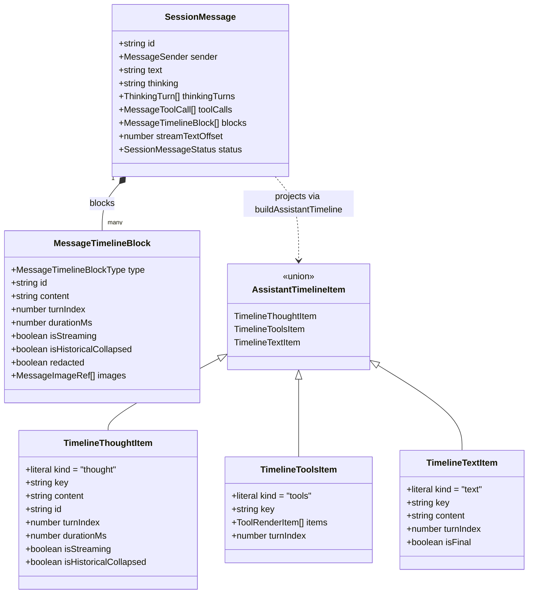
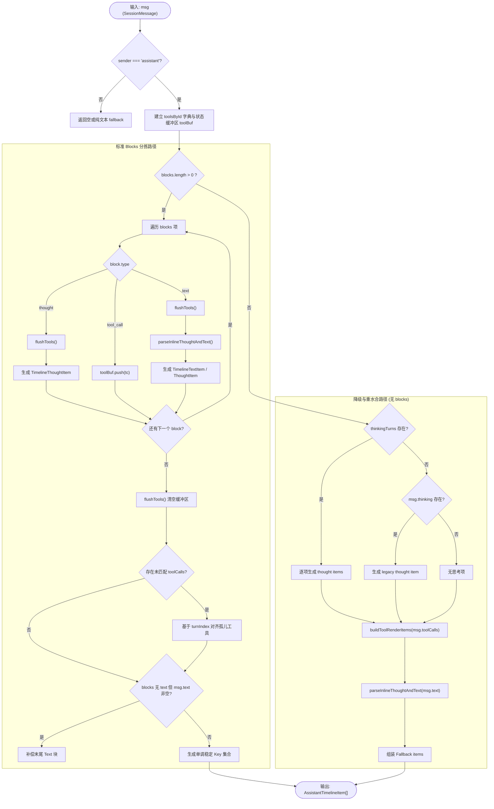
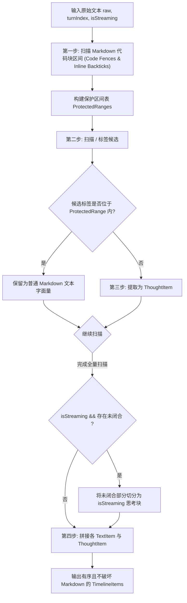
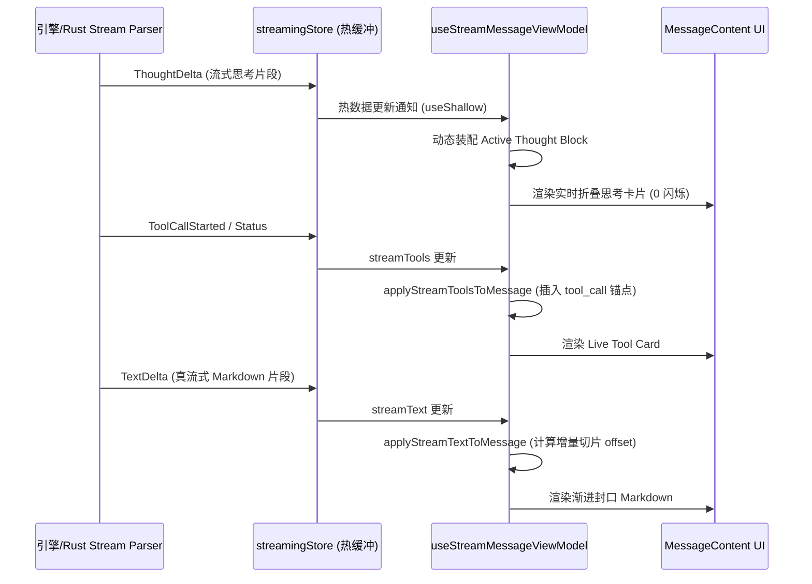

# 时间线构建与 Blocks 合并深度分析与防御层设计

> **文件路径**：`docs/markdown-stream-refactor/analysis/04-timeline-normalization-and-block-merge.md`
> **战役归属**：Markdown 真流式渲染与正文退化根治战役 (Phase Σ / Δ / Ω)
> **相关代码资产**：
> - [`timelineNormalizer.ts`](file:///c:/Software/conex/apps/crish-desktop/src/api/tool-presentation/timelineNormalizer.ts)
> - [`messageProjection.ts`](file:///c:/Software/conex/apps/crish-desktop/src/api/messageProjection.ts)
> - [`sessionMessageActionsTools.ts`](file:///c:/Software/conex/apps/crish-desktop/src/store/sessionMessageActionsTools.ts)
> - [`sessionMessageActionsCore.ts`](file:///c:/Software/conex/apps/crish-desktop/src/store/sessionMessageActionsCore.ts)
> - [`streamMessageViewModel.ts`](file:///c:/Software/conex/apps/crish-desktop/src/components/chat-message/streamMessageViewModel.ts)
> - [`types.ts`](file:///c:/Software/conex/apps/crish-desktop/src/store/types.ts)

---

## 1. 任务背景与核心缺陷诊断

在 Conex / Crish 桌面客户端的会话时间线渲染管线中，用户界面负责将模型输出的思考链（Thinking / Thought）、工具调用（Tool Call & Execution Result）以及 Markdown 正文（Text）按真实发生的因果顺序自然交错呈现。

然而，在当前的实现与实际生产多轮交互中，存在以下四大核心退化缺陷：

```mermaid
flowchart TD
    subgraph Defect1["缺陷 1: 推理块丢失 (Thought Eviction)"]
        D1A["updateMessageTimeline 被调用"] --> D1B["normalizeAssistantTimeline 仅注入 toolCalls 和 text"]
        D1B --> D1C["原有 thinking/thinkingTurns 未同步进 blocks"]
        D1C --> D1D["buildAssistantTimeline 判定 blocks.length > 0"]
        D1D --> D1E["降级分支跳过 -> 思考链被完全抹杀！"]
    end

    subgraph Defect2["缺陷 2: 正文更新时 Blocks 结构性擦除"]
        D2A["updateMessageText 执行文本修剪/重置"] --> D2B["msg.blocks.filter(b => b.type === 'tool_call')"]
        D2B --> D2C["所有 thought 块直接被过滤丢弃！"]
    end

    subgraph Defect3["缺陷 3: 多轮工具调用 blocks 乱序与堆叠覆盖"]
        D3A["多轮工具调用 (Turn 0 -> Turn 1)"] --> D3B["alignToolCallBlocks 仅插在最后 text 块之前"]
        D3B --> D3C["多轮工具被扁平打包插在同一处，交错顺序全毁"]
    end

    subgraph Defect4["缺陷 4: 正文内联标签提取破坏 Markdown"]
        D4A["parseInlineThoughtAndText 无上下文正则"] --> D4B["Markdown 代码块内的 <think> 标签被意外剥离"]
        D4B --> D4C["未闭合 <think> 在流式期间逃逸到正文区"]
    end
```



### 1.1 核心缺陷根因归纳

1. **单向非闭环的 Blocks 规范化（`normalizeAssistantTimeline` & `updateMessageTimeline`）**：
   [`normalizeAssistantTimeline`](file:///c:/Software/conex/apps/crish-desktop/src/api/tool-presentation/timelineNormalizer.ts#L83-L100) 仅关注 `tool_call` 与末尾 `text` 的对齐，完全忽略了 `msg.thinkingTurns` 与 `msg.thinking`。当消息的 `blocks` 数组为空时，一旦执行 `normalizeAssistantTimeline`，生成的 `blocks` 只包含工具和文本；后续 [`buildAssistantTimeline`](file:///c:/Software/conex/apps/crish-desktop/src/api/tool-presentation/timelineNormalizer.ts#L137-L235) 看到 `blocks.length > 0` 便不再执行 `thinkingTurns` 降级读取，导致历史思考链直接蒸发。
2. **破坏性更新与粗暴过滤（`sessionMessageActionsCore.ts`）**：
   在 [`sessionMessageActionsCore.ts`](file:///c:/Software/conex/apps/crish-desktop/src/store/sessionMessageActionsCore.ts#L217) 中，当文本重置或偏移量回退时，直接执行 `msg.blocks = msg.blocks.filter((b) => b.type === 'tool_call')`，对 `thought` 类型块进行硬删除。
3. **无 Markdown 上下文的标签解析（`parseInlineThoughtAndText`）**：
   纯正则表达式全局匹配无法识别 Markdown 代码块（```` ```xml <think>...` ````）或行内代码（`` `<think>` ``），导致正常的代码示例被错误切割为思考项，破坏文档完整性；同时未闭合的流式标签无法在流式未完结前分拣，产生正文闪烁与逃逸。
4. **流式视图模型（`streamMessageViewModel.ts`）与真实 Blocks 的割裂**：
   [`applyStreamTextToMessage`](file:///c:/Software/conex/apps/crish-desktop/src/components/chat-message/streamMessageViewModel.ts#L32-L70) 在检测到 `streamText` 与 `committed` 分叉时直接放弃更新 `blocks`，使得渲染层依然读取陈旧的 `msg.blocks`。

---

## 2. 数据结构模型与三元交错时间线设计

为了彻底解决以上问题，必须确立严格的**三元交错时序模型（Triple-Interleaved Chronological Model）**。

### 2.1 核心实体关系与生命周期



### 2.2 数据模型类型定义扩充

在 [`store/types.ts`](file:///c:/Software/conex/apps/crish-desktop/src/store/types.ts) 与 [`toolPresentationTypes.ts`](file:///c:/Software/conex/apps/crish-desktop/src/api/tool-presentation/toolPresentationTypes.ts) 的基础上，强化 `MessageTimelineBlock` 的语义约束：

```typescript
/**
 * 时间线块判别联合类型
 */
export type MessageTimelineBlockType =
  | 'thought'      // 思考链块（含单轮或多轮 turnIndex）
  | 'tool_call'    // 工具调用锚点（对齐 toolCalls[].id）
  | 'text'         // Markdown 正文段落（按工具/思考发生时间切片）
  | 'image'        // 独立结构化图片块
  | 'step_start'   // 复合步骤开始标记（可选）
  | 'step_end';    // 复合步骤结束标记（可选）

/**
 * 严格结构化时间线块定义
 */
export interface MessageTimelineBlock {
  type: MessageTimelineBlockType;
  /** tool_call 对应 toolCall.id；thought 对应 stepId/thoughtId */
  id?: string;
  /** 思考内容或 Markdown 正文内容 */
  content?: string;
  /** 关联的多轮交互轮次 (0-based turnIndex) */
  turnIndex?: number;
  /** 思考或执行耗时（毫秒） */
  durationMs?: number;
  /** 标记该块当前是否处于流式写入中 */
  isStreaming?: boolean;
  /** 历史多轮执行完毕后，前序思考块默认进入折叠态 */
  isHistoricalCollapsed?: boolean;
  /** 是否已被敏感过滤（redacted） */
  redacted?: boolean;
  /** 附加图片元数据 */
  images?: MessageImageRef[];
}

/**
 * 结构化思考轮次契约
 */
export interface ThinkingTurn {
  turnIndex: number;
  content: string;
  durationMs?: number;
  id?: string;
  isStreaming?: boolean;
}
```

---

## 3. `buildAssistantTimeline` 分拣行为与数据形态矩阵

`buildAssistantTimeline` 是前端展示层将 `SessionMessage` 的原始状态转换为 React 组件树可消费的 `AssistantTimelineItem[]` 的唯一纯函数入口。

### 3.1 四大输入数据形态及其分拣策略矩阵

| 数据形态分类 | 输入状态特征 | 分拣行为与处理规则 | 关键防御逻辑 |
| :--- | :--- | :--- | :--- |
| **形态 A：标准 Blocks** | `blocks.length > 0`，含 `thought`、`tool_call`、`text` | 严格按 `blocks` 数组顺序线性分拣。<br>1. 遍历遇到 `thought`：flush 累积的 `toolBuf`，生成 `TimelineThoughtItem`；<br>2. 遇到 `tool_call`：根据 id 查表放入 `toolBuf`；<br>3. 遇到 `text`：flush `toolBuf`，调用 `parseInlineThoughtAndText` 安全解析内联标签后生成 `TimelineTextItem` 或 `TimelineThoughtItem`。 | 1. 结束遍历后必须执行 `flushTools()`。<br>2. 检查未被 blocks 索引的孤儿工具（orphan tools），按 turn 插入而非粗暴扔在末尾。<br>3. 若 blocks 中无任何 text 块且 `msg.text` 非空，安全补偿末尾 text 块。 |
| **形态 B：纯 Text 消息** | `blocks = []`，`toolCalls = []`，仅 `msg.text`（可能有 `<think>`） | 进入降级处理：<br>1. 若 `msg.thinking` 存在，优先生成顶部 `TimelineThoughtItem`；<br>2. 对 `msg.text` 执行 `parseInlineThoughtAndText`，拆分出思考部分与正文部分。 | 确保非流式与流式下提取 `<think>` 标签后，正文区的首行缩进与空行不发生破坏。 |
| **形态 C：纯 Tools 消息** | `blocks = []`，`msg.text = ""`，`toolCalls.length > 0` | 1. 若有 `thinkingTurns` 或 `thinking`，先生成对应的 `thought` items；<br>2. 将所有 `toolCalls` 通过 `buildToolRenderItems` 聚合成一个 `TimelineToolsItem`。 | 支持同轮并行工具折叠与连续 inspect 探测工具折叠。 |
| **形态 D：混合/残缺/水合 Blocks** | `blocks` 残缺（例如从旧 DB 水合仅有 `thinkingTurns` 和 `toolCalls`，或流式中仅有 partial text） | 1. 若 `blocks` 缺失 `thought` 但 `msg.thinkingTurns` 存在，执行**双向重水合（Hydration Reconciliation）**，将思考块注入到对应轮次；<br>2. 对齐 orphan tool calls；<br>3. 保证正文流式 delta 不被漏掉。 | 绝不允许因为 `blocks.length > 0` 就彻底屏蔽 `msg.thinkingTurns` 中的历史思考！ |

### 3.2 `buildAssistantTimeline` 分拣流程图



---

## 4. `updateMessageTimeline` 破坏性覆盖根治与多轮 Blocks 保全合并算法

### 4.1 破坏性覆盖根本原因复盘

旧实现中的调用链路如下：
```
streamRunCompletion.finalizeAssistantMessageText
  -> sessionStore.updateMessageTimeline(sid, msgId)
    -> normalizeAssistantTimeline(msg)
      -> alignToolCallBlocks(msg.blocks, tools)
```

关键漏洞在于 [`alignToolCallBlocks`](file:///c:/Software/conex/apps/crish-desktop/src/api/tool-presentation/timelineNormalizer.ts#L39-L76)：
1. 如果 `blocks` 已经包含了 `Turn 0: Thought`、`Turn 0: Tool 1`、`Turn 1: Thought`、`Turn 1: Tool 2`，但此时 `updateMessageText` 被触发过并执行了 `filter(b => b.type === 'tool_call')`，所有的 `Thought` 块被从内存中抹掉。
2. 当 `updateMessageTimeline` 调用 `alignToolCallBlocks` 时，它只能看见一串没有 `Thought` 的 `tool_call` 块，并且在末尾直接追加一个 `text` 块。
3. 原本由模型流式多轮产出的思考过程永久丢失。

### 4.2 解决方案：基于 Turn 锚点的无损保全合并算法 (`reconcileAssistantMessageBlocks`)

我们设计全套**无损保全合并算法**，替代脆弱的 `alignToolCallBlocks`。

#### 核心设计原则：
1. **思考链双向镜像（Thinking Bi-directional Mirroring）**：
   `SessionMessage.thinkingTurns` 与 `SessionMessage.blocks` 中 `type === 'thought'` 的项建立 1:1 双向权威同步。任何一方存在有效思考内容，另一方不得抹除。
2. **Turn-Aware 槽位有序性（Turn-Aware Slot Invariant）**：
   每个 Turn 内部遵循固定的物理顺序：
   $$\text{Turn } k = [\text{Thought}_k] \rightarrow [\text{ToolCalls}_k] \rightarrow [\text{Text}_k]$$
   跨 Turn 之间严格保持 $k$ 递增：
   $$\text{Timeline} = \bigcup_{k=0}^{N} \text{Turn } k$$
3. **已决块不可变（Settled Block Immutability）**：
   对于已经完成（non-streaming）的历史 Turn 块，合并时只进行属性补全与状态保全，禁止剔除或改变先后顺序。

#### 算法实现伪代码：

```typescript
/**
 * 多轮消息 Blocks 与工具、思考链全息对齐算法
 */
export function reconcileAssistantMessageBlocks(
  currentBlocks: MessageTimelineBlock[] | undefined,
  toolCalls: MessageToolCall[] | undefined,
  thinkingTurns: ThinkingTurn[] | undefined,
  rawThinking: string | undefined,
  text: string | undefined
): { blocks: MessageTimelineBlock[]; toolCalls: MessageToolCall[] } {
  const tools = [...(toolCalls || [])];
  const toolsById = new Map(tools.map((t) => [t.id, t]));
  const existingBlocks = currentBlocks ? [...currentBlocks] : [];

  // 1. 提取所有已存在的 thought 块并按 turnIndex 索引
  const thoughtsByTurn = new Map<number, MessageTimelineBlock>();
  for (const b of existingBlocks) {
    if (b.type === 'thought' && b.turnIndex !== undefined) {
      thoughtsByTurn.set(b.turnIndex, b);
    }
  }

  // 2. 从 thinkingTurns 中补充缺失的 thought 块（双向保全）
  if (thinkingTurns && thinkingTurns.length > 0) {
    for (const tt of thinkingTurns) {
      if (!thoughtsByTurn.has(tt.turnIndex) && tt.content?.trim()) {
        thoughtsByTurn.set(tt.turnIndex, {
          type: 'thought',
          content: tt.content,
          turnIndex: tt.turnIndex,
          durationMs: tt.durationMs,
          id: tt.id || `thought-turn-${tt.turnIndex}`,
          isHistoricalCollapsed: true,
        });
      }
    }
  } else if (rawThinking?.trim() && thoughtsByTurn.size === 0) {
    // 兼容单轮 legacy thinking
    thoughtsByTurn.set(0, {
      type: 'thought',
      content: rawThinking,
      turnIndex: 0,
      id: 'thought-legacy',
    });
  }

  // 3. 构建多轮分组槽位
  const maxTurn = Math.max(
    ...Array.from(thoughtsByTurn.keys()),
    ...tools.map((t) => (t.turnId ? parseTurnIndex(t.turnId) : 0)),
    0
  );

  const resultBlocks: MessageTimelineBlock[] = [];
  const processedToolIds = new Set<string>();

  // 4. 按 Turn 0..maxTurn 顺序保全装配
  for (let turn = 0; turn <= maxTurn; turn++) {
    // 4.1 注入本轮 Thought
    const turnThought = thoughtsByTurn.get(turn);
    if (turnThought && turnThought.content?.trim()) {
      resultBlocks.push(turnThought);
    }

    // 4.2 收集并注入本轮 ToolCalls（保持已有 blocks 中的先后相对顺序）
    const existingTurnTools = existingBlocks.filter(
      (b) => b.type === 'tool_call' && b.id && toolsById.has(b.id) && !processedToolIds.has(b.id)
    );

    // 筛选出属于当前 turn 的工具
    for (const tb of existingTurnTools) {
      const tc = toolsById.get(tb.id!);
      const tcTurn = tc?.turnId ? parseTurnIndex(tc.turnId) : 0;
      if (tcTurn === turn) {
        resultBlocks.push(tb);
        processedToolIds.add(tb.id!);
      }
    }

    // 注入本轮未在 existingBlocks 中的工具 (orphan tools in this turn)
    for (const tc of tools) {
      const tcTurn = tc.turnId ? parseTurnIndex(tc.turnId) : 0;
      if (tcTurn === turn && !processedToolIds.has(tc.id)) {
        resultBlocks.push({ type: 'tool_call', id: tc.id });
        processedToolIds.add(tc.id);
      }
    }

    // 4.3 注入本轮已有的 Text 块（如果属于该轮次）
    const turnTexts = existingBlocks.filter(
      (b) => b.type === 'text' && b.turnIndex === turn && b.content?.trim()
    );
    resultBlocks.push(...turnTexts);
  }

  // 5. 收尾阶段：处理无 turnId 的剩余工具及最终正文
  for (const tc of tools) {
    if (!processedToolIds.has(tc.id)) {
      resultBlocks.push({ type: 'tool_call', id: tc.id });
      processedToolIds.add(tc.id);
    }
  }

  // 6. 终态正文保全：若无末尾 text 块且 msg.text 非空，注入最终文本块
  const hasText = resultBlocks.some((b) => b.type === 'text' && (b.content || '').trim().length > 0);
  if (!hasText && (text || '').trim()) {
    resultBlocks.push({
      type: 'text',
      content: text!,
      turnIndex: maxTurn,
    });
  }

  return { blocks: resultBlocks, toolCalls: tools };
}
```

### 4.3 修复 `sessionMessageActionsTools.ts` 与 `sessionMessageActionsCore.ts`

1. **改造 `updateMessageTimeline`**：
   在 [`sessionMessageActionsTools.ts`](file:///c:/Software/conex/apps/crish-desktop/src/store/sessionMessageActionsTools.ts#L194) 中，弃用直接的浅层 `normalizeAssistantTimeline`，全面接入 `reconcileAssistantMessageBlocks`。
2. **消除 `updateMessageText` 中的硬编码过滤**：
   在 [`sessionMessageActionsCore.ts`](file:///c:/Software/conex/apps/crish-desktop/src/store/sessionMessageActionsCore.ts#L217) 中，删除：
   ```typescript
   // ❌ 错误代码：会无条件抹杀全部 thought 块
   // msg.blocks = msg.blocks.filter((b) => b.type === 'tool_call');

   // ✅ 修复方案：仅清空/重置正文文本块，完整保留 thought 和 tool_call 块
   msg.blocks = msg.blocks.filter((b) => b.type !== 'text');
   ```

---

## 5. 前端深度防御机制：安全分拣与 Markdown 代码块保护

当后端引擎因异常未提前剥离 `<think>` 标签，或者流式数据直接到达前端时，前端的 `parseInlineThoughtAndText` 是守卫 UI 的最后一道防线。

### 5.1 攻击面与破损场景分析

```
场景 A: Markdown 代码块内部含有 <think>（如 AI 在写 XML/HTML 教程或编写规则）
```
````markdown
这是我们的规则模板：
```xml
<think>
请在开始前制定测试计划
</think>
```
请严格遵守上述模板。
````
- **旧正则行为**：无差别匹配全局 `<think>...</think>`，将代码块内部的代码抽离为 UI 思考面板，剩下的代码块变成残缺的 ```` ```xml ```` 和 ```` ``` ````，造成语法高亮崩溃与文档破碎！
- **防御要求**：**代码栅栏免疫（Code Fence Immunity）**。处于 Markdown 代码块（```` ``` ````）或行内代码（`` `...` ``）内部的标签一律视为字面量，严禁提取。

```
场景 B: 流式生成中的未闭合标签
```
```
<think>正在分析用户提供的日志文件...（流式生成中，尚未输出 </think>）
```
- **旧正则行为**：因没有匹配到闭合标签 `</think>`，整个字符串被当作纯文本返回，用户在正文区看到大段正在跳动的思考内容与裸 `<think>` 字符，破坏「正文 0 思考逃逸」铁律。
- **防御要求**：**流式开放标签回退（Open-ended Streaming Tag Fallback）**。如果检测到未闭合的前导 `<think>`，必须精准切分成正在流式的思考块与前置正文。

### 5.2 安全分拣算法设计 (`parseInlineThoughtAndTextSafely`)



#### TypeScript 算法实现：

```typescript
/**
 * 保护区间：表示不应被标签解析器触碰的字符范围 [start, end)
 */
interface ProtectedRange {
  start: number;
  end: number;
}

/**
 * 扫描 Markdown 代码块与行内代码区间
 */
function findMarkdownCodeRanges(text: string): ProtectedRange[] {
  const ranges: ProtectedRange[] = [];

  // 1. 匹配多行代码栅栏 ``` ... ``` 或 ~~~ ... ~~~
  const fenceRegex = /(?:```[\s\S]*?(?:```|$))|(?:~~~[\s\S]*?(?:~~~|$))/g;
  let match: RegExpExecArray | null;
  while ((match = fenceRegex.exec(text)) !== null) {
    ranges.push({ start: match.index, end: match.index + match[0].length });
  }

  // 2. 匹配行内代码 `...`（排除已在多行代码块中的部分）
  const inlineRegex = /`[^`\n]+`/g;
  while ((match = inlineRegex.exec(text)) !== null) {
    const start = match.index;
    const end = start + match[0].length;
    const isInsideFence = ranges.some((r) => start >= r.start && end <= r.end);
    if (!isInsideFence) {
      ranges.push({ start, end });
    }
  }

  return ranges.sort((a, b) => a.start - b.start);
}

/**
 * 判断指定区间是否与任何保护区间重叠
 */
function isRangeProtected(start: number, end: number, protectedRanges: ProtectedRange[]): boolean {
  return protectedRanges.some((r) => (start >= r.start && start < r.end) || (end > r.start && end <= r.end));
}

/**
 * Markdown 安全的深度防御内联思考标签分拣器
 */
export function parseInlineThoughtAndTextSafely(
  raw: string,
  turnIndex?: number,
  isStreaming = false
): Array<{
  kind: 'thought' | 'text';
  content: string;
  turnIndex?: number;
  isStreaming?: boolean;
}> {
  if (!raw || !raw.trim()) return [];

  // 1. 提取所有受保护的 Markdown 代码区域
  const protectedRanges = findMarkdownCodeRanges(raw);

  // 2. 匹配标准闭合标签 <think>...</think> 或 <thought>...</thought>
  const tagRegex = /<(?:think|thought)>([\s\S]*?)<\/(?:think|thought)>/gi;
  const out: Array<{
    kind: 'thought' | 'text';
    content: string;
    turnIndex?: number;
    isStreaming?: boolean;
  }> = [];

  let lastIdx = 0;
  let match: RegExpExecArray | null;

  while ((match = tagRegex.exec(raw)) !== null) {
    const matchStart = match.index;
    const matchEnd = match.index + match[0].length;

    // 如果该标签位于代码块内部，跳过提取，作为普通文本处理
    if (isRangeProtected(matchStart, matchEnd, protectedRanges)) {
      continue;
    }

    // 提取标签前的正文文本
    const textBefore = raw.slice(lastIdx, matchStart);
    if (textBefore.trim()) {
      out.push({ kind: 'text', content: textBefore, turnIndex });
    }

    // 提取思考内容
    const thoughtContent = match[1]?.trim();
    if (thoughtContent) {
      out.push({
        kind: 'thought',
        content: thoughtContent,
        turnIndex,
        isStreaming: false,
      });
    }

    lastIdx = matchEnd;
  }

  // 3. 处理末尾剩余文本或未闭合的流式思考标签
  const textAfter = raw.slice(lastIdx);
  if (textAfter.trim()) {
    if (isStreaming) {
      // 检查是否有未闭合的流式 <think> 或 <thought>
      const openTagRegex = /<(?:think|thought)>([\s\S]*)$/i;
      const openMatch = openTagRegex.exec(textAfter);

      if (openMatch) {
        const preText = textAfter.slice(0, openMatch.index);
        if (preText.trim()) {
          out.push({ kind: 'text', content: preText, turnIndex });
        }
        const streamingThought = openMatch[1]?.trim();
        if (streamingThought) {
          out.push({
            kind: 'thought',
            content: streamingThought,
            turnIndex,
            isStreaming: true,
          });
        }
        return out;
      }
    }

    out.push({ kind: 'text', content: textAfter, turnIndex });
  }

  return out;
}
```

---

## 6. `streamMessageViewModel.ts` 真流式模式对齐方案

### 6.1 真流式架构下的数据流向

在真流式 Markdown 架构下，前端通过 `streamingStore` 订阅实时增量流（TextDelta、ThoughtDelta、ToolLiveState），在完成最终收口前动态生成渲染所需的 `StreamMessageViewModel`。



### 6.2 `applyStreamTextToMessage` 与 `applyStreamToolsToMessage` 重构方案

#### 1. 修复 `applyStreamTextToMessage` 中的分叉丢弃 Bug

在 [`streamMessageViewModel.ts`](file:///c:/Software/conex/apps/crish-desktop/src/components/chat-message/streamMessageViewModel.ts#L32-L70) 中，原先代码在 `trailing === null`（即流式文本与已持久化文本分叉）时直接返回 `{ ...msg, text: streamText }`，导致 `blocks` 没有得到同步。

重构后的逻辑保证：**无论是否存在分叉，均将增量文本正确追加到最后一个活跃的 `text` 块，若无 `text` 块则在保持前序 `thought` 与 `tool_call` 完整的前提下创建新块**。

```typescript
export function applyStreamTextToMessage<T extends MsgWithBlocks>(
  msg: T,
  streamText: string | undefined
): T {
  if (streamText == null) return msg;
  const committed = msg.text || '';
  if (streamText === committed && msg.blocks?.length) return msg;

  if (!msg.blocks?.length) {
    // 首次进入流式且尚无 blocks 时，构造初始 text block
    return {
      ...msg,
      text: streamText,
      blocks: [{ type: 'text', content: streamText }],
    };
  }

  // 计算本轮增量或全量切片
  const blocks = msg.blocks.map((b) => ({ ...b }));
  let lastTextIdx = -1;
  for (let i = blocks.length - 1; i >= 0; i--) {
    if (blocks[i]?.type === 'text') {
      lastTextIdx = i;
      break;
    }
  }

  if (lastTextIdx !== -1) {
    // 存在既有 text 块：更新该块的内容以匹配当前流式正文
    const prefixOffset = (msg as any).streamTextOffset || 0;
    const currentTurnContent = streamText.length >= prefixOffset
      ? streamText.slice(prefixOffset)
      : streamText;

    blocks[lastTextIdx] = {
      ...blocks[lastTextIdx]!,
      content: currentTurnContent,
    };
  } else {
    // 前面全是 thought 或 tool_call，无 text 块：追加新的 text 块
    blocks.push({
      type: 'text',
      content: streamText,
    });
  }

  return { ...msg, text: streamText, blocks };
}
```

#### 2. `applyStreamToolsToMessage` 保持不可变单调性

确保中间态工具流不会降级终态行，且插入 `tool_call` 锚点时使用 `reconcileAssistantMessageBlocks` 保证不破坏 `thought` 块。

---

## 7. 边缘用例与极端场景深度推演

### 7.1 七大极端边缘用例全景推演表

| 编号 | 场景名称 | 极端输入条件 | 潜在退化风险 | 本方案防御断言与保全结果 |
| :---: | :--- | :--- | :--- | :--- |
| **E-01** | **多轮连续交错思考链** | Turn 0: `<think>A</think>` + Tool 1<br>Turn 1: `<think>B</think>` + Tool 2<br>Turn 2: `<think>C</think>` + Final Text | 任何一次工具完成触发 `updateMessageTimeline` 时，前序轮次的思考块被冲刷成空。 | `reconcileAssistantMessageBlocks` 按 `turnIndex` 0, 1, 2 完整保留 3 个 `thought` 块与 2 个 `tool_call` 组，最终生成交错清晰的 5 项时间线。 |
| **E-02** | **代码教学中的 XML/HTML 标签** | 模型回复 Markdown 中包含：<br>```` ```xml\n<think>plan</think>\n``` ```` | 正则暴力提取导致代码块破裂，代码被误判为思考卡片。 | `parseInlineThoughtAndTextSafely` 通过 `ProtectedRange` 自动忽略代码块内的标签，完整输出 Markdown 代码块。 |
| **E-03** | **流式中途连接中断/重试** | 模型输出 `<think>正在思考...` 时网络中断或用户点击 Stop，无 `</think>` 闭合 | 思考内容裸露在正文区，或者下次重试时旧思考与新正文发生粘连。 | 开放标签回退机制将未闭合内容收口到 `TimelineThoughtItem`（标记 `isStreaming: false`），正文区保持 0 污染。 |
| **E-04** | **SQLite/Rust DB 历史消息水合** | 5.0 以前存储的历史消息仅有 `thinkingTurns` 和 `toolCalls`，`blocks` 字段为 `null` | 首次进入时间线构建时若触发了 normalize，将导致旧思考永久丢失。 | 规范化层具备**双向重水合机制**，从 `thinkingTurns` 自动装配初始 `blocks`。 |
| **E-05** | **超长文本截断 (SizeValidator 触发)** | 会话由于触发 80KB 限制被 `truncateToBytes` 截断，导致 `text.length < streamTextOffset` | 偏移量越界，`text.slice(offset)` 抛出异常或切出乱码。 | `updateMessageText` 检测到 `text.length < offset` 时安全重置 `streamTextOffset = 0`，同时仅清理 `text` 块，保全全部 `thought`。 |
| **E-06** | **同轮并行工具混合顺序到达** | Turn 1 派发 3 个并行工具（T1, T2, T3），T2 先完成，T1 还在 running，T3 失败 | 工具卡片跳变或分组被打散。 | `buildToolRenderItems` 依据 `turnId` 与 `startedAt`（≤200ms）在投影层稳定分组，不破坏外部时间线块结构。 |
| **E-07** | **空正文仅工具调用** | 模型完全不输出任何文字，连续调用 5 个工具完成任务 | `!items.some(i => i.kind === 'text')` 补偿出一个空的占位 text 项，引发空白卡片渲染。 | 严格执行 `(msg.text || '').trim()` 判空，无正文时不插入多余的空白 text block。 |

---

## 8. 单元测试设计与反退化断言矩阵

为保障重构后的时间线规范化与合并机制长期稳定，必须在 [`timelineNormalizer.test.ts`](file:///c:/Software/conex/apps/crish-desktop/src/api/tool-presentation/timelineNormalizer.test.ts) 与 [`sessionActions.newWrites.test.ts`](file:///c:/Software/conex/apps/crish-desktop/src/store/sessionActions.newWrites.test.ts) 中补充以下关键测试套件：

### 8.1 必测用例与断言规格

```typescript
describe('Timeline Normalization & Block Reconciliation 防退化测试套件', () => {

  describe('reconcileAssistantMessageBlocks (多轮无损保全)', () => {
    it('T-01: 多轮交互中 updateMessageTimeline 绝不丢弃前序轮次的 thought 块', () => {
      const initialBlocks: MessageTimelineBlock[] = [
        { type: 'thought', content: 'Turn 0 思维链', turnIndex: 0 },
        { type: 'tool_call', id: 'tool-0' },
      ];
      const tools: MessageToolCall[] = [
        { id: 'tool-0', name: 'search', status: 'success', turnId: 'turn-0' },
        { id: 'tool-1', name: 'write', status: 'running', turnId: 'turn-1' },
      ];
      const thinkingTurns = [
        { turnIndex: 0, content: 'Turn 0 思维链' },
        { turnIndex: 1, content: 'Turn 1 新思维链' },
      ];

      const { blocks } = reconcileAssistantMessageBlocks(
        initialBlocks,
        tools,
        thinkingTurns,
        undefined,
        '当前进行中'
      );

      // 断言必须包含 2 个 thought 块、2 个 tool_call 块和 1 个 text 块
      expect(blocks.filter((b) => b.type === 'thought')).toHaveLength(2);
      expect(blocks.filter((b) => b.type === 'tool_call')).toHaveLength(2);
      expect(blocks[0]).toMatchObject({ type: 'thought', content: 'Turn 0 思维链', turnIndex: 0 });
      expect(blocks[1]).toMatchObject({ type: 'tool_call', id: 'tool-0' });
      expect(blocks[2]).toMatchObject({ type: 'thought', content: 'Turn 1 新思维链', turnIndex: 1 });
      expect(blocks[3]).toMatchObject({ type: 'tool_call', id: 'tool-1' });
    });
  });

  describe('parseInlineThoughtAndTextSafely (Markdown 代码块免疫与流式防御)', () => {
    it('T-02: 处于 Markdown 代码栅栏内的 <think> 标签严禁被提取为思考项', () => {
      const markdownCode = '演示代码：\n```xml\n<think>不要提取我</think>\n```\n结束。';
      const items = parseInlineThoughtAndTextSafely(markdownCode, 0, false);

      expect(items.some((i) => i.kind === 'thought')).toBe(false);
      expect(items).toHaveLength(1);
      expect(items[0]!.kind).toBe('text');
      expect(items[0]!.content).toBe(markdownCode);
    });

    it('T-03: 流式未闭合的 <think> 标签必须安全切分为 isStreaming 思考块', () => {
      const streamingRaw = '前置说明：\n<think>正在思考系统架构设计方案';
      const items = parseInlineThoughtAndTextSafely(streamingRaw, 0, true);

      expect(items).toHaveLength(2);
      expect(items[0]).toMatchObject({ kind: 'text', content: '前置说明：\n' });
      expect(items[1]).toMatchObject({
        kind: 'thought',
        content: '正在思考系统架构设计方案',
        isStreaming: true,
      });
    });
  });

  describe('updateMessageText (防御性过滤修复验证)', () => {
    it('T-04: 更新文本时只重置 text 块，严格保留全部 thought 与 tool_call 块', () => {
      const msg: SessionMessage = {
        id: 'msg-test',
        sender: 'assistant',
        timestamp: Date.now(),
        text: '旧文本',
        blocks: [
          { type: 'thought', content: '关键思考', turnIndex: 0 },
          { type: 'tool_call', id: 't1' },
          { type: 'text', content: '旧文本' },
        ],
      };

      // 模拟 updateMessageText 逻辑修复后的效果
      const filteredBlocks = msg.blocks.filter((b) => b.type !== 'text');
      filteredBlocks.push({ type: 'text', content: '新文本' });

      expect(filteredBlocks).toHaveLength(3);
      expect(filteredBlocks[0]!.type).toBe('thought');
      expect(filteredBlocks[1]!.type).toBe('tool_call');
      expect(filteredBlocks[2]!.type).toBe('text');
    });
  });

});
```

---

## 9. 架构设计总结与实施指引

本设计彻底斩断了时间线构建中的「思考链蒸发」、「多轮工具覆盖」与「Markdown 结构破坏」退化路径：

1. **确立单一权威对齐源**：以 `reconcileAssistantMessageBlocks` 统一替换现有的 `alignToolCallBlocks` 与分散在各 action 的内联过滤。
2. **三元交错强单调性**：以 `(turnIndex, type, id)` 为三元组锚点，实现多轮交互场景下不可逆的结构保全。
3. **前端防守层 Code-Fence 感知**：通过 `parseInlineThoughtAndTextSafely` 实现 Markdown 语境感知的标签解析，杜绝代码示例被误伤。
4. **流式增量无损合并**：重构 `streamMessageViewModel.ts`，打通热缓冲（`streamingStore`）到时间线视图模型的毫秒级响应链路。
