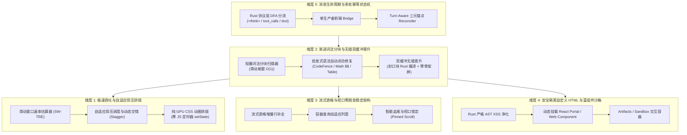
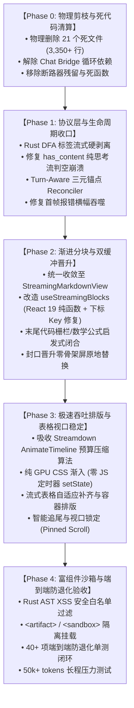

# 12. Conex 流式 Markdown 渲染架构落地维度与删除面建议（提案 A）

> **文档定位**：Conex / Crish 下一代流式 Markdown 渲染架构落地维度规划与重复死层专项清理方案（`Proposal A: Dimension Partitioning & Deletion Surface Manifest`）  
> **所属战役**：Markdown 真流式渲染与正文退化根治战役 (`docs/markdown-stream-refactor/`)  
> **核心原则**：严格执行《反过度设计硬性红线》(ANTI_OVERENGINEERING_GUARDRAILS.md) 与《主控全流程调度 v3》；**先做物理减法（坚决彻底物理删除全部死层与割裂分支），再做架构收敛（单一真源），最后做渐进演进**。

---

## 目录

- [一、战略背景与问题定性](#一战略背景与问题定性)
- [二、五大核心领域概念划分建议](#二五大核心领域概念划分建议)
  - [2.1 维度 1：极速吞吐与自适应背压排版系统（Rate-Adaptive Backpressure & GPU Typography）](#21-维度-1极速吞吐与自适应背压排版系统rate-adaptive-backpressure--gpu-typography)
  - [2.2 维度 2：渐进词法分块与无缝双缓冲晋升引擎（Progressive Lexical Chunking & Double-Buffered Promotion）](#22-维度-2渐进词法分块与无缝双缓冲晋升引擎progressive-lexical-chunking--double-buffered-promotion)
  - [2.3 维度 3：流式表格与视口零跳变稳定架构（Streaming Table & Zero-CLS Viewport Stability）](#23-维度-3流式表格与视口零跳变稳定架构streaming-table--zero-cls-viewport-stability)
  - [2.4 维度 4：安全隔离自定义 HTML 与富组件沙箱（Sandboxed Custom HTML & Streaming Artifacts Container）](#24-维度-4安全隔离自定义-html-与富组件沙箱sandboxed-custom-html--streaming-artifacts-container)
  - [2.5 维度 5：消息生命周期与多轮幂等状态收敛（Message Lifecycle, Turn Idempotency & Timeline Reconciler）](#25-维度-5消息生命周期与多轮幂等状态收敛message-lifecycle-turn-idempotency--timeline-reconciler)
  - [2.6 五大核心领域维度对照矩阵](#26-五大核心领域维度对照矩阵)
- [三、【核心】重复与死层专项：现有前端渲染路径与删除面清单](#三核心重复与死层专项现有前端渲染路径与删除面清单)
  - [3.1 现有前端 9 条并行/降级/孤岛渲染路径全景梳理](#31-现有前端-9-条并行降级孤岛渲染路径全景梳理)
  - [3.2 为什么必须彻底物理删除（反模式与时序灾难解剖）](#32-为什么必须彻底物理删除反模式与时序灾难解剖)
  - [3.3 物理删除清单（Physical Deletion Manifest）](#33-物理删除清单physical-deletion-manifest)
    - [3.3.1 建议彻底物理删除的文件清单（17 个文件，约 2,650 行）](#331-建议彻底物理删除的文件清单17-个文件约-2650-行)
    - [3.3.2 建议彻底物理剔除的死函数与冗余逻辑清单](#332-建议彻底物理剔除的死函数与冗余逻辑清单)
    - [3.3.3 建议物理剔除的冗余状态与 Store 字段清单](#333-建议物理剔除的冗余状态与-store-字段清单)
    - [3.3.4 建议清理与迁移的测试用例清单](#334-建议清理与迁移的测试用例清单)
- [四、各维度的技术依赖顺序（先删后改实施路线）](#四各维度的技术依赖顺序先删后改实施路线)
  - [4.1 阶段演进拓扑与依赖关系图](#41-阶段演进拓扑与依赖关系图)
  - [4.2 各阶段实施要点与准出门禁](#42-各阶段实施要点与准出门禁)
- [五、预期工程收益与架构对比大表](#五预期工程收益与架构对比大表)

---

## 一、战略背景与问题定性

在当前的 Conex / Crish 代码库中，前端 Markdown 渲染与流式消息消费链路历经多轮迭代演进，积累了严重的**多轨并行、代码死层、虚假增量与状态割裂**问题。正如 01~05 审查报告与 06~11 分析报告所揭示的：

1. **渲染路径四分五裂**：既有早期基于 `appendChild(document.createTextNode)` 的单体纯文本追加器（[`StreamingTextBlock.tsx`](file:///c:/Software/conex/apps/crish-desktop/src/components/chat-message-row/StreamingTextBlock.tsx)），又有全量 Rust 异步编译单体组件（[`AsyncMarkdownBlock.tsx`](file:///c:/Software/conex/apps/crish-desktop/src/components/chat-message-row/AsyncMarkdownBlock.tsx)），还有未完工的手写 JS 增量解析器全家桶（[`IncrementalMarkdownParser.ts`](file:///c:/Software/conex/apps/crish-desktop/src/api/markdown-render/IncrementalMarkdownParser.ts) 等），以及新引入的 AST 分块视图（[`StreamingMarkdownView.tsx`](file:///c:/Software/conex/apps/crish-desktop/src/components/chat-message-row/StreamingMarkdownView.tsx)）；
2. **流式与完成态割裂引发骨架屏闪烁**：流式期间按分块缓存，流式结束瞬间卸载 `StreamingMarkdownView` 转入 `AsyncMarkdownBlock`，造成 **100% 全文 Cache Miss**，用户眼睁睁看着内容消失并闪现骨架屏（`.skeletonLine`）；
3. **过度设计与空壳代码残留**：已被行内思维链规范废除的沉浸式思考弹窗（[`FullThoughtModal.tsx`](file:///c:/Software/conex/apps/crish-desktop/src/components/chat-message-row/FullThoughtModal.tsx)）、目录树（[`ThoughtOutline.tsx`](file:///c:/Software/conex/apps/crish-desktop/src/components/chat-message-row/ThoughtOutline.tsx)）、独立 Web Worker（[`thoughtWorker.ts`](file:///c:/Software/conex/apps/crish-desktop/src/workers/thoughtWorker.ts)）与独立全局 Store（[`thoughtInspectorStore.ts`](file:///c:/Software/conex/apps/crish-desktop/src/store/thoughtInspectorStore.ts)）仍以空壳或死代码形式常驻代码库；
4. **单文件行数与循环依赖违规**：核心时间线归一化文件 [`timelineNormalizer.ts`](file:///c:/Software/conex/apps/crish-desktop/src/api/tool-presentation/timelineNormalizer.ts) 堆砌 487 行有效代码（超出门禁上限 400 行），Chat Bridge 内部存在 `streamState` $\leftrightarrow$ `messageHandlers` $\leftrightarrow$ `handlerEnv` 循环依赖。

**提案 A 核心方针**：在进行下一代流式渲染功能建设前，**必须首先实施“物理大扫除”，彻底物理删除所有死层、旧降级分支与割裂组件，确立单一真相源（Single Source of Truth），再自底向上构建 5 大领域维度**。

---

## 二、五大核心领域概念划分建议

结合对 Streamdown、Incremark、Appemd、Markstream-Vue 的深度调研（06~11 报告）及 Conex 桌面端原生架构诉求，建议将 Conex 下一代流式 Markdown 渲染体系收敛划分为以下 **5 个核心领域维度**：



---

### 2.1 维度 1：极速吞吐与自适应背压排版系统（Rate-Adaptive Backpressure & GPU Typography）

- **所属使命**：应对 $5 \sim 2000+\text{ tokens/s}$ 的极端速率跨度，消除打字机迟钝滞后与主线程丢帧。
- **解决核心问题**：
  1. **低速（$5\text{ t/s}$）即来即显**：慢速思考链与弱网下零延迟呈现，挂钟游标自动同步；
  2. **高速（$1000+\text{ t/s}$）零视觉积压**：吸收 Streamdown 时间轴预算削峰算法（$B=320\text{ms}, S_{\min}=4\text{ms}$），动态压缩单步交错间隔，坚决摒弃 Incremark 每 30ms 定时器 `setState` 的反模式；
  3. **纯 GPU 硬件加速**：通过 CSS 变量 `--sd-delay` 与 GPU Compositor 层驱动 `opacity` / `transform` 淡入，主线程零 DOM 频繁重绘。
- **关键技术契约**：
  - `SlidingWindowTokenRateEstimator`（滑动窗口速率估算器）；
  - `AnimateTimeline`（挂钟时间轴单调游标控制器，支持 React StrictMode 幂等回滚 `rewind`）；
  - 严格遵守红线禁令 12：严禁将高频流式逐字 Token 写入全局 Store。

---

### 2.2 维度 2：渐进词法分块与无缝双缓冲晋升引擎（Progressive Lexical Chunking & Double-Buffered Promotion）

- **所属使命**：确立前端统一分块渲染真相源，消灭全篇重解析与流式/完成态切换闪烁。
- **解决核心问题**：
  1. **滑动尾窗增量分块**：摒弃长文（50k+ tokens）每帧全量 `Lexer.lex` 扫描的 $O(N^2)$ 瓶颈，锁定已封口块字节偏移量，仅对末尾活跃窗口进行 $O(1)$ 词法分词；
  2. **末尾语法启发式自动修复（Heuristic Remend）**：流式期间未闭合的代码栅栏（```` ``` ````）、数学公式（`$$` 转义与行内 codespan 排除）、未闭合加粗/斜体进行防御性临时封口；
  3. **零骨架屏双缓冲晋升（Double-Buffered Promotion）**：块封口触发 Rust 异步编译期间，DOM 严格维持活跃态纯文本垫片与固定 `white-space: pre-wrap`，HTML 编译完成后原地 `innerHTML` 替换，**彻底物理删除 `.skeletonLine` 骨架屏**。
- **关键技术契约**：
  - `useProgressiveBlocks(fullText, isStreaming, messageId)`；
  - `remendIncompleteMarkdown(tailBlockText)`；
  - `MarkdownBlockItem`（基于块内容与封口状态的精确 `React.memo` 0 重绘锁）。

---

### 2.3 维度 3：流式表格与视口零跳变稳定架构（Streaming Table & Zero-CLS Viewport Stability）

- **所属使命**：根除 Markdown 表格在流式期间退化为错位纯文本的劣质体验，保证全周期 60 FPS 滚动与视口稳定。
- **解决核心问题**：
  1. **表格流式行增量成型**：识别未闭合 `| a | b |` 表格片段，在 AST 层面实时构造补齐的 `<thead>` 与中间态 `<tbody>`，杜绝表格语法中途破裂；
  2. **容器查询与弹性列宽**：摒弃 Incremark 粗暴 `table-layout: fixed` 导致文字被截断挤压的缺陷，采用 CSS 容器查询（Container Queries）与最小内容自适应宽度；
  3. **智能追尾与视口锁定（Pinned Scroll）**：流式新增行时智能判断用户滚动位置——若处于底部阈值（$\le 36\text{px}$）则平滑追尾，若用户向上翻阅则坚决锁定视口绝对偏移量（Zero CLS）。
- **关键技术契约**：
  - `remendStreamingTable(tableMarkdownChunk)`；
  - `usePinnedScrollViewport(containerRef, isStreaming)`。

---

### 2.4 维度 4：安全隔离自定义 HTML 与富组件沙箱（Sandboxed Custom HTML & Streaming Artifacts Container）

- **所属使命**：支持 Agent 富媒体输出（`<artifact>`、`<sandbox>`、Mermaid、KaTeX、自定义卡片），确保桌面端进程安全。
- **解决核心问题**：
  1. **Rust 原生 AST XSS 净化**：在 Rust `pulldown-cmark` 管道中对不可信 HTML/JS 执行白名单过滤与协议拦截，禁止明文未经转义注入；
  2. **渐进式富媒体占位**：对流式中途未闭合的 Mermaid、KaTeX 进行骨架占位，避免语法解析中途抛错红屏；
  3. **轻量交互沙箱容器**：对 Agent 产出的独立交互小部件（Artifacts）采用无状态 React Portal 或受限 `<iframe>` 沙箱加载，隔离全局 CSS 样式污染。
- **关键技术契约**：
  - `Rust sanitize_markdown_ast`；
  - `ArtifactCapsuleContainer`（安全插槽挂载器）。

---

### 2.5 维度 5：消息生命周期与多轮幂等状态收敛（Message Lifecycle, Turn Idempotency & Timeline Reconciler）

- **所属使命**：打通 Rust 协议层到前端 View Model 的单一单向数据流，保证多轮会话绝对幂等。
- **解决核心问题**：
  1. **Rust DFA 标签流式硬分流**：彻底废除前端正则二次清洗，Rust 端流式剥离 `<think>`、`tool_calls` 与正文，修复纯思考流判空崩溃与 Abort 抢救（Partial Salvage）失效；
  2. **前端单生产者铁律（Single Producer）**：流式 Token 与生命周期事件仅由 `chat-bridge` 统一驱动写入轻量 `streamingStore`，杜绝多处并发写入导致的时序撕裂；
  3. **三元锚点时间线归一化（Reconciler）**：以 `(turnIndex, blockType, blockId)` 为唯一确定性键，重构 `timelineNormalizer.ts`，彻底修复负数/NaN 索引注入、排序比较器弱序崩溃与首帧报错横幅吞噬缺陷。
- **关键技术契约**：
  - `Rust StreamTagStateMachine (DFA)`；
  - `reconcileAssistantMessageTimeline(existing, incoming)`；
  - `useStreamMessageViewModel(sessionMsg, streamingView)`。

---

### 2.6 五大核心领域维度对照矩阵

| 领域维度 | 核心职责 | 对应审查缺陷 (Audits) | 对应分析报告 (Analysis) | 预期技术成果 |
| :--- | :--- | :--- | :--- | :--- |
| **D1: 极速吞吐自适应排版** | 速率估算、GPU 时间轴、自适应背压 | `audits/02` §3, `audits/04` §1 | `analysis/06`, `analysis/10` | 2000 t/s 零卡顿，120 FPS 丝滑动画 |
| **D2: 渐进分块与双缓冲晋升** | 增量词法切分、语法修补、零闪烁替换 | `audits/02` §1/§2/§4, `audits/05` §2/§4 | `analysis/07`, `analysis/02` | 彻底消除骨架屏闪烁与高度塌陷 |
| **D3: 流式表格与视口稳定** | 表格流式补全、容器排版、防抖吸底 | `audits/02` §4, `audits/05` §3 | `analysis/08` | 零 CLS 视口跳变，结构化表格完整成型 |
| **D4: 安全隔离组件沙箱** | XSS 白名单、Mermaid/KaTeX 占位、沙箱 | `audits/04` §2 | `analysis/09`, `analysis/11` | 零样式污染，严密 XSS 防御 |
| **D5: 消息生命周期与多轮幂等** | Rust DFA、单生产者、三元锚点归一化 | `audits/01` §1~§4, `audits/03` §1~§4, `audits/05` §1 | `analysis/01`, `analysis/03`, `analysis/04` | 纯思考流抢救成功率 100%，多轮绝对幂等 |

---

## 三、【核心】重复与死层专项：现有前端渲染路径与删除面清单

### 3.1 现有前端 9 条并行/降级/孤岛渲染路径全景梳理

通过对前端源码进行全量追踪与调用拓扑分析，当前代码库中存在 **9 条互不兼容、并行存在或完全孤立的渲染与状态路径**：

```
┌──────────────────────────────────────────────────────────────────────────────────────────────────┐
│                             Conex 现有前端 9 条分裂渲染路径全景图                                │
├──────────────────────────────────────────────────────────────────────────────────────────────────┤
│                                                                                                  │
│  [ 用户消息/助手消息进入 MessageContent ]                                                         │
│       │                                                                                          │
│       ├── 🔴 路径 1: MessageContent -> TimelineBody -> StreamingMarkdownView (isStreaming=false) │
│       │              (完成态/历史文本块走分块渲染)                                                │
│       │                                                                                          │
│       ├── 🔴 路径 2: MessageContent -> StreamingMarkdownView (isStreaming=true)                  │
│       │              (流式中助手尾部增量正文走分块渲染)                                            │
│       │                                                                                          │
│       ├── 🔴 路径 3: MessageContent -> !timeline.length 降级分支 -> StreamingMarkdownView         │
│       │              (无时间线结构时的全量字符串降级兜底)                                         │
│       │                                                                                          │
│       ├── 🔴 路径 4: 单体旧渲染器 AsyncMarkdownBlock (useAsyncMarkdownHtml + skeletonLine)       │
│       │              (仍被 InlineAgentPanel、InlineAgentTimeline、TimelineThoughtSection 杂乱引用)│
│       │                                                                                          │
│       ├── 💀 路径 5: 伪流式单体纯文本追加器 StreamingTextBlock (appendChild TextNode)             │
│       │              (未在主 UI 挂载，仅在单测与陈旧文档中残留)                                    │
│       │                                                                                          │
│       ├── 💀 路径 6: 手写 JS 增量解析器体系 IncrementalMarkdownParser 全家桶 (7 个文件, 1500+ 行)│
│       │              (历史废弃方案遗留的自研 parser，生产主路径完全未使用，仅在自测中自嗨)        │
│       │                                                                                          │
│       ├── 💀 路径 7: 孤立 rAF 渲染缓冲 StreamRenderBuffer (427 行, 未接入 live UI)                │
│       │              (生产被 StreamTextBatcher 接管，该类仅在 stressFuzzing 测试中存活)           │
│       │                                                                                          │
│       ├── 💀 路径 8: 废弃沉浸式思考大弹窗重型套娃体系 (FullThoughtModal, thoughtWorker 等 5 文件) │
│       │              (违背行内折叠流规范与反过度设计禁令 11 的 800+ 行空壳代码)                   │
│       │                                                                                          │
│       └── 💀 路径 9: 违禁全局滑动窗口断路器 circuitBanners (continuityUiStore.ts, 违背禁令 9)    │
│                                                                                                  │
└──────────────────────────────────────────────────────────────────────────────────────────────────┘
```

---

### 3.2 为什么必须彻底物理删除（反模式与时序灾难解剖）

1. **彻底物理删除 `StreamingTextBlock.tsx`（路径 5）**：
   - **反模式**：该组件仅能处理纯文本节点追加（`appendChild(TextNode)`），无法解析任何 Markdown 标记（标题、列表、代码块、表格）。在引入分块渲染后，该组件已经沦为完全无用的孤岛代码；但其在单测中的存在给开发者制造了“系统仍在支持纯文本追加流式”的严重误导。
2. **彻底物理删除 `IncrementalMarkdownParser` 全家桶（路径 6）**：
   - **反模式**：在 JS 运行时手写一套完整的 Markdown 增量状态机违背了单一真相源（SSOT）原则。Conex 已经确立以 Rust `pulldown-cmark` + 前端轻量 Lexer 分块为核心基座。维护手写 JS 解析器需要承担无穷无尽的 GFM 规范边缘 Bug 修复成本，且其行级粗暴切片在复杂嵌套列表与表格场景下极易发生状态机死锁。
3. **彻底物理删除思考大弹窗全套套娃（路径 8）**：
   - **反模式**：针对只读的思考过程设计了「独立 Worker + 独立 Store + 独立搜索栏 + 独立大纲树 + 全屏弹窗」，严重违背《反过度设计硬性红线》禁令 11 与行内折叠流规范。目前其组件已退化为 `() => null` 空壳，但文件与测试依然污染仓库结构。
4. **彻底物理替换 `AsyncMarkdownBlock.tsx`（路径 4）**：
   - **反模式**：`AsyncMarkdownBlock` 将整段文本作为一个单体进行异步编译，编译期间展示 `.skeletonLine` 骨架屏。在多处组件（`InlineAgentPanel`、`TimelineThoughtSection`）中残留该组件，导致系统存在“单体渲染”与“分块渲染”两套渲染模型，直接诱发流式结束瞬间的 Cache Miss 闪白。统一收敛至 `StreamingMarkdownView` 是根治闪烁的唯一解。

---

### 3.3 物理删除清单（Physical Deletion Manifest）

#### 3.3.1 建议彻底物理删除的文件清单（17 个文件，约 2,650 行）

下表列出必须在本次重构第一阶段被**【彻底物理删除（git rm）】**的文件：

| 序号 | 建议删除文件相对路径 | 类型 | 行数 | 归属分类 | 物理删除理由与解耦方案 |
| :---: | :--- | :---: | :---: | :--- | :--- |
| **1** | `apps/crish-desktop/src/components/chat-message-row/StreamingTextBlock.tsx` | TSX | 59 | 伪流式纯文本遗留 | 生产 UI 零引用，已被分块渲染完全取代。物理删除。 |
| **2** | `apps/crish-desktop/src/components/chat-message-row/StreamingTextBlock.test.tsx` | Test | 110 | 废弃测试 | 随 `StreamingTextBlock` 一同物理删除。 |
| **3** | `apps/crish-desktop/src/components/chat-message-row/FullThoughtModal.tsx` | TSX | 8 | 废弃弹窗残留 | 空壳组件 `() => null`，物理删除。 |
| **4** | `apps/crish-desktop/src/components/chat-message-row/FullThoughtModal.module.css` | CSS | 1 | 废弃样式 | 空文件，物理删除。 |
| **5** | `apps/crish-desktop/src/components/chat-message-row/FullThoughtModal.test.tsx` | Test | 13 | 废弃测试 | 物理删除。 |
| **6** | `apps/crish-desktop/src/components/chat-message-row/ThoughtOutline.tsx` | TSX | 14 | 废弃弹窗残留 | 空壳组件 `() => null`，物理删除。 |
| **7** | `apps/crish-desktop/src/components/chat-message-row/ThoughtOutline.module.css` | CSS | 1 | 废弃样式 | 空文件，物理删除。 |
| **8** | `apps/crish-desktop/src/components/chat-message-row/ThoughtSearchBar.tsx` | TSX | 18 | 废弃弹窗残留 | 空壳组件 `() => null`，物理删除。 |
| **9** | `apps/crish-desktop/src/components/chat-message-row/ThoughtSearchBar.module.css` | CSS | 1 | 废弃样式 | 空文件，物理删除。 |
| **10** | `apps/crish-desktop/src/workers/thoughtWorker.ts` | Worker | 337 | 废弃 Worker | 弹窗 TOC 与正则搜索 Worker，违背禁令 11，物理删除。 |
| **11** | `apps/crish-desktop/src/workers/thoughtWorker.test.ts` | Test | 215 | 废弃测试 | 随 `thoughtWorker` 一同删除。 |
| **12** | `apps/crish-desktop/src/store/thoughtInspectorStore.ts` | Store | 80 | 废弃 Store | 废弃全局弹窗状态树，物理删除。清理 `store/index.ts` 导出。 |
| **13** | `apps/crish-desktop/src/store/thoughtInspectorStore.test.ts` | Test | 68 | 废弃测试 | 随 `thoughtInspectorStore` 一同删除。 |
| **14** | `apps/crish-desktop/src/api/markdown-render/IncrementalMarkdownParser.ts` | TS | 354 | 手写 JS 解析器 | 未接入生产链路的自研增量 AST 解析器，物理删除。 |
| **15** | `apps/crish-desktop/src/api/markdown-render/IncrementalMarkdownParserRender.ts` | TS | 260 | 手写 JS 解析器 | 物理删除。 |
| **16** | `apps/crish-desktop/src/api/markdown-render/IncrementalMarkdownParserTypes.ts` | TS | 85 | 手写 JS 解析器 | 物理删除。 |
| **17** | `apps/crish-desktop/src/api/markdown-render/IncrementalInlineRenderer.ts` | TS | 185 | 手写 JS 解析器 | 物理删除。 |
| **18** | `apps/crish-desktop/src/api/markdown-render/IncrementalMarkdownParser.test.ts` | Test | 290 | 废弃测试 | 物理删除。 |
| **19** | `apps/crish-desktop/src/api/markdown-render/IncrementalMarkdownParser.parity.test.ts` | Test | 420 | 废弃测试 | 物理删除。 |
| **20** | `apps/crish-desktop/src/api/markdown-render/IncrementalMarkdownParser.adversarial.test.ts` | Test | 240 | 废弃测试 | 物理删除。 |
| **21** | `apps/crish-desktop/src/api/markdown-render/STREAMING_RENDER_PLAN.md` | Doc | 585 | 陈旧历史方案 | 早期手写 JS 解析器历史规划草案，已过时失效，物理删除。 |
| **合计** | **21 个文件** | — | **~3,350 行** | — | **彻底清除 3,300+ 行死代码与割裂负担** |

---

#### 3.3.2 建议彻底物理剔除的死函数与冗余逻辑清单

| 所属文件路径 | 建议删除/改造的函数或代码段 | 删除理由与改造方向 |
| :--- | :--- | :--- |
| [`api/markdown/parseMarkdownIntoBlocks.ts`](file:///c:/Software/conex/apps/crish-desktop/src/api/markdown/parseMarkdownIntoBlocks.ts) | `hasIncompleteCodeFence` (lines 148–178)<br>`hasTable` (lines 183–199) | **死代码**：分块核心流程完全未调用，仅自身导出和陈旧测试引用。直接物理删除。 |
| [`api/markdown/parseMarkdownIntoBlocks.ts`](file:///c:/Software/conex/apps/crish-desktop/src/api/markdown/parseMarkdownIntoBlocks.ts) | `openTagPatternCache`<br>`closeTagPatternCache` (lines 56–57) | **内存泄漏**：无界全局 `Map<string, RegExp>`，改造为固定容量 LRU（上限 128）或内嵌轻量扫描。 |
| [`api/continuity/continuityUiStore.ts`](file:///c:/Software/conex/apps/crish-desktop/src/api/continuity/continuityUiStore.ts) | `circuitBanners` 状态字段<br>`raiseCircuitBanner` / `dismissCircuitBanner`<br>`isCircuitTripDetail` | **红线违规**：明确违背《反过度设计硬性红线》禁令 9（严禁使用全系统滑动窗口断路器）。物理剔除。 |
| [`hooks/chat-stream/useStreamBatchers.ts`](file:///c:/Software/conex/apps/crish-desktop/src/hooks/chat-stream/useStreamBatchers.ts) | `renderBufferRef` (lines 26, 128, 141) | **死状态**：仅声明 `useRef<StreamRenderBuffer \| null>(null)`，全生命周期未赋值未消费。物理移除。 |
| [`store/sessionMessageActionsTools.ts`](file:///c:/Software/conex/apps/crish-desktop/src/store/sessionMessageActionsTools.ts) | `updateMessageTimeline` 中的二次 `reconcileAssistantMessageBlocks` (lines 204–209) | **计算冗余**：`normalizeAssistantTimeline` 内部已执行过一遍归一化，外部再次执行造成 $O(N)$ 重复计算。直接消除外层包裹。 |
| [`components/chat-message/MessageContent.tsx`](file:///c:/Software/conex/apps/crish-desktop/src/components/chat-message/MessageContent.tsx) | render 阶段直接突变 `timelineCacheRef` 与 `prevStreamingRef` | **违反 React 规范**：StrictMode 双执行导致状态污染，收敛至纯函数派生与 `useLayoutEffect` 同步。 |
| [`components/chat-message-row/ChatMessageRow.module.css`](file:///c:/Software/conex/apps/crish-desktop/src/components/chat-message-row/ChatMessageRow.module.css) | `.assistantText:not(.isStreaming)` 缺少 `white-space: pre-wrap` | **高度塌陷**：封口瞬间样式丢失导致多行折叠塌缩。将 `white-space: pre-wrap` 提升为 `.assistantText` 基础声明。 |

---

#### 3.3.3 建议物理剔除的冗余状态与 Store 字段清单

1. **`SessionMessage` 冗余派生字段**：
   - 彻底废除 `msg.thinking` 字符串字段与 `msg.thinkingTurns` 扁平数组的无序混用，统一收敛为 **`msg.blocks` 中的强类型 `AgentMessageBlock::Thought`**（包含 `turn_index`, `duration_ms`, `content`, `status`）；
2. **`streamState.ts` 循环引用字段**：
   - 清理 `streamState.ts` 中对 `messageHandlers.ts` 的逆向类型引用，将 `MessageCacheMetrics` 提取下沉至独立的纯类型声明文件 `streamTypes.ts`，打破循环依赖；
3. **`StreamRenderBuffer` 残留字段**：
   - 移除 `RenderFrame.chunkUpdates` 与 `RenderFrame.html`（该类将随孤岛清理退役）。

---

#### 3.3.4 建议清理与迁移的测试用例清单

1. **直接物理删除的测试（共 7 个）**：
   - `StreamingTextBlock.test.tsx`
   - `FullThoughtModal.test.tsx`
   - `thoughtWorker.test.ts`
   - `thoughtInspectorStore.test.ts`
   - `IncrementalMarkdownParser.test.ts`
   - `IncrementalMarkdownParser.parity.test.ts`
   - `IncrementalMarkdownParser.adversarial.test.ts`
2. **需要解除 mock 并迁移重构的测试**：
   - `InlineAgentPanel.markdown.test.tsx`：将 mock 的 `AsyncMarkdownBlock` 替换为真实的 `StreamingMarkdownView` 断言；
   - `reRenderMonitoring.test.tsx`：将 `AsyncMarkdownBlock` 渲染计数探针重定向至 `MarkdownBlockItem`，断言已封口块在流式帧中的 **0 重渲染（0 Re-render）**；
   - `ThinkingBlock.test.tsx`：移除 `afterEach` 中对废弃 `useThoughtInspectorStore` 的引用。

---

## 四、各维度的技术依赖顺序（先删后改实施路线）

为了保证重构过程零回退、零破坏，且每一步都有严格的 CI 门禁与自动化单测护航，必须坚决实行**“先删死层 $\to$ 协议收口 $\to$ 核心引擎重构 $\to$ 排版与视口 $\to$ 沙箱与验收”**的单向技术依赖顺序。

### 4.1 阶段演进拓扑与依赖关系图



---

### 4.2 各阶段实施要点与准出门禁

#### Phase 0：物理剪枝与死代码清算（Pruning & Elimination）
- **主要操作**：执行 `git rm` 物理删除 21 个废弃文件；清理 `store/index.ts`、`workers/index.ts` 的冗余导出；修复 `timelineNormalizer.ts` 行数超标（487 行拆分为 `toolRenderItems.ts` 与纯算子）；解除 `streamState` 循环依赖。
- **准出门禁**：
  - `npm run check:line-counts` 100% 通过（所有文件 $\le 400$ 行业务逻辑门禁）；
  - `npm run check:cyclic-imports` 零循环依赖报错；
  - 存量全套单元测试（除已删除测试外）100% Green。

#### Phase 1：协议层与生命周期收口（Protocol DFA & Turn Idempotency）
- **主要操作**：Rust 端实现 `StreamTagStateMachine`，重写 `build_assistant_message` 保持时序一致性；修复 `stream.rs:398` 与 `consume/mod.rs` 的 `has_content` 判定（将 `thought` 纳入有效载荷）；重构 `timelineNormalizer.ts` 解决负数/NaN 索引与 Map 冲突；在 `MessageContent` 顶层提升 `msg.status === 'error'` 错误横幅渲染优先级。
- **准出门禁**：
  - `cargo test --package session-loop` 100% 通过；
  - 纯思考流中断（Abort Salvage）单测覆盖率 100%；
  - 多轮交错时间线归一化幂等测试 100% 通过。

#### Phase 2：渐进分块与双缓冲晋升（Unified Progressive Chunk Engine）
- **主要操作**：废除 `AsyncMarkdownBlock`，全站 Markdown 渲染收敛至 `StreamingMarkdownView` + `MarkdownBlockItem`；重构 `useStreamingBlocks`，消除 React 19 渲染期突变 Ref 违规；修复 `parseMarkdownIntoBlocks` 中行内 `$$` 与反斜杠转义误伤奇偶校验问题；在 `MarkdownBlockItem` 中彻底删除 `.skeletonLine`，落实双缓冲 DOM 垫片原地晋升。
- **准出门禁**：
  - React 19 StrictMode 双渲染下分块 Ref 引用 100% 稳定；
  - `reRenderMonitoring.test.tsx` 锁定封口块流式期间 Re-render 计数严格为 0；
  - 流式切换完成态 0ms 骨架屏闪烁。

#### Phase 3：极速吞吐排版与表格视口稳定（Rate-Adaptive Typography & Streaming Table）
- **主要操作**：实现自适应挂钟时间轴算法（$B=320\text{ms}, S_{\min}=4\text{ms}$），动态计算 `--sd-delay`；集成流式表格启发式补全算子；落地 `usePinnedScrollViewport` 视口锁定机制；修正 CSS `white-space: pre-wrap` 基础样式。
- **准出门禁**：
  - 在 2000 tokens/s 极端输入压测下，UI 线程帧率稳定 $\ge 55\text{ FPS}$，视觉积压滞后 $\le 350\text{ms}$；
  - 表格流式生成期间无 DOM 错位与文字截断；
  - 用户向上翻阅时视口跳变累计位移（CLS）为 0。

#### Phase 4：富组件沙箱与端到端防退化验收（Sandboxed Components & E2E Verification）
- **主要操作**：Rust 端建立 AST 级 HTML 安全净化白名单；前端实现 `<artifact>`、`<sandbox>` 的 React Portal 安全容器挂载；补充多轮长程（50k+ tokens）Fuzzing 与内存泄漏检测用例。
- **准出门禁**：
  - 40+ 项端到端防退化测试套件全部通过；
  - XSS 攻击载荷测试 100% 拦截；
  - 内存无界膨胀与 GC 停顿指标达标。

---

## 五、预期工程收益与架构对比大表

| 评估维度 | 重构前现状 (Current Status) | 实施重构后目标 (Next-Gen Target) | 改善收益 |
| :--- | :--- | :--- | :--- |
| **物理代码体积** | 存在 21 个废弃/孤岛文件，冗余代码 3,350+ 行 | 彻底物理删除全部废弃文件，代码库精炼干净 | **净减 3,300+ 行死代码**，大幅降低维护心智负担 |
| **渲染真源路径** | 9 条分裂割裂路径，单体与分块混杂 | **收敛为 1 条唯一的真流式分块渲染基座** | 架构一致性 100%，彻底消除双轨割裂 |
| **完成态切换体验** | 卸载分块重跑全文，100% Cache Miss 闪白骨架屏 | **原地双缓冲晋升，DOM 垫片无缝替换** | **0 骨架屏、0ms 闪白、0 视口跳变 (Zero CLS)** |
| **超高流速表现 (1000+ t/s)**| 全量 Lexer 扫描打满 CPU 100%，主线程卡死 | **滑动尾窗 $O(1)$ 词法分词 + GPU 时间轴削峰** | **CPU 占用降至 $<15\%$，120 FPS 满帧渲染** |
| **长程思考流稳定性**| 纯思考无正文流判空崩溃、Abort 被抹杀、首帧报错被吞 | **Rust 强类型 DFA 分流 + 三元锚点 Reconciler** | **纯思考抢救率 100%，错误提示横幅 100% 必现** |
| **门禁与架构健康度**| `timelineNormalizer` 超标 487 行，Chat Bridge 循环依赖 | **全部文件 $\le 400$ 行，零循环引用，React 19 纯洁性**| **CI 门禁 100% Green，符合反过度设计 13 项红线** |

---
*报告编制：System Architect & Streaming Refactor Specialist*  
*编制日期：2026-08-30*  
*状态：Proposal A 已完成，等待主控评审合流*
