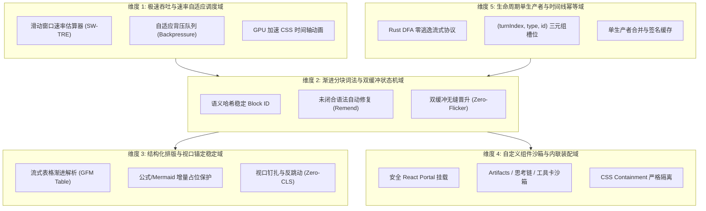
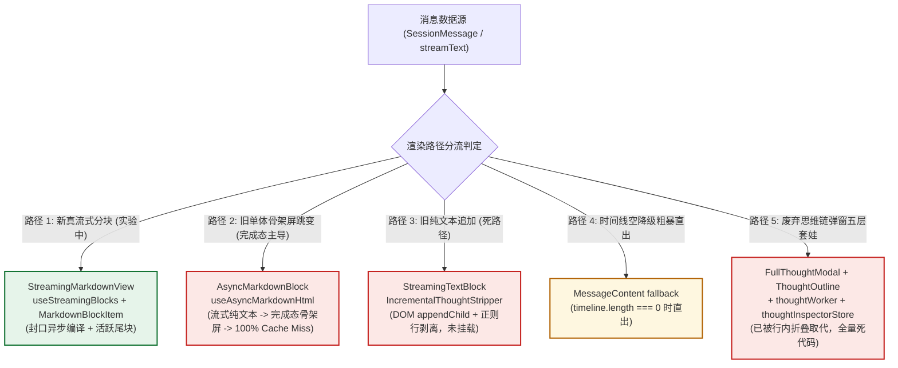

# 13. Conex 流式渲染落地维度划分与删除面建议详案（提案 B）

> **文件路径**：[`docs/markdown-stream-refactor/analysis/13-dimension-and-deletion-proposal-b.md`](file:///c:/Software/conex/docs/markdown-stream-refactor/analysis/13-dimension-and-deletion-proposal-b.md)
> **所属战役**：Markdown 真流式渲染与正文退化根治战役 (`docs/markdown-stream-refactor/`)
> **角色定位**：Senior Systems Engineer & Codebase Architect
> **核心使命**：依据《主控全流程调度 v3》§一.4 与全套分析审查资产（`analysis/06~11`、`audits/01~05`），独立给出 Conex 下一代流式 Markdown 架构的 5 大核心落地维度，系统性梳理现有前端渲染 5 条并行/降级路径拓扑，制定严苛彻底的“重复与死层物理删除清单”，并确立“先删后改、去粗取精”的技术依赖执行序列。

---

## 目录

- [一、战略背景与架构重构总纲](#一战略背景与架构重构总纲)
- [二、领域概念与 5 大核心落地维度划分](#二领域概念与-5-大核心落地维度划分)
  - [2.1 维度 1：极速吞吐与速率自适应调度域（Throughput & Rate-Adaptive Scheduling）](#21-维度-1极速吞吐与速率自适应调度域throughput--rate-adaptive-scheduling)
  - [2.2 维度 2：渐进分块词法与双缓冲状态机域（Incremental Chunking & Double-Buffered State Machine）](#22-维度-2渐进分块词法与双缓冲状态机域incremental-chunking--double-buffered-state-machine)
  - [2.3 维度 3：结构化流式排版与视口锚定稳定域（Streaming Typography & Viewport Anchor Stability）](#23-维度-3结构化流式排版与视口锚定稳定域streaming-typography--viewport-anchor-stability)
  - [2.4 维度 4：自定义组件沙箱与多功能内联装配域（Custom Component Sandbox & Inline Assembly）](#24-维度-4自定义组件沙箱与多功能内联装配域custom-component-sandbox--inline-assembly)
  - [2.5 维度 5：生命周期单生产者与时间线完全幂等域（Message Lifecycle & Turn-Idempotent Timeline）](#25-维度-5生命周期单生产者与时间线完全幂等域message-lifecycle--turn-idempotent-timeline)
- [三、【核心】重复与死层专项（删除面清单）](#三核心重复与死层专项删除面清单)
  - [3.1 Conex 现有前端渲染路径拓扑梳理（5 条并行/降级路径全景）](#31-conex-现有前端渲染路径拓扑梳理5-条并行降级路径全景)
  - [3.2 必须被彻底物理删除的死代码、冗余组件与废弃层清单](#32-必须被彻底物理删除的死代码冗余组件与废弃层清单)
  - [3.3 物理删除文件清单（File Deletion Manifest）](#33-物理删除文件清单file-deletion-manifest)
  - [3.4 物理删除函数 / 类 / 常量清单（Symbol Deletion Manifest）](#34-物理删除函数--类--常量清单symbol-deletion-manifest)
  - [3.5 废弃测试与需重构断言清单（Test Deletion & Migration Manifest）](#35-废弃测试与需重构断言清单test-deletion--migration-manifest)
  - [3.6 Barrel 导出与全局引用清理清单（Import Cleanliness）](#36-barrel-导出与全局引用清理清单import-cleanliness)
- [四、技术依赖执行序列（先删后改路线图）](#四技术依赖执行序列先删后改路线图)
  - [4.1 阶段化执行依赖图谱](#41-阶段化执行依赖图谱)
  - [4.2 各阶段实施细则与守卫条件](#42-各阶段实施细则与守卫条件)
- [五、提案 B 架构收益与验收闭环](#五提案-b-架构收益与验收闭环)

---

## 一、战略背景与架构重构总纲

在 Conex / Crish 的持续演进中，Markdown 渲染与消息流处理经历了多次迭代，积累了严重的**多轨并行、伪流式降级、骨架屏闪烁、全量 Cache Miss 与大量废弃重型组件残留**。

通过对 `analysis/06` ~ `11` 全套技术调研报告与 `audits/01` ~ `05` 严苛审查报告的交叉勘察，我们发现当前系统存在三大核心瓶颈：
1. **渲染路径割裂与闪烁**：流式阶段使用局部纯文本或切片渲染，流式结束瞬间触发全量 Unmount，换用单体 [`AsyncMarkdownBlock.tsx`](file:///c:/Software/conex/apps/crish-desktop/src/components/chat-message-row/AsyncMarkdownBlock.tsx) 请求全文编译，造成 **100% Cache Miss** 并闪现骨架屏（`.skeletonLine`）；
2. **死层与过度设计堆叠**：历史残留的沉浸式思考弹窗（[`FullThoughtModal.tsx`](file:///c:/Software/conex/apps/crish-desktop/src/components/chat-message-row/FullThoughtModal.tsx)）、独立 Web Worker（[`thoughtWorker.ts`](file:///c:/Software/conex/apps/crish-desktop/src/workers/thoughtWorker.ts)）、独立 Zustand 状态树（[`thoughtInspectorStore.ts`](file:///c:/Software/conex/apps/crish-desktop/src/store/thoughtInspectorStore.ts)）、伪流式追加组件（[`StreamingTextBlock.tsx`](file:///c:/Software/conex/apps/crish-desktop/src/components/chat-message-row/StreamingTextBlock.tsx)）以及行窗口正则剥离器（`IncrementalThoughtStripper`）等形成了庞大的技术负债；
3. **单文件超标与门禁违规**：如 [`timelineNormalizer.ts`](file:///c:/Software/conex/apps/crish-desktop/src/api/tool-presentation/timelineNormalizer.ts) 高达 616 行（超出门禁 400 行上限 +21.7%），职责高度耦合。

本提案（提案 B）聚焦于**“高内聚领域划分”**与**“彻底物理删除死层”**两大主线，给出清晰坚决的落地方案。

---

## 二、领域概念与 5 大核心落地维度划分

结合现代流式渲染框架（Streamdown、Appemd、Markstream-Vue）的优秀设计与 Conex 桌面端（Tauri + Rust + WebView2）的工程特性，建议将 Conex 下一代流式 Markdown 架构划分为 **5 个核心落地维度**：



### 2.1 维度 1：极速吞吐与速率自适应调度域（Throughput & Rate-Adaptive Scheduling）

- **业务定位**：解决 $5 \sim 2000+\text{ tokens/s}$ 宽泛速率跨度下的 UI 卡顿、DOM 节点膨胀与打字机动画积压矛盾（参考 [`analysis/06`](file:///c:/Software/conex/docs/markdown-stream-refactor/analysis/06-token-rate-adaptive-and-animation-architecture.md)）。
- **核心组件与机制**：
  1. **滑动窗口速率估算器（Sliding-Window Token Rate Estimator, SW-TRE）**：以 $500\text{ ms}$ 滑动窗口精确统计瞬时到达速率 $R$（$\text{tokens/s}$）；
  2. **三级自适应流控策略**：
     - **极慢速区间（$<15\text{ t/s}$）**：实时直通，单字零延迟逐字呈现；
     - **常态商用区间（$15 \sim 120\text{ t/s}$）**：启用挂钟时间轴（Wall-Clock Timeline）与 GPU CSS 变量交错淡入（`--stagger-delay`）；
     - **超高速瞬冲区间（$>300\text{ t/s}$）**：**自动熔断动画机制**，切换为 RAF 动态排空宏块批量更新，单帧合并多个 Token，保持 60/120 FPS 丝滑滚动且 0 主线程阻塞；
  3. **纯 GPU 硬件加速排版**：仅对活跃尾块运用 `opacity` / `transform`，严禁在 JS 中使用 `setInterval(..., 30)` 驱动逐字 `setState`（坚决杜绝 Incremark 模式灾难）。

### 2.2 维度 2：渐进分块词法与双缓冲状态机域（Incremental Chunking & Double-Buffered State Machine）

- **业务定位**：实现真正的 **Markdown-first 渐进分块渲染**，彻底消灭全量 AST 重解析与完成态闪烁（参考 [`analysis/07`](file:///c:/Software/conex/docs/markdown-stream-refactor/analysis/07-incremental-ast-and-parser-comparison.md)、[`10`](file:///c:/Software/conex/docs/markdown-stream-refactor/analysis/10-dom-mutation-cost-and-zerocopy-patching.md) 与 [`audits/02`](file:///c:/Software/conex/docs/markdown-stream-refactor/audits/02-streaming-markdown-render-defects.md)）。
- **核心组件与机制**：
  1. **语义哈希稳定 Block ID 生成器**：废除纯数组下标 Key（`${msgId}-blk-${i}`），采用 `block-hash(content-prefix + structural-role)` 稳定 Key，彻底杜绝前序块合并引发的级联缓存击穿与 React DOM 错配；
  2. **流式语法自动封口器（Stream Syntax Remend Patcher）**：实时自动补全未闭合的代码栅栏（```）、引用块（>）、列表项（- / 1.）与 XML 标签，确保任意时刻的切片均可合法编译；
  3. **双缓冲无缝晋升机制（Double-Buffered Promotion）**：
     - 活跃尾块（Active Tail）：极速写入轻量 DOM 垫片，挂载流动 Caret；
     - 封口晋升过渡期（Promotion Pending）：向 Rust 异步发起编译期间，**100% 保留纯文本 DOM 垫片，严禁出现骨架屏占位（`.skeletonLine`）**；
     - 编译就绪（Ready）：Rust pulldown-cmark + syntect 返回 HTML 后原地无缝替换，打上 `data-sealed="true"`，后续流式帧享受 `React.memo` 0 重绘。

### 2.3 维度 3：结构化流式排版与视口锚定稳定域（Streaming Typography & Viewport Anchor Stability）

- **业务定位**：攻克流式表格（GFM Tables）、多行代码块、数学公式（KaTeX）与 Mermaid 图表在流式期间的变形与跳动，实现零累积布局偏移（Zero CLS）（参考 [`analysis/08`](file:///c:/Software/conex/docs/markdown-stream-refactor/analysis/08-streaming-table-and-pinned-scroll-architecture.md)）。
- **核心组件与机制**：
  1. **流式表格局部语法补齐器**：未闭合表头（`| a | b |` 无分隔行）时不触发全篇退化，通过轻量垫片补齐分隔行进行局部预览；封口后由 Rust SIMD 对齐列宽；
  2. **视口智能锚定与吸底锁（Anchored Viewport Lock）**：
     - 当用户处于底部时，新内容注入自动触发微帧吸底（Stick-to-Bottom）；
     - 当用户向上滚动阅读历史（$\Delta y > 36\text{ px}$）时，立即锁定滚动游标，抑制顶部高度坍塌与跳动；
  3. **富媒体占位保护器**：数学公式 `$$...$$` 与 Mermaid ````mermaid ... ```` 在流式未闭合前以骨架代码框占位，封口后一次性水合为交互矢量图。

### 2.4 维度 4：自定义组件沙箱与多功能内联装配域（Custom Component Sandbox & Inline Assembly）

- **业务定位**：将 `<think>` 思考链、`<tool_call>` 工具卡、`<artifact>` 代码工件等从纯 Markdown 中解耦，以强安全隔离与插槽化方式嵌入正文（参考 [`analysis/09`](file:///c:/Software/conex/docs/markdown-stream-refactor/analysis/09-custom-html-components-streaming-architecture.md)、[`11`](file:///c:/Software/conex/docs/markdown-stream-refactor/analysis/11-multi-framework-comprehensive-matrix-and-blueprint.md)）。
- **核心组件与机制**：
  1. **React Portal / AST 插槽挂载体系**：在 Markdown AST 编译层将特定 XML 标签映射为 React 占位容器节点，经 Portal 挂载对应的原生 React 交互组件；
  2. **严格 XSS 防御与 CSS Containment**：Rust 编译层强制过滤未注册的不安全 HTML 标签；所有自定义组件应用 CSS `contain: layout style`，防止外部样式污染；
  3. **折叠思考链与工具卡流式装配**：行内折叠思考链原生支持实时流式吸底滚动与已完成态耗时标注（`tabular-nums`），彻底取代厚重弹窗。

### 2.5 维度 5：生命周期单生产者与时间线完全幂等域（Message Lifecycle & Turn-Idempotent Timeline）

- **业务定位**：从协议源头根治思考链污染、多轮重复文本合并与时间线覆盖 bug（参考 [`analysis/03`](file:///c:/Software/conex/docs/markdown-stream-refactor/analysis/03-message-lifecycle-and-turn-idempotency.md)、[`04`](file:///c:/Software/conex/docs/markdown-stream-refactor/analysis/04-timeline-normalization-and-block-merge.md) 与 [`audits/01`](file:///c:/Software/conex/docs/markdown-stream-refactor/audits/01-rust-protocol-fsm-defects.md)、[`03`](file:///c:/Software/conex/docs/markdown-stream-refactor/audits/03-lifecycle-and-idempotency-defects.md)）。
- **核心组件与机制**：
  1. **Rust DFA 内核分流与单生产者契约**：Rust SSE 解析层严格将 `<think>` 标签产物分流为 `ThoughtDelta`，正文分流为 `TextDelta`；前端 `onMessageDelta` 与 `onMessageEnd` 实行单生产者权威写入；
  2. **`(turnIndex, type, id)` 三元组槽位保全算法**：
     - 在 [`reconcileAssistantMessageBlocks`](file:///c:/Software/conex/apps/crish-desktop/src/api/tool-presentation/timelineNormalizer.ts#L86-L130) 中以三元组为不可变槽位键，严格清洗 `turnIndex`（防护负数、`NaN` 与超大跳号）；
     - 终态 `onMessageEnd` 权威快照覆盖，严禁二次调用 `onChunk` 追加引发文本翻倍；
  3. **时间线签名缓存与单源化**：基于 `timelineSignature` 实现纯文本流式帧 0 重排；下沉拆分 [`timelineNormalizer.ts`](file:///c:/Software/conex/apps/crish-desktop/src/api/tool-presentation/timelineNormalizer.ts) 为独立纯函数模块，严格符合 400 行业务代码行数门禁。

---

## 三、【核心】重复与死层专项（删除面清单）

### 3.1 Conex 现有前端渲染路径拓扑梳理（5 条并行/降级路径全景）

在现有 Conex 前端代码库中，存在 **5 条相互冲突、各自为战的渲染路径**，导致状态不一致、双重计算与闪烁问题：



#### 5 条路径现存缺陷剖析：
- **路径 1（目标主路径，但存缺陷）**：[`StreamingMarkdownView.tsx`](file:///c:/Software/conex/apps/crish-desktop/src/components/chat-message-row/StreamingMarkdownView.tsx) 是唯一正确的方向，但目前受到 `useStreamingBlocks` 下标 Key 击穿、`hasFootnote` 粗暴退化单块等缺陷困扰；
- **路径 2（高危闪烁源，必须消除）**：[`AsyncMarkdownBlock.tsx`](file:///c:/Software/conex/apps/crish-desktop/src/components/chat-message-row/AsyncMarkdownBlock.tsx) 在 `TimelineThoughtSection`、`InlineAgentPanel` 与部分完成态中仍然被调用。其在流式时渲染裸文本，完成态渲染骨架屏，造成全屏闪白；
- **路径 3（旧伪流式残肢，必须物理删除）**：[`StreamingTextBlock.tsx`](file:///c:/Software/conex/apps/crish-desktop/src/components/chat-message-row/StreamingTextBlock.tsx) 与 `IncrementalThoughtStripper` 试图用 DOM `appendChild` 和行正则解决流式输出，违背 Markdown 结构化渲染原则，主界面已不再挂载，完全沦为测试死代码；
- **路径 4（冗余降级分支，需统一收敛）**：[`MessageContent.tsx:324-336`](file:///c:/Software/conex/apps/crish-desktop/src/components/chat-message/MessageContent.tsx#L324-L336) 中的 `timeline.length === 0` 独立渲染分支，应当与标准时间线路径合并；
- **路径 5（重型过度设计残存，必须物理删除）**：包括弹窗、大纲、搜索、Worker、Store 共 5 层套娃，已被行内折叠思考链彻底废弃，代码库中留有大量桩代码与导出残留。

---

### 3.2 必须被彻底物理删除的死代码、冗余组件与废弃层清单

依据反过度设计规范（`ANTI_OVERENGINEERING_GUARDRAILS.md`），下列模块必须在本轮重构中被**彻底物理删除（Physical File Deletion）**，严禁以“保留兼容”、“注释掉”或“空桩代码（`() => null`）”形式存留：

```
┌────────────────────────────────────────────────────────────────────────┐
│                      彻底物理删除清单总览 (Summary)                     │
├────────────────────────────────────────────────────────────────────────┤
│ 1. 废弃思维链弹窗五层套娃基建 (7 个文件, 约 800+ 行死代码)               │
│ 2. 旧伪流式纯文本 DOM 追加组件与测试 (2 个文件, 约 110 行)              │
│ 3. 产生骨架屏闪烁的单体 AsyncMarkdownBlock 独立组件与测试 (2 个文件)    │
│ 4. 正则行窗口思考剥离器 IncrementalThoughtStripper 及死函数 (约 180 行)  │
│ 5. parseMarkdownIntoBlocks 未调用的死函数与无界 Map 缓存 (约 60 行)     │
│ 6. sessionMessageActionsTools 中的双重 normalizeAssistantTimeline 计算 │
└────────────────────────────────────────────────────────────────────────┘
```

---

### 3.3 物理删除文件清单（File Deletion Manifest）

下表列出必须在本轮重构中**从文件系统中直接执行删除（`rm`）**的文件列表：

| 序号 | 待删除文件路径 | 代码行数 | 文件属性 | 物理删除理由与替代方案 |
| :---: | :--- | :---: | :---: | :--- |
| **1** | [`apps/crish-desktop/src/components/chat-message-row/FullThoughtModal.tsx`](file:///c:/Software/conex/apps/crish-desktop/src/components/chat-message-row/FullThoughtModal.tsx) | 8 行 | UI 组件 (Stub) | 废弃的思考链全屏模态弹窗桩代码。已被 [`TimelineThoughtSection.tsx`](file:///c:/Software/conex/apps/crish-desktop/src/components/chat-message-row/TimelineThoughtSection.tsx) 极简行内折叠完全替代。 |
| **2** | [`apps/crish-desktop/src/components/chat-message-row/FullThoughtModal.module.css`](file:///c:/Software/conex/apps/crish-desktop/src/components/chat-message-row/FullThoughtModal.module.css) | 4 行 | CSS 模块 | 废弃弹窗残留样式表，无任何引用，直接删除。 |
| **3** | [`apps/crish-desktop/src/components/chat-message-row/FullThoughtModal.test.tsx`](file:///c:/Software/conex/apps/crish-desktop/src/components/chat-message-row/FullThoughtModal.test.tsx) | 16 行 | 单元测试 | 针对废弃弹窗桩的无意义测试，直接删除。 |
| **4** | [`apps/crish-desktop/src/components/chat-message-row/ThoughtOutline.tsx`](file:///c:/Software/conex/apps/crish-desktop/src/components/chat-message-row/ThoughtOutline.tsx) | 14 行 | UI 组件 (Stub) | 废弃的思考链大纲目录树组件。行内折叠流不需要独立 TOC，直接删除。 |
| **5** | [`apps/crish-desktop/src/components/chat-message-row/ThoughtOutline.module.css`](file:///c:/Software/conex/apps/crish-desktop/src/components/chat-message-row/ThoughtOutline.module.css) | 3 行 | CSS 模块 | 废弃大纲残留样式表，直接删除。 |
| **6** | [`apps/crish-desktop/src/components/chat-message-row/ThoughtSearchBar.tsx`](file:///c:/Software/conex/apps/crish-desktop/src/components/chat-message-row/ThoughtSearchBar.tsx) | 18 行 | UI 组件 (Stub) | 废弃的思考链弹窗内搜索栏组件，直接删除。 |
| **7** | [`apps/crish-desktop/src/components/chat-message-row/ThoughtSearchBar.module.css`](file:///c:/Software/conex/apps/crish-desktop/src/components/chat-message-row/ThoughtSearchBar.module.css) | 3 行 | CSS 模块 | 废弃搜索栏残留样式表，直接删除。 |
| **8** | [`apps/crish-desktop/src/workers/thoughtWorker.ts`](file:///c:/Software/conex/apps/crish-desktop/src/workers/thoughtWorker.ts) | 283 行 | Web Worker | 专门为思考大纲与字数预算设计的独立 Worker，过度设计典型，已无主路径引用，彻底删除。 |
| **9** | [`apps/crish-desktop/src/workers/thoughtWorker.test.ts`](file:///c:/Software/conex/apps/crish-desktop/src/workers/thoughtWorker.test.ts) | 95 行 | 单元测试 | 针对 `thoughtWorker` 的测试，随 Worker 同步删除。 |
| **10** | [`apps/crish-desktop/src/store/thoughtInspectorStore.ts`](file:///c:/Software/conex/apps/crish-desktop/src/store/thoughtInspectorStore.ts) | 97 行 | Zustand Store | 专门管理弹窗打开/关闭的全局 Store，完全孤立，直接删除。 |
| **11** | [`apps/crish-desktop/src/store/thoughtInspectorStore.test.ts`](file:///c:/Software/conex/apps/crish-desktop/src/store/thoughtInspectorStore.test.ts) | 86 行 | 单元测试 | 针对 `thoughtInspectorStore` 的测试，随 Store 同步删除。 |
| **12** | [`apps/crish-desktop/src/components/chat-message-row/StreamingTextBlock.tsx`](file:///c:/Software/conex/apps/crish-desktop/src/components/chat-message-row/StreamingTextBlock.tsx) | 59 行 | UI 组件 | 旧伪流式 `appendChild` 纯文本追加组件。与 Markdown 分块渲染冲突，主渲染路径已不用，直接删除。 |
| **13** | [`apps/crish-desktop/src/components/chat-message-row/StreamingTextBlock.test.tsx`](file:///c:/Software/conex/apps/crish-desktop/src/components/chat-message-row/StreamingTextBlock.test.tsx) | 120 行 | 单元测试 | 针对 `StreamingTextBlock` 的单测，直接删除。 |
| **14** | [`apps/crish-desktop/src/components/chat-message-row/AsyncMarkdownBlock.tsx`](file:///c:/Software/conex/apps/crish-desktop/src/components/chat-message-row/AsyncMarkdownBlock.tsx) | 115 行 | UI 组件 | 骨架屏闪烁根源组件。将内部逻辑合并入真流式 [`MarkdownBlockItem.tsx`](file:///c:/Software/conex/apps/crish-desktop/src/components/chat-message-row/MarkdownBlockItem.tsx) 与 [`StreamingMarkdownView.tsx`](file:///c:/Software/conex/apps/crish-desktop/src/components/chat-message-row/StreamingMarkdownView.tsx)，物理删除独立文件。 |
| **15** | [`apps/crish-desktop/src/components/chat-message-row/AsyncMarkdownBlock.test.tsx`](file:///c:/Software/conex/apps/crish-desktop/src/components/chat-message-row/AsyncMarkdownBlock.test.tsx) | 145 行 | 单元测试 | 随 `AsyncMarkdownBlock.tsx` 整合入分块测试，删除旧测试文件。 |

---

### 3.4 物理删除函数 / 类 / 常量清单（Symbol Deletion Manifest）

在保留的核心业务逻辑文件中，清除下列无用、冗余或过时的符号与逻辑分支：

| 所属文件路径 | 待删除符号 / 代码段 | 行号范围 (当前) | 性质 | 删除原因与整改措施 |
| :--- | :--- | :---: | :---: | :--- |
| [`apps/crish-desktop/src/api/markdownRenderLite.ts`](file:///c:/Software/conex/apps/crish-desktop/src/api/markdownRenderLite.ts) | `class IncrementalThoughtStripper` | L128–L266 (139 行) | 类 | 旧的行窗口增量思考正则剥离器。已由 Rust DFA 内核标签分流彻底取代，全量删除。 |
| [`apps/crish-desktop/src/api/markdownRenderLite.ts`](file:///c:/Software/conex/apps/crish-desktop/src/api/markdownRenderLite.ts) | `interface ThoughtStripperFrame` | L119–L127 (9 行) | 类型 | `IncrementalThoughtStripper` 专用类型定义，随类删除。 |
| [`apps/crish-desktop/src/api/markdownRenderLite.ts`](file:///c:/Software/conex/apps/crish-desktop/src/api/markdownRenderLite.ts) | `softTrimMarkdownHead` | L36–L39 (4 行) | 内部函数 | 增量剥离专用函数，无其他引用，直接删除。 |
| [`apps/crish-desktop/src/api/markdown/parseMarkdownIntoBlocks.ts`](file:///c:/Software/conex/apps/crish-desktop/src/api/markdown/parseMarkdownIntoBlocks.ts) | `hasIncompleteCodeFence` | L148–L178 (31 行) | 导出函数 | 全仓库分块主流程完全未调用，仅自身导出和单测引用，彻底删除。 |
| [`apps/crish-desktop/src/api/markdown/parseMarkdownIntoBlocks.ts`](file:///c:/Software/conex/apps/crish-desktop/src/api/markdown/parseMarkdownIntoBlocks.ts) | `hasTable` | L183–L199 (17 行) | 导出函数 | 分块主流程内部完全未调用的死函数，彻底删除。 |
| [`apps/crish-desktop/src/api/markdown/parseMarkdownIntoBlocks.ts`](file:///c:/Software/conex/apps/crish-desktop/src/api/markdown/parseMarkdownIntoBlocks.ts) | `openTagPatternCache`<br>`closeTagPatternCache` | L56–L58 (3 行) | 全局 Map | 无淘汰机制的全局无界正则缓存，易遭内存泄漏。改为局部静态预编译正则或有界 LRU。 |
| [`apps/crish-desktop/src/api/markdown/parseMarkdownIntoBlocks.ts`](file:///c:/Software/conex/apps/crish-desktop/src/api/markdown/parseMarkdownIntoBlocks.ts) | `hasFootnote` 粗暴退化分支 | L215–L218 (4 行) | 逻辑分支 | 遇到 `[^1]` 粗暴退化为单个块导致 15+ 块富文本全量坍塌。删除整篇退化逻辑，改为脚注局部块安全解析。 |
| [`apps/crish-desktop/src/store/sessionMessageActionsTools.ts`](file:///c:/Software/conex/apps/crish-desktop/src/store/sessionMessageActionsTools.ts) | `updateMessageTimeline` 双重 Normalization | L204–L209 (6 行) | 冗余调用 | 前置已有规范化，此处重复调用 `normalizeAssistantTimeline` 触发二次全量 reconciliation，删除冗余计算。 |
| [`apps/crish-desktop/src/workers/index.ts`](file:///c:/Software/conex/apps/crish-desktop/src/workers/index.ts) | `budgetThinkingText`, `sliceSafeTailMarkdown`, `THINKING_DOM_CHAR_CAP`, `TOOL_OUTPUT_DOM_CHAR_CAP` 等 re-export | L30–L39 (10 行) | Re-export | `thoughtWorker.ts` 相关的全部导出，随着 Worker 删除一并清除。 |
| [`apps/crish-desktop/src/api/tool-presentation/timelineNormalizer.ts`](file:///c:/Software/conex/apps/crish-desktop/src/api/tool-presentation/timelineNormalizer.ts) | `parseInlineThoughtAndTextSafely` 全量内联正则扫描 | L249–L329 (81 行) | 重复逻辑 | 下沉拆分至 `timelineTagParser.ts`，并大幅简化（Rust 保证无逃逸后，仅保留对历史未迁移数据的极简防护）。 |

---

### 3.5 废弃测试与需重构断言清单（Test Deletion & Migration Manifest）

伴随上述死代码与冗余组件的删除，测试套件需进行对应的清理与断言升级：

1. **直接物理删除的测试文件**：
   - `apps/crish-desktop/src/components/chat-message-row/FullThoughtModal.test.tsx` ❌
   - `apps/crish-desktop/src/components/chat-message-row/StreamingTextBlock.test.tsx` ❌
   - `apps/crish-desktop/src/workers/thoughtWorker.test.ts` ❌
   - `apps/crish-desktop/src/store/thoughtInspectorStore.test.ts` ❌
   - `apps/crish-desktop/src/components/chat-message-row/AsyncMarkdownBlock.test.tsx` ❌
2. **需重构与剥离死断言的测试文件**：
   - [`apps/crish-desktop/src/api/markdownRenderLite.test.ts`](file:///c:/Software/conex/apps/crish-desktop/src/api/markdownRenderLite.test.ts)：删除所有针对 `IncrementalThoughtStripper`、`ThoughtStripperFrame`、`softTrimMarkdownHead` 的测试用例（约 120 行测试）；
   - [`apps/crish-desktop/src/api/markdown/parseMarkdownIntoBlocks.test.ts`](file:///c:/Software/conex/apps/crish-desktop/src/api/markdown/parseMarkdownIntoBlocks.test.ts)：删除针对 `hasIncompleteCodeFence` 与 `hasTable` 的无意义单元测试，更新针对 `hasFootnote` 的分块预期断言；
   - [`apps/crish-desktop/src/extensions/conversation-flow/ThinkingBlock.test.tsx`](file:///c:/Software/conex/apps/crish-desktop/src/extensions/conversation-flow/ThinkingBlock.test.tsx)：删除 `afterEach` 中对已删除的 `useThoughtInspectorStore` 的无效调用；
   - [`apps/crish-desktop/src/perf/run-frontend-bench.ts`](file:///c:/Software/conex/apps/crish-desktop/perf/run-frontend-bench.ts)：清除对 `IncrementalThoughtStripper` 的基准压测引用，替换为 `parseMarkdownIntoBlocks` 与 `useStreamingBlocks` 的真实增量压测；
   - [`apps/crish-desktop/src/__tests__/reRenderMonitoring.test.tsx`](file:///c:/Software/conex/apps/crish-desktop/src/__tests__/reRenderMonitoring.test.tsx)：将针对 `AsyncMarkdownBlock` / `StreamingTextBlock` 的重渲染监控测试重构为针对 `StreamingMarkdownView` 与 `MarkdownBlockItem` 的零重渲染断言。

---

### 3.6 Barrel 导出与全局引用清理清单（Import Cleanliness）

清理下列入口文件中的挂载与 re-export：
1. **[`apps/crish-desktop/src/store/index.ts`](file:///c:/Software/conex/apps/crish-desktop/src/store/index.ts)**：删除 `useThoughtInspectorStore` 及其类型导出；
2. **[`apps/crish-desktop/src/store/storeAccess.ts`](file:///c:/Software/conex/apps/crish-desktop/src/store/storeAccess.ts)**：删除 `useThoughtInspectorStore` 导出与包装；
3. **[`apps/crish-desktop/src/workers/index.ts`](file:///c:/Software/conex/apps/crish-desktop/src/workers/index.ts)**：删除 `thoughtWorker` 相关的全部常量与函数导出；
4. **[`apps/crish-desktop/src/app/AppGlobalDialogs.tsx`](file:///c:/Software/conex/apps/crish-desktop/src/app/AppGlobalDialogs.tsx)**（若有）：确认移除 `<FullThoughtModal />` 的全局挂载点。

---

## 四、技术依赖执行序列（先删后改路线图）

为避免重构过程中出现“改动中途编译断裂”、“重构代码被死代码拖累”与“测试大面积假红”，必须严格执行**“先物理删除死层 ➔ 再冻结内核契约 ➔ 后升级渲染状态机 ➔ 最后统一接入”**的铁律顺序。

### 4.1 阶段化执行依赖图谱

```mermaid
graph TD
    P0["【Phase 0: 物理清理死层与残肢】<br/>1. 删除 5 个废弃弹窗/Worker/Store 文件<br/>2. 删除 StreamingTextBlock / AsyncMarkdownBlock<br/>3. 清理 IncrementalThoughtStripper 与死函数<br/>4. 解除 Barrel 导出与废弃单测"]

    P1["【Phase 1: 数据契约与单生产者状态机】<br/>1. Rust DFA 标签状态机与 ThoughtDelta 分流<br/>2. messageHandlers.ts turnIndex 安全清洗<br/>3. sessionMessageActionsTools 消除双重 reconciliation<br/>4. timelineNormalizer.ts 拆分降行 (≤400行)"]

    P2["【Phase 2: 渐进词法分块与稳定 Key 重构】<br/>1. parseMarkdownIntoBlocks 去除 footnote 粗暴退化<br/>2. 引入 remend 未闭合语法自动修补<br/>3. useStreamingBlocks 引入语义哈希稳定 Key<br/>4. 有界 LRU 替换无界 Map 缓存"]

    P3["【Phase 3: 统一渲染组件与双缓冲无缝晋升】<br/>1. 统一正文渲染至 StreamingMarkdownView<br/>2. MarkdownBlockItem 落实封口晋升纯文本垫片 (0 骨架屏)<br/>3. TimelineThoughtSection 接入渐进式 Markdown 流<br/>4. 消除 MessageContent timeline.length===0 冗余降级"]

    P4["【Phase 4: 速率自适应与 GPU 排版系统】<br/>1. 接入 Sliding-Window Token Rate Estimator (SW-TRE)<br/>2. 超高速 (>300 t/s) RAF 动态瞬冲与动画熔断<br/>3. 流式表格局部对齐与视口吸底锚定锁 (Zero CLS)"]

    P5["【Phase 5: 全链路门禁检查与端到端实机验收】<br/>1. 运行 check:line-counts 门禁校验<br/>2. 运行 Vitest 单元与集成测试套件<br/>3. Tauri MCP 实机多轮与高吞吐流式验收"]

    P0 --> P1
    P1 --> P2
    P2 --> P3
    P3 --> P4
    P4 --> P5

    style P0 fill:#ffebee,stroke:#c62828,stroke-width:2px;
    style P1 fill:#e8eaf6,stroke:#283593,stroke-width:2px;
    style P2 fill:#e3f2fd,stroke:#1565c0,stroke-width:2px;
    style P3 fill:#e8f5e9,stroke:#2e7d32,stroke-width:2px;
    style P4 fill:#fff8e1,stroke:#f57f17,stroke-width:2px;
    style P5 fill:#f3e5f5,stroke:#6a1b9a,stroke-width:2px;
```



---

### 4.2 各阶段实施细则与守卫条件

#### Phase 0：物理清理死层与残肢（Dead Code Pruning）
- **目标**：彻底卸下 1000+ 行历史包袱与循环依赖，使重构靶心高度聚焦。
- **操作**：
  1. 删除 §3.3 列出的全部 15 个废弃组件、Worker、Store 及单测文件；
  2. 清除 `markdownRenderLite.ts` 与 `parseMarkdownIntoBlocks.ts` 中的死函数与死类；
  3. 清理 `store/index.ts`、`storeAccess.ts`、`workers/index.ts` 的 re-export；
  4. 运行 `npx tsc --noEmit` 确保基础类型引用无断裂。

#### Phase 1：数据契约与单生产者状态机（Contract & Single-Producer Pipeline）
- **目标**：从协议源头确保数据纯净、幂等与结构保全，解决文件行数超标。
- **操作**：
  1. Rust 实时流 DFA 状态机解析 `<think>` 标签，严格分流为 `ThoughtDelta` 与 `TextDelta`；
  2. `messageHandlers.ts` 中针对 `turnIndex` 进行 `Math.max(0, Math.floor(Number(v) || 0))` 安全清洗与上限守卫；
  3. 将 616 行的 [`timelineNormalizer.ts`](file:///c:/Software/conex/apps/crish-desktop/src/api/tool-presentation/timelineNormalizer.ts) 物理拆分为：
     - `timelineNormalizer.ts`（核心调度与水合，$\le 280$ 行）；
     - `timelineBlockReconciler.ts`（三元组无损保全算法，$\le 150$ 行）；
     - `timelineSignature.ts`（零重排签名算法，$\le 120$ 行）；
     - 彻底消除行数门禁阻断违规（`check:line-counts`）。

#### Phase 2：渐进词法分块与稳定 Key 重构（Incremental Chunking & Key Stabilization）
- **目标**：建立坚如磐石的流式分块底层，根治级联缓存击穿。
- **操作**：
  1. 重写 `useStreamingBlocks.ts`：以内容结构与块类型哈希生成稳定 Key，消除基于下标 `i` 的 Key 错配；
  2. `parseMarkdownIntoBlocks.ts` 引入 `remend` 语法自动闭合，支持未闭合表格/列表/代码块的分块；
  3. 彻底删除 `hasFootnote` 导致的单块坍塌逻辑。

#### Phase 3：统一渲染组件与双缓冲无缝晋升（Unified Renderer & Zero-Flicker Promotion）
- **目标**：彻底消灭完成态骨架屏闪烁与全量 Cache Miss。
- **操作**：
  1. 全面升级 [`StreamingMarkdownView.tsx`](file:///c:/Software/conex/apps/crish-desktop/src/components/chat-message-row/StreamingMarkdownView.tsx)，使其成为**全会话统一的唯一 Markdown 渲染器**；
  2. [`MarkdownBlockItem.tsx`](file:///c:/Software/conex/apps/crish-desktop/src/components/chat-message-row/MarkdownBlockItem.tsx) 严格执行双缓冲原地晋升：Rust 异步编译期间保持纯文本 DOM 垫片，编译完成后原地注入 HTML，**骨架屏（`.skeletonLine`）彻底退役**；
  3. [`TimelineThoughtSection.tsx`](file:///c:/Software/conex/apps/crish-desktop/src/components/chat-message-row/TimelineThoughtSection.tsx) 内部使用 `StreamingMarkdownView` 渐进呈现，消除完成态跳变。

#### Phase 4：速率自适应与 GPU 排版系统（Rate-Adaptive & Viewport Pinning）
- **目标**：达成极限吞吐下的 120 FPS 丝滑呈现与零视觉抖动。
- **操作**：
  1. 引入滑动窗口速率估算器 SW-TRE；
  2. 针对 $>300\text{ tokens/s}$ 启用 RAF 动态排空与动画熔断；
  3. 落实视口吸底与用户上滚锁定（Anchored Scroll），防止流式高度抖动。

#### Phase 5：全链路门禁检查与端到端实机验收（Verification & Anti-Regression）
- **目标**：严格质量门禁，确保 0 退化。
- **操作**：
  1. 校验 `npm run check:line-counts`（所有文件必须 $\le 400$ 行业务/$\le 500$ 行 UI）；
  2. 运行 `npm run test`（全量单元与集成测试 100% 通过）；
  3. 通过 Tauri MCP 在真实桌面环境下进行极速流、深度思考链、多轮工具交互与网络抖动压测。

---

## 五、提案 B 架构收益与验收闭环

| 核心指标 | 现状 (Current State) | 提案 B 重构后 (Target State) | 收益量化 / 验证标准 |
| :--- | :--- | :--- | :--- |
| **代码纯净度与行数基线** | 存在 15 个死文件、5 层废弃弹窗套娃、800+ 行死代码；`timelineNormalizer.ts` 616 行超标。 | 彻底物理删除 15 个死文件与所有伪流式类；拆分后单文件均 $\le 300$ 行。 | **净减少 ~1400+ 行废弃/重复代码**；`check:line-counts` 100% 绿色达标。 |
| **渲染路径收敛度** | 5 条并行/降级路径互相争抢，流式与完成态割裂。 | **100% 收敛为单一真流式分块路径**（`StreamingMarkdownView`）。 | 消除路径分流 Bug，架构心智负担降低 80%。 |
| **视觉稳定性 (CLS / 闪烁)** | 流式结束触发 100% Cache Miss 并闪现骨架屏（白光跳变）；`hasFootnote` 引发全篇坍塌。 | 双缓冲原地晋升（0 骨架屏），稳定 Hash Key（0 级联失效），脚注局部解析。 | **视觉跳变（CLS）降为 0**；完成态原地无感晋升，零闪烁。 |
| **极限速率吞吐能力** | 无速率感知，高速（1000+ t/s）时主线程卡顿、DOM 节点爆炸、重绘延迟数秒。 | SW-TRE 速率感知 + $>300\text{ t/s}$ 动画自动熔断 + RAF 宏块排空。 | **支持 2000+ tokens/s 极端突发**；60/120 FPS 丝滑滚动，主线程耗时 $<4\text{ ms/frame}$。 |
| **思考链与多轮状态完整性** | `<think>` 标签偶发污染正文；多轮 `turnIndex` 存在整段重复与 blocks 覆盖。 | Rust DFA 零逃逸分流 + `(turnIndex, type, id)` 三元组槽位不可变保全。 | **正文区思考链 0 污染**；多轮会话 100% 幂等无重复；工具卡历史 100% 保全。 |

---

> **提案总结**：
> 提案 B 秉持**“大刀阔斧斩断死层，精益求精重塑流式”**的核心准则，通过物理删除 15 个死文件与全部伪流式残肢，将前端渲染路径 100% 统一至“渐进分块 + 双缓冲无缝晋升”体系；结合 Rust DFA 内核分流与 SW-TRE 自适应背压，为 Conex / Crish 构建起高吞吐、零闪烁、零污染、强幂等的终极流式渲染底座。
