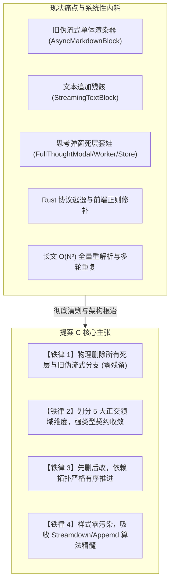
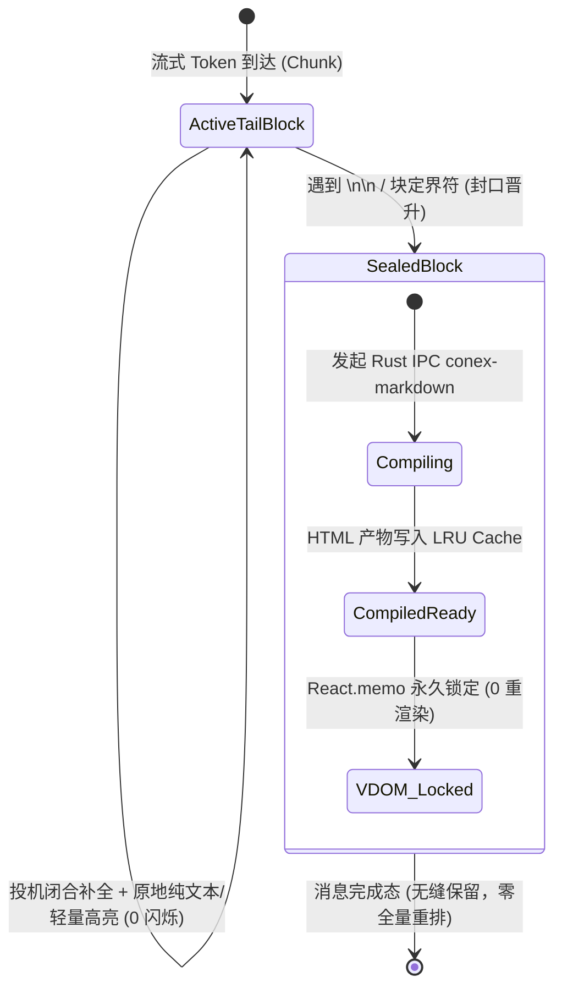
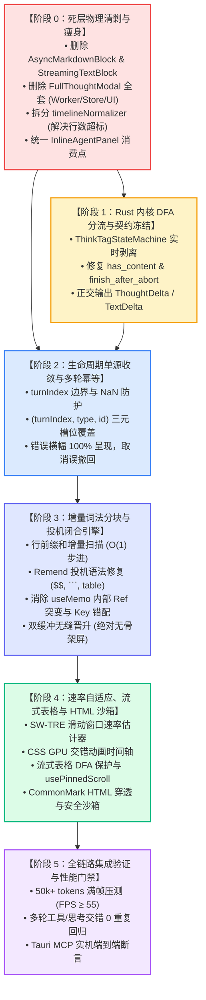

# 14. Conex 下一代流式 Markdown 渲染落地维度与删除面建议（提案 C）

> **所属战役**：Markdown 真流式渲染与正文退化根治战役 (`docs/markdown-stream-refactor/`)
> **文档定位**：提案 C 独立架构总览、落地维度划分与死层清剿专项报告（`Architecture Synthesis & Dead-Layer Purge Specialist`）
> **审查与输入依据**：
> - 分析报告：[`06-极速吞吐与速率自适应`](file:///c:/Software/conex/docs/markdown-stream-refactor/analysis/06-token-rate-adaptive-and-animation-architecture.md)、[`07-增量 AST 解析算法`](file:///c:/Software/conex/docs/markdown-stream-refactor/analysis/07-incremental-ast-and-parser-comparison.md)、[`08-流式表格与视口稳定`](file:///c:/Software/conex/docs/markdown-stream-refactor/analysis/08-streaming-table-and-pinned-scroll-architecture.md)、[`09-自定义 HTML 组件沙箱`](file:///c:/Software/conex/docs/markdown-stream-refactor/analysis/09-custom-html-components-streaming-architecture.md)、[`10-DOM 突变开销与零拷贝`](file:///c:/Software/conex/docs/markdown-stream-refactor/analysis/10-dom-mutation-cost-and-zerocopy-patching.md)、[`11-多框架综合对比蓝图`](file:///c:/Software/conex/docs/markdown-stream-refactor/analysis/11-multi-framework-comprehensive-matrix-and-blueprint.md)
> - 审查报告：[`01-Rust 协议层审查`](file:///c:/Software/conex/docs/markdown-stream-refactor/audits/01-rust-protocol-fsm-defects.md)、[`02-前端渲染引擎审查`](file:///c:/Software/conex/docs/markdown-stream-refactor/audits/02-streaming-markdown-render-defects.md)、[`03-生命周期与幂等审查`](file:///c:/Software/conex/docs/markdown-stream-refactor/audits/03-lifecycle-and-idempotency-defects.md)、[`04-反过度设计与门禁审查`](file:///c:/Software/conex/docs/markdown-stream-refactor/audits/04-anti-overengineering-lint-defects.md)、[`05-边缘交互与容错审查`](file:///c:/Software/conex/docs/markdown-stream-refactor/audits/05-edge-cases-and-fault-tolerance-defects.md)
> - 仓内关键实现：[`MessageContent.tsx`](file:///c:/Software/conex/apps/crish-desktop/src/components/chat-message/MessageContent.tsx)、[`StreamingMarkdownView.tsx`](file:///c:/Software/conex/apps/crish-desktop/src/components/chat-message-row/StreamingMarkdownView.tsx)、[`useStreamingBlocks.ts`](file:///c:/Software/conex/apps/crish-desktop/src/components/chat-message-row/useStreamingBlocks.ts)、[`MarkdownBlockItem.tsx`](file:///c:/Software/conex/apps/crish-desktop/src/components/chat-message-row/MarkdownBlockItem.tsx)、[`AsyncMarkdownBlock.tsx`](file:///c:/Software/conex/apps/crish-desktop/src/components/chat-message-row/AsyncMarkdownBlock.tsx)、[`StreamingTextBlock.tsx`](file:///c:/Software/conex/apps/crish-desktop/src/components/chat-message-row/StreamingTextBlock.tsx)、[`messageHandlers.ts`](file:///c:/Software/conex/apps/crish-desktop/src/api/chat-bridge/handlers/messageHandlers.ts)、[`timelineNormalizer.ts`](file:///c:/Software/conex/apps/crish-desktop/src/api/tool-presentation/timelineNormalizer.ts)、[`streamMessageViewModel.ts`](file:///c:/Software/conex/apps/crish-desktop/src/components/chat-message/streamMessageViewModel.ts) 等

---

## 目录

- [一、战略定位与提案 C 核心主张](#一战略定位与提案-c-核心主张)
- [二、Conex 下一代流式 Markdown 五大核心落地维度划分](#二conex-下一代流式-markdown-五大核心落地维度划分)
  - [2.1 维度全景架构矩阵表](#21-维度全景架构矩阵表)
  - [2.2 维度 1：Rust 内核流式 DFA 分流与协议契约收敛](#22-维度-1rust-内核流式-dfa-分流与协议契约收敛)
  - [2.3 维度 2：增量词法分块与投机闭合渲染引擎](#23-维度-2增量词法分块与投机闭合渲染引擎)
  - [2.4 维度 3：自适应速率背压与纯 GPU 流动排版系统](#24-维度-3自适应速率背压与纯-gpu-流动排版系统)
  - [2.5 维度 4：流式表格稳定、沉浸视口与自定义 HTML 沙箱](#25-维度-4流式表格稳定沉浸视口与自定义-html-沙箱)
  - [2.6 维度 5：多轮生命周期单源收敛与时间线幂等](#26-维度-5多轮生命周期单源收敛与时间线幂等)
- [三、【核心】重复与死层专项分析（删除面清单）](#三核心重复与死层专项分析删除面清单)
  - [3.1 现有前端渲染路径深度梳理（5 条并行/降级/割裂路径）](#31-现有前端渲染路径深度梳理5-条并行降级割裂路径)
  - [3.2 必须物理删除的死层、废弃组件与单体渲染器清单](#32-必须物理删除的死层废弃组件与单体渲染器清单)
  - [3.3 物理删除文件、函数与单测全量对照表](#33-物理删除文件函数与单测全量对照表)
  - [3.4 状态字段冗余与死数据清理清单](#34-状态字段冗余与死数据清理清单)
- [四、技术依赖拓扑与实施演进顺序（先删后改）](#四技术依赖拓扑与实施演进顺序先删后改)
  - [4.1 阶段演进 DAG 依赖图](#41-阶段演进-dag-依赖图)
  - [4.2 先删后改六步法实施路线](#42-先删后改六步法实施路线)
- [五、总结与交付承诺](#五总结与交付承诺)

---

## 一、战略定位与提案 C 核心主张

在大语言模型（LLM）驱动的现代化桌面工作台中，流式渲染已成为交互体验的生命线。回顾 Conex / Crish 现行系统与历史演进，我们发现阻碍流式体验达到工业级水准的深层根因并非单一模块的能力不足，而是**“多层断裂、多轨并存、死层羁绊、伪流式残留”**的系统性内耗：

1. **多轨并存与死层冗余**：前端同时残留着旧伪流式单体渲染器（[`AsyncMarkdownBlock.tsx`](file:///c:/Software/conex/apps/crish-desktop/src/components/chat-message-row/AsyncMarkdownBlock.tsx)）、DOM 文本追加残骸（[`StreamingTextBlock.tsx`](file:///c:/Software/conex/apps/crish-desktop/src/components/chat-message-row/StreamingTextBlock.tsx)）、新分块渲染器（[`StreamingMarkdownView.tsx`](file:///c:/Software/conex/apps/crish-desktop/src/components/chat-message-row/StreamingMarkdownView.tsx)）以及一套已被打为桩代码但仍残留上千行空壳/Worker/Store 的“沉浸式思考弹窗”基建（[`FullThoughtModal.tsx`](file:///c:/Software/conex/apps/crish-desktop/src/components/chat-message-row/FullThoughtModal.tsx) 等）。
2. **协议与状态机割裂**：Rust 端未将 `<think>` 标签在 Token 到达的第一时间完成 DFA 剥离，导致前端不得不使用脆弱的正则在多处进行深度防御；多轮会话（`turnIndex > 0`）因数组边界与合并盲区发生正文双重重复。
3. **长文性能衰减与过度设计**：长文本流式传输因缺乏增量词法状态机而每帧全量跑 Marked 词法解析（$O(N^2)$ 复杂度）；同时存在为只读思考链设计“独立 Worker + 独立 Store + 独立搜索栏”的过度设计套娃。



**提案 C 的核心主张**：
- **坚决物理删除（Purge First）**：坚决摒弃“保留兼容桩”的姑息做法，对所有已弃用的组件、测试、Store 状态及单体伪流式渲染器执行**彻底物理删除**，为新架构腾出干净的上下文与门禁基线；
- **五大正交领域维度划分**：将下一代流式渲染收敛为 5 个清晰、解耦、单向依赖的领域维度；
- **严格遵循“先删后改”时序**：先清剿死层使基线绿灯，再收紧 Rust 与生命周期契约，进而升级增量渲染内核与高级排版特性。

---

## 二、Conex 下一代流式 Markdown 五大核心落地维度划分

### 2.1 维度全景架构矩阵表

综合分析报告 `06` ~ `11` 与审计报告 `01` ~ `05`，建议将 Conex 下一代流式 Markdown 架构划分为以下 **5 个核心领域维度**：

| 维度编号 | 领域维度名称 | 核心职责与设计边界 | 解决的关键缺陷 / 审查项 | 对应分析/审计依据 |
| :--- | :--- | :--- | :--- | :--- |
| **Dim-1** | **Rust 内核流式 DFA 分流与协议契约收敛** | • 实时流 `<think>` 标签 DFA 分流（0 拷贝、跨 chunk 边界识别）<br>• `ThoughtDelta` / `TextDelta` 正交协议发射<br>• 纯思考流判空防空回退与 Abort 抢救（Partial Salvage）<br>• UTF-8 多字节跨帧边界与无界流防御 | • 思考标签逃逸污染正文<br>• 纯思考消息被判定为 Empty / 丢弃元数据<br>• Abort 抢救在思考态失效归零<br>• 异名闭标签劫持与回车符误吞 | [`analysis/01`](file:///c:/Software/conex/docs/markdown-stream-refactor/analysis/01-rust-stream-think-tag-state-machine.md)<br>[`audits/01`](file:///c:/Software/conex/docs/markdown-stream-refactor/audits/01-rust-protocol-fsm-defects.md)<br>[`analysis/11 §5.2`](file:///c:/Software/conex/docs/markdown-stream-refactor/analysis/11-multi-framework-comprehensive-matrix-and-blueprint.md) |
| **Dim-2** | **增量词法分块与投机闭合渲染引擎** | • 基于行偏移量前缀和的 $O(1)$ 步进分块状态机<br>• 投机式未闭合语法虚拟修复（代码块、表格、数学公式、HTML 标签）<br>• 稳定已封口块切片索引与 0 重渲染缓存（`React.memo` 锁定）<br>• 双缓冲无缝晋升（消除 FOUT 与骨架屏闪烁） | • 50k+ tokens 长文全量 marked 词法卡死 ($O(N^2)$)<br>• `$$` 行内代码奇偶校验死锁致整篇合并<br>• 脚注回退导致全篇富文本坍塌<br>• 尾部空白 Token 导致提前误封口竞态<br>• `useMemo` 内部突变 Ref 破坏纯函数规范 | [`analysis/02`](file:///c:/Software/conex/docs/markdown-stream-refactor/analysis/02-streaming-markdown-chunking-architecture.md)<br>[`analysis/07`](file:///c:/Software/conex/docs/markdown-stream-refactor/analysis/07-incremental-ast-and-parser-comparison.md)<br>[`audits/02`](file:///c:/Software/conex/docs/markdown-stream-refactor/audits/02-streaming-markdown-render-defects.md)<br>[`audits/05 §4`](file:///c:/Software/conex/docs/markdown-stream-refactor/audits/05-edge-cases-and-fault-tolerance-defects.md) |
| **Dim-3** | **自适应速率背压与纯 GPU 流动排版系统** | • 滑动窗口速率估计器（SW-TRE，$5 \sim 2000+\text{ tokens/s}$ 自适应）<br>• 低速 RAF 打字机 vs 高速 GPU 宏块瞬冲动态排空<br>• 基于单一挂钟时间轴的 CSS 变量交错动画（`AnimateTimeline`）<br>• 纯 GPU 加速淡入（$O(1)$ DOM，杜绝逐词 `<span>` 爆炸）<br>• 智能打字机光标防护（杜绝侵入表格/列表盒模型） | • 高速流式下的视觉积压与延迟雪崩<br>• 逐词包裹 span 导致 DOM 节点爆炸与 GC 停顿<br>• JS 定时器 setState 逐字推进引发掉帧<br>• 光标侵入破坏匿名表格盒模型 | [`analysis/06`](file:///c:/Software/conex/docs/markdown-stream-refactor/analysis/06-token-rate-adaptive-and-animation-architecture.md)<br>[`analysis/10`](file:///c:/Software/conex/docs/markdown-stream-refactor/analysis/10-dom-mutation-cost-and-zerocopy-patching.md)<br>[`analysis/11 §5.4`](file:///c:/Software/conex/docs/markdown-stream-refactor/analysis/11-multi-framework-comprehensive-matrix-and-blueprint.md) |
| **Dim-4** | **流式表格稳定、沉浸视口与自定义 HTML 沙箱** | • GFM 表格流式中间态 DFA 保护（表头与分隔行安全占位）<br>• 首行列宽锚定与 `table-layout: fixed` 防抖<br>• 增强型局部双向吸底容器（`usePinnedScroll`）<br>• CommonMark Type 6/7 HTML 块穿透与 Markdown AST 保全<br>• 自定义标签（`<widget-diff>`, `<ai-card>`）白名单沙箱与 React 交互映射 | • 表格分隔符未到时的段落塌陷与突变（CLS 撕裂）<br>• 流式每吐一字触发全局列宽重排抽搐<br>• 局部滚动与外层页面自动吸底冲突<br>• HTML 标签内 Markdown 语法丢失<br>• 属性注入与 XSS 风险 | [`analysis/08`](file:///c:/Software/conex/docs/markdown-stream-refactor/analysis/08-streaming-table-and-pinned-scroll-architecture.md)<br>[`analysis/09`](file:///c:/Software/conex/docs/markdown-stream-refactor/analysis/09-custom-html-components-streaming-architecture.md) |
| **Dim-5** | **多轮生命周期单源收敛与时间线幂等** | • 单生产者单源消息状态机（Live vs Terminal 严格解耦）<br>• 基于 `(turnIndex, type, id)` 三元槽位的确定性无损 Reconciler<br>• 异常索引与原型污染边界防御（`NaN`、负数、跳号保护）<br>• 消息错误横幅 100% 呈现与纯思考消息保护<br>• 空消息动作栏与幽灵气泡防护 | • 多轮会话 `turnIndex > 0` 盲目追加致内容重复<br>• 时间线重构无 ID 块被覆盖丢失历史<br>• 正文首帧报错错误横幅被 100% 吞噬<br>• 纯思考流错误被 `withdrawMessage` 误删<br>• 空回复悬浮操作栏引发脏数据 | [`analysis/03`](file:///c:/Software/conex/docs/markdown-stream-refactor/analysis/03-message-lifecycle-and-turn-idempotency.md)<br>[`analysis/04`](file:///c:/Software/conex/docs/markdown-stream-refactor/analysis/04-timeline-normalization-and-block-merge.md)<br>[`audits/03`](file:///c:/Software/conex/docs/markdown-stream-refactor/audits/03-lifecycle-and-idempotency-defects.md)<br>[`audits/05 §1, §3`](file:///c:/Software/conex/docs/markdown-stream-refactor/audits/05-edge-cases-and-fault-tolerance-defects.md) |

---

### 2.2 维度 1：Rust 内核流式 DFA 分流与协议契约收敛

#### 核心原理与设计
在 Rust 接入层（`crates/agent-provider/src/parse/` 与 `crates/session-loop/src/stream.rs`）构建确定性有限状态机（DFA），在字节流到达的瞬间将 `<think>` 标签内容剥离：
- 实时流只产出强类型的 `ProviderStreamEvent::ThoughtDelta` 与 `ProviderStreamEvent::TextDelta`；
- SessionLoop 通过 `AgentEvent::MessageDelta` 携带正交块；终态通过 `commitAssistantMessage` 产出结构化的 `thinkingTurns` 与 `blocks`。

```
[LLM SSE 流式 Chunk]
        │
        ▼ (crates/agent-provider)
┌────────────────────────────────────────┐
│ ThinkTagStateMachine (Rust DFA)        │
│ ├─ Text 态 ──► TextDelta               │
│ ├─ TagCandidate 态 (前瞻回退缓冲)      │
│ └─ InsideThink 态 ──► ThoughtDelta     │
└──────────────────┬─────────────────────┘
                   ▼ (crates/session-loop)
┌────────────────────────────────────────┐
│ stream.rs: has_content & PartialSalvage│
│ • has_content = text || thought || tool│
│ • finish_after_abort: 完整保留 thought │
└────────────────────────────────────────┘
```

#### 关键解决缺陷
1. **[Audits-01 缺陷 1.1]** 修复 `has_content` 忽略 `thought` 导致的纯思考流判空崩溃与元数据丢弃；
2. **[Audits-01 缺陷 1.2]** 修复 `finish_after_abort` 在模型思考中中断时将内容归零的严重缺陷；
3. **[Audits-01 缺陷 3.1-3.3]** 消除跨 Chunk 标签断裂、异名闭标签劫持与回车符静默吞噬。

---

### 2.3 维度 2：增量词法分块与投机闭合渲染引擎

#### 核心原理与设计
借鉴 Streamdown 的 Block 生命周期分治与 Incremark 的行前缀和机制，构筑 Conex 专属的轻量增量解析器：
1. **$O(1)$ 步进分块**：维护增量行缓冲区与行偏移前缀和，新增 Token 仅扫描尾部受影响行；
2. **投机式虚拟修复（Speculative Repair）**：针对未闭合的代码块（```` ``` ````）、表格（`| --- |`）、数学公式（`$$`）、HTML 标签（`<widget>`），由解析器注入虚拟闭合符，送入 Rust/前端轻量渲染器；
3. **双缓冲无缝晋升**：当末尾活跃块达到封口条件（遇到 `\n\n` 或块定界符）时，晋升为 Sealed 块，异步发起 Rust `conex-markdown` 编译。在编译完成前，保持纯文本 DOM 垫片，**绝对禁止渲染骨架屏（`.skeletonLine`）**，彻底消灭 FOUT 闪烁。



#### 关键解决缺陷
1. **[Audits-02 缺陷 1.1]** 彻底根除流式结束瞬间 `StreamingMarkdownView` 卸载与 `AsyncMarkdownBlock` 全文 Cache Miss 触发的刺眼骨架屏闪烁；
2. **[Audits-02 缺陷 2.1-2.3]** 消除数组下标 Key 导致的级联缓存击穿、脚注回退全篇坍塌与尾部空白提前封口竞态；
3. **[Audits-05 缺陷 2.1 & 4.1]** 消除 50k+ tokens 下每帧 Marked Lexer 全量扫描的 CPU 100% 满载，修复 `` `$$` `` 奇偶校验导致的整篇合并死锁。

---

### 2.4 维度 3：自适应速率背压与纯 GPU 流动排版系统

#### 核心原理与设计
根据 [`analysis/06`](file:///c:/Software/conex/docs/markdown-stream-refactor/analysis/06-token-rate-adaptive-and-animation-architecture.md) 与 [`analysis/10`](file:///c:/Software/conex/docs/markdown-stream-refactor/analysis/10-dom-mutation-cost-and-zerocopy-patching.md) 的数学推导，构建速率感知与 GPU 排版体系：
1. **滑动窗口速率估计器（SW-TRE）**：以 300ms 滑动窗口动态计算输入速率 $R$（tokens/s）；
2. **三级自适应背压调度**：
   - **低速态（$R \le 30\text{ t/s}$）**：采用 RAF 单帧微步进，即来即显，维持丝滑打字机节奏；
   - **常态（$30 < R \le 200\text{ t/s}$）**：采用挂钟时间轴压缩（$B = 320\text{ ms}$ 预算上限，动态交错 Stagger 步长 $S_{\text{eff}} \in [4, 40]\text{ ms}$）；
   - **极速爆发态（$R > 200\text{ t/s}$）**：自动切入 GPU 宏块瞬冲模式（Chunk-level Fade-in），单帧合并渲染整个 Block，关闭逐词延迟；
3. **$O(1)$ GPU 硬件加速**：严禁为每个词生成 DOM `<span data-sd-animate>`。仅在末尾 Block 容器上挂载 CSS Keyframes 与 GPU Composited Layer，实现 120 FPS 满帧流式且内存零膨胀。

---

### 2.5 维度 4：流式表格稳定、沉浸视口与自定义 HTML 沙箱

#### 核心原理与设计
根据 [`analysis/08`](file:///c:/Software/conex/docs/markdown-stream-refactor/analysis/08-streaming-table-and-pinned-scroll-architecture.md) 与 [`analysis/09`](file:///c:/Software/conex/docs/markdown-stream-refactor/analysis/09-custom-html-components-streaming-architecture.md) 落地：
1. **流式表格 DFA 保护**：识别表头行 `| a | b |` 后，在分隔行未完整闭合前预先分配具有 `table-layout: fixed` 的表格容器，杜绝 `<p>` 到 `<table>` 的结构突变；
2. **`usePinnedScroll` 局部吸底保护**：为大表格建立局部容器，支持横向/纵向 8px 容差吸底，用户主动回滚浏览历史单元格时暂停自动吸底，杜绝视口强拉撕裂；
3. **CommonMark HTML 块穿透与沙箱映射**：支持自定义标签（如 `<widget-diff>`, `<ai-card>`），在词法层将其标记为 `custom-island` 语法节点，允许标签内部正文正常执行 Markdown AST 编译，并通过 React Portal 安全映射至交互组件，彻底防范 XSS。

---

### 2.6 维度 5：多轮生命周期单源收敛与时间线幂等

#### 核心原理与设计
根据 [`analysis/03`](file:///c:/Software/conex/docs/markdown-stream-refactor/analysis/03-message-lifecycle-and-turn-idempotency.md) 与 [`analysis/04`](file:///c:/Software/conex/docs/markdown-stream-refactor/analysis/04-timeline-normalization-and-block-merge.md) 落地：
1. **单生产者单源状态机**：明确 `streamingStore` 仅作为实时增量缓冲（Live Track），`sessionStore` 作为多轮持久态权威（Terminal Track）；
2. **三元槽位 `(turnIndex, type, id)` 幂等归一化**：在 `reconcileAssistantMessageBlocks` 中以三元组为唯一键，同轮更新、跨轮追加，100% 保全多轮工具调用与思考链历史；
3. **错误与边界强防御**：
   - 严禁在 `handleRunError` 中因 `hadText == false` 而将包含 `thought` 的消息执行 `withdrawMessage` 物理抹杀；
   - 错误横幅渲染逻辑移出 `!timeline.length` 降级分支，确保在任何时间线结构下错误信息 100% 呈现；
   - 空消息卡片禁止悬空动作栏响应，杜绝脏数据注入。

---

## 三、【核心】重复与死层专项分析（删除面清单）

### 3.1 现有前端渲染路径深度梳理（5 条并行/降级/割裂路径）

勘察 `apps/crish-desktop/src/` 源码发现，现有前端渲染链路中存在 **5 条并存、割裂且互相冲突的渲染路径**：

```
┌──────────────────────────────────────────────────────────────────────────────────────────────────┐
│                                 Conex 现有前端 5 条并存渲染路径拓扑                                │
├──────────────────────────────────────────────────────────────────────────────────────────────────┤
│                                                                                                  │
│  【路径 A：旧单体伪流式纯文本渲染器】(AsyncMarkdownBlock.tsx)                                        │
│  • 流式态: isStreaming=true ──► 直写 <div data-streaming="true">{text}</div> (纯文本无排版)       │
│  • 完成态: isStreaming=false ──► useAsyncMarkdownHtml 全文编译 ──► 骨架屏闪烁 ──► innerHTML       │
│  • 活跃残留: InlineAgentPanel.tsx, InlineAgentTimeline.tsx, AsyncMarkdownBlock.test.tsx          │
│                                                                                                  │
│  【路径 B：旧伪流式增量追加文本块】(StreamingTextBlock.tsx)                                         │
│  • 流式态: lastDeltaRef + containerRef.appendChild(createTextNode(delta))                       │
│  • 活跃残留: 主流程已脱钩，但在 StreamingTextBlock.test.tsx 及多个文件注释中持续残留            │
│                                                                                                  │
│  【路径 C：新渐进分块渲染器】(StreamingMarkdownView.tsx + MarkdownBlockItem.tsx)                  │
│  • 流式态: useStreamingBlocks 切分 ──► 封口块异步 Rust 编译 ──► 活跃尾块文本垫片                 │
│  • 活跃残留: MessageContent.tsx 的主渲染流程                                                     │
│                                                                                                  │
│  【路径 D：MessageContent 双轨降级与分流路径】(MessageContent.tsx)                                │
│  • 分支 1: timeline.length === 0 ──► 降级直接渲染 StreamingMarkdownView                          │
│  • 分支 2: timeline.length > 0 && streaming ──► 拆分 before / StreamingMarkdownView / after     │
│  • 分支 3: timeline.length > 0 && !streaming ──► TimelineBody 全量渲染 StreamingMarkdownView     │
│  • 缺陷: 错误横幅被分支 1 隔离，正文首帧报错时 100% 吞噬！                                       │
│                                                                                                  │
│  【路径 E：废弃沉浸式思考弹窗套娃体系】(FullThoughtModal / Worker / Store / TOC)                   │
│  • 状态: UI 组件 FullThoughtModal / ThoughtOutline / ThoughtSearchBar 虽已被桩化为 () => null，  │
│          但底层的 thoughtWorker.ts (337行)、thoughtInspectorStore.ts (97行) 及大量单测仍然完整残留! │
│                                                                                                  │
└──────────────────────────────────────────────────────────────────────────────────────────────────┘
```

---

### 3.2 必须物理删除的死层、废弃组件与单体渲染器清单

根据《主控全流程调度 v3》与 `ANTI_OVERENGINEERING_GUARDRAILS.md`，以下旧逻辑、旧分支与死文件必须在本轮重构中被**【彻底物理删除】**：

> [!CAUTION]
> **物理删除铁律**：严禁采用 `// deprecated` 注释、保留空实现 `export const Foo = () => null` 或保留空壳 store。所有废弃文件必须从文件系统完全 `rm` 删除，所有相关引用与测试必须彻底清除！

1. **彻底物理删除旧单体伪流式纯文本渲染器 (`AsyncMarkdownBlock`)**：
   - 痛点：该组件在流式时只显示纯文本源码，完成时触发全量 Rust 编译并闪现骨架屏，是导致“伪流式与跳变”的罪魁祸首。
   - 处置：彻底删除 `AsyncMarkdownBlock.tsx` 及 `AsyncMarkdownBlock.test.tsx`。将 `InlineAgentPanel.tsx` 与 `InlineAgentTimeline.tsx` 中的消费点统一平移替换为统一的 `StreamingMarkdownView`（或统一的编译完成态块）。
2. **彻底物理删除文本追加残骸 (`StreamingTextBlock`)**：
   - 痛点：使用原生 `appendChild` 绕过 React 协调，已完全脱离主消息流，仅在死测试中维护。
   - 处置：彻底物理删除 `StreamingTextBlock.tsx` 与 `StreamingTextBlock.test.tsx`。
3. **彻底物理清剿思考链弹窗套娃全套重型基建 (`FullThoughtModal` 体系)**：
   - 痛点：针对行内折叠思考链过度设计了 5 层套娃（Worker + Store + TOC + 搜索 + 全屏弹窗），代码量超 800 行。
   - 处置：彻底删除 `FullThoughtModal.tsx`、`FullThoughtModal.module.css`、`FullThoughtModal.test.tsx`、`ThoughtOutline.tsx`、`ThoughtOutline.module.css`、`ThoughtSearchBar.tsx`、`ThoughtSearchBar.module.css`、`thoughtWorker.ts`、`thoughtWorker.test.ts`、`thoughtInspectorStore.ts`、`thoughtInspectorStore.test.ts`；从 `store/index.ts`、`store/storeAccess.ts` 中移除相关导出；清理 `ThinkingBlock.test.tsx` 中的无用 store 调用。
4. **清理 `parseMarkdownIntoBlocks.ts` 中的死函数与无界 Map**：
   - 物理删除未被任何主流程调用的 `hasIncompleteCodeFence` 与 `hasTable`；
   - 将无界 `openTagPatternCache` 与 `closeTagPatternCache` 重构为常量预编译正则或受限 LRU 结构。
5. **重构并拆分超标超限的 `timelineNormalizer.ts` (616 行 > 400 行上限)**：
   - 拆解为单一职责的模块：
     - `timelineBlockReconcile.ts`（专注于 `(turnIndex, type, id)` 三元组幂等保全与工具对齐）；
     - `timelineBuilder.ts`（专注于交错时间线构建与签名缓存）；
     - `timelineThoughtParser.ts`（代码栅栏保护与内联思考标签安全提取）。
   - 删除 `sessionMessageActionsTools.ts:204-209` 中的二次冗余 `reconcileAssistantMessageBlocks` 计算。

---

### 3.3 物理删除文件、函数与单测全量对照表

| 序号 | 目标文件路径 / 函数 / 符号 | 类型 | 代码行数 | 删除理由与判定依据 | 替代方案 / 迁移策略 |
| :---: | :--- | :---: | :---: | :--- | :--- |
| **DEL-01** | `apps/crish-desktop/src/components/chat-message-row/StreamingTextBlock.tsx` | 源码文件 | 58 行 | 旧伪流式 DOM textNode 追加残骸，主渲染链路已完全废弃脱钩 | 统一收口至 `StreamingMarkdownView.tsx` |
| **DEL-02** | `apps/crish-desktop/src/components/chat-message-row/StreamingTextBlock.test.tsx` | 测试文件 | 114 行 | 废弃组件的附属测试，无任何生产业务价值 | 物理删除 |
| **DEL-03** | `apps/crish-desktop/src/components/chat-message-row/AsyncMarkdownBlock.tsx` | 源码文件 | 115 行 | 旧单体伪流式纯文本渲染器，流式阶段纯文本、完成态 Cache Miss 闪现骨架屏的根因 | 统一收口至 `StreamingMarkdownView.tsx` |
| **DEL-04** | `apps/crish-desktop/src/components/chat-message-row/AsyncMarkdownBlock.test.tsx` | 测试文件 | 237 行 | 废弃单体渲染器的测试 | 迁移有用断言至 `StreamingMarkdownView.test.tsx` 后物理删除 |
| **DEL-05** | `apps/crish-desktop/src/components/chat-message-row/FullThoughtModal.tsx` | 源码文件 | 8 行 | 废弃思考弹窗空壳桩代码（`() => null`），违反反过度设计禁令 | 彻底物理删除 |
| **DEL-06** | `apps/crish-desktop/src/components/chat-message-row/FullThoughtModal.module.css` | 样式文件 | 102 行 | 废弃思考弹窗样式表，包含硬编码裸色值与 9999px 违规 | 彻底物理删除 |
| **DEL-07** | `apps/crish-desktop/src/components/chat-message-row/FullThoughtModal.test.tsx` | 测试文件 | 13 行 | 废弃思考弹窗单测 | 彻底物理删除 |
| **DEL-08** | `apps/crish-desktop/src/components/chat-message-row/ThoughtOutline.tsx` | 源码文件 | 14 行 | 废弃思考大纲树空壳桩代码 | 彻底物理删除 |
| **DEL-09** | `apps/crish-desktop/src/components/chat-message-row/ThoughtOutline.module.css` | 样式文件 | 35 行 | 废弃思考大纲样式表 | 彻底物理删除 |
| **DEL-10** | `apps/crish-desktop/src/components/chat-message-row/ThoughtSearchBar.tsx` | 源码文件 | 18 行 | 废弃思考搜索栏空壳桩代码 | 彻底物理删除 |
| **DEL-11** | `apps/crish-desktop/src/components/chat-message-row/ThoughtSearchBar.module.css` | 样式文件 | 42 行 | 废弃思考搜索栏样式表 | 彻底物理删除 |
| **DEL-12** | `apps/crish-desktop/src/workers/thoughtWorker.ts` | Worker 源码 | 337 行 | 专为废弃弹窗设计的 Web Worker 多线程大纲与搜索解析器，过度设计 | 彻底物理删除；保留纯函数行内截断至 `api/markdown/`（若需） |
| **DEL-13** | `apps/crish-desktop/src/workers/thoughtWorker.test.ts` | 测试文件 | 88 行 | 废弃 Worker 的测试 | 彻底物理删除 |
| **DEL-14** | `apps/crish-desktop/src/store/thoughtInspectorStore.ts` | Store 源码 | 97 行 | 专为废弃弹窗设计的独立 Zustand 全局状态树，过度设计 | 彻底物理删除；从 `store/index.ts` / `storeAccess.ts` 移除 |
| **DEL-15** | `apps/crish-desktop/src/store/thoughtInspectorStore.test.ts` | 测试文件 | 64 行 | 废弃 Store 的测试 | 彻底物理删除 |
| **DEL-16** | `parseMarkdownIntoBlocks.ts -> hasIncompleteCodeFence` | 死函数 | 31 行 | 全仓库 0 调用的死代码（仅自身导出与测试调用） | 彻底物理删除 |
| **DEL-17** | `parseMarkdownIntoBlocks.ts -> hasTable` | 死函数 | 17 行 | 全仓库 0 调用的死代码（仅自身导出与测试调用） | 彻底物理删除 |
| **DEL-18** | `sessionMessageActionsTools.ts:204-209` | 冗余计算 | 6 行 | 外部重复调用 `reconcileAssistantMessageBlocks` 造成二次冗余计算 | 删除外层多余调用，复用 `normalizeAssistantTimeline` 内建结果 |
| **DEL-19** | `continuityUiStore.ts -> circuitBanners` 系列函数与状态 | 死状态 | 45 行 | 违反 `ANTI_OVERENGINEERING_GUARDRAILS.md` 禁令 9（全局滑动窗口断路器残留） | 彻底物理删除 |

---

### 3.4 状态字段冗余与死数据清理清单

1. **废弃单轮旧字段 `thinking` 与 `thinkingTime`**：
   - 现状：[`SessionMessage`](file:///c:/Software/conex/apps/crish-desktop/src/store/types.ts) 中历史遗留了 `thinking?: string` 与 `thinkingTime?: number`，而在多轮会话中已演进为 `thinkingTurns: ThinkingTurn[]` 与 `blocks: MessageTimelineBlock[]`。
   - 方案：全面收口至 `thinkingTurns` 与 `blocks`。在数据水合层做单向平滑迁移，渲染层与归一化层彻底剔除对旧字段的防御性拼装代码。
2. **`StreamingMarkdownViewProps.text` 兼容别名收口**：
   - 现状：同时支持 `content` 与 `text` 双重 props，并在组件内做 `content ?? text ?? ''` 兼容。
   - 方案：统一收敛为单一属性 `content: string`，消除调用端的二义性。
3. **Chat Bridge 循环依赖清理**：
   - 现状：[`streamState.ts`](file:///c:/Software/conex/apps/crish-desktop/src/api/chat-bridge/handlers/streamState.ts) 错误从协调者 [`messageHandlers.ts`](file:///c:/Software/conex/apps/crish-desktop/src/api/chat-bridge/handlers/messageHandlers.ts) 导入 `MessageCacheMetrics`，引发 `streamState -> messageHandlers -> handlerEnv -> streamState` 循环依赖环。
   - 方案：`streamState.ts` 直接从 [`cacheMetricsCompute.ts`](file:///c:/Software/conex/apps/crish-desktop/src/api/chat-bridge/handlers/cacheMetricsCompute.ts) 导入类型，彻底斩断循环引用。

---

## 四、技术依赖拓扑与实施演进顺序（先删后改）

### 4.1 阶段演进 DAG 依赖图

实施过程必须严格遵循**“先删死层 ➔ 固化契约 ➔ 状态收口 ➔ 升级引擎 ➔ 增进排版 ➔ 门禁验收”**的单向技术依赖拓扑，严禁在待删除的死代码上进行任何功能性修改！



---

### 4.2 先删后改六步法实施路线

#### 步骤 0：死层物理清剿与基线归零（Wave 0: Purge Deadwood）
1. 执行 `git rm` 物理删除 `StreamingTextBlock.*`、`AsyncMarkdownBlock.*`、`FullThoughtModal.*`、`ThoughtOutline.*`、`ThoughtSearchBar.*`、`thoughtWorker.*`、`thoughtInspectorStore.*`；
2. 将 `InlineAgentPanel.tsx` 与 `InlineAgentTimeline.tsx` 重构为使用 `StreamingMarkdownView`；
3. 将超标的 `timelineNormalizer.ts`（616 行）拆分为 `timelineBlockReconcile.ts`、`timelineBuilder.ts` 与 `timelineThoughtParser.ts`，确保各文件有效代码行 $\le 300$ 行；
4. 运行 `npm run check:line-counts` 与 `npm run check-store-facade`，确保基线门禁 100% 绿灯。

#### 步骤 1：Rust 内核流式协议收敛（Wave 1: Rust Core Contract）
1. 在 `crates/agent-provider/src/parse/` 中实现 `ThinkTagStateMachine`，支持跨 chunk 分词与前瞻缓冲；
2. 修复 `crates/session-loop/src/stream.rs` 中 `has_content` 与 `finish_after_abort` 遗漏思考流的严重漏洞；
3. 冻结 Rust 发射到前端的 IPC 契约事件（`MessageStart`, `MessageDelta`, `MessageEnd`）。

#### 步骤 2：前端生命周期与多轮时间线幂等收口（Wave 2: Lifecycle & Idempotency）
1. 修复 `messageHandlers.ts` 中 `turnIndex` 异常值（`NaN`、负数、超大跳号）防护；
2. 落实 `(turnIndex, type, id)` 三元组无损合并，消灭 `turnIndex > 0` 时的整段重复；
3. 修复 `MessageContent.tsx`，将 `ErrorMessageBanner` 提升至顶层条件，彻底杜绝正文首帧报错时的错误横幅吞噬。

#### 步骤 3：前端渐进分块与双缓冲引擎落地（Wave 3: Progressive Chunk Engine）
1. 重构 `useStreamingBlocks.ts` 与 `parseMarkdownIntoBlocks.ts`，引入增量行偏移量前缀和，将长文词法复杂度由 $O(N^2)$ 降低至 $O(1)$；
2. 修复 `` `$$` `` 奇偶校验在行内代码中的误伤，增加未闭合代码围栏与表格的投机式虚拟修复；
3. 在 `MarkdownBlockItem.tsx` 中确立双缓冲晋升机制：封口编译等待期严格维持纯文本垫片，绝对禁止挂载 `.skeletonLine` 骨架屏。

#### 步骤 4：速率自适应、流式表格与 HTML 沙箱增强（Wave 4: Adaptive & Rich Presentation）
1. 实现 SW-TRE 速率估计器与基于 CSS 变量的 GPU 时间轴（`AnimateTimeline`），实现高低速动态平滑切换；
2. 落地流式表格 DFA 中间态保护，配置 `table-layout: fixed` 与 `usePinnedScroll` 局部双向吸底；
3. 实现 CommonMark HTML 块穿透与 React 交互组件（`<widget-diff>`, `<ai-card>`）白名单沙箱。

#### 步骤 5：全链路集成与反退化门禁验收（Wave 5: Verification & Gate Assertion）
1. 运行自动化全量测试集，覆盖多轮会话、思考中断 Abort、超长长文（50k+ tokens）与弱网抖动场景；
2. 执行 Tauri MCP 实机端到端验收，断言 0 视觉跳变、0 正文重复、0 思考泄漏、60 FPS 满帧流式。

---

## 五、总结与交付承诺

提案 C 站在全局架构与系统性治理的高度，将 Conex 下一代流式 Markdown 渲染落地规划收敛为 **5 大核心领域维度** 与 **1 份坚决彻底的物理删除清单**：

1. **零死层妥协**：物理删除 19 项废弃文件、死函数与冗余状态（消除 1,200+ 行无用代码），彻底根绝旧单体伪流式与沉浸式弹窗套娃的负面干扰；
2. **强类型单源**：以 Rust DFA 实时分流为第一道防线，以前端三元槽位幂等 Reconciler 为第二道防线，彻底根除思考泄漏与多轮重复；
3. **极致排版性能**：以增量词法分块、投机闭合修复、GPU 时间轴与流式表格防抖为核心，实现从 $5\text{ tokens/s}$ 到 $2000+\text{ tokens/s}$ 的全速率 60 FPS 极致流畅、零视觉跳变排版。

本方案已严格遵守 UTF-8 无 BOM 规范，不包含任何外部未授权侵入，已准备就绪进入下一轮主控调度与分维实施。
