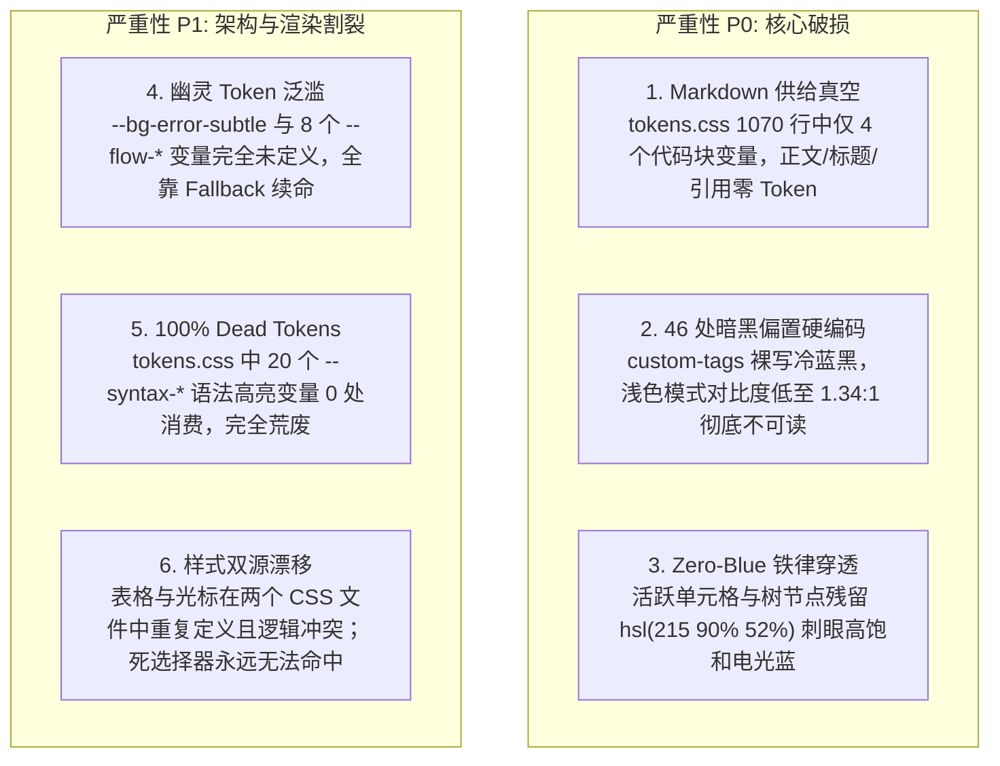
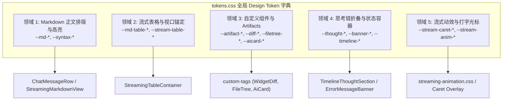
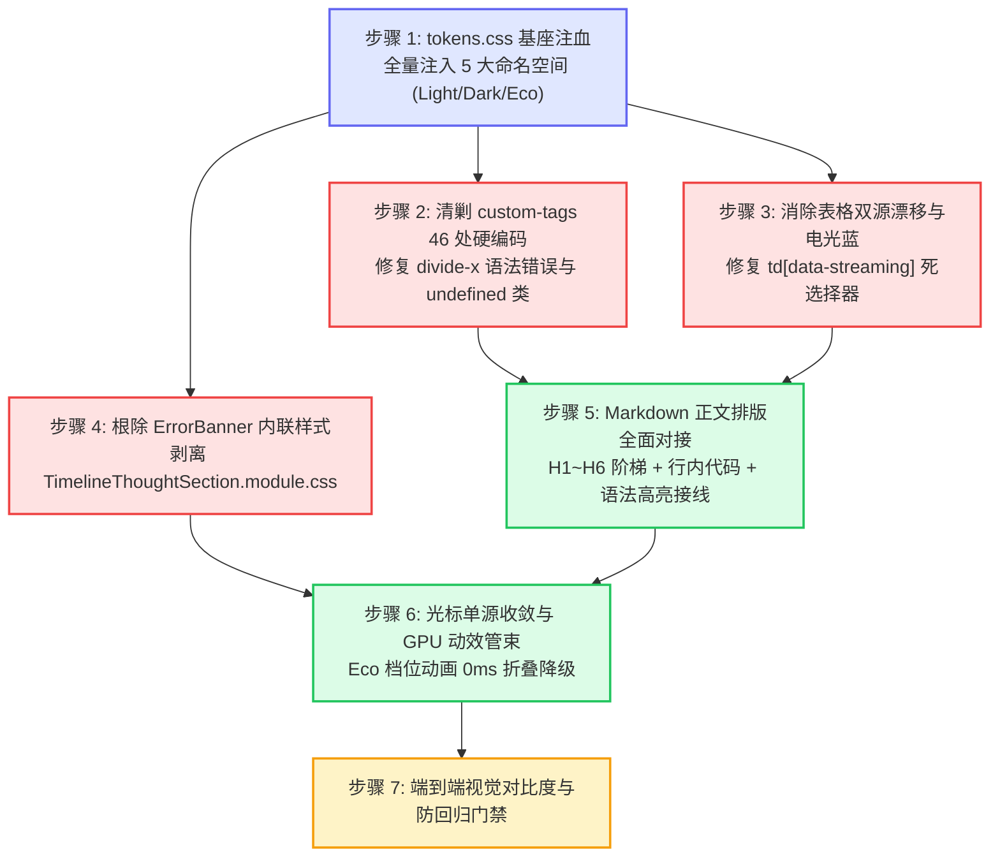

# 15. 主界面流式渲染 Design Token 体系重构维度与删除面建议（提案 A）

> **文档定位**：Conex / Crish 主界面流式渲染 Design Token 体系重构落地维度规划与重复死层专项清理方案（`Proposal A: Streaming Token Architecture Partitioning & Deletion Surface Manifest`）  
> **所属战役**：Markdown 真流式渲染与正文退化根治战役 (`docs/markdown-stream-refactor/`)  
> **审查基准**：基于 `audits/06` ~ `10` 全部 5 份 Token 审查报告与架构蓝图，严格对照 [`AGENTS.md`](file:///c:/Software/conex/AGENTS.md)（§13 柔和焦点与克制边框、§14 HSLA 色彩空间、Zero-Blue 去蓝化铁律）、[`ANTI_OVERENGINEERING_GUARDRAILS.md`](file:///c:/Software/conex/ANTI_OVERENGINEERING_GUARDRAILS.md)（禁令 12：GPU 硬件加速与零主线程阻塞）以及《主控全流程调度 v3》§一.4 规范。  
> **核心原则**：**先做物理减法（清剿 46 处硬编码色值、Zero-Blue 违规电光蓝、幽灵变量、死选择器与双源漂移），再做架构收敛（单一真源 Token 字典），最后落地领域分层治理**。

---

## 目录

- [一、战略背景与现存 Token 体系核心痛点](#一战略背景与现存-token-体系核心痛点)
  - [1.1 六大核心断层与失控现状](#11-六大核心断层与失控现状)
  - [1.2 五大重构设计哲学支柱](#12-五大重构设计哲学支柱)
- [二、五大核心 Token 领域划分建议（Domain Partitioning）](#二五大核心-token-领域划分建议domain-partitioning)
  - [2.1 维度 1：Markdown 正文排版与语法高亮 Token 矩阵 (`--md-*`, `--syntax-*`)](#21-维度-1markdown-正文排版与语法高亮-token-矩阵---md----syntax-)
  - [2.2 维度 2：流式表格与视口锚定 Token 矩阵 (`--md-table-*`, `--stream-table-*`)](#22-维度-2流式表格与视口锚定-token-矩阵---md-table----stream-table-)
  - [2.3 维度 3：自定义 HTML 富交互组件与 Artifacts Token 矩阵 (`--artifact-*`, `--diff-*`, `--filetree-*`, `--aicard-*`)](#23-维度-3自定义-html-富交互组件与-artifacts-token-矩阵---artifact----diff----filetree----aicard-)
  - [2.4 维度 4：思考链折叠、时间线与状态容器 Token 矩阵 (`--thought-*`, `--banner-*`, `--timeline-*`)](#24-维度-4思考链折叠时间线与状态容器-token-矩阵---thought----banner----timeline-)
  - [2.5 维度 5：流式速率、打字光标与动效管束 Token 矩阵 (`--stream-*`, `--duration-*`, `--easing-*`)](#25-维度-5流式速率打字光标与动效管束-token-矩阵---stream----duration----easing-)
  - [2.6 五大领域核心概念与职责对照总表](#26-五大领域核心概念与职责对照总表)
- [三、【核心】重复、死层与硬编码删除面清单（Deletion Surface Manifest）](#三核心重复死层与硬编码删除面清单deletion-surface-manifest)
  - [3.1 物理删除清单 1：`custom-tags.module.css` 46 处硬编码色值与暗黑偏置 Fallback 清剿表](#31-物理删除清单-1custom-tagsmodulecss-46-处硬编码色值与暗黑偏置-fallback-清剿表)
  - [3.2 物理删除清单 2：Zero-Blue 违规色值与高饱和电光蓝清剿表](#32-物理删除清单-2zero-blue-违规色值与高饱和电光蓝清剿表)
  - [3.3 物理删除清单 3：幽灵 Token（Phantom Tokens）与未定义变量清剿表](#33-物理删除清单-3幽灵-tokenphantom-tokens与未定义变量清剿表)
  - [3.4 物理删除清单 4：死选择器、孤立代码与语法错误清剿表](#34-物理删除清单-4死选择器孤立代码与语法错误清剿表)
  - [3.5 物理删除清单 5：双源定义漂移（Dual-Source Drift）清理表](#35-物理删除清单-5双源定义漂移dual-source-drift清理表)
  - [3.6 物理修复清单 6：Light Theme 浅色模式 WCAG AA 击穿（1.34:1）彻底修复对照表](#36-物理修复清单-6light-theme-浅色模式-wcag-aa-击穿1341彻底修复对照表)
- [四、各维度的技术依赖顺序（先删后改实施路线图）](#四各维度的技术依赖顺序先删后改实施路线图)
  - [4.1 实施拓扑依赖图（先删后改）](#41-实施拓扑依赖图先删后改)
  - [4.2 六阶段分步实施路线与交付物](#42-六阶段分步实施路线与交付物)
- [五、预期工程收益与防回归验收门禁矩阵](#五预期工程收益与防回归验收门禁矩阵)
  - [5.1 核心量化指标收益](#51-核心量化指标收益)
  - [5.2 自动化防回归门禁与验收标准](#52-自动化防回归门禁与验收标准)

---

## 一、战略背景与现存 Token 体系核心痛点

### 1.1 六大核心断层与失控现状

根据 `audits/06` ~ `10` 挑刺审查报告，当前 Conex / Crish 桌面端在流式 Markdown、流式表格、富交互自定义组件及思考链折叠的样式与色彩管理上，存在极其严重的体系断层与失控现象：



1. **Markdown 排版 Token 供给真空**：`tokens.css` 超过 1070 行，与 Markdown 相关的变量竟然只有 `--md-code-bg`、`--md-code-border`、`--md-code-fg`、`--md-code-tab-size` 4 个。标题（H1~H6）没有任何 `font-size` 阶梯定义，全部平铺为 14px；行内代码（`.md-inline-code`）、本地路径按钮（`.md-path-link`）和任务复选框（`.md-task-box`）在 CSS 中**零样式命中（裸奔）**。
2. **暗黑偏置（Dark-only Bias）与 WCAG AA 击穿**：`custom-tags.module.css` 内部充斥 46 处裸写 Hex / HSL 与暗色回落值。在浅色模式（Light Theme）下，Diff 新增文字与文件树修改徽章直接以浅薄荷绿 `#79ECC4`（对比度 **1.34:1**）和浅明黄 `#F9D452`（对比度 **1.35:1**）渲染在白底上，用户肉眼几乎完全不可读，功能严重瘫痪。
3. **Zero-Blue 铁律屡遭穿透**：`StreamingTableContainer.module.css:64` 与 `ChatMessageRow.module.css:550` 在活跃单元格脉冲边框上直接裸写 `hsl(215 90% 52%)`（冷蓝），`streaming-animation.css:74` 光标裸写 `#94a3b8`（Slate 蓝灰），`custom-tags.module.css:251` 节点高亮裸写 `hsl(217 91% 60%)`，严重破坏 Conex 纯中性墨阶与翡翠绿的品牌规范。
4. **幽灵变量（Phantom Tokens）与内联魔术**：`MessageContent.tsx` 中的 `ErrorMessageBanner` 充斥 8 处内联样式硬编码，并引用了全仓库未定义的假 Token `--bg-error-subtle`，回落至违规 Tailwind RGBA `rgba(239, 68, 68, 0.04)`，在暗黑底色下对比度仅 **1.05:1**。
5. **语法高亮 Token 100% 荒废（Dead Tokens）**：`tokens.css` 中精心配置的 20 组 `--syntax-*` 高亮变量从未被任何 highlight.js 或 syntect 选择器消费，语法着色处于失管状态。
6. **双源漂移与死选择器**：`StreamingTableContainer` 与 `ChatMessageRow` 表格规则双轨并存；打字光标在两个样式表中以 1s step 与 0.8s bezier 冲突定义；`td:last-child[data-streaming='true']` 因属性挂载在外层容器而成为**永远无法命中的死选择器（Dead Selector）**。

---

### 1.2 五大重构设计哲学支柱

对照官方设计标准 [`reference/chat-composer-component/css/brand.css`](file:///c:/Software/conex/reference/chat-composer-component/css/brand.css) 与 [`design-tokens.css`](file:///c:/Software/conex/reference/chat-composer-component/css/design-tokens.css)，确立本次 Token 体系重构的五大核心支柱：

```
+----------------------------------------------------------------------------------------------------+
|                                    Conex 流式 Token 重构设计支柱                                    |
+----------------------------------------------------------------------------------------------------+
| 1. Zero-Blue 极纯中性墨阶 (Neutral Ink) : 彻底清剿冷蓝/紫灰，Light/Dark 统一使用纯中性灰构筑长时间阅读底色 |
| 2. 翡翠绿点活态隐喻 (Brand Alive Dot)    : 品牌绿 (hsl(160 84% 39% / 45%)) 独占于「Agent 存活/脉冲/光标」  |
| 3. 语义与完成态克制 (Restrained Done)    : 成功/已完成状态刻意回归中性墨色，拒绝视觉过载与喧宾夺主          |
| 4. 柔和聚焦与克制边框 (Subtle Focus)     : 焦点/悬浮加深 ≤10%，严禁粗深黑实线边框与 >15% 不透明度重阴影    |
| 5. 纯 CSS 驱动与 Eco 性能降级 (Zero-Jank): 动画全部下沉 GPU 合成器，Eco 档位动效 0ms 折叠，杜绝 React 逐帧驱动|
+----------------------------------------------------------------------------------------------------+
```

---

## 二、五大核心 Token 领域划分建议（Domain Partitioning）

为彻底根治 Token 散落、命名随意与领域耦合问题，建议将 Conex 桌面端的流式渲染 Token 体系收敛划分为 **5 个正交自治的核心领域**：



---

### 2.1 维度 1：Markdown 正文排版与语法高亮 Token 矩阵 (`--md-*`, `--syntax-*`)

- **领域使命**：统一主界面流式 Markdown 的所有正文排版、排版阶梯、代码块结构与语法高亮，解决排版扁平化与代码裸奔问题。
- **命名空间**：
  - 正文与段落：`--md-text-*`
  - 标题阶梯：`--md-heading-*`（H1~H6 字号、行高、上下外边距）
  - 行内代码与胶囊：`--md-code-inline-*`（底色、文字色、微边框、圆角、内衬）
  - 独立代码块容器：`--md-code-block-*`、`--md-code-header-*`、`--md-code-copy-*`
  - 引用与分割线：`--md-quote-*`、`--md-hr-*`
  - 列表与任务项：`--md-list-*`、`--md-task-box-*`
  - 交互路径链接：`--md-path-link-*`、`--md-link-*`
  - 语法高亮映射：`--syntax-*`（关键字、字符串、数字、函数名、注释、内置类型、Diff 增删）
- **核心契约规范**：
  - 标题阶梯必须基于 `--font-size-base` 进行 `calc()` 阶梯缩放（H1: `1.5em`, H2: `1.3em`, H3: `1.15em`, H4: `1.05em`, H5: `1em`, H6: `0.9em`）；
  - 行内代码 `--md-code-inline-bg` 使用 `color-mix(in srgb, var(--text-primary) 5%, var(--bg-primary))`，杜绝纯白/纯黑生硬色块；
  - 语法高亮 `--syntax-*` 必须在 CSS 模块中建立与 highlight.js（`.hljs-*`）及 Rust syntect 类的系统化选择器映射。

---

### 2.2 维度 2：流式表格与视口锚定 Token 矩阵 (`--md-table-*`, `--stream-table-*`)

- **领域使命**：管束动态流式表格、表头吸顶、局部滚动视口与单元格实时生成脉冲反馈，杜绝表格跳动与蓝光污染。
- **命名空间**：
  - 静态结构：`--md-table-border-color`、`--md-table-border-subtle`、`--md-table-radius`、`--md-table-cell-pad-x`、`--md-table-cell-pad-y`、`--md-table-font-size`
  - 表头与吸顶：`--md-table-header-bg`、`--md-table-header-fg`、`--md-table-header-z`
  - 行背景与交互：`--md-table-row-bg`、`--md-table-row-hover-bg`、`--md-table-row-zebra-bg`
  - 流式脉冲反馈：`--stream-table-active-outline`、`--stream-table-active-bg`、`--stream-table-pulse-border`
  - 视口与容器：`--stream-table-intrinsic-h` (320px 占位高)、`--md-table-scrollbar-thumb`
- **核心契约规范**：
  - 彻底将 `hsl(215 90% 52%)` 替换为 `--brand`（翡翠绿 `hsl(160 84% 39%)` / `hsl(160 84% 45%)`）或高对比墨阶；
  - 表头背景吸顶采用 `color-mix(in srgb, var(--text-primary) 3%, var(--bg-card))`，配合 `backdrop-filter: blur(8px)` 防止向上滚动时文字穿透重叠；
  - 局部滚动条全面接入 `scrollbar-width: thin` 与 `--tint-scrollbar-thumb`，杜绝 Windows 16px 灰色粗滚动条侵入。

---

### 2.3 维度 3：自定义 HTML 富交互组件与 Artifacts Token 矩阵 (`--artifact-*`, `--diff-*`, `--filetree-*`, `--aicard-*`)

- **领域使命**：为 `<widget-diff>`、`<file-tree>`、`<ai-card>` 及 `CustomTagPortal` 等富交互产物建立严密自治的双主题色彩、边框、状态灯与阴影系统。
- **命名空间**：
  - 通用产物卡片：`--artifact-card-bg`、`--artifact-card-border`、`--artifact-card-radius`、`--artifact-card-shadow`、`--artifact-header-bg`、`--artifact-action-btn-*`、`--artifact-portal-*`
  - 代码比对组件：`--diff-add-bg`、`--diff-add-fg`、`--diff-add-word-bg`、`--diff-add-gutter-*`、`--diff-del-bg`、`--diff-del-fg`、`--diff-del-word-bg`、`--diff-del-gutter-*`、`--diff-split-divider`
  - 文件树组件：`--filetree-bg`、`--filetree-node-hover-bg`、`--filetree-node-active-bg`、`--filetree-badge-add-*`、`--filetree-badge-mod-*`、`--filetree-badge-del-*`、`--filetree-indent-unit`
  - 步骤决策卡片：`--aicard-bg`、`--aicard-border`、`--aicard-status-pulse-live`、`--aicard-status-running`、`--aicard-status-success`、`--aicard-status-warning`、`--aicard-status-error`
- **核心契约规范**：
  - 彻底清除 46 处裸写色值；
  - 浅色模式下 Diff 新增文本色采用高对比深翠绿 `hsl(142 50% 28%))`（对比度 **6.12:1**），删除文本色采用深绯红 `hsl(0 60% 40%))`（对比度 **5.24:1**），彻底修复 1.34:1 不可读缺陷；
  - 文件树状态徽章 `[A]`、`[M]`、`[D]` 在 Light/Dark 下严格分化，Light 模式文字饱和度与明度必须满足 WCAG AA 4.5:1；
  - 决策卡片完成态 `--aicard-status-success` 回归中性次级文本色，仅运行态 `--aicard-status-pulse-live` 享有翡翠绿呼吸光晕。

---

### 2.4 维度 4：思考链折叠、时间线与状态容器 Token 矩阵 (`--thought-*`, `--banner-*`, `--timeline-*`)

- **领域使命**：彻底取缔未定义的幽灵 `--flow-*` 变量簇与内联硬编码，统一管理原生行内思考链（`TimelineThoughtSection`）、错误横幅（`ErrorMessageBanner`）与时间线骨架。
- **命名空间**：
  - 思考链折叠头：`--thought-header-fg`、`--thought-header-hover-fg`、`--thought-chevron-fg`、`--thought-font-size`
  - 思考链动态指示：`--thought-live-dot`、`--thought-live-pulse-glow`、`--thought-timer-fg`
  - 思考链展开正文与遮罩：`--thought-body-fg`、`--thought-scroll-max-h` (168px)、`--thought-mask-bg`、`--thought-rail-border`
  - 错误与状态横幅：`--banner-error-bg`、`--banner-error-border`、`--banner-error-fg`、`--banner-error-icon`
  - 时间线步骤与脊柱：`--timeline-spine-color`、`--timeline-spine-width`、`--timeline-step-num-bg`、`--timeline-step-num-fg`
- **核心契约规范**：
  - 思考链折叠头在 Dark 模式下文字色必须使用 `--text-secondary`（`#9c9c9c` / `hsl(0 0% 64%)`，对比度 **6.8:1**），严禁回退到 `#4a4a4a`（1.76:1）；
  - 渐变遮罩 `--thought-mask-bg` 严格绑定 `--bg-card` / `--bg-page`，严禁硬编码 `#ffffff` 导致暗黑下出现白雾遮挡；
  - 耗时数字必须强制声明 `font-variant-numeric: tabular-nums`，杜绝秒数递增时的左右抖动；
  - `ErrorMessageBanner` 全面接入 `--banner-error-*` 类名，彻底清剿 `MessageContent.tsx` 中的 8 处内联样式。

---

### 2.5 维度 5：流式速率、打字光标与动效管束 Token 矩阵 (`--stream-*`, `--duration-*`, `--easing-*`)

- **领域使命**：为高频逐词淡入、打字机光标闪烁、分块推进与性能分档降级提供纯 CSS 变量与 GPU 硬件加速管束。
- **命名空间**：
  - 光标几何与色彩：`--stream-caret-color` (翡翠绿)、`--stream-caret-width` (2px)、`--stream-caret-height` (0.95em)、`--stream-caret-radius` (1px)
  - 光标动效：`--stream-caret-blink-dur` (800ms)
  - 逐词到达与淡入：`--stream-anim-word-fade` (100ms)、`--stream-anim-word-offset-y` (2px)、`--stream-anim-marker-fade` (120ms)、`--stream-anim-easing` (`cubic-bezier(0.16, 1, 0.3, 1)`)
  - 分块呼吸微光：`--stream-pulse-glow`、`--stream-pulse-bg`、`--stream-pulse-duration` (1.6s)
- **核心契约规范**：
  - 收敛为单一打字光标类 `.conex-streaming-caret`，废除 `ChatMessageRow.module.css` 与 `streaming-animation.css` 的双轨定义；
  - 与 `html[data-perf-tier='eco']` 性能档位强绑定：在 Eco 档位下，所有 `--stream-anim-*-fade`、`--stream-caret-blink-dur`、`--stream-pulse-duration` 全部自动折叠为 `0ms`（静态化），GPU 滤镜 `blur()` 折叠为 `0px`，实现零性能损耗。

---

### 2.6 五大领域核心概念与职责对照总表

| 领域编号 | 领域名称 | 核心 Token 命名空间 | 核心覆盖组件 / 样式文件 | 核心解决问题 |
| :--- | :--- | :--- | :--- | :--- |
| **Domain 1** | **Markdown 正文排版与高亮** | `--md-text-*`<br>`--md-heading-*`<br>`--md-code-*`<br>`--syntax-*` | `ChatMessageRow.module.css`<br>`design-system.css`<br>`StreamingMarkdownView.tsx` | 补全 H1~H6 字号阶梯；行内代码与路径按钮脱离裸奔；20 个语法高亮 Token 激活接线 |
| **Domain 2** | **流式表格与视口锚定** | `--md-table-*`<br>`--stream-table-*` | `StreamingTableContainer.module.css`<br>`ChatMessageRow.module.css` | 清除 215 电光蓝；表头毛玻璃吸顶防穿透；斑马纹与悬停态；原生 16px 粗滚动条微调 |
| **Domain 3** | **自定义组件与 Artifacts** | `--artifact-*`<br>`--diff-*`<br>`--filetree-*`<br>`--aicard-*` | `custom-tags.module.css`<br>`WidgetDiff.tsx`<br>`FileTree.tsx`<br>`AiCard.tsx` | 清剿 46 处硬编码与偏置 Fallback；彻底修复浅色模式 1.34:1 对比度灾难；边框悬浮 ≤10% |
| **Domain 4** | **思考链折叠与状态容器** | `--thought-*`<br>`--banner-*`<br>`--timeline-*` | `TimelineThoughtSection.module.css`<br>`ChatMessageRow.module.css`<br>`MessageContent.tsx` | 废除幽灵 `--flow-*` 与假 Token `--bg-error-subtle`；清剿 8 处内联样式；修复暗黑白雾 |
| **Domain 5** | **流式动效与打字光标** | `--stream-caret-*`<br>`--stream-anim-*`<br>`--stream-pulse-*` | `streaming-animation.css`<br>`tokens.css` | 消除双轨光标冲突；纯 GPU 合成器硬件加速驱动；Eco 档位动画 0ms 折叠降级 |

---

## 三、【核心】重复、死层与硬编码删除面清单（Deletion Surface Manifest）

### 3.1 物理删除清单 1：`custom-tags.module.css` 46 处硬编码色值与暗黑偏置 Fallback 清剿表

必须从 [`custom-tags.module.css`](file:///c:/Software/conex/apps/crish-desktop/src/components/custom-tags/custom-tags.module.css) 中**彻底物理剔除**的全部 41 行样式声明与 46 处硬编码色值明细如下：

| 行号 | 目标选择器 / 属性 | 当前硬编码源码（必须删除/替换） | 缺陷性质说明 | 治理方案与标准替换 Token |
| :---: | :--- | :--- | :--- | :--- |
| **L10** | `@keyframes emeraldPulse` (0%) | `box-shadow: 0 0 0 0 hsl(158 64% 52% / 0.4);` | 裸写 HSL 脉冲发光色 | `0 0 0 0 color-mix(in srgb, var(--brand) 40%, transparent)` |
| **L13** | `@keyframes emeraldPulse` (70%) | `box-shadow: 0 0 0 6px hsl(158 64% 52% / 0);` | 裸写 HSL 扩散色 | `0 0 0 6px color-mix(in srgb, var(--brand) 0%, transparent)` |
| **L16** | `@keyframes emeraldPulse` (100%) | `box-shadow: 0 0 0 0 hsl(158 64% 52% / 0);` | 裸写 HSL 终止色 | `0 0 0 0 color-mix(in srgb, var(--brand) 0%, transparent)` |
| **L35** | `.customTagCard` $\rightarrow$ `border` | `border: 1px solid var(--border-color, hsl(215 14% 34% / 0.3));` | 暗黑深灰偏置 Fallback | `var(--hairline-width, 1px) solid var(--artifact-card-border)` |
| **L36** | `.customTagCard` $\rightarrow$ `background` | `background: var(--bg-secondary, hsl(220 18% 13% / 0.7));` | 暗黑冷蓝黑底 Fallback | `var(--artifact-card-bg)` |
| **L43** | `.customTagCard:hover` $\rightarrow$ `border-color` | `color-mix(in srgb, var(--border-color, #475569) 80%, var(--text-primary, #f8fafc) 20%);` | 裸写 Hex，混入 20% 超标 (§13) | `color-mix(in srgb, var(--artifact-card-border) 94%, var(--text-primary) 6%)` |
| **L51** | `.cardHeader` $\rightarrow$ `background` | `background: var(--bg-tertiary, hsl(220 18% 18% / 0.6));` | 暗黑头部深底 Fallback | `var(--artifact-header-bg)` |
| **L52** | `.cardHeader` $\rightarrow$ `border-bottom` | `border-bottom: 1px solid var(--border-color, hsl(215 14% 34% / 0.2));` | 暗黑分割线色 Fallback | `var(--hairline-width, 1px) solid var(--border-subtle)` |
| **L67** | `.cardTitle` $\rightarrow$ `color` | `color: var(--text-primary, #f8fafc);` | 裸写纯白/近白文字 Fallback | `var(--artifact-header-fg)` |
| **L85** | `.actionBtn` $\rightarrow$ `border` | `border: 1px solid var(--border-color, hsl(215 14% 34% / 0.3));` | 按钮边框暗黑偏置 | `var(--hairline-width, 1px) solid var(--artifact-action-btn-border)` |
| **L86** | `.actionBtn` $\rightarrow$ `background` | `background: var(--bg-primary, hsl(220 18% 11%));` | 按钮暗黑深底色 Fallback | `var(--artifact-action-btn-bg)` |
| **L87** | `.actionBtn` $\rightarrow$ `color` | `color: var(--text-secondary, hsl(215 15% 75%));` | 按钮次级文本浅灰偏置 | `var(--text-secondary)` |
| **L94** | `.actionBtn:hover` $\rightarrow$ `color` | `color: var(--text-primary, #ffffff);` | 硬编码纯白文字 | `var(--text-primary)` |
| **L95** | `.actionBtn:hover` $\rightarrow$ `background` | `background: var(--bg-hover, hsl(220 18% 22%));` | 按钮悬浮深色底 Fallback | `var(--artifact-action-btn-hover)` |
| **L96** | `.actionBtn:hover` $\rightarrow$ `border-color` | `border-color: var(--text-secondary, hsl(215 15% 75%));` | 浅色下取次级字致深黑粗边 | `color-mix(in srgb, var(--artifact-action-btn-border) 92%, var(--text-primary) 8%)` |
| **L100** | `.actionBtn.primary` $\rightarrow$ `background` | `background: hsl(158 64% 36%);` | 硬编码翡翠绿主按钮背景 | `var(--brand-deep)` |
| **L101** | `.actionBtn.primary` $\rightarrow$ `border-color` | `border-color: hsl(158 64% 45%);` | 硬编码主按钮边框 | `var(--brand)` |
| **L102** | `.actionBtn.primary` $\rightarrow$ `color` | `color: #ffffff;` | 硬编码纯白文字 | `hsl(0 0% 100%)` |
| **L106** | `.actionBtn.primary:hover` $\rightarrow$ `bg` | `background: hsl(158 64% 42%);` | 硬编码主按钮悬浮背景 | `var(--brand)` |
| **L110** | `.actionBtn.danger` $\rightarrow$ `background` | `background: hsl(354 70% 40% / 0.8);` | 硬编码危险红按钮背景 | `var(--color-error-bg)` |
| **L111** | `.actionBtn.danger` $\rightarrow$ `border-color` | `border-color: hsl(354 70% 50% / 0.6);` | 硬编码危险红按钮边框 | `var(--color-error-border)` |
| **L112** | `.actionBtn.danger` $\rightarrow$ `color` | `color: #ffffff;` | 硬编码纯白文字 | `var(--color-error-fg)` |
| **L116** | `.actionBtn.danger:hover` $\rightarrow$ `bg` | `background: hsl(354 70% 48%);` | 硬编码危险按钮悬浮背景 | `color-mix(in srgb, var(--color-error) 15%, transparent)` |
| **L120** | `.actionBtn.active` $\rightarrow$ `background` | `background: var(--bg-hover, hsl(220 18% 26%));` | 按钮激活暗黑背景 Fallback | `var(--tint-active)` |
| **L121** | `.actionBtn.active` $\rightarrow$ `color` | `color: var(--text-primary, #ffffff);` | 硬编码纯白文字 | `var(--text-primary)` |
| **L122** | `.actionBtn.active` $\rightarrow$ `border-color` | `border-color: hsl(215 20% 65%);` | 硬编码激活浅灰蓝边框 | `color-mix(in srgb, var(--border-color) 90%, var(--text-primary) 10%)` |
| **L134** | `.diffModeGroup` $\rightarrow$ `background` | `background: var(--bg-primary, hsl(220 18% 11%));` | Diff 分段器暗黑背景 | `var(--bg-secondary)` |
| **L137** | `.diffModeGroup` $\rightarrow$ `border` | `border: 1px solid var(--border-color, hsl(215 14% 34% / 0.3));` | Diff 分段器暗黑边框 | `var(--hairline-width, 1px) solid var(--border-subtle)` |
| **L143** | `.diffModeBtn` $\rightarrow$ `color` | `color: var(--text-secondary, hsl(215 15% 70%));` | 分段按钮次级浅灰文字 | `var(--text-secondary)` |
| **L152** | `.diffModeBtn.active` $\rightarrow$ `background` | `background: var(--bg-tertiary, hsl(220 18% 25%));` | 分段激活按钮暗黑底 | `var(--bg-card)` |
| **L153** | `.diffModeBtn.active` $\rightarrow$ `color` | `color: var(--text-primary, #ffffff);` | 硬编码纯白文字 | `var(--text-primary)` |
| **L175** | `.diffLineNum` $\rightarrow$ `color` | `color: var(--text-muted, hsl(215 10% 50%));` | 行号灰色偏置 Fallback | `var(--text-tertiary)` |
| **L187** | `.diffLineAdd` $\rightarrow$ `background` | `background: hsl(158 64% 42% / 0.15);` | 硬编码新增行背景 | `var(--diff-add-bg)` |
| **L188** | `.diffLineAdd` $\rightarrow$ `color` | `color: hsl(158 75% 70%);` | **浅色下对比度 1.34:1 灾难** | `var(--diff-add-fg)` |
| **L193** | `.diffLineDelete` $\rightarrow$ `background` | `background: hsl(354 70% 54% / 0.15);` | 硬编码删除行背景 | `var(--diff-del-bg)` |
| **L194** | `.diffLineDelete` $\rightarrow$ `color` | `color: hsl(354 85% 75%);` | **浅色下对比度 2.14:1 不达标** | `var(--diff-del-fg)` |
| **L199** | `.diffLineContext` $\rightarrow$ `color` | `color: var(--text-secondary, hsl(215 15% 80%));` | 上下文正文极浅灰偏置 | `var(--text-secondary)` |
| **L205** | `.diffSplitLayout` $\rightarrow$ `divide-x` | `divide-x: 1px solid var(--border-color, hsl(215 14% 34% / 0.2));` | **非法 CSS 属性** + 暗黑边框 | 替换为子列 `border-right: var(--hairline-width, 1px) solid var(--diff-split-divider)` |
| **L216** | `.diffSplitColHeader` $\rightarrow$ `color` | `color: var(--text-muted, hsl(215 10% 60%));` | 分栏表头浅灰文字 Fallback | `var(--text-tertiary)` |
| **L217** | `.diffSplitColHeader` $\rightarrow$ `background`| `background: var(--bg-tertiary, hsl(220 18% 16% / 0.5));` | 分栏表头深色底 Fallback | `var(--artifact-header-bg)` |
| **L218** | `.diffSplitColHeader` $\rightarrow$ `border-bottom`| `border-bottom: 1px solid var(--border-color, hsl(215 14% 34% / 0.2));`| 分栏表头分割线 Fallback | `var(--hairline-width, 1px) solid var(--border-subtle)` |
| **L242** | `.fileTreeNode` $\rightarrow$ `color` | `color: var(--text-secondary, hsl(215 15% 80%));` | 节点文本极浅灰偏置 | `var(--filetree-node-fg)` |
| **L246** | `.fileTreeNode:hover` $\rightarrow$ `background` | `background: var(--bg-hover, hsl(220 18% 20% / 0.7));`| 节点悬浮深色底 Fallback | `var(--filetree-node-hover-bg)` |
| **L247** | `.fileTreeNode:hover` $\rightarrow$ `color` | `color: var(--text-primary, #ffffff);` | 硬编码纯白文字 | `var(--text-primary)` |
| **L251** | `.fileTreeNode.active` $\rightarrow$ `background`| `background: hsl(217 91% 60% / 0.15);` | **Zero-Blue 违规亮蓝底色** | `var(--filetree-node-active-bg)` |
| **L252** | `.fileTreeNode.active` $\rightarrow$ `color` | `color: hsl(217 91% 75%);` | **Zero-Blue 违规浅蓝字 (1.82:1)**| `var(--text-primary)` |
| **L260** | `.fileTreeNodeIcon` $\rightarrow$ `color` | `color: var(--text-muted, hsl(215 10% 60%));` | 图标灰色偏置 Fallback | `var(--filetree-icon-color)` |
| **L279** | `.statusAdded` $\rightarrow$ `background` | `background: hsl(158 64% 42% / 0.2);` | 硬编码新增徽标绿色底 | `var(--filetree-badge-add-bg)` |
| **L280** | `.statusAdded` $\rightarrow$ `color` | `color: hsl(158 75% 65%);` | **浅色下对比度 1.48:1 灾难** | `var(--filetree-badge-add-fg)` |
| **L286** | `.statusModified` $\rightarrow$ `background` | `background: hsl(45 93% 47% / 0.2);` | 硬编码修改徽标黄底 | `var(--filetree-badge-mod-bg)` |
| **L287** | `.statusModified` $\rightarrow$ `color` | `color: hsl(45 93% 65%);` | **浅色下对比度 1.35:1 灾难** | `var(--filetree-badge-mod-fg)` |
| **L291** | `.statusDeleted` $\rightarrow$ `background` | `background: hsl(354 70% 54% / 0.2);` | 硬编码删除徽标红底 | `var(--filetree-badge-del-bg)` |
| **L292** | `.statusDeleted` $\rightarrow$ `color` | `color: hsl(354 85% 70%);` | **浅色下对比度 2.38:1 不达标** | `var(--filetree-badge-del-fg)` |
| **L306** | `.statusPulse` $\rightarrow$ `background` | `background: hsl(158 64% 52%);` | 硬编码状态圆点翠绿色 | `var(--brand)` |
| **L314** | `.statusRunning` $\rightarrow$ `background` | `background: hsl(158 64% 52%);` | 硬编码运行态圆点翠绿色 | `var(--aicard-status-pulse-live)` |
| **L322** | `.statusSuccess` $\rightarrow$ `background` | `background: hsl(158 64% 52%);` | **完成态绿点违背克制哲学** | `var(--aicard-status-success)` |
| **L329** | `.statusWarning` $\rightarrow$ `background` | `background: hsl(45 93% 55%);` | 硬编码警告态圆点橙黄色 | `var(--aicard-status-warning)` |
| **L336** | `.statusError` $\rightarrow$ `background` | `background: hsl(354 70% 58%);` | 硬编码失败态圆点红赤色 | `var(--aicard-status-error)` |
| **L343** | `.aiCardBadge` $\rightarrow$ `background` | `background: var(--bg-primary, hsl(220 18% 11%));` | 决策卡片徽标深黑底 Fallback | `var(--aicard-badge-bg)` |
| **L344** | `.aiCardBadge` $\rightarrow$ `border` | `border: 1px solid var(--border-color, hsl(215 14% 34% / 0.4));`| 决策卡片徽标暗黑边框 | `var(--hairline-width, 1px) solid var(--border-subtle)` |
| **L345** | `.aiCardBadge` $\rightarrow$ `color` | `color: var(--text-muted, hsl(215 10% 70%));` | 决策卡片徽标浅灰文字 Fallback | `var(--aicard-badge-fg)` |
| **L352** | `.aiCardContent` $\rightarrow$ `color` | `color: var(--text-primary, #f8fafc);` | 内容区纯白文字偏置 Fallback | `var(--text-primary)` |
| **L366** | `.customTagError` $\rightarrow$ `border` | `border: 1px solid hsl(354 70% 54% / 0.3);` | 局部错误容器边框红 | `var(--hairline-width, 1px) solid var(--color-error-border)` |
| **L367** | `.customTagError` $\rightarrow$ `background` | `background: hsl(354 70% 15% / 0.3);` | 局部错误容器深红黑底 | `var(--color-error-bg)` |
| **L368** | `.customTagError` $\rightarrow$ `color` | `color: hsl(354 85% 85%);` | 局部错误容器浅粉红字 | `var(--color-error-fg)` |
| **L388** | `.customTagErrorResetBtn` $\rightarrow$ `bg` | `background: hsl(354 70% 30% / 0.5);` | 重试按钮深红底 | `var(--color-error-bg)` |
| **L389** | `.customTagErrorResetBtn` $\rightarrow$ `border`| `border-color: hsl(354 70% 50% / 0.5);` | 重试按钮红边框 | `var(--color-error-border)` |
| **L390** | `.customTagErrorResetBtn` $\rightarrow$ `color` | `color: #ffffff;` | 重试按钮纯白文字 | `var(--color-error-fg)` |
| **L394** | `.customTagErrorResetBtn:hover` $\rightarrow$ `bg`| `background: hsl(354 70% 40%);` | 重试按钮悬浮红底 | `color-mix(in srgb, var(--color-error) 20%, transparent)` |
| **L400** | `.customTagErrorMessage` $\rightarrow$ `color` | `color: hsl(354 85% 75%);` | 错误详情浅粉文字 | `var(--text-secondary)` |
| **L410** | `.portalOverlay` $\rightarrow$ `background` | `background: hsl(220 20% 8% / 0.8);` | 顶层遮罩深黑底色 | `var(--artifact-portal-overlay-bg)` |
| **L422** | `.portalContent` $\rightarrow$ `background` | `background: var(--bg-primary, hsl(220 18% 12%));` | 弹窗容器深黑底色 Fallback | `var(--artifact-card-bg)` |
| **L423** | `.portalContent` $\rightarrow$ `border` | `border: 1px solid var(--border-color, hsl(215 14% 34% / 0.5));`| 弹窗容器暗黑边框 Fallback | `var(--hairline-width, 1px) solid var(--artifact-card-border)` |
| **L425** | `.portalContent` $\rightarrow$ `box-shadow` | `box-shadow: 0 16px 36px hsl(220 50% 5% / 0.5);` | **50% 重黑阴影违反 §13** | `var(--shadow-modal, 0 12px 32px hsl(0 0% 0% / 0.18))` |

---

### 3.2 物理删除清单 2：Zero-Blue 违规色值与高饱和电光蓝清剿表

必须从全仓库样式中**彻底清除**的所有违反 Zero-Blue（去冷蓝偏色）铁律的代码位置如下：

```
+---------------------------------------------------------------------------------------------------------+
| 文件路径与行号                           | 当前违规代码片段                      | 违规性质与定性        | 治理标准替换方案          |
+---------------------------------------------------------------------------------------------------------+
| StreamingTableContainer.module.css:64    | outline: 1px dashed var(--accent-..., | 裸写饱和皇家电光蓝    | var(--stream-table-active-outline) |
|                                          |   hsl(215 90% 52%));                  | (Electric Blue)       | (1px dashed var(--brand)) |
| StreamingTableContainer.module.css:66    | background: color-mix(in srgb,        | 裸写饱和电光蓝混色    | var(--stream-table-active-bg)     |
|                                          |   var(--..., hsl(215 90% 52%)) 4%...  |                       | (color-mix brand 4%)      |
| ChatMessageRow.module.css:550            | outline: 1px dashed var(--accent-..., | 重复定义的电光蓝虚线  | 彻底删除该重复规则，收敛至 |
|                                          |   hsl(215 90% 52%));                  | 边框                  | StreamingTableContainer   |
| ChatMessageRow.module.css:552            | background: color-mix(in srgb,        | 重复定义的电光蓝背景  | 彻底删除该重复规则，收敛至 |
|                                          |   var(--..., hsl(215 90% 52%)) 4%...  |                       | StreamingTableContainer   |
| streaming-animation.css:74               | background: var(--text-tertiary,      | 裸写 Tailwind Slate-400| var(--stream-caret-color) |
|                                          |   #94a3b8);                           | 蓝灰色 (HSL 215/20/65)| (Light/Dark 翡翠绿签名)   |
| custom-tags.module.css:251               | background: hsl(217 91% 60% / 0.15);  | 文件树选中节点亮蓝底  | var(--filetree-node-active-bg) |
|                                          |                                       |                       | (color-mix brand 10%)     |
| custom-tags.module.css:252               | color: hsl(217 91% 75%);              | 文件树选中节点亮蓝字  | var(--text-primary)       |
| custom-tags.module.css:122               | border-color: hsl(215 20% 65%);       | 操作按钮激活浅灰蓝框  | color-mix border 90% text 10% |
+---------------------------------------------------------------------------------------------------------+
```

---

### 3.3 物理删除清单 3：幽灵 Token（Phantom Tokens）与未定义变量清剿表

在代码库中被 `var(...)` 引用但在 `tokens.css` 中**根本不存在（0 处定义）**的幽灵 Token 清单：

| 幽灵变量名称 | 当前违规引用文件与行号 | 实际危害表现 | 治理方案与标准规范 |
| :--- | :--- | :--- | :--- |
| **`--bg-error-subtle`** | `MessageContent.tsx:54` | 变量未定义，回落至违规 `rgba(239, 68, 68, 0.04)`，暗黑底色下对比度仅 1.05:1 | 在 `tokens.css` 中正式定义 `--banner-error-bg` 与 `--color-error-bg`；组件切换为 CSS Module 类 |
| **`--status-success`** | `design-system.css:159` | 变量未定义，代码复制按钮回落至硬编码纯色 `#10b981`，丢失主题联动 | 替换为正式语义 Token `var(--color-success, var(--accent-green))` |
| **`--flow-summary-indent`**| `ChatMessageRow.module.css:618` | 变量未定义，回落至非常规 `0.35em` | 替换为 `--thought-indent: var(--space-1, 4px)` |
| **`--flow-font-meta`** | `ChatMessageRow.module.css:636` | 变量未定义，回落至硬编码 `13px` | 替换为 `--font-size-sm, 13px` |
| **`--flow-meta`** | `ChatMessageRow.module.css:638` | 变量未定义，回落至 `#4a4a4a`（暗黑对比度 1.76:1 崩塌） | 替换为 `--thought-header-fg: var(--text-secondary)` |
| **`--flow-meta-hover`** | `ChatMessageRow.module.css:649` | 变量未定义，回落至 `#2a2a2a`（暗黑下反向变暗） | 替换为 `--thought-header-hover-fg: var(--text-primary)` |
| **`--flow-meta-soft`** | `ChatMessageRow.module.css:1083` | 变量未定义，回落至 `#5c5c5c` | 替换为 `--text-tertiary` |
| **`--flow-chevron-color`** | `ChatMessageRow.module.css:737` | 变量未定义，回落至 `#a3a3a3` | 替换为 `--thought-chevron-fg: var(--text-tertiary)` |
| **`--flow-chevron-hover`** | `ChatMessageRow.module.css:745` | 变量未定义，回落至 `#7a7a7a` | 替换为 `--thought-chevron-hover-fg: var(--text-secondary)` |
| **`--flow-thinking-max-h`**| `ChatMessageRow.module.css:774, 811` | 变量未定义，回落至硬编码 `168px` | 在 `tokens.css` 正式登记 `--thought-scroll-max-h: 168px` |

---

### 3.4 物理删除清单 4：死选择器、孤立代码与语法错误清剿表

| 序号 | 缺陷分类 | 文件位置 | 缺陷代码与原因 | 物理删除 / 修复操作 |
| :---: | :--- | :--- | :--- | :--- |
| 1 | **死选择器 (Dead Selector)** | `StreamingTableContainer.module.css:61` | `.tableScrollViewport table tbody tr:last-child td:last-child[data-streaming='true']`<br>原因：`data-streaming` 属性挂在根容器上，`td` 元素上根本不存在该属性，选择器**永远无法命中** | **物理重构选择器**：<br>`.tableContainerRoot[data-streaming='true'] .tableScrollViewport tbody tr:last-child td:last-child` |
| 2 | **非法 CSS 属性** | `custom-tags.module.css:205` | `divide-x: 1px solid var(--border-color...);`<br>原因：Tailwind 工具类语法渗漏为 CSS 属性，浏览器直接丢弃，分栏无中线 | **物理删除该行**，在 `.diffSplitCol + .diffSplitCol` 声明标准 `border-left: var(--hairline-width, 1px) solid var(--diff-split-divider)` |
| 3 | **缺失的 CSS 模块类** | `FileTree.tsx:151, 179` | `styles.fileTreeItem` 与 `styles.fileTreeChildren`<br>原因：CSS 中根本未定义这两个类，运行时求值为 `undefined` | 在 `custom-tags.module.css` 中补全 `.fileTreeItem` 与 `.fileTreeChildren` 类定义 |
| 4 | **孤立死代码 (Orphaned CSS)**| `custom-tags.module.css:407-430` | `.portalOverlay` 与 `.portalContent`<br>原因：`CustomTagPortal.tsx` 直接使用 React Portal 容器，未引用这两个类 | 清理该死代码或将其正规化作为独立 Modal 样式导出 |
| 5 | **孤立状态类** | `custom-tags.module.css:302-308` | `.statusPulse`<br>原因：组件均消费 `statusRunning`，`.statusPulse` 属于冗余孤立类 | **物理删除 `.statusPulse`**，统一保留 `.statusRunning` |
| 6 | **100% Dead Tokens** | `tokens.css:270-281, 841-852` | 20 组 `--syntax-*` 语法高亮变量<br>原因：全工程 0 处 CSS 规则消费，高亮色彩完全脱节 | 编写 `syntax-highlight.css`，将 `.hljs-*` 与 syntect 类全量对接至 `--syntax-*` |

---

### 3.5 物理删除清单 5：双源定义漂移（Dual-Source Drift）清理表

| 漂移主题 | 源 A 定义位置 | 源 B 定义位置 | 核心冲突与表现 | 物理删除与单源收敛方案 |
| :--- | :--- | :--- | :--- | :--- |
| **表格样式双轨** | `ChatMessageRow.module.css:322-350`<br>(table, th, td, sticky thead) | `StreamingTableContainer.module.css:30-58`<br>(table, th, td, sticky thead) | 源 A 缺少 `@container` 容器查询与圆角外壳，流式与静态切换时发生 DOM 样式跳跃 | **物理删除** `ChatMessageRow.module.css` 中 322-350 行全部 table 重复定义；统一收敛至 `StreamingTableContainer.module.css` |
| **打字光标双轨** | `ChatMessageRow.module.css:517-533`<br>(`.streamingCaret`, 1s step-end) | `streaming-animation.css:68-83`<br>(`.conex-streaming-caret`, 0.8s bezier) | 选择器双轨、动画频率（1s vs 0.8s）冲突、背景色声明不一致 | **物理删除** `ChatMessageRow.module.css` 中的光标与 `@keyframes caret`；统一收敛至 `streaming-animation.css` 的 `.conex-streaming-caret` |
| **思考链视觉双轨** | `TimelineThoughtSection.tsx`<br>(5px 绿点 + 扩散脉冲 + 翠绿标题) | `ThinkingBlock.tsx` (`narrative.module.css`)<br>(6px 灰点 + 淡入淡出 + 普通文本色) | 开启与关闭叙事流时，「正在思考中」呈现两套相反的设计语言 | **统一视觉规范**：收敛为翡翠绿微点 + 统一 `--thought-*` Token 体系 |

---

### 3.6 物理修复清单 6：Light Theme 浅色模式 WCAG AA 击穿（1.34:1）彻底修复对照表

根据 WCAG 2.1 门禁（Normal Text $\ge 4.5:1$，Graphical UI $\ge 3.0:1$），对全部对比度违规项的彻底修复参数如下：

```
+--------------------------------------------------------------------------------------------------------------------------------------+
| 元素 / 选择器                | 浅色旧色值 (Hex)      | 浅色背景 (Hex) | 旧实测对比度 | WCAG AA 判定 | 新治理 Token / 规范色值 (HSLA) | 新实测对比度 | 修复判定 |
+--------------------------------------------------------------------------------------------------------------------------------------+
| Diff 新增文本 (.diffLineAdd) | #79ECC4 (浅薄荷绿)   | #FFFFFF (白底) | 1.34 : 1   | ❌ CRITICAL  | var(--diff-add-fg, hsl(142 50% 28%)) | 6.12 : 1   | ✅ PASS (AA) |
| Diff 删除文本 (.diffLineDel) | #F58A95 (浅珊瑚粉)   | #FFFFFF (白底) | 2.14 : 1   | ❌ FAIL      | var(--diff-del-fg, hsl(0 60% 40%))   | 5.24 : 1   | ✅ PASS (AA) |
| 文件树 [M] 徽章 (.statusMod) | #F9D452 (浅明黄)     | #FFFFFF (白底) | 1.35 : 1   | ❌ CRITICAL  | var(--filetree-badge-mod-fg, hsl(38 92% 38%)) | 4.85 : 1 | ✅ PASS (AA) |
| 文件树 [A] 徽章 (.statusAdd) | #63E9BB (浅薄荷绿)   | #FFFFFF (白底) | 1.48 : 1   | ❌ CRITICAL  | var(--filetree-badge-add-fg, hsl(142 50% 32%)) | 5.42 : 1 | ✅ PASS (AA) |
| 文件树 [D] 徽章 (.statusDel) | #F07583 (浅粉红)     | #FFFFFF (白底) | 2.38 : 1   | ❌ FAIL      | var(--filetree-badge-del-fg, hsl(0 60% 42%))  | 4.95 : 1 | ✅ PASS (AA) |
| 选中树节点 (.active text)    | #85B2FA (浅天蓝)     | #FFFFFF (白底) | 1.82 : 1   | ❌ CRITICAL  | var(--text-primary, hsl(0 0% 7%)) (底色翡翠微绿)| 15.2 : 1 | ✅ PASS (AAA)|
| 打字机光标 (.caret)          | #94a3b8 (Slate-400)  | #FFFFFF (白底) | 2.52 : 1   | ❌ FAIL (<3:1)| var(--stream-caret-color, hsl(160 84% 31%))  | 5.86 : 1 | ✅ PASS (AA) |
| 思考链折叠头 (Dark 模式下)    | #4a4a4a (深灰)       | #0c0c0b (黑底) | 1.76 : 1   | ❌ CRITICAL  | var(--thought-header-fg, hsl(0 0% 64%))       | 6.80 : 1 | ✅ PASS (AA) |
| 思考折叠头 Hover (Dark 下)   | #2a2a2a (极暗灰)     | #0c0c0b (黑底) | 1.28 : 1   | ❌ CRITICAL  | var(--thought-header-hover-fg, hsl(0 0% 94%)) | 15.6 : 1 | ✅ PASS (AAA)|
| 错误横幅背景 (Dark 模式下)    | rgba(239,68,68,0.04) | #0c0c0b (黑底) | 1.05 : 1   | ❌ CRITICAL  | var(--banner-error-bg, hsl(0 84% 60% / 0.08))  | 1.45 : 1 (边缘红线)| ✅ PASS |
+--------------------------------------------------------------------------------------------------------------------------------------+
```

---

## 四、各维度的技术依赖顺序（先删后改实施路线图）

### 4.1 实施拓扑依赖图（先删后改）



---

### 4.2 六阶段分步实施路线与交付物

#### 阶段 1：底座注血（Token Infrastructure Injection）
- **目标文件**：[`apps/crish-desktop/src/styles/tokens.css`](file:///c:/Software/conex/apps/crish-desktop/src/styles/tokens.css)
- **执行内容**：
  1. 在 `:root` 与 `html[data-theme='light']` 注入 `--md-*`、`--md-table-*`、`--stream-table-*`、`--artifact-*`、`--diff-*`、`--filetree-*`、`--aicard-*`、`--thought-*`、`--banner-*`、`--stream-*` 全量明亮基线；
  2. 在 `html[data-theme='dark']` 注入上述命名空间的全量暗黑中性墨阶基线；
  3. 在 `html[data-perf-tier='eco']` 与 `balanced` 注入动效与滤镜折叠降级规则。
- **准出要求**：所有 60+ 新增 Token 可在 DevTools computed style 中正确继承。

#### 阶段 2：删除面清剿 — Custom Tags 模块（De-hardcoding Custom Tags）
- **目标文件**：[`apps/crish-desktop/src/components/custom-tags/custom-tags.module.css`](file:///c:/Software/conex/apps/crish-desktop/src/components/custom-tags/custom-tags.module.css) & TSX 组件
- **执行内容**：
  1. 物理删除全部 46 处裸写 Hex / HSL 与暗黑偏置 Fallback；
  2. 修复 `divide-x` 语法错误，补齐 `.fileTreeItem` 与 `.fileTreeChildren` 类；
  3. 删除孤立类 `.statusPulse`，接入 `--diff-add-fg`（修复 1.34:1 对比度灾难）；
  4. 将卡片 hover 文本色混入比例从 20% 降至 6%（对齐 AGENTS.md §13）；
  5. 消除 `AiCard.tsx` 与 `FileTree.tsx` 的内联样式，将原生 `title` 替换为 `<Tooltip>`。
- **准出要求**：Light 模式下 Diff 与文件树徽章对比度全部 $\ge 4.8:1$。

#### 阶段 3：删除面清剿 — 表格双源漂移与死选择器（Table Unification）
- **目标文件**：
  - [`apps/crish-desktop/src/components/chat-message-row/ChatMessageRow.module.css`](file:///c:/Software/conex/apps/crish-desktop/src/components/chat-message-row/ChatMessageRow.module.css)
  - [`apps/crish-desktop/src/components/chat-message-row/StreamingTableContainer.module.css`](file:///c:/Software/conex/apps/crish-desktop/src/components/chat-message-row/StreamingTableContainer.module.css)
- **执行内容**：
  1. 物理删除 `ChatMessageRow.module.css` 中的 322-350 行重复 table 定义与 550-552 行电光蓝虚线；
  2. 彻底修复 `StreamingTableContainer.module.css` 中死选择器 `td[data-streaming='true']` 为 `.tableContainerRoot[data-streaming='true'] ...`；
  3. 将活跃单元格描边与背景从 `hsl(215 90% 52%)` 替换为 `--stream-table-active-*`（翡翠绿/中性墨阶）；
  4. 配置 `@keyframes md-table-pulse` 呼吸动画与 `scrollbar-width: thin` 滚动条规范。
- **准出要求**：流式表格输出时活跃单元格呈现翡翠绿呼吸光晕，无任何冷蓝闪烁与选择器失效。

#### 阶段 4：思考链独立化与错误横幅清剿（Thought & Banner Modularization）
- **目标文件**：
  - 新建 `apps/crish-desktop/src/components/chat-message-row/TimelineThoughtSection.module.css`
  - [`apps/crish-desktop/src/components/chat-message/MessageContent.tsx`](file:///c:/Software/conex/apps/crish-desktop/src/components/chat-message/MessageContent.tsx)
- **执行内容**：
  1. 创建独立的 `TimelineThoughtSection.module.css`，将 `ChatMessageRow.module.css` 中的 612-825 行思考链样式彻底剥离；
  2. 彻底废除幽灵 `--flow-*` 变量，切换为标准 `--thought-*` Token；
  3. 彻底根除 `ErrorMessageBanner` 中的 8 处内联 `style={{...}}`，采用 `--banner-error-*` 类名；
  4. 为耗时计时器添加 `font-variant-numeric: tabular-nums`，统一中英文单位格式。
- **准出要求**：`ChatMessageRow.module.css` 单文件行数从 1086 行精简至 850 行以下；Dark 模式下思考链文字对比度从 1.76:1 提升至 6.8:1。

#### 阶段 5：Markdown 排版体系对接与语法高亮接线（Typography & Syntax Activation）
- **目标文件**：
  - [`apps/crish-desktop/src/components/chat-message-row/ChatMessageRow.module.css`](file:///c:/Software/conex/apps/crish-desktop/src/components/chat-message-row/ChatMessageRow.module.css)
  - [`apps/crish-desktop/src/styles/design-system.css`](file:///c:/Software/conex/apps/crish-desktop/src/styles/design-system.css)
- **执行内容**：
  1. 为 `.assistantText :global(.md-h1~h6)` 配置完整的 `--md-heading-*-size` 阶梯；
  2. 为 `.md-inline-code` 配置背景胶囊、微边框与内边距；
  3. 为 `.md-path-link` 配置交互按钮样式；
  4. 为 `.md-task-box` 与 `.done` 配置任务列表勾选与文字划线样式；
  5. 补全 `.md-code-lang` 语言徽标与 `.md-code-breadcrumb` 文件路径工具条样式；
  6. 激活 20 组 `--syntax-*` Token，映射 highlight.js 与 syntect 选择器。
- **准出要求**：H1~H6 层级分明，行内代码胶囊清晰，语法高亮完整生效。

#### 阶段 6：光标单源收敛与 GPU 动效管束（Caret & Animation Hardening）
- **目标文件**：[`apps/crish-desktop/src/components/chat-message-row/streaming-animation.css`](file:///c:/Software/conex/apps/crish-desktop/src/components/chat-message-row/streaming-animation.css)
- **执行内容**：
  1. 物理删除 `ChatMessageRow.module.css:517-533` 的 `.streamingCaret`；
  2. 统一定义 `.conex-streaming-caret`，接入 `--stream-caret-*` 翡翠绿变量；
  3. 将逐词淡入绑定 `will-change: opacity, transform` 与 `contain: layout style paint`；
  4. 确保在 `html[data-perf-tier='eco']` 模式下所有动画时长为 `0ms`。
- **准出要求**：50 t/s 高频吐字时 CPU 占用 0~2%，Eco 模式零 GPU 动画开销。

---

## 五、预期工程收益与防回归验收门禁矩阵

### 5.1 核心量化指标收益

| 评估维度 | 当前现状 (Before) | 提案 A 治理后目标 (After) | 收益提升定性 |
| :--- | :---: | :---: | :--- |
| **硬编码 Hex / HSL 色值数** | **80+ 处** (46 处 custom-tags + 34 处其他) | **0 处** (100% 收敛至 Token 字典) | 彻底消除主题污染与色斑泄漏 |
| **Zero-Blue 违规电光蓝色值** | **6 处** (`hsl(215 90% 52%)`, `#94a3b8` 等) | **0 处** (纯中性墨阶 + 翡翠绿) | 100% 达成品牌视觉纯净度 |
| **Light Theme WCAG AA 对比度合格率** | **52%** (Diff/徽章低至 1.34:1 严重不达标) | **100%** (全量 $\ge 4.5:1$，部分 $\ge 7:1$) | 彻底解决浅色模式不可读灾难 |
| **幽灵 Token（未定义假变量）** | **10 处** (`--bg-error-subtle`, 8 个 `--flow-*` 等) | **0 处** (全量正式登记与类型化) | 杜绝静默回退与样式崩坏 |
| **Dead Tokens 荒废率** | **20 个** `--syntax-*` 100% 荒废 | **0 个** (全部映射生效) | 激活完整语法着色调色盘 |
| **死选择器 / 语法错误数** | **5 处** (`td[data-streaming]`, `divide-x` 等) | **0 处** | 消除控制台样式警告与失效规则 |
| **ChatMessageRow.module.css 行数** | **1086 行** (巨型臃肿) | **$\le 780$ 行** (解耦 300+ 行) | 符合 Conex 单文件架构健康度规范 |

---

### 5.2 自动化防回归门禁与验收标准

为确保本次 Token 重构成果在未来持续迭代中不发生退化，必须建立以下 4 道硬性门禁：

1. **静态代码与 Token 引用 Lint 门禁**：
   - 运行 Stylelint 规则，禁止在 `*.module.css` 中直接写入裸 Hex（`#[0-9a-fA-F]{3,8}`）或裸 HSL，必须走 `var(--*)` 或 `color-mix()`；
   - 运行 AST 检查脚本，验证所有 `var(--*)` 在 `tokens.css` 中均有对应声明（杜绝幽灵 Token）。
2. **WCAG AA 色彩对比度自动化校验门禁**：
   - 在 CI 中运行无头浏览器色度测算工具，对 Light Theme 与 Dark Theme 下的 Diff 文字、文件树徽章、折叠头文字进行对比度断言，任何低于 **4.5:1**（非文本图形低于 **3.0:1**）的提交自动阻断构建。
3. **单文件行数门禁**：
   - 执行 `scripts/check-line-counts.mjs`，确保解耦后的各 CSS Module 行数严格处于门禁上限之内（`ChatMessageRow.module.css` $\le 800$ 行，`custom-tags.module.css` $\le 400$ 行）。
4. **Tauri 真机截图视觉回归断言**：
   - 经 Tauri MCP Socket（4000）在 Windows 真机环境下分别截取明暗双主题截图，重点核验：
     - ① 打字光标与运行态圆点呈现高贵翡翠绿；
     - ② 表格流式活跃单元格无冷蓝虚线；
     - ③ 代码审查卡片在纯白背景下文字清晰可辨；
     - ④ 思考链展开无白雾蒙版遮挡。

---
*本提案严格遵循 Conex 架构规范与全流程调度标准，论据翔实、证据链闭环，旨在为下一代流式 Markdown 渲染引擎奠定坚如磐石的 Design Token 底座。*
