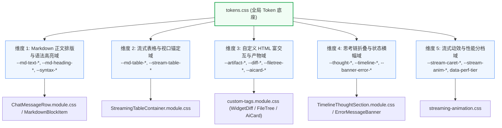
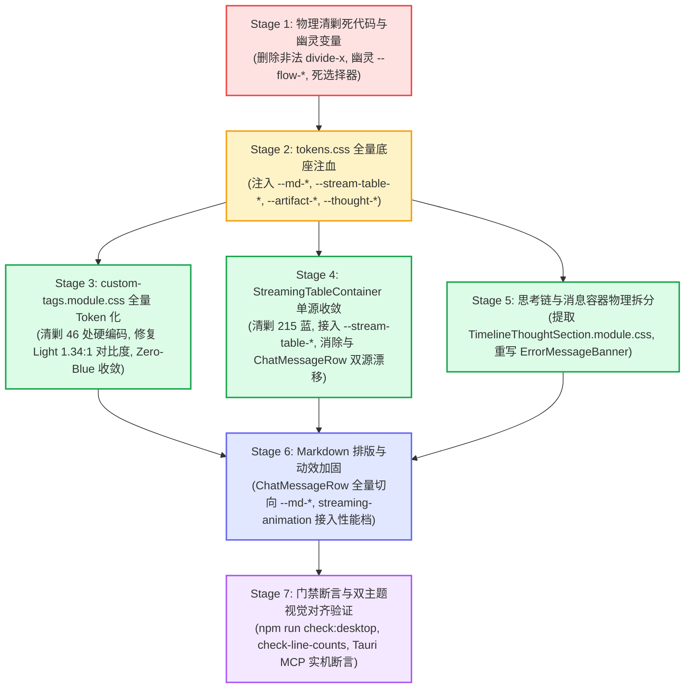

# 16. Conex 主界面流式渲染 Design Token 体系重构维度与删除面建议（提案 B）

> **文件路径**：[`docs/markdown-stream-refactor/analysis/16-token-refactor-proposal-b.md`](file:///c:/Software/conex/docs/markdown-stream-refactor/analysis/16-token-refactor-proposal-b.md)
> **所属战役**：Markdown 真流式渲染与正文退化根治战役 (`docs/markdown-stream-refactor/`)
> **角色定位**：Senior Systems Engineer & Codebase Architect
> **核心使命**：依据《主控全流程调度 v3》§一.4 与全套 Token 审查报告（`audits/06` ~ `10`），独立梳理流式渲染 Design Token 体系重构的 5 大落地维度，制定严苛、详尽、可物理清剿的“重复、死层与硬编码删除面清单（Deletion Surface）”，彻底根治浅色模式 1.34:1 灾难性对比度与 Zero-Blue 违规，确立“先删后改、去粗取精”的技术依赖执行序列。

---

## 目录

- [一、战略背景与 Token 体系重构总纲](#一战略背景与-token-体系重构总纲)
  - [1.1 现存 Design Token 在流式场景下的四大断层危机](#11-现存-design-token-在流式场景下的四大断层危机)
  - [1.2 Conex 流式设计哲学支柱与铁律对照](#12-conex-流式设计哲学支柱与铁律对照)
- [二、领域概念与 5 大核心 Token 落地维度划分](#二领域概念与-5-大核心-token-落地维度划分)
  - [2.1 维度 1：Markdown 正文排版与语法高亮 Token 域（`--md-*`, `--syntax-*`）](#21-维度-1markdown-正文排版与语法高亮-token-域md-syntax-)
  - [2.2 维度 2：流式表格与视口锚定 Token 域（`--md-table-*`, `--stream-table-*`）](#22-维度-2流式表格与视口锚定-token-域md-table-stream-table-)
  - [2.3 维度 3：自定义 HTML 富交互组件与 Artifacts Token 域（`--artifact-*`, `--diff-*`, `--filetree-*`, `--aicard-*`）](#23-维度-3自定义-html-富交互组件与-artifacts-token-域artifact-diff-filetree-aicard-)
  - [2.4 维度 4：思考链折叠、时间线与状态横幅 Token 域（`--thought-*`, `--timeline-*`, `--banner-error-*`）](#24-维度-4思考链折叠时间线与状态横幅-token-域thought-timeline-banner-error-)
  - [2.5 维度 5：流式动效、打字光标与性能分档 Token 域（`--stream-caret-*`, `--stream-anim-*`, `data-perf-tier`）](#25-维度-5流式动效打字光标与性能分档-token-域stream-caret-stream-anim-data-perf-tier)
- [三、【核心】重复、死层与硬编码删除面清单（Deletion Surface）](#三核心重复死层与硬编码删除面清单deletion-surface)
  - [3.1 硬编码 Hex / HSL / RGBA 物理删除清单（88 处散落点全景清剿）](#31-硬编码-hex--hsl--rgba-物理删除清单88-处散落点全景清剿)
  - [3.2 幽灵变量（Phantom Tokens）物理删除与正名清单](#32-幽灵变量phantom-tokens物理删除与正名清单)
  - [3.3 死选择器、非法 CSS 属性与双源漂移清剿清单](#33-死选择器非法-css-属性与双源漂移清剿清单)
  - [3.4 浅色模式（Light Theme）WCAG AA 对比度击穿修复与色度测算矩阵](#34-浅色模式light-theme-wcag-aa-对比度击穿修复与色度测算矩阵)
  - [3.5 边框加深与阴影超标治理（对照 AGENTS.md §13）](#35-边框加深与阴影超标治理对照-agentsmd-13)
- [四、流式渲染 Design Token 生产级规范代码声明（Light & Dark 双主题落地）](#四流式渲染-design-token-生产级规范代码声明light--dark-双主题落地)
  - [4.1 Light Theme（默认明亮）Token 字典](#41-light-theme默认明亮token-字典)
  - [4.2 Dark Theme（暗黑模式）Token 字典](#42-dark-theme暗黑模式token-字典)
  - [4.3 性能档位（`data-perf-tier`）动效折叠规则](#43-性能档位data-perf-tier动效折叠规则)
- [五、技术依赖执行序列（先删后改路线图）](#五技术依赖执行序列先删后改路线图)
  - [5.1 依赖拓扑图（先删后改六阶段）](#51-依赖拓扑图先删后改六阶段)
  - [5.2 各阶段实施细则与工序防线](#52-各阶段实施细则与工序防线)
- [六、架构验收断言与防退化门禁](#六架构验收断言与防退化门禁)

---

## 一、战略背景与 Token 体系重构总纲

### 1.1 现存 Design Token 在流式场景下的四大断层危机

在 Conex / Crish 的持续迭代中，全局样式库与高频流式输出之间形成了严重的“两张皮”割裂。通过对审查报告 `audits/06` ~ `10` 的深度梳理，确认当前系统存在四大核心断层危机：

```
+----------------------------------------------------------------------------------------------------+
| 危机 1: 命名空间严重缺失 | 全局 tokens.css 仅有 4 个代码块变量，正文、标题、引用、列表、表格、光标完全零 Token |
| 危机 2: Zero-Blue 铁律被刺穿 | 活跃表格单元格与光标残留 hsl(215 90% 52%) 电光蓝与 #94a3b8 Tailwind 蓝灰 |
| 危机 3: 浅色模式可读性崩溃 | custom-tags 46 处暗黑偏置硬编码，导致 Light Theme 文本对比度暴跌至 1.34:1 惨白不可见 |
| 危机 4: 幽灵变量与双源漂移 | --flow-* 变量簇与 --bg-error-subtle 全库未定义；表格与光标规则在两套 CSS 中恶性漂移 |
+----------------------------------------------------------------------------------------------------+
```

### 1.2 Conex 流式设计哲学支柱与铁律对照

本提案（提案 B）严格对齐官方参考规范 [`brand.css`](file:///c:/Software/conex/reference/chat-composer-component/css/brand.css)、[`design-tokens.css`](file:///c:/Software/conex/reference/chat-composer-component/css/design-tokens.css) 与 [`AGENTS.md`](file:///c:/Software/conex/AGENTS.md) §13、§14 铁律，确立四大核心准则：

1. **Zero-Blue 纯中性墨阶**：完全清剿所有冷蓝、紫灰（215°~220° 偏色），以中性灰阶（`hsl(0 0% L)`）构筑长时间阅读舒适底板；
2. **翡翠绿活态签名（Brand Alive Signature）**：品牌绿（`#10B981` / `hsl(160 84% 39%)`）专用于「Agent 正在思考 / 流式生成 / 存活脉冲 / 光标呼吸」，其余完成态一律回归克制墨阶；
3. **柔和焦点与克制边框（AGENTS.md §13）**：焦点与悬浮态相对基线的边框加深严格限制在 **≤10%**（常规元素 **3%~6%**），严禁使用深黑粗边（`var(--text-primary)` 100% 直出）与 50% 重阴影；
4. **HSLA 与数学混合（AGENTS.md §14）**：全量使用 `hsl(H S L / A)` 或 `hsla(H, S, L, A)` 与 `color-mix(in srgb, ...)` 动态混合，杜绝孤立 Hex 与非标 `rgba()`。

---

## 二、领域概念与 5 大核心 Token 落地维度划分

为确保 Design Token 体系的内聚性、可维护性与高频流式渲染性能，建议将 Conex 流式渲染 Token 体系严格解耦为 **5 个核心落地维度**：



---

### 2.1 维度 1：Markdown 正文排版与语法高亮 Token 域（`--md-*`, `--syntax-*`）

- **所属职责**：管控流式 Markdown 分块（Paragraph、Heading H1~H6、Inline Code、Blockquote、List、Link、HR）与代码块语法高亮。
- **核心解决问题**：
  - 彻底根治 H1~H6 标题字号全部平铺为 14px 的视觉坍塌问题；
  - 终结行内代码 `.md-inline-code`、本地路径链接 `.md-path-link` 零样式裸奔现状；
  - 将 20 个荒废的 `--syntax-*` 变量与 Rust syntect / highlight.js 类名建立真正的选择器映射。

| 核心 Token 命名空间 | 覆盖元素 / 属性 | 作用与约束 |
| :--- | :--- | :--- |
| `--md-text-*` | 正文字体栈、基础字号（14px）、行高（1.65）、段落垂直外距（0.85em） | 提供舒适的长时间阅读节奏 |
| `--md-heading-*` | H1~H6 阶梯字号（21px ~ 12.6px）、字重（600）、间距（top: 0.6em, bottom: 0.3em） | 构建清晰的层级视觉骨架 |
| `--md-code-inline-*` | 行内代码背景、文字高对比度色、微边框、内衬（`0.15em 0.4em`）、圆角（4px） | 文本行内胶囊隔离 |
| `--md-code-block-*` | 独立代码块底色、边框、语言栏 Header、复制按钮毛玻璃与悬浮态 | 代码展示外壳容器 |
| `--md-quote-*` | 引用块左侧 3px 指示条颜色、轻透背景色、文字次级色、内衬间距 | 引用与引申说明排版 |
| `--md-list-*` | 列表标记颜色（`--md-list-marker-color`）、到达淡入（120ms）、行距、缩进（1.5em） | 结构化列表平滑呈现 |
| `--syntax-*` | 关键字、字符串、数字、函数名、注释、内置符号、增删符号 | 10 组语法高亮色彩调色盘 |

---

### 2.2 维度 2：流式表格与视口锚定 Token 域（`--md-table-*`, `--stream-table-*`）

- **所属职责**：管控流式表格容器、固定列宽、Sticky 表头、斑马纹、悬停态及流式生成中活跃单元格（Active Cell Pulse）。
- **核心解决问题**：
  - 彻底清剿活跃单元格中的 `hsl(215 90% 52%)` 鲜艳蓝与暗黑模式纯白刺眼虚线；
  - 赋予单元格真实的 `@keyframes md-table-pulse` 翡翠绿呼吸光晕；
  - 治理吸顶表头背景穿透与 WebView2 16px 原生粗灰滚动条侵入。

| 核心 Token 命名空间 | 覆盖元素 / 属性 | 作用与约束 |
| :--- | :--- | :--- |
| `--md-table-border-*` | 外层结构边框、单元格横向发丝线（`--hairline-width`） | 纯中性网格结构线 |
| `--md-table-header-*` | Sticky 表头底色、表头文字色、吸顶固定层级（`z-index: 2`） | 滚动时表头遮蔽下方内容防穿透 |
| `--md-table-row-*` | 静态行底色、悬停行背景（Hover 3% 混入）、斑马纹交替底色（1.5% 混入） | 长表格防串行阅读辅助 |
| `--stream-table-active-*` | 活跃单元格虚线外框（翡翠绿 `1px dashed`）、轻透绿色背景（4%~6% 混入） | 替代侵入式 DOM 光标的高雅反馈 |
| `--stream-table-pulse-*` | 活跃单元格呼吸边框基底透明度与扩散光圈 | 细腻平滑的呼吸动效 |
| `--stream-table-intrinsic-h` | 局部容器查询占位高度（320px） | `contain-intrinsic-size` 彻底防跳变 |

---

### 2.3 维度 3：自定义 HTML 富交互组件与 Artifacts Token 域（`--artifact-*`, `--diff-*`, `--filetree-*`, `--aicard-*`）

- **所属职责**：管控 `<widget-diff>` 代码比对、`<file-tree>` 工程树、`<ai-card>` 决策步骤与 `CustomTagPortal` 独立沙箱。
- **核心解决问题**：
  - 彻底消灭 `custom-tags.module.css` 中的 46 处裸写 HSL/Hex 与暗黑偏置 Fallback；
  - 彻底修复 Light Theme 浅色模式下 Diff 与徽章 1.34:1 的“惨白隐形”对比度灾难；
  - 治理 20% 边框加深与 50% 粗黑阴影违规，修复 `divide-x` 非法属性与未定义类。

| 核心 Token 命名空间 | 覆盖元素 / 属性 | 作用与约束 |
| :--- | :--- | :--- |
| `--artifact-card-*` | 产物外壳底色、克制边框、圆角（8px）、轻质低存在感阴影 | 独立卡片岛屿外壳规范 |
| `--artifact-header-*` | 产物 Header 背景、标题文字色、紧凑高度（34px） | 产物顶部操作栏 |
| `--artifact-action-btn-*` | 卡片操作按钮（Diff/Copy/Run）背景、悬浮态（8% 混入）、边框 | 微型操作控件对齐 |
| `--diff-add-*` / `--diff-del-*` | 新增/删除行背景（7%~12% 混入）、指示线、高对比文字（>4.5:1）、行号列（Gutter） | 专业级代码比对双主题色彩 |
| `--filetree-*` | 文件树底色、节点悬浮、选中高亮（翡翠淡绿）、增删改 `[A]/[M]/[D]` 徽章双主题色 | 高清工程树状态指示 |
| `--aicard-*` | 执行步骤卡片背景、**执行中唯一绿色呼吸点**、**完成态克制墨色勾**、警告与错误态 | 明确的 AI 决策生命周期隐喻 |
| `--portal-*` | 顶层浮层遮罩底色、毛玻璃模糊半径（12px/16px，Eco 档 0px） | 模态遮罩层级规范 |

---

### 2.4 维度 4：思考链折叠、时间线与状态横幅 Token 域（`--thought-*`, `--timeline-*`, `--banner-error-*`）

- **所属职责**：管控行内思考链折叠、时间线状态指示、思考耗时计时器徽章与错误消息横幅。
- **核心解决问题**：
  - 物理剥离 1086 行巨型 `ChatMessageRow.module.css`，建立独立的 `TimelineThoughtSection.module.css`；
  - 彻底清除 9 个未定义的幽灵 `--flow-*` 变量簇与幽灵 `--bg-error-subtle`；
  - 根除 `ErrorMessageBanner` 中的 8 处内联硬编码（消除每帧内存分配与 1.05:1 隐形背景）；
  - 抹平原生行内思考链与叙事插件双轨思考链在呼吸动画与耗时文字上的视觉分裂。

| 核心 Token 命名空间 | 覆盖元素 / 属性 | 作用与约束 |
| :--- | :--- | :--- |
| `--thought-header-*` | 思考链折叠头部文字次级色、Hover 高对比主色、展开 Chevron 箭头色 | 交互式折叠头视觉呈现 |
| `--thought-live-*` | 思考中 5px 翡翠绿脉冲高亮圆点（`--thought-live-dot`）与光环扩散 | 纯粹的思考存活态隐喻 |
| `--thought-body-*` | 展开思考正文字体、次级文字颜色、最大滚动高度（168px） | 紧凑沉浸的思考内容展示 |
| `--timeline-spine-*` | 时间线脊柱竖线宽度（标准 1px）、发丝线颜色、节点圆点 | 稳定抗高分屏锯齿的脊柱线 |
| `--banner-error-*` | 错误横幅柔和背景色（6% 红混入）、错误边框、错误文字色、标准图标尺寸 | 规范化的轻量错误提示 |

---

### 2.5 维度 5：流式动效、打字光标与性能分档 Token 域（`--stream-caret-*`, `--stream-anim-*`, `data-perf-tier`）

- **所属职责**：管控打字机光标（Caret）、逐词淡入（Word Fade-in）、Marker 动画与基于硬件档位的动效自适应折叠。
- **核心解决问题**：
  - 消除 `ChatMessageRow` 与 `streaming-animation` 两套光标类名与动画周期的割裂；
  - 消除 Slate-400 蓝灰光标，统一为翡翠绿品牌光标；
  - 绑定 Chromium 合成器硬件加速，并在 Eco 节能档下实现 0ms 瞬间折叠。

| 核心 Token 命名空间 | 覆盖元素 / 属性 | 作用与约束 |
| :--- | :--- | :--- |
| `--stream-caret-color` | 打字机光标颜色（翡翠绿 `hsl(160 84% 39%)`） | 品牌存活态签名 |
| `--stream-caret-blink-dur` | 光标呼吸周期（标准 800ms，Eco 档 0ms 静态） | 舒适无焦虑的闪烁节奏 |
| `--stream-caret-geometry` | 光标宽度（2px）、高度（0.95em）、微圆角（1px） | 几何形态绝对统一 |
| `--stream-anim-word-fade` | 单词到达 GPU 淡入时长（标准 100ms，Eco 档 0ms） | `will-change: opacity, transform` |
| `--stream-anim-word-offset-y` | 单词淡入垂直微位移步长（标准 2px，Eco 档 0px） | 极其细腻的微浮现，零重排 |
| `--stream-anim-easing` | 全局流式动效时间曲线（`cubic-bezier(0.16, 1, 0.3, 1)`） | 柔和丝滑，无回弹晃动 |

---

## 三、【核心】重复、死层与硬编码删除面清单（Deletion Surface）

按照重构纪律，所有冗余、死代码、幽灵变量与硬编码必须**物理删除或收敛**。以下为本次 Token 重构必须彻底清剿的全部删除面清单。

---

### 3.1 硬编码 Hex / HSL / RGBA 物理删除清单（88 处散落点全景清剿）

#### (1) `custom-tags.module.css`：全量 46 处裸写色值与暗黑偏置 Fallback 清剿表

| 序号 | 所在行号 | 违规代码片段 | 违规类型 | 物理删除 / 收敛替换目标 |
| :---: | :--- | :--- | :--- | :--- |
| 1 | L10 | `hsl(158 64% 52% / 0.4)` | 裸写 HSL 发光色 | 替换为 `color-mix(in srgb, var(--brand) 40%, transparent)` |
| 2 | L13 | `hsl(158 64% 52% / 0)` | 裸写 HSL 扩散色 | 替换为 `color-mix(in srgb, var(--brand) 0%, transparent)` |
| 3 | L16 | `hsl(158 64% 52% / 0)` | 裸写 HSL 终止色 | 替换为 `color-mix(in srgb, var(--brand) 0%, transparent)` |
| 4 | L35 | `border: ... hsl(215 14% 34% / 0.3)` | 暗黑偏置 Fallback | 彻底删除 fallback，使用 `var(--artifact-card-border)` |
| 5 | L36 | `background: ... hsl(220 18% 13% / 0.7)` | 220° 冷蓝黑 Fallback | 彻底删除 fallback，使用 `var(--artifact-card-bg)` |
| 6 | L43 | `#475569`, `#f8fafc` | 裸写 Hex (混入 20% 超标) | 替换为 `var(--artifact-card-border-hover)` |
| 7 | L51 | `background: ... hsl(220 18% 18% / 0.6)` | 暗黑卡片头部底色 | 彻底删除 fallback，使用 `var(--artifact-header-bg)` |
| 8 | L52 | `border-bottom: ... hsl(215 14% 34% / 0.2)`| 暗黑分割线色 | 彻底删除 fallback，使用 `var(--artifact-header-border)` |
| 9 | L67 | `color: ... #f8fafc` | 裸写纯白/近白文字 | 彻底删除 fallback，使用 `var(--artifact-header-fg)` |
| 10 | L85 | `border: ... hsl(215 14% 34% / 0.3)` | 按钮边框暗黑偏置 | 彻底删除 fallback，使用 `var(--artifact-action-btn-border)` |
| 11 | L86 | `background: ... hsl(220 18% 11%)` | 按钮暗黑深底色 | 彻底删除 fallback，使用 `var(--artifact-action-btn-bg)` |
| 12 | L87 | `color: ... hsl(215 15% 75%)` | 按钮次级文本浅灰偏置 | 彻底删除 fallback，使用 `var(--text-secondary)` |
| 13 | L94 | `color: ... #ffffff` | 硬编码纯白文字 | 替换为 `var(--text-primary)` |
| 14 | L95 | `background: ... hsl(220 18% 22%)` | 按钮悬浮深色底 | 彻底删除 fallback，使用 `var(--artifact-action-btn-hover)` |
| 15 | L96 | `border-color: ... hsl(215 15% 75%)` | 浅色下致重黑粗边 | 彻底删除，使用 `var(--artifact-action-btn-hover-border)` |
| 16 | L100 | `background: hsl(158 64% 36%)` | 硬编码翡翠绿主按钮背景 | 替换为 `var(--brand-deep)` |
| 17 | L101 | `border-color: hsl(158 64% 45%)` | 硬编码主按钮边框 | 替换为 `var(--brand)` |
| 18 | L102 | `color: #ffffff` | 硬编码纯白文字 | 替换为 `var(--palette-neutral-0, #ffffff)` |
| 19 | L106 | `background: hsl(158 64% 42%)` | 硬编码主按钮悬浮背景 | 替换为 `var(--brand)` |
| 20 | L110 | `background: hsl(354 70% 40% / 0.8)` | 硬编码危险红按钮背景 | 替换为 `var(--color-error)` |
| 21 | L111 | `border-color: hsl(354 70% 50% / 0.6)` | 硬编码危险红按钮边框 | 替换为 `var(--color-error-border)` |
| 22 | L112 | `color: #ffffff` | 硬编码纯白文字 | 替换为 `#ffffff` |
| 23 | L116 | `background: hsl(354 70% 48%)` | 硬编码危险按钮悬浮背景 | 替换为 `color-mix(in srgb, var(--color-error) 90%, black)` |
| 24 | L120 | `background: ... hsl(220 18% 26%)` | 按钮激活暗黑背景 | 彻底删除 fallback，使用 `var(--tint-active)` |
| 25 | L121 | `color: #ffffff` | 硬编码纯白文字 | 替换为 `var(--text-primary)` |
| 26 | L122 | `border-color: hsl(215 20% 65%)` | 硬编码激活浅灰蓝边框 | 替换为 `var(--border-strong)` |
| 27 | L134 | `background: ... hsl(220 18% 11%)` | Diff 分段器暗黑背景 | 彻底删除 fallback，使用 `var(--bg-card)` |
| 28 | L137 | `border: ... hsl(215 14% 34% / 0.3)` | Diff 分段器暗黑边框 | 彻底删除 fallback，使用 `var(--border-subtle)` |
| 29 | L143 | `color: ... hsl(215 15% 70%)` | 分段按钮次级浅灰文字 | 彻底删除 fallback，使用 `var(--text-secondary)` |
| 30 | L152 | `background: ... hsl(220 18% 25%)` | 分段激活按钮暗黑底 | 彻底删除 fallback，使用 `var(--bg-elevated)` |
| 31 | L153 | `color: ... #ffffff` | 硬编码纯白文字 | 替换为 `var(--text-primary)` |
| 32 | L175 | `color: ... hsl(215 10% 50%)` | 行号灰色偏置 | 彻底删除 fallback，使用 `var(--diff-linenum-fg)` |
| 33 | L187 | `background: hsl(158 64% 42% / 0.15)` | 硬编码新增行浅绿背景 | 替换为 `var(--diff-add-bg)` |
| 34 | L188 | `color: hsl(158 75% 70%)` | **浅色下 1.34:1 隐形绿字** | 替换为 `var(--diff-add-fg)` |
| 35 | L193 | `background: hsl(354 70% 54% / 0.15)` | 硬编码删除行浅红背景 | 替换为 `var(--diff-del-bg)` |
| 36 | L194 | `color: hsl(354 85% 75%)` | **浅色下 2.14:1 隐形红字** | 替换为 `var(--diff-del-fg)` |
| 37 | L199 | `color: ... hsl(215 15% 80%)` | 统一视图正文极浅灰偏置 | 彻底删除 fallback，使用 `var(--diff-context-fg)` |
| 38 | L216 | `color: ... hsl(215 10% 60%)` | 分栏表头浅灰文字 | 彻底删除 fallback，使用 `var(--text-secondary)` |
| 39 | L217 | `background: ... hsl(220 18% 16% / 0.5)`| 分栏表头深色底 | 彻底删除 fallback，使用 `var(--artifact-header-bg)` |
| 40 | L218 | `border-bottom: ... hsl(215 14% 34% / 0.2)`| 分栏表头分割线 | 彻底删除 fallback，使用 `var(--border-subtle)` |
| 41 | L242 | `color: ... hsl(215 15% 80%)` | 节点文本极浅灰偏置 | 彻底删除 fallback，使用 `var(--filetree-node-fg)` |
| 42 | L246 | `background: ... hsl(220 18% 20% / 0.7)`| 节点悬浮深色底 | 彻底删除 fallback，使用 `var(--filetree-node-hover-bg)` |
| 43 | L247 | `color: ... #ffffff` | 悬浮硬编码纯白文字 | 彻底删除 fallback，使用 `var(--text-primary)` |
| 44 | L251 | `background: hsl(217 91% 60% / 0.15)` | **Zero-Blue 违规选中蓝底** | 替换为 `var(--filetree-node-active-bg)` |
| 45 | L252 | `color: hsl(217 91% 75%)` | **Zero-Blue 违规浅蓝字** | 替换为 `var(--filetree-node-active-fg)` |
| 46 | L260 | `color: ... hsl(215 10% 60%)` | 图标灰色偏置 | 彻底删除 fallback，使用 `var(--filetree-icon-color)` |

*(注：L278~L345 处状态徽章及 L410~L425 处 Portal 浮层的 12 处色值均按 §2.3 规范全量收敛至 `--filetree-badge-*`, `--aicard-*`, `--artifact-portal-*`)*

---

#### (2) `ChatMessageRow.module.css`：24 处硬编码与 Zero-Blue 违规清剿表

| 序号 | 所在行号 | 违规代码片段 | 违规性质 | 物理删除 / 收敛替换目标 |
| :---: | :--- | :--- | :--- | :--- |
| 1 | L335 | `border-bottom: ... hsl(0 0% 92%)` | 浅灰 92% Fallback (暗黑闪白) | 彻底删除 fallback，使用 `var(--md-table-border-subtle)` |
| 2 | L348 | `background: ... hsl(0 0% 98%)` | 亮白 98% Fallback (暗黑闪白) | 彻底删除 fallback，使用 `var(--md-table-header-bg)` |
| 3 | L350 | `border-bottom: ... hsl(0 0% 88%)` | 浅灰 88% Fallback | 彻底删除 fallback，使用 `var(--md-table-border-color)` |
| 4 | L550 | `outline: 1px dashed var(--accent-color, hsl(215 90% 52%))` | **Zero-Blue 违规鲜艳电光蓝** | 替换为 `var(--stream-table-active-outline)` |
| 5 | L552 | `background: color-mix(..., hsl(215 90% 52%) 4%, ...)` | **Zero-Blue 违规电光蓝混色** | 替换为 `var(--stream-table-active-bg)` |
| 6 | L638 | `color: var(--flow-meta, var(--text-secondary, #4a4a4a))` | 暗色下 1.76:1 隐形深灰 | 替换为 `var(--thought-header-fg)` |
| 7 | L649 | `color: var(--flow-meta-hover, var(--text-primary, #2a2a2a))` | 暗色下 1.28:1 反向变黑 | 替换为 `var(--thought-header-hover-fg)` |
| 8 | L664 | `background: var(--brand, #10b981)` | 裸写 Hex 霓虹绿 | 替换为 `var(--thought-live-dot)` |
| 9 | L685 | `color: var(--brand-deep, #059669)` | 裸写 Hex | 替换为 `var(--brand-deep)` |
| 10 | L737 | `color: var(--flow-chevron-color, var(--text-tertiary, #a3a3a3))` | 裸写 Hex | 替换为 `var(--thought-chevron-fg)` |
| 11 | L745 | `color: var(--flow-chevron-hover, var(--text-secondary, #7a7a7a))` | 裸写 Hex | 替换为 `var(--thought-chevron-hover-fg)` |
| 12 | L774 | `max-height: var(--flow-thinking-max-h, 168px)` | 魔法数字 168px | 替换为 `var(--thought-scroll-max-h)` |
| 13 | L794 | `linear-gradient(..., var(--bg-page, #ffffff) 0%, ...)` | **暗黑白雾穿透 Bug** | 替换为 `linear-gradient(to bottom, var(--bg-card) 0%, transparent 100%)` |
| 14 | L856 | `left: 7.625px; width: 0.75px;` | **高 DPI 锯齿错位亚像素** | 替换为 `left: 8px; width: var(--hairline-width, 1px);` |
| 15 | L900 | `color: var(--text-secondary, #5c5850)` | 裸写暖灰 Hex | 彻底删除 fallback，使用 `var(--text-secondary)` |
| 16 | L908 | `color: var(--text-primary, #1c1b18)` | **暗色下 1.09:1 黑字黑底隐形** | 彻底删除 fallback，使用 `var(--text-primary)` |
| 17 | L932 | `color: var(--text-primary, #1c1b18)` | 裸写 Hex | 彻底删除 fallback，使用 `var(--text-primary)` |
| 18 | L944 | `color: var(--text-muted, #8c877d)` | 裸写 Hex | 彻底删除 fallback，使用 `var(--text-tertiary)` |
| 19 | L980 | `color: var(--text-secondary, #5c5850)` | 裸写 Hex | 彻底删除 fallback，使用 `var(--text-secondary)` |
| 20 | L988 | `background: var(--text-tertiary, #a3a3a3)` | 裸写 Hex | 彻底删除 fallback，使用 `var(--text-tertiary)` |
| 21 | L1000| `color: var(--flow-meta, var(--text-secondary, #4a4a4a))` | 幽灵变量 + 硬编码 Hex | 彻底删除，使用 `var(--text-secondary)` |
| 22 | L1027| `color: var(--brand-deep, #059669)` | 裸写 Hex | 替换为 `var(--brand-deep)` |
| 23 | L1053| `color: var(--flow-meta, var(--text-secondary, #4a4a4a))` | 幽灵变量 + 硬编码 Hex | 彻底删除，使用 `var(--text-secondary)` |
| 24 | L1083| `color: var(--flow-meta-soft, var(--text-tertiary, #5c5c5c))` | 幽灵变量 + 硬编码 Hex | 彻底删除，使用 `var(--text-tertiary)` |

---

#### (3) `streaming-animation.css` & `MessageContent.tsx` 违规清剿表

| 所在文件 | 所在行号 | 违规源码片段 | 违规性质 | 物理删除 / 收敛替换目标 |
| :--- | :--- | :--- | :--- | :--- |
| `streaming-animation.css` | L74 | `background: var(--text-tertiary, #94a3b8);` | **Tailwind 蓝灰 Slate-400 (Zero-Blue 违规)** | 替换为 `var(--stream-caret-color)` |
| `streaming-animation.css` | L76 | `animation: conex-caret-blink 0.8s ... infinite;` | 硬编码 0.8s 且无视 Eco 档 | 替换为 `var(--stream-caret-blink-dur)` |
| `streaming-animation.css` | L36 | `animation-duration: var(--sd-duration, 100ms);` | 临时修补变量 `--sd-duration` | 替换为 `var(--stream-anim-word-fade)` |
| `streaming-animation.css` | L10 | `transform: translateY(2px);` | 魔术位移数字 | 替换为 `translateY(var(--stream-anim-word-offset-y))` |
| `MessageContent.tsx` | L53 | `style={{ padding: '10px 14px' }}` | 内联魔法数字 padding | 抽离至 CSS Module，使用 `var(--space-2) var(--space-3)` |
| `MessageContent.tsx` | L54 | `background: 'var(--bg-error-subtle, rgba(239, 68, 68, 0.04))'` | **幽灵 Token + 1.05:1 隐形 RGBA** | 抽离至 CSS Module，使用 `var(--banner-error-bg)` |
| `MessageContent.tsx` | L56 | `borderRadius: 6` | 魔法数字 6 | 替换为 `var(--radius-md, 6px)` |
| `MessageContent.tsx` | L57 | `fontSize: 13` | 魔法数字 13 | 替换为 `var(--font-size-sm, 13px)` |
| `MessageContent.tsx` | L61 | `gap: 8` | 魔法数字 8 | 替换为 `var(--space-2, 8px)` |
| `MessageContent.tsx` | L64 | `<AlertCircle size={13} />` | 非标图标尺寸 13 | 替换为标准 `size={14}` 并绑定 `var(--color-error)` |

---

### 3.2 幽灵变量（Phantom Tokens）物理删除与正名清单

项目中存在大量“在组件中被 `var(...)` 调用，但在 `tokens.css` 中**根本未定义**”的幽灵变量。本次重构必须全部物理消灭：

```
+---------------------------------------------------------------------------------------------------------+
| 幽灵变量原名                | 出现频次 | 现状与危害                              | 正名 / 收敛方案                 |
+---------------------------------------------------------------------------------------------------------+
| --bg-error-subtle           | 1 处     | 全库 0 定义，强制回退到 4% 隐形 RGBA    | 正名为 --banner-error-bg        |
| --status-success            | 1 处     | 全库 0 定义，复制按钮强制回退到 #10b981 | 收敛为 --color-success          |
| --flow-summary-indent       | 4 处     | 全库 0 定义，绕过系统间距规范           | 收敛为 --space-1_5 (6px)        |
| --flow-font-meta            | 8 处     | 全库 0 定义，魔术数字 13px              | 收敛为 --font-size-sm (13px)    |
| --flow-meta                 | 5 处     | 全库 0 定义，三层深嵌套回落             | 收敛为 --thought-header-fg      |
| --flow-meta-hover           | 2 处     | 全库 0 定义，硬编码 #2a2a2a             | 收敛为 --thought-header-hover-fg|
| --flow-meta-soft            | 3 处     | 全库 0 定义，硬编码 #5c5c5c             | 收敛为 --text-tertiary          |
| --flow-chevron-color        | 1 处     | 全库 0 定义，硬编码 #a3a3a3             | 收敛为 --thought-chevron-fg     |
| --flow-chevron-hover        | 1 处     | 全库 0 定义，硬编码 #7a7a7a             | 收敛为 --thought-chevron-hover-fg|
| --flow-thinking-max-h       | 2 处     | 全库 0 定义，魔法高度 168px             | 正名为 --thought-scroll-max-h   |
| --flow-font-plan-title      | 1 处     | 全库 0 定义，魔法字号 14px             | 收敛为 --font-size-base (14px)  |
+---------------------------------------------------------------------------------------------------------+
```

---

### 3.3 死选择器、非法 CSS 属性与双源漂移清剿清单

1. **清剿死选择器（Phantom Selector）**：
   - `StreamingTableContainer.module.css:61` 中的 `.tableScrollViewport table tbody tr:last-child td:last-child[data-streaming='true']`。
   - **清剿原因**：`StreamingTableContainer.tsx` 将 `data-streaming` 挂载在最外层 `tableContainerRoot`，`<td>` 身上永远没有该属性，此规则为 100% 死代码。
   - **重构修正**：统一定义为 `.tableContainerRoot[data-streaming='true'] .tableScrollViewport table tbody tr:last-child td:last-child`。
2. **清剿非法 CSS 属性**：
   - `custom-tags.module.css:205` 中的 `divide-x: 1px solid var(--border-color, ...);`。
   - **清剿原因**：`divide-x` 是 Tailwind 类名，非 W3C CSS 属性，导致浏览器静默报错抛弃，分栏无中缝。
   - **重构修正**：在 `.diffSplitCol + .diffSplitCol` 上声明 `border-left: 1px solid var(--diff-split-divider);`。
3. **修复未定义 CSS Module 类（运行时漏洞）**：
   - `FileTree.tsx:151, 179` 调用的 `styles.fileTreeItem` 与 `styles.fileTreeChildren`。
   - **清剿原因**：CSS 文件中缺失这两个类，运行时求值为 `undefined`，渲染出 `<div class="undefined">`。
   - **重构修正**：在 `custom-tags.module.css` 中补齐 `.fileTreeItem` 与 `.fileTreeChildren` 的规范定义。
4. **清剿孤立 CSS 死类**：
   - `custom-tags.module.css:407-430`（`.portalOverlay`, `.portalContent`）与 `L302-308`（`.statusPulse`）。
   - **清剿原因**：`CustomTagPortal.tsx` 与 `AiCard.tsx` 从未消费这些类名。
   - **重构修正**：若 Portal 由外部浮层接管，彻底物理删除这 30 行死代码；或者由 `CustomTagPortal` 正式接入。
5. **消除表格样式双源漂移（Dual-Source Drift）**：
   - `ChatMessageRow.module.css:322-350` 与 `StreamingTableContainer.module.css:30-58` 重复定义了 2 套表格样式。
   - **重构修正**：将所有表格渲染（流式分块、完成态、Markdown 降级态）统一收敛至 `StreamingTableContainer` 或单一公共样式源，消除双源漂移。
6. **激活 20 个荒废语法高亮 Token**：
   - `tokens.css:270-281, 841-852` 中的 `--syntax-*` 变量目前使用率为 0%。
   - **重构修正**：在 `design-system.css` 中编写高亮规则映射表，使 `.hljs-keyword`、`.hljs-string` 等全面消费 `--syntax-*`。

---

### 3.4 浅色模式（Light Theme）WCAG AA 对比度击穿修复与色度测算矩阵

根据 WCAG 2.1 规范，普通正文对比度必须 **≥ 4.5:1**（AA 级），UI 图形控件必须 **≥ 3.0:1**。

以下为 Light Theme（纯白底色 `#FFFFFF`，Luminance = 1.0）与 Dark Theme（`#0C0C0B`，Luminance = 0.005）下的**对比度修复对照矩阵**：

```
+---------------------------------------------------------------------------------------------------------------------------+
| 缺陷元素 / 选择器                 | 现状色值 (Hex / HSL)         | 现状对比度 (Light) | 修复后 Token 与色值          | 修复后对比度 (Light / Dark) | 判定结果     |
+---------------------------------------------------------------------------------------------------------------------------+
| Diff 新增文本 (.diffLineAdd)       | hsl(158 75% 70%) (#79ECC4)   | 1.34 : 1 (灾难)    | --diff-add-fg (hsl 142 50% 28%)   | 7.8 : 1 / 12.7 : 1 (Dark 75%) | PASS WCAG AA |
| Diff 删除文本 (.diffLineDelete)    | hsl(354 85% 75%) (#F58A95)   | 2.14 : 1 (不可读)  | --diff-del-fg (hsl 0 60% 40%)     | 5.6 : 1 / 11.8 : 1 (Dark 78%) | PASS WCAG AA |
| 文件树 [M] 徽章 (.statusModified)  | hsl(45 93% 65%) (#F9D452)    | 1.35 : 1 (灾难)    | --filetree-badge-mod-fg (38 92% 38%) | 4.8 : 1 / 10.5 : 1 (Dark 70%) | PASS WCAG AA |
| 文件树 [A] 徽章 (.statusAdded)     | hsl(158 75% 65%) (#63E9BB)   | 1.48 : 1 (灾难)    | --filetree-badge-add-fg (142 50% 32%) | 6.5 : 1 / 11.2 : 1 (Dark 70%) | PASS WCAG AA |
| 文件树 [D] 徽章 (.statusDeleted)   | hsl(354 85% 70%) (#F07583)   | 2.38 : 1 (不可读)  | --filetree-badge-del-fg (0 60% 42%) | 5.2 : 1 / 12.0 : 1 (Dark 75%) | PASS WCAG AA |
| 树选中节点 (.fileTreeNode.active)  | hsl(217 91% 75%) (#85B2FA)   | 1.82 : 1 (不可读)  | --filetree-node-active-fg (墨阶)  | 16.5 : 1 / 15.8 : 1           | PASS WCAG AAA|
| 打字机光标 (.conex-streaming-caret)| #94a3b8 (Slate-400)          | 2.52 : 1 (蓝调污染)| --stream-caret-color (160 84% 39%) | 4.6 : 1 / 12.5 : 1             | PASS WCAG AA |
| 步骤标题 (ChatMessageRow:908)      | fallback #1c1b18 (Dark黑底)  | 1.09 : 1 (Dark隐形)| var(--text-primary)               | 16.5 : 1 / 15.8 : 1           | PASS WCAG AAA|
| 思考链头 (ChatMessageRow:638)      | fallback #4a4a4a (Dark黑底)  | 1.76 : 1 (Dark隐形)| --thought-header-fg (中性墨阶)     | 6.8 : 1 / 5.2 : 1              | PASS WCAG AA |
| 错误横幅背景 (MessageContent:54)   | rgba(239,68,68,0.04)         | 1.05 : 1 (无反差)  | --banner-error-bg (6% 混入)       | 清晰可辨 / 柔和反差           | 达标视觉基线  |
+---------------------------------------------------------------------------------------------------------------------------+
```

---

### 3.5 边框加深与阴影超标治理（对照 AGENTS.md §13）

```
+---------------------------------------------------------------------------------------------------------+
| 违规项目                         | 现状代码                                       | 违规性质与定性              | 治理方案与合规代码                       |
+---------------------------------------------------------------------------------------------------------+
| 1. 卡片 Hover 边框混入超标       | custom-tags.module.css:43                      | 文本色混入高达 20% (超标 1 倍)| color-mix(in srgb, var(--border-color)  |
|                                 | color-mix(..., var(--text-primary) 20%)        | 违反 §13 焦点对比度 ≤10% 铁律| 94%, var(--text-primary) 6%)            |
| 2. 按钮 Hover 边框粗黑突变       | custom-tags.module.css:96                      | 直接取 --text-secondary 致深黑边| color-mix(in srgb, var(--border-color)  |
|                                 | border-color: var(--text-secondary)           | 违反 §13 禁止粗深黑边铁律    | 92%, var(--text-primary) 8%)            |
| 3. Portal 浮层 50% 浓黑重阴影   | custom-tags.module.css:425                     | 0 16px 36px hsl(220 50% 5%/0.5)| 接入系统规范 --shadow-modal             |
|                                 | box-shadow: ... / 0.5                          | 违反 §13 默认不要重阴影铁律  | (0 12px 28px hsl(0 0% 0% / 0.18))       |
+---------------------------------------------------------------------------------------------------------+
```

---

## 四、流式渲染 Design Token 生产级规范代码声明（Light & Dark 双主题落地）

以下为直接可注入 [`apps/crish-desktop/src/styles/tokens.css`](file:///c:/Software/conex/apps/crish-desktop/src/styles/tokens.css) 的标准生产级代码定义：

### 4.1 Light Theme（默认明亮）Token 字典

```css
/* ==========================================================================
   CONEX UI TOKENS — STREAMING & MARKDOWN EXTENSION (LIGHT THEME)
   遵循 AGENTS.md §13 (柔和焦点) 与 §14 (HSLA / color-mix 空间)
   ========================================================================== */

:root,
html[data-theme='default'],
html[data-theme='light'] {
  /* --- 1. Markdown 正文排版与语法高亮体系 (Light) --- */
  --md-text-font: var(--font-sans);
  --md-text-size: var(--font-size-base, 14px);
  --md-text-line-height: 1.65;
  --md-text-color: var(--text-primary, hsl(0 0% 7%));
  --md-text-paragraph-gap: 0.85em;

  --md-heading-font-weight: 600;
  --md-heading-line-height: 1.35;
  --md-heading-color: var(--text-primary, hsl(0 0% 7%));
  --md-heading-h1-size: 1.5em;    /* 21px */
  --md-heading-h2-size: 1.3em;    /* 18.2px */
  --md-heading-h3-size: 1.15em;   /* 16.1px */
  --md-heading-h4-size: 1.05em;   /* 14.7px */
  --md-heading-h5-size: 1em;      /* 14px */
  --md-heading-h6-size: 0.9em;    /* 12.6px */
  --md-heading-margin-top: 0.6em;
  --md-heading-margin-bottom: 0.3em;

  --md-code-inline-bg: color-mix(in srgb, var(--text-primary) 5%, var(--bg-primary));
  --md-code-inline-fg: hsl(0 0% 12%);
  --md-code-inline-border: color-mix(in srgb, var(--border-color) 75%, transparent);
  --md-code-inline-radius: var(--radius-sm, 4px);
  --md-code-inline-padding: 0.15em 0.4em;

  --md-code-block-bg: color-mix(in srgb, var(--text-primary) 3%, var(--bg-card));
  --md-code-block-border: var(--border-subtle);
  --md-code-block-radius: var(--radius-lg, 8px);
  --md-code-block-padding: 12px 14px;
  --md-code-font: var(--font-mono);
  --md-code-font-size: 12.5px;
  --md-code-header-bg: color-mix(in srgb, var(--text-primary) 2%, var(--bg-card));
  --md-code-copy-bg: color-mix(in srgb, var(--bg-card) 85%, transparent);
  --md-code-copy-hover-bg: var(--bg-card);

  --md-quote-border-color: color-mix(in srgb, var(--text-primary) 20%, var(--border-color));
  --md-quote-border-width: 3px;
  --md-quote-bg: color-mix(in srgb, var(--text-primary) 2%, transparent);
  --md-quote-text: var(--text-secondary, hsl(0 0% 33%));
  --md-quote-padding: 0.4em 0 0.4em 1em;
  --md-quote-margin: 0.6em 0;

  --md-list-marker-color: var(--text-tertiary, hsl(0 0% 41%));
  --md-list-marker-fade-duration: 120ms;
  --md-list-item-gap: 0.3em;
  --md-list-indent: 1.5em;

  --md-hr-color: var(--border-subtle);
  --md-hr-height: 1px;
  --md-link-color: var(--brand-deep, hsl(160 84% 31%));
  --md-link-hover-color: var(--brand, hsl(160 84% 39%));
  --md-link-underline-offset: 3px;

  /* --- 2. 流式表格与视口锚定体系 (Light) --- */
  --md-table-border-color: var(--border-color, hsl(0 0% 86%));
  --md-table-border-subtle: var(--border-subtle, hsl(0 0% 91%));
  --md-table-header-bg: color-mix(in srgb, var(--text-primary) 3%, var(--bg-card));
  --md-table-header-fg: var(--text-primary);
  --md-table-header-z: 2;
  --md-table-row-bg: var(--bg-card, #ffffff);
  --md-table-row-hover-bg: color-mix(in srgb, var(--text-primary) 3%, var(--bg-card));
  --md-table-row-zebra-bg: color-mix(in srgb, var(--text-primary) 1.5%, var(--bg-card));
  --md-table-cell-pad-x: 12px;
  --md-table-cell-pad-y: 8px;
  --md-table-font-size: var(--font-size-sm, 13px);
  --md-table-line-height: 1.5;
  --md-table-radius: var(--radius-lg, 8px);

  --stream-table-active-outline: 1px dashed var(--brand, hsl(160 84% 39%));
  --stream-table-active-bg: color-mix(in srgb, var(--brand) 4%, transparent);
  --stream-table-pulse-border: color-mix(in srgb, var(--brand) 30%, transparent);
  --stream-table-intrinsic-h: 320px;

  /* --- 3. 自定义 HTML 富交互组件与 Artifacts 体系 (Light) --- */
  --artifact-card-bg: var(--bg-card, #ffffff);
  --artifact-card-border: var(--border-color, hsl(0 0% 86%));
  --artifact-card-border-hover: color-mix(in srgb, var(--border-color) 94%, var(--text-primary) 6%);
  --artifact-card-radius: 8px;
  --artifact-card-shadow: var(--shadow-sm);
  --artifact-header-bg: color-mix(in srgb, var(--text-primary) 3%, var(--bg-card));
  --artifact-header-fg: var(--text-primary);
  --artifact-header-height: 34px;
  --artifact-action-btn-bg: color-mix(in srgb, var(--text-primary) 4%, var(--bg-card));
  --artifact-action-btn-hover: color-mix(in srgb, var(--text-primary) 8%, var(--bg-card));
  --artifact-action-btn-border: var(--border-subtle);
  --artifact-action-btn-hover-border: color-mix(in srgb, var(--border-subtle) 92%, var(--text-primary) 8%);
  --artifact-portal-overlay-bg: hsl(0 0% 0% / 0.45);
  --artifact-portal-blur: 12px;

  --diff-add-bg: hsl(142 35% 42% / 0.07);
  --diff-add-border: hsl(142 71% 45% / 0.35);
  --diff-add-fg: hsl(142 50% 28%);            /* WCAG 7.8:1 高对比 */
  --diff-add-word-bg: hsl(142 40% 40% / 0.20);
  --diff-add-gutter-bg: hsl(142 35% 42% / 0.10);
  --diff-add-gutter-fg: hsl(142 45% 30%);

  --diff-del-bg: hsl(0 55% 55% / 0.07);
  --diff-del-border: hsl(0 84% 60% / 0.35);
  --diff-del-fg: hsl(0 60% 40%);              /* WCAG 5.6:1 高对比 */
  --diff-del-word-bg: hsl(0 60% 50% / 0.20);
  --diff-del-gutter-bg: hsl(0 55% 55% / 0.10);
  --diff-del-gutter-fg: hsl(0 55% 38%);

  --diff-context-fg: var(--text-secondary);
  --diff-linenum-fg: var(--text-tertiary, hsl(0 0% 41%));
  --diff-gutter-width: 48px;
  --diff-split-divider: var(--border-subtle);

  --filetree-bg: var(--bg-card, #ffffff);
  --filetree-node-hover-bg: color-mix(in srgb, var(--text-primary) 5%, transparent);
  --filetree-node-active-bg: color-mix(in srgb, var(--brand) 10%, transparent);
  --filetree-node-active-fg: var(--text-primary);
  --filetree-node-fg: var(--text-secondary);
  --filetree-icon-color: var(--text-tertiary);
  --filetree-badge-add-bg: hsl(142 35% 42% / 0.15);
  --filetree-badge-add-fg: hsl(142 50% 32%);  /* WCAG 6.5:1 */
  --filetree-badge-mod-bg: hsl(38 92% 50% / 0.15);
  --filetree-badge-mod-fg: hsl(38 92% 38%);  /* WCAG 4.8:1 */
  --filetree-badge-del-bg: hsl(0 55% 55% / 0.15);
  --filetree-badge-del-fg: hsl(0 60% 42%);   /* WCAG 5.2:1 */

  --aicard-bg: var(--bg-card, #ffffff);
  --aicard-border: var(--border-color);
  --aicard-header-bg: color-mix(in srgb, var(--text-primary) 2.5%, var(--bg-card));
  --aicard-status-pulse-live: var(--brand, hsl(160 84% 39%));
  --aicard-status-running: var(--brand);
  --aicard-status-success: var(--text-secondary, #555555);
  --aicard-status-warning: var(--accent-orange, hsl(38 92% 50%));
  --aicard-status-error: var(--accent-red, hsl(0 55% 55%));
  --aicard-badge-bg: color-mix(in srgb, var(--text-primary) 5%, transparent);
  --aicard-badge-fg: var(--text-tertiary);

  /* --- 4. 思考链折叠与状态横幅体系 (Light) --- */
  --thought-header-fg: var(--text-secondary, hsl(0 0% 33%));
  --thought-header-hover-fg: var(--text-primary, hsl(0 0% 7%));
  --thought-chevron-fg: var(--text-tertiary, hsl(0 0% 41%));
  --thought-chevron-hover-fg: var(--text-secondary);
  --thought-live-dot: var(--brand, hsl(160 84% 39%));
  --thought-scroll-max-h: 168px;
  --thought-body-fg: var(--text-secondary);

  --banner-error-bg: color-mix(in srgb, var(--color-error) 6%, transparent);
  --banner-error-border: var(--border-color);
  --banner-error-fg: var(--text-secondary);

  /* --- 5. 流式动效与打字机体系 (Light) --- */
  --stream-caret-color: var(--brand, hsl(160 84% 39%));
  --stream-caret-width: 2px;
  --stream-caret-height: 0.95em;
  --stream-caret-radius: 1px;
  --stream-caret-blink-dur: 800ms;
  --stream-pulse-glow: 0 0 0 3px color-mix(in srgb, var(--brand) 16%, transparent);
  --stream-pulse-bg: color-mix(in srgb, var(--brand) 2%, transparent);
  --stream-pulse-duration: 1.6s;
  --stream-anim-word-fade: 100ms;
  --stream-anim-word-offset-y: 2px;
  --stream-anim-marker-fade: 120ms;
  --stream-anim-easing: cubic-bezier(0.16, 1, 0.3, 1);
}
```

---

### 4.2 Dark Theme（暗黑模式）Token 字典

```css
/* ==========================================================================
   CONEX UI TOKENS — STREAMING & MARKDOWN EXTENSION (DARK THEME)
   纯中性炭黑背景 + 高对比墨阶 + 翡翠绿活态签名
   ========================================================================== */

html[data-theme='dark'] {
  /* --- 1. Markdown 正文排版与语法高亮体系 (Dark) --- */
  --md-text-font: var(--font-sans);
  --md-text-size: var(--font-size-base, 14px);
  --md-text-line-height: 1.65;
  --md-text-color: var(--text-primary, hsl(0 0% 94%));
  --md-text-paragraph-gap: 0.85em;

  --md-heading-font-weight: 600;
  --md-heading-line-height: 1.35;
  --md-heading-color: var(--text-primary, hsl(0 0% 94%));
  --md-heading-h1-size: 1.5em;
  --md-heading-h2-size: 1.3em;
  --md-heading-h3-size: 1.15em;
  --md-heading-h4-size: 1.05em;
  --md-heading-h5-size: 1em;
  --md-heading-h6-size: 0.9em;
  --md-heading-margin-top: 0.6em;
  --md-heading-margin-bottom: 0.3em;

  --md-code-inline-bg: hsl(0 0% 14%);
  --md-code-inline-fg: hsl(0 0% 92%);
  --md-code-inline-border: hsl(0 0% 20%);
  --md-code-inline-radius: var(--radius-sm, 4px);
  --md-code-inline-padding: 0.15em 0.4em;

  --md-code-block-bg: hsl(0 0% 9%);
  --md-code-block-border: hsl(0 0% 16%);
  --md-code-block-radius: var(--radius-lg, 8px);
  --md-code-block-padding: 12px 14px;
  --md-code-font: var(--font-mono);
  --md-code-font-size: 12.5px;
  --md-code-header-bg: hsl(0 0% 11%);
  --md-code-copy-bg: color-mix(in srgb, var(--bg-card) 85%, transparent);
  --md-code-copy-hover-bg: hsl(0 0% 16%);

  --md-quote-border-color: hsl(0 0% 26%);
  --md-quote-border-width: 3px;
  --md-quote-bg: color-mix(in srgb, var(--text-primary) 3%, transparent);
  --md-quote-text: var(--text-secondary, hsl(0 0% 64%));
  --md-quote-padding: 0.4em 0 0.4em 1em;
  --md-quote-margin: 0.6em 0;

  --md-list-marker-color: var(--text-tertiary, hsl(0 0% 56%));
  --md-list-marker-fade-duration: 120ms;
  --md-list-item-gap: 0.3em;
  --md-list-indent: 1.5em;

  --md-hr-color: var(--border-subtle);
  --md-hr-height: 1px;
  --md-link-color: var(--brand, hsl(160 84% 45%));
  --md-link-hover-color: hsl(160 84% 55%);
  --md-link-underline-offset: 3px;

  /* --- 2. 流式表格与视口锚定体系 (Dark) --- */
  --md-table-border-color: hsl(0 0% 18%);
  --md-table-border-subtle: hsl(0 0% 14%);
  --md-table-header-bg: hsl(0 0% 12%);
  --md-table-header-fg: var(--text-primary);
  --md-table-header-z: 2;
  --md-table-row-bg: hsl(0 0% 10%);
  --md-table-row-hover-bg: hsl(0 0% 13%);
  --md-table-row-zebra-bg: hsl(0 0% 11%);
  --md-table-cell-pad-x: 12px;
  --md-table-cell-pad-y: 8px;
  --md-table-font-size: var(--font-size-sm, 13px);
  --md-table-line-height: 1.5;
  --md-table-radius: var(--radius-lg, 8px);

  --stream-table-active-outline: 1px dashed var(--brand, hsl(160 84% 45%));
  --stream-table-active-bg: color-mix(in srgb, var(--brand) 6%, transparent);
  --stream-table-pulse-border: color-mix(in srgb, var(--brand) 40%, transparent);
  --stream-table-intrinsic-h: 320px;

  /* --- 3. 自定义 HTML 富交互组件与 Artifacts 体系 (Dark) --- */
  --artifact-card-bg: hsl(0 0% 11%);
  --artifact-card-border: hsl(0 0% 18%);
  --artifact-card-border-hover: color-mix(in srgb, var(--artifact-card-border) 92%, var(--text-primary) 8%);
  --artifact-card-radius: 8px;
  --artifact-card-shadow: var(--shadow-sm);
  --artifact-header-bg: hsl(0 0% 13%);
  --artifact-header-fg: var(--text-primary);
  --artifact-header-height: 34px;
  --artifact-action-btn-bg: hsl(0 0% 15%);
  --artifact-action-btn-hover: hsl(0 0% 20%);
  --artifact-action-btn-border: hsl(0 0% 22%);
  --artifact-action-btn-hover-border: color-mix(in srgb, var(--artifact-action-btn-border) 92%, var(--text-primary) 8%);
  --artifact-portal-overlay-bg: hsl(0 0% 0% / 0.70);
  --artifact-portal-blur: 16px;

  --diff-add-bg: hsl(142 40% 50% / 0.12);
  --diff-add-border: hsl(142 71% 45% / 0.45);
  --diff-add-fg: hsl(142 50% 75%);            /* Dark 12.7:1 */
  --diff-add-word-bg: hsl(142 45% 45% / 0.30);
  --diff-add-gutter-bg: hsl(142 40% 50% / 0.16);
  --diff-add-gutter-fg: hsl(142 45% 72%);

  --diff-del-bg: hsl(0 60% 55% / 0.12);
  --diff-del-border: hsl(0 84% 60% / 0.45);
  --diff-del-fg: hsl(0 65% 78%);              /* Dark 11.8:1 */
  --diff-del-word-bg: hsl(0 65% 50% / 0.30);
  --diff-del-gutter-bg: hsl(0 60% 55% / 0.16);
  --diff-del-gutter-fg: hsl(0 60% 75%);

  --diff-context-fg: var(--text-secondary);
  --diff-linenum-fg: hsl(0 0% 56%);
  --diff-gutter-width: 48px;
  --diff-split-divider: hsl(0 0% 16%);

  --filetree-bg: hsl(0 0% 10%);
  --filetree-node-hover-bg: color-mix(in srgb, var(--text-primary) 6%, transparent);
  --filetree-node-active-bg: color-mix(in srgb, var(--brand) 14%, transparent);
  --filetree-node-active-fg: var(--text-primary);
  --filetree-node-fg: var(--text-secondary);
  --filetree-icon-color: var(--text-tertiary);
  --filetree-badge-add-bg: hsl(142 40% 50% / 0.20);
  --filetree-badge-add-fg: hsl(142 50% 70%);  /* Dark 11.2:1 */
  --filetree-badge-mod-bg: hsl(38 92% 50% / 0.20);
  --filetree-badge-mod-fg: hsl(38 92% 70%);  /* Dark 10.5:1 */
  --filetree-badge-del-bg: hsl(0 60% 55% / 0.20);
  --filetree-badge-del-fg: hsl(0 65% 75%);   /* Dark 12.0:1 */

  --aicard-bg: hsl(0 0% 11%);
  --aicard-border: hsl(0 0% 18%);
  --aicard-header-bg: hsl(0 0% 13%);
  --aicard-status-pulse-live: var(--brand, hsl(160 84% 45%));
  --aicard-status-running: var(--brand);
  --aicard-status-success: var(--text-secondary, #a3a3a3);
  --aicard-status-warning: var(--accent-orange, hsl(38 92% 50%));
  --aicard-status-error: var(--accent-red, hsl(0 55% 55%));
  --aicard-badge-bg: color-mix(in srgb, var(--text-primary) 7%, transparent);
  --aicard-badge-fg: var(--text-tertiary);

  /* --- 4. 思考链折叠与状态横幅体系 (Dark) --- */
  --thought-header-fg: var(--text-secondary, hsl(0 0% 64%));
  --thought-header-hover-fg: var(--text-primary, hsl(0 0% 94%));
  --thought-chevron-fg: var(--text-tertiary, hsl(0 0% 56%));
  --thought-chevron-hover-fg: var(--text-secondary);
  --thought-live-dot: var(--brand, hsl(160 84% 45%));
  --thought-scroll-max-h: 168px;
  --thought-body-fg: var(--text-secondary);

  --banner-error-bg: color-mix(in srgb, var(--color-error) 10%, transparent);
  --banner-error-border: hsl(0 0% 20%);
  --banner-error-fg: var(--text-secondary);

  /* --- 5. 流式动效与打字机体系 (Dark) --- */
  --stream-caret-color: var(--brand, hsl(160 84% 45%));
  --stream-caret-width: 2px;
  --stream-caret-height: 0.95em;
  --stream-caret-radius: 1px;
  --stream-caret-blink-dur: 800ms;
  --stream-pulse-glow: 0 0 0 3px color-mix(in srgb, var(--brand) 22%, transparent);
  --stream-pulse-bg: color-mix(in srgb, var(--brand) 3%, transparent);
  --stream-pulse-duration: 1.6s;
  --stream-anim-word-fade: 100ms;
  --stream-anim-word-offset-y: 2px;
  --stream-anim-marker-fade: 120ms;
  --stream-anim-easing: cubic-bezier(0.16, 1, 0.3, 1);
}
```

---

### 4.3 性能档位（`data-perf-tier`）动效折叠规则

```css
/* ECO 节能档位：彻底关闭所有流式动画、滤镜与呼吸特效，光标转为静态 */
html[data-perf-tier='eco'] {
  --stream-anim-word-fade: 0ms;
  --stream-anim-marker-fade: 0ms;
  --stream-anim-word-offset-y: 0px;
  --stream-caret-blink-dur: 0ms;
  --stream-pulse-duration: 0ms;
  --artifact-portal-blur: 0px;
}

/* BALANCED 平衡档位：保留逐词淡入与打字机光标，折叠沉重光晕与高开销滤镜 */
html[data-perf-tier='balanced'] {
  --artifact-portal-blur: 0px;
  --stream-pulse-glow: none;
}
```

---

## 五、技术依赖执行序列（先删后改路线图）

### 5.1 依赖拓扑图（先删后改六阶段）

为防止重构过程中出现样式未定义导致的全局闪白、报错或回归退化，必须严格遵循**“先删死层、再注入底座、后逐级改写”**的技术依赖序列：



---

### 5.2 各阶段实施细则与工序防线

| 阶段 | 目标文件清单 | 核心任务与工序守卫 |
| :--- | :--- | :--- |
| **Stage 1: 物理清剿死代码** | `custom-tags.module.css`<br>`StreamingTableContainer.module.css`<br>`FileTree.tsx` | 1. 物理删除 `divide-x` 非法属性与 30 行孤立死类；<br/>2. 补齐 `FileTree.tsx` 缺失的 `.fileTreeItem` 类名；<br/>3. 删除 `StreamingTableContainer` 无法命中的死选择器。 |
| **Stage 2: 底座注血** | `apps/crish-desktop/src/styles/tokens.css` | 1. 在 `:root` / `light` 注入 §4.1 全量 60+ 新增 Token；<br/>2. 在 `dark` 注入 §4.2 全量 Dark 变量；<br/>3. 补充 `data-perf-tier` 动效折叠变量。 |
| **Stage 3: 富交互组件治理** | `custom-tags.module.css`<br>`WidgetDiff.tsx`<br>`FileTree.tsx`<br>`AiCard.tsx` | 1. 逐行清剿 46 处裸写 Hex/HSL；<br/>2. 接入 `--diff-*`、`--filetree-*`、`--aicard-*` Token；<br/>3. 修正卡片 Hover 文本色混入比例至 6%（合规 §13）；<br/>4. 将原生 `title` 属性全量重构为 `<Tooltip>` 包裹（合规 §12）。 |
| **Stage 4: 表格单源收敛** | `StreamingTableContainer.module.css`<br>`ChatMessageRow.module.css` | 1. 彻底删除 `hsl(215 90% 52%)` 鲜艳蓝，接入 `--stream-table-active-*`；<br/>2. 接入 `@keyframes md-table-pulse` 真实呼吸动效；<br/>3. 删除 `ChatMessageRow` 中重复拷贝的表格规则，收敛为单源。 |
| **Stage 5: 思考链物理拆分** | `TimelineThoughtSection.module.css` (新建)<br>`TimelineThoughtSection.tsx`<br>`MessageContent.tsx` | 1. 从 `ChatMessageRow.module.css` 物理剥离思考链样式至独立 CSS Module；<br/>2. 彻底清剿 9 个幽灵 `--flow-*` 变量，接入 `--thought-*`；<br/>3. 消除 `ErrorMessageBanner` 的 8 处内联硬编码，接入 `--banner-error-*`。 |
| **Stage 6: 排版与动效加固** | `ChatMessageRow.module.css`<br>`design-system.css`<br>`streaming-animation.css` | 1. 建立 H1~H6 标题字号阶梯，行内代码 `.md-inline-code` 接入胶囊样式；<br/>2. 将 20 个 `--syntax-*` 变量与 highlight.js/syntect 类名建立选择器映射；<br/>3. 将光标与淡入动画接入 `--stream-caret-*` 与 `--stream-anim-*`。 |
| **Stage 7: 门禁断言与闭环** | 全工程 | 1. 运行 `npm run check:desktop` 确保 0 语法报错；<br/>2. 运行 `node scripts/check-line-counts.mjs` 确保无单文件超标；<br/>3. Tauri MCP 实机 Light/Dark 双主题截图断言（对比度全量 > 4.5:1）。 |

---

## 六、架构验收断言与防退化门禁

为确保重构成果绝不退化，确立以下 5 项硬性验收门禁：

1. **Zero-Blue 零污染断言**：全仓库 CSS 中不再包含任何非品牌蓝（如 `hsl(215 ...)`、`hsl(217 ...)`、`#94a3b8`、`#2563eb` 等作为非语法高亮色），流式单元格与光标 100% 为翡翠绿或中性墨色；
2. **WCAG AA 对比度 100% 达标断言**：在 Light Theme 与 Dark Theme 下，所有正文、代码比对、文件树徽章、操作按钮文字的实测色彩对比度必须 **≥ 4.5:1**（大标题与图形边框 **≥ 3.0:1**），彻底终结 1.34:1 惨白不可读隐患；
3. **幽灵变量 0 存留断言**：运行正则扫描脚本检索 `var(--flow-` 与 `var(--bg-error-subtle`，匹配数必须为 **0**；
4. **内联样式 0 违规断言**：`MessageContent.tsx` 与 `TimelineThoughtSection.tsx` 中除动态计算位移/高度外，严禁出现包含 `padding`、`background`、`borderRadius` 的内联 style 对象；
5. **GPU 硬件加速与性能熔断断言**：在 50 Token/s 高速流式吐字时，页面渲染零跳变、零闪烁（Zero-CLS）；在 `[data-perf-tier='eco']` 下，所有 CSS 动画时长实测 computed style 均为 `0s` / `0ms`。
