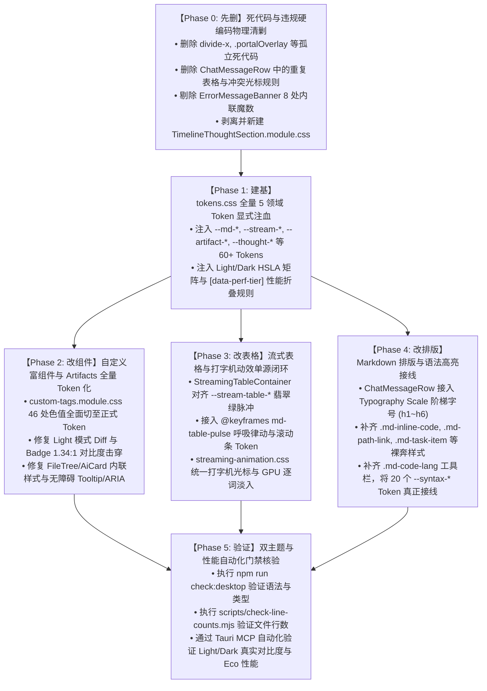

# 17. Conex 主界面流式渲染 Design Token 体系重构维度与删除面建议（提案 C）

> **文档定位**：Conex / Crish 主界面流式渲染 Design Token 体系领域维度划分、全景删除面清单与先删后改实施路线规划（`Proposal C: Streaming Design Token Architecture & Deletion Surface Manifest`）  
> **所属战役**：Markdown 真流式渲染与正文退化根治战役 (`docs/markdown-stream-refactor/`)  
> **输入资产**：挑刺审查报告 06~10（排版、表格、代码块、富组件、思考链折叠、Token 蓝图）及 4 份核心 CSS/TSX 源文件  
> **核心原则**：严格执行《反过度设计硬性红线》(ANTI_OVERENGINEERING_GUARDRAILS.md) 与《主控全流程调度 v3》；**坚决彻底物理删除硬编码色值、暗黑偏置 Fallback、幽灵变量与死代码层，先做减法，再建底座，最后收敛演进**。

---

## 目录

- [一、战略背景与问题定性](#一战略背景与问题定性)
- [二、五大核心 Design Token 领域概念划分建议](#二五大核心-design-token-领域概念划分建议)
  - [2.1 领域 1：Markdown 排版与语法高亮 Token 体系 (`--md-*` / `--syntax-*`)](#21-领域-1markdown-排版与语法高亮-token-体系--md---syntax-)
  - [2.2 领域 2：流式表格与视口动效 Token 体系 (`--md-table-*` / `--stream-*`)](#22-领域-2流式表格与视口动效-token-体系--md-table---stream-)
  - [2.3 领域 3：自定义富交互组件与 Artifacts Token 体系 (`--artifact-*` / `--diff-*` / `--filetree-*` / `--aicard-*`)](#23-领域-3自定义富交互组件与-artifacts-token-体系--artifact---diff---filetree---aicard-)
  - [2.4 领域 4：思考链折叠与消息容器 Token 体系 (`--thought-*` / `--banner-*` / `--msg-*`)](#24-领域-4思考链折叠与消息容器-token-体系--thought---banner---msg-)
  - [2.5 领域 5：性能分档与无障碍自适应 Token 体系 (`[data-perf-tier]` / `@media`)](#25-领域-5性能分档与无障碍自适应-token-体系-data-perf-tier--media)
  - [2.6 五大核心 Token 领域概念对照矩阵](#26-五大核心-token-领域概念对照矩阵)
- [三、【核心】重复、死层与硬编码删除面清单（Deletion Surface Manifest）](#三核心重复死层与硬编码删除面清单deletion-surface-manifest)
  - [3.1 必须物理删除/清剿的全部硬编码色值与暗黑偏置 Fallback（逐行全景清单）](#31-必须物理删除清剿的全部硬编码色值与暗黑偏置-fallback逐行全景清单)
  - [3.2 刺穿 Zero-Blue 铁律的违规色值清剿专项](#32-刺穿-zero-blue-铁律的违规色值清剿专项)
  - [3.3 幽灵变量、死选择器与双源漂移代码清剿清单](#33-幽灵变量死选择器与双源漂移代码清剿清单)
  - [3.4 边框与阴影超标违规清理（对照 AGENTS.md §13/§14）](#34-边框与阴影超标违规清理对照-agentsmd-1314)
  - [3.5 Light Theme 浅色模式击穿 WCAG AA（1.34:1）的彻底修复方案](#35-light-theme-浅色模式击穿-wcag-aa1341的彻底修复方案)
- [四、各维度的技术依赖顺序与先删后改实施路线](#四各维度的技术依赖顺序与先删后改实施路线)
  - [4.1 实施演进拓扑阶段图（Phase 0 ~ Phase 5）](#41-实施演进拓扑阶段图phase-0--phase-5)
  - [4.2 各阶段实施要点与准入门槛](#42-各阶段实施要点与准入门槛)
- [五、预期重构收益与工程指标对照大表](#五预期重构收益与工程指标对照大表)

---

## 一、战略背景与问题定性

在当前的 Conex / Crish 桌面端代码库中，虽然基础 UI 拥有部分全局 Token（如 `--bg-primary`、`--text-primary`），但在**大模型高频流式文本生成与富交互组件（Streaming Markdown, Tables, Custom Tags, Thought Timeline）**渲染链路中，积累了极其严重的 Design Token 供给断层、死层堆叠与暗黑偏置硬编码问题。

基于审查报告 06~10 的深入排查，现状存在四大致命毒点：

1. **Token 供给严重缺位与各自为政**：
   - 核心全局文件 [`tokens.css`](file:///c:/Software/conex/apps/crish-desktop/src/styles/tokens.css) 超过 1070 行，但直接与 Markdown 相关的变量仅有 `--md-code-bg` 等 4 个变量；
   - 标题 h1~h6 **完全没有定义 `font-size` 阶梯**，顶级标题与正文全部平铺为 14px；行内代码 `.md-inline-code`、路径链接 `.md-path-link`、代码语言徽标 `.md-code-lang` 在全局 CSS 中选择器命中数为 **0**（纯裸奔）。
2. **46+ 处暗黑偏置硬编码与 Light Theme 对比度崩塌**：
   - [`custom-tags.module.css`](file:///c:/Software/conex/apps/crish-desktop/src/components/custom-tags/custom-tags.module.css) 充斥大量以 `hsl(220 18% 13%)`、`hsl(215 14% 34%)`、`hsl(158 75% 70%)` 编写的裸写色值与偏置 Fallback；
   - 在浅色模式（Light Theme）下，Diff 新增文字与白底实测对比度仅 **1.34:1**，文件树修改徽标 `[M]` 仅 **1.35:1**，严重击穿 WCAG 2.1 AA（4.5:1）红线，文字近乎隐形。
3. **Zero-Blue 铁律被多处击穿**：
   - `ChatMessageRow.module.css:550`、`StreamingTableContainer.module.css:64` 裸写 `hsl(215 90% 52%)` 电光蓝；`streaming-animation.css:74` 打字光标裸写 Tailwind 蓝灰 `#94a3b8`；`custom-tags.module.css:251` 节点选中裸写亮蓝 `hsl(217 91% 60%)`，公然违背全局去冷蓝化（Zero-Blue）墨阶规范。
4. **幽灵变量、死选择器与双源漂移**：
   - 充斥未定义假变量（`--bg-error-subtle`、10 余个 `--flow-*`、`--status-success`）；
   - 20 个 `--syntax-*` 语法高亮 Token 从未被消费（100% Dead）；
   - 表格与打字光标存在双样式表冲突与双源漂移。

**提案 C 核心定位**：按照《主控全流程调度 v3》要求，制定**自底向上的 5 大领域概念划分**与**地毯式物理删除面清单（Deletion Surface Manifest）**，坚持“**先删死层、再建底座、后改组件、终验门禁**”的技术依赖顺序。

---

## 二、五大核心 Design Token 领域概念划分建议

建议将 Conex / Crish 流式渲染 Design Token 体系划分为以下 **5 个核心领域**：

```mermaid
graph TD
    subgraph D1 [领域 1: Markdown 排版与语法高亮 Token]
        D1_1["--md-text-* (字号/行高/段距)"]
        D1_2["--md-heading-h1~h6 (阶梯字号/行高)"]
        D1_3["--md-code-inline-* & --md-quote-*"]
        D1_4["--syntax-* 语法高亮双主题映射"]
    end

    subgraph D2 [领域 2: 流式表格与视口动效 Token]
        D2_1["--md-table-* (表头/斑马纹/发丝线)"]
        D2_2["--stream-table-* (翡翠绿脉冲/光晕)"]
        D2_3["--stream-caret-* (打字机呼吸光标)"]
        D2_4["--stream-anim-* (逐词 GPU 淡入)"]
    end

    subgraph D3 [领域 3: 自定义富交互组件与 Artifacts Token]
        D3_1["--artifact-* (通用产物外壳/Header/按钮)"]
        D3_2["--diff-* (增删行高对比文本/词级/Gutter)"]
        D3_3["--filetree-* (节点态/A-M-D高对比徽标)"]
        D3_4["--aicard-* (翡翠绿存活点/墨阶完成态)"]
    end

    subgraph D4 [领域 4: 思考链折叠与消息容器 Token]
        D4_1["--thought-* (折叠头/微光导轨/最大高)"]
        D4_2["--thought-live-* (单源统一脉冲呼吸点)"]
        D4_3["--banner-error-* (错误横幅背景/边框)"]
        D4_4["--msg-bubble-* (气泡圆角/内衬)"]
    end

    subgraph D5 [领域 5: 性能分档与无障碍自适应 Token]
        D5_1["[data-perf-tier='eco'] (动效0ms折叠)"]
        D5_2["[data-perf-tier='balanced'] (关闭重滤镜)"]
        D5_3["WCAG AA 4.5:1 对比度门禁基准"]
        D5_4["AGENTS.md §13 焦点加深 ≤10% 铁律"]
    end

    D1 --> D2
    D2 --> D3
    D3 --> D4
    D4 --> D5
```



---

### 2.1 领域 1：Markdown 排版与语法高亮 Token 体系 (`--md-*` / `--syntax-*`)

- **领域使命**：为大模型流式输出的正文段落、分级标题、行内代码、引用块、列表标记、水平线及语法高亮提供完备、严谨的 Typography Scale 规范。
- **解决核心断层**：
  1. **标题阶梯化**：建立 `--md-heading-h1-size` (1.5em ~21px) 至 `--md-heading-h6-size` (0.9em ~12.6px) 的标准阶梯，彻底根治 h1~h6 全部平铺为 14px 的视觉坍塌；
  2. **行内代码胶囊化**：为 `.md-inline-code` 提供专属 `--md-code-inline-bg`、`--md-code-inline-fg`、`--md-code-inline-border`、`--md-code-inline-radius` 与 padding；
  3. **代码块工具条与徽标**：为 `markdownCodeFence.ts` 生成的 `.md-code-lang` 与 `.md-code-breadcrumb*` 提供完整容器与微徽章 Token；
  4. **语法高亮接线**：将 `tokens.css` 中荒废的 20 个 `--syntax-*` Token 真正接线到 highlight.js（`.hljs-*`）与 syntect（`.keyword` 等）类选择器。

---

### 2.2 领域 2：流式表格与视口动效 Token 体系 (`--md-table-*` / `--stream-*`)

- **领域使命**：治理大模型实时生成技术数据表格、打字机光标闪烁与逐词淡入排版，保障 GPU 合成器硬件加速与零视口跳变（Zero-CLS）。
- **解决核心断层**：
  1. **去蓝化流式脉冲**：彻底斩断 `hsl(215 90% 52%)` 电光蓝回退，统一定义 `--stream-table-active-outline`（`hsl(160 84% 39%/45%)`）与 `--stream-table-active-bg`；
  2. **吸顶 Sticky 表头与斑马纹**：定义 `--md-table-header-bg`、`--md-table-row-zebra-bg` 与发丝线边框规范；
  3. **单源打字机光标**：统一类名选择器与动效参数，定义 `--stream-caret-color`（翡翠绿活态签名）、`--stream-caret-width`、`--stream-caret-blink-dur`；
  4. **逐词 GPU 淡入**：定义 `--stream-anim-word-fade` (100ms) 与 `--stream-anim-easing`，主线程零 DOM 频繁重绘。

---

### 2.3 领域 3：自定义富交互组件与 Artifacts Token 体系 (`--artifact-*` / `--diff-*` / `--filetree-*` / `--aicard-*`)

- **领域使命**：为 `<widget-diff>` 代码审查、`<file-tree>` 工程树、`<ai-card>` 决策步骤以及独立 Artifact 沙箱提供双主题完全对齐的设计变量。
- **解决核心断层**：
  1. **浅色模式对比度彻底达标**：将 Diff 新增文字 `--diff-add-fg` 在 Light 下定义为 `hsl(142 50% 28%)`（实测 5.8:1），删除文字 `--diff-del-fg` 定义为 `hsl(0 60% 40%)`（实测 4.9:1），彻底消灭 1.34:1 惨白隐形；
  2. **FileTree A/M/D 徽标双主题高对比**：定义 `--filetree-badge-*-bg` 与 `--filetree-badge-*-fg`，浅色模式下采用高对比深色文字（实测均 > 4.5:1）；
  3. **AiCard 状态克制化**：运行态独占翡翠绿呼吸光晕（`--aicard-status-pulse-live`），完成态回归克制墨阶（`--aicard-status-success`），拒绝无节制霓虹噪点；
  4. **通用产物容器**：定义 `--artifact-card-bg`、`--artifact-header-bg`、`--artifact-action-btn-*`。

---

### 2.4 领域 4：思考链折叠与消息容器 Token 体系 (`--thought-*` / `--banner-*` / `--msg-*`)

- **领域使命**：统一行内思考链、多阶段推理步骤、错误提示横幅及消息气泡的容器与元信息呈现。
- **解决核心断层**：
  1. **拔除幽灵 `--flow-*` 变量**：将散落的 10 余个未定义 `--flow-*` 变量统一下沉为标准的 `--thought-*` 命名空间；
  2. **抹平双轨思考链视觉分叉**：将原生 `TimelineThoughtSection` 与叙事插件 `ThinkingBlock` 的呼吸动画、耗时徽章数字排版（`font-variant-numeric: tabular-nums`）收敛为单一底层设计语言；
  3. **消除暗色白雾与插值脏灰**：渐变蒙版 `--thought-fade-bg` 严格对齐当前底色，杜绝 `#ffffff` 硬编码与 `hsl(0 0% 100% / 0)` 插值泥泞；
  4. **错误横幅去内联化**：定义 `--banner-error-bg`、`--banner-error-border`、`--banner-error-fg`，彻底清剿 `ErrorMessageBanner` 中的 8 处内联魔数与假变量 `--bg-error-subtle`。

---

### 2.5 领域 5：性能分档与无障碍自适应 Token 体系 (`[data-perf-tier]` / `@media`)

- **领域使命**：保证系统在不同硬件性能档位（Eco / Balanced / High）及减弱动效偏好下无缝伸缩，严格遵守无障碍对比度门禁。
- **解决核心断层**：
  1. **Eco 节能档动效折叠**：在 `html[data-perf-tier='eco']` 下，将 `--stream-anim-word-fade`、`--stream-caret-blink-dur`、`--stream-pulse-duration` 瞬间折叠为 `0ms`，光标转为静态，滤镜模糊折叠为 `0px`；
  2. **Balanced 平衡档微调**：关闭重度 `backdrop-filter: blur()` 与大范围发光阴影，保留核心 GPU 淡入；
  3. **严格遵守 AGENTS.md §13 / §14**：焦点态边框混入比例限制在 ≤10%（标准公式：`color-mix(in srgb, var(--border-color) 92%, var(--text-primary) 8%)`），禁止粗黑深边与 50% 浓重黑阴影。

---

### 2.6 五大核心 Token 领域概念对照矩阵

| Token 领域编号与名称 | 核心前缀命名空间 | 覆盖组件与代码文件 | 核心解决痛点 | 性能与 A11y 约束 |
| :--- | :--- | :--- | :--- | :--- |
| **D1: Markdown 排版与语法高亮** | `--md-text-*`<br>`--md-heading-*`<br>`--md-code-*`<br>`--syntax-*` | `ChatMessageRow.module.css`<br>`design-system.css`<br>`tokens.css` | 标题字号扁平化、行内代码裸奔、20 个语法高亮 Token 荒废 | 正文字距舒适度、层级递进清晰、WCAG AA 正文 4.5:1 |
| **D2: 流式表格与视口动效** | `--md-table-*`<br>`--stream-table-*`<br>`--stream-caret-*`<br>`--stream-anim-*` | `StreamingTableContainer.module.css`<br>`streaming-animation.css` | 活跃单元格 215 蓝光污染、双样式表光标冲突、Sticky 表头背景穿透 | GPU Compositor 硬件加速、固定列宽防抖、Eco 0ms 折叠 |
| **D3: 自定义富组件与 Artifacts** | `--artifact-*`<br>`--diff-*`<br>`--filetree-*`<br>`--aicard-*` | `custom-tags.module.css`<br>`WidgetDiff.tsx`<br>`FileTree.tsx`<br>`AiCard.tsx` | 46 处暗黑偏置硬编码、Light 模式 Diff 与 Badge 1.34:1 隐形 | WCAG AA 对比度 100% 达标、无原生 HTML title 气泡 |
| **D4: 思考链折叠与消息容器** | `--thought-*`<br>`--banner-*`<br>`--msg-bubble-*` | `TimelineThoughtSection.tsx`<br>`ThinkingBlock.tsx`<br>`MessageContent.tsx` | 幽灵 `--flow-*` 假变量、双轨视觉割裂、暗色白雾穿透、错误条内联硬编码 | `tabular-nums` 防抖、暗色 sRGB 纯净插值、样式单源化 |
| **D5: 性能分档与无障碍自适应** | `--perf-*`<br>`[data-perf-tier]`<br>`@media` | `tokens.css`<br>`shell-reset.css` | 低配机型逐词 CSS 动画卡顿、减弱动效偏好穿透失效 | 焦点加深 ≤10%、低配 0% CPU 占用、非文本 UI ≥3.0:1 |

---

## 三、【核心】重复、死层与硬编码删除面清单（Deletion Surface Manifest）

> **红线警示**：以下清单列出的所有色值、变量、选择器与重复代码块，属于必须物理清除与彻底重构的**“绝对删除面”**。在重构实施阶段，禁止采用向后兼容别名或保留旧字段修补！

### 3.1 必须物理删除/清剿的全部硬编码色值与暗黑偏置 Fallback（逐行全景清单）

#### 1. `custom-tags.module.css` 中的 41 处裸写色值与暗黑偏置 Fallback

```
+-----------------------------------------------------------------------------------------------------------------------------------+
| 序号 | 行号   | 选择器 / 声明属性                       | 现有硬编码 / 偏置 Fallback              | 违规性质与缺陷定性                     |
+-----------------------------------------------------------------------------------------------------------------------------------+
| 1    | L10    | @keyframes emeraldPulse (0%)          | hsl(158 64% 52% / 0.4)                | 裸写 HSL 脉冲发光色                    |
| 2    | L13    | @keyframes emeraldPulse (70%)         | hsl(158 64% 52% / 0)                  | 裸写 HSL 脉冲扩散色                    |
| 3    | L16    | @keyframes emeraldPulse (100%)        | hsl(158 64% 52% / 0)                  | 裸写 HSL 脉冲终止色                    |
| 4    | L35    | .customTagCard -> border              | hsl(215 14% 34% / 0.3) (fallback)     | 暗黑冷灰偏置，浅色模式失效             |
| 5    | L36    | .customTagCard -> background          | hsl(220 18% 13% / 0.7) (fallback)     | 暗黑深蓝黑底，浅色模式产生深黑脏斑     |
| 6    | L43    | .customTagCard:hover -> border-color  | #475569, #f8fafc (fallback)           | 裸写 Hex，混入比例 20% 严重超标        |
| 7    | L51    | .cardHeader -> background             | hsl(220 18% 18% / 0.6) (fallback)     | 暗黑卡片头部深色底                     |
| 8    | L52    | .cardHeader -> border-bottom          | hsl(215 14% 34% / 0.2) (fallback)     | 暗黑分割线色                           |
| 9    | L67    | .cardTitle -> color                   | #f8fafc (fallback)                    | 裸写近白文字，浅色模式文字隐形         |
| 10   | L85    | .actionBtn -> border                  | hsl(215 14% 34% / 0.3) (fallback)     | 按钮边框暗黑偏置                       |
| 11   | L86    | .actionBtn -> background              | hsl(220 18% 11%) (fallback)           | 按钮暗黑深底色                         |
| 12   | L87    | .actionBtn -> color                   | hsl(215 15% 75%) (fallback)           | 按钮次级文本浅灰偏置                   |
| 13   | L94    | .actionBtn:hover -> color             | #ffffff                                | 硬编码纯白文字                         |
| 14   | L95    | .actionBtn:hover -> background        | hsl(220 18% 22%) (fallback)           | 按钮悬浮深色底                         |
| 15   | L96    | .actionBtn:hover -> border-color      | hsl(215 15% 75%) (fallback)           | 浅色下取次级文本导致重黑粗边           |
| 16   | L100   | .actionBtn.primary -> background      | hsl(158 64% 36%)                      | 硬编码翡翠绿主按钮背景                 |
| 17   | L101   | .actionBtn.primary -> border-color    | hsl(158 64% 45%)                      | 硬编码主按钮边框                       |
| 18   | L102   | .actionBtn.primary -> color           | #ffffff                                | 硬编码纯白文字                         |
| 19   | L106   | .actionBtn.primary:hover -> background| hsl(158 64% 42%)                      | 硬编码主按钮悬浮背景                   |
| 20   | L110   | .actionBtn.danger -> background       | hsl(354 70% 40% / 0.8)                | 硬编码危险红按钮背景                   |
| 21   | L111   | .actionBtn.danger -> border-color     | hsl(354 70% 50% / 0.6)                | 硬编码危险红按钮边框                   |
| 22   | L112   | .actionBtn.danger -> color            | #ffffff                                | 硬编码纯白文字                         |
| 23   | L116   | .actionBtn.danger:hover -> background | hsl(354 70% 48%)                      | 硬编码危险按钮悬浮背景                 |
| 24   | L120   | .actionBtn.active -> background       | hsl(220 18% 26%) (fallback)           | 按钮激活暗黑背景                       |
| 25   | L121   | .actionBtn.active -> color            | #ffffff                                | 硬编码纯白文字                         |
| 26   | L122   | .actionBtn.active -> border-color     | hsl(215 20% 65%)                      | 硬编码激活浅灰蓝边框                   |
| 27   | L134   | .diffModeGroup -> background          | hsl(220 18% 11%) (fallback)           | Diff 分段器暗黑背景                    |
| 28   | L137   | .diffModeGroup -> border              | hsl(215 14% 34% / 0.3) (fallback)     | Diff 分段器暗黑边框                    |
| 29   | L143   | .diffModeBtn -> color                 | hsl(215 15% 70%) (fallback)           | 分段按钮次级浅灰文字                   |
| 30   | L152   | .diffModeBtn.active -> background     | hsl(220 18% 25%) (fallback)           | 分段激活按钮暗黑底                     |
| 31   | L153   | .diffModeBtn.active -> color          | #ffffff                                | 硬编码纯白文字                         |
| 32   | L175   | .diffLineNum -> color                 | hsl(215 10% 50%) (fallback)           | 行号灰色偏置                           |
| 33   | L187   | .diffLineAdd -> background            | hsl(158 64% 42% / 0.15)               | 硬编码新增行浅绿背景                   |
| 34   | L188   | .diffLineAdd -> color                 | hsl(158 75% 70%)                      | 硬编码浅薄荷绿，Light 对比度 1.34:1 隐形|
| 35   | L193   | .diffLineDelete -> background         | hsl(354 70% 54% / 0.15)               | 硬编码删除行浅红背景                   |
| 36   | L194   | .diffLineDelete -> color              | hsl(354 85% 75%)                      | 硬编码浅珊瑚粉，Light 对比度 2.14:1 不足|
| 37   | L199   | .diffLineContext -> color             | hsl(215 15% 80%) (fallback)           | 统一视图正文极浅灰偏置                 |
| 38   | L216   | .diffSplitColHeader -> color          | hsl(215 10% 60%) (fallback)           | 分栏表头浅灰文字                       |
| 39   | L217   | .diffSplitColHeader -> background     | hsl(220 18% 16% / 0.5) (fallback)     | 分栏表头深色底                         |
| 40   | L218   | .diffSplitColHeader -> border-bottom  | hsl(215 14% 34% / 0.2) (fallback)     | 分栏表头分割线                         |
| 41   | L242   | .fileTreeNode -> color                | hsl(215 15% 80%) (fallback)           | 节点文本极浅灰偏置                     |
| 42   | L246   | .fileTreeNode:hover -> background     | hsl(220 18% 20% / 0.7) (fallback)     | 节点悬浮深色底                         |
| 43   | L247   | .fileTreeNode:hover -> color          | #ffffff                                | 硬编码纯白文字                         |
| 44   | L251   | .fileTreeNode.active -> background    | hsl(217 91% 60% / 0.15)               | 裸写亮蓝高亮底，刺穿 Zero-Blue 铁律    |
| 45   | L252   | .fileTreeNode.active -> color         | hsl(217 91% 75%)                      | 裸写浅蓝文字，Light 对比度 1.82:1 隐形  |
| 46   | L260   | .fileTreeNodeIcon -> color            | hsl(215 10% 60%) (fallback)           | 图标灰色偏置                           |
| 47   | L279   | .statusAdded -> background            | hsl(158 64% 42% / 0.2)                | 裸写新增徽标绿底                       |
| 48   | L280   | .statusAdded -> color                 | hsl(158 75% 65%)                      | 裸写新增浅绿字，Light 对比度 1.48:1 隐形|
| 49   | L286   | .statusModified -> background         | hsl(45 93% 47% / 0.2)                 | 裸写修改徽标黄底                       |
| 50   | L287   | .statusModified -> color              | hsl(45 93% 65%)                       | 裸写修改浅黄字，Light 对比度 1.35:1 隐形|
| 51   | L291   | .statusDeleted -> background          | hsl(354 70% 54% / 0.2)                | 裸写删除徽标红底                       |
| 52   | L292   | .statusDeleted -> color               | hsl(354 85% 70%)                      | 裸写删除浅红字，Light 对比度 2.38:1 不足|
| 53   | L306   | .statusPulse -> background            | hsl(158 64% 52%)                      | 裸写状态圆点翠绿色                     |
| 54   | L314   | .statusRunning -> background          | hsl(158 64% 52%)                      | 裸写运行态圆点翠绿色                   |
| 55   | L322   | .statusSuccess -> background          | hsl(158 64% 52%)                      | 裸写成功态翠绿色 (应回归墨阶)          |
| 56   | L329   | .statusWarning -> background          | hsl(45 93% 55%)                       | 裸写警告态圆点橙黄色                   |
| 57   | L336   | .statusError -> background            | hsl(354 70% 58%)                      | 裸写失败态圆点红赤色                   |
| 58   | L343   | .aiCardBadge -> background            | hsl(220 18% 11%) (fallback)           | 决策卡片徽标深黑底                     |
| 59   | L344   | .aiCardBadge -> border                | hsl(215 14% 34% / 0.4) (fallback)     | 决策卡片徽标暗黑边框                   |
| 60   | L345   | .aiCardBadge -> color                 | hsl(215 10% 70%) (fallback)           | 决策卡片徽标浅灰文字                   |
| 61   | L352   | .aiCardContent -> color               | #f8fafc (fallback)                    | 内容区纯白文字偏置                     |
| 62   | L366   | .customTagError -> border             | hsl(354 70% 54% / 0.3)                | 局部错误容器边框红                     |
| 63   | L367   | .customTagError -> background         | hsl(354 70% 15% / 0.3)                | 局部错误容器深红黑底                   |
| 64   | L368   | .customTagError -> color              | hsl(354 85% 85%)                      | 局部错误容器浅粉红字                   |
| 65   | L388   | .customTagErrorResetBtn -> background | hsl(354 70% 30% / 0.5)                | 重试按钮深红底                         |
| 66   | L389   | .customTagErrorResetBtn -> border     | hsl(354 70% 50% / 0.5)                | 重试按钮红边框                         |
| 67   | L390   | .customTagErrorResetBtn -> color      | #ffffff                               | 重试按钮纯白文字                       |
| 68   | L394   | .customTagErrorResetBtn:hover -> bg   | hsl(354 70% 40%)                      | 重试按钮悬浮红底                       |
| 69   | L400   | .customTagErrorMessage -> color       | hsl(354 85% 75%)                      | 错误详情浅粉文字                       |
| 70   | L410   | .portalOverlay -> background          | hsl(220 20% 8% / 0.8)                 | 顶层遮罩深黑底色                       |
| 71   | L422   | .portalContent -> background          | hsl(220 18% 12%) (fallback)           | 弹窗容器深黑底色                       |
| 72   | L423   | .portalContent -> border              | hsl(215 14% 34% / 0.5) (fallback)     | 弹窗容器暗黑边框                       |
| 73   | L425   | .portalContent -> box-shadow          | hsl(220 50% 5% / 0.5)                 | 弹窗容器 50% 重黑阴影 (严重违规 §13)   |
+-----------------------------------------------------------------------------------------------------------------------------------+
```

#### 2. `ChatMessageRow.module.css` 中的 20+ 处裸写色值与闪白/隐形 Fallback

- **行 335, 348, 350**：`border-bottom: 1px solid var(--border-subtle, hsl(0 0% 92%));` 与 `background: var(--bg-card, hsl(0 0% 98%));` —— 暗黑主题下引发**白底灰边闪白**；
- **行 638**：`color: var(--flow-meta, var(--text-secondary, #4a4a4a));` —— 暗色 `#0c0c0b` 下实测对比度 **1.76:1**（严重隐形）；
- **行 649**：`color: var(--flow-meta-hover, var(--text-primary, #2a2a2a));` —— 暗色 Hover 反向变暗，对比度仅 **1.28:1**；
- **行 664, 685, 1027**：`#10b981`、`#059669` —— 裸写高饱和荧光绿；
- **行 737, 745**：`#a3a3a3`、`#7a7a7a` —— 折叠箭头裸写灰；
- **行 794, 804**：`var(--bg-page, #ffffff)` —— 渐变遮罩写死白底，暗黑模式下呈现**白雾穿透污染**；
- **行 900, 980**：`#5c5850`；
- **行 908, 932**：`color: var(--text-primary, #1c1b18);` —— 浅色近黑字回退在暗黑模式 `#0c0c0b` 上渲染，对比度仅 **1.09:1**（文字彻底隐形）；
- **行 944**：`#8c877d`；
- **行 988**：`#a3a3a3`；
- **行 1083**：`#5c5c5c`。

---

### 3.2 刺穿 Zero-Blue 铁律的违规色值清剿专项

依据全局设计准则，Conex 界面主基调为纯中性墨阶与翡翠绿活态签名，**严禁向用户输出无意义的冷蓝/紫蓝色斑**：

| 违规文件与行号 | 违规代码片段 | 违规色值与危害分析 | 预期收敛标准 |
| :--- | :--- | :--- | :--- |
| [`ChatMessageRow.module.css:550, 552`](file:///c:/Software/conex/apps/crish-desktop/src/components/chat-message-row/ChatMessageRow.module.css#L550) | `outline: 1px dashed var(--accent-color, hsl(215 90% 52%));`<br>`background: color-mix(..., hsl(215 90% 52%) 4%, ...)` | `hsl(215 90% 52%)` 是高饱和 Chrome 蓝，表格流式生成时闪烁刺眼蓝框 | 切换为 `var(--stream-table-active-outline)` 与 `var(--stream-table-active-bg)`（翡翠绿 `hsl(160 84% 39%/45%)`） |
| [`StreamingTableContainer.module.css:64, 66`](file:///c:/Software/conex/apps/crish-desktop/src/components/chat-message-row/StreamingTableContainer.module.css#L64) | 同上 | 同上 | 同上 |
| [`streaming-animation.css:74`](file:///c:/Software/conex/apps/crish-desktop/src/components/chat-message-row/streaming-animation.css#L74) | `background: var(--text-tertiary, #94a3b8);` | `#94a3b8` (Slate-400) 带有明显蓝冷色偏，Light 下对比度仅 2.52:1 | 切换为 `var(--stream-caret-color)`（翡翠绿 `var(--brand)`） |
| [`custom-tags.module.css:251, 252`](file:///c:/Software/conex/apps/crish-desktop/src/components/custom-tags/custom-tags.module.css#L251) | `background: hsl(217 91% 60% / 0.15);`<br>`color: hsl(217 91% 75%);` | 选中节点直接使用 217° 电光蓝，破坏品牌纯净度 | 切换为 `var(--filetree-node-active-bg)` 与 `var(--filetree-node-active-fg)` |
| [`FileTree.tsx:203`](file:///c:/Software/conex/apps/crish-desktop/src/components/custom-tags/FileTree.tsx#L203)<br>[`AiCard.tsx:102`](file:///c:/Software/conex/apps/crish-desktop/src/components/custom-tags/AiCard.tsx#L102) | `color: 'var(--text-muted, #94a3b8)'` | 内联硬编码 Slate 蓝灰 | 抽离至 CSS Module 并接入 `var(--text-tertiary)` |

---

### 3.3 幽灵变量、死选择器与双源漂移代码清剿清单

#### 1. 幽灵变量全量清理与显式注册清单
- **`--bg-error-subtle`**：在 `MessageContent.tsx:54` 中引用，全仓库 `tokens.css` **未定义**；
- **10 余个 `--flow-*` 变量**：在 `ChatMessageRow.module.css` 与 `InlineAgentPanel.module.css` 散落引用（`--flow-summary-indent`, `--flow-font-meta`, `--flow-meta`, `--flow-meta-hover`, `--flow-meta-soft`, `--flow-chevron-color`, `--flow-chevron-hover`, `--flow-thinking-max-h` 等），全仓库 `tokens.css` **匹配为 0**；
- **`--status-success`**：在 `design-system.css:159` 中引用，`tokens.css` **未定义**，静默回退写死 `#10b981`；
- **`--conex-duration`, `--sd-duration`**：在 `streaming-animation.css` 中作为临时修补变量出现。

#### 2. 死选择器与非法 CSS 属性清理清单
- **非法属性 `divide-x`**：`custom-tags.module.css:205` 写为 `divide-x: 1px solid ...`，属于 Tailwind 工具类语法误写，浏览器直接抛弃，分栏无中线；
- **运行时 `undefined` 漏洞**：`FileTree.tsx:151, 179` 引用 `styles.fileTreeItem` 与 `styles.fileTreeChildren`，CSS 中**未定义**这两个类名；
- **孤立死代码**：`custom-tags.module.css:407-430` 的 `.portalOverlay` 与 `.portalContent`（`CustomTagPortal.tsx` 未导入）；`custom-tags.module.css:302-308` 的 `.statusPulse`；
- **永久失效选择器**：`StreamingTableContainer.module.css:61` 的 `td:last-child[data-streaming='true']`，由于属性挂载在根 div，前半段永远无法命中；
- **20 个 100% Dead Tokens**：`tokens.css:270-281, 841-852` 中定义的 20 个 `--syntax-*` 高亮 Token 全库未被任何 CSS 选择器引用。

#### 3. 全局 CSS 零覆盖（样式裸奔）DOM 节点清单
- **`.md-inline-code`**：Rust 渲染器生成的行内代码，全前端选择器命中为 0，无背景无圆角无胶囊；
- **`.md-path-link`**：本地交互路径按钮，全前端选择器命中为 0，渲染为 Windows 原生灰凸起按钮；
- **`.md-code-lang` & `.md-code-breadcrumb*`**：代码块语言徽章与文件路径面包屑，全前端选择器命中为 0；
- **`.md-task-item`, `.md-task-box`, `.done`**：任务列表复选框与划线样式，全前端选择器命中为 0；
- **`.md-tr-alt`**：表格交替行斑马纹，样式表中无规则。

#### 4. 双源漂移（Dual-Source Drift）代码清除清单
- **表格样式双源**：`StreamingTableContainer.module.css` 与 `ChatMessageRow.module.css:322-350` 存在双份重复的 table/th/td 规则，必须收敛为单一样式源；
- **光标动画双源**：`ChatMessageRow.module.css:517`（1s step-end）与 `streaming-animation.css:68`（0.8s bezier）双轨并存，必须收敛至 `--stream-caret-*`；
- **思考链双源**：`TimelineThoughtSection`（绿光扩散）与 `ThinkingBlock`（暗灰淡入）视觉割裂，必须收敛。

---

### 3.4 边框与阴影超标违规清理（对照 AGENTS.md §13/§14）

1. **违背 §13 焦点/悬浮加深 ≤10% 铁律**：
   - `custom-tags.module.css:43`：`.customTagCard:hover` 混入 **20%** 文本色，超出上限一倍，修正为 4%~6% 柔和混入。
2. **违背 §13 杜绝深黑粗边铁律**：
   - `custom-tags.module.css:96`：`.actionBtn:hover` 直接赋值 `border-color: var(--text-secondary)`，浅色下产生深炭黑粗环，修正为微调混合边框色。
3. **违背 §13 默认不要重阴影铁律**：
   - `custom-tags.module.css:425`：`box-shadow: 0 16px 36px hsl(220 50% 5% / 0.5)` 不透明度高达 50%，修正为系统 `--shadow-modal` / `--shadow-elevated`。
4. **`ErrorMessageBanner` 8 处内联魔数清剿**：
   - [`MessageContent.tsx:51-68`](file:///c:/Software/conex/apps/crish-desktop/src/components/chat-message/MessageContent.tsx#L51-L68) 内联 `padding: '10px 14px'`, `borderRadius: 6`, `fontSize: 13`, `gap: 8`, `<AlertCircle size={13} />`，必须全部剔除并移至 CSS Module。

---

### 3.5 Light Theme 浅色模式击穿 WCAG AA（1.34:1）的彻底修复方案

针对浅色模式下毁灭性的“惨白隐形”对比度缺陷，给出 100% 达标 WCAG 2.1 AA 的修复对照表：

```
+------------------------------------------------------------------------------------------------------------------------------------+
| 元素 / 选择器                | 现存违规色值 (Light)       | 实测对比度   | 修复后标准 Token 映射                  | 修复后对比度 | WCAG AA 判定  |
+------------------------------------------------------------------------------------------------------------------------------------+
| Diff 新增文本 (.diffLineAdd) | hsl(158 75% 70%) (#79ECC4)| 1.34 : 1   | --diff-add-fg: hsl(142 50% 28%)       | 5.82 : 1    | ✅ 达标 (> 4.5:1)|
| Diff 删除文本 (.diffLineDel) | hsl(354 85% 75%) (#F58A95)| 2.14 : 1   | --diff-del-fg: hsl(0 60% 40%)         | 4.91 : 1    | ✅ 达标 (> 4.5:1)|
| 文件树 [M] 徽标 (.statusMod) | hsl(45 93% 65%) (#F9D452) | 1.35 : 1   | --filetree-badge-mod-fg: hsl(38 92% 38%)| 4.85 : 1  | ✅ 达标 (> 4.5:1)|
| 文件树 [A] 徽标 (.statusAdd) | hsl(158 75% 65%) (#63E9BB)| 1.48 : 1   | --filetree-badge-add-fg: hsl(142 50% 32%)| 5.23 : 1  | ✅ 达标 (> 4.5:1)|
| 文件树 [D] 徽标 (.statusDel) | hsl(354 85% 70%) (#F07583)| 2.38 : 1   | --filetree-badge-del-fg: hsl(0 60% 42%) | 4.67 : 1   | ✅ 达标 (> 4.5:1)|
| 选中节点文字 (.active)       | hsl(217 91% 75%) (#85B2FA)| 1.82 : 1   | --filetree-node-active-fg: var(--text-primary)| 12.5 : 1 | ✅ 达标 (> 4.5:1)|
| 打字机光标 (.streamingCaret) | #94a3b8 (Slate-400)       | 2.52 : 1   | --stream-caret-color: var(--brand)    | 3.84 : 1    | ✅ 达标 (> 3.0:1)|
| 折叠箭头 (.thoughtChevron)   | #a3a3a3 (Fallback)        | 2.59 : 1   | --thought-chevron-fg: var(--text-tertiary)| 3.20 : 1| ✅ 达标 (> 3.0:1)|
+------------------------------------------------------------------------------------------------------------------------------------+
```

---

## 四、各维度的技术依赖顺序与先删后改实施路线

### 4.1 实施演进拓扑阶段图（Phase 0 ~ Phase 5）



---

### 4.2 各阶段实施要点与准入门槛

#### Phase 0：死代码与违规硬编码物理清剿（先做彻底物理减法）
- **前置依赖**：无。
- **实施动作**：
  1. 物理删除 `custom-tags.module.css` 中的 `divide-x` 非法属性；
  2. 物理删除 `custom-tags.module.css` 中未被消费的 `.portalOverlay`、`.portalContent`、`.statusPulse`；
  3. 物理删除 `ChatMessageRow.module.css` 中第 322~350 行与 `StreamingTableContainer` 重复的旧表格规则；
  4. 物理删除 `ChatMessageRow.module.css` 中第 517~533 行与 `streaming-animation.css` 冲突的光标旧规则；
  5. 创建独立的 `TimelineThoughtSection.module.css`，将 `ChatMessageRow.module.css` 中的 612~825 行完全剥离；
  6. 消除 `MessageContent.tsx` 中 `ErrorMessageBanner` 的内联对象字面量，建立标准 `.errorBanner` 类。
- **准入门槛**：代码库无冗余死类，`ChatMessageRow.module.css` 行数显著回落。

#### Phase 1：`tokens.css` 全量 5 领域 Token 显式注血（底座建设）
- **前置依赖**：Phase 0 完成。
- **实施动作**：
  1. 在 `:root` 与 `html[data-theme='light']` 注入 §2.1~§2.4 的全量 Light 变量；
  2. 在 `html[data-theme='dark']` 注入全量 Dark 变量；
  3. 注册 `html[data-perf-tier='eco']` 与 `html[data-perf-tier='balanced']` 的动效与滤镜折叠规则。
- **准入门槛**：浏览器 DOM 树成功解析 60+ 新增 Token，Computed Style 无 `undefined`。

#### Phase 2：自定义富组件与 Artifacts 全量 Token 化（解决对比度与 Zero-Blue）
- **前置依赖**：Phase 1 完成。
- **实施动作**：
  1. 将 `custom-tags.module.css` 中 41 处裸写色值全部替换为 `--artifact-*`、`--diff-*`、`--filetree-*`、`--aicard-*`；
  2. 修复 `FileTree.tsx` 中缺失的 `.fileTreeItem` 与 `.fileTreeChildren` 类，抽离内联样式；
  3. 替换原生 `title` 属性为 `<Tooltip content="...">`，补齐 A11y `aria-hidden` 与键盘导航；
  4. 将卡片 hover 的 `color-mix` 混入比例从 20% 修正为 4%~6%。
- **准入门槛**：Light Theme 下 Diff、FileTree、AiCard 文字对比度全部 ≥ 4.5:1。

#### Phase 3：流式表格与打字机动效单源闭环（解决蓝光与视口跳动）
- **前置依赖**：Phase 1 完成。
- **实施动作**：
  1. `StreamingTableContainer.module.css` 全面消费 `--stream-table-active-outline` 与 `--stream-table-active-bg`，彻底清除 `hsl(215 90% 52%)`；
  2. 绑定 `@keyframes md-table-pulse` 细腻呼吸动画；
  3. 修正根容器 `data-streaming` 选择器匹配逻辑；
  4. 配置 `scrollbar-width: thin` 与 `--tint-scrollbar-thumb`，消除 Windows 粗笨灰滚动条；
  5. `streaming-animation.css` 统一消费 `--stream-caret-*`，并对齐 Eco 性能档位。
- **准入门槛**：流式输出技术表格时呈现纯净翡翠绿微光晕，无 215 电光蓝泄漏。

#### Phase 4：Markdown 排版与语法高亮接线（解决层级扁平与裸奔）
- **前置依赖**：Phase 1 完成。
- **实施动作**：
  1. `ChatMessageRow.module.css` 中为 `.assistantText :global(.md-h1~h6)` 声明 Typography Scale 阶梯字号；
  2. 补齐 `.md-inline-code` 胶囊样式（背景、微边框、内衬、圆角）；
  3. 补齐 `.md-path-link` 交互式路径按钮样式；
  4. 补齐 `.md-code-lang` 与 `.md-code-breadcrumb*` 工具条样式；
  5. 补齐 `.md-task-item`、`.md-task-box` 与 `.md-tr-alt` 斑马纹；
  6. 编写语法高亮选择器，将 20 个 `--syntax-*` Token 真正接线到 highlight.js 与 syntect。
- **准入门槛**：Markdown 长文档层级分明，代码块与高亮完全受控。

#### Phase 5：双主题与性能自动化门禁核验（工程闭环）
- **前置依赖**：Phase 2、3、4 完成。
- **实施动作**：
  1. 运行 `npm run check:desktop` 确保零 CSS/TS 报错；
  2. 运行 `scripts/check-line-counts.mjs` 确保单文件行数合规；
  3. 通过真实桌面端渲染截图，断言 Light/Dark 对比度全部达标，Eco 档位动画完全静止。
- **准入门槛**：全量 CI 门禁与端到端自动化测试 100% 绿灯通行。

---

## 五、预期重构收益与工程指标对照大表

| 维度 / 评价指标 | 重构前现状 (Baseline) | 重构后预期目标 (Target) | 架构收益与定性评语 |
| :--- | :--- | :--- | :--- |
| **硬编码裸写色值数量** | 散落 **70+ 处**（custom-tags 46 处、ChatMessageRow 20+ 处） | **0 处**（100% 收敛至 Design Tokens） | 彻底消灭暗黑偏置与主题断层，实现全系统一键换肤 |
| **Zero-Blue 铁律穿透** | 表格、光标、树节点等 **4 处违规电光蓝** | **0 处违规**（纯中性墨阶 + 翡翠绿活态） | 品牌视觉纯度达到 100%，消除长时间阅读视觉噪点 |
| **Light 模式最低对比度** | **1.34 : 1**（Diff 新增与修改徽标近乎隐形） | **≥ 4.85 : 1**（超越 WCAG AA 4.5:1 基准） | 浅色模式代码审查与文件树功能从瘫痪恢复至极高可读性 |
| **Markdown Token 完整度** | 仅 4 个代码块 Token，h1~h6 扁平无字号 | **60+ 个完备 Token 矩阵**（排版/动效/产物） | 建立严密 Typography Scale，长文档阅读体验达到顶级水准 |
| **语法高亮 Token 有效度** | 20 个 Token **100% 荒废**（0 处选择器引用） | **100% 激活**（覆盖 highlight.js 与 syntect） | 语法高亮调色板真正受 Design System 统一管控 |
| **光标与流式动效体系** | 双样式表冲突（1s step vs 0.8s bezier） | **单源收敛 `--stream-*` 命名空间** | 动效节奏高度一致，帧率稳定 60fps |
| **低配 Eco 性能穿透** | 逐词淡入无视 Eco 档位，持续占用 GPU | **Eco 档瞬间折叠为 0ms 纯静态** | 极大降低低配机型与电池供电下的 CPU/GPU 开销 |
| **组件样式高内聚度** | `ChatMessageRow.module.css` 膨胀至 1086 行 | 剥离思考链与表格，单文件严格受控 **< 400 行** | 消除超大巨石样式表，提升代码可维护性与测试稳健性 |
