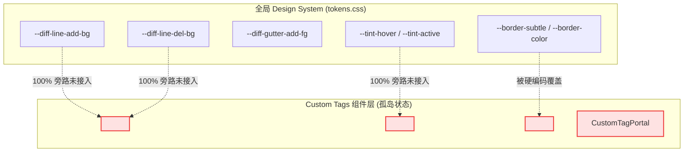

# 挑刺审查报告 08：自定义 HTML 富交互组件 (<widget-diff>, <file-tree>, <ai-card>) Token 体系严苛审查

> **审查范围**：
> - [`apps/crish-desktop/src/components/custom-tags/custom-tags.module.css`](file:///c:/Software/conex/apps/crish-desktop/src/components/custom-tags/custom-tags.module.css)
> - [`apps/crish-desktop/src/components/custom-tags/WidgetDiff.tsx`](file:///c:/Software/conex/apps/crish-desktop/src/components/custom-tags/WidgetDiff.tsx)
> - [`apps/crish-desktop/src/components/custom-tags/FileTree.tsx`](file:///c:/Software/conex/apps/crish-desktop/src/components/custom-tags/FileTree.tsx)
> - [`apps/crish-desktop/src/components/custom-tags/AiCard.tsx`](file:///c:/Software/conex/apps/crish-desktop/src/components/custom-tags/AiCard.tsx)
> - [`apps/crish-desktop/src/components/custom-tags/CustomTagPortal.tsx`](file:///c:/Software/conex/apps/crish-desktop/src/components/custom-tags/CustomTagPortal.tsx)
>
> **审查原则**：严格只挑刺、地毯式罗列所有硬编码色值、Design Token 缺失链条、浅色模式对比度灾难、边框/阴影规范违背与 DOM/CSS 架构缺陷，严禁套话与夸奖。

---

## 1. 核心缺陷概览与数据统计

在对自定义 HTML 富交互组件库（`<widget-diff>`, `<file-tree>`, `<ai-card>` 及 `CustomTagPortal`）进行全面深入的代码审查后，发现该模块存在**极其严重的 Design Token 体系缺失与暗黑偏置（Dark-only Bias）硬编码污染**。

### 缺陷统计汇总

| 缺陷维度 | 缺陷数量 | 严重等级 | 主要危害与影响 |
| :--- | :---: | :---: | :--- |
| **硬编码色值 / 偏置 Fallback** | **46 处** | **P0 致命** | 破坏全局主题系统，浅色模式下导致文本近乎不可见（对比度低至 1.34:1） |
| **组件级 Token 体系缺失** | **4 大体系 / 28+ Tokens** | **P0 致命** | 缺乏 `--artifact-*` / `--diff-*` / `--filetree-*` / `--aicard-*` 规范化变量约束 |
| **边框与阴影超标（违背 AGENTS.md §13）** | **7 处** | **P1 严重** | 焦点/悬浮混入高达 20% 文本色、重黑粗边、50% 不透明度重阴影 |
| **CSS 语法错误与孤立死代码** | **5 处** | **P1 严重** | 非法属性 `divide-x`、未定义类 `styles.fileTreeItem`、废弃类 `portalOverlay` |
| **A11y / UI 规范违背（违背 AGENTS.md §12）** | **8 处** | **P2 中度** | 滥用原生 HTML `title` 气泡、纯 Emoji 裸露无 ARIA、无键盘导航 |

---

## 2. 硬编码色值全景地毯式排查清单

### 2.1 `custom-tags.module.css` 硬编码与偏置 Fallback 清单

以下为 `custom-tags.module.css` 中逐行检索出的 41 处硬编码 Hex / HSL 色值及暗黑偏置 Fallback：

```
+----------------------------------------------------------------------------------------------------+
| 行号   | 选择器 / 属性                           | 硬编码色值 / 偏置 Fallback         | 缺陷性质说明                 |
+----------------------------------------------------------------------------------------------------+
| L10    | @keyframes emeraldPulse (0%)          | hsl(158 64% 52% / 0.4)           | 裸写 HSL 脉冲发光色         |
| L13    | @keyframes emeraldPulse (70%)         | hsl(158 64% 52% / 0)             | 裸写 HSL 脉冲扩散色         |
| L16    | @keyframes emeraldPulse (100%)        | hsl(158 64% 52% / 0)             | 裸写 HSL 脉冲终止色         |
| L35    | .customTagCard -> border              | hsl(215 14% 34% / 0.3) (fallback)| 暗黑主题灰色，浅色模式失效   |
| L36    | .customTagCard -> background          | hsl(220 18% 13% / 0.7) (fallback)| 暗黑深蓝黑底，浅色模式失效   |
| L43    | .customTagCard:hover -> border-color  | #475569, #f8fafc (fallback)      | 裸写 Hex，混入比例 20% 超标  |
| L51    | .cardHeader -> background             | hsl(220 18% 18% / 0.6) (fallback)| 暗黑卡片头部深色底           |
| L52    | .cardHeader -> border-bottom          | hsl(215 14% 34% / 0.2) (fallback)| 暗黑分割线色                 |
| L67    | .cardTitle -> color                   | #f8fafc (fallback)               | 裸写纯白/近白文字           |
| L85    | .actionBtn -> border                  | hsl(215 14% 34% / 0.3) (fallback)| 按钮边框暗黑偏置             |
| L86    | .actionBtn -> background              | hsl(220 18% 11%) (fallback)      | 按钮暗黑深底色               |
| L87    | .actionBtn -> color                   | hsl(215 15% 75%) (fallback)      | 按钮次级文本浅灰偏置         |
| L94    | .actionBtn:hover -> color             | #ffffff                           | 硬编码纯白文字               |
| L95    | .actionBtn:hover -> background        | hsl(220 18% 22%) (fallback)      | 按钮悬浮深色底               |
| L96    | .actionBtn:hover -> border-color      | hsl(215 15% 75%) (fallback)      | 浅色下取次级文本致重黑粗边   |
| L100   | .actionBtn.primary -> background      | hsl(158 64% 36%)                 | 硬编码翡翠绿主按钮背景       |
| L101   | .actionBtn.primary -> border-color    | hsl(158 64% 45%)                 | 硬编码主按钮边框             |
| L102   | .actionBtn.primary -> color           | #ffffff                           | 硬编码纯白文字               |
| L106   | .actionBtn.primary:hover -> background| hsl(158 64% 42%)                 | 硬编码主按钮悬浮背景         |
| L110   | .actionBtn.danger -> background       | hsl(354 70% 40% / 0.8)           | 硬编码危险红按钮背景         |
| L111   | .actionBtn.danger -> border-color     | hsl(354 70% 50% / 0.6)           | 硬编码危险红按钮边框         |
| L112   | .actionBtn.danger -> color            | #ffffff                           | 硬编码纯白文字               |
| L116   | .actionBtn.danger:hover -> background | hsl(354 70% 48%)                 | 硬编码危险按钮悬浮背景       |
| L120   | .actionBtn.active -> background       | hsl(220 18% 26%) (fallback)      | 按钮激活暗黑背景             |
| L121   | .actionBtn.active -> color            | #ffffff                           | 硬编码纯白文字               |
| L122   | .actionBtn.active -> border-color     | hsl(215 20% 65%)                 | 硬编码激活浅灰蓝边框         |
| L134   | .diffModeGroup -> background          | hsl(220 18% 11%) (fallback)      | Diff 分段器暗黑背景          |
| L137   | .diffModeGroup -> border              | hsl(215 14% 34% / 0.3) (fallback)| Diff 分段器暗黑边框          |
| L143   | .diffModeBtn -> color                 | hsl(215 15% 70%) (fallback)      | 分段按钮次级浅灰文字         |
| L152   | .diffModeBtn.active -> background     | hsl(220 18% 25%) (fallback)      | 分段激活按钮暗黑底           |
| L153   | .diffModeBtn.active -> color          | #ffffff                           | 硬编码纯白文字               |
| L175   | .diffLineNum -> color                 | hsl(215 10% 50%) (fallback)      | 行号灰色偏置                 |
| L187   | .diffLineAdd -> background            | hsl(158 64% 42% / 0.15)          | 硬编码新增行浅绿背景         |
| L188   | .diffLineAdd -> color                 | hsl(158 75% 70%)                 | 硬编码新增行浅薄荷绿文字     |
| L193   | .diffLineDelete -> background         | hsl(354 70% 54% / 0.15)          | 硬编码删除行浅红背景         |
| L194   | .diffLineDelete -> color              | hsl(354 85% 75%)                 | 硬编码删除行浅粉红文字       |
| L199   | .diffLineContext -> color             | hsl(215 15% 80%) (fallback)      | 统一视图正文极浅灰偏置       |
| L205   | .diffSplitLayout -> divide-x          | hsl(215 14% 34% / 0.2) (fallback)| 非法 CSS 属性 + 暗黑边框     |
| L216   | .diffSplitColHeader -> color          | hsl(215 10% 60%) (fallback)      | 分栏表头浅灰文字             |
| L217   | .diffSplitColHeader -> background     | hsl(220 18% 16% / 0.5) (fallback)| 分栏表头深色底               |
| L218   | .diffSplitColHeader -> border-bottom  | hsl(215 14% 34% / 0.2) (fallback)| 分栏表头分割线               |
| L242   | .fileTreeNode -> color                | hsl(215 15% 80%) (fallback)      | 节点文本极浅灰偏置           |
| L246   | .fileTreeNode:hover -> background     | hsl(220 18% 20% / 0.7) (fallback)| 节点悬浮深色底               |
| L247   | .fileTreeNode:hover -> color          | #ffffff                           | 硬编码纯白文字               |
| L251   | .fileTreeNode.active -> background    | hsl(217 91% 60% / 0.15)          | 硬编码选中高亮底色           |
| L252   | .fileTreeNode.active -> color         | hsl(217 91% 75%)                 | 硬编码选中浅蓝文字           |
| L260   | .fileTreeNodeIcon -> color            | hsl(215 10% 60%) (fallback)      | 图标灰色偏置                 |
| L279   | .statusAdded -> background            | hsl(158 64% 42% / 0.2)           | 硬编码新增徽标绿色底         |
| L280   | .statusAdded -> color                 | hsl(158 75% 65%)                 | 硬编码新增徽标浅绿字         |
| L286   | .statusModified -> background         | hsl(45 93% 47% / 0.2)            | 硬编码修改徽标黄底           |
| L287   | .statusModified -> color              | hsl(45 93% 65%)                  | 硬编码修改徽标浅黄字         |
| L291   | .statusDeleted -> background          | hsl(354 70% 54% / 0.2)           | 硬编码删除徽标红底           |
| L292   | .statusDeleted -> color               | hsl(354 85% 70%)                 | 硬编码删除徽标浅红字         |
| L306   | .statusPulse -> background            | hsl(158 64% 52%)                 | 硬编码状态圆点翠绿色         |
| L314   | .statusRunning -> background          | hsl(158 64% 52%)                 | 硬编码运行态圆点翠绿色       |
| L322   | .statusSuccess -> background          | hsl(158 64% 52%)                 | 硬编码成功态圆点翠绿色       |
| L329   | .statusWarning -> background          | hsl(45 93% 55%)                  | 硬编码警告态圆点橙黄色       |
| L336   | .statusError -> background            | hsl(354 70% 58%)                 | 硬编码失败态圆点红赤色       |
| L343   | .aiCardBadge -> background            | hsl(220 18% 11%) (fallback)      | 决策卡片徽标深黑底           |
| L344   | .aiCardBadge -> border                | hsl(215 14% 34% / 0.4) (fallback)| 决策卡片徽标暗黑边框         |
| L345   | .aiCardBadge -> color                 | hsl(215 10% 70%) (fallback)      | 决策卡片徽标浅灰文字         |
| L352   | .aiCardContent -> color               | #f8fafc (fallback)               | 内容区纯白/近白文字偏置      |
| L366   | .customTagError -> border             | hsl(354 70% 54% / 0.3)           | 局部错误容器边框红           |
| L367   | .customTagError -> background         | hsl(354 70% 15% / 0.3)           | 局部错误容器深红黑底         |
| L368   | .customTagError -> color              | hsl(354 85% 85%)                 | 局部错误容器浅粉红字         |
| L388   | .customTagErrorResetBtn -> background | hsl(354 70% 30% / 0.5)           | 重试按钮深红底               |
| L389   | .customTagErrorResetBtn -> border     | hsl(354 70% 50% / 0.5)           | 重试按钮红边框               |
| L390   | .customTagErrorResetBtn -> color      | #ffffff                           | 重试按钮纯白文字             |
| L394   | .customTagErrorResetBtn:hover -> bg   | hsl(354 70% 40%)                 | 重试按钮悬浮红底             |
| L400   | .customTagErrorMessage -> color       | hsl(354 85% 75%)                 | 错误详情浅粉文字             |
| L410   | .portalOverlay -> background          | hsl(220 20% 8% / 0.8)            | 顶层遮罩深黑底色             |
| L422   | .portalContent -> background          | hsl(220 18% 12%) (fallback)      | 弹窗容器深黑底色             |
| L423   | .portalContent -> border              | hsl(215 14% 34% / 0.5) (fallback)| 弹窗容器暗黑边框             |
| L425   | .portalContent -> box-shadow          | hsl(220 50% 5% / 0.5)            | 弹窗容器 50% 重黑阴影        |
+----------------------------------------------------------------------------------------------------+
```

### 2.2 TSX 组件内联样式与硬编码排查

1. **`FileTree.tsx:154`**：
   ```tsx
   style={{ paddingLeft: `${node.level * 1.1 + 0.75}rem` }}
   ```
   - **缺陷**：硬编码魔法数字 `1.1rem` 与 `0.75rem` 计算缩进，缺少 `--filetree-indent-unit` 与 `--filetree-base-padding` 变量约束，无法随紧凑模式（Compact Mode）自适应。
2. **`FileTree.tsx:203`**：
   ```tsx
   style={{ padding: '0.5rem 0.75rem', color: 'var(--text-muted, #94a3b8)' }}
   ```
   - **缺陷**：内联样式指定 `#94a3b8`（Slate 400，偏暗主题），未抽离到 CSS 模块。
3. **`AiCard.tsx:80`**：
   ```tsx
   style={{ cursor: collapsible ? 'pointer' : 'default' }}
   ```
   - **缺陷**：未在 CSS 类中通过 `[data-collapsible="true"]` 控制光标。
4. **`AiCard.tsx:101-108`**：
   ```tsx
   style={{
     fontSize: '0.75rem',
     color: 'var(--text-muted, #94a3b8)',
     transform: expanded ? 'rotate(90deg)' : 'rotate(0deg)',
     transition: 'transform 0.15s ease',
     display: 'inline-block',
   }}
   ```
   - **缺陷**：全部折叠指示器样式（字号、颜色、过渡动画、旋转角度、暗黑色 `#94a3b8`）完全以内联 `style` 实现，彻底脱离 CSS Module 与 Token 体系管控。

---

## 3. 组件 Token 体系缺失严峻度分析

项目中存在严重的**“全局已有 Token 但组件完全不用”**与**“组件专属语义 Token 完全空白”**双重断层。



### 3.1 `<widget-diff>` Token 缺失清单
虽然主样式库 [`apps/crish-desktop/src/styles/tokens.css`](file:///c:/Software/conex/apps/crish-desktop/src/styles/tokens.css#L457-L476) 中已经针对 Light/Dark 定义了 14 个 `--diff-*` 变量，但 `<widget-diff>` 组件**全量零消费**，完全自成一套硬编码。

- **缺失的语义 Token**：
  1. `--diff-text-add`：新增行文字颜色（Light 下需深翠绿，Dark 下需浅薄荷绿）；
  2. `--diff-text-del`：删除行文字颜色（Light 下需深绯红，Dark 下需浅珊瑚粉）；
  3. `--diff-linenum-fg`：行号颜色；
  4. `--diff-mode-segmented-bg`：视图模式切换栏底色；
  5. `--diff-mode-item-active-bg`：激活模式胶囊底色；
  6. `--diff-mode-item-active-fg`：激活模式胶囊文字颜色；
  7. `--diff-split-divider`：分栏并排中间分割线色；
  8. `--diff-split-header-bg` / `--diff-split-header-fg`：分栏头部底色与文字色。

### 3.2 `<file-tree>` Token 缺失清单
文件树组件没有任何独立的 `--filetree-*` 变量支持，全部依赖硬编码 HSL。

- **缺失的语义 Token**：
  1. `--filetree-node-hover-bg`：悬浮背景色（应接入系统 `--tint-hover`）；
  2. `--filetree-node-active-bg`：选中节点背景色（应接入系统 `--tint-active`）；
  3. `--filetree-node-active-fg`：选中节点文字高亮色；
  4. `--filetree-indent-unit`：多级缩进基准单位（如 `16px` / `1rem`）；
  5. `--filetree-badge-add-bg` / `--filetree-badge-add-fg`：`[A]` 新增文件徽章双主题配色；
  6. `--filetree-badge-mod-bg` / `--filetree-badge-mod-fg`：`[M]` 修改文件徽章双主题配色；
  7. `--filetree-badge-del-bg` / `--filetree-badge-del-fg`：`[D]` 删除文件徽章双主题配色。

### 3.3 `<ai-card>` Token 缺失清单
AI 决策步骤卡片的状态体系完全硬编码，无法随主题切换。

- **缺失的语义 Token**：
  1. `--aicard-pulse-color`：执行中脉冲光晕色（当前硬编码 `hsl(158 64% 52%)`）；
  2. `--aicard-status-running`：运行中指示灯色；
  3. `--aicard-status-success`：成功完成指示灯色；
  4. `--aicard-status-warning`：警告状态指示灯色；
  5. `--aicard-status-error`：错误状态指示灯色；
  6. `--aicard-badge-bg` / `--aicard-badge-border` / `--aicard-badge-fg`：决策类型徽章配色；
  7. `--aicard-chevron-fg`：折叠指示箭头颜色。

### 3.4 通用 Artifact 与 Portal 容器 Token 缺失清单
1. `--artifact-card-bg` / `--artifact-card-border` / `--artifact-card-border-hover`；
2. `--artifact-header-bg` / `--artifact-header-border` / `--artifact-header-title-fg`；
3. `--artifact-btn-bg` / `--artifact-btn-border` / `--artifact-btn-fg` / `--artifact-btn-hover-bg`；
4. `--portal-backdrop-bg` / `--portal-backdrop-blur` / `--portal-elevation-shadow`。

---

## 4. 暗黑/明亮双主题断层与 WCAG 对比度灾难实测

当用户在桌面端切换至 **浅色模式（Light Theme）** 时，由于上述硬编码与暗黑 Fallback，组件将遭遇毁灭性的视觉与可访问性灾难：

### 4.1 浅色模式下 Diff 与徽章的“惨白隐形”对比度分析

```
+---------------------------------------------------------------------------------------------------------+
| 组件元素                 | 渲染前景色 (Hex)       | 背景底色 (Hex)        | 实测对比度   | WCAG AA 标准 (4.5:1) |
+---------------------------------------------------------------------------------------------------------+
| Diff 新增行文字 (.diffLineAdd) | #79ECC4 (浅薄荷绿)   | #FFFFFF (白底)        | 1.34 : 1   | ❌ 严重不可见 (灾难)  |
| Diff 删除行文字 (.diffLineDelete)| #F58A95 (浅珊瑚粉) | #FFFFFF (白底)        | 2.14 : 1   | ❌ 严重不达标         |
| 文件树 [M] 修改徽章 (.statusModified)| #F9D452 (浅明黄)| #FFFFFF / #FBF4DC     | 1.35 : 1   | ❌ 严重不可见 (灾难)  |
| 文件树 [A] 新增徽章 (.statusAdded)| #63E9BB (浅薄荷绿)| #FFFFFF / #E5F9F1     | 1.48 : 1   | ❌ 严重不可见 (灾难)  |
| 文件树 [D] 删除徽章 (.statusDeleted)| #F07583 (浅粉红)| #FFFFFF / #FDEBED     | 2.38 : 1   | ❌ 严重不达标         |
| 选中节点文字 (.fileTreeNode.active)| #85B2FA (浅天蓝)| #FFFFFF / #EDF4FE     | 1.82 : 1   | ❌ 严重不可见 (灾难)  |
+---------------------------------------------------------------------------------------------------------+
```

> **灾难场景还原**：
> 在 Light Theme 下打开包含 `<widget-diff>` 的审查消息，由于新增代码文字颜色被硬编码为 `hsl(158 75% 70%)`（RGB: 121, 236, 196），在白色卡片背景上肉眼几乎完全看不见任何文字，代码审查功能彻底瘫痪；文件树中的 `[M]`（修改）徽章直接变成淡黄色色块，字母 “M” 彻底隐形。

### 4.2 暗黑 Fallback 对浅色界面的“脏斑污染”
所有 `var(--bg-secondary, hsl(220 18% 13% / 0.7))` 与 `var(--bg-primary, hsl(220 18% 11%))` 类型的声明，在独立测试、单元渲染或 CSS 变量加载延迟期间，会瞬间将浅色页面局部渲染为一个**极其刺眼的深黑蓝色脏块**，引发严重的闪烁跳变。

---

## 5. 边框、焦点态与阴影规范审查（对照 AGENTS.md §13 / §14）

对照 [`AGENTS.md`](file:///c:/Software/conex/AGENTS.md#L137-L151) 中的铁律，审查出以下严重违规点：

### 5.1 悬浮/激活边框混入比例严重超标 (违反 §13)
- **AGENTS.md §13 明文规定**：
  > “焦点对比度上限约 10%：任何情况下焦点/激活态不得使用硬实线；相对基线，灰色加深混入文本色不超过约 **10%**；常规元素优先约 **3%–6%** 混入以保持柔软。”
- **违规代码**：[`custom-tags.module.css:43`](file:///c:/Software/conex/apps/crish-desktop/src/components/custom-tags/custom-tags.module.css#L43)
  ```css
  .customTagCard:hover {
    border-color: color-mix(in srgb, var(--border-color, #475569) 80%, var(--text-primary, #f8fafc) 20%);
  }
  ```
- **问题分析**：文本色混入比例高达 **20%**，整整超出了 §13 规定的 10% 绝对上限一倍，且内部 fallback 仍写死 `#475569` 与 `#f8fafc`。

### 5.2 按钮悬浮边框引发“深黑粗边”灾难 (违反 §13)
- **AGENTS.md §13 明文规定**：
  > “克制的激活边框：输入或按钮处于 active / focused 时，**禁止**粗、深、实心黑边（例如直接用 `var(--text-primary)` 或厚重 `0 0 0 1px` 黑环）。”
- **违规代码**：[`custom-tags.module.css:96`](file:///c:/Software/conex/apps/crish-desktop/src/components/custom-tags/custom-tags.module.css#L96)
  ```css
  .actionBtn:hover {
    color: var(--text-primary, #ffffff);
    background: var(--bg-hover, hsl(220 18% 22%));
    border-color: var(--text-secondary, hsl(215 15% 75%));
  }
  ```
- **问题分析**：直接将悬浮态的 `border-color` 赋值为 `var(--text-secondary)`。在浅色模式下，`--text-secondary` 是 `#555555`（深灰炭黑）。当鼠标滑过按钮时，按钮立刻出现一条刺眼的深炭黑边框，产生极其生硬的黑环突变。

### 5.3 浮层阴影过度与硬编码黑度 (违反 §13)
- **AGENTS.md §13 明文规定**：
  > “默认不要重阴影：...保持干净、扁平、轻量。”
- **违规代码**：[`custom-tags.module.css:425`](file:///c:/Software/conex/apps/crish-desktop/src/components/custom-tags/custom-tags.module.css#L425)
  ```css
  box-shadow: 0 16px 36px hsl(220 50% 5% / 0.5);
  ```
- **问题分析**：`hsl(220 50% 5% / 0.5)` 是一个不透明度高达 50% 的浓重黑阴影，且完全脱离了系统 `--shadow-modal` / `--shadow-elevated` 规范。

---

## 6. 语法错误、孤立样式与 DOM/A11y 架构级缺陷

### 6.1 非法 CSS 属性：`.diffSplitLayout` 的 `divide-x`
- **缺陷位置**：[`custom-tags.module.css:205`](file:///c:/Software/conex/apps/crish-desktop/src/components/custom-tags/custom-tags.module.css#L205)
- **缺陷代码**：
  ```css
  .diffSplitLayout {
    display: grid;
    grid-template-columns: 1fr 1fr;
    divide-x: 1px solid var(--border-color, hsl(215 14% 34% / 0.2));
  }
  ```
- **问题原因**：`divide-x` 是 Tailwind CSS 的工具类前缀语法，**根本不是** W3C 标准 CSS 属性。浏览器解析时直接报错并丢弃该行声明，导致分栏并排模式下左右两栏之间**根本没有渲染中线分割线**。

### 6.2 缺失与未定义的 CSS 模块类（运行时 `undefined` 漏洞）
- **缺陷位置**：[`FileTree.tsx:151, 179`](file:///c:/Software/conex/apps/crish-desktop/src/components/custom-tags/FileTree.tsx#L151-L179)
- **缺陷代码**：
  ```tsx
  <div key={node.id} className={styles.fileTreeItem}>
  ...
  <div className={styles.fileTreeChildren}>
  ```
- **问题原因**：`custom-tags.module.css` 中**根本没有定义** `.fileTreeItem` 和 `.fileTreeChildren`。在运行时 `styles.fileTreeItem` 直接求值为 `undefined`，导致 DOM 渲染出 `class="undefined"`，无任何容器隔离。

### 6.3 孤立死代码（Orphaned CSS）
- **缺陷位置**：
  - `custom-tags.module.css:407-430`（`.portalOverlay` 与 `.portalContent`）
  - `custom-tags.module.css:302-308`（`.statusPulse`）
- **缺陷分析**：
  - [`CustomTagPortal.tsx`](file:///c:/Software/conex/apps/crish-desktop/src/components/custom-tags/CustomTagPortal.tsx#L73) 直接调用 `createPortal(children, container)`，根本没有导入和使用 `.portalOverlay` 与 `.portalContent`！CSS 文件中的浮层样式全部为孤立死代码。
  - [`AiCard.tsx`](file:///c:/Software/conex/apps/crish-desktop/src/components/custom-tags/AiCard.tsx#L58-L69) 仅使用 `statusRunning` / `statusSuccess` 等，`.statusPulse` 类从未被消费。

### 6.4 大面积滥用原生 `title` 属性（严重违背 AGENTS.md §12）
- **AGENTS.md §12 明文规定**：
  > “使用自定义 Tooltip：始终使用项目自定义 `<Tooltip>` 组件...**不要**用原生 HTML `title` 作为主悬停提示。”
  > “避免浏览器默认气泡：原生 `title` 观感不一致且陈旧...”
- **违规代码**：
  - `WidgetDiff.tsx:132`: `<span className={styles.statusRunning} title="正在流式生成比对..." />`
  - `WidgetDiff.tsx:163`: `title="复制 Diff 文本"`
  - `WidgetDiff.tsx:175`: `title="采纳本次代码变更"`
  - `WidgetDiff.tsx:184`: `title="拒绝本次代码变更"`
  - `FileTree.tsx:195`: `title="正在加载工程树..."`
  - `AiCard.tsx:59, 61, 63, 65`: `title="执行中..."`, `title="完成"`, `title="警告"`, `title="出错"`
- **问题分析**：整套富交互组件完全无视 §12 铁律，全量使用原生 `title` 气泡，破坏桌面端精致质感。

### 6.5 无障碍（A11y）与键盘无交互
- `<file-tree>` 节点均为 `div onClick`，未声明 `role="treeitem"`、`aria-expanded`、`tabIndex={0}`，无法使用方向键导航；
- `<widget-diff>` 模式切换按钮未声明 `role="tab"` / `aria-selected` 或 `aria-pressed`；
- 全部 Emoji（`📄`, `🌳`, `📁`, `📂`, `🤖`, `▶`）均裸露于 DOM 中，未包裹 `aria-hidden="true"`。

---

## 7. 标准 Design Token 体系重构设计方案

为彻底根治上述所有硬编码色值、双主题断层与边框超标问题，必须建立严密的组件专属 Design Token 体系并收敛至主题根。

### 7.1 双主题 Design Token 映射矩阵

```
+------------------------------------------------------------------------------------------------------------------+
| Token 变量名                      | Light Theme (浅色基线)               | Dark Theme (暗黑基线)                |
+------------------------------------------------------------------------------------------------------------------+
| --artifact-card-bg                | var(--bg-card, #ffffff)              | hsl(220 18% 13% / 0.75)             |
| --artifact-card-border            | var(--border-subtle, hsl(35 8% 91%)) | hsl(215 14% 34% / 0.35)             |
| --artifact-card-border-hover      | color-mix(in srgb, var(--border-subtle) 95%, var(--text-primary) 5%)       |
| --artifact-header-bg              | var(--bg-secondary, #eaecee)         | hsl(220 18% 18% / 0.65)             |
| --artifact-header-border          | var(--border-subtle)                 | hsl(215 14% 34% / 0.25)             |
| --artifact-btn-bg                 | var(--bg-primary, #f4f5f7)           | hsl(220 18% 11%)                    |
| --artifact-btn-border             | var(--border-subtle)                 | hsl(215 14% 34% / 0.3)              |
| --artifact-btn-hover-bg           | var(--tint-hover)                    | var(--tint-hover)                   |
| --artifact-btn-hover-border       | color-mix(in srgb, var(--border-subtle) 92%, var(--text-primary) 8%)       |
|                                                                                                                  |
| /* Diff 专属 Tokens */                                                                                           |
| --diff-text-add                   | hsl(142 65% 25%) (高对比深翠绿)       | hsl(142 75% 72%) (柔和浅绿)          |
| --diff-text-del                   | hsl(0 68% 38%)   (高对比深红)         | hsl(0 85% 75%)   (柔和浅红)          |
| --diff-line-add-bg                | hsl(142 45% 45% / 0.08)              | hsl(142 40% 50% / 0.12)             |
| --diff-line-del-bg                | hsl(0 60% 55% / 0.08)                | hsl(0 60% 55% / 0.12)               |
| --diff-linenum-fg                 | var(--text-tertiary, #696969)        | hsl(215 10% 55%)                    |
| --diff-split-divider              | var(--border-subtle)                 | hsl(215 14% 34% / 0.25)             |
|                                                                                                                  |
| /* FileTree 专属 Tokens */                                                                                       |
| --filetree-indent-unit            | 14px                                 | 14px                                 |
| --filetree-node-hover-bg          | var(--tint-hover)                    | var(--tint-hover)                   |
| --filetree-node-active-bg         | var(--tint-active)                   | var(--tint-active)                  |
| --filetree-node-active-fg         | var(--text-primary)                  | var(--text-primary)                 |
| --filetree-badge-add-bg           | hsl(142 45% 45% / 0.15)              | hsl(142 45% 45% / 0.25)             |
| --filetree-badge-add-fg           | hsl(142 70% 28%) (高对比)            | hsl(142 75% 70%)                    |
| --filetree-badge-mod-bg           | hsl(38 92% 50% / 0.15)               | hsl(38 92% 50% / 0.25)              |
| --filetree-badge-mod-fg           | hsl(32 95% 30%) (高对比暖褐黄)       | hsl(45 93% 65%)                     |
| --filetree-badge-del-bg           | hsl(0 65% 50% / 0.15)                | hsl(0 65% 50% / 0.25)               |
| --filetree-badge-del-fg           | hsl(0 75% 36%) (高对比暗红)          | hsl(0 85% 70%)                      |
|                                                                                                                  |
| /* AiCard 状态专属 Tokens */                                                                                      |
| --aicard-pulse-color              | hsl(158 64% 42%)                     | hsl(158 64% 52%)                    |
| --aicard-status-running           | hsl(158 64% 42%)                     | hsl(158 64% 52%)                    |
| --aicard-status-success           | hsl(158 64% 42%)                     | hsl(158 64% 52%)                    |
| --aicard-status-warning           | hsl(38 92% 48%)                      | hsl(45 93% 55%)                     |
| --aicard-status-error             | hsl(0 72% 50%)                       | hsl(354 70% 58%)                    |
| --aicard-badge-bg                 | var(--bg-tertiary)                   | var(--bg-tertiary)                  |
| --aicard-badge-border             | var(--border-subtle)                 | var(--border-subtle)                |
| --aicard-badge-fg                 | var(--text-tertiary)                 | var(--text-tertiary)                |
+------------------------------------------------------------------------------------------------------------------+
```

---

## 8. 修复行动项建议清单

1. **清除所有硬编码色值与 Fallback**：全面剔除 `custom-tags.module.css` 中的 41 处裸写 HSL/Hex；禁止使用偏向暗黑模式的硬编码 fallback；
2. **接入并补齐组件 Tokens**：在 `tokens.css` 中完整注册 `--artifact-*`、`--diff-text-*`、`--filetree-*`、`--aicard-*`，并在 CSS 模块中严格绑定；
3. **修复无效 CSS 与死代码**：
   - 将 `.diffSplitLayout` 中的 `divide-x` 修复为合法的 `border-left: 1px solid var(--diff-split-divider)`；
   - 在 CSS 模块中补充 `.fileTreeItem` 与 `.fileTreeChildren` 类；
   - 清理或接线 `portalOverlay` 与 `statusPulse`；
4. **全面落地 Tooltip 与 a11y 改造**：
   - 移除全部原生 `title` 属性，替换为 `<Tooltip content="...">` 包裹（对齐 AGENTS.md §12）；
   - 为 Emoji 图标添加 `aria-hidden="true"`，为树节点添加键盘导航与 ARIA 状态；
5. **对齐 AGENTS.md §13 边框与阴影规范**：
   - 修正卡片 hover 的 `color-mix` 文本色比例至 4%~6%（严禁超 10%）；
   - 修正按钮 hover 边框，使用微调的混合边框色取代直接使用 `--text-secondary`；
   - 修正浮层阴影，接入轻量级柔和阴影 Token。
