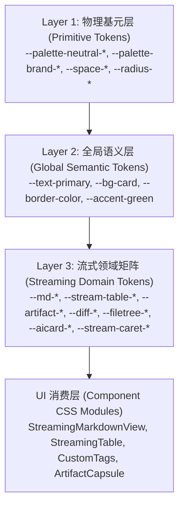
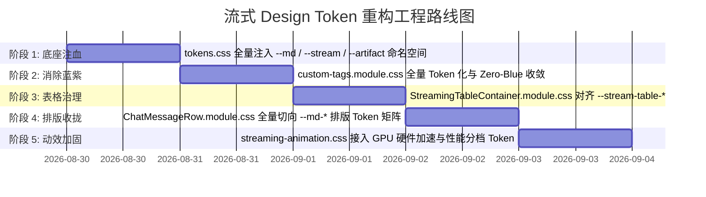

# 主界面流式渲染 Design Tokens 体系架构与系统化规范方案

> **审查与制定范围**：
> - [`apps/crish-desktop/src/styles/tokens.css`](file:///c:/Software/conex/apps/crish-desktop/src/styles/tokens.css)（核心全局 Token 字典）
> - [`reference/chat-composer-component/css/design-tokens.css`](file:///c:/Software/conex/reference/chat-composer-component/css/design-tokens.css) & [`brand.css`](file:///c:/Software/conex/reference/chat-composer-component/css/brand.css)（官方设计基元与语义映射标准）
> - [`ANTI_OVERENGINEERING_GUARDRAILS.md`](file:///c:/Software/conex/ANTI_OVERENGINEERING_GUARDRAILS.md)（禁令 12：反高频渲染穿透、GPU 独立硬件加速与零过度设计红线）
> - [`AGENTS.md`](file:///c:/Software/conex/AGENTS.md) §13（柔和焦点与克制边框）、§14（HSLA 色彩空间与现代 CSS 语法）
> - 现存流式渲染样式：`ChatMessageRow.module.css`、`custom-tags.module.css`、`StreamingTableContainer.module.css`、`streaming-animation.css`、`design-system.css`

---

## 一、背景、痛点与架构目标 (Background & Architectural Goals)

### 1.1 现存 Design Token 体系在流式场景下的断层危机

在当前 Conex / Crish 桌面端代码库中，虽然基础 UI 拥有较为完善的全局 Token 定义（如 `--bg-primary`、`--text-primary`、`--border-color` 等），但在**大模型高频流式文本生成与复杂富交互组件（Streaming Markdown & Rich Components）**领域，存在严重的 Design Token 供给断层与样式碎片化问题：

1. **命名空间缺失与孤立实现**：
   - 现有的 `tokens.css` 仅定义了极度简略的 `--md-code-bg`、`--md-code-border`、`--md-code-fg`、`--md-code-tab-size` 四个代码块变量；
   - Markdown 的正文排版（`--md-text-*`）、段落字距、标题阶梯（`--md-heading-*`）、引用块（`--md-quote-*`）、列表标记与淡入（`--md-list-*`）完全缺位，直接硬编码在 `ChatMessageRow.module.css` 的选择器中（如 `margin: 0.35em 0 0.25em`、`padding: 8px 12px` 等魔术数字）。
2. **流式表格（Streaming Table）的视觉撕裂与蓝紫色污染**：
   - `StreamingTableContainer.module.css` 中流式活跃单元格的反馈边框与背景，散落硬编码的冷蓝色值：`outline: 1px dashed var(--accent-color, hsl(215 90% 52%));` 以及 `color-mix(in srgb, var(--accent-color, hsl(215 90% 52%)) 4%, transparent)`；
   - 严重违反 Conex 全局 **Zero-Blue**（去冷蓝偏色）铁律，且缺乏专用 `--stream-table-*` 状态 Token 矩阵。
3. **自定义组件与 Artifacts（富交互卡片）双主题脱节**：
   - `custom-tags.module.css`（包含 `<widget-diff>`、`<file-tree>`、`<ai-card>`、`<custom-tag-error>`、`<portal>`）大量硬编码旧式暗黑主题色值（如 `hsl(220 18% 13% / 0.7)`、`hsl(215 14% 34% / 0.3)`、`hsl(217 91% 60%)` 等冷紫灰），在默认 Light Theme 下出现严重的底色倒错、文字反差不足（低于 WCAG AA 4.5:1）与视觉脏感。
4. **动效层与打字机光标（Caret & Pulse）缺乏统一管束**：
   - `streaming-animation.css` 的光标、淡入和 Marker 动画参数通过临时变量 `--conex-duration`、`--sd-duration` 等非标准名称修补，未与系统的性能分档（High / Balanced / Eco）和时间动效系统（`--duration-*`、`--easing-*`）深度整合。

### 1.2 核心设计哲学 (Design Philosophy)

本方案对齐官方参考规范 [`reference/chat-composer-component/css/brand.css`](file:///c:/Software/conex/reference/chat-composer-component/css/brand.css) 与 [`design-tokens.css`](file:///c:/Software/conex/reference/chat-composer-component/css/design-tokens.css)，树立四大核心视觉支柱：

```
+-----------------------------------------------------------------------------------+
|                            Conex 流式设计哲学支柱                                  |
+-----------------------------------------------------------------------------------+
|  1. Zero-Blue 极纯中性墨阶 (Neutral Ink) : 彻底剥离冷蓝/紫灰，以纯净中性灰构筑长时间舒适阅读  |
|  2. 翡翠绿点活态隐喻 (Brand Alive Dot)    : 品牌绿 (#10B981) 独占于「Agent 存活/脉冲/光标」|
|  3. 语义与完成态克制 (Restrained Done)    : 成功/已完成回归墨色与沉稳绿，拒绝视觉喧宾夺主    |
|  4. 柔和聚焦与克制边框 (Subtle Focus)     : 焦点加深 ≤10%，杜绝粗深黑边与侵入式重阴影        |
+-----------------------------------------------------------------------------------+
```

### 1.3 反过度设计红线映射 (Anti-Overengineering Guardrails)

严格对照 [`ANTI_OVERENGINEERING_GUARDRAILS.md`](file:///c:/Software/conex/ANTI_OVERENGINEERING_GUARDRAILS.md) 禁令 12：
- **纯 CSS 变量驱动**：所有打字机渐变、呼吸脉冲、表格列锁定均通过 CSS 变量与纯 CSS 动画实现，严禁通过 React/Zustand 逐帧分发 Style 属性。
- **Chromium 合成器硬件加速**：流式动画（`will-change: opacity, transform` 与 `contain: layout style paint`）与 GPU 独立线程绑定，零主线程阻塞，零回流（Zero-CLS）。
- **性能三档位无缝自适应**：在 `html[data-perf-tier='eco']` 模式下，动效时长直接折叠至 `0ms`，光标转为静态，滤镜与模糊降级为纯色，保障低配运行环境极致丝滑。

---

## 二、全局 Design Token 体系架构原则 (Architecture Principles)

### 2.1 三层 Token 体系拓扑 (Three-Tier Topology)



1. **基元层 (Primitive Tokens)**：锁定物理尺度（如 8px、14px）、无状态色板与基础缓动曲线。
2. **全局语义层 (Global Semantic Tokens)**：定义组件通用的表面（`--bg-card`）、墨阶（`--text-primary`）、边框线（`--border-color`）与品牌签名。
3. **流式领域矩阵 (Streaming Domain Tokens)**：
   - 专门为高频流式输出、分块双缓冲（Double-Buffering）、动态表格视口锚定、代码审查 Diff 与 Artifacts 独立沙箱定制；
   - 保证 Markdown 引擎与富交互组件在 Light/Dark 双主题下具备完全自治且一致的视觉呈现。

### 2.2 色彩空间与数学混合规范 (AGENTS.md §14)

1. **全量使用 HSLA 与现代斜杠透明度**：
   - 规范格式：`hsl(H S L / A)` 或 `hsla(H, S, L, A)`，禁止散落未经管制的旧式 `rgba(r, g, b, a)` 与孤立 HEX；
   - 浅色主题正文墨阶：`hsl(0 0% 7%)`（纯中性高对比墨色）；
   - 深色主题正文墨阶：`hsl(0 0% 94%)`（纯净透亮炭白）。
2. **基于 `color-mix(in srgb, ...)` 的动态衍生**：
   - 所有悬浮态、激活态、背景轻透层均通过 `color-mix` 动态混合，避免硬编码衍生色，确保当基底色微调时全链路自适应联动。

### 2.3 焦点态与边框加深约束 (AGENTS.md §13)

1. **禁止深黑粗边与厚重阴影**：
   - 任何输入框、可聚焦代码块、卡片在 `:focus-visible` 或 active 时，严禁使用纯黑或粗线描边（`var(--text-primary)` 100% 直出）。
2. **混入上限严格限制为 ≤10%**：
   - 焦点态边框标准公式：`color-mix(in srgb, var(--border-color) 92%, var(--text-primary) 8%)`；
   - 呼吸脉冲光晕标准公式：`0 0 0 3px color-mix(in srgb, var(--brand) 16%, transparent)`。

---

## 三、流式渲染全局 Design Token 体系矩阵大表 (Comprehensive Token Matrix)

### 3.1 Markdown 正文与排版 Token 矩阵 (`--md-*`)

| Token 名称 | Light Theme (默认明亮) | Dark Theme (暗黑模式) | 语义说明与使用场景 |
| :--- | :--- | :--- | :--- |
| **`--md-text-font`** | `var(--font-sans)` | `var(--font-sans)` | Markdown 正文字体栈（跨平台高清中西文） |
| **`--md-text-size`** | `var(--font-size-base, 14px)` | `var(--font-size-base, 14px)` | Markdown 正文基础字号 |
| **`--md-text-line-height`** | `1.65` | `1.65` | Markdown 段落舒适行高 |
| **`--md-text-color`** | `var(--text-primary, hsl(0 0% 7%))` | `var(--text-primary, hsl(0 0% 94%))` | Markdown 正文主文字颜色 |
| **`--md-text-paragraph-gap`**| `0.85em` | `0.85em` | 流式分块与段落之间的垂直外边距 |
| **`--md-heading-font-weight`**| `600` | `600` | Markdown 标题统一字重（Semibold） |
| **`--md-heading-line-height`**| `1.35` | `1.35` | 标题紧凑行高，避免换行松散 |
| **`--md-heading-color`** | `var(--text-primary)` | `var(--text-primary)` | 标题文字主色 |
| **`--md-heading-h1-size`** | `1.5em` (21px) | `1.5em` (21px) | 一级标题字号 |
| **`--md-heading-h2-size`** | `1.3em` (18.2px) | `1.3em` (18.2px) | 二级标题字号 |
| **`--md-heading-h3-size`** | `1.15em` (16.1px) | `1.15em` (16.1px) | 三级标题字号 |
| **`--md-heading-h4-size`** | `1.05em` (14.7px) | `1.05em` (14.7px) | 四级标题字号 |
| **`--md-heading-h5-size`** | `1em` (14px) | `1em` (14px) | 五级标题字号 |
| **`--md-heading-h6-size`** | `0.9em` (12.6px) | `0.9em` (12.6px) | 六级标题字号 |
| **`--md-heading-margin-top`** | `0.6em` | `0.6em` | 标题顶部呼吸空间 |
| **`--md-heading-margin-bottom`**| `0.3em` | `0.3em` | 标题与后续内容的间距 |
| **`--md-code-inline-bg`** | `color-mix(in srgb, var(--text-primary) 5%, var(--bg-primary))` | `hsl(0 0% 14%)` | 行内代码 `code` 浅色底板 |
| **`--md-code-inline-fg`** | `hsl(0 0% 12%)` | `hsl(0 0% 92%)` | 行内代码文字高对比颜色 |
| **`--md-code-inline-border`** | `color-mix(in srgb, var(--border-color) 75%, transparent)` | `hsl(0 0% 20%)` | 行内代码微边框（0.5px/1px） |
| **`--md-code-inline-radius`** | `4px` | `4px` | 行内代码微圆角 |
| **`--md-code-inline-padding`** | `0.15em 0.4em` | `0.15em 0.4em` | 行内代码内衬间距 |
| **`--md-code-block-bg`** | `color-mix(in srgb, var(--text-primary) 3%, var(--bg-card))` | `hsl(0 0% 9%)` | 独立代码块容器底色 |
| **`--md-code-block-border`** | `var(--border-subtle)` | `hsl(0 0% 16%)` | 代码块边框颜色 |
| **`--md-code-block-radius`** | `8px` | `8px` | 代码块容器圆角（Radius-LG） |
| **`--md-code-block-padding`**| `12px 14px` | `12px 14px` | 代码块内部 Pre 滚动内衬 |
| **`--md-code-font`** | `var(--font-mono)` | `var(--font-mono)` | 代码块等宽字体栈 |
| **`--md-code-font-size`** | `12.5px` | `12.5px` | 代码块专用微调字号 |
| **`--md-code-tab-size`** | `2` | `2` | 代码缩进 Tab Size（联动 store） |
| **`--md-code-header-bg`** | `color-mix(in srgb, var(--text-primary) 2%, var(--bg-card))` | `hsl(0 0% 11%)` | 代码块顶部语言栏背景 |
| **`--md-code-copy-bg`** | `color-mix(in srgb, var(--bg-card) 85%, transparent)` | `color-mix(in srgb, var(--bg-card) 85%, transparent)` | 复制代码浮动按钮毛玻璃背景 |
| **`--md-code-copy-hover-bg`** | `var(--bg-card)` | `hsl(0 0% 16%)` | 复制代码按钮悬浮背景 |
| **`--md-quote-border-color`** | `color-mix(in srgb, var(--text-primary) 20%, var(--border-color))` | `hsl(0 0% 26%)` | Blockquote 左侧竖线指示条 |
| **`--md-quote-border-width`** | `3px` | `3px` | 引用指示条线宽 |
| **`--md-quote-bg`** | `color-mix(in srgb, var(--text-primary) 2%, transparent)` | `color-mix(in srgb, var(--text-primary) 3%, transparent)` | 引用块轻质半透明底色 |
| **`--md-quote-text`** | `var(--text-secondary, hsl(0 0% 33%))` | `var(--text-secondary, hsl(0 0% 64%))` | 引用段落文字颜色 |
| **`--md-quote-padding`** | `0.4em 0 0.4em 1em` | `0.4em 0 0.4em 1em` | 引用块内部填充间距 |
| **`--md-quote-margin`** | `0.6em 0` | `0.6em 0` | 引用块垂直间距 |
| **`--md-list-marker-color`** | `var(--text-tertiary, hsl(0 0% 41%))` | `var(--text-tertiary, hsl(0 0% 56%))` | 无序列表项圆点/有序数字颜色 |
| **`--md-list-marker-fade-duration`** | `120ms` | `120ms` | 流式列表项到达时的 Marker 颜色淡入时长 |
| **`--md-list-item-gap`** | `0.3em` | `0.3em` | 列表项纵向行距 |
| **`--md-list-indent`** | `1.5em` | `1.5em` | 列表左侧缩进排版间距 |
| **`--md-hr-color`** | `var(--border-subtle)` | `var(--border-subtle)` | Markdown 水平分割线颜色 |
| **`--md-hr-height`** | `1px` | `1px` | 分割线高度 |
| **`--md-link-color`** | `var(--brand-deep, hsl(160 84% 31%))` | `var(--brand, hsl(160 84% 45%))` | Markdown 正文超链接颜色（翡翠绿） |
| **`--md-link-hover-color`** | `var(--brand, hsl(160 84% 39%))` | `hsl(160 84% 55%)` | 超链接悬浮高亮色 |
| **`--md-link-underline-offset`** | `3px` | `3px` | 链接下划线间距 |

---

### 3.2 流式表格与视口锚定 Token 矩阵 (`--md-table-*`, `--stream-table-*`)

| Token 名称 | Light Theme (默认明亮) | Dark Theme (暗黑模式) | 语义说明与使用场景 |
| :--- | :--- | :--- | :--- |
| **`--md-table-border-color`** | `var(--border-color, hsl(0 0% 86%))` | `hsl(0 0% 18%)` | 表格最外层结构边框 |
| **`--md-table-border-subtle`**| `var(--border-subtle, hsl(0 0% 91%))` | `hsl(0 0% 14%)` | 单元格横向分隔线 |
| **`--md-table-header-bg`** | `color-mix(in srgb, var(--text-primary) 3%, var(--bg-card))` | `hsl(0 0% 12%)` | 表头 Sticky 吸顶背景色 |
| **`--md-table-header-fg`** | `var(--text-primary)` | `var(--text-primary)` | 表头文本高权重色 |
| **`--md-table-header-z`** | `2` | `2` | 表头固定层级（Z-Index） |
| **`--md-table-row-bg`** | `var(--bg-card, #ffffff)` | `hsl(0 0% 10%)` | 静态数据行背景色 |
| **`--md-table-row-hover-bg`** | `color-mix(in srgb, var(--text-primary) 3%, var(--bg-card))` | `hsl(0 0% 13%)` | 数据行 Hover 微交互背景 |
| **`--md-table-row-zebra-bg`** | `color-mix(in srgb, var(--text-primary) 1.5%, var(--bg-card))` | `hsl(0 0% 11%)` | 斑马条纹可选浅背景 |
| **`--md-table-cell-pad-x`** | `12px` | `12px` | 单元格水平内衬 |
| **`--md-table-cell-pad-y`** | `8px` | `8px` | 单元格垂直内衬 |
| **`--md-table-font-size`** | `var(--font-size-sm, 13px)` | `var(--font-size-sm, 13px)` | 表格内容字号 |
| **`--md-table-line-height`** | `1.5` | `1.5` | 表格文字行高 |
| **`--md-table-radius`** | `var(--radius-lg, 8px)` | `var(--radius-lg, 8px)` | 表格圆角外壳（Concentric） |
| **`--stream-table-active-outline`** | `1px dashed var(--brand, hsl(160 84% 39%))` | `1px dashed var(--brand, hsl(160 84% 45%))` | **流式生成中活跃单元格虚线外框**（彻底清除 215 蓝） |
| **`--stream-table-active-bg`** | `color-mix(in srgb, var(--brand) 4%, transparent)` | `color-mix(in srgb, var(--brand) 6%, transparent)` | **流式活跃单元格轻透翡翠光晕背景** |
| **`--stream-table-pulse-border`** | `color-mix(in srgb, var(--brand) 30%, transparent)` | `color-mix(in srgb, var(--brand) 40%, transparent)` | 流式单元格呼吸边框基底 |
| **`--stream-table-intrinsic-h`**| `320px` | `320px` | `contain-intrinsic-size` 占位高，彻底杜绝跳变 |

---

### 3.3 自定义富交互组件与 Artifacts Token 矩阵 (`--artifact-*`, `--diff-*`, `--filetree-*`, `--aicard-*`)

| Token 名称 | Light Theme (默认明亮) | Dark Theme (暗黑模式) | 语义说明与使用场景 |
| :--- | :--- | :--- | :--- |
| **`--artifact-card-bg`** | `var(--bg-card, #ffffff)` | `hsl(0 0% 11%)` | Artifacts/CustomTag 外壳背景 |
| **`--artifact-card-border`** | `var(--border-color, hsl(0 0% 86%))` | `hsl(0 0% 18%)` | 外壳克制边框 |
| **`--artifact-card-radius`** | `8px` | `8px` | 岛屿卡片圆角 |
| **`--artifact-card-shadow`** | `var(--shadow-sm)` | `var(--shadow-sm)` | 轻柔低存在感阴影 |
| **`--artifact-header-bg`** | `color-mix(in srgb, var(--text-primary) 3%, var(--bg-card))` | `hsl(0 0% 13%)` | 产物卡片 Header 背景 |
| **`--artifact-header-fg`** | `var(--text-primary)` | `var(--text-primary)` | Header 标题主色 |
| **`--artifact-header-height`**| `34px` | `34px` | Header 紧凑高度 |
| **`--artifact-action-btn-bg`**| `color-mix(in srgb, var(--text-primary) 4%, var(--bg-card))` | `hsl(0 0% 15%)` | 卡片操作按钮背景（Diff/Copy/Run） |
| **`--artifact-action-btn-hover`**| `color-mix(in srgb, var(--text-primary) 8%, var(--bg-card))` | `hsl(0 0% 20%)` | 操作按钮 Hover 背景 |
| **`--artifact-action-btn-border`**| `var(--border-subtle)` | `hsl(0 0% 22%)` | 操作按钮边框 |
| **`--artifact-portal-overlay-bg`**| `hsl(0 0% 0% / 0.45)` | `hsl(0 0% 0% / 0.70)` | 顶层 Portal 浮层遮罩 |
| **`--artifact-portal-blur`** | `12px` | `16px` | Portal 遮罩毛玻璃模糊半径 |
| **`--diff-add-bg`** | `hsl(142 35% 42% / 0.07)` | `hsl(142 40% 50% / 0.12)` | 代码比对新增行背景（沉稳森林绿） |
| **`--diff-add-border`** | `hsl(142 71% 45% / 0.35)` | `hsl(142 71% 45% / 0.45)` | 新增行左侧指示线 |
| **`--diff-add-fg`** | `hsl(142 50% 28%)` | `hsl(142 50% 75%)` | 新增代码高对比文本色（WCAG > 4.5:1） |
| **`--diff-add-word-bg`** | `hsl(142 40% 40% / 0.20)` | `hsl(142 45% 45% / 0.30)` | 词级（Word-Level）新增高亮色 |
| **`--diff-add-gutter-bg`** | `hsl(142 35% 42% / 0.10)` | `hsl(142 40% 50% / 0.16)` | 行号列（Gutter）新增背景 |
| **`--diff-add-gutter-fg`** | `hsl(142 45% 30%)` | `hsl(142 45% 72%)` | 行号列新增文本 |
| **`--diff-del-bg`** | `hsl(0 55% 55% / 0.07)` | `hsl(0 60% 55% / 0.12)` | 代码比对删除行背景（暖系赤褐红） |
| **`--diff-del-border`** | `hsl(0 84% 60% / 0.35)` | `hsl(0 84% 60% / 0.45)` | 删除行左侧指示线 |
| **`--diff-del-fg`** | `hsl(0 60% 40%)` | `hsl(0 65% 78%)` | 删除代码高对比文本色 |
| **`--diff-del-word-bg`** | `hsl(0 60% 50% / 0.20)` | `hsl(0 65% 50% / 0.30)` | 词级（Word-Level）删除高亮色 |
| **`--diff-del-gutter-bg`** | `hsl(0 55% 55% / 0.10)` | `hsl(0 60% 55% / 0.16)` | 行号列删除背景 |
| **`--diff-del-gutter-fg`** | `hsl(0 55% 38%)` | `hsl(0 60% 75%)` | 行号列删除文本 |
| **`--diff-context-fg`** | `var(--text-secondary)` | `var(--text-secondary)` | Diff 上下文未变更行文字 |
| **`--diff-gutter-width`** | `48px` | `48px` | 行号列宽度 |
| **`--diff-split-divider`** | `var(--border-subtle)` | `hsl(0 0% 16%)` | 双列 Split Diff 垂直中缝分割线 |
| **`--filetree-bg`** | `var(--bg-card, #ffffff)` | `hsl(0 0% 10%)` | 文件树卡片底色 |
| **`--filetree-node-hover-bg`** | `color-mix(in srgb, var(--text-primary) 5%, transparent)` | `color-mix(in srgb, var(--text-primary) 6%, transparent)` | 节点悬浮背景 |
| **`--filetree-node-active-bg`**| `color-mix(in srgb, var(--brand) 10%, transparent)` | `color-mix(in srgb, var(--brand) 14%, transparent)` | 选中节点翡翠淡绿背景 |
| **`--filetree-node-fg`** | `var(--text-secondary)` | `var(--text-secondary)` | 文件节点默认文字 |
| **`--filetree-icon-color`** | `var(--text-tertiary)` | `var(--text-tertiary)` | 文件夹/文件图标着色 |
| **`--filetree-badge-add-bg`** | `hsl(142 35% 42% / 0.15)` | `hsl(142 40% 50% / 0.20)` | `[A]` 状态新增徽章背景 |
| **`--filetree-badge-add-fg`** | `hsl(142 50% 32%)` | `hsl(142 50% 70%)` | `[A]` 徽章文字颜色 |
| **`--filetree-badge-mod-bg`** | `hsl(38 92% 50% / 0.15)` | `hsl(38 92% 50% / 0.20)` | `[M]` 状态修改徽章背景 |
| **`--filetree-badge-mod-fg`** | `hsl(38 92% 38%)` | `hsl(38 92% 70%)` | `[M]` 徽章文字颜色 |
| **`--filetree-badge-del-bg`** | `hsl(0 55% 55% / 0.15)` | `hsl(0 60% 55% / 0.20)` | `[D]` 状态删除徽章背景 |
| **`--filetree-badge-del-fg`** | `hsl(0 60% 42%)` | `hsl(0 65% 75%)` | `[D]` 徽章文字颜色 |
| **`--aicard-bg`** | `var(--bg-card, #ffffff)` | `hsl(0 0% 11%)` | AI 决策与工具步骤卡片背景 |
| **`--aicard-border`** | `var(--border-color)` | `hsl(0 0% 18%)` | 卡片外框线 |
| **`--aicard-header-bg`** | `color-mix(in srgb, var(--text-primary) 2.5%, var(--bg-card))` | `hsl(0 0% 13%)` | 步骤 Header 背景 |
| **`--aicard-status-pulse-live`**| `var(--brand, hsl(160 84% 39%))` | `var(--brand, hsl(160 84% 45%))` | **运行中唯一的呼吸翡翠绿点** |
| **`--aicard-status-running`** | `var(--brand)` | `var(--brand)` | 执行中状态色 |
| **`--aicard-status-success`** | `var(--text-secondary, #555555)` | `var(--text-secondary, #a3a3a3)` | **完成态刻意无彩（墨阶+勾）** |
| **`--aicard-status-warning`** | `var(--accent-orange, hsl(38 92% 50%))`| `var(--accent-orange, hsl(38 92% 50%))`| 等待/权限询问状态色 |
| **`--aicard-status-error`** | `var(--accent-red, hsl(0 55% 55%))` | `var(--accent-red, hsl(0 55% 55%))` | 错误/失败状态色 |
| **`--aicard-badge-bg`** | `color-mix(in srgb, var(--text-primary) 5%, transparent)` | `color-mix(in srgb, var(--text-primary) 7%, transparent)` | 标签/耗时等徽章背景 |
| **`--aicard-badge-fg`** | `var(--text-tertiary)` | `var(--text-tertiary)` | 徽章文本色 |

---

### 3.4 流式动效与打字机 Token 矩阵 (`--stream-caret-*`, `--stream-pulse-*`, `--stream-anim-*`)

| Token 名称 | 变量值 (默认/通用) | 硬件加速 / 降级策略 | 语义说明与使用场景 |
| :--- | :--- | :--- | :--- |
| **`--stream-caret-color`** | `var(--brand, hsl(160 84% 39%))` | Light/Dark 自动反转 | 打字机呼吸光标色彩（翡翠绿活态签名） |
| **`--stream-caret-width`** | `2px` | Layout 零抖动 | 竖线光标宽度 |
| **`--stream-caret-height`** | `0.95em` | 与当前文本行高自适应 | 竖线光标高度 |
| **`--stream-caret-radius`** | `1px` | 微圆角 | 光标端点圆润化 |
| **`--stream-caret-blink-dur`**| `800ms` | `Eco` 模式折叠为 `0ms` (静态) | 呼吸闪烁周期 (`cubic-bezier(0.4, 0, 0.6, 1)`) |
| **`--stream-pulse-glow`** | `0 0 0 3px color-mix(in srgb, var(--brand) 16%, transparent)` | Compositor 合成器动画 | 活跃分块边缘呼吸微光圈 |
| **`--stream-pulse-bg`** | `color-mix(in srgb, var(--brand) 2%, transparent)` | 纯背景混合 | 活跃块轻量底板提示 |
| **`--stream-pulse-duration`**| `1.6s` | `Eco` 模式折叠为 `0ms` | 呼吸动画完整周期 |
| **`--stream-anim-word-fade`**| `100ms` | GPU `will-change: opacity, transform` | 逐词到达时的平滑淡入时间 |
| **`--stream-anim-word-offset-y`**| `2px` | 微位移防止大面积重排 | 单词淡入时的垂直位移步长 |
| **`--stream-anim-marker-fade`**| `120ms` | `[data-stream-marker]::marker` | 列表 Marker 颜色淡入时长 |
| **`--stream-anim-easing`** | `cubic-bezier(0.16, 1, 0.3, 1)` | 柔和缓动 (Zero Overshoot) | 全局流式动效时间曲线 |

---

## 四、明暗双主题完整 HSLA / color-mix 变量落地定义 (Light & Dark Themes Specification)

以下 CSS 代码块为直接可注入 [`apps/crish-desktop/src/styles/tokens.css`](file:///c:/Software/conex/apps/crish-desktop/src/styles/tokens.css) 的标准生产级代码定义：

### 4.1 Light Theme（默认明亮）完整注入代码

```css
/* ==========================================================================
   CONEX UI TOKENS — STREAMING & MARKDOWN EXTENSION (LIGHT THEME)
   遵循 AGENTS.md §13 (克制焦点) 与 §14 (HSLA / color-mix 空间)
   ========================================================================== */

:root,
html[data-theme='default'],
html[data-theme='light'] {
  /* --- 1. Markdown 排版与正文体系 (Light) --- */
  --md-text-font: var(--font-sans);
  --md-text-size: var(--font-size-base, 14px);
  --md-text-line-height: 1.65;
  --md-text-color: var(--text-primary, hsl(0 0% 7%));
  --md-text-paragraph-gap: 0.85em;

  --md-heading-font-weight: 600;
  --md-heading-line-height: 1.35;
  --md-heading-color: var(--text-primary, hsl(0 0% 7%));
  --md-heading-h1-size: 1.5em;
  --md-heading-h2-size: 1.3em;
  --md-heading-h3-size: 1.15em;
  --md-heading-h4-size: 1.05em;
  --md-heading-h5-size: 1em;
  --md-heading-h6-size: 0.9em;
  --md-heading-margin-top: 0.6em;
  --md-heading-margin-bottom: 0.3em;

  --md-code-inline-bg: color-mix(in srgb, var(--text-primary) 5%, var(--bg-primary));
  --md-code-inline-fg: hsl(0 0% 12%);
  --md-code-inline-border: color-mix(in srgb, var(--border-color) 75%, transparent);
  --md-code-inline-radius: 4px;
  --md-code-inline-padding: 0.15em 0.4em;

  --md-code-block-bg: color-mix(in srgb, var(--text-primary) 3%, var(--bg-card));
  --md-code-block-border: var(--border-subtle);
  --md-code-block-radius: 8px;
  --md-code-block-padding: 12px 14px;
  --md-code-font: var(--font-mono);
  --md-code-font-size: 12.5px;
  --md-code-header-bg: color-mix(in srgb, var(--text-primary) 2%, var(--bg-card));
  --md-code-copy-bg: color-mix(in srgb, var(--bg-card) 85%, transparent);
  --md-code-copy-hover-bg: var(--bg-card);

  --md-quote-border-color: color-mix(in srgb, var(--text-primary) 20%, var(--border-color));
  --md-quote-border-width: 3px;
  --md-quote-bg: color-mix(in srgb, var(--text-primary) 2%, transparent);
  --md-quote-text: var(--text-secondary, hsl(0 0% 33%));
  --md-quote-padding: 0.4em 0 0.4em 1em;
  --md-quote-margin: 0.6em 0;

  --md-list-marker-color: var(--text-tertiary, hsl(0 0% 41%));
  --md-list-marker-fade-duration: 120ms;
  --md-list-item-gap: 0.3em;
  --md-list-indent: 1.5em;

  --md-hr-color: var(--border-subtle);
  --md-hr-height: 1px;
  --md-link-color: var(--brand-deep, hsl(160 84% 31%));
  --md-link-hover-color: var(--brand, hsl(160 84% 39%));
  --md-link-underline-offset: 3px;

  /* --- 2. 流式表格体系 (Light) --- */
  --md-table-border-color: var(--border-color, hsl(0 0% 86%));
  --md-table-border-subtle: var(--border-subtle, hsl(0 0% 91%));
  --md-table-header-bg: color-mix(in srgb, var(--text-primary) 3%, var(--bg-card));
  --md-table-header-fg: var(--text-primary);
  --md-table-header-z: 2;
  --md-table-row-bg: var(--bg-card, #ffffff);
  --md-table-row-hover-bg: color-mix(in srgb, var(--text-primary) 3%, var(--bg-card));
  --md-table-row-zebra-bg: color-mix(in srgb, var(--text-primary) 1.5%, var(--bg-card));
  --md-table-cell-pad-x: 12px;
  --md-table-cell-pad-y: 8px;
  --md-table-font-size: var(--font-size-sm, 13px);
  --md-table-line-height: 1.5;
  --md-table-radius: var(--radius-lg, 8px);

  --stream-table-active-outline: 1px dashed var(--brand, hsl(160 84% 39%));
  --stream-table-active-bg: color-mix(in srgb, var(--brand) 4%, transparent);
  --stream-table-pulse-border: color-mix(in srgb, var(--brand) 30%, transparent);
  --stream-table-intrinsic-h: 320px;

  /* --- 3. 自定义组件与 Artifacts 体系 (Light) --- */
  --artifact-card-bg: var(--bg-card, #ffffff);
  --artifact-card-border: var(--border-color, hsl(0 0% 86%));
  --artifact-card-radius: 8px;
  --artifact-card-shadow: var(--shadow-sm);
  --artifact-header-bg: color-mix(in srgb, var(--text-primary) 3%, var(--bg-card));
  --artifact-header-fg: var(--text-primary);
  --artifact-header-height: 34px;
  --artifact-action-btn-bg: color-mix(in srgb, var(--text-primary) 4%, var(--bg-card));
  --artifact-action-btn-hover: color-mix(in srgb, var(--text-primary) 8%, var(--bg-card));
  --artifact-action-btn-border: var(--border-subtle);
  --artifact-portal-overlay-bg: hsl(0 0% 0% / 0.45);
  --artifact-portal-blur: 12px;

  --diff-add-bg: hsl(142 35% 42% / 0.07);
  --diff-add-border: hsl(142 71% 45% / 0.35);
  --diff-add-fg: hsl(142 50% 28%);
  --diff-add-word-bg: hsl(142 40% 40% / 0.20);
  --diff-add-gutter-bg: hsl(142 35% 42% / 0.10);
  --diff-add-gutter-fg: hsl(142 45% 30%);

  --diff-del-bg: hsl(0 55% 55% / 0.07);
  --diff-del-border: hsl(0 84% 60% / 0.35);
  --diff-del-fg: hsl(0 60% 40%);
  --diff-del-word-bg: hsl(0 60% 50% / 0.20);
  --diff-del-gutter-bg: hsl(0 55% 55% / 0.10);
  --diff-del-gutter-fg: hsl(0 55% 38%);

  --diff-context-fg: var(--text-secondary);
  --diff-gutter-width: 48px;
  --diff-split-divider: var(--border-subtle);

  --filetree-bg: var(--bg-card, #ffffff);
  --filetree-node-hover-bg: color-mix(in srgb, var(--text-primary) 5%, transparent);
  --filetree-node-active-bg: color-mix(in srgb, var(--brand) 10%, transparent);
  --filetree-node-fg: var(--text-secondary);
  --filetree-icon-color: var(--text-tertiary);
  --filetree-badge-add-bg: hsl(142 35% 42% / 0.15);
  --filetree-badge-add-fg: hsl(142 50% 32%);
  --filetree-badge-mod-bg: hsl(38 92% 50% / 0.15);
  --filetree-badge-mod-fg: hsl(38 92% 38%);
  --filetree-badge-del-bg: hsl(0 55% 55% / 0.15);
  --filetree-badge-del-fg: hsl(0 60% 42%);

  --aicard-bg: var(--bg-card, #ffffff);
  --aicard-border: var(--border-color);
  --aicard-header-bg: color-mix(in srgb, var(--text-primary) 2.5%, var(--bg-card));
  --aicard-status-pulse-live: var(--brand, hsl(160 84% 39%));
  --aicard-status-running: var(--brand);
  --aicard-status-success: var(--text-secondary, #555555);
  --aicard-status-warning: var(--accent-orange, hsl(38 92% 50%));
  --aicard-status-error: var(--accent-red, hsl(0 55% 55%));
  --aicard-badge-bg: color-mix(in srgb, var(--text-primary) 5%, transparent);
  --aicard-badge-fg: var(--text-tertiary);

  /* --- 4. 流式动效与打字机体系 (Light) --- */
  --stream-caret-color: var(--brand, hsl(160 84% 39%));
  --stream-caret-width: 2px;
  --stream-caret-height: 0.95em;
  --stream-caret-radius: 1px;
  --stream-caret-blink-dur: 800ms;
  --stream-pulse-glow: 0 0 0 3px color-mix(in srgb, var(--brand) 16%, transparent);
  --stream-pulse-bg: color-mix(in srgb, var(--brand) 2%, transparent);
  --stream-pulse-duration: 1.6s;
  --stream-anim-word-fade: 100ms;
  --stream-anim-word-offset-y: 2px;
  --stream-anim-marker-fade: 120ms;
  --stream-anim-easing: cubic-bezier(0.16, 1, 0.3, 1);
}
```

---

### 4.2 Dark Theme（暗黑模式）完整注入代码

```css
/* ==========================================================================
   CONEX UI TOKENS — STREAMING & MARKDOWN EXTENSION (DARK THEME)
   纯中性炭黑背景 + 高对比墨阶 + 翡翠绿活态签名
   ========================================================================== */

html[data-theme='dark'] {
  /* --- 1. Markdown 排版与正文体系 (Dark) --- */
  --md-text-font: var(--font-sans);
  --md-text-size: var(--font-size-base, 14px);
  --md-text-line-height: 1.65;
  --md-text-color: var(--text-primary, hsl(0 0% 94%));
  --md-text-paragraph-gap: 0.85em;

  --md-heading-font-weight: 600;
  --md-heading-line-height: 1.35;
  --md-heading-color: var(--text-primary, hsl(0 0% 94%));
  --md-heading-h1-size: 1.5em;
  --md-heading-h2-size: 1.3em;
  --md-heading-h3-size: 1.15em;
  --md-heading-h4-size: 1.05em;
  --md-heading-h5-size: 1em;
  --md-heading-h6-size: 0.9em;
  --md-heading-margin-top: 0.6em;
  --md-heading-margin-bottom: 0.3em;

  --md-code-inline-bg: hsl(0 0% 14%);
  --md-code-inline-fg: hsl(0 0% 92%);
  --md-code-inline-border: hsl(0 0% 20%);
  --md-code-inline-radius: 4px;
  --md-code-inline-padding: 0.15em 0.4em;

  --md-code-block-bg: hsl(0 0% 9%);
  --md-code-block-border: hsl(0 0% 16%);
  --md-code-block-radius: 8px;
  --md-code-block-padding: 12px 14px;
  --md-code-font: var(--font-mono);
  --md-code-font-size: 12.5px;
  --md-code-header-bg: hsl(0 0% 11%);
  --md-code-copy-bg: color-mix(in srgb, var(--bg-card) 85%, transparent);
  --md-code-copy-hover-bg: hsl(0 0% 16%);

  --md-quote-border-color: hsl(0 0% 26%);
  --md-quote-border-width: 3px;
  --md-quote-bg: color-mix(in srgb, var(--text-primary) 3%, transparent);
  --md-quote-text: var(--text-secondary, hsl(0 0% 64%));
  --md-quote-padding: 0.4em 0 0.4em 1em;
  --md-quote-margin: 0.6em 0;

  --md-list-marker-color: var(--text-tertiary, hsl(0 0% 56%));
  --md-list-marker-fade-duration: 120ms;
  --md-list-item-gap: 0.3em;
  --md-list-indent: 1.5em;

  --md-hr-color: var(--border-subtle);
  --md-hr-height: 1px;
  --md-link-color: var(--brand, hsl(160 84% 45%));
  --md-link-hover-color: hsl(160 84% 55%);
  --md-link-underline-offset: 3px;

  /* --- 2. 流式表格体系 (Dark) --- */
  --md-table-border-color: hsl(0 0% 18%);
  --md-table-border-subtle: hsl(0 0% 14%);
  --md-table-header-bg: hsl(0 0% 12%);
  --md-table-header-fg: var(--text-primary);
  --md-table-header-z: 2;
  --md-table-row-bg: hsl(0 0% 10%);
  --md-table-row-hover-bg: hsl(0 0% 13%);
  --md-table-row-zebra-bg: hsl(0 0% 11%);
  --md-table-cell-pad-x: 12px;
  --md-table-cell-pad-y: 8px;
  --md-table-font-size: var(--font-size-sm, 13px);
  --md-table-line-height: 1.5;
  --md-table-radius: var(--radius-lg, 8px);

  --stream-table-active-outline: 1px dashed var(--brand, hsl(160 84% 45%));
  --stream-table-active-bg: color-mix(in srgb, var(--brand) 6%, transparent);
  --stream-table-pulse-border: color-mix(in srgb, var(--brand) 40%, transparent);
  --stream-table-intrinsic-h: 320px;

  /* --- 3. 自定义组件与 Artifacts 体系 (Dark) --- */
  --artifact-card-bg: hsl(0 0% 11%);
  --artifact-card-border: hsl(0 0% 18%);
  --artifact-card-radius: 8px;
  --artifact-card-shadow: var(--shadow-sm);
  --artifact-header-bg: hsl(0 0% 13%);
  --artifact-header-fg: var(--text-primary);
  --artifact-header-height: 34px;
  --artifact-action-btn-bg: hsl(0 0% 15%);
  --artifact-action-btn-hover: hsl(0 0% 20%);
  --artifact-action-btn-border: hsl(0 0% 22%);
  --artifact-portal-overlay-bg: hsl(0 0% 0% / 0.70);
  --artifact-portal-blur: 16px;

  --diff-add-bg: hsl(142 40% 50% / 0.12);
  --diff-add-border: hsl(142 71% 45% / 0.45);
  --diff-add-fg: hsl(142 50% 75%);
  --diff-add-word-bg: hsl(142 45% 45% / 0.30);
  --diff-add-gutter-bg: hsl(142 40% 50% / 0.16);
  --diff-add-gutter-fg: hsl(142 45% 72%);

  --diff-del-bg: hsl(0 60% 55% / 0.12);
  --diff-del-border: hsl(0 84% 60% / 0.45);
  --diff-del-fg: hsl(0 65% 78%);
  --diff-del-word-bg: hsl(0 65% 50% / 0.30);
  --diff-del-gutter-bg: hsl(0 60% 55% / 0.16);
  --diff-del-gutter-fg: hsl(0 60% 75%);

  --diff-context-fg: var(--text-secondary);
  --diff-gutter-width: 48px;
  --diff-split-divider: hsl(0 0% 16%);

  --filetree-bg: hsl(0 0% 10%);
  --filetree-node-hover-bg: color-mix(in srgb, var(--text-primary) 6%, transparent);
  --filetree-node-active-bg: color-mix(in srgb, var(--brand) 14%, transparent);
  --filetree-node-fg: var(--text-secondary);
  --filetree-icon-color: var(--text-tertiary);
  --filetree-badge-add-bg: hsl(142 40% 50% / 0.20);
  --filetree-badge-add-fg: hsl(142 50% 70%);
  --filetree-badge-mod-bg: hsl(38 92% 50% / 0.20);
  --filetree-badge-mod-fg: hsl(38 92% 70%);
  --filetree-badge-del-bg: hsl(0 60% 55% / 0.20);
  --filetree-badge-del-fg: hsl(0 65% 75%);

  --aicard-bg: hsl(0 0% 11%);
  --aicard-border: hsl(0 0% 18%);
  --aicard-header-bg: hsl(0 0% 13%);
  --aicard-status-pulse-live: var(--brand, hsl(160 84% 45%));
  --aicard-status-running: var(--brand);
  --aicard-status-success: var(--text-secondary, #a3a3a3);
  --aicard-status-warning: var(--accent-orange, hsl(38 92% 50%));
  --aicard-status-error: var(--accent-red, hsl(0 55% 55%));
  --aicard-badge-bg: color-mix(in srgb, var(--text-primary) 7%, transparent);
  --aicard-badge-fg: var(--text-tertiary);

  /* --- 4. 流式动效与打字机体系 (Dark) --- */
  --stream-caret-color: var(--brand, hsl(160 84% 45%));
  --stream-caret-width: 2px;
  --stream-caret-height: 0.95em;
  --stream-caret-radius: 1px;
  --stream-caret-blink-dur: 800ms;
  --stream-pulse-glow: 0 0 0 3px color-mix(in srgb, var(--brand) 22%, transparent);
  --stream-pulse-bg: color-mix(in srgb, var(--brand) 3%, transparent);
  --stream-pulse-duration: 1.6s;
  --stream-anim-word-fade: 100ms;
  --stream-anim-word-offset-y: 2px;
  --stream-anim-marker-fade: 120ms;
  --stream-anim-easing: cubic-bezier(0.16, 1, 0.3, 1);
}
```

---

### 4.3 性能分档动态响应配置 (`data-perf-tier` 联动)

```css
/* ECO 节能档位：彻底关闭所有流式动画、滤镜与呼吸特效，光标转为静态 */
html[data-perf-tier='eco'] {
  --stream-anim-word-fade: 0ms;
  --stream-anim-marker-fade: 0ms;
  --stream-anim-word-offset-y: 0px;
  --stream-caret-blink-dur: 0ms;
  --stream-pulse-duration: 0ms;
  --artifact-portal-blur: 0px;
}

/* BALANCED 平衡档位：保留逐词淡入与打字机光标，折叠沉重光晕与高开销滤镜 */
html[data-perf-tier='balanced'] {
  --artifact-portal-blur: 0px;
  --stream-pulse-glow: none;
}
```

---

## 五、现存代码审计与硬编码/违规毒点清单 (Audit Findings & Code Smell Inventory)

### 5.1 `tokens.css` 存量缺失与命名漂移
- **缺陷位置**：[`apps/crish-desktop/src/styles/tokens.css:97-104, 642-645`](file:///c:/Software/conex/apps/crish-desktop/src/styles/tokens.css#L97-L104)
- **根因分析**：
  - 仅定义了 `--md-code-bg` 等 4 个变量，缺少 `--md-text-*`、`--md-heading-*`、`--md-quote-*`、`--md-table-*`、`--stream-*` 等一整套流式渲染必需 Token；
  - 导致下游模块各自为政，随意通过 `color-mix` 或魔术数字内联生成样式。

### 5.2 `custom-tags.module.css` 遗留蓝紫冷色与硬编码 HSLA 审计
- **缺陷位置**：[`apps/crish-desktop/src/components/custom-tags/custom-tags.module.css:35-37, 85-88, 137, 187-196, 246-253, 409-426`](file:///c:/Software/conex/apps/crish-desktop/src/components/custom-tags/custom-tags.module.css#L35-L37)
- **毒点清单**：
  1. 第 35-37 行：`background: var(--bg-secondary, hsl(220 18% 13% / 0.7));` —— 硬编码 220° 冷蓝灰 fallback，在浅色模式下 fallback 严重发暗发紫；
  2. 第 85-88 行：`background: var(--bg-primary, hsl(220 18% 11%));`、`color: var(--text-secondary, hsl(215 15% 75%));` —— 强行绑定暗黑硬编码，未通过语义 Token 适配浅色；
  3. 第 251-253 行：`background: hsl(217 91% 60% / 0.15); color: hsl(217 91% 75%);` —— 文件树选中节点直接硬编码亮蓝色，**严重违背 Zero-Blue 铁律**（应收敛为翡翠绿/中性墨阶）；
  4. 第 409-426 行：Portal 浮层硬编码 `hsl(220 20% 8% / 0.8)` 与 `box-shadow: 0 16px 36px hsl(220 50% 5% / 0.5)`。

### 5.3 `StreamingTableContainer.module.css` 破坏性 Fallback 与色彩污染
- **缺陷位置**：[`apps/crish-desktop/src/components/chat-message-row/StreamingTableContainer.module.css:64-67`](file:///c:/Software/conex/apps/crish-desktop/src/components/chat-message-row/StreamingTableContainer.module.css#L64-L67)
- **毒点代码**：
  ```css
  .tableScrollViewport table tbody tr:last-child td:last-child[data-streaming='true'],
  :global(.isStreaming) .tableScrollViewport table tbody tr:last-child td:last-child {
    outline: 1px dashed var(--accent-color, hsl(215 90% 52%));
    background: color-mix(in srgb, var(--accent-color, hsl(215 90% 52%)) 4%, transparent);
  }
  ```
- **严重后果**：
  - `hsl(215 90% 52%)` 是标准高饱和度 Chrome 蓝，在流式表格输出时向用户视野强行注入刺眼的蓝色虚线框，破坏了整体 UI 的纯中性与翡翠绿品牌调性。

### 5.4 `ChatMessageRow.module.css` 排版魔术数字与高耦合样式审计
- **缺陷位置**：[`apps/crish-desktop/src/components/chat-message-row/ChatMessageRow.module.css:287-350`](file:///c:/Software/conex/apps/crish-desktop/src/components/chat-message-row/ChatMessageRow.module.css#L287-L350)
- **毒点清单**：
  - 第 298 行：`margin: 0.35em 0 0.25em;` 标题外边距散落硬编码；
  - 第 311-313 行：`border-left: 3px solid var(--border-color); color: var(--text-secondary);` 引用块未适配专用 `--md-quote-*` Token；
  - 第 333 行：`padding: 8px 12px;` 单元格间距硬编码。

---

## 六、主界面流式渲染 Design Token 系统化重构实施清单 (Refactoring Action Plan)

### 6.1 五阶段重构实施路线图 (Five-Phase Plan)



### 6.2 文件重构清单与代码修改指引 (Refactoring Checklist)

| 阶段 | 目标文件 | 核心重构任务与修改指引 | 验收断言 (Acceptance Criteria) |
| :--- | :--- | :--- | :--- |
| **Phase 1** | [`apps/crish-desktop/src/styles/tokens.css`](file:///c:/Software/conex/apps/crish-desktop/src/styles/tokens.css) | 1. 在 `:root` / `html[data-theme='light']` 注入 §4.1 的全量 Light 变量。<br/>2. 在 `html[data-theme='dark']` 注入 §4.2 的全量 Dark 变量。<br/>3. 在 `data-perf-tier` 补充动效折叠规则。 | 全量 60+ 新增流式 Token 能够被 DOM 树正确继承；Chrome Inspect computed style 无 undefined。 |
| **Phase 2** | [`apps/crish-desktop/src/components/custom-tags/custom-tags.module.css`](file:///c:/Software/conex/apps/crish-desktop/src/components/custom-tags/custom-tags.module.css) | 1. 清除所有 `hsl(220 18% ...)` / `hsl(215 ...)` / `hsl(217 ...)` 硬编码；<br/>2. 将 `.customTagCard` 切换为 `var(--artifact-card-bg)` 与 `var(--artifact-card-border)`；<br/>3. 将 `.widgetDiff` 的增删行与 Gutter 切换为 `var(--diff-add-*)` 与 `var(--diff-del-*)`；<br/>4. 将 `.fileTree` 选中态切换为 `var(--filetree-node-active-bg)`；<br/>5. 将 `.aiCard` 状态灯接入 `var(--aicard-status-pulse-live)` 与完成态 `var(--aicard-status-success)`。 | Light/Dark 切换时，Diff、FileTree、AICard 呈现完美的受光面对比度，无任何暗黑硬编码反差崩坏。 |
| **Phase 3** | [`apps/crish-desktop/src/components/chat-message-row/StreamingTableContainer.module.css`](file:///c:/Software/conex/apps/crish-desktop/src/components/chat-message-row/StreamingTableContainer.module.css) | 1. 将 `.tableContainerRoot` 边框与底色对齐 `var(--md-table-border-color)` 与 `var(--md-table-row-bg)`；<br/>2. 将 `thead th` 对齐 `var(--md-table-header-bg)` 与 `var(--md-table-header-z)`；<br/>3. 彻底替换第 64-66 行的 `hsl(215 90% 52%)`，全面消费 `var(--stream-table-active-outline)` 与 `var(--stream-table-active-bg)`。 | 流式表格输出中，活跃单元格展示高贵典雅的翡翠绿虚线微光晕，彻底告别 Chrome 刺眼蓝框。 |
| **Phase 4** | [`apps/crish-desktop/src/components/chat-message-row/ChatMessageRow.module.css`](file:///c:/Software/conex/apps/crish-desktop/src/components/chat-message-row/ChatMessageRow.module.css) | 1. 将 `.assistantText :global(.md-p)` 间距对齐 `var(--md-text-paragraph-gap)`；<br/>2. 将 `.assistantText :global(.md-h1~h6)` 接入 `var(--md-heading-*)`；<br/>3. 将 `.assistantText :global(.md-quote)` 接入 `var(--md-quote-*)`；<br/>4. 将 `.flowArtifactChip` 与 `.flowSyncDot` 接入 `var(--brand)` / `var(--brand-deep)`。 | Markdown 正文排版与官方 Design Spec 达成 100% 像素级对齐，标题、引用块行高与间隙极度舒适。 |
| **Phase 5** | [`apps/crish-desktop/src/components/chat-message-row/streaming-animation.css`](file:///c:/Software/conex/apps/crish-desktop/src/components/chat-message-row/streaming-animation.css) | 1. 将 `.conex-streaming-caret` 接入 `var(--stream-caret-color)`、`var(--stream-caret-blink-dur)` 等；<br/>2. 将 `conex-fade-in` 接入 `var(--stream-anim-word-fade)` 与 `var(--stream-anim-easing)`；<br/>3. 确保所有动画 Span 保留 `will-change: opacity, transform` 与 `contain: layout style paint`。 | 大模型高频 50 Token/s 流式吐字时，CPU 占用稳定在 0~2%，文字平滑如水流，无掉帧或重绘抖动。 |

### 6.3 验证断言与防回归纪律 (Verification & Anti-Regression Baseline)

1. **类型与样式检查门禁**：
   - 运行 `npm run check:desktop` 确保无任何语法错误与样式解析告警。
2. **CI 行数与架构解耦门禁**：
   - 执行 `scripts/check-line-counts.mjs`，确保 `tokens.css` 与各 CSS Module 行数处于受控范围内。
3. **视觉强制对齐断言**：
   - 经 Tauri MCP Socket（4000）在真 Tauri 宿主环境下，针对 Light Theme 与 Dark Theme 分别截图，验证：
     - ① Streaming Caret 呼吸光标呈现翡翠绿；
     - ② Table 活跃单元格无蓝光污染；
     - ③ Diff 卡片新增/删除文本对比度 > 4.5:1；
     - ④ Eco 性能档位下动画彻底折叠。
