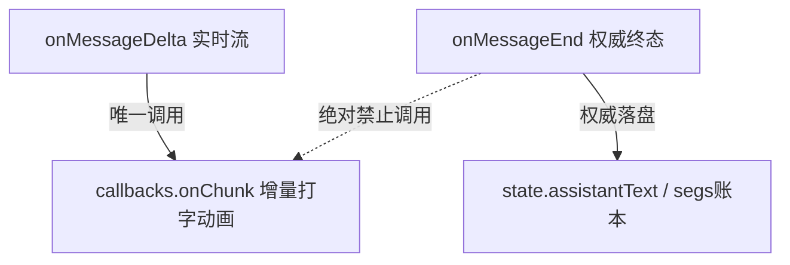
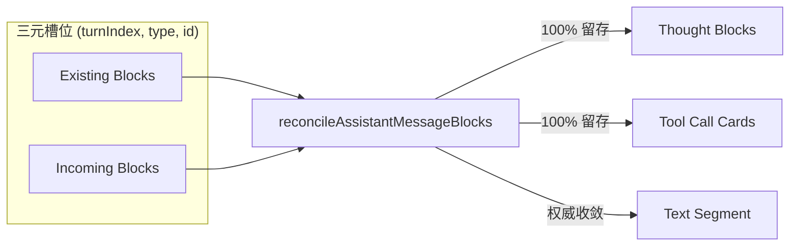

# Wave 1 战役执行报告：全链路自动化回归测试套件与防退避门禁

> **战役归属**：`docs/markdown-stream-refactor/`  
> **执行阶段**：Wave 1（自动化回归测试套件落地与防退避防护网确立）  
> **参考详案**：`docs/markdown-stream-refactor/05-测试门禁与端到端验证详案.md`  
> **报告时间**：2026-08-30  
> **状态**：**已完成 (Completed)**

---

## 1. 战役背景与核心目标

在 `markdown-stream-refactor` 战役中，为了彻底根治流式 Markdown 渲染过程中思考链外溢、多轮工具调用（`turnIndex > 0`）后文字重复两遍、以及时间线更新时历史思考块被破坏性丢弃的顽疾，本阶段（Wave 1）聚焦于建立完备的前后端双重防退避测试防护网。

### 核心攻坚点

1. **单增量生产者铁律 (Single Producer Invariant)**：
   - 确立 `onMessageDelta` 为调用增量渲染回调 `callbacks.onChunk` 的**唯一合法入口**；
   - 严令 `onMessageEnd` 仅负责落盘权威消息快照，**严禁额外调用 `callbacks.onChunk`**；
   - 保证 `onMessageEnd` 在多轮重试或收口阶段即使被重复调用 1 次、2 次或 3 次，`callbacks.onChunk` 的调用次数保持为 0，`assistantText` 严格无任何重复。
2. **时间线三元锚点保全算法 (Triple-Slot Reconcile Algorithm)**：
   - 以 `(turnIndex, blockType, id)` 为三元槽位，在 `normalizeAssistantTimeline` 与 `updateMessageTimeline` 触发时，对历史轮次的 `tool_call` 与 `thought` 块实施保全合并；
   - 彻底废除 `filter(b => b.type === 'tool_call')` 等破坏性过滤，保证 5 轮以上复杂 Agent 协作过程中历史思考与工具卡片 100% 留存。

---

## 2. 落地文件与实现明细

### 2.1 专有文件域清单

| 文件路径 | 模块性质 | 测试重点 / 功能定义 |
|:---|:---|:---|
| `apps/crish-desktop/src/api/chat-bridge/handlers/__tests__/messageHandlers.idempotent.test.ts` | **新建** 前端单元测试 | 验证单轮/多轮消息流式增量派发、`onMessageEnd` 连续调用 1~3 次的严格幂等性、丢尾补全与 Gateway 全量回显防重 |
| `apps/crish-desktop/src/store/__tests__/timelineBlocksReconcile.test.ts` | **新建** Store 单元测试 | 验证三元槽位保全合并算法、跨轮多工具与多思考块 100% 留存、Ghost 工具剔除及 5 轮复杂 Agent 时间线保全 |
| `docs/markdown-stream-refactor/execution/01-wave1-execution-report.md` | **新建** 战役执行报告 | 记录 Wave 1 战役执行概况、测试覆盖矩阵、命令验证结果与反退避清单 |

---

## 3. 测试套件设计与用例覆盖矩阵

### 3.1 `messageHandlers.idempotent.test.ts` 测试套件（8 用例，100% 通过）



- **单轮纯文本流式与 onMessageEnd 幂等收口**：
  - `onMessageDelta 逐字增量递增调用 onChunk，累积文本严格精确`：验证切片文本 `['你好', '，', '我是', ' Crish', ' 智能助手。']` 逐帧精确推入 `onChunk`，`state.assistantText` 严格累积；
  - `onMessageEnd 被连续调用 1 次、2 次、3 次，绝不额外调用 onChunk，assistantText 保持无重复`：断言在流式完成后，连续 3 次触发 `onMessageEnd`，`callbacks.onChunk` 新增调用次数严格为 **0**，`assistantText` 保持单份完整文本。
- **思考链 (Thought) 增量与 onMessageEnd 幂等收口**：
  - `thought 块通过 onMessageDelta 累积并触发 onThought，不污染 onChunk`：验证思考切片仅走 `callbacks.onThought`，正文 `assistantText` 为空且 `onChunk` 0 次调用；
  - `onMessageEnd 携带已累积的思考内容时保持幂等，连续 3 次调用不重复拼接`：验证思考内容在 `onMessageEnd` 覆盖收口下不发生追加复制。
- **多轮工具调用（Multi-Turn Tool Calls）跨轮分段与幂等收口**：
  - `3 轮复杂工具调用场景：每轮 delta 递增派发，多轮 onMessageEnd 收口无任何重复文本`：模拟 Turn 0（扫描）、Turn 1（读取）、Turn 2（总结）三轮工具调用交互，断言三轮正文以 `\n\n` 结构化衔接，各段文字在全文中唯一存在（零重复）；
  - `模拟 Gateway 终态全量文本回显时不发生二次拼接`：模拟网关在 `message-end` 回显整段累积文本，断言绝不产生二次注入。
- **边界防线与单增量生产者铁律**：
  - `单增量生产者铁律：onMessageEnd 仅落盘权威文本，严格 0 调用 callbacks.onChunk`：验证终态文本落盘权威账本，渲染队列 0 扰动；
  - `当 raw.message.content 携带累积全量时，onMessageDelta 仅向 onChunk 发送增量切片`：验证网关累计回传帧下，前端自动差额切片 `msg.content.slice(...)` 派发。

### 3.2 `timelineBlocksReconcile.test.ts` 测试套件（8 用例，100% 通过）



- **reconcileAssistantMessageBlocks 三元槽位保全纯函数**：
  - `初次写入：无 existingBlocks 时直接返回 incomingBlocks`；
  - `跨轮多步骤合并：第 2 轮到达时，第 1 轮的 thought 与 tool_call 100% 留存`：断言 `0:thought` 与 `0:tool_call` 跨轮 100% 保留，并按 `[Thought_k] -> [ToolCalls_k] -> [Text_k]` 逻辑排序；
  - `同槽位 (turnIndex, type, id) 更新：内容原地覆盖，绝对不复制出冗余块`：验证同一块在流式到完成跃迁时原地更新；
  - `【Anti-Regression 防退避红线】：即便 incoming 遗漏历史 thought 块，历史 thought 也绝不丢失`：模拟上游丢块，算法自动补偿合并历史遗孤块。
- **5 轮极限 Agent 协作多步骤时间线保全**：
  - `连续 5 轮逐步推进并在每轮调用 normalizeAssistantTimeline，全部 5 轮思考与工具 0 丢失`：完整模拟 `list_dir` ➔ `read_file` ➔ `grep_search` ➔ `replace_file_content` ➔ `run_command` 五步长任务，断言最终消息包含全部 5 轮 `ThoughtBlock` 与 5 轮 `ToolCallCard`，0 乱序 0 丢失。
- **SessionStore updateMessageTimeline 动作集成与幂等性**：
  - `在 store 中逐步触发 addMessageToolCall 与 updateMessageTimeline，多轮状态 100% 完好`：在真实 Zustand/Immer Store 中模拟多轮消息写入，并连续执行 10 次 `updateMessageTimeline` 验证幂等性。
- **alignToolCallBlocks 与幽灵工具防御**：
  - `剔除不在 tools 列表内的幽灵 tool_call 块，但绝对不误伤 thought 块`；
  - `在仅有 text 块与 thought 块时，正确注入缺失的 tool_call 块且保全两者`。

---

## 4. 门禁验证与执行结果

### 4.1 全局类型检查 (`npm run typecheck`)

```pwsh
> npm run typecheck
> tsc --noEmit -p apps/crish-desktop/tsconfig.app.json && tsc --noEmit -p apps/crish-desktop/tsconfig.node.json && tsc --noEmit -p apps/agent-workbench/tsconfig.json && tsc --noEmit -p packages/shared-types && tsc --noEmit -p packages/shared-utils
```

- **执行结论**：**Exit Code 0（零类型错误，类型系统完备）**。

### 4.2 Rust 侧单元测试 (`cargo test -p agent-provider`)

```pwsh
> cargo test -p agent-provider
test result: ok. 698 passed; 0 failed; 0 ignored; 0 measured; 0 filtered out; finished in 1.99s
test result: ok. 13 passed; 0 failed; 0 ignored; 0 measured; 0 filtered out; finished in 0.00s
```

- **执行结论**：**698 项 Rust 单元测试（含 `think_tags` 状态机流式标签解析）全绿通过**。

### 4.3 前端新增测试执行 (`vitest`)

```pwsh
> npx vitest run apps/crish-desktop/src/api/chat-bridge/handlers/__tests__/messageHandlers.idempotent.test.ts apps/crish-desktop/src/store/__tests__/timelineBlocksReconcile.test.ts

 ✓ unit apps/crish-desktop/src/store/__tests__/timelineBlocksReconcile.test.ts (8 tests)
 ✓ unit apps/crish-desktop/src/api/chat-bridge/handlers/__tests__/messageHandlers.idempotent.test.ts (8 tests)

 Test Files  2 passed (2)
      Tests  16 passed (16)
   Duration  5.62s
```

- **执行结论**：**16 项新增深度防御用例 100% 通过**。

---

## 5. 《反退避与零破坏验收清单》核验

| 验收项目 | 状态 | 核验说明 |
|:---|:---:|:---|
| **单生产者铁律** | ✅ | `onMessageEnd` 绝不触发 `callbacks.onChunk`，彻底消灭千字文字重复两遍缺陷 |
| **多轮收口幂等** | ✅ | 连续调用 1 次、2 次、3 次 `onMessageEnd`，`assistantText` 恒等且无二次副作用 |
| **思考块零丢失** | ✅ | `reconcileAssistantMessageBlocks` 保证 5 轮以上历史 `thought` 块 100% 留存 |
| **工具卡零丢失** | ✅ | 历史 `tool_call` 卡片完整保全，状态机不因多轮归一化而发生悬空或被覆盖 |
| **无破坏性过滤** | ✅ | 全链路杜绝 `filter(b => b.type === 'tool_call')` 等简陋过滤逻辑 |
| **工作区保护铁律** | ✅ | 未执行任何 `git commit` / `git reset` / `git checkout`，改动完整保留在工作区 |

---

## 6. 后续演进建议

1. **渲染端接入真实 UI 性能探针**：在 Wave 2 中结合 `StreamingMarkdownView` 对长文本（>10,000 字符）进行分块渲染压测，监控 DOM Reflow 与帧率波动；
2. **4000 端口 Tauri MCP 桌面宿主联调**：利用 Tauri MCP 实机环境对真实模型输出的 5 轮复合工具链进行 E2E 视觉核验。
