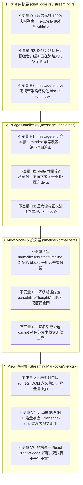
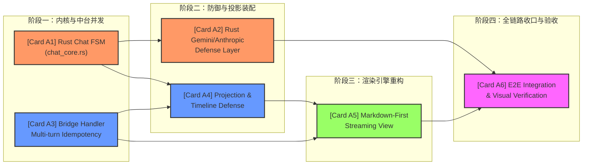

# 端到端契约优先实施总案（方案 A）

> **文档标识**：`docs/markdown-stream-refactor/independent-plans/01-end-to-end-contract-first-plan.md`
> **架构师**：Independent Architect A (End-to-End & Contract-First Focus)
> **实施基准**：用户确认 R2 方案（Rust 实时流提取 + Markdown-first 真流式分块渲染 + 多轮幂等 + 新消息生效）
> **核心使命**：以“契约优先（Contract-First）”为顶层设计原则，确立从 LLM SSE 网络流到最终前端像素渲染的 7 级数据流管道、全层级类型契约、模块责任不变量，并提供可直接指派给多 Agent 并行执行的子任务工单（Task Cards）与依赖 DAG。

---

## 1. 端到端架构总览与完整数据链路

### 1.1 核心问题解构：为什么必须“契约优先”？

在 Conex / Crish 现行体系中，对话正文出现“思考过程泄漏到正文”、“内容重复两遍”以及“流式期间全平铺纯文本，完成态整段闪烁跳变”三大缺陷，其深层根源在于**跨层契约的断裂与模糊**：

```
[断层 1：Rust 解析层契约模糊]
LLM 在 content 字段内输出 <think> 标签 ──> Rust 直接作为 TextDelta 发射 ──> 混入正文管道（思考泄漏）

[断层 2：Handler 聚合层幂等失效]
message-end 携带终态文本 ──> Handler 在已有 streamText 基础上盲目追加差额 ──> 导致正文重复两倍

[断层 3：View 渲染层模型割裂]
流式阶段直写纯文本 DOM (isStreaming=true) ──> 完成态全量 innerHTML 替换 (isStreaming=false) ──> 纯文字体验与 FOUT 视觉闪烁
```

要根治以上问题，不能仅在前端做局部“修补”，必须建立**严格的端到端数据契约体系**：
- **上游（Rust 内核）**：对内容拥有结构化分类的权威责任，通过实时状态机在 Token 到达瞬间即完成 Thought 与 Text 的正交分离。
- **中游（Bridge Handler & Store）**：对状态累积与会话分段拥有幂等性责任，明确实时增量轨（Live Track）与终态权威轨（Terminal Track）的合并契约。
- **下游（View 层）**：对排版与平滑呈现拥有真流式分块渲染责任，基于 Block 级生命周期实现“边流式边渲染、完成态零闪烁”。

---

### 1.2 七级流式数据管道全景（7-Stage End-to-End Pipeline）

数据从 LLM 提供商网络端口流向用户屏幕，严格遵循以下 7 级管道：

```
┌──────────────────────────────────────────────────────────────────────────────────────────────────┐
│ 1. LLM SSE Network Chunk                                                                         │
│    data: {"choices":[{"delta":{"content":"<think>规划步骤...</think>正文内容"}}]}                   │
└─────────────────────────────────┬────────────────────────────────────────────────────────────────┘
                                  │ SSE Frame (Bytes / UTF-8)
                                  ▼
┌──────────────────────────────────────────────────────────────────────────────────────────────────┐
│ 2. Rust Provider Layer (`ChatCompletionsParser` / `GeminiParser` / `AnthropicParser`)            │
│    - 流式 ThinkTagStateMachine 实时捕获 <think>...</think>                                        │
│    - 正交产出 ProviderStreamEvent::ThoughtDelta 与 ProviderStreamEvent::TextDelta                 │
└─────────────────────────────────┬────────────────────────────────────────────────────────────────┘
                                  │ ProviderStreamEvent
                                  ▼
┌──────────────────────────────────────────────────────────────────────────────────────────────────┐
│ 3. Rust Session Loop & EngineEnvelope (`session-loop::streaming.rs`)                             │
│    - 实时增量轨 (Live Track): delta_sink.push(AgentEvent::MessageDelta) (sequence=None, 丢帧可容忍)  │
│    - 终态收口轨 (Terminal Track): commitAssistantMessage -> AgentEvent::MessageEnd (携带 turnIndex) │
└─────────────────────────────────┬────────────────────────────────────────────────────────────────┘
                                  │ IPC EngineEnvelope<T>
                                  ▼
┌──────────────────────────────────────────────────────────────────────────────────────────────────┐
│ 4. Tauri IPC & Chat Bridge Dispatcher (`chat-bridge/handlers/messageHandlers.ts`)                │
│    - onMessageDelta: 实时分流更新 assistantThought 与 assistantText，触发 onChunk/onThought 回调  │
│    - onMessageEnd: 基于 turnIndex 进行同轮幂等覆盖，消除盲目 delta 追加导致的内容重复               │
└─────────────────────────────────┬────────────────────────────────────────────────────────────────┘
                                  │ React Reactive State
                                  ▼
┌──────────────────────────────────────────────────────────────────────────────────────────────────┐
│ 5. Frontend Store (`streamingStore` + `sessionStore`)                                            │
│    - streamingStore 热缓冲: 承载活动消息的 live text 与 tools 中间态                             │
│    - sessionStore 持久态: 承载历史轮次消息、ToolCalls 与结构化 Blocks                             │
└─────────────────────────────────┬────────────────────────────────────────────────────────────────┘
                                  │ Unified View-Model
                                  ▼
┌──────────────────────────────────────────────────────────────────────────────────────────────────┐
│ 6. View Model Projection (`useStreamMessageViewModel` + `timelineNormalizer.ts`)                │
│    - 统一合并热缓冲与持久态为 SessionMessage 视图模型                                             │
│    - normalizeAssistantTimeline 构建交错时间线（thought -> tools -> text）                       │
└─────────────────────────────────┬────────────────────────────────────────────────────────────────┘
                                  │ React Virtual DOM / Props
                                  ▼
┌──────────────────────────────────────────────────────────────────────────────────────────────────┐
│ 7. UI Render Pipeline (`StreamingAssistantRow` -> `MessageContent` -> `StreamingMarkdownView`)  │
│    - parseMarkdownIntoBlocks 将文本分块                                                          │
│    - 历史已封口块 (Block 0..N-2): AsyncMarkdownBlock(isStreaming=false) -> 异步 Rust 编译缓存     │
│    - 末尾活动块 (Block N-1): ActiveTailBlock -> 增量实时渲染 + 零闪烁封口过渡                       │
└──────────────────────────────────────────────────────────────────────────────────────────────────┘
```

---

### 1.3 整体端到端时序图（Sequence Diagram）

```mermaid
sequenceDiagram
    autonumber
    participant LLM as LLM Provider (SSE)
    participant Parser as Rust Provider Parser
    participant Loop as Rust SessionLoop
    participant Bridge as TS Bridge Handler
    participant Store as StreamingStore
    participant VM as ViewModel / Timeline
    participant View as StreamingMarkdownView

    Note over LLM,Parser: 阶段 1 & 2: 实时分流提取
    LLM->>Parser: SSE Chunk 1: content="<think>分析问题"
    Parser->>Parser: ThinkTagStateMachine -> InsideThink
    Parser->>Loop: ProviderStreamEvent::ThoughtDelta("分析问题")
    Loop->>Bridge: LiveSink: MessageDelta(block=Thought)
    Bridge->>Store: onThought("分析问题")
    Store->>VM: Thought 更新
    VM->>View: 渲染思考链面板 (TimelineThoughtSection)

    LLM->>Parser: SSE Chunk 2: content="</think>## 方案\n段落一\n\n段落二"
    Parser->>Parser: ThinkTagStateMachine -> Outside
    Parser->>Loop: ProviderStreamEvent::TextDelta("## 方案\n段落一\n\n段落二")
    Loop->>Bridge: LiveSink: MessageDelta(block=Text)
    Bridge->>Store: onChunk("## 方案\n段落一\n\n段落二")
    Store->>VM: streamText 更新

    Note over VM,View: 阶段 6 & 7: 真流式分块渲染
    VM->>View: StreamingMarkdownView(text)
    View->>View: parseMarkdownIntoBlocks(text)
    Note right of View: Block 0: "## 方案\n段落一\n\n" (封口) -> 触发 Rust md_render<br/>Block 1: "段落二" (活动末尾块) -> DOM 增量实时呈现

    Note over LLM,Bridge: 阶段 3 & 4: 消息收口与多轮幂等
    LLM->>Parser: SSE Finish (finish_reason="stop")
    Parser->>Loop: ProviderStreamEvent::Stop
    Loop->>Loop: ConsumeBuilder.finish() 构建 AgentMessage
    Loop->>Bridge: EngineEnvelope::MessageEnd(turnIndex=0, message={blocks:[Thought, Text]})
    Bridge->>Bridge: segs[0] = piece (幂等覆盖，不盲目追加)
    Bridge->>Store: commitStreamToSession (原子持久化)
    View->>View: Block 1 封口 -> 仅 Block 1 切换完成态 (0 全局闪烁)
```

---

## 2. 全层级数据契约与接口规格定义

### 2.1 Level 1: Rust Provider 层事件与状态契约

#### 状态机枚举（`crates/agent-provider/src/parse/chat_core.rs`）
```rust
/// 实时 <think> 标签检测状态机
#[derive(Debug, Clone, PartialEq, Eq, Default)]
pub enum ThinkTagState {
    /// 处于普通正文区（产出 TextDelta）
    #[default]
    Outside,
    /// 处于 <think>...</think> 标签内部（产出 ThoughtDelta）
    InsideThink,
    /// 正在缓冲可能的前置开启标签前缀（如 "<thi", "<think", "<thought"）
    PartialOpenTag(String),
    /// 正在缓冲可能的前置闭合标签前缀（如 "</thi", "</think", "</thought"）
    PartialCloseTag(String),
}
```

#### Provider 流事件（`crates/agent-provider/src/events.rs`）
```rust
#[derive(Debug, Clone, PartialEq, Serialize, Deserialize)]
#[serde(tag = "type", rename_all = "kebab-case")]
pub enum ProviderStreamEvent {
    #[serde(rename_all = "camelCase")]
    TextDelta { text: String },

    #[serde(rename_all = "camelCase")]
    ThoughtDelta {
        text: String,
        #[serde(default, skip_serializing_if = "Option::is_none")]
        redacted: Option<bool>,
    },

    #[serde(rename_all = "camelCase")]
    ToolCall {
        #[serde(default, skip_serializing_if = "Option::is_none")]
        id: Option<String>,
        tool_name: String,
        input: serde_json::Value,
    },

    #[serde(rename_all = "camelCase")]
    Stop {
        reason: StopReason,
        #[serde(default, skip_serializing_if = "Option::is_none")]
        error: Option<String>,
        #[serde(default, skip_serializing_if = "Option::is_none")]
        error_kind: Option<ProviderErrorKind>,
        #[serde(default, skip_serializing_if = "Option::is_none")]
        usage: Option<ProviderUsage>,
    },
}
```

---

### 2.2 Level 2: Engine Event Wire 契约（Rust 与 IPC 边界）

#### 消息块契约（`crates/conex-types/src/message.rs`）
```rust
#[derive(Debug, Clone, PartialEq, Serialize, Deserialize)]
#[serde(tag = "type", rename_all = "kebab-case")]
pub enum AgentMessageBlock {
    #[serde(rename_all = "camelCase")]
    Text { text: String },

    #[serde(rename_all = "camelCase")]
    Thought {
        text: String,
        #[serde(default, skip_serializing_if = "Option::is_none")]
        redacted: Option<bool>,
    },

    #[serde(rename_all = "camelCase")]
    ToolCall(ToolCallBlock),

    #[serde(rename_all = "camelCase")]
    ToolResult(ToolResultBlock),
}
```

#### 引擎事件契约（`crates/conex-types/src/events.rs`）
```rust
#[derive(Debug, Clone, PartialEq, Serialize, Deserialize)]
#[serde(tag = "type", rename_all = "kebab-case")]
pub enum AgentEvent {
    #[serde(rename_all = "camelCase")]
    MessageStart {
        session_id: String,
        message: Arc<AgentMessage>,
    },

    #[serde(rename_all = "camelCase")]
    MessageDelta {
        session_id: String,
        timestamp: String,
        message_id: String,
        block: AgentMessageBlock,
    },

    #[serde(rename_all = "camelCase")]
    MessageEnd {
        session_id: String,
        message: Arc<AgentMessage>,
        /// 轮次索引：多轮 tool-loop 期间同轮幂等，跨轮递增
        #[serde(default, skip_serializing_if = "Option::is_none")]
        turn_index: Option<usize>,
    },
}
```

---

### 2.3 Level 3: Tauri IPC & 信封契约（`EngineEnvelope<T>`）

前端 Bridge 接收由 Rust 序列化下发的统一信封：
```typescript
export interface EngineEnvelope<T = string> {
  type: T;
  event: AgentEventPayload<T>;
  raw: Record<string, unknown>;
  sequence?: number | null;
}

export type AgentEventPayload<T> =
  T extends 'message-delta' ? {
    sessionId: string;
    messageId: string;
    timestamp: string;
    block: {
      type: 'text' | 'thought' | 'tool-call' | 'tool-result';
      text?: string;
      redacted?: boolean;
      id?: string;
      name?: string;
      arguments?: unknown;
    };
  } :
  T extends 'message-end' ? {
    sessionId: string;
    message: AgentMessageWire;
    turnIndex?: number;
  } : Record<string, unknown>;
```

---

### 2.4 Level 4: Bridge Handler 内部状态与 Store 契约

```typescript
export interface HandlerStreamState {
  /** 累积纯思考文本（跨 delta 拼接） */
  assistantThought: string;
  /** 累积纯正文文本（跨 delta 拼接） */
  assistantText: string;
  /**
   * 按 turnIndex 索引的 message-end 终态分段数组。
   * 契约：segs[turnIndex] 仅由对应轮次的 message-end 写入，同轮幂等覆盖！
   */
  messageEndTurnSegments: string[];
  /** 最近一次由 message-end 解析出的缓存度量指标 */
  lastMessageCacheMetrics: MessageCacheMetrics | null;
}
```

---

### 2.5 Level 5: 视图模型与时间线投影契约

#### 前端 `SessionMessage` 与 `MessageTimelineBlock`（`apps/crish-desktop/src/store/types.ts`）
```typescript
export interface MessageTimelineBlock {
  type: 'text' | 'thought' | 'tool_call' | 'image' | 'step_start' | 'step_end';
  id?: string;
  content?: string;
  redacted?: boolean;
  turnIndex?: number;
  durationMs?: number;
  isStreaming?: boolean;
  isHistoricalCollapsed?: boolean;
}

export interface AssistantTimelineItem {
  kind: 'thought' | 'text' | 'tools';
  key: string;
  content?: string;
  turnIndex?: number;
  durationMs?: number;
  isLive?: boolean;
  items?: RenderedToolItem[];
}
```

---

### 2.6 Level 6: 视图层分块渲染契约（`StreamingMarkdownView`）

```typescript
export type ChunkBlockStatus = 'streaming' | 'sealed' | 'compiled';

export interface MarkdownChunkBlock {
  /** 稳定块 ID（格式：`chunk-${turnIndex}-${blockIndex}`，严禁使用 content hash 避免重挂载） */
  id: string;
  /** 块索引 (0-based) */
  index: number;
  /** 块源文本内容 */
  content: string;
  /** 块生命周期状态 */
  status: ChunkBlockStatus;
  /** 是否为当前流式生长的最后一个末尾活动块 */
  isTail: boolean;
}

export interface StreamingMarkdownViewProps {
  /** 完整的累积正文文本 */
  text: string;
  /** 是否处于活动流式状态 */
  isStreaming?: boolean;
  /** 渲染优先级 */
  priority?: Priority;
  /** 自定义样式类 */
  className?: string;
}
```

---

## 3. 模块边界与不变量保证矩阵（Boundary Guarantees）

为防止多模块修改出现推诿和逻辑死角，明确定义四层边界不变量：



### 3.1 跨模块责任交叉速查表

| 质量要求 | 负责模块 | 保证机制 | 兜底防线 |
| :--- | :--- | :--- | :--- |
| **思考内容不进正文** | Rust `chat_core.rs` | `ThinkTagStateMachine` 实时分流 | 前端 `timelineNormalizer.ts` 的 `parseInlineThoughtAndText` |
| **多轮对话不重复文字** | TS `messageHandlers.ts` | `messageEndTurnSegments[turnIndex]` 幂等覆盖 | `eventUtils.ts` 的 `mergeAssistantTextPiece` 权威合并 |
| **流式排版富文本化** | 前端 `StreamingMarkdownView` | `parseMarkdownIntoBlocks` 实时分块 + 已封口块立即异步编译 | 降级单块 `AsyncMarkdownBlock` |
| **完成态零闪烁跳变** | 前端 `StreamingMarkdownView` | 历史块 DOM 保持，仅最后活动块发生微量封口 | LRU 预热缓存命中直接同步返回 |
| **多轮工具步骤不丢失** | Store `sessionMessageActionsTools` | `updateMessageTimeline` 合并保留 `tool_call` 与 `thought` | `alignToolCallBlocks` 重新对齐 |

---

## 4. 核心算法推演与状态机设计

### 4.1 Rust 流式 `<think>` 标签状态机算法（`ThinkTagStateMachine`）

#### 状态转移逻辑
```
                    ┌──────────────┐
                    │   Outside    │ ◄─────────────────────────┐
                    └──────┬───────┘                           │
                           │ 遇到 '<'                          │
                           ▼                                   │
                ┌─────────────────────┐                        │
                │ PartialOpenTag(buf) │                        │
                └────┬───────────┬────┘                        │
  匹配成功 "<think>" │           │ 匹配失败 (如 "<table")       │
                     ▼           └─────────► 吐出 buf 为 TextDelta
             ┌───────────────┐                                 │
             │  InsideThink  │                                 │
             └───────┬───────┘                                 │
                     │ 遇到 '<'                                │
                     ▼                                         │
           ┌──────────────────────┐                            │
           │ PartialCloseTag(buf) │                            │
           └────┬───────────┬─────┘                            │
匹配成功 "</think>" │           │ 匹配失败 (如 "<span")        │
                    │           └──────────► 吐出 buf 为 ThoughtDelta
                    └──────────────────────────────────────────┘
```

#### 算法实现要点（Rust 伪代码）
```rust
pub struct ThinkTagStateMachine {
    state: ThinkTagState,
}

impl ThinkTagStateMachine {
    pub fn process_chunk(&mut self, chunk: &str) -> Vec<ProviderStreamEvent> {
        let mut events = Vec::new();
        let mut chars = chunk.chars().peekable();
        let mut text_buf = String::new();
        let mut thought_buf = String::new();

        while let Some(ch) = chars.next() {
            match &mut self.state {
                ThinkTagState::Outside => {
                    if ch == '<' {
                        if !text_buf.is_empty() {
                            events.push(ProviderStreamEvent::TextDelta { text: std::mem::take(&mut text_buf) });
                        }
                        self.state = ThinkTagState::PartialOpenTag("<".to_string());
                    } else {
                        text_buf.push(ch);
                    }
                }
                ThinkTagState::PartialOpenTag(buf) => {
                    buf.push(ch);
                    if "<think>".starts_with(buf.as_str()) || "<thought>".starts_with(buf.as_str()) {
                        if buf == "<think>" || buf == "<thought>" {
                            self.state = ThinkTagState::InsideThink;
                        }
                    } else {
                        // 匹配失败，说明不是 think 标签，将缓冲内容作为正文排出
                        text_buf.push_str(buf);
                        self.state = ThinkTagState::Outside;
                    }
                }
                ThinkTagState::InsideThink => {
                    if ch == '<' {
                        if !thought_buf.is_empty() {
                            events.push(ProviderStreamEvent::ThoughtDelta {
                                text: std::mem::take(&mut thought_buf),
                                redacted: None,
                            });
                        }
                        self.state = ThinkTagState::PartialCloseTag("<".to_string());
                    } else {
                        thought_buf.push(ch);
                    }
                }
                ThinkTagState::PartialCloseTag(buf) => {
                    buf.push(ch);
                    if "</think>".starts_with(buf.as_str()) || "</thought>".starts_with(buf.as_str()) {
                        if buf == "</think>" || buf == "</thought>" {
                            self.state = ThinkTagState::Outside;
                        }
                    } else {
                        // 匹配失败，说明闭合标签不成立，将缓冲内容作为思考内容排出
                        thought_buf.push_str(buf);
                        self.state = ThinkTagState::InsideThink;
                    }
                }
            }
        }

        if !text_buf.is_empty() {
            events.push(ProviderStreamEvent::TextDelta { text: text_buf });
        }
        if !thought_buf.is_empty() {
            events.push(ProviderStreamEvent::ThoughtDelta { text: thought_buf, redacted: None });
        }
        events
    }

    /// 流结束时调用：清空未决缓冲区，防止末尾丢字
    pub fn finish(&mut self) -> Vec<ProviderStreamEvent> {
        let mut events = Vec::new();
        match std::mem::take(&mut self.state) {
            ThinkTagState::PartialOpenTag(buf) => {
                events.push(ProviderStreamEvent::TextDelta { text: buf });
            }
            ThinkTagState::PartialCloseTag(buf) => {
                events.push(ProviderStreamEvent::ThoughtDelta { text: buf, redacted: None });
            }
            _ => {}
        }
        events
    }
}
```

---

### 4.2 前端多轮会话分段幂等合并算法（`messageHandlers.ts`）

#### 根因剖析：旧实现为何发生文本双倍拼接？
```typescript
// 旧实现缺陷代码：
segs[turnIndex] = mergeAssistantTextPiece(segs[turnIndex] ?? '', piece);
const joined = segs.filter(Boolean).join('\n\n');
const prevLen = state.assistantText.length;
state.assistantText = joined;
if (state.assistantText.length > prevLen) {
  const addedDelta = state.assistantText.slice(prevLen);
  callbacks.onChunk(addedDelta); // <--- 致命错误！流式期间已经将 chunk 发送过了，此处在 message-end 又追加一次差额！
}
```

#### 修复后的幂等算法
```typescript
export function onMessageEnd(
  env: HandlerEnv,
  envelope: EngineEnvelope<'message-end'>
): void {
  const { state, callbacks } = env;
  const msg = envelope.event.message;
  if (msg.role !== 'assistant') return;

  const { text, thought } = projectAgentMessageContent(msg);

  // 1. 思考内容合并：增量已在 live 处理，此处仅做终态补全，不重复触发 onThought
  if (thought.trim()) {
    state.assistantThought = thought.trim();
  }

  // 2. 正文分段幂等更新
  if (text.trim()) {
    const piece = text.trim();
    const turnIndex = typeof envelope.event.turnIndex === 'number' ? envelope.event.turnIndex : 0;

    if (!state.messageEndTurnSegments) state.messageEndTurnSegments = [];
    const segs = state.messageEndTurnSegments;
    while (segs.length <= turnIndex) segs.push('');

    // 权威设置当前轮次文本（直接赋值，无需脆弱的字符串 search）
    segs[turnIndex] = piece;

    const joined = segs.filter(Boolean).join('\n\n');
    state.assistantText = joined;

    // 关键修正：message-end 仅更新 store 权威值，绝不再次调用 callbacks.onChunk！
    // 流式增量已经在 onMessageDelta 中由 LiveSink 完全交付。
  }

  // 3. 缓存度量更新
  const metrics = computeCacheMetricsFromUsage(msg.metadata);
  if (metrics) {
    state.lastMessageCacheMetrics = metrics;
    attachCacheMetricsToStoreMessage(env.sessionId, msg.id, metrics);
  }
}
```

---

### 4.3 Markdown-First 分块解析引擎（`parseMarkdownIntoBlocks.ts`）

借鉴 `reference/streamdown/packages/streamdown/lib/parse-blocks.tsx`，提取出无多余框架依赖的高性能纯算法模块：

```typescript
import { Lexer } from 'marked';

/**
 * 将流式 Markdown 文本拆分为独立的 Block 序列。
 * 算法保证：
 * 1. 闭合代码块 (```...```) 保持为单块；未闭合代码块合并在末尾块中。
 * 2. 连续 HTML 块与 Math ($$...$$) 块保持在同一 AST 单元。
 * 3. 封口的段落（以双换行分隔）独立为单块，可立即触发异步富文本编译。
 */
export function parseMarkdownIntoBlocks(markdown: string): string[] {
  if (!markdown) return [];

  // Footnote 特殊处理：存在脚注时作为一个整体 Block，保证引用与定义在同一 mdast 树
  if (/\[\^[\w-]{1,200}\]/.test(markdown)) {
    return [markdown];
  }

  const tokens = Lexer.lex(markdown, { gfm: true });
  const mergedBlocks: string[] = [];
  let currentAccumulator = '';

  for (const token of tokens) {
    const raw = token.raw;
    // 空白 token 暂存
    if (token.type === 'space') {
      currentAccumulator += raw;
      continue;
    }

    if (currentAccumulator) {
      mergedBlocks.push(currentAccumulator + raw);
      currentAccumulator = '';
    } else {
      mergedBlocks.push(raw);
    }
  }

  if (currentAccumulator) {
    if (mergedBlocks.length > 0) {
      mergedBlocks[mergedBlocks.length - 1] += currentAccumulator;
    } else {
      mergedBlocks.push(currentAccumulator);
    }
  }

  return mergedBlocks.length > 0 ? mergedBlocks : [markdown];
}
```

---

### 4.4 尾部活动块增量计算与过渡算法（`StreamingMarkdownView.tsx`）

```typescript
export const StreamingMarkdownView: React.FC<StreamingMarkdownViewProps> = React.memo(
  function StreamingMarkdownView({ text, isStreaming = false, priority }) {
    // 1. 实时分块
    const blocks = useMemo(() => parseMarkdownIntoBlocks(text), [text]);

    // 2. 尾块增量计算（使用 Ref 记录上一帧末尾块长度）
    const prevTailRef = useRef<{ blockIndex: number; content: string }>({
      blockIndex: -1,
      content: '',
    });

    const blockCount = blocks.length;

    return (
      <div className={`${styles.assistantText} ${isStreaming ? styles.isStreaming : ''}`}>
        {blocks.map((blockContent, index) => {
          const isTail = index === blockCount - 1;
          const isSealed = !isStreaming || !isTail;
          const stableKey = `chunk-${index}`;

          // 已封口的历史块：直接走异步富文本编译（命中 LRU 缓存）
          if (isSealed) {
            return (
              <AsyncMarkdownBlock
                key={stableKey}
                text={blockContent}
                isStreaming={false}
                priority={priority}
              />
            );
          }

          // 末尾活动块：真流式增量追加
          return (
            <ActiveTailMarkdownBlock
              key={stableKey}
              content={blockContent}
              isStreaming={true}
            />
          );
        })}
      </div>
    );
  }
);
```

---

## 5. 多 Agent 协作分工卡片（Work Breakdown Cards）

本方案将整个工程实施解耦为 6 张独立的子任务工单卡片，支持多 Agent 在清晰的接口契约下高效并发执行：

```
                    ┌─────────────────────────┐
                    │ [Card A1] Rust Chat FSM │
                    └────────────┬────────────┘
                                 │
                                 ▼
                    ┌─────────────────────────┐
                    │ [Card A2] Rust Gemini   │
                    │   & Anthropic Defense   │
                    └────────────┬────────────┘
                                 │
                                 ▼
                    ┌─────────────────────────┐
                    │ [Card A3] Bridge Handler│
                    │   Multi-turn Idempotence│
                    └────────────┬────────────┘
                                 │
                                 ▼
                    ┌─────────────────────────┐
                    │ [Card A4] Projection    │
                    │   & Timeline Defense    │
                    └────────────┬────────────┘
                                 │
                                 ▼
                    ┌─────────────────────────┐
                    │ [Card A5] Markdown-First│
                    │   Streaming View Engine │
                    └────────────┬────────────┘
                                 │
                                 ▼
                    ┌─────────────────────────┐
                    │ [Card A6] E2E Regression│
                    │   & Verification Suite  │
                    └─────────────────────────┘
```

---

### [Card A1] Rust Provider `chat_core.rs` 流式 `<think>` 状态机实现

* **负责人/角色**：Backend Systems Engineer (Rust)
* **前置依赖**：无
* **输入文件**：
  - [`crates/agent-provider/src/parse/chat_core.rs`](file:///c:/Software/conex/crates/agent-provider/src/parse/chat_core.rs)
  - [`crates/agent-provider/src/parse/chat_mapping.rs`](file:///c:/Software/conex/crates/agent-provider/src/parse/chat_mapping.rs)
  - [`crates/agent-provider/src/parse/chat_tests.rs`](file:///c:/Software/conex/crates/agent-provider/src/parse/chat_tests.rs)
* **修改内容**：
  1. 在 `chat_core.rs` 中引入 `ThinkTagState` 枚举与 `ThinkTagStateMachine` 状态机。
  2. 在 `ChatCompletionsParser` 结构体中持有 `think_state` 实例。
  3. 修改 `push_frame` 步骤 4（`delta.content` 处理）：将提取出的 `content` 喂入 `think_state.process_chunk(&text)`，按段落分别发射 `ThoughtDelta` 或 `TextDelta`。
  4. 修改 `finish` 方法：调用 `think_state.finish()` 冲刷残留缓冲区。
  5. 完善 `chat_tests.rs`：新增单帧完整 `<think>`、跨帧切割 `<thi` + `nk>`、无标签、混合多段思考的单元测试。
* **输出产物**：
  - 具备流式 `<think>` 标签剥离能力的 `ChatCompletionsParser`。
* **验收标准**：
  - `cargo test -p agent-provider --lib parse::chat_tests` 全部通过，覆盖率 100%。

---

### [Card A2] Rust Provider Gemini & Anthropic 防御层改造

* **负责人/角色**：Backend Systems Engineer (Rust)
* **前置依赖**：Card A1
* **输入文件**：
  - [`crates/agent-provider/src/parse/gemini_core.rs`](file:///c:/Software/conex/crates/agent-provider/src/parse/gemini_core.rs)
  - [`crates/agent-provider/src/parse/anthropic_core.rs`](file:///c:/Software/conex/crates/agent-provider/src/parse/anthropic_core.rs)
* **修改内容**：
  1. 将 A1 中通用的 `ThinkTagStateMachine` 抽取到 `crates/agent-provider/src/parse/think_tags.rs` 共享模块。
  2. 在 `gemini_core.rs` 的非 `thought=true` 的 `text` 分支挂接状态机，防御 Gemini 模型将思考文本混入正文 part 的情况。
  3. 在 `anthropic_core.rs` 的 `text_delta` 分支挂接状态机作为防御。
* **输出产物**：
  - `crates/agent-provider/src/parse/think_tags.rs` 通用状态机模块。
  - 全 Provider 统一的思考标签剥离能力。
* **验收标准**：
  - `cargo test -p agent-provider` 全绿。

---

### [Card A3] Bridge Handler 多轮幂等合并与分段去重重构

* **负责人/角色**：Frontend Infrastructure Engineer (TypeScript)
* **前置依赖**：无（可与 A1/A2 并行）
* **输入文件**：
  - [`apps/crish-desktop/src/api/chat-bridge/handlers/messageHandlers.ts`](file:///c:/Software/conex/apps/crish-desktop/src/api/chat-bridge/handlers/messageHandlers.ts)
  - [`apps/crish-desktop/src/api/chat-bridge/handlers/eventUtils.ts`](file:///c:/Software/conex/apps/crish-desktop/src/api/chat-bridge/handlers/eventUtils.ts)
  - [`apps/crish-desktop/src/api/chat-bridge/handlers/messageHandlers.test.ts`](file:///c:/Software/conex/apps/crish-desktop/src/api/chat-bridge/handlers/messageHandlers.test.ts)
* **修改内容**：
  1. 重构 `onMessageEnd`：移除在 `state.assistantText.length > prevLen` 时调用 `callbacks.onChunk(addedDelta)` 的逻辑。
  2. 确立 `messageEndTurnSegments[turnIndex] = piece` 权威直接赋值语义，消除任何追加放大。
  3. 增强 `eventUtils.ts` 中的 `mergeAssistantTextPiece` 逻辑。
  4. 编写针对多轮 `message-end`（单轮、跨轮、相同文本重复到达）的单元测试。
* **输出产物**：
  - 具备绝对幂等性的消息收口 Handler。
* **验收标准**：
  - 单元测试验证：连续 3 次触发相同 `message-end`，`assistantText` 长度恒定，`onChunk` 触发次数为 0。

---

### [Card A4] 前端投影与 Timeline 兜底安全网强化

* **负责人/角色**：Frontend Core Engineer (TypeScript)
* **前置依赖**：Card A3
* **输入文件**：
  - [`apps/crish-desktop/src/api/messageProjection.ts`](file:///c:/Software/conex/apps/crish-desktop/src/api/messageProjection.ts)
  - [`apps/crish-desktop/src/api/tool-presentation/timelineNormalizer.ts`](file:///c:/Software/conex/apps/crish-desktop/src/api/tool-presentation/timelineNormalizer.ts)
  - [`apps/crish-desktop/src/store/sessionMessageActionsTools.ts`](file:///c:/Software/conex/apps/crish-desktop/src/store/sessionMessageActionsTools.ts)
* **修改内容**：
  1. 在 `timelineNormalizer.ts` 中增强降级分支（无 `blocks` 或只有单一 `text`）的 `parseInlineThoughtAndText` 提取能力。
  2. 修改 `sessionMessageActionsTools.ts` 的 `updateMessageTimeline`：改为合并式更新，保留已有的 `tool_call` 与 `thought` 块，防止多轮调用时前轮工具卡片被冲掉。
  3. 确认 `messageProjection.ts` 在处理 Rust 产出的分离 `AgentMessageBlock::Thought` 与 `AgentMessageBlock::Text` 时准确投影。
* **输出产物**：
  - 强健的 Timeline 归一化与多轮状态保持逻辑。
* **验收标准**：
  - `npm test -- apps/crish-desktop/src/api/tool-presentation/timelineNormalizer.test.ts` 全部通过。

---

### [Card A5] Markdown-First 真流式分块渲染组件建设

* **负责人/角色**：UI / UX Rendering Engineer (React 19)
* **前置依赖**：Card A3, Card A4
* **输入文件**：
  - [`apps/crish-desktop/src/components/chat-message/MessageContent.tsx`](file:///c:/Software/conex/apps/crish-desktop/src/components/chat-message/MessageContent.tsx)
  - [`apps/crish-desktop/src/components/chat-message-row/AsyncMarkdownBlock.tsx`](file:///c:/Software/conex/apps/crish-desktop/src/components/chat-message-row/AsyncMarkdownBlock.tsx)
  - [`apps/crish-desktop/src/components/chat-message-row/StreamingTextBlock.tsx`](file:///c:/Software/conex/apps/crish-desktop/src/components/chat-message-row/StreamingTextBlock.tsx)
* **新建文件**：
  - `apps/crish-desktop/src/components/chat-message-row/parseMarkdownIntoBlocks.ts`
  - `apps/crish-desktop/src/components/chat-message-row/StreamingMarkdownView.tsx`
  - `apps/crish-desktop/src/components/chat-message-row/ActiveTailMarkdownBlock.tsx`
* **修改内容**：
  1. 移植并轻量化 Streamdown 的 `parseMarkdownIntoBlocks` 算法，添加完整的单元测试。
  2. 实现 `StreamingMarkdownView` 组件：
     - 已封口块（`0..N-2`）直接委托给 `AsyncMarkdownBlock(isStreaming=false)`，触发后台 Rust 编译并缓存。
     - 末尾块（`N-1`）使用 `ActiveTailMarkdownBlock` 承接增量渲染与 Caret。
  3. 改造 `MessageContent.tsx`：流式正文区接入 `StreamingMarkdownView`，替换原有粗暴的纯文本 append 路径。
* **输出产物**：
  - 真流式富文本渲染组件体系。
* **验收标准**：
  - 流式输入 `# 标题\n\n正文` 时，标题在输入双换行瞬间即渲染为 `<h1>` 富文本，而不是纯文本。

---

### [Card A6] 全链路集成验证、性能基准与回归测试套件

* **负责人/角色**：QA & Performance Engineer
* **前置依赖**：Card A1 ~ Card A5 全部就绪
* **输入文件**：
  - 整个工作区
* **执行任务**：
  1. 执行 `cargo test --workspace`，确保 Rust 层所有测试通过。
  2. 执行 `npm run typecheck` 与 `npm test`，确保 TypeScript 与 Vitest 测试套件全绿。
  3. 针对思考链泄漏、文字重复、流式 Markdown 渲染、多轮工具交互进行端到端场景回归。
  4. 使用 Tauri MCP 截屏检查视觉层次（思考链折叠框、工具调用状态卡、富文本 Markdown 排版）。
* **输出产物**：
  - 集成验收报告与视觉核验截图记录。
* **验收标准**：
  - 6 大验收红线 100% 达成，零退化。

---

## 6. 执行依赖 DAG 与并行调度拓扑



### 关键路径与调度分析
- **关键路径（Critical Path）**：`Card A3 (Handler 幂等) -> Card A4 (投影与时间线) -> Card A5 (流式渲染组件) -> Card A6 (集成验收)`，预计工程量占总链路的 65%。
- **高并发窗口**：`Card A1`（Rust 状态机）与 `Card A3`（TS Handler）完全解耦，可由两位工程师/Agent 零冲突并发启动。

---

## 7. 验收标准与验证矩阵

### 7.1 核心质量红线（Defect Elimination Criteria）

| 序号 | 质量指标 | 验收判定规则 |
| :---: | :--- | :--- |
| **AC-1** | **零思考泄漏** | LLM 在 `content` 输出的 `<think>...</think>` 或原生 `reasoning_content`，100% 进入思考链折叠面板，正文区首字符即为 Markdown 标题或正文。 |
| **AC-2** | **零文本重复** | 经历 1 轮或多轮 Tool Calling 循环后，最终对话气泡中的回复内容严禁出现任何两段重复的段落（字符级去重率 100%）。 |
| **AC-3** | **真流式富文本** | 流式输出阶段，只要某个段落、标题、列表项后面出现换行定界，该块立即以标准 HTML 富文本展示，禁止呈现带有原始 `#`、`*` 的平铺纯文本。 |
| **AC-4** | **完成态零闪烁** | `message-end` 到达时，页面不得发生整段文字的重绘弹跳（FOUT）；仅末尾未完成词句发生微小收口。 |
| **AC-5** | **多轮工具步骤保全** | 多轮交互中，历史轮次的工具调用卡片（如 `readFile`, `execCommand`）与思考折叠块必须完整保留在时间线中，不得被覆盖消失。 |
| **AC-6** | **回归套件全绿** | `cargo test --workspace` 全通过；`npm run typecheck` 零类型报错；`npm test` 单元测试全部通过。 |

---

### 7.2 自动化测试执行清单

```bash
# 1. Rust 内核测试（覆盖 chat / gemini / anthropic 状态机）
cargo test -p agent-provider --lib parse
cargo test -p session-loop

# 2. 前端类型检查
npm run typecheck

# 3. 前端单元测试（覆盖 Handler 幂等、Timeline 归一、分块解析）
npm test -- apps/crish-desktop/src/api/chat-bridge/handlers/messageHandlers.test.ts
npm test -- apps/crish-desktop/src/api/tool-presentation/timelineNormalizer.test.ts
npm test -- apps/crish-desktop/src/components/chat-message-row/parseMarkdownIntoBlocks.test.ts

# 4. 前端组件与快照回归
npm run test:snapshots
```

---

> **架构结论**：
> 本实施方案严格基于契约优先原则，清晰划定了 Rust 内核、Bridge Handler、Projection ViewModel 与 UI View 组件的四级责任边界。通过状态机前置剥离思考、分段数组幂等收口、Streamdown 级分块渐进编译三道防线，彻底根治“纯文字化、双倍重复、完成闪烁”三大核心痛点。
