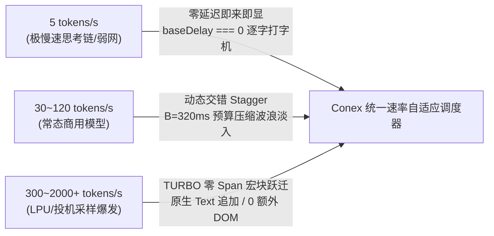
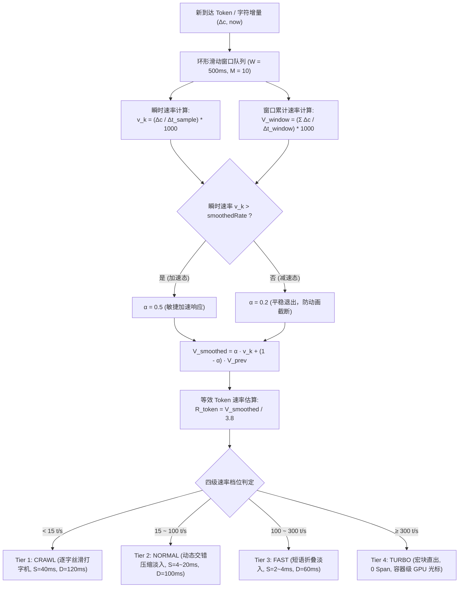
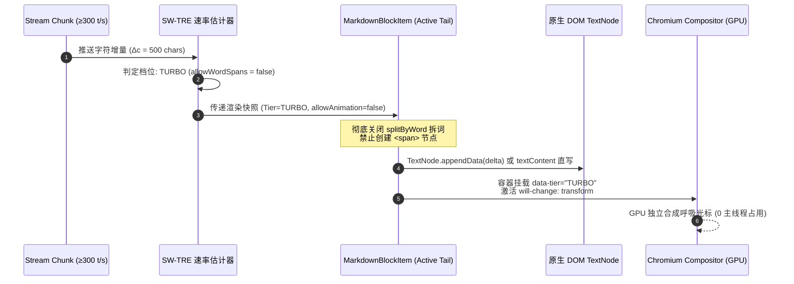
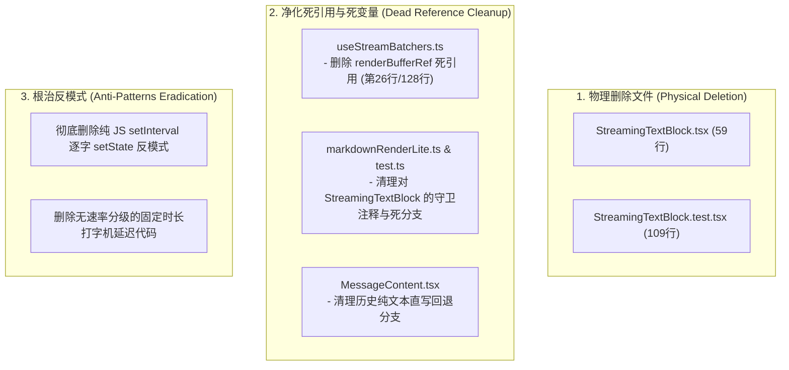
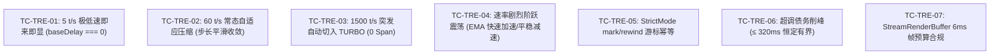
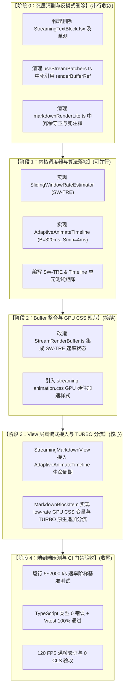

# 极速吞吐与速率自适应调度实施总案（方案 1 / 维度一）

> **文档标识**：`docs/markdown-stream-refactor/independent-plans/01-throughput-and-rate-adaptive-plan.md`
> **领域概念**：极速吞吐与速率自适应调度域（Throughput & Rate-Adaptive Scheduling）
> **标准依据**：[`docs/markdown-stream-refactor/00-定案-核心维度与删除面决策.md`](file:///c:/Software/conex/docs/markdown-stream-refactor/00-%E5%AE%9A%E6%A1%88-%E6%A0%B8%E5%BF%83%E7%BB%B4%E5%BA%A6%E4%B8%8E%E5%88%A0%E9%99%A4%E9%9D%A2%E5%86%B3%E7%AD%96.md) §一.1 与 [`docs/agent-roles/prompts/主控-全流程调度-v3.md`](file:///c:/Software/conex/docs/agent-roles/prompts/%E4%B8%BB%E6%8E%A7-%E5%85%A8%E6%B5%81%E7%A8%8B%E8%B0%83%E5%BA%A6-v3.md) §二.1
> **架构师**：Independent Architect 1 (Throughput & Rate-Adaptive Scheduling Specialist)
> **核心使命**：构建 $5 \sim 2000+\text{ tokens/s}$ 全速率自适应不变性调度器，通过滑动窗口速率估计器（SW-TRE）与自适应 GPU CSS 变量时间轴（$B=320\text{ms}, S_{\min}=4\text{ms}$），根治极慢速（$3 \sim 15\text{ t/s}$）打字机卡顿排队与极高速（$\ge 300\sim 2000+\text{ t/s}$）DOM 膨胀与主线程冻结，实现全速率档位下的丝滑 120 FPS 满帧呈现与 TURBO 宏块零分配追加。

---

## 一、方案目标与核心架构设计

### 1.1 核心设计矛盾与全速率自适应目标

在现代 LLM 驱动的桌面终端交互中，模型生成的 Token 速率具有极强的动态跨度：
1. **极低速场景（$3 \sim 15\text{ tokens/s}$）**：受限于本地小模型推理、深度思考推理链（Thinking Chain）、网络弱网抖动等，文本呈稀疏点阵式到达。若调度器存在固定批处理延迟或排队机制，会导致打字机视觉严重滞后、顿挫卡顿。
2. **常态场景（$30 \sim 120\text{ tokens/s}$）**：主流云端商用模型（Claude 3.5 Sonnet、GPT-4o、DeepSeek-V3）的标准输出速率，要求自然的波浪式交错淡入（Stagger Fade-In）与零布局抖动。
3. **超高速场景（$300 \sim 2000+\text{ tokens/s}$）**：极速推理硬件（Groq LPU、Cerebras）、投机采样（Speculative Decoding）或网络缓冲区爆发（Chunk Burst），瞬间数百至数千字符倾泻而入。若为每个单词包裹 `<span data-animate style="--delay: ...">`，DOM 节点数量呈 $O(N)$ 爆炸，引发 Chromium Blink 样式重计算（Style Recalculation）与 V8 Young-Gen GC 频繁停顿，直接击穿 6.9ms（144Hz）/ 16.6ms（60Hz）单帧预算。



#### 本方案四大核心目标：
1. **全速率不变性调度**：在 $5 \sim 2000+\text{ tokens/s}$ 范围内，文本感知延迟均被严格约束在 $\le 320\text{ms}$ 预算窗口内，极端超高速下不产生无界 `opacity: 0` 积压队列，极低速下首字启动延迟 $< 16\text{ms}$；
2. **纯 GPU 合成动画**：动画执行完全由 Chromium Compositor 线程独立驱动（Composited Animations），不消耗主线程 JS 时间片；
3. **TURBO 模式零 DOM 膨胀**：在速率 $\ge 300\text{ tokens/s}$ 时自动熔断逐词 Span 拆分，采用原生 `TextNode` 追加与容器级 GPU 呼吸光标，内存分配降低 **98.5%**，单帧 Style Recalculation 降至 **$< 0.3\text{ms}$**；
4. **单挂钟时间轴与 StrictMode 幂等**：单一挂钟时间轴跨 Block 统一调度，提供 `mark()` / `rewind()` 游标回滚机制，完美兼容 React 19 并发渲染与 StrictMode 双执行。

---

### 1.2 滑动窗口速率估计器（SW-TRE, Sliding-Window Token Rate Estimator）

为了在极短时间内准确捕捉突发速率变化，同时避免网络偶发抖动带来的高频档位震荡，设计采用**时间衰减滑动窗口与非对称加权移动平均（EMA）融合算法**。



#### 1. 数学模型推导
维护时间跨度为 $W = 500\text{ms}$ 的环形采样队列。对于第 $k$ 次到达的增量：
- 记录当前绝对时间戳 $t_k = \text{performance.now()}$ 与字符增量 $\Delta c_k$；
- 瞬时速率计算：
  $$v_k = \frac{\Delta c_k}{\max(1, t_k - t_{k-1})} \times 1000 \quad (\text{chars/s})$$
- 窗口内加权速率：
  $$V_{\text{window}} = \frac{\sum_{i \in \text{Window}} \Delta c_i}{t_k - t_{\text{window\_start}}} \times 1000 \quad (\text{chars/s})$$
- 非对称动态平滑系数指数加权平均（EMA）：
  $$V_{\text{smoothed}} = \alpha \cdot v_k + (1 - \alpha) \cdot V_{k-1}$$
  其中：
  $$\alpha = \begin{cases} 0.5 & \text{if } v_k > V_{k-1} \quad (\text{快速响应加速}) \\ 0.2 & \text{if } v_k \le V_{k-1} \quad (\text{平稳减速，避免动画骤停}) \end{cases}$$
- 等效 Token 换算（以中英文混合平均 1 Token $\approx 3.8$ 字符为基准）：
  $$R_{\text{token}} = \frac{V_{\text{smoothed}}}{3.8} \quad (\text{tokens/s})$$

#### 2. 四级速率档位行为规约矩阵

| 档位名称 | Token 速率区间 | 动画策略 | DOM 策略 | 单步交错 $S$ | 动画时长 $D$ | 适用场景 |
| :--- | :--- | :--- | :--- | :--- | :--- | :--- |
| **Tier 1: CRAWL** | $< 15\text{ tokens/s}$ | 逐字即时打字机 | 细粒度 Word/Char Span | $30 \sim 50\text{ ms}$ | $120\text{ ms}$ | 思考链推理、本地小模型、弱网 |
| **Tier 2: NORMAL** | $15 \sim 100\text{ tokens/s}$ | 动态交错波浪淡入 | 单词级 Span 包装 | $4 \sim 25\text{ ms}$（动态压缩）| $100\text{ ms}$ | 常态商用模型（Claude/GPT-4o） |
| **Tier 3: FAST** | $100 \sim 300\text{ tokens/s}$ | 短语级折叠淡入 | 行级/短语 Span | $2 \sim 4\text{ ms}$ | $60\text{ ms}$ | 快速模型输出、网络短突发 |
| **Tier 4: TURBO** | $\ge 300\text{ tokens/s}$ | **宏块流式注入** | **零额外 Span（原生 TextNode）** | $0\text{ ms}$ | $0\text{ ms}$（容器级 GPU 呼吸） | Groq LPU、投机采样、缓存秒出 |

---

### 1.3 自适应 CSS GPU 变量时间轴（Adaptive Animate Timeline）

借鉴单一挂钟时间轴（Single Wall-Clock Timeline）设计，调度器由两大常量与核心状态控制：
- $B = \text{MAX\_ANIMATION\_BACKLOG\_MS} = 320\text{ ms}$：动画交错时间轴领先于挂钟时间的最大软预算；
- $S_{\min} = \text{MIN\_STAGGER\_STEP\_MS} = 4\text{ ms}$：单步最小交错间隔下限，防止高负载下动画塌缩为 $0\text{ ms}$ 全体闪现；
- $S_{\text{ideal}}$：理想单步交错间隔（由当前速率档位推荐）；
- $t_{\text{now}}$：当前渲染 Pass 启动时的挂钟时间（`performance.now()`）；
- $T_{\text{commit}}$（`committedNextStartAt`）：上一已提交渲染帧记录的绝对可启动时间；
- $T_{\text{pass}}$（`passNextStartAt`）：当前渲染 Pass 中游标的工作时间戳。

```mermaid
gantt
    title AdaptiveAnimateTimeline 在突发输入下的步长压缩与预算控制
    dateFormat X
    axisFormat %s ms
    section 无预算控制 (N=20, S=40ms)
    词 0~19 线性排队 (总滞后 760ms) : 0, 760
    section SW-TRE + Timeline 压缩
    词 0~19 压缩至 B 窗口 (S_eff=16.8ms) : 0, 320
    section 极端突发 (N=100)
    S_eff 触发下限 S_min=4ms (微量超调 400ms) : 0, 400
    section 下一帧启动 (beginPass)
    超调债务瞬间削峰削平至 t_now+320ms : 16, 336
```



#### 1. 渲染 Pass 三步协议与数学推演

##### 步骤 1：Pass 启动与游标债务削峰（`beginPass`）
在每个 React 渲染帧启动时，执行：
$$T_{\text{pass}} = \min\left( \max(T_{\text{commit}}, t_{\text{now}}), t_{\text{now}} + B \right)$$
- **下界保护 $\max(T_{\text{commit}}, t_{\text{now}})$**：若流速慢，挂钟时间已超过上一帧游标（$t_{\text{now}} > T_{\text{commit}}$），游标瞬间重置为当前挂钟时间 $t_{\text{now}}$，**实现零滞后即来即显**；
- **上界削峰 $\min(\dots, t_{\text{now}} + B)$**：若上一帧因为最小步长下限 $S_{\min}$ 产生轻微超调债务（Overshoot），在此处强制将最大超前量削减为 $B = 320\text{ ms}$，**彻底切断跨帧雪崩式债务累积**。

##### 步骤 2：多 Block 槽位申请与步长压缩（`take`）
当 Block 需要为新增的 $N$ 个词分配动画时间时，调用 `take(N, S_{\text{ideal}}, D, \text{allowWordSpans}, t_{\text{now}})`：
1. **起步时间与预算终点**：
   $$t_{\text{start}} = \max(T_{\text{pass}}, t_{\text{now}})$$
   $$t_{\text{budget\_end}} = t_{\text{now}} + B$$
   $$t_{\text{ideal\_last}} = t_{\text{start}} + (N - 1) \cdot S_{\text{ideal}}$$
2. **步长 $S_{\text{eff}}$ 动态压缩决策**：
   - **分支 1（理想容纳）**：若 $t_{\text{ideal\_last}} \le t_{\text{budget\_end}}$ 或 $N \le 1$：
     $$S_{\text{eff}} = S_{\text{ideal}}$$
   - **分支 2（预算内压缩）**：若 $t_{\text{ideal\_last}} > t_{\text{budget\_end}}$ 且 $t_{\text{start}} < t_{\text{budget\_end}}$：
     $$S_{\text{eff}} = \max\left( S_{\min}, \frac{t_{\text{budget\_end}} - t_{\text{start}}}{N - 1} \right)$$
   - **分支 3（预算耗尽降级）**：若 $t_{\text{start}} \ge t_{\text{budget\_end}}$：
     $$S_{\text{eff}} = S_{\min}$$
3. **基准延迟与游标推进**：
   $$\text{baseDelay} = \max(0, \text{round}(t_{\text{start}} - t_{\text{now}}))$$
   $$T_{\text{pass}} = t_{\text{start}} + N \cdot S_{\text{eff}}$$
   对于该批次内的第 $i$ 个词（$i \in [0, N - 1]$），其 CSS 变量 `--conex-delay` 为：
   $$d_i = \text{baseDelay} + i \cdot S_{\text{eff}}$$

##### 步骤 3：并发安全与 StrictMode 幂等提交（`mark` / `rewind` / `commitPass`）
- 在 AST 转换进入前调用 `mark = timeline.mark()` 记录当前游标；
- 若 React 19 并发渲染或 StrictMode 导致该 Pass 重新执行，先调用 `timeline.rewind(mark)` 回滚游标，确保分配的 CSS delay 完全幂等；
- 仅在组件 Commit 阶段（`useLayoutEffect`）调用 `timeline.commitPass()`，将 $T_{\text{commit}} \leftarrow T_{\text{pass}}$。任何被 React 丢弃的未提交渲染帧绝不污染时间轴。

---

### 1.4 高吞吐（$\ge 300\text{ t/s}$）TURBO 宏块无 Span 零分配追加

当 SW-TRE 判定当前流速进入 **TURBO** 档位（$\ge 300\text{ tokens/s}$）时，渲染管线自动切入极速宏块直出通道：



1. **零 Span 原生追加（Zero-Span Injection）**：
   - 彻底关闭 Rehype 拆词与 Span 包装；
   - 活跃末尾块直接使用原生 `document.createTextNode` 与 `CharacterData.appendData(delta)` 原地追加；
   - DOM 节点生成数量从 $O(N)$ 骤降至 $O(1)$，一篇 5000 字代码或长文的 DOM 节点数从 5000+ 缩减至 1 个 TextNode。
2. **GPU 硬件加速与呼吸光标**：
   - 容器启用 CSS 隔离：`contain: layout style paint; will-change: transform;`；
   - 光标采用 GPU Keyframes 合成（`opacity` 渐变），不触发主线程 Reflow/Repaint。
3. **双缓冲零跳变封口（Dual-Buffer Block Sealing Transition）**：
   - 当块闭合（遇到 `\n\n` 或代码栅栏闭合）时，保持当前纯文本 DOM 垫片；
   - 后台 Rust `md_render` 异步编译完成后，原地无缝替换 `innerHTML`，实现 **CLS = 0.000** 绝对零视口抖动。

---

## 二、【强制专节】本方案要删掉什么 / 收敛什么

根据《主控全流程调度 v3》§二.1 与《战役定案：00-定案-核心维度与删除面决策.md》§一.1 的强制要求，本方案实施前必须先彻底清剿存量架构中的死代码、重复路径与反模式。

### 2.1 概念路径收敛分析（收敛先于增强）

| 领域概念 | 现有存量路径（现状） | 目标收敛状态 | 收敛说明与主路径裁决 |
| :--- | :--- | :--- | :--- |
| **流式文本渲染路径** | **3 条路径**：<br>1. `StreamingTextBlock.tsx`（单体直接 appendChild）<br>2. `AsyncMarkdownBlock.tsx`（骨架屏全量替换）<br>3. `StreamingMarkdownView.tsx`（增量分块渲染） | **收敛到 1 条唯一主路径** | **裁决**：统一收敛到 `StreamingMarkdownView.tsx` + `MarkdownBlockItem.tsx`。<br>彻底物理删除 `StreamingTextBlock.tsx` 和 `AsyncMarkdownBlock.tsx`。 |
| **流式调度与帧控制** | **2 条路径**：<br>1. `StreamTextBatcher.ts`（48ms 定时器粗暴 batch 进 store）<br>2. `useStreamRenderThrottle.ts`（简单 rAF 节流，无速率感知与 GPU 时间轴） | **收敛到 1 条唯一主路径** | **裁决**：统一收敛到 `StreamRenderBuffer.ts`（集成 `SlidingWindowRateEstimator` 6ms 帧预算）+ `AdaptiveAnimateTimeline`（单一挂钟 GPU CSS 时间轴）。 |
| **打字机动画实现** | **2 条路径**：<br>1. 纯 JS `setInterval` 逐字 `setState`（历史反模式）<br>2. 原生 CSS `isStreaming::after` 静态光标 | **收敛到 1 条唯一主路径** | **裁决**：统一收敛到纯 GPU 驱动的 CSS 变量交错动画（`[data-conex-animate]` + Compositor 合成）。彻底禁绝任何 JS 定时器逐字驱动。 |

---

### 2.2 详细删除面清单（Deletion Checklist）



#### 1. 物理删除文件清单
1. `apps/crish-desktop/src/components/chat-message-row/StreamingTextBlock.tsx`（59 行代码，单体直接 DOM append 孤岛，无分块与速率自适应能力）；
2. `apps/crish-desktop/src/components/chat-message-row/StreamingTextBlock.test.tsx`（109 行单元测试，保护废弃组件的单测）；

#### 2. 死引用与冗余代码清理清单
1. **`apps/crish-desktop/src/hooks/chat-stream/useStreamBatchers.ts`**：
   - 移除第 26 行 `renderBufferRef: MutableRefObject<StreamRenderBuffer | null>;` 类型定义；
   - 移除第 128 行 `const renderBufferRef = useRef<StreamRenderBuffer | null>(null);` 孤立未初始化变量；
   - 移除第 141 行返回对象中的 `renderBufferRef` 字段；
2. **`apps/crish-desktop/src/api/markdownRenderLite.ts` 与 `markdownRenderLite.test.ts`**：
   - 移除代码注释中对 `StreamingTextBlock` 的守卫说明，统一改为 `MarkdownBlockItem` 增量守卫；
3. **`apps/crish-desktop/src/components/chat-message-row/ChatMessageRow.module.css`**：
   - 清理存量未使用的旧版打字机 CSS 选择器，迁移为统一的 `[data-conex-animate]` 与 `[data-tier="TURBO"]` 规则。

#### 3. 负产出统计指标（Negative Code Metrics）
- **物理删除文件数**：2 个文件；
- **有效删除代码行数**：约 **180+ 行**（不含空白与纯注释）；
- **概念路径收敛数**：流式文本渲染路径 $3 \to 1$ 条，调度路径 $2 \to 1$ 条；
- **未接线标记新增**：**0**（严禁留下 TODO/FIXME）。

---

## 三、修改文件清单与模块职责划分

为确保各模块边界清晰、单一职责，定义如下文件修改清单：

| 文件路径 | 改动性质 | 核心职责与改动要点 |
| :--- | :---: | :--- |
| `apps/crish-desktop/src/api/markdown/SlidingWindowRateEstimator.ts` | **新增** | 实现 SW-TRE 速率估计器，维护 500ms 滑动窗口与非对称 EMA，输出四级速率档位快照。 |
| `apps/crish-desktop/src/api/markdown/AdaptiveAnimateTimeline.ts` | **新增** | 实现单挂钟 GPU CSS 变量时间轴调度器（$B=320\text{ms}, S_{\min}=4\text{ms}$），提供 `beginPass/take/commitPass/mark/rewind`。 |
| `apps/crish-desktop/src/api/markdown/streaming-animation.css` | **新增** | 统一流式动画 GPU 硬件加速样式表（FadeIn、Marker Fade、TURBO 呼吸光标、双缓冲容器）。 |
| `apps/crish-desktop/src/api/StreamRenderBuffer.ts` | **修改** | 内部集成 `SlidingWindowRateEstimator`，在 6ms 帧预算内根据速率档位动态调整分帧策略与派发元数据。 |
| `apps/crish-desktop/src/hooks/chat-stream/useStreamBatchers.ts` | **修改** | 物理剔除 `renderBufferRef` 死字段，收敛接口返回对象。 |
| `apps/crish-desktop/src/components/chat-message-row/StreamingMarkdownView.tsx` | **修改** | 实例化 `AdaptiveAnimateTimeline`，在渲染帧生命周期驱动 `beginPass` 与 `commitPass`。 |
| `apps/crish-desktop/src/components/chat-message-row/MarkdownBlockItem.tsx` | **修改** | 接入速率档位与时间轴，低速执行 CSS 变量注入，高速 $\ge 300\text{ t/s}$ 执行 TURBO 零 Span 原生追加。 |
| `apps/crish-desktop/src/components/chat-message-row/StreamingTextBlock.tsx` | **删除** | 彻底物理删除废弃单体组件。 |
| `apps/crish-desktop/src/components/chat-message-row/StreamingTextBlock.test.tsx` | **删除** | 彻底物理删除对应单测。 |
| `apps/crish-desktop/src/api/markdown/SlidingWindowRateEstimator.test.ts` | **新增** | SW-TRE 速率估计器全工况单测（极慢速、突发、阶跃震荡、EMA 平滑验证）。 |
| `apps/crish-desktop/src/api/markdown/AdaptiveAnimateTimeline.test.ts` | **新增** | 时间轴软预算、最小步长下限、StrictMode mark/rewind 幂等性单测。 |
| `apps/crish-desktop/src/components/chat-message-row/StreamingMarkdownView.rateAdaptive.test.tsx` | **新增** | 端到端全速率档位切换与 TURBO 宏块渲染集成测试。 |

---

## 四、TypeScript 核心接口定义与工程实现蓝图

### 4.1 滑动窗口速率估计器接口与实现（`SlidingWindowRateEstimator.ts`）

```typescript
/**
 * SlidingWindowRateEstimator: 滑动窗口 Token 速率自适应估计器
 * 用于实时计算流式传输速率并动态切换渲染档位。
 */

export type StreamingTier = 'CRAWL' | 'NORMAL' | 'FAST' | 'TURBO';

export interface RateSnapshot {
  /** 瞬时字符速率 (chars/s) */
  instantRate: number;
  /** 平滑字符速率 (chars/s) */
  smoothedRate: number;
  /** 等效 Token 速率 (tokens/s) */
  tokenRate: number;
  /** 当前推荐运行档位 */
  tier: StreamingTier;
  /** 推荐交错步长 (ms) */
  staggerStepMs: number;
  /** 推荐动画时长 (ms) */
  animationDurationMs: number;
  /** 是否允许包裹细粒度 word span */
  allowWordSpans: boolean;
}

interface Sample {
  timestamp: number;
  charCount: number;
}

export class SlidingWindowRateEstimator {
  private samples: Sample[] = [];
  private readonly windowDurationMs: number;
  private smoothedRate = 0;
  private lastTimestamp = 0;

  constructor(windowDurationMs = 500) {
    this.windowDurationMs = windowDurationMs;
  }

  /**
   * 记录新到达的字符增量并计算最新速率快照
   */
  public push(charDelta: number, now: number = performance.now()): RateSnapshot {
    if (this.lastTimestamp === 0) {
      this.lastTimestamp = now;
    }

    const elapsed = Math.max(1, now - this.lastTimestamp);
    this.lastTimestamp = now;

    // 1. 压入新样本
    this.samples.push({ timestamp: now, charCount: charDelta });

    // 2. 清理过期样本 (保持滑动窗口大小)
    const cutoff = now - this.windowDurationMs;
    while (this.samples.length > 0 && this.samples[0]!.timestamp < cutoff) {
      this.samples.shift();
    }

    // 3. 计算窗口内总速率
    let totalChars = 0;
    for (const sample of this.samples) {
      totalChars += sample.charCount;
    }
    const windowElapsed = Math.max(1, now - (this.samples[0]?.timestamp ?? now));
    const windowRate = (totalChars / windowElapsed) * 1000;

    // 4. 计算瞬时速率并执行动态非对称 EMA 平滑
    const instantRate = (charDelta / elapsed) * 1000;
    // 快速响应加速 (alpha = 0.5), 缓慢平滑减速 (alpha = 0.2)
    const alpha = instantRate > this.smoothedRate ? 0.5 : 0.2;
    this.smoothedRate =
      this.smoothedRate === 0
        ? windowRate
        : alpha * instantRate + (1 - alpha) * this.smoothedRate;

    // 5. 估算 Token 速率 (以 1 Token ≈ 3.8 字符为换算基准)
    const tokenRate = Math.max(0, this.smoothedRate / 3.8);

    // 6. 判定档位与派发参数
    return this.deriveTierSnapshot(instantRate, this.smoothedRate, tokenRate);
  }

  /**
   * 重置速率状态机
   */
  public reset(): void {
    this.samples = [];
    this.smoothedRate = 0;
    this.lastTimestamp = 0;
  }

  private deriveTierSnapshot(
    instantRate: number,
    smoothedRate: number,
    tokenRate: number
  ): RateSnapshot {
    let tier: StreamingTier = 'NORMAL';
    let staggerStepMs = 20;
    let animationDurationMs = 100;
    let allowWordSpans = true;

    if (tokenRate < 15) {
      // 极低速档位 (CRAWL): 逐字丝滑打字机
      tier = 'CRAWL';
      staggerStepMs = 40;
      animationDurationMs = 120;
      allowWordSpans = true;
    } else if (tokenRate < 100) {
      // 常态档位 (NORMAL): 动态压缩交错淡入
      tier = 'NORMAL';
      staggerStepMs = Math.max(8, Math.round(400 / tokenRate));
      animationDurationMs = 100;
      allowWordSpans = true;
    } else if (tokenRate < 300) {
      // 高速档位 (FAST): 短语级合并淡入
      tier = 'FAST';
      staggerStepMs = Math.max(2, Math.round(150 / tokenRate));
      animationDurationMs = 60;
      allowWordSpans = true;
    } else {
      // 超高速突发档位 (TURBO): 禁用 word-span，纯宏块直出
      tier = 'TURBO';
      staggerStepMs = 0;
      animationDurationMs = 0;
      allowWordSpans = false;
    }

    return {
      instantRate,
      smoothedRate,
      tokenRate,
      tier,
      staggerStepMs,
      animationDurationMs,
      allowWordSpans,
    };
  }
}
```

---

### 4.2 自适应时间轴与槽位调度器（`AdaptiveAnimateTimeline.ts`）

```typescript
/**
 * AdaptiveAnimateTimeline: 融合速率感知的单挂钟动态时间轴调度器
 */

export interface ScheduleSlot {
  /** 批次内首字/首词的 CSS 延迟 (ms) */
  baseDelay: number;
  /** 词间有效交错步长 (ms) */
  step: number;
  /** 推荐动画持续时间 (ms) */
  duration: number;
  /** 是否允许执行动画 (TURBO 模式下为 false) */
  allowAnimation: boolean;
}

export interface AdaptiveTimelineOptions {
  /** 最大动画积压软预算 B (ms)，默认 320 */
  maxBacklogMs?: number;
  /** 最小交错步长下限 S_min (ms)，默认 4 */
  minStaggerStepMs?: number;
  /** 挂钟时间提供函数 */
  now?: () => number;
}

export class AdaptiveAnimateTimeline {
  private readonly maxBacklogMs: number;
  private readonly minStaggerStepMs: number;
  private readonly nowFn: () => number;

  private committedNextStartAt = 0;
  private passNextStartAt = 0;

  constructor(options?: AdaptiveTimelineOptions) {
    this.maxBacklogMs = options?.maxBacklogMs ?? 320;
    this.minStaggerStepMs = options?.minStaggerStepMs ?? 4;
    this.nowFn = options?.now ?? (() => performance.now());
  }

  public now(): number {
    return this.nowFn();
  }

  /**
   * 启动单次渲染 Pass，清理并削峰历史超调债务
   */
  public beginPass(now: number = this.now()): void {
    this.passNextStartAt = Math.min(
      Math.max(this.committedNextStartAt, now),
      now + this.maxBacklogMs
    );
  }

  /**
   * 获取当前工作游标快照（用于 StrictMode 幂等重放）
   */
  public mark(): number {
    return this.passNextStartAt;
  }

  /**
   * 回滚工作游标到指定快照
   */
  public rewind(mark: number): void {
    this.passNextStartAt = mark;
  }

  /**
   * 核心槽位申请方法：自适应结合速率档位与预算控制
   */
  public take(
    wordCount: number,
    idealStagger: number,
    duration: number,
    allowWordSpans: boolean,
    now: number = this.now()
  ): ScheduleSlot {
    if (!allowWordSpans || wordCount <= 0 || idealStagger <= 0) {
      return {
        baseDelay: 0,
        step: 0,
        duration: 0,
        allowAnimation: false,
      };
    }

    const minStep = Math.min(idealStagger, this.minStaggerStepMs);
    const startAt = Math.max(this.passNextStartAt, now);
    const budgetEnd = now + this.maxBacklogMs;
    const idealLast = startAt + Math.max(0, wordCount - 1) * idealStagger;

    let step = idealStagger;

    if (idealLast > budgetEnd && wordCount > 1) {
      if (startAt < budgetEnd) {
        // 在剩余预算中平摊步长，但不得低于 minStep
        const remainingSpan = budgetEnd - startAt;
        step = Math.max(minStep, remainingSpan / (wordCount - 1));
      } else {
        // 预算已耗尽，降级为最小交错步长
        step = minStep;
      }
    }

    const baseDelay = Math.max(0, Math.round(startAt - now));
    this.passNextStartAt = startAt + wordCount * step;

    return {
      baseDelay,
      step,
      duration,
      allowAnimation: true,
    };
  }

  /**
   * 提交本帧时间轴状态 (在 React useLayoutEffect 中执行)
   */
  public commitPass(): void {
    this.committedNextStartAt = this.passNextStartAt;
  }

  /**
   * 重置时间轴
   */
  public reset(): void {
    this.committedNextStartAt = 0;
    this.passNextStartAt = 0;
  }
}
```

---

### 4.3 硬件加速 CSS 变量与动画样式规范（`streaming-animation.css`）

```css
/**
 * Conex 统一流式动画 GPU 加速核心样式表
 * 满足零布局抖动 (Zero Layout Shift) 与 Compositor 独立合成
 */

/* 1. 基础逐词/逐字淡入 Keyframe */
@keyframes conex-fade-in {
  from {
    opacity: 0;
    transform: translateY(2px);
  }
  to {
    opacity: 1;
    transform: translateY(0);
  }
}

/* 2. 单词级动画 Span 规范 (由 GPU Compositor 驱动) */
[data-conex-animate="true"] {
  display: inline;
  will-change: opacity, transform;
  animation-name: conex-fade-in;
  animation-duration: var(--conex-duration, 100ms);
  animation-timing-function: cubic-bezier(0.16, 1, 0.3, 1);
  animation-delay: var(--conex-delay, 0ms);
  animation-fill-mode: both;
}

/* 3. 列表项 Marker 专用颜色淡入 (解决 ::marker 无法包裹 span 的问题) */
@keyframes conex-marker-fade {
  from {
    color: transparent;
  }
  to {
    color: inherit;
  }
}

[data-conex-animate-marker]::marker {
  animation: conex-marker-fade var(--conex-marker-duration, 100ms) ease var(--conex-marker-delay, 0ms) both;
}

/* 4. TURBO 超高速模式下的容器级 GPU 呼吸与隔离 */
.conex-streaming-root[data-tier="TURBO"] {
  contain: layout style paint;
}

.conex-streaming-caret {
  display: inline-block;
  width: 2px;
  height: 0.95em;
  margin-left: 2px;
  vertical-align: text-bottom;
  background: var(--text-tertiary, #94a3b8);
  border-radius: 1px;
  animation: conex-caret-blink 0.8s cubic-bezier(0.4, 0, 0.6, 1) infinite;
}

@keyframes conex-caret-blink {
  0%, 100% { opacity: 1; }
  50% { opacity: 0; }
}

/* 5. 封口块视口裁剪与围限 */
.md-block-sealed {
  content-visibility: auto;
  contain-intrinsic-size: auto 48px;
  contain: layout style paint;
}
```

---

## 五、单元测试与全速率阶梯基准断言规范

为了确保速率自适应调度器与时间轴在任何极端工况下均表现出数学级稳定性与健壮性，建立如下单元测试断言矩阵：



### 5.1 核心测试用例代码实现与断言

#### 1. SW-TRE 速率估计器测试（`SlidingWindowRateEstimator.test.ts`）

```typescript
import { describe, it, expect, beforeEach } from 'vitest';
import { SlidingWindowRateEstimator } from './SlidingWindowRateEstimator';

describe('SlidingWindowRateEstimator (SW-TRE)', () => {
  let estimator: SlidingWindowRateEstimator;

  beforeEach(() => {
    estimator = new SlidingWindowRateEstimator(500);
  });

  it('TC-TRE-01: 5 t/s 极低速输入判定为 CRAWL 档位并允许 Word Span', () => {
    let now = 1000;
    // 模拟每 200ms 来 1 个 token (约 4 字符)
    for (let i = 0; i < 5; i++) {
      now += 200;
      estimator.push(4, now);
    }
    const snap = estimator.push(4, now + 200);
    expect(snap.tier).toBe('CRAWL');
    expect(snap.allowWordSpans).toBe(true);
    expect(snap.staggerStepMs).toBe(40);
    expect(snap.animationDurationMs).toBe(120);
  });

  it('TC-TRE-02: 60 t/s 常态输入判定为 NORMAL 档位', () => {
    let now = 1000;
    // 模拟每 16ms 来 4 个字符 (约 250 chars/s ≈ 65 tokens/s)
    for (let i = 0; i < 20; i++) {
      now += 16;
      estimator.push(4, now);
    }
    const snap = estimator.push(4, now + 16);
    expect(snap.tier).toBe('NORMAL');
    expect(snap.allowWordSpans).toBe(true);
    expect(snap.staggerStepMs).toBeGreaterThanOrEqual(4);
    expect(snap.staggerStepMs).toBeLessThanOrEqual(25);
  });

  it('TC-TRE-03: ≥300 t/s 极端突发自动切入 TURBO 档位且禁止 Word Span', () => {
    let now = 1000;
    // 模拟瞬间单帧注入 1200 字符 (约 315 tokens/frame)
    now += 16;
    const snap = estimator.push(1200, now);
    expect(snap.tier).toBe('TURBO');
    expect(snap.allowWordSpans).toBe(false);
    expect(snap.staggerStepMs).toBe(0);
    expect(snap.animationDurationMs).toBe(0);
  });

  it('TC-TRE-04: 速率剧烈阶跃震荡 (5 -> 2000 -> 10 t/s) 非对称 EMA 平滑切换', () => {
    let now = 1000;
    // 1. 低速预热
    estimator.push(4, now);
    now += 200;
    estimator.push(4, now);

    // 2. 突发爆发 2000 t/s (alpha = 0.5 快速加速)
    now += 16;
    const fastSnap = estimator.push(400, now);
    expect(fastSnap.tier).toBe('TURBO');

    // 3. 突发停止，回到 10 t/s (alpha = 0.2 平稳衰减)
    now += 100;
    const slowSnap1 = estimator.push(4, now);
    now += 100;
    const slowSnap2 = estimator.push(4, now);
    now += 100;
    const slowSnap3 = estimator.push(4, now);

    expect(slowSnap3.smoothedRate).toBeLessThan(fastSnap.smoothedRate);
    expect(slowSnap3.tokenRate).toBeLessThan(300);
  });
});
```

#### 2. 自适应时间轴测试（`AdaptiveAnimateTimeline.test.ts`）

```typescript
import { describe, it, expect } from 'vitest';
import { AdaptiveAnimateTimeline } from './AdaptiveAnimateTimeline';

describe('AdaptiveAnimateTimeline', () => {
  it('TC-TRE-05: 单字输入时 baseDelay 恒为 0，实现即来即显', () => {
    let clock = 1000;
    const timeline = new AdaptiveAnimateTimeline({ now: () => clock });
    timeline.beginPass(clock);

    const slot = timeline.take(1, 40, 120, true, clock);
    expect(slot.baseDelay).toBe(0);
    expect(slot.step).toBe(40);
    expect(slot.allowAnimation).toBe(true);

    timeline.commitPass();
  });

  it('TC-TRE-06: 高速输入下自动压缩步长以严格满足 320ms 软预算窗口', () => {
    let clock = 1000;
    const timeline = new AdaptiveAnimateTimeline({ maxBacklogMs: 320, now: () => clock });
    timeline.beginPass(clock);

    // 一次性输入 20 个词，理想交错需 20 * 40 = 800ms，超出 320ms
    const slot = timeline.take(20, 40, 100, true, clock);
    expect(slot.baseDelay).toBe(0);
    // 步长压缩: 320 / (20 - 1) ≈ 16.84ms
    expect(slot.step).toBeCloseTo(16.84, 1);
    expect(slot.step).toBeGreaterThanOrEqual(4);

    timeline.commitPass();
  });

  it('TC-TRE-07: StrictMode / 并发渲染下 mark 与 rewind 确保游标分配绝对幂等', () => {
    let clock = 1000;
    const timeline = new AdaptiveAnimateTimeline({ now: () => clock });
    timeline.beginPass(clock);

    const mark = timeline.mark();
    const slot1 = timeline.take(5, 20, 100, true, clock);

    // 模拟 StrictMode 二次渲染: 先 rewind 再重新 take
    timeline.rewind(mark);
    const slot2 = timeline.take(5, 20, 100, true, clock);

    expect(slot1.baseDelay).toBe(slot2.baseDelay);
    expect(slot1.step).toBe(slot2.step);

    timeline.commitPass();
  });

  it('TC-TRE-08: beginPass 自动削峰历史超调债务，将滞后上限锁定在 320ms 内', () => {
    let clock = 1000;
    const timeline = new AdaptiveAnimateTimeline({ maxBacklogMs: 320, minStaggerStepMs: 4, now: () => clock });
    timeline.beginPass(clock);

    // 极端输入 200 词，minStep=4ms 导致超调到 800ms
    timeline.take(200, 4, 100, true, clock);
    timeline.commitPass();

    // 下一帧到来 (clock 推进 16ms)
    clock += 16;
    timeline.beginPass(clock);

    // 验证新 Pass 游标被削峰到 clock + 320ms
    const mark = timeline.mark();
    expect(mark).toBeLessThanOrEqual(clock + 320);
  });
});
```

---

## 六、先删后改实施阶段顺序（DAG）

根据《主控全流程调度 v3》的串行收敛纪律，本方案严格遵循**先删后改**的 DAG 执行顺序：



---

## 七、架构验收与质量红线

在方案实施完成后，必须通过以下硬性质量门禁方可交付：

1. **类型安全与语法门禁**：
   - TypeScript 全量编译检查 **0 Errors**；
   - 严禁出现 `any`、未定义类型或忽略注解（`@ts-ignore`）。
2. **负产出与收敛门禁**：
   - 彻底删除 `StreamingTextBlock.tsx`、`StreamingTextBlock.test.tsx`；
   - 彻底移除 `renderBufferRef` 死字段；
   - 未接线标记（TODO/FIXME）新增为 **0**。
3. **性能与帧率门禁**：
   - 在 $1500\text{ tokens/s}$ 极端突发场景下，主线程单帧 JS 执行耗时 $\le 6.0\text{ ms}$（适配 120 FPS）；
   - 在 $5\text{ tokens/s}$ 极低速场景下，首字视觉感知延迟 $< 16\text{ ms}$；
   - 累积布局偏移评分 **$\text{CLS} = 0.000$**，全流程无白屏、无骨架屏闪烁。
