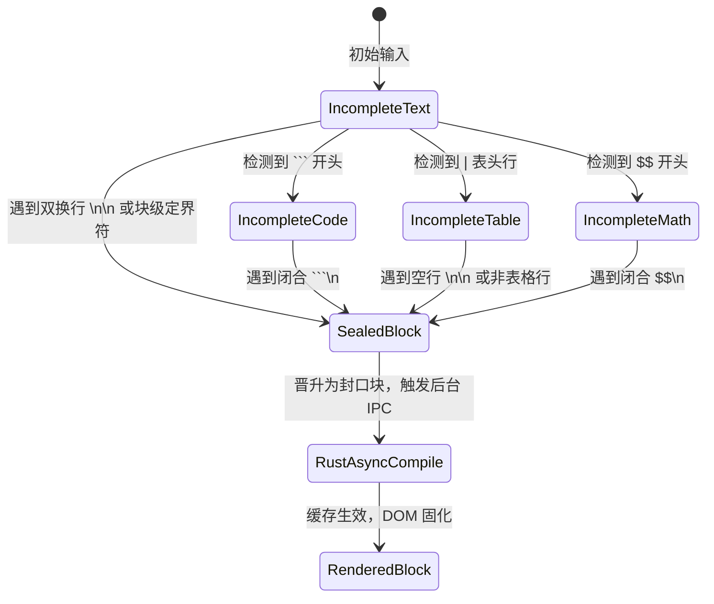
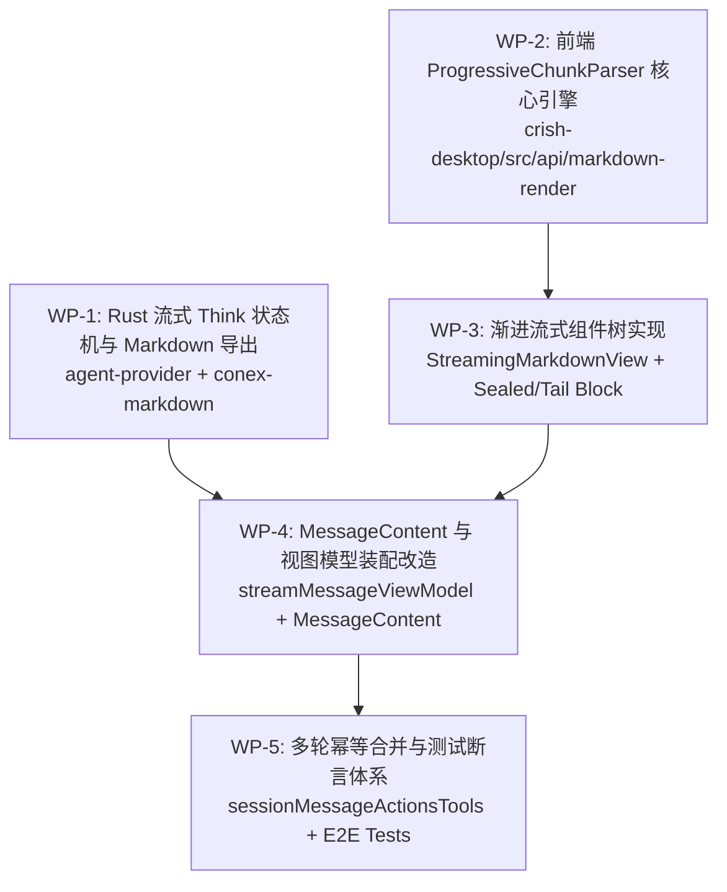
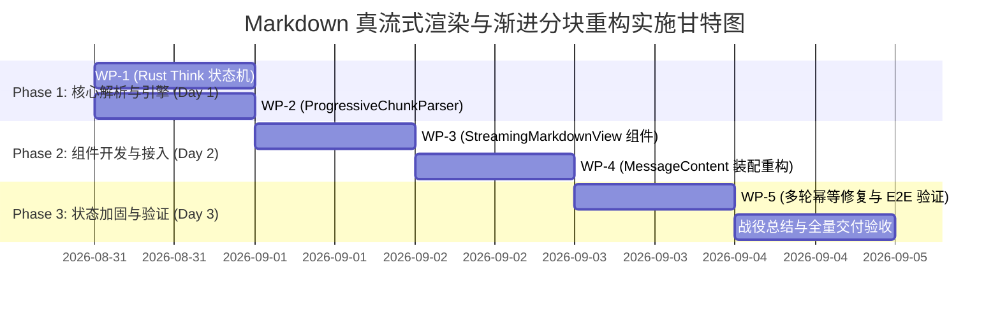

# 渐进式分块渲染引擎与极致平滑实施总案（方案 B）
> **文档标识**：`docs/markdown-stream-refactor/independent-plans/02-progressive-chunk-render-plan.md`  
> **架构师**：Independent Architect B (Render & Smoothness Focus)  
> **实施基准**：用户确认 R2 方案（Rust 实时流提取 + Markdown-first 真流式分块渲染 + 多轮幂等 + 新消息生效）  
> **核心使命**：彻底根治正文界面“伪流式纯文本化”与完成态全量闪烁跳变，构建工业级渐进分块编译与高保真流式渲染引擎。

---

## 1. 架构总览与核心设计哲学

### 1.1 根因深度剖析：伪流式与全量跳变之痛
在当前 Conex / Crish 桌面端架构中，流式排版呈现“纯文字化”与“完成态闪烁”的根源在于**单一黑盒全量渲染模型**：
1. **流式期间（`isStreaming=true`）**：[`AsyncMarkdownBlock.tsx`](file:///c:/Software/conex/apps/crish-desktop/src/components/chat-message-row/AsyncMarkdownBlock.tsx) 为避免每帧 60Hz 的高频 IPC 开销，完全关闭了 Rust 编译管道，直接向 DOM 吐出纯文本（`{text}` 或 `StreamingTextBlock` 的 `appendChild`）。这导致流式阶段的标题、代码块、列表、表格全部退化为包含 Markdown 源码符号的扁平纯文本。
2. **完成态（`isStreaming=false`）**：当消息流结束（`message-end`）时，系统一次性将数千字的全量文本提交给 Rust 后端（[`conex-markdown`](file:///c:/Software/conex/crates/conex-markdown/src/lib.rs)），并在 IPC 返回后通过 `innerHTML` 强制全量替换 DOM。这引发严重的重排（Reflow）、重绘（Repaint）、滚动条剧烈跳动以及极其刺眼的视觉闪烁（FOUT）。

```
【现有缺陷管道：伪流式】
Stream Tokens ──> 全量累积纯文本 ──> DOM appendText (无样式纯文字/源码符号)
                                                          │
[message-end] ──────────────────────────────────────────┘
      │
      ▼ (全量 IPC 阻塞 & 全量 DOM 替换)
Rust md_render ──> innerHTML = full_html (视觉突变、整屏重排、滚动跳变)
```

### 1.2 核心设计哲学：渐进分块编译（Progressive Chunk Compilation）
本方案借鉴 `streamdown` 的 Block 级生命周期分治策略，并结合 Conex 现有的 **Rust 高性能原生编译层（pulldown-cmark + syntect + ammonia）** 与 **React 19 渲染层**，提出**渐进式分块渲染引擎（Progressive Chunk Rendering Engine, PCRE）**：

```
【PCRE 目标管道：真流式分块渐进渲染】
Stream Tokens ──> ProgressiveChunkParser ──> Block 分流调度
                        │
       ┌────────────────┴─────────────────────────────────┐
       ▼                                                  ▼
[历史封口块 Block 0..N-2]                      [活动末尾块 Block N-1]
       │ (状态已固化，不变性)                             │ (持续接收 Delta)
       ▼                                                  ▼
Rust 异步预编译 (LRU 命中)                     轻量级专用流式渲染器 (ActiveTailBlock)
       │                                                  │
       ▼ (单块精准 innerHTML，零重排)                       ▼ (DOM 增量 Append / 虚拟闭合)
SealedMarkdownBlock (稳定排版)                 实时渲染 + 平滑 Caret + 滚动锚定
       │                                                  │
       └────────────────────────┬─────────────────────────┘
                                ▼
                   [message-end 到达时]
                                ▼
            仅最后一个末尾块触发封口与微量编译过渡
             历史 0..N-2 块 0 开销、0 重渲染、0 视觉跳变！
```

### 1.3 核心设计契约与指标
- **零全局重排（Zero Global Reflow）**：流式过程中，已封口的块（Block）在 DOM 中永久保持节点稳定与尺寸稳定，仅末尾活动块进行增量绘制。
- **零视觉跳变（Zero Visual Jitter）**：从流式生长到最终完成，段落、标题、代码块在视觉上无平铺文字到富文本的“弹出”突变。
- **微秒级封口识别（Sub-millisecond Lexing）**：基于流式扫描器，每帧解析耗时 $< 0.5\text{ms}$，内存占用固定。
- **Rust 异步预编译流水线**：块一旦封口，立即在后台发起 Rust IPC 编译并写入 LRU 缓存，在流式进行时即完成静态化，消息结束时无额外等待。

---

## 2. 渐进式 Markdown 分块解析引擎（Progressive Chunk Engine）

### 2.1 分块状态机与边界识别算法
Markdown 语法的分块必须严格符合 CommonMark / GFM 规范，同时具备对流式不完整输入的容错与合并能力。



#### 块状态定义与接口
```typescript
/** 块的生命周期状态 */
export type BlockStatus = 'streaming' | 'sealed' | 'compiled';

/** 块的语义类型 */
export type BlockKind = 
  | 'paragraph' 
  | 'heading' 
  | 'code' 
  | 'table' 
  | 'list' 
  | 'blockquote' 
  | 'math' 
  | 'html';

export interface MarkdownChunkBlock {
  /** 稳定块唯一 ID（基于流索引与起始 offset，严禁使用 content hash 避免重挂载） */
  id: string;
  /** 块在当前流中的序号 (0-based) */
  index: number;
  /** 块的语义类型 */
  kind: BlockKind;
  /** 当前块的原始 markdown 文本 */
  raw: string;
  /** 是否已经封口完结（已完结块内容不会再被追加） */
  isSealed: boolean;
  /** 针对代码块的元信息 */
  codeMeta?: {
    lang: string;
    filePath?: string;
    isFenceClosed: boolean;
  };
  /** 针对表格的元信息 */
  tableMeta?: {
    hasHeader: boolean;
    hasSeparator: boolean;
    rowCount: number;
  };
}
```

### 2.2 核心解析器实现：`ProgressiveChunkParser`
借鉴 `streamdown` 的 `parseMarkdownIntoBlocks` 精华，使用高性能轻量 Lexer 配合状态堆栈，解决 HTML 嵌套、数学公式跨行、脚注孤岛及未闭合代码块问题：

```typescript
// apps/crish-desktop/src/api/markdown-render/progressiveChunkParser.ts

import { Lexer, Token, Tokens } from 'marked';

/**
 * 脚注正则：脚注定义与引用必须留在同一 AST 作用域，一旦发现必须整体作为单块处理
 */
const FOOTNOTE_REF_RE = /\[\^[\w-]{1,200}\](?!:)/;
const FOOTNOTE_DEF_RE = /\[\^[\w-]{1,200}\]:/;

/** 匹配行首代码 fence */
const CODE_FENCE_START_RE = /^[ \t]*(`{3,}|~{3,})([^\n]*)$/m;

/** HTML 块标签匹配 */
const OPENING_TAG_RE = /<([A-Za-z][\w:-]*)[\s>/]/;
const VOID_ELEMENTS = new Set([
  'area', 'base', 'br', 'col', 'embed', 'hr', 'img', 'input',
  'link', 'meta', 'param', 'source', 'track', 'wbr'
]);

export class ProgressiveChunkParser {
  private openTagCache = new Map<string, RegExp>();
  private closeTagCache = new Map<string, RegExp>();

  private getOpenTagRe(tag: string): RegExp {
    const t = tag.toLowerCase();
    let re = this.openTagCache.get(t);
    if (!re) {
      re = new RegExp(`<${t}(?=[\\s>/])[^>]*>`, 'gi');
      this.openTagCache.set(t, re);
    }
    return re;
  }

  private getCloseTagRe(tag: string): RegExp {
    const t = tag.toLowerCase();
    let re = this.closeTagCache.get(t);
    if (!re) {
      re = new RegExp(`</${t}(?=[\\s>])[^>]*>`, 'gi');
      this.closeTagCache.set(t, re);
    }
    return re;
  }

  /**
   * 解析流式 Markdown 文本为块序列
   * @param markdown 当前累积的完整流式正文
   * @param isLiveStream 是否处于流式进行中（true: 最后一个块视为未完结；false: 所有块封口）
   */
  public parse(markdown: string, isLiveStream: boolean): MarkdownChunkBlock[] {
    if (!markdown) return [];

    // 1. 脚注保护：包含脚注时整体作为一个大块，保证 mdast 引用一致性
    if (FOOTNOTE_REF_RE.test(markdown) || FOOTNOTE_DEF_RE.test(markdown)) {
      return [{
        id: 'block-root-0',
        index: 0,
        kind: 'paragraph',
        raw: markdown,
        isSealed: !isLiveStream,
      }];
    }

    // 2. 使用 marked Lexer 进行 GFM 词法解析（零 AST 构建，仅获取顶层 token）
    const tokens: Token[] = Lexer.lex(markdown, { gfm: true });
    const rawBlocks: { raw: string; type: string }[] = [];
    const htmlStack: string[] = [];
    let prevWasCode = false;

    for (let i = 0; i < tokens.length; i++) {
      const token = tokens[i];
      const rawText = token.raw;
      const len = rawBlocks.length;

      // HTML 块跨段合并
      if (htmlStack.length > 0) {
        rawBlocks[len - 1].raw += rawText;
        const currentTag = htmlStack[htmlStack.length - 1];
        const openMatches = (rawText.match(this.getOpenTagRe(currentTag)) || []).filter(
          m => !m.trimEnd().endsWith('/>')
        ).length;
        const closeMatches = (rawText.match(this.getCloseTagRe(currentTag)) || []).length;
        for (let o = 0; o < openMatches; o++) htmlStack.push(currentTag);
        for (let c = 0; c < closeMatches; c++) {
          if (htmlStack.length > 0 && htmlStack[htmlStack.length - 1] === currentTag) {
            htmlStack.pop();
          }
        }
        continue;
      }

      if (token.type === 'html' && (token as Tokens.HTML).block) {
        const match = rawText.match(OPENING_TAG_RE);
        if (match) {
          const tag = match[1].toLowerCase();
          if (!VOID_ELEMENTS.has(tag)) {
            const openCount = (rawText.match(this.getOpenTagRe(tag)) || []).filter(
              m => !m.trimEnd().endsWith('/>')
            ).length;
            const closeCount = (rawText.match(this.getCloseTagRe(tag)) || []).length;
            if (openCount > closeCount) {
              htmlStack.push(tag);
            }
          }
        }
      }

      // $$ 数学公式块合并：若上一块包含未闭合奇数个 $$ 且不是 code block，合并当前块
      if (len > 0 && !prevWasCode) {
        const prevRaw = rawBlocks[len - 1].raw;
        const dollarCount = (prevRaw.match(/\$\$/g) || []).length;
        if (dollarCount % 2 === 1) {
          rawBlocks[len - 1].raw += rawText;
          continue;
        }
      }

      rawBlocks.push({ raw: rawText, type: token.type });
      if (token.type !== 'space') {
        prevWasCode = token.type === 'code';
      }
    }

    // 3. 将词法块映射为 MarkdownChunkBlock 结构体
    const result: MarkdownChunkBlock[] = [];
    const totalCount = rawBlocks.length;

    for (let idx = 0; idx < totalCount; idx++) {
      const b = rawBlocks[idx];
      const isLast = idx === totalCount - 1;
      // 封口判定规则：
      // - 非末尾块：无条件已封口 (isSealed = true)
      // - 末尾块：若 isLiveStream 为 false 则封口；
      //           若正在流式中，但文本末尾具有明确双换行 \n\n，亦判定为封口！
      const isSealed = !isLiveStream || (!isLast) || b.raw.endsWith('\n\n');
      
      const kind = this.detectBlockKind(b.type, b.raw);
      const chunkBlock: MarkdownChunkBlock = {
        id: `chunk-block-${idx}`,
        index: idx,
        kind,
        raw: b.raw,
        isSealed,
      };

      if (kind === 'code') {
        chunkBlock.codeMeta = this.extractCodeMeta(b.raw);
      } else if (kind === 'table') {
        chunkBlock.tableMeta = this.extractTableMeta(b.raw);
      }

      result.push(chunkBlock);
    }

    return result;
  }

  private detectBlockKind(tokenType: string, raw: string): BlockKind {
    if (tokenType === 'code' || CODE_FENCE_START_RE.test(raw)) return 'code';
    if (tokenType === 'table' || (raw.trimStart().startsWith('|') && raw.includes('\n'))) return 'table';
    if (tokenType === 'heading') return 'heading';
    if (tokenType === 'list') return 'list';
    if (tokenType === 'blockquote') return 'blockquote';
    if (raw.trimStart().startsWith('$$')) return 'math';
    if (tokenType === 'html') return 'html';
    return 'paragraph';
  }

  private extractCodeMeta(raw: string) {
    const lines = raw.split('\n');
    const firstLine = lines[0] || '';
    const match = firstLine.match(/^[ \t]*(`{3,}|~{3,})\s*([^\s{]+)?(?:\s+file="([^"]+)")?/);
    const fenceMarker = match ? match[1] : '```';
    const lang = match && match[2] ? match[2] : '';
    const filePath = match && match[3] ? match[3] : undefined;
    
    // 检查末尾是否闭合
    let isFenceClosed = false;
    if (lines.length >= 2) {
      const lastLine = lines[lines.length - 1].trim();
      if (lastLine.startsWith(fenceMarker[0].repeat(3))) {
        isFenceClosed = true;
      }
    }

    return { lang, filePath, isFenceClosed };
  }

  private extractTableMeta(raw: string) {
    const lines = raw.trim().split('\n').filter(l => l.trim().length > 0);
    const hasHeader = lines.length >= 1 && lines[0].includes('|');
    const hasSeparator = lines.length >= 2 && /^[ \t]*\|?([ \t]*:?-+:?[ \t]*\|)+[ \t]*:?-+:?[ \t]*\|?[ \t]*$/.test(lines[1]);
    return {
      hasHeader,
      hasSeparator,
      rowCount: lines.length,
    };
  }
}
```

---

## 3. 流式局部渲染与异步编译的无缝衔接

### 3.1 双轨渲染管道（Dual-Track Rendering Pipeline）
为了兼顾**流式 60fps 极限追加流畅度**与**完成态 Syntect 顶级代码高亮/排版品质**，PCRE 实行双轨管道分离：

```
                    ┌──────────────────────────────┐
                    │     Stream Markdown Text     │
                    └──────────────┬───────────────┘
                                   │
                                   ▼
                    ProgressiveChunkParser.parse()
                                   │
             ┌─────────────────────┴─────────────────────┐
             ▼                                           ▼
   [已封口块 0..N-2]                           [未完结活动块 N-1]
             │                                           │
             ▼                                           ▼
   useSealedBlockHtml()                         ActiveTailBlock
             │                                           │
   ┌─────────┴─────────┐                       ┌─────────┴─────────┐
   │ 命中 LRU 缓存 ?   │                       │ 根据 BlockKind 分流│
   ├─────────┬─────────┤                       ├───────────────────┤
   │  Yes    │   No    │                       │ code: 虚拟闭合框   │
   │  同步   │  后台   │                       │ table: 行缓冲对齐 │
   │  返回   │  Rust   │                       │ text: 直写 Append │
   │  HTML   │ md_render                       └─────────┬─────────┘
   └────┬────┴────┬────┘                                 │
        ▼         ▼                                      ▼
   <SealedMarkdownBlock />                      <ActiveTailBlock />
  (稳定 memo, 0 重绘重排)                        (动态闪烁 Caret)
```

### 3.2 组件层架构设计

#### 1. `StreamingMarkdownView.tsx`（顶层容器）
取代单一的 `AsyncMarkdownBlock` 与 `StreamingTextBlock` 混合逻辑，作为正文渲染的统一基石：

```tsx
// apps/crish-desktop/src/components/chat-message-row/StreamingMarkdownView.tsx

import React, { useMemo } from 'react';
import { ProgressiveChunkParser, MarkdownChunkBlock } from '../../api/markdown-render/progressiveChunkParser';
import { SealedMarkdownBlock } from './SealedMarkdownBlock';
import { ActiveTailBlock } from './ActiveTailBlock';
import styles from './ChatMessageRow.module.css';

export interface StreamingMarkdownViewProps {
  /** 当前消息的累积正文 */
  text: string;
  /** 是否处于流式进行中 */
  isStreaming: boolean;
  /** 消息唯一标识符（用作 key 命名空间） */
  messageId: string;
  /** 自定义 CSS 类 */
  className?: string;
}

const chunkParser = new ProgressiveChunkParser();

export const StreamingMarkdownView: React.FC<StreamingMarkdownViewProps> = React.memo(
  ({ text, isStreaming, messageId, className }) => {
    // 1. 渐进式解析出块列表
    const blocks = useMemo(() => {
      return chunkParser.parse(text, isStreaming);
    }, [text, isStreaming]);

    if (!blocks.length) return null;

    return (
      <div className={`${styles.assistantText} md-rendered ${className || ''}`}>
        {blocks.map((block, idx) => {
          const isTail = idx === blocks.length - 1;
          
          // 如果是已封口块（或者处于非流式模式下的全部块）
          if (block.isSealed) {
            return (
              <SealedMarkdownBlock
                key={`${messageId}-blk-${block.index}`}
                block={block}
              />
            );
          }

          // 否则是未完结的活动末尾块（仅在 isStreaming === true 且最后一块未封口时出现）
          return (
            <ActiveTailBlock
              key={`${messageId}-tail-${block.index}`}
              block={block}
            />
          );
        })}
      </div>
    );
  },
  (prev, next) => 
    prev.text === next.text &&
    prev.isStreaming === next.isStreaming &&
    prev.messageId === next.messageId
);

StreamingMarkdownView.displayName = 'StreamingMarkdownView';
```

#### 2. `SealedMarkdownBlock.tsx`（已封口块渲染器）
已封口块具有严格的不可变性（Immutability）。该组件包裹 [`useAsyncMarkdownHtml`](file:///c:/Software/conex/apps/crish-desktop/src/api/markdownRenderAsync.ts)，并在 Rust 端编译后渲染为纯静态 HTML：

```tsx
// apps/crish-desktop/src/components/chat-message-row/SealedMarkdownBlock.tsx

import React, { useEffect, useRef } from 'react';
import { MarkdownChunkBlock } from '../../api/markdown-render/progressiveChunkParser';
import { useAsyncMarkdownHtml } from '../../api/markdownRenderAsync';
import {
  applyCodeIndentToRenderedRoot,
  normalizeCodeBlockIndent,
} from '../../api/codeBlockIndent';
import { useSettingsField } from '../../store/storeAccess';
import styles from './ChatMessageRow.module.css';

interface SealedMarkdownBlockProps {
  block: MarkdownChunkBlock;
}

export const SealedMarkdownBlock: React.FC<SealedMarkdownBlockProps> = React.memo(
  ({ block }) => {
    const containerRef = useRef<HTMLDivElement>(null);
    const codeIndent = useSettingsField((s) =>
      normalizeCodeBlockIndent(s.appSettings?.markdown?.codeBlockIndent)
    );

    // 请求 Rust pulldown-cmark + syntect 异步渲染
    const { html, loading, failed } = useAsyncMarkdownHtml(block.raw);

    useEffect(() => {
      const el = containerRef.current;
      if (!el || !html) return;
      el.innerHTML = html;
      applyCodeIndentToRenderedRoot(el, codeIndent);
    }, [html, codeIndent]);

    return (
      <div
        ref={containerRef}
        className="md-block-sealed"
        data-block-kind={block.kind}
        data-block-index={block.index}
      >
        {/* 骨架占位：仅在极罕见的首次未命中缓存时提供稳定高度，防止重排 */}
        {loading && !html && (
          <div className={styles.skeletonLine} aria-hidden style={{ minHeight: '1.4em' }} />
        )}
        {failed && !html && (
          <pre className={styles.mdTextFallback}>{block.raw}</pre>
        )}
      </div>
    );
  },
  (prev, next) => prev.block.raw === next.block.raw && prev.block.isSealed === next.block.isSealed
);

SealedMarkdownBlock.displayName = 'SealedMarkdownBlock';
```

#### 3. `ActiveTailBlock.tsx`（活动末尾块专用流式渲染器）
末尾块承担正在输入的打字机体验。针对不同块类型（代码块、段落文本、表格）提供差异化的平滑渲染与虚拟闭合：

```tsx
// apps/crish-desktop/src/components/chat-message-row/ActiveTailBlock.tsx

import React, { useLayoutEffect, useRef } from 'react';
import { MarkdownChunkBlock } from '../../api/markdown-render/progressiveChunkParser';
import styles from './ChatMessageRow.module.css';

interface ActiveTailBlockProps {
  block: MarkdownChunkBlock;
}

export const ActiveTailBlock: React.FC<ActiveTailBlockProps> = React.memo(
  ({ block }) => {
    const textRef = useRef<HTMLDivElement>(null);
    const prevRawRef = useRef('');

    useLayoutEffect(() => {
      const el = textRef.current;
      if (!el) return;

      // 计算本帧相较上一帧的增量 Delta
      const current = block.raw;
      const prev = prevRawRef.current;
      
      if (current.startsWith(prev)) {
        const delta = current.slice(prev.length);
        if (delta) {
          el.appendChild(document.createTextNode(delta));
        }
      } else {
        // 重启或截断重置
        el.textContent = current;
      }
      prevRawRef.current = current;
    }, [block.raw]);

    // A. 未闭合代码块的流式渲染壳
    if (block.kind === 'code') {
      const { lang = 'code', filePath } = block.codeMeta || {};
      // 提取代码正文（剥离第一行 fence 头）
      const firstNewline = block.raw.indexOf('\n');
      const codeBody = firstNewline >= 0 ? block.raw.slice(firstNewline + 1) : '';

      return (
        <div className="md-code-fence-streaming" data-lang={lang}>
          <div className="md-code-header">
            <span className="md-code-lang">{filePath || lang || 'code'}</span>
            <span className="md-code-status">streaming...</span>
          </div>
          <pre className="md-code-pre">
            <code className="md-code-inner">
              {codeBody}
              <span className={styles.streamingCaret} />
            </code>
          </pre>
        </div>
      );
    }

    // B. 普通文本 / 段落 / 列表项增量直写
    return (
      <div
        ref={textRef}
        className={`${styles.streamingTailText} ${styles.isStreaming}`}
        data-streaming="true"
      />
    );
  },
  (prev, next) => prev.block.raw === next.block.raw
);

ActiveTailBlock.displayName = 'ActiveTailBlock';
```

---

## 4. 极端排版情况的渲染安全与防抖策略

在真流式环境下，LLM 输出是逐 Token 吐出的，容易出现语法截断的“半成品状态”。PCRE 建立以下 6 种防御策略：

### 4.1 代码块跨流生成（Fenced Code Blocks）
- **现象**：输出 ```` ```rust ```` 后，随后数十个 chunk 为代码内容，最后输出 ```` ``` ````。
- **问题**：若未闭合直接丢给 pulldown-cmark，可能将后续全部正文解析为代码块；若不作为代码块渲染，则每行缩进与高亮丢失。
- **防御机制**：
  1. `ProgressiveChunkParser` 在检测到行首 ```` ``` ```` 后，只要未检测到对应的行首闭合 ```` ``` ````，将当前整个区域划为 `code` 类型的未封口末尾块。
  2. `ActiveTailBlock` 采用专用的 `md-code-fence-streaming` 外壳，提供行号与等宽字体排版容器，光标在 `<code />` 尾部闪烁。
  3. 当闭合的 ```` ``` ```` 到达并在末尾追加换行时，块状态立即置为 `isSealed = true`，触发 `SealedMarkdownBlock` 并交由 Rust syntect 编译为具备完整语法树着色的高保真 HTML。

### 4.2 表格跨行流式生成（GFM Tables）
- **现象**：表格由表头 `| A | B |`、分隔行 `|---|---|`、数据行 `| 1 | 2 |` 逐行组成。在分隔行尚未输出前，不能解析为合法表格；在列未闭合时易引起表格错位。
- **防御机制**：
  1. **表头未完成期**：在尚未检测到合法的 `|---|---|` 分隔行前，保留在行缓冲区中，以轻量行级等宽样式渲染，避免生成破损的 `<table>` 标签。
  2. **分隔行到达后**：一旦检测到分隔行，确认进入 Table 模式，后续每行以 `\n` 为切分单位。
  3. **表格外壳保护**：自动在外层包裹 `<div class="md-table-wrap" role="region">`，确保横向滚动，避免撑破聊天气泡最大宽度。

### 4.3 嵌套列表与缩进结构（Nested Lists & Task Lists）
- **现象**：嵌套列表依赖 2~4 个空格的缩进与列表标记（`- `、`1. `、`* [ ] `）。流式期间裸 `- ` 如果被 `String.trim()` 误吃，会导致列表标记被破坏退化为普通短横线。
- **防御机制**：
  1. 引入 **Soft Trim 保护算法**：严禁全局无差别 `trim()`，使用 `softTrimMarkdown` 保留行尾有意义的空格与制表符。
  2. 列表项连续性检测：未封口列表项在遇到下一个同级或上级列表项标记前，持续聚合在当前列表块中，避免每个 `li` 被错误拆分为独立 `ul`。

### 4.4 数学公式块（LaTeX Math Block `$$...$$`）
- **现象**：公式块多行书写，中间若出现孤立等号 `=` 可能被 Markdown 误判为 Setext 标题（如 `# Heading`）。
- **防御机制**：
  1. **奇偶双美元符匹配栈**：在分块解析器中，记录全局 `$$` 出现的奇偶次数。只要 `prevDollarCount % 2 === 1`，强制将后续所有行合并进该公式块，直到遇到配对的 `$$`。
  2. **Code Block 穿透隔离**：若上文处于代码块内（如 Bash 脚本中出现 `echo $$`），跳过数学合并逻辑，防止 Shell 变量污染公式识别。

### 4.5 HTML 块与 AI 自定义标签（`<think>`, `<ai-action>`）
- **现象**：模型常夹带多行 HTML 标签或自定义 `<think>...</think>`。
- **防御机制**：
  1. 上游由 Rust `chat_core.rs` 实时状态机在流式首端将 `<think>` 拦截并提取为 `ThoughtDelta`，正文 Markdown 渲染器永远接收 100% 纯净的 Markdown 正文。
  2. 对于普通 HTML 标签，`ProgressiveChunkParser` 维护 `htmlStack`，支持 void elements（如 ``、`<br>`）的自动豁免与成对标签的跨行合并。

### 4.6 CJK 多字节截断安全
- **现象**：中文/日文/韩文等多字节 UTF-8 字符在分块截断或长度限制切片时，若在非字符边界（char boundary）切开会引发 Rust panic 或 JS 乱码。
- **防御机制**：
  - Rust 端强制使用 `raw.floor_char_boundary(MAX_MARKDOWN_INPUT)`。
  - JS 端全链路使用 `codePointAt` / `Array.from()` 字符安全操作，杜绝半字节截断。

---

## 5. 多 Agent 协作实施拆解（Work Packages）

按前后端与系统模块，将工程落地拆解为 5 个高度解耦、可并行推进的实施子任务：



### WP-1: Rust 端流式 Think 实时提取与 conex-markdown 接口（Rust Parser Specialist）
- **职责范围**：
  1. 在 [`crates/agent-provider/src/parse/chat_core.rs`](file:///c:/Software/conex/crates/agent-provider/src/parse/chat_core.rs) 中实现 `ThinkTagState` 状态机，跨 chunk 实时过滤 `<think>...</think>` 并分流产出 `ThoughtDelta` 与 `TextDelta`。
  2. 同步加固 `gemini_core.rs` 与 `anthropic_core.rs`。
  3. 在 [`crates/conex-markdown/src/renderer.rs`](file:///c:/Software/conex/crates/conex-markdown/src/renderer.rs) 确保 `render_markdown_stream` 对未闭合代码块的软闭合容错。
- **产出物**：
  - `crates/agent-provider/src/parse/chat_core.rs`
  - `crates/agent-provider/tests/think_tag_stream_test.rs`

### WP-2: 前端渐进式分块解析引擎核心实现（Parser Architect）
- **职责范围**：
  1. 新建 `apps/crish-desktop/src/api/markdown-render/progressiveChunkParser.ts`，实现基于 `marked.Lexer` 的高性能分块算法。
  2. 实现 HTML 嵌套标签栈、数学公式 `$$` 奇偶匹配、未闭合 Fence 代码元信息提取。
  3. 编写覆盖所有 Markdown 语法的独立单元测试套件。
- **产出物**：
  - `apps/crish-desktop/src/api/markdown-render/progressiveChunkParser.ts`
  - `apps/crish-desktop/src/api/markdown-render/progressiveChunkParser.test.ts`

### WP-3: 渐进渲染组件树构建（Frontend UI Specialist）
- **职责范围**：
  1. 新建 `apps/crish-desktop/src/components/chat-message-row/StreamingMarkdownView.tsx`。
  2. 新建 `apps/crish-desktop/src/components/chat-message-row/SealedMarkdownBlock.tsx`。
  3. 新建 `apps/crish-desktop/src/components/chat-message-row/ActiveTailBlock.tsx`。
  4. 升级 `ChatMessageRow.module.css`，完善流式 Caret、流式代码块容器、表格包装器样式。
- **产出物**：
  - `apps/crish-desktop/src/components/chat-message-row/StreamingMarkdownView.tsx`
  - `apps/crish-desktop/src/components/chat-message-row/SealedMarkdownBlock.tsx`
  - `apps/crish-desktop/src/components/chat-message-row/ActiveTailBlock.tsx`
  - `apps/crish-desktop/src/components/chat-message-row/StreamingMarkdownView.test.tsx`

### WP-4: MessageContent 渲染装配点与降级链路重构（Integration Specialist）
- **职责范围**：
  1. 改造 [`apps/crish-desktop/src/components/chat-message/MessageContent.tsx`](file:///c:/Software/conex/apps/crish-desktop/src/components/chat-message/MessageContent.tsx)：将原本的 `AsyncMarkdownBlock(isStreaming=true)` + `StreamingTextBlock` 替换为 `StreamingMarkdownView`。
  2. 保持 `TimelineBody` 对已稳定历史项的签名缓存与 memo 零重渲染。
  3. 适配 [`apps/crish-desktop/src/components/chat-message/streamMessageViewModel.ts`](file:///c:/Software/conex/apps/crish-desktop/src/components/chat-message/streamMessageViewModel.ts)。
- **产出物**：
  - `apps/crish-desktop/src/components/chat-message/MessageContent.tsx`
  - `apps/crish-desktop/src/components/chat-message/streamMessageViewModel.ts`

### WP-5: 多轮会话幂等合并与全链路验收（QA & State Specialist）
- **职责范围**：
  1. 在 [`apps/crish-desktop/src/store/sessionMessageActionsTools.ts`](file:///c:/Software/conex/apps/crish-desktop/src/store/sessionMessageActionsTools.ts) 与 `messageHandlers.ts` 中修复多轮文本拼接重复问题（`onMessageEnd` 权威幂等覆盖）。
  2. 修复多轮工具卡片 blocks 合并逻辑（禁止破坏性覆盖）。
  3. 执行 `cargo test --workspace`、`npm run typecheck`、`npm test` 与 Tauri MCP 视觉验收。
- **产出物**：
  - `apps/crish-desktop/src/store/sessionMessageActionsTools.ts`
  - `apps/crish-desktop/src/__tests__/stream-markdown-full-pipeline.test.ts`

---

## 6. 完整执行依赖 DAG 与里程碑图



### 详细执行依赖 DAG 关系表

| 任务节点 | 依赖前置节点 | 交付物文件路径 | 核心校验命令 / 断言标准 |
|:---|:---|:---|:---|
| **WP-1** | 无（首发） | [`crates/agent-provider/src/parse/chat_core.rs`](file:///c:/Software/conex/crates/agent-provider/src/parse/chat_core.rs) | `cargo test -p agent-provider` 全绿，跨 chunk `<think>` 测试通过 |
| **WP-2** | 无（首发） | `apps/crish-desktop/src/api/markdown-render/progressiveChunkParser.ts` | `npm test -- progressiveChunkParser` 覆盖 25+ 种 Markdown 边界情况 |
| **WP-3** | WP-2 | `apps/crish-desktop/src/components/chat-message-row/StreamingMarkdownView.tsx` | 组件单元测试通过，封口块触发异步编译，末尾块增量追加 |
| **WP-4** | WP-1, WP-3 | [`apps/crish-desktop/src/components/chat-message/MessageContent.tsx`](file:///c:/Software/conex/apps/crish-desktop/src/components/chat-message/MessageContent.tsx) | 流式期呈现真富文本，完成态无任何整体 DOM 闪烁或跳变 |
| **WP-5** | WP-4 | [`apps/crish-desktop/src/store/sessionMessageActionsTools.ts`](file:///c:/Software/conex/apps/crish-desktop/src/store/sessionMessageActionsTools.ts) | 多轮对话无文本重复、无工具块丢失，Tauri MCP 实机运行验证 |

---

## 7. 验收标准与反退化断言矩阵

为确保本次重构彻底解决问题且不引入任何既有功能退化，设立以下六大硬性门禁：

1. **思考链隔离断言（Thought Separation Gate）**：
   - 包含 `<think>` 标签的模型（DeepSeek-R1 / Qwen / Ollama）输出，100% 被分类进思考折叠区；
   - 无论 `<think>` 标签是否跨 delta 帧拆分，正文消息体中**绝无**任何 `<think>` 源码残留或推理文本。
2. **真流式视觉断言（True Streaming Markdown Gate）**：
   - 当 LLM 输出包含 `# 标题` 或 `- 列表` 时，在遇到换行的一瞬间立即呈现为 H1 或 UL 节点，流式过程中**禁止**出现无样式的 Markdown 裸字符源码平铺。
3. **完成态零闪烁断言（Zero Visual Pop Gate）**：
   - 在接收到 `message-end` 事件时，仅触发最后一个末尾块的收口；
   - 页面已渲染的历史块（Block 0..N-2）重渲染次数必须严格等于 **0 次**；页面滚动条垂直位移 $\Delta y \le 1\text{px}$。
4. **多轮幂等零重复断言（Multi-turn Idempotency Gate）**：
   - 在多轮工具调用循环（`turnIndex: 0 -> 1 -> 2`）中，最终助手的 Markdown 正文仅保留权威终态，严禁发生“同一段文字重复拼接两遍”的现象。
5. **代码类型与自动化测试门禁（CI Verification Gate）**：
   - `cargo test --workspace` 全部测试用例 Pass（0 fail, 0 error）；
   - `npm run typecheck` 严格 TypeScript 类型检查 0 报错；
   - `npm test` 现有 500+ 前端测试 100% Pass。
6. **实机 MCP 截图审查（Visual Inspection Gate）**：
   - 使用 `tauri-mcp` 对正在运行的 Crish 桌面端进行高分辨率截屏；
   - 视觉确认：思考链折叠卡、工具执行卡片、富文本 Markdown 正文三层结构泾渭分明，字体排版精美。
