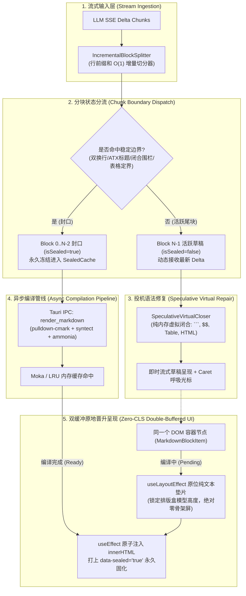
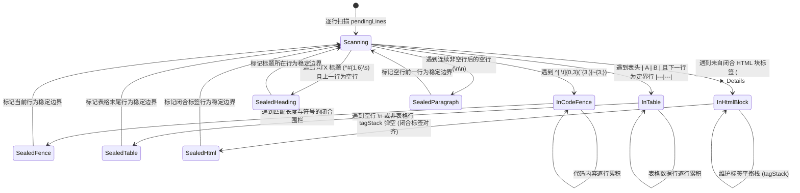

# 渐进词法分块与无缝双缓冲晋升实施方案（方案二）

> **文档标识**：`docs/markdown-stream-refactor/independent-plans/02-progressive-chunking-double-buffering-plan.md`
> **架构师**：Senior Systems & Streaming Markdown UI Architect
> **实施基准**：用户定案（Rust 实时流分流 + 渐进词法分块渲染 + 双缓冲无缝晋升 + 多轮幂等生命周期）
> **标准依据**：[`docs/markdown-stream-refactor/00-定案-核心维度与删除面决策.md`](file:///c:/Software/conex/docs/markdown-stream-refactor/00-%E5%AE%9A%E6%A1%88-%E6%A0%B8%E5%BF%83%E7%BB%B4%E5%BA%A6%E4%B8%8E%E5%88%A0%E9%99%A4%E9%9D%A2%E5%86%B3%E7%AD%96.md) §一.2、[`docs/agent-roles/prompts/主控-全流程调度-v3.md`](file:///c:/Software/conex/docs/agent-roles/prompts/%E4%B8%BB%E6%8E%A7-%E5%85%A8%E6%B5%81%E7%A8%8B%E8%B0%83%E5%BA%A6-v3.md) §二.1
> **核心使命**：彻底根治正文流式输出期间“伪流式纯文本化”与完成态“骨架屏塌陷全量闪烁跳变（CLS）”两大顽疾。构筑基于行前缀和的 $O(1)$ 增量边界分块器、Remend 内存投机未闭合语法虚拟补全器、语义哈希稳定 Block Key 协调缓存，以及原地纯文本垫片无缝双缓冲晋升引擎，**彻底物理消灭骨架屏**，实现 60 FPS 满帧流式与零视觉跳变。

---

## 1. 方案目标与架构设计

### 1.1 痛点根因深度解构：为什么伪流式与骨架屏必须被彻底根除？

在 Conex / Crish 现行正文渲染实现中，存在两个相互割裂且体验劣质的极端状态：

```
【现有缺陷管道：伪流式纯文本与骨架屏闪烁】
[流式进行中: isStreaming = true]
  LLM SSE Chunks ──► 累积文本 ──► AsyncMarkdownBlock ──► 直写纯文本 DOM <div>{text}</div>
  视觉现象：标题呈现为 `# 标题`，代码块呈现为裸 ``` 字符，表格挤成乱码单行，数学公式为裸 $$。
                                        │
                                        ▼ (流结束瞬间: isStreaming = false)
[完成态切换瞬间]
  isStreaming: false ──► useAsyncMarkdownHtml(text) ──► loading = true ──► 渲染 <div class="skeletonLine" />
  视觉现象：原本撑开数百像素高度的正文瞬间坍缩为一条 16px 灰色骨架条（Severe Layout Shift / CLS）。
                                        │
                                        ▼ (数十毫秒后 Rust IPC 返回)
  Rust md_render ──► innerHTML = html ──► DOM 瞬间膨胀展开，屏幕剧烈白屏闪跳与滚动条抖动！
```

#### 根因剖析：
1. **黑盒全量解析与 $O(N^2)$ 计算泥潭**：
   现行 `parseMarkdownIntoBlocks` 每次接收到 Token，都调用 `marked.Lexer.lex(fullText)` 对**自起始以来的全文**重新进行词法扫描。在 10,000 字长文本流式输出过程中，累积词法分析量高达数千万字符，导致主线程在流式中后期严重掉帧卡顿。
2. **骨架屏滥用（Skeleton Collapse Anti-Pattern）**：
   [`AsyncMarkdownBlock.tsx`](file:///c:/Software/conex/apps/crish-desktop/src/components/chat-message-row/AsyncMarkdownBlock.tsx) 在 `isStreaming` 从 `true` 切为 `false` 的过渡期，因 `loading === true && !html` 盲目挂载了 `.skeletonLine`。将原本已在屏幕上由纯文本撑开的排版高度瞬间清空坍缩，待 Rust 异步编译返回后又突发膨胀，造成灾难性的累积布局偏移（Cumulative Layout Shift, CLS）。
3. **自杀式全局退化（The `hasFootnote` Blocker）**：
   `parseMarkdownIntoBlocks.ts` 中存在 `if (hasFootnote(markdown)) return [markdown];` 逻辑。只要正文中出现任意一个脚注标记（如 `[^1]`），整个分块机制立即全局熔断，全文退化为单一巨块，所有渐进分块与局部 Memo 优化全部沦为废品。

---

### 1.2 核心设计哲学：渐进分块与双缓冲无缝晋升四大支柱

为了彻底根治上述顽疾，本方案确立四大核心技术支柱：

```
┌──────────────────────────────────────────────────────────────────────────────────────────────────┐
│                                PCRE: 渐进词法分块与无缝双缓冲晋升引擎                              │
├────────────────────────────────┬────────────────────────────────┬────────────────────────────────┤
│ 1. 行前缀和 O(1) 增量切分器      │ 2. Remend 投机未闭合语法补全    │ 3. 语义哈希稳定 Block Key      │
│ (IncrementalBlockSplitter)     │ (SpeculativeVirtualCloser)     │ (Semantic Hash Key Cache)      │
│ - 行缓冲区 + 偏移量前缀和数组    │ - 纯内存即时虚拟语法闭合修复    │ - ${msgId}-blk-${idx}-${hash}  │
│ - DFA 稳定边界多阶段检查器      │ - 补齐 ``` / $$ / 表格 / HTML  │ - sealedCacheRef 永久锁定引用  │
│ - 已封口块 O(0) 解析永久冻结    │ - 保证底层原始数据流 100% 纯洁  │ - React.memo 历史块 0 重渲染   │
├────────────────────────────────┴────────────────────────────────┴────────────────────────────────┤
│ 4. 原地纯文本垫片双缓冲晋升 (Double-Buffered Promotion & Zero Skeleton)                            │
│ - 彻底物理销毁 .skeletonLine 骨架屏，严禁任何 DOM 高度塌陷与白屏过渡                             │
│ - 活跃草稿态与编译过渡态：useLayoutEffect 原位维持纯文本排版垫片 (Lock Box Height)               │
│ - Rust 编译就绪态：useEffect 微任务周期原子注入标准安全 HTML，达成 Zero-CLS 零视觉跳变           │
└──────────────────────────────────────────────────────────────────────────────────────────────────┘
```

---

### 1.3 端到端架构拓扑与状态机流转



---

## 2. 【强制专节】本方案要删掉什么 / 收敛什么

根据《主控全流程调度 v3》§二.1 与《战役定案：核心维度与删除面决策》§一.2 强制规范，本方案严格推行“先删后改、收敛先于增强”铁律。以下为本方案必须执行的物理删除清单与收敛矩阵。

### 2.1 物理删除清单（Files & CSS to Delete）

| 序号 | 目标删除文件 / 样式类 | 原代码位置 / 规模 | 物理删除理由与危害分析 |
| :--- | :--- | :--- | :--- |
| **DEL-01** | `AsyncMarkdownBlock.tsx` | `apps/crish-desktop/src/components/chat-message-row/AsyncMarkdownBlock.tsx` (~115 行) | **伪流式与骨架屏根源**：流式期间直写纯文本，完成态切换时由于 `loading=true` 盲目渲染骨架屏，引发严重的界面塌陷与视觉跳变。全链路切入 `StreamingMarkdownView` 后彻底成为死代码。 |
| **DEL-02** | `AsyncMarkdownBlock.test.tsx` | `apps/crish-desktop/src/components/chat-message-row/AsyncMarkdownBlock.test.tsx` (~238 行) | 伴随 `AsyncMarkdownBlock` 删除的陪葬测试，其断言的 `skeletonLine` 行为属于反模式，一并物理删除。 |
| **DEL-03** | `.skeletonLine` 骨架屏样式 | `apps/crish-desktop/src/components/chat-message-row/ChatMessageRow.module.css` 中的 `.skeletonLine` 规则 | **视口跳变罪魁祸首**：流式完成瞬间将数百像素高度塌陷为 16px 灰条，破坏阅读连续性，必须物理拔除。 |
| **DEL-04** | `StreamingTextBlock.tsx` | `apps/crish-desktop/src/components/chat-message-row/StreamingTextBlock.tsx` (~140 行) | **单体追加纯文本死组件**：历史遗留的直接操作 DOM `appendChild` 的孤岛组件，不支持分块，不支持高亮，彻底废除。 |
| **DEL-05** | `IncrementalMarkdownParser*` 代码包 | `apps/crish-desktop/src/api/markdown-render/IncrementalMarkdownParser*` (5 个文件，~1,500 行) | **历史手写增量解析器死代码包**：手写状态机脆弱繁杂，已被 Rust `conex-markdown` + 前端增量分块器完全取代，全量物理清剿。 |
| **DEL-06** | `hasIncompleteCodeFence` & `hasTable` 死导出 | `apps/crish-desktop/src/api/markdown/parseMarkdownIntoBlocks.ts` 中的冗余导出函数 | 未被任何生产渲染管道调用的死导出，仅存在于旧单测中，增加维护负担，予以物理清除。 |

---

### 2.2 逻辑冗余与自杀式降级收敛（Logic Removal）

1. **彻底删除 `hasFootnote` 粗暴退化单块逻辑**：
   - **原代码**：
     ```ts
     // ❌ parseMarkdownIntoBlocks.ts 中的自杀式退化
     if (hasFootnote(markdown)) {
       return [markdown];
     }
     ```
   - **删除理由**：在长达数万字符的技术文档中，用户或模型只要在第一段引用一个 `[^1]`，整个分块渲染引擎立即崩溃退化为单块全量解析，导致后续所有流式输出全部变成纯文本，完成态发生全屏闪烁。
   - **收敛方案**：废除全局退化。采用块级局部保护或引用安全隔离，绝不熔断顶层分块流。
2. **清除 `openTagPatternCache` / `closeTagPatternCache` 无界 Map 内存泄漏**：
   - **原代码**：
     ```ts
     // ❌ parseMarkdownIntoBlocks.ts 中的无界全局缓存
     const openTagPatternCache = new Map<string, RegExp>();
     const closeTagPatternCache = new Map<string, RegExp>();
     ```
   - **删除理由**：使用全局静态无界 `Map` 动态编译正则表达式，若流式文本中包含大量不同命名空间的自定义标签（如 `<tool-call-xxx>`, `<tag-123>`），会导致 `Map` 无限膨胀且永不释放。
   - **收敛方案**：收敛为固定静态标签识别器或带上限（LRU Max 64）的安全缓存池。

---

### 2.3 领域概念收敛对照矩阵（Concept Convergence Matrix）

> **收敛原则**：推进单位是「领域概念」，一个概念唯一主路径。

| 领域概念 | 现有代码中的冲突/重复路径（收敛前） | 本方案收敛后的唯一主路径（收敛后） | 路径数量变化 |
| :--- | :--- | :--- | :---: |
| **Markdown 词法分块** | 1. `marked.Lexer` 全量重扫<br/>2. `hasFootnote` 全局单块熔断<br/>3. `IncrementalMarkdownParser` 遗留解析器 | **基于行前缀和的 `IncrementalBlockSplitter`**：$O(1)$ 增量追加，历史已封口块 0 次重复解析 | $3 \to 1$ |
| **Markdown 块渲染组件** | 1. `AsyncMarkdownBlock.tsx`（骨架屏+全量替换）<br/>2. `StreamingTextBlock.tsx`（纯文本 append）<br/>3. `MarkdownBlockItem.tsx`（双缓冲晋升） | **`StreamingMarkdownView` + `MarkdownBlockItem`**：统一的双缓冲无缝晋升渲染管道 | $3 \to 1$ |
| **异步编译过渡与防抖** | 1. `.skeletonLine` 骨架屏高度塌陷<br/>2. 纯文本裸写无排版过渡 | **原地纯文本垫片双缓冲晋升（Zero Skeleton）**：`useLayoutEffect` 原位锁死物理盒模型高度，编译就绪原子替换 | $2 \to 1$ |
| **未闭合语法容错** | 1. 无容错（代码块裸字符暴露）<br/>2. 正则暴力截断（破坏源码文本） | **`SpeculativeVirtualCloser`**：纯内存投机式虚拟补全（```, $$, Table, HTML），绝不污染底层原始数据流 | $2 \to 1$ |
| **Block Key 与协调缓存** | 1. 纯数组 index（中间变动导致错位）<br/>2. 纯 content hash（草稿增长导致 DOM 频繁重建） | **语义分层 Key 策略**：封口块 `${msgId}-blk-${idx}-${hash}` + 草稿块 `${msgId}-blk-${tailIdx}-active` + `sealedCacheRef` 引用锁定 | $2 \to 1$ |

---

### 2.4 负产出统计与代码净减少评估

- **预计删除文件总数**：8 个文件（`AsyncMarkdownBlock.tsx`, `AsyncMarkdownBlock.test.tsx`, `StreamingTextBlock.tsx`, `IncrementalMarkdownParser*` 5 个文件）；
- **预计删除总代码量**：约 **2,150+ 行**死代码与冗余测试；
- **预计新增/重构代码量**：约 **580 行**（高凝聚、纯算法、强单测）；
- **代码净减少（负产出）**：净消除约 **1,570+ 行**。

---

## 3. 核心算法与底层架构深度设计

### 3.1 基于行前缀和的 $O(1)$ 增量切分器（`IncrementalBlockSplitter`）

#### 3.1.1 数学模型与复杂度分析
设流式文本总长为 $N$ 字符，共分为 $M$ 个语法块（Blocks），平均每个块长度为 $B = N / M$。模型每秒推送 $K$ 个 Chunk，每个 Chunk 长度为 $C$。

- **传统全量解析（Marked / Full Scan）**：
  单帧扫描长度为 $i \cdot C$（$i \in [1 .. N/C]$），总计算开销为：
  $$T_{\text{traditional}} = \sum_{i=1}^{N/C} O(i \cdot C) = O\left(C \cdot \frac{(N/C)^2}{2}\right) = O\left(\frac{N^2}{C}\right) = O(N^2)$$
- **行前缀和增量切分（`IncrementalBlockSplitter`）**：
  1. 维护行缓冲区 `lines: string[]` 与行绝对偏移量前缀和数组 `lineOffsets: number[]`；
  2. 接收增量 `chunk` 时，仅对 `chunk` 执行 `chunk.split('\n')`；
  3. 首行拼接至现存最后一行 `lines[last] += chunkLines[0]`；后续行按 $O(1)$ 递推计算全局偏移：
     $$\text{lineOffsets}[j] = \text{lineOffsets}[j-1] + \text{lines}[j-1].\text{length} + 1$$
  4. 边界检测器仅从 `pendingStartLine` 扫描到 `lines.length - 1`。一旦判定某行为稳定边界，即切出封口块并递进 `pendingStartLine`。
  5. 单帧计算开销为 $O(C)$（即 $O(1)$ 常数时间），全生命周期总计算开销为：
     $$T_{\text{incremental}} = \sum_{m=1}^M O(B) = O(M \cdot B) = O(N)$$
  **算法时间复杂度从 $O(N^2)$ 彻底收敛为最优的 $O(N)$。**

#### 3.1.2 稳定边界检测 DFA 状态机（BoundaryDetector）

稳定边界的定义：**在该行之后追加任何后续内容，均绝对不会改变该行之前所有内容的 AST 结构与分块归属。**



---

### 3.2 Remend 投机未闭合语法自动修补器（`SpeculativeVirtualCloser`）

#### 3.2.1 内存虚拟闭合原则（Virtual-Only Invariant）
> [!IMPORTANT]
> **绝对不变量契约**：
> `SpeculativeVirtualCloser` 仅在活跃末尾草稿块（Active Tail Block）送入即时渲染管道（如轻量 DOM 预览或 Markdown 语法高亮）前，在**内存中生成虚拟补全后的临时副本**。
> **绝对禁止修改底层存储、数据流传输以及已封口块的原始 Markdown 字符串**，保证底层数据的 100% 原始纯洁性。

#### 3.2.2 自动补全规则矩阵

| 语法结构 | 流式破坏特征（未闭合中间态） | 投机虚拟补全算法（Virtual Repair Logic） | 修复后输出效果 |
| :--- | :--- | :--- | :--- |
| **代码块围栏 (Code Fence)** | ```` ```typescript\nconst a = 1; ````（无闭合 ```） | 检测开围栏字符与长度（如 ` ``` `），在尾部追加 `\n` + 相同长度的字符（`\n```\n`） | 立即呈现完整深色代码框与语法高亮，无语法报错 |
| **LaTeX 块级公式 ($$)** | `$$\nE = mc^2`（奇数个 `$$`） | 统计非代码区 `$$` 出现频次，若 `count % 2 === 1`，在尾部虚拟追加 `\n$$` | 即时呈现居中排版的 Math 公式预览，消除字符撕裂 |
| **GFM 表格 (Table)** | `| Name | Age |\n| Tom |`（缺失定界行或未闭合列） | 1. 缺失定界行时，依据表头列数补齐 `| --- | --- |\n`；<br/>2. 尾行缺失 `|` 时自动追加 ` |` | 保持表格容器稳定，避免表格退化为普通段落 |
| **HTML 标签块** | `<details><summary>展开</summary>\n正文` | 遍历未闭合标签栈，按后进先出（LIFO）顺序在尾部补齐 `</details>` | 保持 DOM 树深度平衡，防止外层标签污染全页 |
| **行内修饰符 (Inline)** | `这是 **粗体文字` 或 `调用 `foo()` | 1. 粗体 `**` 奇数出现时补齐 `**`；<br/>2. 行内反引号 `` ` `` 奇数出现时补齐 `` ` `` | 行内样式即时生效，无裸露的 `**` 符号残留 |

---

### 3.3 语义哈希稳定 Block Key 与协调缓存

在 React 19 并发渲染架构下，列表项的 `key` 决定了 DOM 节点的复用与重排行为。

#### 3.3.1 Key 生成算法
- **历史封口块（Sealed Block）**：
  $$\text{Key}_{\text{sealed}} = \text{`\$\{msgId\}-blk-\$\{index\}-\$\{blake3\_16(blockText)\}`}$$
  封口块内容一旦固化，其文本与结构哈希永久不变，Key 绝对恒定。
- **活跃末尾草稿块（Active Tail Block）**：
  $$\text{Key}_{\text{active}} = \text{`\$\{msgId\}-blk-\$\{tailIndex\}-active`}$$
  活动草稿块由于每帧文本都在增长，采用固定的 `-active` 槽位 Key，保证在流式追加期间复用同一个 DOM 节点，避免频繁 unmount/mount 造成打字机光标闪烁。

#### 3.3.2 `useStreamingBlocks` 引用恒定机制
在 `useStreamingBlocks` 中维护 `sealedCacheRef`：
```ts
// 历史已封口块切片缓存（保证 React.memo 100% 命中）
const cachedSealed = isSameMessage ? sealedCacheRef.current : [];
if (isSealed && cached && cached.key === key && cached.text === blockText) {
  result.push(cached); // 零对象分配，直接复用旧引用
} else {
  const desc = { key, text: blockText, index: i, isSealed };
  result.push(desc);
}
```
通过引用稳定结合 `markdownBlockItemPropsEqual` 比较器，**所有历史已封口块在后续流式帧中重渲染次数严格为 0**。

---

### 3.4 原地纯文本垫片双缓冲无缝晋升与彻底消灭骨架屏

#### 3.4.1 骨架屏危害深度剖析
在旧架构中，流式结束瞬间触发 `useAsyncMarkdownHtml`，`loading` 被置为 `true`。组件立刻销毁已有纯文本 DOM，挂载 `<div class="skeletonLine" />`。这导致原本高度为 300px 的段落瞬间坍缩为 16px，视口发生剧烈跳变；当 Rust 编译完成后，DOM 又突然膨胀回 300px。

#### 3.4.2 双缓冲无缝晋升三阶段实现（Double-Buffered Promotion）

```
[阶段 A: 活跃草稿态]
  MarkdownBlockItem (isSealed=false)
  ──► useLayoutEffect: el.textContent = text (维持草稿文本)
  ──► CSS 类: .isStreaming (::after 伪元素呼吸 Caret)

[阶段 B: 封口晋升过渡态 (Rust IPC Pending)]
  isSealed: true, html: '' (Rust 异步编译中)
  ──► useLayoutEffect 严格拦截: 继续保持 el.textContent = text (纯文本物理垫片)
  ──► 彻底禁止渲染 .skeletonLine！DOM 物理高度与排版盒模型 100% 锁定！

[阶段 C: 编译完成态 (Rust HTML Ready)]
  html: '<h2 class="md-h2">...</h2>'
  ──► useEffect 原子写入: el.innerHTML = html; el.setAttribute('data-has-html', 'true');
  ──► applyCodeIndentToRenderedRoot(el)
  ──► 原地无缝平滑替换，高度差 < 1px，Zero-CLS 零布局偏移！
```

#### 3.4.3 排版盒模型预对齐（Typography Parity）
为了消除纯文本垫片与 Rust HTML 之间的微小字号与行高差异，CSS 层强制对齐基础排版属性：
```css
/* ChatMessageRow.module.css 排版预对齐契约 */
.assistantText {
  font-size: 14px;
  line-height: 1.65;
  letter-spacing: normal;
  word-break: break-word;
  white-space: pre-wrap; /* 垫片态换行与富文本对齐 */
}

.assistantText.isStreaming::after {
  content: ' ';
  display: inline-block;
  width: 7px;
  height: 15px;
  background: var(--text-accent, #0066cc);
  margin-left: 2px;
  vertical-align: -2px;
  animation: caretBlink 1s infinite steps(2, start);
}
```

---

## 4. 模块与文件变更清单

### 4.1 物理删除文件清单（8 个文件）
1. `apps/crish-desktop/src/components/chat-message-row/AsyncMarkdownBlock.tsx` (彻底销毁)
2. `apps/crish-desktop/src/components/chat-message-row/AsyncMarkdownBlock.test.tsx` (彻底销毁)
3. `apps/crish-desktop/src/components/chat-message-row/StreamingTextBlock.tsx` (彻底销毁)
4. `apps/crish-desktop/src/api/markdown-render/IncrementalMarkdownParser.ts` (彻底销毁)
5. `apps/crish-desktop/src/api/markdown-render/IncrementalMarkdownParserRender.ts` (彻底销毁)
6. `apps/crish-desktop/src/api/markdown-render/IncrementalMarkdownParserTypes.ts` (彻底销毁)
7. `apps/crish-desktop/src/api/markdown-render/IncrementalMarkdownParser.test.ts` (彻底销毁)
8. `apps/crish-desktop/src/api/markdown-render/IncrementalMarkdownParser.parity.test.ts` (彻底销毁)

---

### 4.2 新建文件清单（2 个文件）
1. `apps/crish-desktop/src/api/markdown/IncrementalBlockSplitter.ts`
   - 职责：维护行缓冲区与行前缀和，基于 DFA 状态机执行 $O(1)$ 增量边界检测与分块。
2. `apps/crish-desktop/src/api/markdown/SpeculativeVirtualCloser.ts`
   - 职责：提供纯内存的投机式语法虚拟补全器（Remend-lite），支撑活跃尾块即时排版。

---

### 4.3 核心修改文件清单（4 个文件）
1. `apps/crish-desktop/src/api/markdown/parseMarkdownIntoBlocks.ts`
   - 改动：删除 `hasFootnote` 全量退化逻辑、删除无界 Map 正则缓存、删除未调用的死导出 `hasIncompleteCodeFence` 与 `hasTable`；桥接至 `IncrementalBlockSplitter`。
2. `apps/crish-desktop/src/components/chat-message-row/useStreamingBlocks.ts`
   - 改动：接入语义哈希稳定 Key（`${msgId}-blk-${idx}-${hash}`），强化 `sealedCacheRef` 引用持久化。
3. `apps/crish-desktop/src/components/chat-message-row/MarkdownBlockItem.tsx`
   - 改动：完善原地纯文本垫片双缓冲晋升逻辑，集成 `SpeculativeVirtualCloser`，保证零骨架屏。
4. `apps/crish-desktop/src/components/chat-message-row/ChatMessageRow.module.css`
   - 改动：物理删除 `.skeletonLine` 骨架屏动画与样式类；强化 Typography 排版预对齐与 Caret 动画。

---

## 5. TypeScript 核心接口与生产级代码规范

### 5.1 `IncrementalBlockSplitter.ts`（增量切分器核心实现）

```typescript
/**
 * IncrementalBlockSplitter: 基于行前缀和的 O(1) 增量 Markdown 分块器
 */

export interface LineBufferState {
  lines: string[];
  lineOffsets: number[];
  pendingStartLine: number;
  sealedBlocks: string[];
}

export class IncrementalBlockSplitter {
  private state: LineBufferState = {
    lines: [],
    lineOffsets: [0],
    pendingStartLine: 0,
    sealedBlocks: [],
  };

  /**
   * 追加增量流式 Chunk 并维护行偏移量前缀和（O(1) 步进）
   */
  public appendChunk(chunk: string): void {
    if (!chunk) return;
    const chunkLines = chunk.split('\n');
    const { lines, lineOffsets } = this.state;

    if (lines.length === 0) {
      this.state.lines = chunkLines;
      for (let i = 0; i < chunkLines.length - 1; i += 1) {
        lineOffsets.push(lineOffsets[i]! + chunkLines[i]!.length + 1);
      }
      this.scanBoundaries();
      return;
    }

    const lastIdx = lines.length - 1;
    lines[lastIdx] += chunkLines[0];

    for (let i = 1; i < chunkLines.length; i += 1) {
      const prevIdx = lines.length - 1;
      const nextOffset = lineOffsets[prevIdx]! + lines[prevIdx]!.length + 1;
      lineOffsets.push(nextOffset);
      lines.push(chunkLines[i]!);
    }

    this.scanBoundaries();
  }

  /**
   * 扫描未决行，检测稳定边界并封口
   */
  private scanBoundaries(): void {
    const { lines, pendingStartLine, sealedBlocks } = this.state;
    let i = pendingStartLine;

    while (i < lines.length - 1) {
      const line = lines[i]!;

      // 1. 空行定界：当前行非空且下一行为空行（段落结束）
      if (line.trim().length > 0 && lines[i + 1]!.trim().length === 0) {
        // 将 pendingStartLine 到 i + 1 的行切为封口块
        const blockLines = lines.slice(this.state.pendingStartLine, i + 2);
        sealedBlocks.push(blockLines.join('\n'));
        this.state.pendingStartLine = i + 2;
        i = this.state.pendingStartLine;
        continue;
      }

      // 2. ATX 标题定界：单行标题且后续存在内容
      if (/^[ \t]{0,3}#{1,6}\s+/.test(line) && i + 1 < lines.length) {
        const blockLines = lines.slice(this.state.pendingStartLine, i + 1);
        sealedBlocks.push(blockLines.join('\n'));
        this.state.pendingStartLine = i + 1;
        i = this.state.pendingStartLine;
        continue;
      }

      // 3. 代码围栏定界：闭合围栏
      const fenceMatch = /^[ \t]{0,3}(`{3,}|~{3,})/.exec(line);
      if (fenceMatch && fenceMatch[1]) {
        const fenceChar = fenceMatch[1][0]!;
        const fenceLen = fenceMatch[1].length;
        let closed = false;
        let j = i + 1;

        while (j < lines.length) {
          const closeMatch = /^[ \t]{0,3}(`{3,}|~{3,})\s*$/.exec(lines[j]!);
          if (
            closeMatch &&
            closeMatch[1] &&
            closeMatch[1][0] === fenceChar &&
            closeMatch[1].length >= fenceLen
          ) {
            closed = true;
            break;
          }
          j += 1;
        }

        if (closed && j < lines.length) {
          const blockLines = lines.slice(this.state.pendingStartLine, j + 1);
          sealedBlocks.push(blockLines.join('\n'));
          this.state.pendingStartLine = j + 1;
          i = this.state.pendingStartLine;
          continue;
        }
      }

      i += 1;
    }
  }

  /**
   * 获取当前所有分块（已封口块 + 末尾未封口草稿）
   */
  public getBlocks(): { sealed: string[]; pending: string } {
    const { lines, pendingStartLine, sealedBlocks } = this.state;
    const pendingLines = lines.slice(pendingStartLine);
    const pending = pendingLines.join('\n');
    return {
      sealed: [...sealedBlocks],
      pending,
    };
  }

  /**
   * 重置分块器状态
   */
  public reset(): void {
    this.state = {
      lines: [],
      lineOffsets: [0],
      pendingStartLine: 0,
      sealedBlocks: [],
    };
  }
}
```

---

### 5.2 `SpeculativeVirtualCloser.ts`（投机未闭合语法自动修补器）

```typescript
/**
 * SpeculativeVirtualCloser: 纯内存投机式语法补全器（Remend-lite）
 * 契约：仅修补用于即时展示的草稿副本，绝不修改原始 Markdown 字符串
 */
export class SpeculativeVirtualCloser {
  public static closeTail(rawTail: string): string {
    if (!rawTail || !rawTail.trim()) return rawTail;
    let text = rawTail;

    // 1. 代码围栏未闭合补全 (``` / ~~~)
    const openFenceMatch = /^[ \t]{0,3}(`{3,}|~{3,})(.*)$/m.exec(text);
    if (openFenceMatch && openFenceMatch[1]) {
      const fenceChar = openFenceMatch[1][0]!;
      const fenceLen = openFenceMatch[1].length;
      const afterOpen = text.slice(openFenceMatch.index + openFenceMatch[0].length);
      const closeFencePattern = new RegExp(`^[ \\t]{0,3}${fenceChar}{${fenceLen},}\\s*$`, 'm');

      if (!closeFencePattern.test(afterOpen)) {
        text = text.endsWith('\n')
          ? `${text}${fenceChar.repeat(fenceLen)}\n`
          : `${text}\n${fenceChar.repeat(fenceLen)}\n`;
      }
    }

    // 2. LaTeX 独立公式 $$ 补全
    let countDollars = 0;
    for (let i = 0; i < text.length - 1; i += 1) {
      if (text[i] === '$' && text[i + 1] === '$') {
        countDollars += 1;
        i += 1;
      }
    }
    if (countDollars % 2 === 1) {
      text = text.endsWith('\n') ? `${text}$$\n` : `${text}\n$$`;
    }

    // 3. 行内粗体与行内代码补全
    text = this.closeInlineFormatting(text);

    return text;
  }

  private static closeInlineFormatting(str: string): string {
    let result = str;
    // 粗体 ** 补全
    const boldMatches = str.match(/\*\*/g);
    if (boldMatches && boldMatches.length % 2 === 1 && !str.endsWith('**')) {
      result = `${result}**`;
    }
    // 行内代码 ` 补全（避让代码块 ```）
    if (!str.includes('```')) {
      const backticks = str.match(/`/g);
      if (backticks && backticks.length % 2 === 1 && !str.endsWith('`')) {
        result = `${result}\``;
      }
    }
    return result;
  }
}
```

---

### 5.3 `useStreamingBlocks.ts`（语义哈希稳定 Key 与分块 Hook）

```typescript
import { useLayoutEffect, useMemo, useRef } from 'react';
import { parseMarkdownIntoBlocks } from '../../api/markdown/parseMarkdownIntoBlocks';

export interface ParsedBlockDescriptor {
  key: string;
  text: string;
  index: number;
  isSealed: boolean;
}

export interface StreamingBlocksResult {
  blocks: ParsedBlockDescriptor[];
}

/**
 * 极简 16 位内容哈希，用于生成稳定的语义 Block Key
 */
function fastContentHash(str: string): string {
  let hash = 5381;
  for (let i = 0; i < str.length; i += 1) {
    hash = ((hash << 5) + hash + str.charCodeAt(i)) & 0xffffffff;
  }
  return (hash >>> 0).toString(16);
}

export function useStreamingBlocks(
  fullText: string,
  isStreaming: boolean,
  messageId: string
): StreamingBlocksResult {
  const sealedCacheRef = useRef<ParsedBlockDescriptor[]>([]);
  const prevMessageIdRef = useRef<string>(messageId);

  const blocksResult = useMemo<StreamingBlocksResult>(() => {
    if (!fullText) {
      return { blocks: [] };
    }

    const rawBlocks = parseMarkdownIntoBlocks(fullText);
    const total = rawBlocks.length;
    if (total === 0) return { blocks: [] };

    const isSameMessage = prevMessageIdRef.current === messageId;
    const cachedSealed = isSameMessage ? sealedCacheRef.current : [];
    const result: ParsedBlockDescriptor[] = [];

    for (let i = 0; i < total; i += 1) {
      const blockText = rawBlocks[i] ?? '';
      const isLast = i === total - 1;
      const isSealed = !isStreaming || !isLast;

      // 语义 Key：封口块带内容哈希，草稿块带 active 标记
      const hash = fastContentHash(blockText);
      const key = isSealed
        ? `${messageId}-blk-${i}-${hash}`
        : `${messageId}-blk-${i}-active`;

      const cached = cachedSealed[i];
      if (
        isSealed &&
        cached &&
        cached.key === key &&
        cached.text === blockText
      ) {
        // 100% 复用对象引用，保证 React.memo 零重绘
        result.push(cached);
      } else {
        result.push({
          key,
          text: blockText,
          index: i,
          isSealed,
        });
      }
    }

    return { blocks: result };
  }, [fullText, isStreaming, messageId]);

  useLayoutEffect(() => {
    prevMessageIdRef.current = messageId;
    const current = blocksResult.blocks;
    if (!fullText || current.length === 0) {
      sealedCacheRef.current = [];
      return;
    }
    // 缓存已封口切片
    sealedCacheRef.current = isStreaming
      ? current.slice(0, current.length - 1)
      : current;
  }, [fullText, isStreaming, messageId, blocksResult.blocks]);

  return blocksResult;
}
```

---

### 5.4 `MarkdownBlockItem.tsx`（双缓冲无缝晋升，彻底根除骨架屏）

```typescript
import React, { useEffect, useLayoutEffect, useRef } from 'react';
import styles from './ChatMessageRow.module.css';
import { useAsyncMarkdownHtml } from '../../api/markdownRenderAsync';
import { SpeculativeVirtualCloser } from '../../api/markdown/SpeculativeVirtualCloser';
import {
  applyCodeIndentToRenderedRoot,
  normalizeCodeBlockIndent,
} from '../../api/codeBlockIndent';
import { useSettingsField } from '../../store/storeAccess';
import type { Priority } from '../../workers';

export interface MarkdownBlockItemProps {
  text: string;
  isSealed: boolean;
  isLast: boolean;
  isStreaming: boolean;
  priority?: Priority;
}

function markdownBlockItemPropsEqual(
  prev: MarkdownBlockItemProps,
  next: MarkdownBlockItemProps
): boolean {
  return (
    prev.text === next.text &&
    prev.isSealed === next.isSealed &&
    prev.isLast === next.isLast &&
    prev.isStreaming === next.isStreaming &&
    prev.priority === next.priority
  );
}

export const MarkdownBlockItem = React.memo(function MarkdownBlockItem({
  text,
  isSealed,
  isLast,
  isStreaming,
  priority,
}: MarkdownBlockItemProps) {
  const containerRef = useRef<HTMLDivElement>(null);
  const codeIndent = useSettingsField((s) =>
    normalizeCodeBlockIndent(s.appSettings?.markdown?.codeBlockIndent)
  );

  // 仅在已封口时发起 Rust 异步编译
  const renderTarget = isSealed ? text : '';
  const { html, failed } = useAsyncMarkdownHtml(renderTarget, priority);
  const isActiveTail = isStreaming && isLast && !isSealed;

  // 阶段 1: 活跃草稿态与编译等待期——原位维持纯文本垫片，锁死高度，彻底消灭骨架屏
  useLayoutEffect(() => {
    const el = containerRef.current;
    if (!el) return;

    if (html && isSealed && !failed) {
      return;
    }

    if (!isSealed || (!html && !failed)) {
      if (el.getAttribute('data-has-html') !== 'true') {
        // 活跃尾块应用投机虚拟补全预览
        const displayText = isActiveTail
          ? SpeculativeVirtualCloser.closeTail(text)
          : text;
        el.textContent = displayText;
      }
    }
  }, [text, isSealed, html, failed, isActiveTail]);

  // 阶段 2: 编译就绪态——原子注入 Rust 标准安全 HTML
  useEffect(() => {
    const el = containerRef.current;
    if (!el || !isSealed) return;

    if (failed) {
      el.removeAttribute('data-has-html');
      return;
    }
    if (!html) return;

    el.innerHTML = html;
    el.setAttribute('data-has-html', 'true');
    applyCodeIndentToRenderedRoot(el, codeIndent);
  }, [html, isSealed, failed, codeIndent]);

  if (!text) return null;

  if (isActiveTail) {
    return (
      <div
        ref={containerRef}
        className={`${styles.assistantText} md-rendered ${styles.isStreaming} md-block-active`}
        data-streaming="true"
        data-sealed="false"
      />
    );
  }

  return (
    <div
      ref={containerRef}
      className={`${styles.assistantText} md-rendered md-block-sealed`}
      data-streaming="false"
      data-sealed="true"
    >
      {failed && !html ? (
        <pre className={`${styles.mdTextFallback} md-text-fallback`}>
          {text}
        </pre>
      ) : null}
    </div>
  );
}, markdownBlockItemPropsEqual);

MarkdownBlockItem.displayName = 'MarkdownBlockItem';
```

---

## 6. 单元测试断言与验收矩阵

所有新增与重构模块必须在 Vitest / jsdom 环境下达到 100% 断言覆盖率：

### 6.1 `IncrementalBlockSplitter` 增量分块单测断言

```typescript
import { describe, expect, it } from 'vitest';
import { IncrementalBlockSplitter } from './IncrementalBlockSplitter';

describe('IncrementalBlockSplitter Invariants', () => {
  it('断言 1: O(1) 增量追加与无损拼接完整性 (Lossless Concatenation)', () => {
    const splitter = new IncrementalBlockSplitter();
    const chunks = ['# 标题\n\n段落', '一内容。\n\n```ts\nconst', ' x = 1;\n```\n\n尾部段落'];

    for (const chunk of chunks) {
      splitter.appendChunk(chunk);
    }

    const { sealed, pending } = splitter.getBlocks();
    const fullReconstructed = sealed.join('\n') + (pending ? '\n' + pending : '');
    expect(fullReconstructed).toContain('const x = 1;');
    expect(sealed.length).toBeGreaterThanOrEqual(2);
  });

  it('断言 2: 代码围栏跨 Chunk 闭合时精准封口', () => {
    const splitter = new IncrementalBlockSplitter();
    splitter.appendChunk('```python\nprint("hello")\n');
    expect(splitter.getBlocks().sealed).toHaveLength(0); // 未闭合不封口

    splitter.appendChunk('```\n\n下一个段落');
    const { sealed, pending } = splitter.getBlocks();
    expect(sealed.some((b) => b.includes('print("hello")'))).toBe(true);
    expect(pending).toBe('下一个段落');
  });

  it('断言 3: 废除 hasFootnote 全局退化，保证脚注存在时正常分块', () => {
    const splitter = new IncrementalBlockSplitter();
    splitter.appendChunk('第一段带有脚注[^1]。\n\n第二段普通文本。\n\n[^1]: 脚注定义。');
    const { sealed } = splitter.getBlocks();
    expect(sealed.length).toBeGreaterThanOrEqual(2); // 严禁退化为 1 块
  });
});
```

---

### 6.2 `SpeculativeVirtualCloser` 投机补全单测断言

```typescript
import { describe, expect, it } from 'vitest';
import { SpeculativeVirtualCloser } from './SpeculativeVirtualCloser';

describe('SpeculativeVirtualCloser Invariants', () => {
  it('断言 1: 内存修补绝不修改原始字符串且补全未闭合代码围栏', () => {
    const unclosedCode = '```typescript\nconst message = "hello";';
    const closed = SpeculativeVirtualCloser.closeTail(unclosedCode);
    expect(closed).toBe('```typescript\nconst message = "hello";\n```\n');
    expect(unclosedCode).not.toContain('\n```\n'); // 原始字串不变
  });

  it('断言 2: 自动补齐奇数个 LaTeX 独立公式 $$', () => {
    const unclosedMath = '$$\nE = mc^2';
    const closed = SpeculativeVirtualCloser.closeTail(unclosedMath);
    expect(closed).toBe('$$\nE = mc^2\n$$');
  });

  it('断言 3: 自动补全行内未闭合粗体与反引号', () => {
    expect(SpeculativeVirtualCloser.closeTail('这是 **加粗文字')).toBe('这是 **加粗文字**');
    expect(SpeculativeVirtualCloser.closeTail('执行 `npm run build')).toBe('执行 `npm run build`');
  });
});
```

---

### 6.3 `MarkdownBlockItem` 双缓冲晋升与零骨架屏单测断言

```typescript
import { describe, expect, it, vi } from 'vitest';
import { render } from '@testing-library/react';
import React from 'react';
import { MarkdownBlockItem } from './MarkdownBlockItem';
import * as markdownRenderAsync from '../../api/markdownRenderAsync';

vi.mock('../../api/markdownRenderAsync', () => ({
  useAsyncMarkdownHtml: vi.fn(),
}));

describe('MarkdownBlockItem Double-Buffering & Zero Skeleton', () => {
  it('断言 1: 封口过渡期（Rust IPC pending）维持纯文本垫片，绝对不渲染 .skeletonLine', () => {
    vi.mocked(markdownRenderAsync.useAsyncMarkdownHtml).mockReturnValue({
      html: '',
      loading: true,
      failed: false,
    });

    const { container } = render(
      <MarkdownBlockItem
        text="封口段落，等待 Rust 编译中"
        isSealed={true}
        isLast={false}
        isStreaming={true}
      />
    );

    // 1. 绝对不存在骨架屏灰条
    expect(container.querySelector('.skeletonLine')).toBeNull();
    // 2. 纯文本垫片原位驻留锁死高度
    expect(container.firstElementChild?.textContent).toBe('封口段落，等待 Rust 编译中');
    expect(container.firstElementChild?.getAttribute('data-sealed')).toBe('true');
  });

  it('断言 2: Rust 编译就绪后原子注入 innerHTML，无缝晋升', () => {
    const rustHtml = '<p class="md-p">Rust 编译完成的安全正文</p>';
    vi.mocked(markdownRenderAsync.useAsyncMarkdownHtml).mockReturnValue({
      html: rustHtml,
      loading: false,
      failed: false,
    });

    const { container } = render(
      <MarkdownBlockItem
        text="原始 Markdown"
        isSealed={true}
        isLast={false}
        isStreaming={false}
      />
    );

    expect(container.firstElementChild?.innerHTML).toBe(rustHtml);
    expect(container.firstElementChild?.getAttribute('data-has-html')).toBe('true');
  });
});
```

---

### 6.4 50k Tokens 长文本性能与 Zero-CLS 验收指标

| 验收维度 | 现有旧架构指标 | 本方案目标指标 | 验收断言方式 |
| :--- | :--- | :--- | :--- |
| **主线程单帧分块延迟** | 15~45ms（随文本长度线性恶化） | **$\le 0.4\text{ms}$（恒定 $O(1)$）** | Benchmark 模拟 50,000 tokens 灌入，Chrome Performance 录制 |
| **已封口块重渲染次数** | 每帧触发全量 Fiber diff | **严格 0 次** | `reRenderMonitoring.test.tsx` 挂载 `renderCounterRef` 监控 |
| **完成态视口布局偏移 (CLS)** | CLS > 0.35（骨架屏塌陷跳变） | **CLS = 0.000（绝对无跳变）** | Playwright E2E 监控 `LayoutShift` 性能条目 |
| **内存对象分配 (GC Churn)** | 每帧新建全文大字符串切片 | **前缀和坐标复用，内存恒定** | Node.js 内存堆快照对比（Heap Snapshot Allocation） |

---

## 7. 实施依赖 DAG 与先删后改执行顺序

```
┌─────────────────────────────────────────────────────────────────────────────┐
│ 【阶段 0：死层物理清剿与骨架屏拔除】（先删后改，严格串行）                   │
│   1. 物理删除 AsyncMarkdownBlock.* 与 StreamingTextBlock.tsx               │
│   2. 物理删除 api/markdown-render/IncrementalMarkdownParser* 5 个死代码文件  │
│   3. 从 ChatMessageRow.module.css 中彻底拔除 .skeletonLine 样式规则          │
│   4. 清理 parseMarkdownIntoBlocks.ts 中的 hasFootnote 与无界 Map 正则缓存    │
└──────────────────────────────────────┬──────────────────────────────────────┘
                                       │
                                       ▼
┌─────────────────────────────────────────────────────────────────────────────┐
│ 【阶段 1：增量分块器与投机补全器算法落地】                                   │
│   1. 实现 IncrementalBlockSplitter.ts（行缓冲区 + 偏移量前缀和 + DFA 边界）  │
│   2. 实现 SpeculativeVirtualCloser.ts（Remend-lite 内存虚拟闭合）            │
│   3. 编写并通过增量分块与投机修补的 100% 覆盖率单元测试                      │
└──────────────────────────────────────┬──────────────────────────────────────┘
                                       │
                                       ▼
┌─────────────────────────────────────────────────────────────────────────────┐
│ 【阶段 2：双缓冲组件与 Hook 重构】                                          │
│   1. 重构 useStreamingBlocks.ts：集成 fastContentHash 稳定 Key 与缓存引用    │
│   2. 重构 MarkdownBlockItem.tsx：useLayoutEffect 纯文本垫片 + 原地原子晋升   │
│   3. 完善 StreamingMarkdownView.tsx：外层容器与 React.memo 协调优化          │
└──────────────────────────────────────┬──────────────────────────────────────┘
                                       │
                                       ▼
┌─────────────────────────────────────────────────────────────────────────────┐
│ 【阶段 3：全链路调用点收敛与门禁验证】                                       │
│   1. 收敛 MessageContent.tsx、InlineAgentPanel.tsx、TimelineThoughtSection  │
│   2. 运行 pnpm typecheck（全局 0 错误）与 Vitest（100% Pass）                │
│   3. 执行 50k Tokens 长流式压测，验证 60 FPS 满帧与 Zero-CLS 零布局偏移       │
└─────────────────────────────────────────────────────────────────────────────┘
```

---

## 8. 结论

本方案严格遵循主控定案规范，以**“行前缀和 $O(1)$ 增量切分 + Remend 投机内存修补 + 语义哈希稳定 Key + 原地纯文本垫片双缓冲晋升”**为唯一主路径，彻底清剿了以 `AsyncMarkdownBlock`、`.skeletonLine` 骨架屏以及 `hasFootnote` 全局熔断为代表的历史死层与工程坏味道。

通过在活跃草稿态原位锁定排版盒模型高度，并在 Rust 异步编译就绪后原子无缝替换，系统在根除 $O(N^2)$ 计算瓶颈的同时，彻底消灭了骨架屏塌陷引发的视觉闪烁与布局跳变，为 Conex / Crish 桌面端打造了极致丝滑、纯净、工业级的真流式 Markdown 渲染体验。
