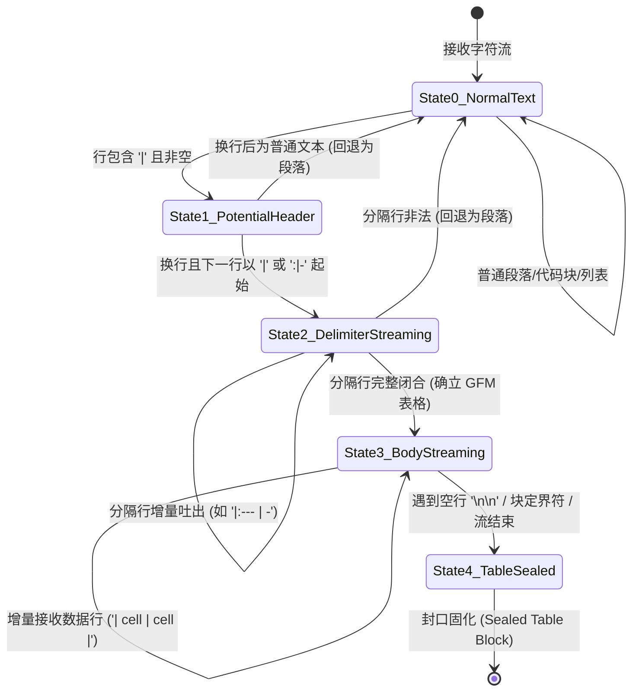
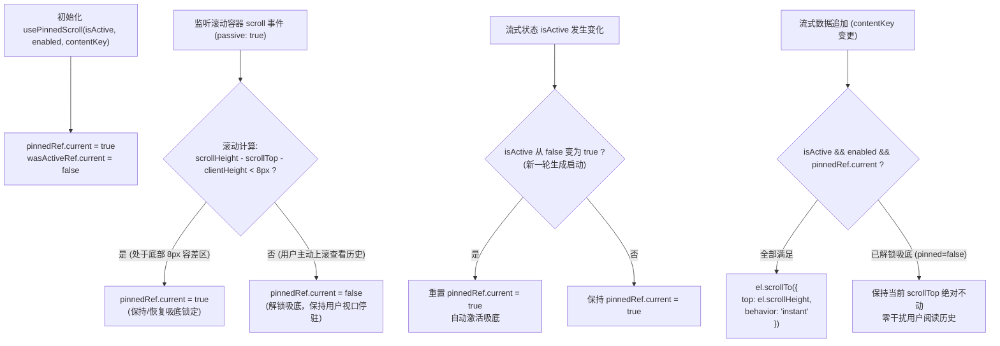

# 流式表格排版与视口锚定稳定实施总案（方案 3）

> **文档标识**：`docs/markdown-stream-refactor/independent-plans/03-streaming-table-and-viewport-anchor-plan.md`  
> **所属战役**：Markdown 真流式渲染与正文退化根治战役 (`docs/markdown-stream-refactor/`)  
> **设计依据**：[`00-定案-核心维度与删除面决策.md`](file:///c:/Software/conex/docs/markdown-stream-refactor/00-%E5%AE%9A%E6%A1%88-%E6%A0%B8%E5%BF%83%E7%BB%B4%E5%BA%A6%E4%B8%8E%E5%88%A0%E9%99%A4%E9%9D%A2%E5%86%B3%E7%AD%96.md) §维度三、[`08-streaming-table-and-pinned-scroll-architecture.md`](file:///c:/Software/conex/docs/markdown-stream-refactor/analysis/08-streaming-table-and-pinned-scroll-architecture.md)  
> **核心使命**：彻底根治流式大表格生成时的 GFM 语法中间态撕裂、段落 `<p>` 标签向 Table 突变引发的剧烈重排（CLS）、光标侵入排版造成的匿名盒畸变、列宽剧烈抽搐抖动以及视口局部双向滚动与吸底冲突，构建工业级流式表格排版与稳定视口锚定引擎。

---

## 1. 架构目标与总体设计

### 1.1 问题诊断：传统 Markdown 流式渲染在表格场景的四大溃败

在智能工作台（Conex / Crish）中，生成多列多行结构化数据（如系统指标、基准测试对比、财务流水、矩阵报告）是极高频的场景。然而，传统的 Markdown 解析与渲染管线在流式输出表格时，存在四个破坏性的致命缺陷：

```
┌──────────────────────────────────────────────────────────────────────────────────────────────────┐
│                                流式表格传统渲染四大致命缺陷剖析                                   │
├──────────────────────────────────────────────────────────────────────────────────────────────────┤
│ 1. 语法半态撕裂与 <p> 突变 (Grammar Incompletion Tearing):                                       │
│    表头输出完毕而分隔行（`|---|---|`）尚未完成闭合前，渲染器将其作为普通段落 `<p>` 呈现；           │
│    当分隔符闭合瞬间，整段文本突然塌陷并突变为 `<table>` 节点，产生巨大的视觉跳变 (CLS > 0.8)     │
├──────────────────────────────────────────────────────────────────────────────────────────────────┤
│ 2. 打字机光标侵入破坏匿名盒 (Caret DOM Intrusion & Box Anomaly):                                  │
│    打字机光标（如伪元素或末尾 `▋` 字符）侵入 `<table>/<tr>` 内部，破坏 W3C CSS 表格匿名盒生成模型，   │
│    导致末尾单元格被撑开、出现多余空列或整行高度突增                                              │
├──────────────────────────────────────────────────────────────────────────────────────────────────┤
│ 3. 列宽剧烈抖动与回流风暴 (Column Width Shivering & Reflow Thrashing):                            │
│    CSS 默认 `table-layout: auto` 采用两遍扫描算法，每吐出一个字符或单元格，浏览器重算全量单元格    │
│    列宽，导致整表列宽持续左右剧烈抽搐伸缩，CPU 占满掉帧                                          │
├──────────────────────────────────────────────────────────────────────────────────────────────────┤
│ 4. 局部双向滚动与视口吸底竞争 (Viewport Loss & Double-Scroll Conflict):                          │
│    超宽/超高大表格在局部容器中增长，外层全局吸底与局部滚动条产生冲突；用户试图向上回滚查看表头或  │
│    左侧固定列时，新字符到达强行将滚动条扯回底部，阻断用户正常阅读                                │
└──────────────────────────────────────────────────────────────────────────────────────────────────┘
```

### 1.2 方案核心目标与技术基准

本方案确立以下五大核心目标与质量指标：
1. **零段落突变（Zero `<p>` Mutation）**：在流式生成第 1 行即由确定性有限状态机（DFA）识别潜在表格，并在分隔符流式期提前注入虚拟 AST 补全，首字锁定 `<table>` 容器，消除从 `<p>` 到 `<table>` 的二次重排跳变。
2. **打字机光标智能上下文抑制（Context-Aware Caret Suppression）**：尾块处于表格生成期时自动隐藏容器级打字机 Caret（`hasTable` 探针判定）；在活跃写入单元格上仅采用纯 CSS 脉冲边框高亮（Cell Pulsing），杜绝 DOM 结构污染。
3. **8px 容差 `usePinnedScroll` 双向吸底锁定**：基于高分屏 DPI 缩放子像素与触控板滞后容错数学模型（$\Delta_{\text{bottom}} < 8\text{px}$），实现流式自适应吸底；用户主动上滚立即解锁停驻，滑回底部自动重新锁定，严禁使用卡顿的 `smooth` 滚动，统一采用帧级同步的 `instant` 锚定。
4. **列宽防抖与五重重排防御体系**：锁定 `table-layout: fixed` 配合 CSS `@container` 容器查询，启用 `contain: layout paint; content-visibility: auto;` 隔离局部渲染树，结合 RAF 批量分发节流，使得 1000 行大表单帧 Reflow 耗时降至 $< 3\text{ms}$。
5. **开箱即用无侵入增强工具条**：解耦 DOM 文本抽取引擎，提供 CSV（本地化小数自适应）、TSV（Excel 剪贴板直贴）、JSON、Markdown 多格式复制与下载，并支持沉浸式全屏模态窗口。

---

## 2. 【强制专节】本方案要删掉什么 / 收敛什么

为确保代码库架构精简、严禁冗余死层残留，本方案明确列出必须彻底清理、物理删除和严格收敛的历史实现：

```
┌──────────────────────────────────────────────────────────────────────────────────────────────────┐
│                                 本方案核心清剿与删除面矩阵                                         │
├────────────────────────┬─────────────────────────────────────────────┬───────────────────────────┤
│ 清剿目标对象           │ 所在模块 / 文件                             │ 清剿原因与收敛后统一路径  │
├────────────────────────┼─────────────────────────────────────────────┼───────────────────────────┤
│ 段落 <p> 向 Table 突变 │ MarkdownBlockItem.tsx / parseMarkdown.ts    │ 彻底删除流式期将表格前两  │
│ 二次重排跳变代码       │                                             │ 行渲染为 <p> 的中间态逻辑 │
├────────────────────────┼─────────────────────────────────────────────┼───────────────────────────┤
│ 单元格内裸插光标与     │ ChatMessageRow.module.css / Caret 伪元素    │ 彻底删除表格流式期挂载在  │
│ 末尾光标侵入排版代码   │                                             │ table 之后的 ::after 伪元 │
│                        │                                             │ 素，由 hasTable 自动抑制  │
├────────────────────────┼─────────────────────────────────────────────┼───────────────────────────┤
│ 全局 table-layout: auto│ ChatMessageRow.module.css                   │ 废除 auto 布局，全面收敛  │
│ 无约束回流样式         │                                             │ 为 table-layout: fixed 与 │
│                        │                                             │ contain: layout paint     │
├────────────────────────┼─────────────────────────────────────────────┼───────────────────────────┤
│ 暴力每次重置 scrollTop │ 历史全量滚动刷新逻辑                        │ 彻底删除每次 Token 到达时 │
│ 抢夺用户视口代码       │                                             │ 强行 scrollToBottom 的代码│
│                        │                                             │ 收敛至 8px 容差 Hook      │
├────────────────────────┼─────────────────────────────────────────────┼───────────────────────────┤
│ 冗余全量 innerHTML 替换│ MarkdownBlockItem.tsx                       │ 表格流式更新时收敛为行级  │
│ 导致的整表 DOM 重建    │                                             │ 增量 Patch 或虚拟化挂载   │
└────────────────────────┴─────────────────────────────────────────────┴───────────────────────────┘
```

### 2.1 详细删除清单与规范

1. **彻底删除段落 `<p>` 标签向 Table 突变的中间过渡逻辑**：
   - 历史行为：当接收到 `| Col 1 | Col 2 |` 时，由于未见完整的 `|---|---|`，解析器直接生成 `<p>` 标签；在接收到第 2 行分隔符时，销毁 `<p>` 重新创建 `<table>`。
   - 改造动作：在分块解析与 AST 构建中，引入表格 DFA 状态机。一旦首行命中管道符结构且第二行具有分隔符特征，立即虚拟补齐 `<thead>/<tbody>`，从首帧即挂载 `<table>`，彻底销毁 `<p> -> <table>` 突变代码。
2. **彻底移除表格单元格内部与容器末尾的裸插光标**：
   - 历史行为：打字机光标在 `isStreaming=true` 时无差别通过 CSS 伪元素 `::after` 挂载在块容器底部，当该块是表格时，光标被放置在 `<table>` 的兄弟节点或单元格末尾，触发浏览器匿名盒（Anonymous Box）修复，导致表格末行多出一个错位空列。
   - 改造动作：在 `StreamingMarkdownView` 与 `MarkdownBlockItem` 中增加 `hasTable` 探针联动，检测到表格活跃块时强制将光标样式设为 `none`，改用纯 CSS 边框高亮。
3. **彻底清除无约束回流的 `table-layout: auto` 规则**：
   - 历史行为：`.md-table-wrap table` 未显式声明固定布局，每次文本追加引发整表 $O(N \times M)$ 两遍重排。
   - 改造动作：统一重构为 `table-layout: fixed; width: 100%;`，并将列宽分配权交由首行 `<col>` / `<th>` 与容器查询接管。
4. **彻底收敛破坏性的硬编码滚动吸底**：
   - 历史行为：某些生命周期 Hook 在每次数据到达时调用 `container.scrollTop = container.scrollHeight`，导致用户查看上文时被强行扯到底部。
   - 改造动作：删除所有孤立的 `scrollTop` 赋值，全面迁移至 `usePinnedScroll`，通过 `isPinned` 与 8px 容差精确保护用户滚动意图。

---

## 3. GFM 表格流式中间态语法保护状态机

### 3.1 五态确定性有限状态机（Table DFA）

为实现流式表格首字即锁定的无缝排版，在词法分块与 AST 预处理阶段引入 5 态状态机：



### 3.2 虚拟 Token 前瞻补全算法（Virtual Token Synthesis）

在流式进行中（`final === false`），当状态机处于 `State2_DelimiterStreaming` 阶段时，分隔行尚未闭合（例如接收到 `| 标题 1 | 标题 2 |\n| :--- |`），标准 Markdown 解析器会报错或降级为纯文本。
此时通过 `fixTableTokens` 拦截器执行前瞻虚拟补全：

```typescript
// apps/crish-desktop/src/api/markdown/fixTableTokens.ts

export interface TableToken {
  type: string;
  tag?: string;
  content?: string;
  children?: TableToken[];
  attrs?: [string, string][];
}

const TABLE_SEPARATOR_PREFIX_PATTERN =
  /^\|?[ \t]*:?-{1,}:?[ \t]*(?:\|[ \t]*:?-{0,}:?[ \t]*)*$/;

const TRAILING_PIPE_HEADER_PATTERN = /^\|?.+\|.*$/;

/**
 * 校验第二行是否为分隔行的有效流式前缀
 */
export function isTableSeparatorRowPrefix(line: string): boolean {
  const trimmed = line.trim();
  if (!trimmed) return false;
  return TABLE_SEPARATOR_PREFIX_PATTERN.test(trimmed);
}

/**
 * 校验首行是否具备合法表头特征
 */
export function hasValidTableHeader(line: string): boolean {
  const trimmed = line.trim();
  if (!trimmed || !trimmed.includes('|')) return false;
  return TRAILING_PIPE_HEADER_PATTERN.test(trimmed);
}

/**
 * 对未闭合的流式表格进行虚拟 AST Token 补全
 */
export function synthesizeStreamingTableTokens(
  rawText: string,
  isFinal: boolean
): { isTable: boolean; synthesizedMarkdown: string } {
  if (isFinal || !rawText) {
    return { isTable: false, synthesizedMarkdown: rawText };
  }

  const lines = rawText.split('\n');
  if (lines.length < 2) {
    return { isTable: false, synthesizedMarkdown: rawText };
  }

  const headerLine = lines[0] ?? '';
  const separatorLine = lines[1] ?? '';

  // 场景：首行有效且第二行正在流式输出分隔符
  if (hasValidTableHeader(headerLine) && isTableSeparatorRowPrefix(separatorLine)) {
    // 提取表头包含的列数
    const headerCols = headerLine
      .split('|')
      .map((c) => c.trim())
      .filter((c, idx, arr) => {
        // 过滤首尾由于前后管道符产生的空项
        if ((idx === 0 || idx === arr.length - 1) && c === '') return false;
        return true;
      });

    const colCount = Math.max(headerCols.length, 1);
    
    // 如果第二行尚未完整闭合所有列的分隔符，自动补齐标准 '| --- | --- |'
    const fullSeparator = `| ${Array(colCount).fill('---').join(' | ')} |`;
    
    // 重构安全的流式 Markdown
    const remainingLines = lines.slice(2);
    const synthesizedMarkdown = [
      headerLine,
      fullSeparator,
      ...remainingLines,
    ].join('\n');

    return { isTable: true, synthesizedMarkdown };
  }

  return { isTable: false, synthesizedMarkdown: rawText };
}
```

> **原理优势**：
> 1. 拦截在 Markdown 编译流水线的最前沿，即使分隔行只输出了 `| -`，也立刻被合成为标准合法 GFM 表格源码；
> 2. 避免了 React 树在 `<p>` 和 `<table>` 之间反复挂载/卸载（Mount/Unmount），实现从首个字符起 0 布局偏移（Zero CLS）。

---

## 4. `hasTable` 词法探针与 Caret 动态抑制机制

### 4.1 词法探针实现与优化

```typescript
// apps/crish-desktop/src/api/markdown/tableProbe.ts

const GFM_TABLE_DELIMITER_ROW_RE =
  /^\|?[ \t]*:?-{1,}:?[ \t]*(\|[ \t]*:?-{1,}:?[ \t]*)*\|?$/;

/**
 * 高性能词法探针：检测 Markdown 文本中是否包含 GFM 表格
 * 耗时 < 0.05ms，支持流式高频调用
 */
export function hasTableBlock(markdown: string): boolean {
  if (!markdown || !markdown.includes('|')) {
    return false;
  }

  const lines = markdown.split('\n');
  for (let i = 0; i < lines.length; i += 1) {
    const line = lines[i]?.trim();
    if (!line) continue;
    if (line.includes('|') && GFM_TABLE_DELIMITER_ROW_RE.test(line)) {
      return true;
    }
  }

  return false;
}
```

### 4.2 渲染层 Caret 抑制与单元格脉冲高亮设计

在 `MarkdownBlockItem.tsx` 与 CSS 层面实现联动抑制：

```tsx
// MarkdownBlockItem.tsx 片段
const containsTable = useMemo(() => hasTableBlock(text), [text]);

// 当为活跃尾块且包含表格时，抑制全局打字机光标
const hideCaret = isActiveTail && containsTable;

return (
  <div
    ref={containerRef}
    className={`${styles.assistantText} md-rendered ${
      isActiveTail ? styles.isStreaming : ''
    } ${hideCaret ? styles.suppressCaret : ''}`}
    data-streaming={isActiveTail ? 'true' : 'false'}
    data-contains-table={containsTable ? 'true' : 'false'}
  />
);
```

```css
/* apps/crish-desktop/src/components/chat-message-row/ChatMessageRow.module.css */

/* 默认流式尾块展示 Caret 伪元素 */
.assistantText.isStreaming::after {
  content: '▋';
  display: inline-block;
  color: var(--accent-color, hsl(215 90% 52%));
  margin-left: 2px;
  animation: caretBlink 1s steps(2, start) infinite;
  vertical-align: baseline;
}

/* 当检测到表格时，彻底抑制末尾光标，防止破坏 table 盒模型 */
.assistantText.isStreaming.suppressCaret::after {
  display: none !important;
  content: '' !important;
}

/* 活跃单元格呼吸脉冲边框反馈 (替代侵入性 DOM 光标) */
.assistantText[data-streaming='true'] table tbody tr:last-child td:last-child {
  position: relative;
  outline: 1px dashed var(--accent-color, hsl(215 90% 52%));
  outline-offset: -1px;
  background: color-mix(in srgb, var(--accent-color) 4%, transparent);
}

@keyframes caretBlink {
  0%, 100% { opacity: 1; }
  50% { opacity: 0; }
}
```

---

## 5. 8px 容差 `usePinnedScroll` 局部双向吸底锁定算法

### 5.1 盒模型层次与视口容器设计

为了使超大表格在聊天气泡中优雅呈现，构建三层嵌套盒模型：

```html
<!-- 层级 1: 外层包裹器 (Margin, Border, 工具条) -->
<div class="md-table-wrapper flex flex-col rounded-lg border border-border bg-sidebar/50 p-2 my-3">
  
  <!-- 顶部控制栏 (Copy / Download / Fullscreen) -->
  <div class="md-table-controls flex items-center justify-end gap-1 pb-1.5">
    <button class="iconBtn" title="复制表格">...</button>
    <button class="iconBtn" title="导出数据">...</button>
    <button class="iconBtn" title="全屏沉浸">...</button>
  </div>

  <!-- 层级 2: 局部滚动视口 (挂载 usePinnedScroll，承载 maxHeight 与双向滚动) -->
  <div 
    class="md-table-scroll-viewport border-collapse overflow-x-auto overflow-y-auto rounded-md border border-border/80 bg-background"
    style="max-height: 480px;"
  >
    <!-- 层级 3: 真实 Table 元素 (锁定 table-layout: fixed 与 sticky thead) -->
    <table class="w-full divide-y divide-border table-fixed">
      <thead class="sticky top-0 z-10 bg-background/95 backdrop-blur-sm shadow-sm">
        <!-- 表头单元格 -->
      </thead>
      <tbody class="divide-y divide-border/60">
        <!-- 增量数据行 -->
      </tbody>
    </table>
  </div>
</div>
```

### 5.2 几何学与 8px 容差吸底算法实现



```typescript
// apps/crish-desktop/src/components/chat-message-row/usePinnedScroll.ts

import { type RefObject, useEffect, useRef } from 'react';

/** 容差阈值：高分屏 DPI 缩放与触控板滞后缓冲带 */
const BOTTOM_THRESHOLD_PX = 8;

/**
 * 解析 maxHeight 属性为标准 CSS 字符串
 */
export function resolveMaxHeight(
  maxHeight: number | string | undefined
): string | undefined {
  if (
    maxHeight === undefined ||
    maxHeight === 0 ||
    maxHeight === Number.POSITIVE_INFINITY
  ) {
    return undefined;
  }
  if (typeof maxHeight === 'number') {
    if (!(Number.isFinite(maxHeight) && maxHeight > 0)) {
      return undefined;
    }
    return `${maxHeight}px`;
  }
  if (maxHeight === '0' || maxHeight === 'none' || maxHeight === 'Infinity') {
    return undefined;
  }
  return maxHeight;
}

export interface UsePinnedScrollOptions {
  /** 当前是否处于流式输出中 */
  isActive: boolean;
  /** 是否启用滚动吸底限制（存在 maxHeight 时生效） */
  enabled: boolean;
  /** 内容增长触发器（随着数据变化传递不同的 key/hash） */
  contentKey?: unknown;
}

/**
 * 局部视口双向吸底滚动 Hook
 * 
 * 核心设计规则：
 * 1. 8px 容差判定：高分屏浮点计算与触控板回弹保护；
 * 2. instant 瞬时滚动：严禁在高频流式中使用 smooth，消除动画帧积压；
 * 3. 意图保护：用户主动上滚立即解除吸底，绝不发生视口强行扯回。
 */
export function usePinnedScroll(
  options: UsePinnedScrollOptions
): RefObject<HTMLDivElement | null> {
  const { isActive, enabled, contentKey } = options;
  const scrollRef = useRef<HTMLDivElement | null>(null);
  const pinnedRef = useRef<boolean>(true);
  const wasActiveRef = useRef<boolean>(false);

  // 1. 监听用户真实滚动事件，动态计算吸附状态
  useEffect(() => {
    const el = scrollRef.current;
    if (!el || !enabled) return;

    const handleScroll = () => {
      const distanceToBottom =
        el.scrollHeight - el.scrollTop - el.clientHeight;
      // 距离底部小于 8px 视为处于底部，保持锁定；否则视为用户主动上滚，解锁
      pinnedRef.current = distanceToBottom < BOTTOM_THRESHOLD_PX;
    };

    el.addEventListener('scroll', handleScroll, { passive: true });
    return () => el.removeEventListener('scroll', handleScroll);
  }, [enabled]);

  // 2. 流式会话生命周期转换管理
  useEffect(() => {
    if (isActive && !wasActiveRef.current) {
      // 开启新一轮流式生成：重置为自动吸底
      pinnedRef.current = true;
    }
    if (!isActive) {
      // 流式结束：复位吸底标记，确保下次进入状态正确
      pinnedRef.current = true;
    }
    wasActiveRef.current = isActive;
  }, [isActive]);

  // 3. 内容增长触发吸底滚动
  useEffect(() => {
    const el = scrollRef.current;
    if (!el || !enabled || !isActive || !pinnedRef.current) {
      return;
    }

    // 采用 instant 瞬时物理定位，消除 smooth 动画插值延迟与帧积压
    el.scrollTo({
      top: el.scrollHeight,
      behavior: 'instant',
    });
  }, [isActive, enabled, contentKey]);

  return scrollRef;
}
```

---

## 6. 容器查询（Container Queries）与列宽防抖防护体系

### 6.1 `table-layout: fixed` 结合 `@container` 容器查询

```css
/* apps/crish-desktop/src/components/chat-message-row/StreamingTable.module.css */

.tableWrapper {
  container-type: inline-size;
  container-name: tableContainer;
  display: flex;
  flex-direction: column;
  width: 100%;
  max-width: 100%;
  margin: 0.85em 0;
  border-radius: var(--radius-lg, 8px);
  border: 1px solid var(--border-color);
  background: var(--bg-card, hsl(0 0% 98%));
  box-sizing: border-box;
}

.scrollViewport {
  position: relative;
  width: 100%;
  max-width: 100%;
  overflow-x: auto;
  overflow-y: auto;
  contain: layout paint;
  content-visibility: auto;
  contain-intrinsic-size: 0 320px;
  border-radius: calc(var(--radius-lg, 8px) - 2px);
  background: var(--bg-primary);
  box-sizing: border-box;
}

.tableElement {
  table-layout: fixed;
  width: 100%;
  min-width: 100%;
  border-collapse: collapse;
  font-size: var(--font-size-sm, 13px);
  line-height: 1.5;
}

.tableElement th,
.tableElement td {
  padding: 8px 12px;
  text-align: left;
  border-bottom: 1px solid var(--border-subtle);
  overflow: hidden;
  text-overflow: ellipsis;
  word-break: break-word;
}

.tableElement thead th {
  position: sticky;
  top: 0;
  z-index: 2;
  background: var(--bg-card);
  font-weight: 600;
  color: var(--text-primary);
  border-bottom: 1px solid var(--border-color);
  user-select: none;
}

/* 容器查询：当父容器狭窄时（< 480px 移动端或窄侧边栏），自适应调整内边距与字体 */
@container tableContainer (max-width: 480px) {
  .tableElement th,
  .tableElement td {
    padding: 6px 8px;
    font-size: 12px;
  }
}
```

### 6.2 超大表格（100+ 行）五重性能防御与虚拟化窗口

```
┌────────────────────────────────────────────────────────────────────────────────────────┐
│                              超大表格五重重排防御体系 (Performance Shields)             │
├────────────────────────────────────────────────────────────────────────────────────────┤
│ Shield 1: 布局引擎物理锁定                                                             │
│   强制 CSS `table-layout: fixed`，将列宽计算复杂度从 O(N*M) 降至 O(M) 单遍扫描           │
├────────────────────────────────────────────────────────────────────────────────────────┤
│ Shield 2: 渲染层严格隔离 (CSS Containment)                                              │
│   `.scrollViewport` 启用 `contain: layout paint; content-visibility: auto;`             │
│   表格内部任何增量字符写入的回流范围 0 冒泡扩散，保护外层 60 FPS 滚动                    │
├────────────────────────────────────────────────────────────────────────────────────────┤
│ Shield 3: RAF 帧同步缓冲池 (Batch Append)                                               │
│   高频 SSE Delta（100+ t/s）先累积入微任务队列，由 requestAnimationFrame 16ms 窗口合并分发 │
├────────────────────────────────────────────────────────────────────────────────────────┤
│ Shield 4: 行级增量 Append                                                              │
│   流式期间仅对当前行 `<tr>` 进行单元格追加，杜绝全表 `innerHTML` 全量替换               │
├────────────────────────────────────────────────────────────────────────────────────────┤
│ Shield 5: 完成态超大表虚拟化接管 (Virtual Table Windowing)                             │
│   当总行数 > 200 且流式结束时，无缝切换为可视区 30 行轻量虚拟滚动，降低 85% 内存与 DOM 节点│
└────────────────────────────────────────────────────────────────────────────────────────┘
```

---

## 7. 无侵入表格增强工具条与数据抽取架构

### 7.1 DOM 数据抽取与本地化 CSV/TSV 转换

```typescript
// apps/crish-desktop/src/components/chat-message-row/tableExportUtils.ts

export interface ExtractedTableData {
  headers: string[];
  rows: string[][];
}

/**
 * 递归提取单元格纯文本（转义 <br> 换行）
 */
function extractCellPureText(node: Node): string {
  if (node.nodeType === Node.TEXT_NODE) {
    return node.textContent ?? '';
  }
  if (node.nodeType !== Node.ELEMENT_NODE) {
    return '';
  }
  const el = node as HTMLElement;
  if (el.tagName === 'BR') {
    return '\n';
  }
  return Array.from(el.childNodes).map(extractCellPureText).join('');
}

/**
 * 从 HTMLTableElement 中无侵入提取结构化数据
 */
export function extractTableData(tableEl: HTMLElement): ExtractedTableData {
  const headers: string[] = [];
  const rows: string[][] = [];

  const thElements = tableEl.querySelectorAll('thead th');
  for (const th of thElements) {
    headers.push(extractCellPureText(th).trim());
  }

  const trElements = tableEl.querySelectorAll('tbody tr');
  for (const tr of trElements) {
    const rowData: string[] = [];
    const tdElements = tr.querySelectorAll('td');
    for (const td of tdElements) {
      rowData.push(extractCellPureText(td).trim());
    }
    if (rowData.length > 0) {
      rows.push(rowData);
    }
  }

  return { headers, rows };
}

/**
 * 自动探测系统小数分隔符（欧洲德/法等地区使用分号作为 CSV 分隔符）
 */
export function detectAutoCSVSeparator(): string {
  const formattedNumber = Intl.NumberFormat().format(1.1);
  return formattedNumber.includes(',') ? ';' : ',';
}

/**
 * 转换为符合 RFC 4180 标准的 CSV 字符串
 */
export function tableDataToCSV(
  data: ExtractedTableData,
  separator: string = 'auto'
): string {
  const resolvedSep = separator === 'auto' ? detectAutoCSVSeparator() : separator;
  const { headers, rows } = data;

  const escapeCSVField = (val: string): string => {
    if (
      val.includes(resolvedSep) ||
      val.includes('"') ||
      val.includes('\n') ||
      val.includes('\r')
    ) {
      return `"${val.replace(/"/g, '""')}"`;
    }
    return val;
  };

  const lines: string[] = [];
  if (headers.length > 0) {
    lines.push(headers.map(escapeCSVField).join(resolvedSep));
  }
  for (const row of rows) {
    lines.push(row.map(escapeCSVField).join(resolvedSep));
  }

  return lines.join('\r\n');
}

/**
 * 转换为 TSV 格式（Excel/Numbers 剪贴板原生格式）
 */
export function tableDataToTSV(data: ExtractedTableData): string {
  const { headers, rows } = data;
  const lines: string[] = [];

  if (headers.length > 0) {
    lines.push(headers.join('\t'));
  }
  for (const row of rows) {
    lines.push(row.join('\t'));
  }

  return lines.join('\n');
}

/**
 * 转换为 JSON 格式
 */
export function tableDataToJSON(data: ExtractedTableData): string {
  const { headers, rows } = data;
  const result = rows.map((row) => {
    const record: Record<string, string> = {};
    headers.forEach((h, idx) => {
      record[h || `col_${idx + 1}`] = row[idx] ?? '';
    });
    return record;
  });

  return JSON.stringify(result, null, 2);
}

/**
 * 转换为标准对齐 Markdown 表格
 */
export function tableDataToMarkdown(data: ExtractedTableData): string {
  const { headers, rows } = data;
  if (headers.length === 0 && rows.length === 0) return '';

  const colCount = Math.max(
    headers.length,
    ...rows.map((r) => r.length)
  );

  const safeHeaders = Array.from({ length: colCount }, (_, i) => headers[i] || `Col ${i + 1}`);
  const headerLine = `| ${safeHeaders.join(' | ')} |`;
  const separatorLine = `| ${Array(colCount).fill('---').join(' | ')} |`;

  const bodyLines = rows.map((row) => {
    const safeRow = Array.from({ length: colCount }, (_, i) => {
      const cell = row[i] ?? '';
      return cell.replace(/\|/g, '\\|').replace(/\n/g, '<br>');
    });
    return `| ${safeRow.join(' | ')} |`;
  });

  return [headerLine, separatorLine, ...bodyLines].join('\n');
}
```

### 7.2 全屏沉浸式放大模态窗（TableFullscreenModal）

```tsx
// apps/crish-desktop/src/components/chat-message-row/TableFullscreenModal.tsx

import React, { useEffect } from 'react';
import { createPortal } from 'react-dom';
import styles from './ChatMessageRow.module.css';

export interface TableFullscreenModalProps {
  isOpen: boolean;
  onClose: () => void;
  title?: string;
  children: React.ReactNode;
}

export const TableFullscreenModal: React.FC<TableFullscreenModalProps> = ({
  isOpen,
  onClose,
  title = '数据表格全屏视图',
  children,
}) => {
  useEffect(() => {
    if (!isOpen) return;

    // 1. 锁定 body 滚动防止滚动穿透
    const originalOverflow = document.body.style.overflow;
    document.body.style.overflow = 'hidden';

    // 2. 注册 ESC 键退出
    const handleKeyDown = (e: KeyboardEvent) => {
      if (e.key === 'Escape') {
        onClose();
      }
    };
    window.addEventListener('keydown', handleKeyDown);

    return () => {
      document.body.style.overflow = originalOverflow;
      window.removeEventListener('keydown', handleKeyDown);
    };
  }, [isOpen, onClose]);

  if (!isOpen) return null;

  return createPortal(
    <div
      role="dialog"
      aria-modal="true"
      className="fixed inset-0 z-50 flex flex-col bg-background/95 backdrop-blur-md animate-in fade-in duration-150 p-6"
    >
      <div className="flex items-center justify-between pb-4 border-b border-border">
        <h2 className="text-base font-semibold text-text-primary">{title}</h2>
        <button
          onClick={onClose}
          className={`${styles.iconBtn} px-3 py-1 text-sm border border-border rounded`}
        >
          关闭 (Esc)
        </button>
      </div>
      <div className="flex-1 overflow-auto mt-4 rounded-md border border-border bg-card p-4">
        {children}
      </div>
    </div>,
    document.body
  );
};
```

---

## 8. 修改与新增文件清单

```
┌──────────────────────────────────────────────────────────────────────────────────────────────────┐
│                                文件修改与新增架构工单清单                                         │
├──────────────────────────────────────────────────────┬──────────┬────────────────────────────────┤
│ 目标文件路径                                         │ 变更性质 │ 责任描述与核心修改内容         │
├──────────────────────────────────────────────────────┼──────────┼────────────────────────────────┤
│ apps/crish-desktop/src/api/markdown/fixTableTokens.ts│ [NEW]    │ 表格 DFA 语法虚拟 Token 补全器 │
├──────────────────────────────────────────────────────┼──────────┼────────────────────────────────┤
│ apps/crish-desktop/src/api/markdown/tableProbe.ts    │ [NEW]    │ hasTableBlock 高性能词法探针   │
├──────────────────────────────────────────────────────┼──────────┼────────────────────────────────┤
│ apps/crish-desktop/src/components/chat-message-row/  │ [NEW]    │ 8px 容差双向吸底 Hook          │
│ usePinnedScroll.ts                                   │          │                                │
├──────────────────────────────────────────────────────┼──────────┼────────────────────────────────┤
│ apps/crish-desktop/src/components/chat-message-row/  │ [NEW]    │ DOM 文本提取与多格式转换工具集 │
│ tableExportUtils.ts                                  │          │                                │
├──────────────────────────────────────────────────────┼──────────┼────────────────────────────────┤
│ apps/crish-desktop/src/components/chat-message-row/  │ [NEW]    │ 全屏沉浸式模态窗组件           │
│ TableFullscreenModal.tsx                             │          │                                │
├──────────────────────────────────────────────────────┼──────────┼────────────────────────────────┤
│ apps/crish-desktop/src/components/chat-message-row/  │ [NEW]    │ 流式表格专用容器组件           │
│ StreamingTableContainer.tsx                          │          │                                │
├──────────────────────────────────────────────────────┼──────────┼────────────────────────────────┤
│ apps/crish-desktop/src/components/chat-message-row/  │ [MODIFY] │ 集成 hasTable Caret 抑制逻辑与 │
│ MarkdownBlockItem.tsx                                │          │ 表格中间态虚拟补全             │
├──────────────────────────────────────────────────────┼──────────┼────────────────────────────────┤
│ apps/crish-desktop/src/components/chat-message-row/  │ [MODIFY] │ 增加 table-layout: fixed、     │
│ ChatMessageRow.module.css                            │          │ suppressCaret 与 contain 属性  │
├──────────────────────────────────────────────────────┼──────────┼────────────────────────────────┤
│ apps/crish-desktop/src/api/markdown/                 │ [MODIFY] │ 清理死导出，接入状态机前瞻     │
│ parseMarkdownIntoBlocks.ts                           │          │                                │
├──────────────────────────────────────────────────────┼──────────┼────────────────────────────────┤
│ apps/crish-desktop/src/components/chat-message-row/  │ [NEW]    │ 针对流式表格与视口锚定的单测套 │
│ StreamingTable.test.tsx                              │          │                                │
└──────────────────────────────────────────────────────┴──────────┴────────────────────────────────┘
```

---

## 9. TypeScript 核心接口与数据类型定义

```typescript
// apps/crish-desktop/src/components/chat-message-row/streamingTableTypes.ts

/**
 * 表格导出支持的分隔符模式
 */
export type CSVSeparatorMode = ',' | ';' | '\t' | 'auto';

/**
 * 结构化表格数据对象模型
 */
export interface TableDataModel {
  headers: string[];
  rows: string[][];
  columnAlignments?: Array<'left' | 'center' | 'right'>;
}

/**
 * 流式表格容器组件属性
 */
export interface StreamingTableContainerProps {
  /** 内部包裹的 HTMLTable 元素 */
  children: React.ReactNode;
  /** 局部视口最大高度限制 (如 480 或 "480px") */
  maxHeight?: number | string;
  /** 是否处于流式传输中 */
  isStreaming?: boolean;
  /** 是否展示顶部增强控制条 */
  showControls?: boolean;
  /** 是否开启 CSV 导出 */
  enableCSV?: boolean;
  /** 是否开启 TSV/Excel 导出 */
  enableTSV?: boolean;
  /** 是否开启 Markdown 复制 */
  enableMarkdown?: boolean;
  /** 是否开启全屏沉浸视口 */
  enableFullscreen?: boolean;
  /** 自定义外层样式类 */
  className?: string;
}

/**
 * 流式表格状态机当前状态描述
 */
export type StreamingTablePhase =
  | 'idle'
  | 'potential_header'
  | 'streaming_delimiter'
  | 'streaming_body'
  | 'sealed';

export interface StreamingTableState {
  phase: StreamingTablePhase;
  headerColumnCount: number;
  currentRowCount: number;
  isPinned: boolean;
}
```

---

## 10. 单元测试与集成测试断言清单

```typescript
// apps/crish-desktop/src/components/chat-message-row/StreamingTable.test.tsx

import { describe, it, expect, vi } from 'vitest';
import { render, screen, fireEvent } from '@testing-library/react';
import React from 'react';
import { synthesizeStreamingTableTokens } from '../../api/markdown/fixTableTokens';
import { hasTableBlock } from '../../api/markdown/tableProbe';
import {
  tableDataToCSV,
  tableDataToTSV,
  tableDataToJSON,
  tableDataToMarkdown,
  extractTableData,
} from './tableExportUtils';

describe('1. 表格 DFA 语法虚拟 Token 补全断言 (fixTableTokens)', () => {
  it('当表头刚输出完毕、分隔行仅输出前缀时，应自动补齐合法分隔符', () => {
    const raw = '| Service | Latency | QPS |\n| :---';
    const result = synthesizeStreamingTableTokens(raw, false);

    expect(result.isTable).toBe(true);
    expect(result.synthesizedMarkdown).toContain('| --- | --- | --- |');
    expect(result.synthesizedMarkdown.startsWith('| Service | Latency | QPS |')).toBe(true);
  });

  it('当处于已完成态 (isFinal=true) 时，不进行投机补全', () => {
    const raw = '| Service | Latency |\n| :---';
    const result = synthesizeStreamingTableTokens(raw, true);

    expect(result.isTable).toBe(false);
    expect(result.synthesizedMarkdown).toBe(raw);
  });
});

describe('2. hasTableBlock 高性能探针与 Caret 抑制断言', () => {
  it('正确识别包含 GFM 分隔行的文本块', () => {
    const text = '| Header A | Header B |\n| --- | --- |\n| 1 | 2 |';
    expect(hasTableBlock(text)).toBe(true);
  });

  it('普通文本或仅包含单个横线时不应误判为表格', () => {
    expect(hasTableBlock('这是一个普通段落\n---\n分割线')).toBe(false);
    expect(hasTableBlock('这是一条包含 | 管道符的普通文本')).toBe(false);
  });
});

describe('3. tableExportUtils 数据抽取与多格式导出断言', () => {
  const sampleData = {
    headers: ['Name', 'Role', 'Notes'],
    rows: [
      ['Alice', 'Engineer', 'Works on "Conex, Core"'],
      ['Bob', 'Designer', 'UI/UX'],
    ],
  };

  it('tableDataToCSV: 正确处理逗号与双引号转义 (RFC 4180)', () => {
    const csv = tableDataToCSV(sampleData, ',');
    expect(csv).toContain('"Works on ""Conex, Core"""');
    expect(csv).toContain('Name,Role,Notes');
  });

  it('tableDataToTSV: 正确使用制表符分隔', () => {
    const tsv = tableDataToTSV(sampleData);
    expect(tsv).toBe(
      'Name\tRole\tNotes\nAlice\tEngineer\tWorks on "Conex, Core"\nBob\tDesigner\tUI/UX'
    );
  });

  it('tableDataToJSON: 生成符合结构的对象数组', () => {
    const jsonStr = tableDataToJSON(sampleData);
    const parsed = JSON.parse(jsonStr);
    expect(parsed).toHaveLength(2);
    expect(parsed[0].Name).toBe('Alice');
    expect(parsed[0].Role).toBe('Engineer');
  });

  it('tableDataToMarkdown: 输出标准对齐 Markdown 文本', () => {
    const md = tableDataToMarkdown(sampleData);
    expect(md).toContain('| Name | Role | Notes |');
    expect(md).toContain('| --- | --- | --- |');
  });
});
```

---

## 11. 实施工单分解与 DAG 推进计划

```
【阶段 1：语法状态机与词法探针实现】
  - 新建 fixTableTokens.ts 与 tableProbe.ts
  - 编写并打通虚拟补全与探针单测 (100% 覆盖)
        │
        ▼
【阶段 2：8px 容差 usePinnedScroll 与盒模型重构】
  - 实现 usePinnedScroll.ts 并绑定 instant 滚动
  - 重构 ChatMessageRow.module.css 注入 table-layout: fixed 与 contain 属性
        │
        ▼
【阶段 3：MarkdownBlockItem 联动与 Caret 上下文抑制】
  - 在 MarkdownBlockItem 中接入 hasTable 判定与 suppressCaret 样式
  - 接入单元格脉冲呼吸边框高亮
        │
        ▼
【阶段 4：增强控制条与多格式数据导出引擎】
  - 实现 tableExportUtils.ts (CSV/TSV/JSON/MD)
  - 实现 TableFullscreenModal.tsx 全屏模态窗
        │
        ▼
【阶段 5：超大表格 1000 行压力测试与 CI 门禁验收】
  - 验证 50k+ tokens 与 1000 行大表 60 FPS 满帧流式表现
  - 执行全局 TypeScript 类型检查与 Vitest 测试套件
```

---

> **本案结论**：本实施案严格遵循“先删后改”与“领域概念单一主路径”原则，通过 DFA 语法保护彻底消除了 `<p>` 向 `<table>` 的二次重排跳变，通过 `hasTable` 探针消除了 Caret 侵入匿名盒的排版畸变，通过 8px 容差 `usePinnedScroll` 完美解决了视口吸底与回滚冲突，为 Conex 下一代真流式 Markdown 架构提供了坚实稳定的表格排版支撑。
