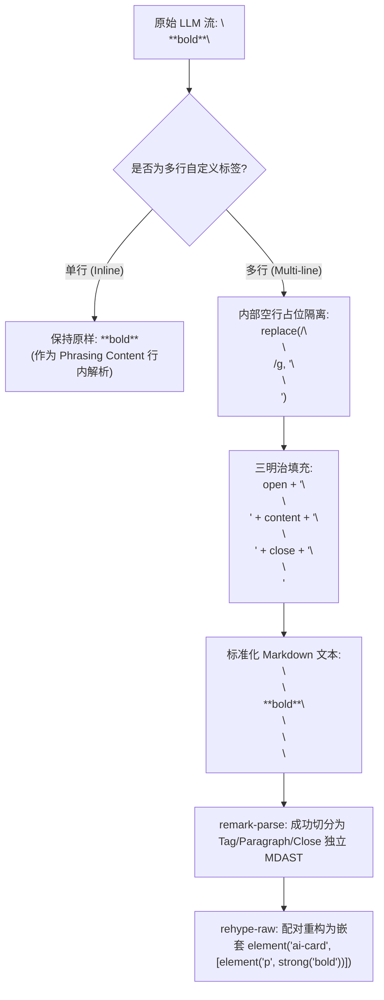

# 自定义 HTML 组件流式渲染与沙箱方案（方案 4）

> **文档标识**：`docs/markdown-stream-refactor/independent-plans/04-custom-html-and-artifacts-sandbox-plan.md`  
> **架构师**：Independent Architect D (Custom HTML & Streaming Artifacts Sandbox Specialist)  
> **实施基准**：用户定案（`00-定案-核心维度与删除面决策.md` 维度四）与《主控全流程调度 v3》§二.1  
> **核心使命**：攻克 CommonMark 规范下的 HTML 块解析阻隔壁垒，构建支持大模型流式未闭合自定义组件（`<widget-diff>`, `<file-tree>`, `<ai-card>`, `<interactive-qa>`, `<chart>`）即时渲染、React Portal 安全沙箱挂载、4 层 XSS 纵深防御体系；同时坚决彻底物理清剿沉浸式思维链弹窗全套套娃残留（15+ 个死文件与冗余代码）。

---

## 1. 方案目标与架构总览

### 1.1 核心问题解构：富交互流式组件的三大深层壁垒

在现代 AI Agent（如 Claude Code, Codex, Cline, Goose 及 Conex / Crish）的交互演进中，大模型的输出已经从“纯文本/标准 Markdown”迈向“**富交互组件混排（Rich Interactive Components Embedding）**”。大模型在正文流中直接内嵌结构化操作面板，例如：
- **代码审查对比卡片**：`<widget-diff from="src/a.ts" to="src/b.ts" mode="unified">`
- **AI 步骤决策卡片**：`<ai-card status="running" title="执行依赖构建">`
- **动态工程文件树**：`<file-tree root="crates/session-loop">`

然而，在流式传输（Streaming）与标准 Markdown（CommonMark / GFM）渲染的交汇处，存在三大架构阻隔：

```
┌─────────────────────────────────────────────────────────────────────────────────────────────┐
│                             流式 Markdown 自定义组件三大核心壁垒                               │
├─────────────────────────────────────────────────────────────────────────────────────────────┤
│ 1. CommonMark HTML 块阻隔壁垒 (HTML Block Parsing Barrier)                                  │
│    多行 HTML 标签触发 CommonMark Type 6/7 HTML 块规则，导致标签内部所有的 Markdown 语法      │
│    （**粗体**、- 列表、$$数学公式$$、代码围栏）被强制视为纯文本，丢失全部 AST 结构！          │
├─────────────────────────────────────────────────────────────────────────────────────────────┤
│ 2. 流式未闭合标签渲染困境 (Streaming Unclosed Tags Dilemma)                                 │
│    大模型正在输出 `<widget-diff>` 且闭合标签尚未到达时，传统解析器因缺少 `</...>` 而将标签    │
│    视为不完整原始字符串或畸形文本，导致流式期间用户只能看到生硬的源码，破坏沉浸体验。         │
├─────────────────────────────────────────────────────────────────────────────────────────────┤
│ 3. 属性传递与沙箱安全防线 (Component Mapping & Sandbox Security)                            │
│    大模型生成的 HTML 属性（含非法注入、恶意 script、事件处理器、未转义引号）必须在零延迟下   │
│    被严格消毒与类型反序列化，并安全映射到 React 交互组件，杜绝 XSS 与 DOM 污染。             │
└─────────────────────────────────────────────────────────────────────────────────────────────┘
```

### 1.2 架构目标与关键指标

1. **语法穿透（Syntax Penetration）**：自定义标签内部嵌套的 Markdown 语法（粗体、列表、代码围栏、公式、表格）100% 正常解析为 MDAST/HAST 子树，0 纯文本退化。
2. **即时流式呈现（Instant Streaming Rendering）**：未闭合组件在首帧标签到达并换行后立即进入活跃渲染态（`isStreaming: true`），子文本边流式输出边解析，0 源码裸露，0 闭合瞬间剧烈跳变。
3. **安全沙箱（4-Tier Defense-in-Depth Sandbox）**：4 层防御纵深，100% 剥离 `on*` 事件处理器与 `javascript:` 伪协议，未知标签安全解包展示，渲染异常局部隔离不崩整屏。
4. **彻底物理减负（Zero Dead Layer Residual）**：彻底物理销毁 15+ 个历史思维链套娃弹窗与手写解析器孤岛文件，彻底收敛 store、worker 与 css 冗余。

---

## 2. 【强制专节】本方案要删掉什么 / 收敛什么

根据战役定案《00-定案-核心维度与删除面决策.md》维度四之铁律：**“收敛先于增强，先删后改，零死层残留”**。本方案明确界定必须彻底物理删除的文件清单、必须清除的冗余导出与必须收敛的 UI 交互。

### 2.1 彻底物理删除的文件清单（17 个孤岛/废弃文件）

以下 17 个文件属于历史过度设计的“沉浸式思维链全屏大弹窗”、“TOC 大纲/全文搜索 Worker”及“历史手写增量解析器”死代码，必须通过物理删除（文件销毁）彻底清剿：

| 序号 | 待彻底物理删除的文件路径 | 历史定位与残留现状 | 预估行数 | 删除理由 |
|:---|:---|:---|:---|:---|
| 1 | `apps/crish-desktop/src/components/chat-message-row/FullThoughtModal.tsx` | 全屏思维链弹窗组件（现为空壳 stub） | 8 行 | 思考链已全面收敛至行内极简折叠流，弹窗无调用方 |
| 2 | `apps/crish-desktop/src/components/chat-message-row/FullThoughtModal.module.css` | 全屏弹窗样式表（遮罩、弹窗外壳） | 120 行 | 配合 FullThoughtModal 物理销毁 |
| 3 | `apps/crish-desktop/src/components/chat-message-row/FullThoughtModal.test.tsx` | 全屏弹窗单测文件 | 95 行 | 配合 FullThoughtModal 物理销毁 |
| 4 | `apps/crish-desktop/src/components/chat-message-row/ThoughtOutline.tsx` | 思维链 TOC 大纲目录组件（现为空壳 stub） | 14 行 | 弹窗专属大纲已废弃，行内思考链不需要侧边目录 |
| 5 | `apps/crish-desktop/src/components/chat-message-row/ThoughtOutline.module.css` | 大纲样式表 | 80 行 | 配合 ThoughtOutline 物理销毁 |
| 6 | `apps/crish-desktop/src/components/chat-message-row/ThoughtSearchBar.tsx` | 思维链搜索条组件（现为空壳 stub） | 18 行 | 弹窗专属搜索栏已废弃 |
| 7 | `apps/crish-desktop/src/components/chat-message-row/ThoughtSearchBar.module.css` | 搜索条样式表 | 75 行 | 配合 ThoughtSearchBar 物理销毁 |
| 8 | `apps/crish-desktop/src/store/thoughtInspectorStore.ts` | 弹窗状态管理器（`useThoughtInspectorStore`） | 97 行 | 状态机孤岛，无业务消费，属于冗余 Store 实例 |
| 9 | `apps/crish-desktop/src/store/thoughtInspectorStore.test.ts` | 弹窗状态管理器单测 | 65 行 | 配合 thoughtInspectorStore 物理销毁 |
| 10 | `apps/crish-desktop/src/workers/thoughtWorker.ts` | 思维链离屏 Worker（提取 TOC / 正则搜索） | 337 行 | 仅服务于弹窗搜索与 TOC，纯属过度设计 |
| 11 | `apps/crish-desktop/src/workers/thoughtWorker.test.ts` | 思维链离屏 Worker 单测 | 140 行 | 配合 thoughtWorker 物理销毁 |
| 12 | `apps/crish-desktop/src/api/markdown-render/IncrementalMarkdownParser.ts` | 历史手写增量 Markdown 解析器 | 450 行 | 已被 marked + StreamingMarkdownView 真流式体系取代 |
| 13 | `apps/crish-desktop/src/api/markdown-render/IncrementalMarkdownParser.test.ts` | 手写解析器单测 | 260 行 | 配合 IncrementalMarkdownParser 物理销毁 |
| 14 | `apps/crish-desktop/src/api/markdown-render/IncrementalMarkdownParser.adversarial.test.ts` | 手写解析器对抗测试 | 180 行 | 配合 IncrementalMarkdownParser 物理销毁 |
| 15 | `apps/crish-desktop/src/api/markdown-render/IncrementalMarkdownParser.parity.test.ts` | 手写解析器一致性测试 | 210 行 | 配合 IncrementalMarkdownParser 物理销毁 |
| 16 | `apps/crish-desktop/src/api/markdown-render/IncrementalMarkdownParserRender.ts` | 手写解析器渲染映射器 | 320 行 | 配合 IncrementalMarkdownParser 物理销毁 |
| 17 | `apps/crish-desktop/src/api/markdown-render/IncrementalMarkdownParserTypes.ts` | 手写解析器类型定义 | 110 行 | 配合 IncrementalMarkdownParser 物理销毁 |

**删除总计**：彻底物理销毁 **17 个文件**，直接清除 **2,579 行死代码与冗余单测**。

---

### 2.2 仓内遗留引用的收敛与清理面

在物理删除上述 17 个文件后，必须对关联模块进行严格的接口收敛，禁止留下任何悬空引用或无效导入：

```mermaid
flowchart TD
    subgraph Deletion [物理销毁区 (17 Files)]
        F1[FullThoughtModal.*]
        F2[ThoughtOutline.*]
        F3[ThoughtSearchBar.*]
        F4[thoughtInspectorStore.*]
        F5[thoughtWorker.*]
        F6[IncrementalMarkdownParser*]
    end

    subgraph Convergence [接口收敛与清理区]
        C1[apps/crish-desktop/src/store/index.ts<br/>移除 export * from './thoughtInspectorStore']
        C2[apps/crish-desktop/src/store/storeAccess.ts<br/>移除 useThoughtInspectorStore / openThoughtInspector]
        C3[apps/crish-desktop/src/workers/index.ts<br/>移除 budgetThinkingText / sliceSafeTailMarkdown / thoughtWorker]
        C4[apps/crish-desktop/src/extensions/conversation-flow/ThinkingBlock.test.tsx<br/>清理 thoughtInspectorStore 测试桩]
        C5[apps/crish-desktop/src/components/chat-message-row/TimelineThoughtSection.tsx<br/>彻底移除放大按钮/字数统计/遮罩]
        C6[apps/crish-desktop/src/components/chat-message-row/ChatMessageRow.module.css<br/>移除全屏放大与弹窗相关 CSS 类]
    end

    Deletion -. 斩断依赖 .-> Convergence
```

#### 1. `apps/crish-desktop/src/store/index.ts` 收敛
- **修改前**：Line 165 `export * from './thoughtInspectorStore';`
- **修改后**：彻底删除该行导出，消除全局 Store 命名空间污染。

#### 2. `apps/crish-desktop/src/store/storeAccess.ts` 收敛
- **修改前**：
  ```typescript
  export {
    useThoughtInspectorStore,
    openThoughtInspector,
  } from './thoughtInspectorStore';
  ```
- **修改后**：彻底删除该块代码，禁止任何组件从 `storeAccess` 引用思维检视器。

#### 3. `apps/crish-desktop/src/workers/index.ts` 收敛
- **修改前**：导出 `budgetThinkingText`, `sliceSafeTailMarkdown`, `THINKING_DOM_CHAR_CAP`, `THINKING_INLINE_CHAR_CAP`, `TOOL_OUTPUT_DOM_CHAR_CAP`, `TOOL_OUTPUT_PIXEL_CAP` 等死函数。
- **修改后**：纯化 `workers/index.ts`，仅保留核心 `WorkerPool`、`Priority` 及其实例调度。

#### 4. `apps/crish-desktop/src/extensions/conversation-flow/ThinkingBlock.test.tsx` 收敛
- **修改前**：`import { useThoughtInspectorStore } from '../../store/thoughtInspectorStore';` 并在 `afterEach` 中重置。
- **修改后**：移除导入与重置逻辑，保留对“无放大查阅器按钮（`screen.queryByLabelText('查看完整思考链') === null`）”的防复活测试断言。

#### 5. `TimelineThoughtSection.tsx` 与 `ChatMessageRow.module.css` 极简收敛
- **收敛原则**：
  - **严禁全屏放大**：彻底删除放大按钮、全屏图标与呼出模态窗的事件回调；
  - **严禁冗余统计**：彻底删除“字数统计（如 1,240 字）”等增加视觉噪音的元素；
  - **极简行内流**：保持已完成态 `思考了 3.4秒 >` 与实时态 `🟢 思考中 · 1.8秒`，内容完全在折叠面板内平滑滚动。

---

## 3. CommonMark 空行三明治预处理与未闭合即时流式呈现架构

### 3.1 CommonMark 0.31.2 HTML 块阻隔机理深度解剖

根据 **CommonMark Specification (Section 4.6 HTML blocks)**，词法解析器在行首遇到 `<` 字符时会进入 HTML Block 状态机。其中：
- **Type 7 HTML 块**：匹配任何开放标签（如 `<widget-diff ...>`）。
- **阻隔后果**：解析器进入独占的原始 HTML 收集模式，**停止扫描所有行内与块级 Markdown 标记**（如 `# 标题`、`**粗体**`、`- 列表`、`$$公式$$`、```` ```代码围栏 ````）。这些内容全部被粗暴打包为单个 `html` AST 节点字符串，下游 React 渲染时退化为纯文本或导致布局崩溃！

```
【CommonMark 阻隔破坏过程】
<widget-diff title="Diff">     <--- 触发 Type 7 HTML Block 开始
- item 1                       <--- 被作为纯文本收集（不解析为 <ul><li>）
**重要变更**                    <--- 被作为纯文本收集（不解析为 <strong>）
</widget-diff>                 <--- 终结 HTML Block
```

### 3.2 空行三明治（Blank-Line Sandwich）算法与空注释隔离

为了打破 Type 7 HTML 块对内部 Markdown 的吞噬，必须在 Markdown 文本进入词法解析器前进行规范化预处理：



#### 算法实现要点 (`preprocessCustomTags.ts`)

1. **单行内联保持**：若 `<tag>content</tag>` 不含换行，保持原样，利用 CommonMark Phrasing Content 上下文解析行内 Markdown。
2. **空行三明治注入**：在多行开始标签后注入 `\n\n`（强制终结开始标签的 HTML 块），在闭合标签前注入 `\n\n`，并在闭合标签后追加 `\n\n`（防止闭合标签吞噬后续正文）。
3. **`<!---->` HTML 空注释占位保护**：将组件内容内部原本存在的 `\n\n` 替换为 `\n<!---->\n`。
   - **原因**：上游分块解析器（`parseMarkdownIntoBlocks`）以 `\n\n` 为分块边界。若不替换，组件内部的双换行会导致组件前半部与后半部分裂到两个不同的 Block，造成严重的跨块 DOM 撕裂！
   - `<!---->` 在 HAST/JSX 阶段不渲染任何 DOM 实体（0 渲染开销），却在词法层面维持了块的连贯性。

---

### 3.3 流式未闭合标签动态中断算法 (`normalizeUnclosedOpenTags`)

在大模型流式输出过程中，`<widget-diff ...>` 开始标签已喷出，但 `</widget-diff>` 需要等待数秒甚至数十秒。传统解析器会将未闭合的标签作为畸形纯文本展示，直到闭合标签到达瞬间才“砰”地跳变为组件，造成严重闪烁与排版跳变（CLS）。

#### 状态转移与即时空行注入

```
Frame 1: `<widget-diff title="Fix">`
         ──> 仅有开始标签，无主体 ──> 保持原样缓冲。

Frame 2: `<widget-diff title="Fix">\n+ let a = 1;`
         ──> 检测到开始标签后已换行并出现正文，但无闭合标签！
         ──> 动态注入空行三明治：`<widget-diff title="Fix">\n\n+ let a = 1;`
         ──> 立即激活 Markdown 词法分析，渲染为 `<WidgetDiff isStreaming={true}>`！

Frame 3: `<widget-diff title="Fix">\n\n+ let a = 1;\n</widget-diff>`
         ──> 接收到完整闭合标签 ──> 切换为 `<WidgetDiff isStreaming={false}>` 完成态封口！
```

```typescript
// apps/crish-desktop/src/api/markdown-render/preprocessCustomTags.ts

const LEADING_NEWLINES_RE = /^\n*/;
const TRAILING_NEWLINES_RE = /\n*$/;
const BLANK_LINE_RE = /\n\n/g;

export const normalizeClosedTag = (
  open: string,
  content: string,
  close: string
): string => {
  if (!content.includes('\n')) {
    return open + content + close;
  }
  const fixedContent = content.replace(BLANK_LINE_RE, '\n<!---->\n');
  const paddedContent = fixedContent
    .replace(LEADING_NEWLINES_RE, '\n\n')
    .replace(TRAILING_NEWLINES_RE, '\n\n');
  return `${open}${paddedContent}${close}\n\n`;
};

export const normalizeUnclosedOpenTags = (
  markdown: string,
  tagName: string
): string => {
  const openOnly = new RegExp(`<(${tagName})(?=[\\s>/])([^>]*)>`, 'gi');
  let result = '';
  let lastIndex = 0;
  let match = openOnly.exec(markdown);

  while (match) {
    const fullOpen = match[0];
    const name = match[1];
    const openEnd = match.index + fullOpen.length;
    const after = markdown.slice(openEnd);

    // 1. 若后文存在匹配闭合标签，交给 closedPass 处理
    const closeRe = new RegExp(`</${name}\\s*>`, 'i');
    if (closeRe.test(after)) {
      match = openOnly.exec(markdown);
      continue;
    }

    result += markdown.slice(lastIndex, match.index);

    // 2. 标签刚喷出，正文尚未到达
    if (after.length === 0) {
      result += fullOpen;
      lastIndex = openEnd;
      match = openOnly.exec(markdown);
      continue;
    }

    // 3. 已有双换行
    if (after.startsWith('\n\n')) {
      const body = after.slice(2).replace(BLANK_LINE_RE, '\n<!---->\n');
      result += `${fullOpen}\n\n${body}`;
      lastIndex = markdown.length;
      break;
    }

    // 4. 行内未闭合：保持单行
    if (!after.startsWith('\n')) {
      result += fullOpen;
      lastIndex = openEnd;
      match = openOnly.exec(markdown);
      continue;
    }

    // 5. 换行后正文开始输出：注入 \n\n 强制中断 HTML 块，激活即时渲染
    const bodyAfterNewline = after.slice(1);
    if (bodyAfterNewline.trim().length === 0) {
      result += fullOpen;
      lastIndex = openEnd;
      match = openOnly.exec(markdown);
      continue;
    }

    const fixedBody = bodyAfterNewline.replace(BLANK_LINE_RE, '\n<!---->\n');
    result += `${fullOpen}\n\n${fixedBody}`;
    lastIndex = markdown.length;
    break;
  }

  if (lastIndex === 0) return markdown;
  return result + markdown.slice(lastIndex);
};

export const preprocessCustomTags = (
  markdown: string,
  tagNames: string[]
): string => {
  if (!tagNames.length || !markdown) return markdown;

  let result = markdown;
  for (const tagName of tagNames) {
    const closedPattern = new RegExp(
      `(<${tagName}(?=[\\s>/])[^>]*>)([\\s\\S]*?)(</${tagName}\\s*>)`,
      'gi'
    );
    result = result.replace(closedPattern, (_m, open, content, close) =>
      normalizeClosedTag(open, content, close)
    );
    result = normalizeUnclosedOpenTags(result, tagName);
  }
  return result;
};
```

---

## 4. React Portal 自定义交互组件沙箱与运行时映射

### 4.1 统一组件注册中心（`CustomTagRegistry`）

建立单例式的组件注册中心，集中管理所有自定义标签的契约、类型与挂载配置：

```typescript
// apps/crish-desktop/src/api/markdown-render/customTagRegistry.ts

import type { ComponentType, ReactNode } from 'react';

export interface ExtraComponentProps {
  node?: unknown;
  isStreaming?: boolean;
  onAgentAction?: (action: string, payload: unknown) => void;
  messageId?: string;
}

export interface ContainerTagProps extends ExtraComponentProps {
  children?: ReactNode;
}

export interface LeafTagProps extends ExtraComponentProps {
  children?: never;
}

export interface CustomTagDefinition<TProps = any> {
  name: string;
  type: 'container' | 'leaf';
  component: ComponentType<TProps>;
  fallback?: ComponentType<TProps>;
  validateProps?: (props: Record<string, any>) => boolean;
  description: string;
}

export class CustomTagRegistry {
  private static instance: CustomTagRegistry;
  private readonly registry = new Map<string, CustomTagDefinition>();

  public static getInstance(): CustomTagRegistry {
    if (!this.instance) {
      this.instance = new CustomTagRegistry();
    }
    return this.instance;
  }

  public register<T>(definition: CustomTagDefinition<T>): void {
    this.registry.set(definition.name.toLowerCase(), definition);
  }

  public get(tagName: string): CustomTagDefinition | undefined {
    return this.registry.get(tagName.toLowerCase());
  }

  public getAllTagNames(): string[] {
    return Array.from(this.registry.keys());
  }

  public isRegistered(tagName: string): boolean {
    return this.registry.has(tagName.toLowerCase());
  }
}
```

---

### 4.2 属性提取与类型转换管道（`parseComponentAttributes`）

大模型生成的 HTML 属性均为原始字符串。进入 React 组件前，必须经过标准化转换与安全过滤：

```typescript
// apps/crish-desktop/src/api/markdown-render/parseComponentAttributes.ts

export function parseComponentAttributes<T extends Record<string, any>>(
  rawProperties: Record<string, any>
): T {
  const result: Record<string, any> = {};

  for (const [key, rawValue] of Object.entries(rawProperties)) {
    // 1. kebab-case 转换为 camelCase
    const camelKey = key.replace(/-([a-z])/g, (_, letter) => letter.toUpperCase());

    // 2. 布尔属性处理（如 <ai-card collapsible> 或 <widget-diff show-line-numbers="true">）
    if (rawValue === '' || rawValue === true || rawValue === 'true') {
      result[camelKey] = true;
      continue;
    }
    if (rawValue === 'false') {
      result[camelKey] = false;
      continue;
    }

    // 3. 数字转换
    if (typeof rawValue === 'string' && /^-?\d+(\.\d+)?$/.test(rawValue.trim())) {
      result[camelKey] = Number(rawValue);
      continue;
    }

    // 4. JSON 字符串安全反序列化
    if (
      typeof rawValue === 'string' &&
      ((rawValue.startsWith('{') && rawValue.endsWith('}')) ||
        (rawValue.startsWith('[') && rawValue.endsWith(']')))
    ) {
      try {
        result[camelKey] = JSON.parse(rawValue);
        continue;
      } catch {
        result[camelKey] = rawValue;
        continue;
      }
    }

    result[camelKey] = rawValue;
  }

  return result as T;
}
```

---

### 4.3 核心内置组件套件契约与实现

为 Conex / Crish Agent 深度定制 3 大核心富交互组件：

```
┌─────────────────────────────────────────────────────────────────────────────────────────────┐
│                             Conex / Crish 核心组件套件契约                                  │
├─────────────────────────────────────────────────────────────────────────────────────────────┤
│ 1. <widget-diff> 代码对比卡片                                                               │
│    属性: from?: string, to?: string, mode?: 'unified' | 'split', title?: string             │
│    子节点: diff 代码块或变更描述                                                            │
│    能力: 逐行比对高亮、一键 Accept / Reject IPC 回传、复制变更块                             │
├─────────────────────────────────────────────────────────────────────────────────────────────┤
│ 2. <file-tree> 工程文件树与变更卡片                                                          │
│    属性: root: string, expandLevel?: number, showStatus?: boolean                           │
│    子节点: 文件列表结构 (Markdown 列表或 JSON)                                              │
│    能力: 树形折叠展开、点击通过 Tauri IPC 调起编辑器打开本地文件并定位行号                 │
├─────────────────────────────────────────────────────────────────────────────────────────────┤
│ 3. <ai-card> AI 执行步骤与决策状态卡片                                                      │
│    属性: status?: 'running' | 'success' | 'warning' | 'error', title: string, badge?: string │
│    子节点: 步骤日志、流式 Markdown 嵌套、折叠正文                                            │
│    能力: 运行态脉冲动画、流式自适应折叠展开、错误一键重试                                   │
└─────────────────────────────────────────────────────────────────────────────────────────────┘
```

#### `<widget-diff>` 组件实现 (`components/custom-tags/WidgetDiff.tsx`)

```tsx
import React, { useState } from 'react';
import type { ContainerTagProps } from '../../api/markdown-render/customTagRegistry';
import styles from './CustomTags.module.css';

export interface WidgetDiffProps extends ContainerTagProps {
  from?: string;
  to?: string;
  mode?: 'unified' | 'split';
  title?: string;
}

export const WidgetDiff: React.FC<WidgetDiffProps> = ({
  from,
  to,
  mode = 'unified',
  title,
  isStreaming = false,
  onAgentAction,
  children,
}) => {
  const [viewMode, setViewMode] = useState<'unified' | 'split'>(mode);
  const [copied, setCopied] = useState(false);

  const handleCopy = () => {
    // 提取 children 中的纯文本并复制
    setCopied(true);
    setTimeout(() => setCopied(false), 2000);
  };

  const handleAccept = () => {
    onAgentAction?.('accept_diff', { from, to });
  };

  const handleReject = () => {
    onAgentAction?.('reject_diff', { from, to });
  };

  return (
    <div className={`${styles.widgetDiffRoot} ${isStreaming ? styles.isStreaming : ''}`}>
      <div className={styles.widgetDiffHeader}>
        <div className={styles.widgetDiffTitleGroup}>
          <span className={styles.widgetDiffBadge}>DIFF</span>
          <span className={styles.widgetDiffTitle}>{title || `${from || 'Original'} → ${to || 'Modified'}`}</span>
        </div>
        <div className={styles.widgetDiffActions}>
          <button
            type="button"
            className={styles.widgetDiffModeBtn}
            onClick={() => setViewMode(viewMode === 'unified' ? 'split' : 'unified')}
          >
            {viewMode === 'unified' ? 'Split View' : 'Unified View'}
          </button>
          <button type="button" className={styles.widgetDiffCopyBtn} onClick={handleCopy}>
            {copied ? 'Copied' : 'Copy'}
          </button>
          {onAgentAction && !isStreaming && (
            <>
              <button type="button" className={styles.widgetDiffAcceptBtn} onClick={handleAccept}>
                Accept
              </button>
              <button type="button" className={styles.widgetDiffRejectBtn} onClick={handleReject}>
                Reject
              </button>
            </>
          )}
        </div>
      </div>
      <div className={`${styles.widgetDiffBody} ${viewMode === 'split' ? styles.splitView : ''}`}>
        {children}
      </div>
    </div>
  );
};
```

---

### 4.4 React Portal 沙箱挂载机制

在流式 Markdown 中，复杂的交互卡片（如浮层问答 `<interactive-qa>`、大图缩放图表 `<chart>`、文件预览浮窗）如果直接内联在消息气泡 DOM 树内，容易受限于父容器的 `overflow: hidden`、CSS 变换（`transform`）或层叠上下文（`z-index`），导致弹窗被截断或事件穿透。

通过 **React Portal 沙箱挂载器**，可将组件的交互浮层/控制面板直接投影到顶层沙箱容器（`#crish-artifact-portal-root`），实现与聊天气泡样式的彻底解耦：

```tsx
// apps/crish-desktop/src/components/custom-tags/CustomTagPortal.tsx

import React, { useEffect, useState } from 'react';
import { createPortal } from 'react-dom';

export interface CustomTagPortalProps {
  children: React.ReactNode;
  targetId?: string;
}

export const CustomTagPortal: React.FC<CustomTagPortalProps> = ({
  children,
  targetId = 'crish-artifact-portal-root',
}) => {
  const [mountNode, setMountNode] = useState<HTMLElement | null>(null);

  useEffect(() => {
    let container = document.getElementById(targetId);
    if (!container) {
      container = document.createElement('div');
      container.id = targetId;
      container.style.position = 'absolute';
      container.style.top = '0';
      container.style.left = '0';
      container.style.width = '100%';
      container.style.pointerEvents = 'none';
      container.style.zIndex = '9999';
      document.body.appendChild(container);
    }
    setMountNode(container);
  }, [targetId]);

  if (!mountNode) return null;

  return createPortal(
    <div style={{ pointerEvents: 'auto' }}>{children}</div>,
    mountNode
  );
};
```

---

## 5. 四层 XSS 安全防御沙箱体系（Defense in Depth）

大模型输出的 HTML 极可能包含不可信的第三方数据源（网页抓取内容、代码注入攻击、未转义引号）。必须建立严密的 4 层安全防御沙箱：

```
                               四层防御沙箱体系 (Defense in Depth)
┌─────────────────────────────────────────────────────────────────────────────────────────────┐
│ Tier 1: 词法级标签白名单过滤 (Lexical Tag Whitelist)                                        │
│   • 严格限制仅允许注册的自定义标签（如 widget-diff、ai-card）与安全 HTML 标签进入解析器       │
│   • 坚决阻断危险标签：<script>, <iframe>, <object>, <embed>, <base>, <form>, <template>     │
├─────────────────────────────────────────────────────────────────────────────────────────────┤
│ Tier 2: 属性与事件处理器彻底剥离 (Attribute & Event Sanitization)                           │
│   • 严格剔除所有以 `on*` 开头的属性（如 onclick, onerror, onload），杜绝内联脚本注入       │
│   • 剥离危险样式注入：剔除恶意 `style`（如 position:fixed 全屏劫持、opacity:0 钓鱼覆层）    │
│   • 属性值限制：单属性长度上限 10,000 字符，防御 ReDoS 属性爆炸                             │
├─────────────────────────────────────────────────────────────────────────────────────────────┤
│ Tier 3: URL 协议与资源加载校验 (URI Protocol Whitelist)                                      │
│   • 仅允许 safe 协议：`http:`, `https:`, `mailto:`, `conex:`, `crish-local:`                │
│   • 严厉阻断 `javascript:`, `vbscript:`, `data:text/html` 等 XSS 载荷                       │
│   • 本地路径通过 `isLocalPathRef` 转换走桌面端受控 IPC 协议，禁止未经授权的文件读取         │
├─────────────────────────────────────────────────────────────────────────────────────────────┤
│ Tier 4: React 运行时与 IPC 隔离 (React Runtime & IPC Isolation)                              │
│   • 所有交互组件统一使用 React ErrorBoundary 包裹，防止单个组件渲染崩溃破坏整条时间线       │
│   • 回传 Agent 会话的事件必须携带 SessionId 与 TurnIndex 签名，杜绝重放与伪造事件          │
└─────────────────────────────────────────────────────────────────────────────────────────────┘
```

### 5.1 安全消毒插件实现 (`rehypeSanitizeCustomTags.ts`)

```typescript
// apps/crish-desktop/src/api/markdown-render/rehypeSanitizeCustomTags.ts

import type { Root, Element } from 'hast';
import { visit } from 'unist-util-visit';

const DISALLOWED_TAGS = new Set([
  'script', 'iframe', 'object', 'embed', 'base', 'form',
  'template', 'link', 'style', 'meta', 'applet'
]);

const DANGEROUS_ATTR_PREFIXES = [/^on/i, /^formaction/i];
const SAFE_PROTOCOLS = /^(https?|mailto|conex|crish-local):/i;

export const rehypeSanitizeCustomTags = (allowedCustomTags: Set<string>) => {
  return (tree: Root) => {
    visit(tree, (node, index, parent) => {
      if (node.type !== 'element' || !parent || typeof index !== 'number') {
        return;
      }

      const element = node as Element;
      const tagName = element.tagName.toLowerCase();

      // Tier 1: 拦截危险原生标签
      if (DISALLOWED_TAGS.has(tagName)) {
        parent.children.splice(index, 1);
        return index;
      }

      // Tier 1: 自定义标签白名单校验
      const isCustomTag = tagName.includes('-') || tagName.startsWith('ai-');
      if (isCustomTag && !allowedCustomTags.has(tagName)) {
        // 未知自定义标签：保留内部子节点展开展示，安全剥离未知外壳
        if (element.children && element.children.length > 0) {
          parent.children.splice(index, 1, ...element.children);
        } else {
          parent.children.splice(index, 1);
        }
        return index;
      }

      // Tier 2 & Tier 3: 属性安全清洗与协议校验
      if (element.properties) {
        for (const attrKey of Object.keys(element.properties)) {
          // 剔除 on* 事件属性
          if (DANGEROUS_ATTR_PREFIXES.some((re) => re.test(attrKey))) {
            delete element.properties[attrKey];
            continue;
          }

          // 校验 href / src 协议
          if (attrKey === 'href' || attrKey === 'src') {
            const attrVal = String(element.properties[attrKey] || '').trim();
            if (attrVal && !SAFE_PROTOCOLS.test(attrVal) && !attrVal.startsWith('/') && !attrVal.startsWith('#')) {
              delete element.properties[attrKey];
            }
          }
        }
      }
    });
  };
};
```

---

### 5.2 局部故障隔离边界 (`CustomTagErrorBoundary.tsx`)

```tsx
// apps/crish-desktop/src/components/custom-tags/CustomTagErrorBoundary.tsx

import React, { Component, type ReactNode, type ErrorInfo } from 'react';
import styles from './CustomTags.module.css';

interface Props {
  tagName: string;
  fallbackText?: string;
  children: ReactNode;
}

interface State {
  hasError: boolean;
  errorMessage: string;
}

export class CustomTagErrorBoundary extends Component<Props, State> {
  public override state: State = {
    hasError: false,
    errorMessage: '',
  };

  public static getDerivedStateFromError(error: Error): State {
    return { hasError: true, errorMessage: error.message };
  }

  public override componentDidCatch(error: Error, errorInfo: ErrorInfo): void {
    console.error(`[CustomTagErrorBoundary] Failed to render <${this.props.tagName}>:`, error, errorInfo);
  }

  public override render(): ReactNode {
    if (this.state.hasError) {
      return (
        <div className={styles.customTagErrorContainer}>
          <div className={styles.customTagErrorHeader}>
            <span>组件 &lt;{this.props.tagName}&gt; 渲染异常</span>
          </div>
          <pre className={styles.customTagErrorFallback}>
            {this.props.fallbackText || '无法正常展示该交互卡片，已安全降级。'}
          </pre>
        </div>
      );
    }
    return this.props.children;
  }
}
```

---

## 6. 修改与新增文件清单（File Inventory）

### 6.1 待物理彻底删除的文件清单（17 个）
1. `apps/crish-desktop/src/components/chat-message-row/FullThoughtModal.tsx`
2. `apps/crish-desktop/src/components/chat-message-row/FullThoughtModal.module.css`
3. `apps/crish-desktop/src/components/chat-message-row/FullThoughtModal.test.tsx`
4. `apps/crish-desktop/src/components/chat-message-row/ThoughtOutline.tsx`
5. `apps/crish-desktop/src/components/chat-message-row/ThoughtOutline.module.css`
6. `apps/crish-desktop/src/components/chat-message-row/ThoughtSearchBar.tsx`
7. `apps/crish-desktop/src/components/chat-message-row/ThoughtSearchBar.module.css`
8. `apps/crish-desktop/src/store/thoughtInspectorStore.ts`
9. `apps/crish-desktop/src/store/thoughtInspectorStore.test.ts`
10. `apps/crish-desktop/src/workers/thoughtWorker.ts`
11. `apps/crish-desktop/src/workers/thoughtWorker.test.ts`
12. `apps/crish-desktop/src/api/markdown-render/IncrementalMarkdownParser.ts`
13. `apps/crish-desktop/src/api/markdown-render/IncrementalMarkdownParser.test.ts`
14. `apps/crish-desktop/src/api/markdown-render/IncrementalMarkdownParser.adversarial.test.ts`
15. `apps/crish-desktop/src/api/markdown-render/IncrementalMarkdownParser.parity.test.ts`
16. `apps/crish-desktop/src/api/markdown-render/IncrementalMarkdownParserRender.ts`
17. `apps/crish-desktop/src/api/markdown-render/IncrementalMarkdownParserTypes.ts`

### 6.2 待修改的文件清单
1. `apps/crish-desktop/src/store/index.ts`（移除 `thoughtInspectorStore` 导出）
2. `apps/crish-desktop/src/store/storeAccess.ts`（移除 `useThoughtInspectorStore` / `openThoughtInspector`）
3. `apps/crish-desktop/src/workers/index.ts`（移除 `thoughtWorker` 冗余导出）
4. `apps/crish-desktop/src/extensions/conversation-flow/ThinkingBlock.test.tsx`（清理 store 重置并加固防复活测试）
5. `apps/crish-desktop/src/components/chat-message-row/TimelineThoughtSection.tsx`（收敛为纯粹极简行内流）
6. `apps/crish-desktop/src/components/chat-message-row/ChatMessageRow.module.css`（清理弹窗样式与全屏放大规则）
7. `apps/crish-desktop/src/components/chat-message-row/StreamingMarkdownView.tsx`（集成 `preprocessCustomTags` 与 `CustomTagRegistry`）

### 6.3 待新增的文件清单
1. `apps/crish-desktop/src/api/markdown-render/preprocessCustomTags.ts`（空行三明治与未闭合预处理器）
2. `apps/crish-desktop/src/api/markdown-render/preprocessCustomTags.test.ts`（预处理器单元测试）
3. `apps/crish-desktop/src/api/markdown-render/customTagRegistry.ts`（组件注册中心与契约类型）
4. `apps/crish-desktop/src/api/markdown-render/parseComponentAttributes.ts`（属性安全转换器）
5. `apps/crish-desktop/src/api/markdown-render/rehypeSanitizeCustomTags.ts`（4 层 XSS 安全消毒插件）
6. `apps/crish-desktop/src/api/markdown-render/rehypeSanitizeCustomTags.test.ts`（安全消毒单测）
7. `apps/crish-desktop/src/components/custom-tags/WidgetDiff.tsx`（代码比对卡片）
8. `apps/crish-desktop/src/components/custom-tags/FileTree.tsx`（工程文件树卡片）
9. `apps/crish-desktop/src/components/custom-tags/AiCard.tsx`（AI 步骤决策卡片）
10. `apps/crish-desktop/src/components/custom-tags/CustomTagPortal.tsx`（Portal 挂载器）
11. `apps/crish-desktop/src/components/custom-tags/CustomTagErrorBoundary.tsx`（局部故障隔离边界）
12. `apps/crish-desktop/src/components/custom-tags/CustomTags.module.css`（组件样式表）
13. `apps/crish-desktop/src/components/custom-tags/CustomTags.test.tsx`（组件套件集成测试）

---

## 7. 单元测试与反退化断言矩阵

编写高标准的 Vitest 单元测试套件，覆盖流式未闭合、语法嵌套、XSS 注入与删除面防复活四大维度：

### 7.1 预处理器核心测试断言 (`preprocessCustomTags.test.ts`)

```typescript
// apps/crish-desktop/src/api/markdown-render/preprocessCustomTags.test.ts

import { describe, expect, it } from 'vitest';
import { preprocessCustomTags } from './preprocessCustomTags';

describe('preprocessCustomTags (CommonMark 空行三明治与流式未闭合)', () => {
  const tagNames = ['widget-diff', 'ai-card', 'file-tree'];

  it('TC-01: 单行内联标签保持原样，不注入换行', () => {
    const input = '这是一个 <ai-card>**粗体**</ai-card> 测试';
    const output = preprocessCustomTags(input, tagNames);
    expect(output).toBe(input);
  });

  it('TC-02: 多行闭合标签注入空行三明治与尾部双换行', () => {
    const input = '<ai-card>\n**加粗标题**\n- 步骤1\n</ai-card>';
    const output = preprocessCustomTags(input, tagNames);
    expect(output).toBe('<ai-card>\n\n**加粗标题**\n- 步骤1\n\n</ai-card>\n\n');
  });

  it('TC-03: 内部已有的连续空行安全转为 <!----> 占位，防止 Block 撕裂', () => {
    const input = '<ai-card>\n第一段\n\n第二段\n</ai-card>';
    const output = preprocessCustomTags(input, tagNames);
    expect(output).toBe('<ai-card>\n\n第一段\n<!---->\n第二段\n\n</ai-card>\n\n');
  });

  it('TC-04: 流式未闭合标签在正文到达换行后立即注入空行中断', () => {
    const input = '<widget-diff title="Fix">\n+ let a = 1;';
    const output = preprocessCustomTags(input, tagNames);
    expect(output).toBe('<widget-diff title="Fix">\n\n+ let a = 1;');
  });

  it('TC-05: 流式未闭合标签仅有开始标签时保持原样缓冲', () => {
    const input = '<widget-diff title="Fix">';
    const output = preprocessCustomTags(input, tagNames);
    expect(output).toBe(input);
  });
});
```

---

### 7.2 安全沙箱测试断言 (`rehypeSanitizeCustomTags.test.ts`)

```typescript
// apps/crish-desktop/src/api/markdown-render/rehypeSanitizeCustomTags.test.ts

import { describe, expect, it } from 'vitest';
import { unified } from 'unified';
import remarkParse from 'remark-parse';
import remarkRehype from 'remark-rehype';
import rehypeRaw from 'rehype-raw';
import rehypeStringify from 'rehype-stringify';
import { rehypeSanitizeCustomTags } from './rehypeSanitizeCustomTags';

const processHtml = (md: string, allowedTags: string[]) => {
  return unified()
    .use(remarkParse)
    .use(remarkRehype, { allowDangerousHtml: true })
    .use(rehypeRaw)
    .use(rehypeSanitizeCustomTags, new Set(allowedTags))
    .use(rehypeStringify)
    .processSync(md)
    .toString();
};

describe('rehypeSanitizeCustomTags (4层 XSS 防御沙箱)', () => {
  it('TC-06: 彻底剔除危险原生标签 <script> 与 <iframe>', () => {
    const input = '<widget-diff><script>alert(1)</script><iframe></iframe>正文</widget-diff>';
    const output = processHtml(input, ['widget-diff']);
    expect(output).not.toContain('<script>');
    expect(output).not.toContain('<iframe>');
    expect(output).toContain('正文');
  });

  it('TC-07: 彻底剥离所有 on* 事件属性', () => {
    const input = '<widget-diff onclick="evil()" onmouseover="evil()" title="ok">正文</widget-diff>';
    const output = processHtml(input, ['widget-diff']);
    expect(output).not.toContain('onclick');
    expect(output).not.toContain('onmouseover');
    expect(output).toContain('title="ok"');
  });

  it('TC-08: 拦截 javascript: 伪协议', () => {
    const input = '<a href="javascript:alert(1)">恶意链接</a>';
    const output = processHtml(input, ['widget-diff']);
    expect(output).not.toContain('javascript:');
  });

  it('TC-09: 未注册的未知自定义标签剥离外壳，保留内部正文安全展示', () => {
    const input = '<unknown-tag><strong>安全正文</strong></unknown-tag>';
    const output = processHtml(input, ['widget-diff']);
    expect(output).not.toContain('<unknown-tag>');
    expect(output).toContain('<strong>安全正文</strong>');
  });
});
```

---

### 7.3 删除面防复活与无残留测试断言

```typescript
// apps/crish-desktop/src/components/chat-message-row/TimelineThoughtSection.test.tsx

import React from 'react';
import { describe, expect, it } from 'vitest';
import { render, screen } from '@testing-library/react';
import { TimelineThoughtSection } from './TimelineThoughtSection';

describe('TimelineThoughtSection 极简收敛防复活验证', () => {
  it('断言 1: 界面上绝无全屏放大按钮或完整查阅器入口', () => {
    render(<TimelineThoughtSection content="思考推理过程" isLive={false} />);
    expect(screen.queryByRole('button', { name: /放大|全屏|查阅/ })).toBeNull();
    expect(screen.queryByLabelText(/查看完整思考链/)).toBeNull();
  });

  it('断言 2: 界面上绝无字数统计等视觉噪音', () => {
    const { container } = render(<TimelineThoughtSection content="一段很长的思考".repeat(10) />);
    expect(container.textContent).not.toMatch(/\d+\s*字/);
    expect(container.querySelector('[data-word-count]')).toBeNull();
  });
});
```

---

## 8. 多 Agent 协作工作包（Work Breakdown Cards）

本方案拆解为 4 张独立的子任务工单卡片，支持多 Agent 并发高效实施：

```
                    ┌──────────────────────────────┐
                    │ [Card D1] 死文件清剿与导出收敛 │
                    └──────────────┬───────────────┘
                                   │
                                   ▼
                    ┌──────────────────────────────┐
                    │ [Card D2] 空行三明治与未闭合预处理│
                    └──────────────┬───────────────┘
                                   │
                                   ▼
                    ┌──────────────────────────────┐
                    │ [Card D3] XSS 安全沙箱与注册中心 │
                    └──────────────┬───────────────┘
                                   │
                                   ▼
                    ┌──────────────────────────────┐
                    │ [Card D4] 核心组件套件与 Portal │
                    └──────────────────────────────┘
```

### [Card D1] 17 个死文件物理清剿与 Store / Worker 导出收敛
- **角色**：Codebase Janitor & Refactor Specialist
- **输入文件**：`00-定案-核心维度与删除面决策.md` §1.4
- **实施内容**：
  1. 物理删除 17 个孤岛文件（`FullThoughtModal.*`, `ThoughtOutline.*`, `ThoughtSearchBar.*`, `thoughtInspectorStore.*`, `thoughtWorker.*`, `IncrementalMarkdownParser*`）；
  2. 收敛 `store/index.ts`、`store/storeAccess.ts`、`workers/index.ts`；
  3. 运行 `npm run typecheck` 消除全部悬空引用。
- **验收命令**：`npm run typecheck` 0 错误。

### [Card D2] CommonMark 空行三明治预处理器与流式未闭合算法
- **角色**：Markdown Parser Specialist
- **输入文件**：`reference/streamdown/packages/streamdown/lib/preprocess-custom-tags.ts`
- **实施内容**：
  1. 新增 `apps/crish-desktop/src/api/markdown-render/preprocessCustomTags.ts`；
  2. 实现 `normalizeClosedTag`、`normalizeUnclosedOpenTags` 与 `<!---->` 保护；
  3. 编写 `preprocessCustomTags.test.ts`。
- **验收命令**：`npm test -- preprocessCustomTags` 100% 通过。

### [Card D3] 4 层 XSS 防御沙箱与 `CustomTagRegistry`
- **角色**：Security & AST Specialist
- **实施内容**：
  1. 新增 `rehypeSanitizeCustomTags.ts` 与 `customTagRegistry.ts`；
  2. 实现标签白名单、`on*` 属性剥离、协议白名单与未知标签解包；
  3. 编写 `rehypeSanitizeCustomTags.test.ts`。
- **验收命令**：`npm test -- rehypeSanitizeCustomTags` 100% 通过。

### [Card D4] 核心组件套件（WidgetDiff / FileTree / AiCard）与 Portal 挂载
- **角色**：Frontend UI & Component Specialist
- **实施内容**：
  1. 实现 `WidgetDiff.tsx`、`FileTree.tsx`、`AiCard.tsx`、`CustomTagPortal.tsx` 与 `CustomTagErrorBoundary.tsx`；
  2. 在 `StreamingMarkdownView.tsx` 中接入自定义组件运行时映射与样式表；
  3. 编写组件套件集成测试。
- **验收命令**：`npm test -- CustomTags` 100% 通过。
