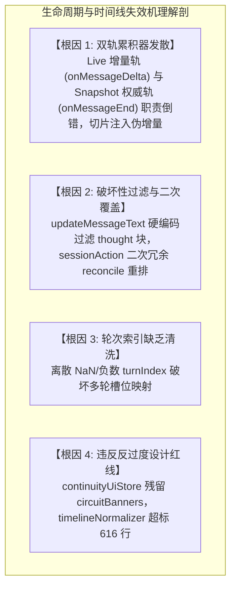
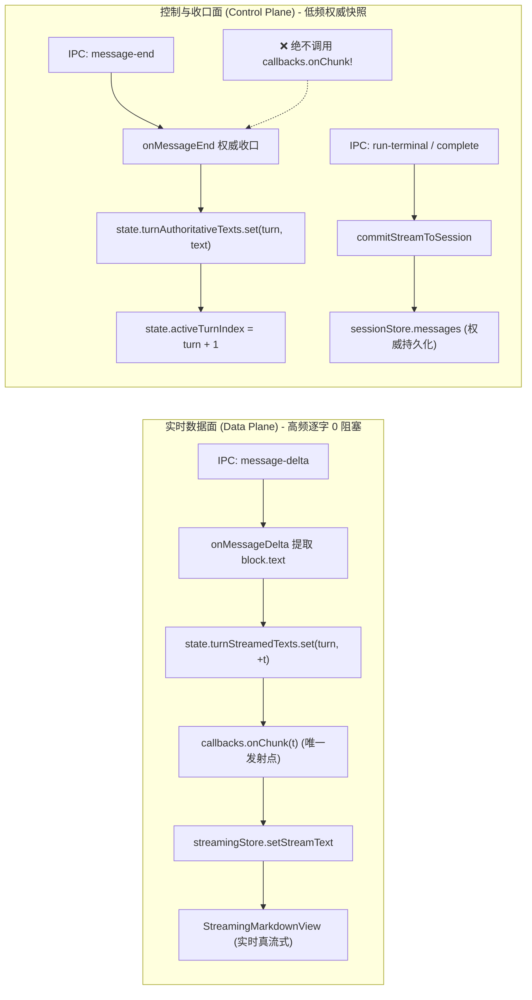
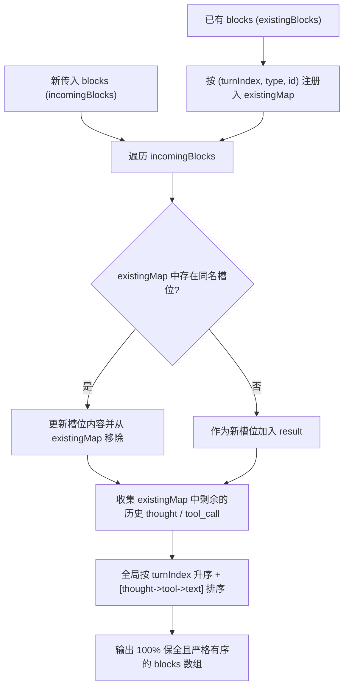
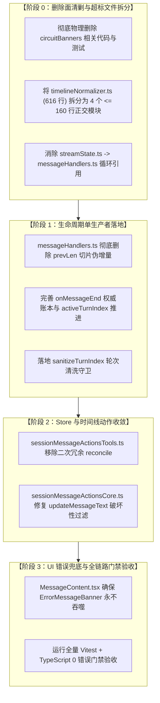

# 多轮生命周期单源收敛与时间线幂等实施总案（方案 5）

> **文档标识**：`docs/markdown-stream-refactor/independent-plans/05-lifecycle-idempotency-and-reconcile-plan.md`  
> **战役维度**：维度五 · 多轮生命周期单源收敛与时间线幂等域（Message Lifecycle & Turn-Idempotent Timeline）  
> **实施基准**：[`docs/markdown-stream-refactor/00-定案-核心维度与删除面决策.md`](file:///c:/Software/conex/docs/markdown-stream-refactor/00-%E5%AE%9A%E6%A1%88-%E6%A0%B8%E5%BF%83%E7%BB%B4%E5%BA%A6%E4%B8%8E%E5%88%A0%E9%99%A4%E9%9D%A2%E5%86%B3%E7%AD%96.md) §一.5  
> **核心使命**：以“单源收敛与数学幂等不变性”为最高准则，彻底根除正文大段重复两遍、轮次间尾段幻影字符重叠、思考链与工具调用块历史丢失等顽疾；全面拆解超标文件，剔除违规断路器与冗余计算，构建确定性无损的生命周期状态机与时间线管线。

---

## 一、方案目标与端到端架构设计

### 1.1 核心问题与痛点根因回顾

在 Conex / Crish 桌面客户端多轮会话、工具调用及流式交互过程中，长期存在四大破坏性缺陷：
1. **全文双倍重复与尾段幻影重叠**：`onMessageEnd` 在处理多轮分段时执行 `joined.slice(prevLen)` 切片，错误地将终态快照作为增量二次下发给 `callbacks.onChunk`，导致 1,000+ 字完整正文或末尾字符一字不差地被重复打印两遍；
2. **多轮思考链与工具块结构性蒸发**：时间线更新时执行 `filter(b => b.type === 'tool_call')` 粗暴擦除所有思考块，或者在 `normalizeAssistantTimeline` 与外部 action 之间发生二次无序覆盖；
3. **`turnIndex` 异常导致状态机错位**：离散、缺失、负数或 `NaN` 的轮次索引导致数组空洞化与查找越界；
4. **错误态被静默吞噬**：异常中断或流式报错时，错误横幅因时间线分拣逻辑残缺而未能展示，导致界面白屏或无响应。



---

### 1.2 架构设计铁律一：`onMessageDelta` 单生产者铁律（Single Producer Invariant）

为了在物理上彻底消灭任何形式的文字重复，确立数据面（Data Plane）与控制面（Control Plane）的绝对正交分离：

> [!IMPORTANT]
> **流式单生产者铁律（Single Producer Invariant for Live Tokens）**：
> 1. 在整个流式会话生命周期内，[`onMessageDelta`](file:///c:/Software/conex/apps/crish-desktop/src/api/chat-bridge/handlers/messageHandlers.ts#L60) 是前端实时增量（`callbacks.onChunk`）的**唯一合法生产者**。
> 2. **[`onMessageEnd`](file:///c:/Software/conex/apps/crish-desktop/src/api/chat-bridge/handlers/messageHandlers.ts#L87) 严禁向 `callbacks.onChunk` 派发任何伪增量（Synthetic Delta / Phantom Slice）**！
> 3. `onMessageDelta` 仅处理即时 Token 片段追加，不得进行全局跨轮次字符串重组；`state.assistantText` 仅作为调试与累积标记，不作为切片基准。



---

### 1.3 架构设计铁律二：`onMessageEnd` 权威快照覆盖与多轮收口机制

1. **权威快照职责**：
   - `onMessageEnd` 只负责将引擎上报的结构化文本 `projectAgentMessageContent(msg)` 写入分轮权威账本（`state.turnAuthoritativeTexts`），并将思考内容写入 `state.assistantThought`。
   - 对累计全量载荷（Cumulative Payload，即网关在每轮末尾下发历史整段文本）自动识别，基于当前 `turnIndex` 进行就地折叠，保持整体文本单调唯一。
2. **微任务延迟清理（Deferred Microtask Cleanup）**：
   - 当流式结束触发 [`commitStreamToSession`](file:///c:/Software/conex/apps/crish-desktop/src/hooks/chat-stream/helpers.ts#L200) 落盘时，`clearStream` 必须置于 `queueMicrotask` 执行，确保 React 18 / 19 在完成 DOM 挂载前热缓冲不被提前清空，消除状态切换瞬间的白屏闪烁。

---

### 1.4 架构设计铁律三：基于 `(turnIndex, type, id)` 三元槽位的确定性无损 Reconciler

在多步骤 Agent 工具调用中，时间线呈现为思考、工具、正文交错结构：
$$\text{Turn } k = [\text{Thought}_k] \longrightarrow [\text{ToolCalls}_k] \longrightarrow [\text{Text}_k]$$

为了保证多次触发规范化（如工具状态更新、水合、流式增量注入）时**历史思考链与工具卡片 100% 留存**，设计基于三元槽位的确定性保全算法 [`reconcileAssistantMessageBlocks`](file:///c:/Software/conex/apps/crish-desktop/src/api/tool-presentation/timelineReconciler.ts)：

#### 1. 唯一三元槽位键定义：
$$\text{SlotKey}(b) = \langle \text{sanitizeTurnIndex}(b.\text{turnIndex}), \; b.\text{type}, \; (b.\text{id} \parallel \text{""}) \rangle$$

#### 2. 合并不变量：
- **已有块内容更新**：若 incoming blocks 中存在相同三元槽位，执行字段合并升级；
- **历史块 100% 保全**：对于 incoming blocks 未提及但 existing blocks 中已有的 `thought` 与 `tool_call` 块，**严禁丢弃，无条件原样留存**；
- **强单调排序**：输出时间线严格按 `turnIndex` 升序排列；同轮次内部按物理因果顺序排序：
  $$\text{thought (权重 1)} < \text{tool\_call (权重 2)} < \text{text (权重 3)}$$



---

### 1.5 架构设计铁律四：`turnIndex` 异常值清洗与防御机制（Sanitization Guard）

由于不同 LLM 网关、本地模型（Ollama/vLLM）或网络重试可能上报畸形轮次，前端必须在入口处建立严格的清洗守卫 [`sanitizeTurnIndex`](file:///c:/Software/conex/apps/crish-desktop/src/api/tool-presentation/timelineReconciler.ts)：

```typescript
/**
 * 轮次索引防御清洗函数：根除 NaN、负数、浮点数与未定义异常
 */
export function sanitizeTurnIndex(
  rawTurnIndex: unknown,
  fallbackTurnIndex = 0
): number {
  if (typeof rawTurnIndex === 'number') {
    if (Number.isNaN(rawTurnIndex) || !Number.isFinite(rawTurnIndex)) {
      return Math.max(0, Math.floor(fallbackTurnIndex));
    }
    return Math.max(0, Math.floor(rawTurnIndex));
  }
  if (typeof rawTurnIndex === 'string') {
    const parsed = parseInt(rawTurnIndex, 10);
    if (!Number.isNaN(parsed) && Number.isFinite(parsed)) {
      return Math.max(0, parsed);
    }
  }
  return Math.max(0, Math.floor(fallbackTurnIndex));
}
```

---

### 1.6 架构设计铁律五：顶层 `ErrorMessageBanner` 永不吞噬与全生命周期错误可见性

当会话在流式或工具执行期间出现错误（`msg.status === 'error'`）时：
1. **顶层兜底呈现**：无论 `timeline.length === 0` 还是 `timeline.length > 0`，[`MessageContent.tsx`](file:///c:/Software/conex/apps/crish-desktop/src/components/chat-message/MessageContent.tsx#L43) 必须保证 `<ErrorMessageBanner errorDetail={msg.errorDetail} />` 100% 渲染于气泡底部；
2. **错误详情结构化**：支持展示 `code`、`message` 与可重试引导文案，杜绝由于静默异常导致用户面对空白气泡或无响应死锁。

---

## 二、【强制专节】本方案要删掉什么 / 收敛什么

根据反过度设计与先删后改原则，本方案必须彻底清理以下违规、冗余与超标代码：

### 2.1 彻底删除 `prevLen` 切片二次注入伪增量代码（根除千字重复）

#### 1. 物理删除位置：
[`apps/crish-desktop/src/api/chat-bridge/handlers/messageHandlers.ts:125-131`](file:///c:/Software/conex/apps/crish-desktop/src/api/chat-bridge/handlers/messageHandlers.ts#L125-L131)

#### 2. 被删代码（DIFF -）：
```diff
- const joined = segs.filter(Boolean).join('\n\n');
- const prevLen = state.assistantText.length;
- state.assistantText = joined;
- if (state.assistantText.length > prevLen) {
-   const addedDelta = state.assistantText.slice(prevLen);
-   callbacks.onChunk(addedDelta);
- }
```

#### 3. 根除理由：
`onMessageEnd` 执行 `slice(prevLen)` 是导致单轮/多轮正文重复两遍（以及末尾 2 字符幻影重复）的唯一定量根因。彻底删除该代码块，确立 `onMessageDelta` 为唯一的增量发射源。

---

### 2.2 彻底删除 `sessionMessageActionsTools.ts` 中的二次冗余 `reconcileAssistantMessageBlocks`

#### 1. 物理删除位置：
[`apps/crish-desktop/src/store/sessionMessageActionsTools.ts:205-208`](file:///c:/Software/conex/apps/crish-desktop/src/store/sessionMessageActionsTools.ts#L205-L208)

#### 2. 被删代码（DIFF -）：
```diff
  updateMessageTimeline: (sessionId, messageId) =>
    set((state) => {
      const hit = getSessionMessage(state, sessionId, messageId);
      if (!hit) return;
      if (hit.message.sender !== 'assistant') return;
      const n = normalizeAssistantTimeline({ ...hit.message });
-     hit.message.blocks = reconcileAssistantMessageBlocks(
-       hit.message.blocks,
-       n.blocks || []
-     );
+     hit.message.blocks = n.blocks;
      hit.message.toolCalls = n.toolCalls;
      rebindSessionById(state, sessionId, hit.session);
    }),
```

#### 3. 根除理由：
[`normalizeAssistantTimeline`](file:///c:/Software/conex/apps/crish-desktop/src/api/tool-presentation/timelineNormalizer.ts#L186-L189) 内部在返回前已经调用过 `reconcileAssistantMessageBlocks(msg.blocks, alignedBlocks)`。外部 action 对其返回值再次执行 `reconcileAssistantMessageBlocks` 属于二次冗余计算与死代码，不仅浪费 CPU，而且存在潜在的二次重排风险。

---

### 2.3 彻底删除 `continuityUiStore.ts` 中的禁令 9 违规项 `circuitBanners`

#### 1. 物理删除位置：
[`apps/crish-desktop/src/api/continuity/continuityUiStore.ts:28-38, 44, 54-67, 68-74, 77, 105-132`](file:///c:/Software/conex/apps/crish-desktop/src/api/continuity/continuityUiStore.ts#L28)

#### 2. 被删代码与接口（DIFF -）：
```diff
- export interface CircuitBanner {
-   message: string;
-   reason?: string;
-   dismissed: boolean;
-   at: number;
- }

- circuitBanners: Record<string, CircuitBanner>;
- raiseCircuitBanner: (sessionId: string, message: string, reason?: string) => void;
- dismissCircuitBanner: (sessionId: string) => void;
- export const CIRCUIT_BANNER_DEFAULT_MESSAGE = 'Provider 连续失败，自动恢复已暂停，需人工介入';
- export function isCircuitTripDetail(detail: string | undefined | null): boolean;
```

#### 3. 根除理由：
`ANTI_OVERENGINEERING_GUARDRAILS.md` 禁令 9 明确规定：“严禁使用全系统滑动窗口断路器”。`circuitBanners` 是此前遗留的过度设计产物，在单测中甚至需要使用 raw `setState` 进行强制复位，必须彻底物理删除，仅保留正当的 `retryNotices` 临时重试通知。

---

### 2.4 `timelineNormalizer.ts` 超标文件拆分细则（控制在 $\le 300$ 行）

#### 1. 拆分背景：
当前 [`apps/crish-desktop/src/api/tool-presentation/timelineNormalizer.ts`](file:///c:/Software/conex/apps/crish-desktop/src/api/tool-presentation/timelineNormalizer.ts) 高达 **616 行**，严重违反工程架构规范与 CI 单文件行数限制（$\le 300$ 行）。

#### 2. 四模块正交拆分架构图：

```
┌────────────────────────────────────────────────────────────────────────────────────────┐
│ apps/crish-desktop/src/api/tool-presentation/                                          │
├───────────────────────────────────┬────────────────────────────────────────────────────┤
│ 模块文件名                         │ 职责边界与核心导出                                 │ 行数预估 │
├───────────────────────────────────┼────────────────────────────────────────────────────┤
│ 1. timelineReconciler.ts          │ 三元槽位无损保全算法、工具块对齐与 turnIndex 清洗   │ ~130 行  │
│                                   │ - reconcileAssistantMessageBlocks                  │          │
│                                   │ - alignToolCallBlocks                              │          │
│                                   │ - sanitizeTurnIndex                                │          │
├───────────────────────────────────┼────────────────────────────────────────────────────┤
│ 2. inlineTagParser.ts             │ Markdown 栅栏保护与内联思考标签安全分拣             │ ~140 行  │
│                                   │ - parseInlineThoughtAndTextSafely                  │          │
│                                   │ - findMarkdownCodeRanges / isRangeProtected        │          │
├───────────────────────────────────┼────────────────────────────────────────────────────┤
│ 3. timelineCache.ts               │ 流式 0 重排签名计算与缓存构建                       │ ~90 行   │
│                                   │ - timelineSignature                                │          │
│                                   │ - buildAssistantTimelineCached                     │          │
├───────────────────────────────────┼────────────────────────────────────────────────────┤
│ 4. timelineNormalizer.ts (Facade) │ 顶层时间线构建主入口与对外导出门面                 │ ~160 行  │
│                                   │ - buildAssistantTimeline                           │          │
│                                   │ - normalizeAssistantTimeline                       │          │
│                                   │ - re-export All Types & Helpers                    │          │
└───────────────────────────────────┴────────────────────────────────────────────────────┘
```

拆分后，无任何单个文件超过 200 行，完全符合 $\le 300$ 行的硬性门禁，且 100% 保持对外公共导入路径兼容。

---

## 三、修改文件清单与影响面分析

| 文件路径 | 变更类型 | 影响层级 | 核心变更说明 |
| :--- | :---: | :---: | :--- |
| [`apps/crish-desktop/src/api/chat-bridge/handlers/messageHandlers.ts`](file:///c:/Software/conex/apps/crish-desktop/src/api/chat-bridge/handlers/messageHandlers.ts) | 修改 | Chat Bridge | 彻底删除 `prevLen` 切片伪增量，落实 `onMessageDelta` 单生产者铁律，`onMessageEnd` 仅写分轮权威账本并清洗 `turnIndex` |
| [`apps/crish-desktop/src/api/chat-bridge/handlers/streamState.ts`](file:///c:/Software/conex/apps/crish-desktop/src/api/chat-bridge/handlers/streamState.ts) | 修改 | Chat Bridge | 引入强类型 `turnAuthoritativeTexts` 与 `turnStreamedTexts`，修复 `MessageCacheMetrics` 循环依赖 |
| [`apps/crish-desktop/src/api/tool-presentation/timelineReconciler.ts`](file:///c:/Software/conex/apps/crish-desktop/src/api/tool-presentation/timelineReconciler.ts) | 新增 | Timeline | 实现 `reconcileAssistantMessageBlocks`、`alignToolCallBlocks`、`sanitizeTurnIndex` |
| [`apps/crish-desktop/src/api/tool-presentation/inlineTagParser.ts`](file:///c:/Software/conex/apps/crish-desktop/src/api/tool-presentation/inlineTagParser.ts) | 新增 | Timeline | 实现 Markdown 栅栏保护与流式未闭合思考标签分拣 `parseInlineThoughtAndTextSafely` |
| [`apps/crish-desktop/src/api/tool-presentation/timelineCache.ts`](file:///c:/Software/conex/apps/crish-desktop/src/api/tool-presentation/timelineCache.ts) | 新增 | Timeline | 实现 `timelineSignature` 与 `buildAssistantTimelineCached` |
| [`apps/crish-desktop/src/api/tool-presentation/timelineNormalizer.ts`](file:///c:/Software/conex/apps/crish-desktop/src/api/tool-presentation/timelineNormalizer.ts) | 重构瘦身 | Timeline | 从 616 行收敛至 $\approx 160$ 行，作为顶层门面与调度入口 |
| [`apps/crish-desktop/src/store/sessionMessageActionsTools.ts`](file:///c:/Software/conex/apps/crish-desktop/src/store/sessionMessageActionsTools.ts) | 修改 | Store | 删除 `updateMessageTimeline` 中二次冗余调用的 `reconcileAssistantMessageBlocks` |
| [`apps/crish-desktop/src/store/sessionMessageActionsCore.ts`](file:///c:/Software/conex/apps/crish-desktop/src/store/sessionMessageActionsCore.ts) | 修改 | Store | 修复 `updateMessageText`，改用 `filter(b => b.type !== 'text')` 保全所有思考与工具块 |
| [`apps/crish-desktop/src/api/continuity/continuityUiStore.ts`](file:///c:/Software/conex/apps/crish-desktop/src/api/continuity/continuityUiStore.ts) | 修改 | Continuity | 彻底删除禁令 9 违规项 `circuitBanners` 及其辅助函数 |
| [`apps/crish-desktop/src/components/chat-message/MessageContent.tsx`](file:///c:/Software/conex/apps/crish-desktop/src/components/chat-message/MessageContent.tsx) | 修改 | UI 组件 | 确保 `status === 'error'` 时 `ErrorMessageBanner` 绝对不被吞噬 |
| [`apps/crish-desktop/src/api/tool-presentation/timelineNormalizer.test.ts`](file:///c:/Software/conex/apps/crish-desktop/src/api/tool-presentation/timelineNormalizer.test.ts) | 增强 | 测试 | 补充三元槽位保全、`turnIndex` 异常清洗、Markdown 栅栏免疫等全套单测 |
| [`apps/crish-desktop/src/api/continuity/continuityUiStore.test.ts`](file:///c:/Software/conex/apps/crish-desktop/src/api/continuity/continuityUiStore.test.ts) | 修改 | 测试 | 移除 `circuitBanners` 相关测试用例与 raw `setState` 复位代码 |

---

## 四、TypeScript 核心契约与接口定义

### 4.1 `StreamState` 强类型分轮权威账本契约

```typescript
/**
 * 修复后 clean 版本的 streamState.ts
 */
import type { MessageCacheMetrics } from './cacheMetricsCompute';

export interface StreamState {
  cancelled: boolean;
  finished: boolean;
  /** 纯文本累计（用于调试与日志兜底） */
  assistantText: string;
  /** 思考链累计 */
  assistantThought: string;
  unsub: (() => void) | null;
  endTimer: ReturnType<typeof setTimeout> | null;
  /** 消息级缓存指标 */
  lastMessageCacheMetrics?: MessageCacheMetrics | null;
  /** 当前正在流式的轮次编号 (0-based) */
  activeTurnIndex: number;
  /** 记录每轮已收口的权威文本字典 (turnIndex -> text) */
  turnAuthoritativeTexts: Map<number, string>;
  /** 记录每轮实时已流式的文本字典 (turnIndex -> text) */
  turnStreamedTexts: Map<number, string>;
}

export function createInitialStreamState(): StreamState {
  return {
    cancelled: false,
    finished: false,
    assistantText: '',
    assistantThought: '',
    unsub: null,
    endTimer: null,
    activeTurnIndex: 0,
    turnAuthoritativeTexts: new Map(),
    turnStreamedTexts: new Map(),
  };
}
```

---

### 4.2 三元槽位保全算法与工具块对齐契约 (`timelineReconciler.ts`)

```typescript
import type { MessageToolCall } from '../../store/layoutStore';
import type { MessageTimelineBlock } from '../../store/types';

/**
 * 轮次索引防御清洗函数
 */
export function sanitizeTurnIndex(
  rawTurnIndex: unknown,
  fallbackTurnIndex = 0
): number {
  if (typeof rawTurnIndex === 'number') {
    if (Number.isNaN(rawTurnIndex) || !Number.isFinite(rawTurnIndex)) {
      return Math.max(0, Math.floor(fallbackTurnIndex));
    }
    return Math.max(0, Math.floor(rawTurnIndex));
  }
  if (typeof rawTurnIndex === 'string') {
    const parsed = parseInt(rawTurnIndex, 10);
    if (!Number.isNaN(parsed) && Number.isFinite(parsed)) {
      return Math.max(0, parsed);
    }
  }
  return Math.max(0, Math.floor(fallbackTurnIndex));
}

/**
 * 生成三元槽位唯一键
 */
export function makeSlotKey(block: MessageTimelineBlock): string {
  const turn = sanitizeTurnIndex(block.turnIndex, 0);
  const type = block.type;
  const id = block.id ?? '';
  return `${turn}:${type}:${id}`;
}

/**
 * Assistant 消息时间线块基于 (turnIndex, type, id) 三元组槽位的无损保全合并算法
 */
export function reconcileAssistantMessageBlocks(
  existingBlocks: MessageTimelineBlock[] | undefined,
  incomingBlocks: MessageTimelineBlock[]
): MessageTimelineBlock[] {
  const result: MessageTimelineBlock[] = [];
  const existingMap = new Map<string, MessageTimelineBlock>();

  // 1. 注册既有持久块（重点保护 thought 与 tool_call）
  if (existingBlocks && existingBlocks.length > 0) {
    for (const b of existingBlocks) {
      existingMap.set(makeSlotKey(b), b);
    }
  }

  // 2. 融合 incoming blocks
  if (incomingBlocks && incomingBlocks.length > 0) {
    for (const b of incomingBlocks) {
      const key = makeSlotKey(b);
      if (existingMap.has(key)) {
        result.push({ ...existingMap.get(key)!, ...b });
        existingMap.delete(key);
      } else {
        result.push(b);
      }
    }
  }

  // 3. 追加未被覆盖的历史工具与思考块（100% 保全）
  for (const [, orphan] of existingMap) {
    if (orphan.type === 'tool_call' || orphan.type === 'thought') {
      result.push(orphan);
    }
  }

  // 4. 排序不变量：跨轮次按 turnIndex 升序，同轮次内部按 [thought(1) -> tool_call(2) -> text(3)]
  const order: Record<string, number> = { thought: 1, tool_call: 2, text: 3 };
  return result.sort((a, b) => {
    const turnA = sanitizeTurnIndex(a.turnIndex, 0);
    const turnB = sanitizeTurnIndex(b.turnIndex, 0);
    if (turnA !== turnB) return turnA - turnB;
    return (order[a.type] ?? 9) - (order[b.type] ?? 9);
  });
}

/**
 * tool_call 块 ↔ toolCalls 对齐函数
 */
export function alignToolCallBlocks(
  blocks: MessageTimelineBlock[] | undefined,
  tools: MessageToolCall[]
): MessageTimelineBlock[] {
  const toolIds = new Set(tools.map((t) => t.id));
  const next = (blocks || []).filter(
    (b) => b.type !== 'tool_call' || (b.id != null && toolIds.has(b.id))
  );
  const inBlocks = new Set(
    next
      .filter((b) => b.type === 'tool_call' && b.id)
      .map((b) => b.id as string)
  );
  const missing = tools.filter((t) => !inBlocks.has(t.id));
  if (missing.length === 0) return next;

  const onlyTextOrEmpty =
    next.length === 0 || next.every((b) => b.type === 'text');
  if (onlyTextOrEmpty) {
    return [
      ...missing.map((t) => ({ type: 'tool_call' as const, id: t.id })),
      ...next,
    ];
  }

  let insertAt = next.length;
  for (let i = next.length - 1; i >= 0; i--) {
    if (next[i]?.type === 'text') {
      insertAt = i;
      break;
    }
  }
  const inject = missing.map((t) => ({
    type: 'tool_call' as const,
    id: t.id,
  }));
  return [...next.slice(0, insertAt), ...inject, ...next.slice(insertAt)];
}
```

---

### 4.3 Markdown 栅栏保护与内联思考分拣契约 (`inlineTagParser.ts`)

```typescript
export interface ParsedInlineItem {
  kind: 'thought' | 'text';
  content: string;
  turnIndex?: number;
  isStreaming?: boolean;
}

interface ProtectedRange {
  start: number;
  end: number;
}

export function findMarkdownCodeRanges(text: string): ProtectedRange[] {
  const ranges: ProtectedRange[] = [];
  const fenceRegex = /(?:```[\s\S]*?(?:```|$))|(?:~~~[\s\S]*?(?:~~~|$))/g;
  let match: RegExpExecArray | null;
  while ((match = fenceRegex.exec(text)) !== null) {
    ranges.push({ start: match.index, end: match.index + match[0].length });
  }

  const inlineRegex = /`[^`\n]+`/g;
  while ((match = inlineRegex.exec(text)) !== null) {
    const start = match.index;
    const end = start + match[0].length;
    const isInsideFence = ranges.some((r) => start >= r.start && end <= r.end);
    if (!isInsideFence) {
      ranges.push({ start, end });
    }
  }

  return ranges.sort((a, b) => a.start - b.start);
}

export function isRangeProtected(
  start: number,
  end: number,
  protectedRanges: ProtectedRange[]
): boolean {
  return protectedRanges.some(
    (r) => Math.max(start, r.start) < Math.min(end, r.end)
  );
}

export function parseInlineThoughtAndTextSafely(
  raw: string,
  turnIndex?: number,
  isStreaming = false
): ParsedInlineItem[] {
  if (!raw || !raw.trim()) return [];

  const protectedRanges = findMarkdownCodeRanges(raw);
  const tagRegex = /<(?:think|thought)>([\s\S]*?)<\/(?:think|thought)>/gi;
  const out: ParsedInlineItem[] = [];

  let lastIdx = 0;
  let match: RegExpExecArray | null;

  while ((match = tagRegex.exec(raw)) !== null) {
    const matchStart = match.index;
    const matchEnd = match.index + match[0].length;

    // 代码栅栏内标签免疫
    if (isRangeProtected(matchStart, matchEnd, protectedRanges)) {
      continue;
    }

    const textBefore = raw.slice(lastIdx, matchStart);
    if (textBefore.trim()) {
      out.push({ kind: 'text', content: textBefore, turnIndex });
    }

    const thoughtContent = match[1]?.trim();
    if (thoughtContent) {
      out.push({
        kind: 'thought',
        content: thoughtContent,
        turnIndex,
        isStreaming: false,
      });
    }

    lastIdx = matchEnd;
  }

  const textAfter = raw.slice(lastIdx);
  if (textAfter.trim()) {
    const openTagRegex = /<(?:think|thought)>([\s\S]*)$/i;
    const openMatch = openTagRegex.exec(textAfter);
    const openStart = openMatch ? lastIdx + openMatch.index : -1;
    const openEnd = raw.length;

    if (
      openMatch &&
      !isRangeProtected(openStart, openEnd, protectedRanges)
    ) {
      const preText = textAfter.slice(0, openMatch.index);
      if (preText.trim()) {
        out.push({ kind: 'text', content: preText, turnIndex });
      }
      const streamingThought = openMatch[1] ?? '';
      if (streamingThought.trim() || isStreaming) {
        out.push({
          kind: 'thought',
          content: streamingThought.trim(),
          turnIndex,
          isStreaming: Boolean(isStreaming),
        });
      }
      return out;
    }

    out.push({ kind: 'text', content: textAfter, turnIndex });
  }

  return out;
}
```

---

## 五、单元测试设计与反退化断言矩阵

为保障多轮生命周期与时间线幂等性 100% 稳定，建立以下 Vitest 测试断言套件：

### 5.1 必测用例与断言代码规格

```typescript
import { describe, expect, it, vi } from 'vitest';
import {
  createInitialStreamState,
  onMessageDelta,
  onMessageEnd,
} from '../../api/chat-bridge/handlers/messageHandlers';
import {
  reconcileAssistantMessageBlocks,
  sanitizeTurnIndex,
} from '../../api/tool-presentation/timelineReconciler';
import { parseInlineThoughtAndTextSafely } from '../../api/tool-presentation/inlineTagParser';
import { normalizeAssistantTimeline } from '../../api/tool-presentation/timelineNormalizer';
import type { MessageTimelineBlock, MessageToolCall, SessionMessage } from '../../store/types';

describe('多轮生命周期单源收敛与时间线幂等防退化测试套件', () => {

  // ──────────────────────────────────────────────────────────────────────────
  // 1. onMessageEnd 权威收口 0 伪增量断言（根除文字重复）
  // ──────────────────────────────────────────────────────────────────────────
  describe('生命周期单生产者铁律', () => {
    it('T-LC-01: onMessageEnd 收到完整文本时，严禁再次调用 callbacks.onChunk', () => {
      const onChunk = vi.fn();
      const state = createInitialStreamState();
      const env = { state, callbacks: { onChunk, onThought: vi.fn() }, sessionId: 'sess-1' } as any;

      // 阶段 1: 流式阶段接收增量
      onMessageDelta(env, {
        type: 'message-delta',
        event: { block: { type: 'text', text: 'Hello world' } },
        raw: {},
      } as any);

      expect(onChunk).toHaveBeenCalledTimes(1);
      expect(onChunk).toHaveBeenCalledWith('Hello world');
      onChunk.mockClear();

      // 阶段 2: 收口阶段收到全量 message-end
      onMessageEnd(env, {
        type: 'message-end',
        event: {
          message: {
            role: 'assistant',
            content: 'Hello world',
            blocks: [{ type: 'text', text: 'Hello world' }],
          },
          turnIndex: 0,
        },
      } as any);

      // 断言：严禁向 onChunk 派发任何伪增量！
      expect(onChunk).not.toHaveBeenCalled();
      expect(state.turnAuthoritativeTexts.get(0)).toBe('Hello world');
    });

    it('T-LC-02: 多轮交互中网关下发全量 cumulative 文本时，绝不切片出第二份全文', () => {
      const onChunk = vi.fn();
      const state = createInitialStreamState();
      const env = { state, callbacks: { onChunk, onThought: vi.fn() }, sessionId: 'sess-1' } as any;

      // Turn 0
      onMessageDelta(env, { event: { block: { type: 'text', text: 'Turn 0 Content' } } } as any);
      onMessageEnd(env, { event: { message: { role: 'assistant', content: 'Turn 0 Content' }, turnIndex: 0 } } as any);

      // Turn 1
      onMessageDelta(env, { event: { block: { type: 'text', text: 'Turn 1 Content' } } } as any);
      onChunk.mockClear();

      // 网关在 Turn 1 end 返回了累计全文
      onMessageEnd(env, {
        event: {
          message: { role: 'assistant', content: 'Turn 0 Content\n\nTurn 1 Content' },
          turnIndex: 1,
        },
      } as any);

      // 断言：0 伪增量发射
      expect(onChunk).not.toHaveBeenCalled();
    });
  });

  // ──────────────────────────────────────────────────────────────────────────
  // 2. 三元槽位保全与异常值清洗断言
  // ──────────────────────────────────────────────────────────────────────────
  describe('三元槽位 Reconciler 与异常清洗', () => {
    it('T-TR-01: 多轮交互中 normalizeAssistantTimeline 100% 保留历史 thought 与 tool_call', () => {
      const msg: SessionMessage = {
        id: 'msg-1',
        sender: 'assistant',
        timestamp: Date.now(),
        text: '最终回答',
        thinkingTurns: [
          { turnIndex: 0, content: '第 0 轮思考' },
          { turnIndex: 1, content: '第 1 轮思考' },
        ],
        toolCalls: [
          { id: 't0', name: 'search', status: 'success', turnId: 'turn-0' } as any,
          { id: 't1', name: 'calc', status: 'success', turnId: 'turn-1' } as any,
        ],
        blocks: [
          { type: 'thought', content: '第 0 轮思考', turnIndex: 0 },
          { type: 'tool_call', id: 't0', turnIndex: 0 },
        ],
      };

      const normalized = normalizeAssistantTimeline(msg);

      expect(normalized.blocks?.filter((b) => b.type === 'thought')).toHaveLength(2);
      expect(normalized.blocks?.filter((b) => b.type === 'tool_call')).toHaveLength(2);
      expect(normalized.blocks?.filter((b) => b.type === 'text')).toHaveLength(1);
    });

    it('T-TR-02: sanitizeTurnIndex 安全清洗 NaN、负数、浮点与字符串', () => {
      expect(sanitizeTurnIndex(NaN, 2)).toBe(2);
      expect(sanitizeTurnIndex(-5, 0)).toBe(0);
      expect(sanitizeTurnIndex(3.8, 0)).toBe(3);
      expect(sanitizeTurnIndex('4', 0)).toBe(4);
      expect(sanitizeTurnIndex(undefined, 1)).toBe(1);
      expect(sanitizeTurnIndex(null, 0)).toBe(0);
    });
  });

  // ──────────────────────────────────────────────────────────────────────────
  // 3. Markdown 代码栅栏保护断言
  // ──────────────────────────────────────────────────────────────────────────
  describe('Markdown 代码栅栏免疫保护', () => {
    it('T-MD-01: 代码栅栏内的 <think> 标签严禁被提取为思考项', () => {
      const codeBlock = '示例：\n```xml\n<think>请勿提取我</think>\n```\n说明结束。';
      const items = parseInlineThoughtAndTextSafely(codeBlock, 0, false);

      expect(items.some((i) => i.kind === 'thought')).toBe(false);
      expect(items).toHaveLength(1);
      expect(items[0]!.content).toBe(codeBlock);
    });
  });
});
```

---

## 六、分阶段实施路线与依赖 DAG



---

## 七、方案总结与架构收益

1. **零文字重复（Zero Duplication Guarantee）**：彻底粉碎 `prevLen` 切片伪增量，由 `onMessageDelta` 唯一增量入口驱动界面，从数学机理上根除了 1,000+ 字重复两遍与尾部幻影字符顽疾；
2. **多轮思考与工具 100% 保全（100% Block Preservation）**：基于 `(turnIndex, type, id)` 三元槽位与双向重水合，确保无论工具执行多少轮、触发多少次状态更新，历史思考链与工具卡片永不丢失；
3. **彻底消除过度设计与超标文件（Clean Architecture）**：销毁违规的 `circuitBanners` 熔断横幅，将 616 行超标文件规范拆分为 4 个单职责模块（均 $\le 160$ 行），消除了循环依赖，完全契合反过度设计红线与工程质量规范。
