# 06. 死层物理清剿、代码瘦身与全链路防退化实施总案（方案 6）

> **文档标识**：`docs/markdown-stream-refactor/independent-plans/06-dead-layer-elimination-and-refactor-plan.md`
> **方案定位**：下一代流式 Markdown 架构战役独立实施详案 6 —— 死层物理清剿、代码瘦身与全链路防退化（`Dead-Layer Purge, Code Slimming & Full-Chain Anti-Regression Plan`）
> **架构师**：Senior Systems Engineer & Codebase Architect (Purge & Modular Governance Specialist)
> **输入与执行标准**：
> - 核心定案依据：[`00-定案-核心维度与删除面决策.md`](file:///c:/Software/conex/docs/markdown-stream-refactor/00-%E5%AE%9A%E6%A1%88-%E6%A0%B8%E5%BF%83%E7%BB%B4%E5%BA%A6%E4%B8%8E%E5%88%A0%E9%99%A4%E9%9D%A2%E5%86%B3%E7%AD%96.md)
> - 提案建议资产：[`analysis/12`](file:///c:/Software/conex/docs/markdown-stream-refactor/analysis/12-dimension-and-deletion-proposal-a.md) ~ [`14`](file:///c:/Software/conex/docs/markdown-stream-refactor/analysis/14-dimension-and-deletion-proposal-c.md) 提案 A/B/C 交叉结论
> - 红线约束：[`ANTI_OVERENGINEERING_GUARDRAILS.md`](file:///c:/Software/conex/ANTI_OVERENGINEERING_GUARDRAILS.md)（13 项硬性红线）
> - 调度依据：[`docs/agent-roles/prompts/主控-全流程调度-v3.md`](file:///c:/Software/conex/docs/agent-roles/prompts/%E4%B8%BB%E6%8E%A7-%E5%85%A8%E6%B5%81%E7%A8%8B%E8%B0%83%E5%BA%A6-v3.md) §一.5、§二.1
> **核心原则**：推进单位是「领域概念」，一个概念唯一主路径；收敛先于增强，先做物理减法（坚决彻底物理删除 21 个孤岛死文件与割裂分支），破除循环依赖与单文件行数违规，构建 50k+ Tokens 满帧压测门禁，确立单一真相源（SSOT）。

---

## 目录

- [一、方案目标与架构重构总纲](#一方案目标与架构重构总纲)
  - [1.1 战略定位：为什么必须“物理清剿死层”与“代码瘦身”？](#11-战略定位为什么必须物理清剿死层与代码瘦身)
  - [1.2 方案核心目标与量化指标](#12-方案核心目标与量化指标)
  - [1.3 先删后改工程拓扑与阶段演进图谱 (DAG)](#13-先删后改工程拓扑与阶段演进图谱-dag)
- [二、【强制专节】本方案要删掉什么 / 收敛什么](#二强制专节本方案要删掉什么--收敛什么)
  - [2.1 21 个物理删除文件全景大表（完整路径、行数、替代路径与无害化证明）](#21-21-个物理删除文件全景大表完整路径行数替代路径与无害化证明)
  - [2.2 符号/函数级死代码与反模式剔除清单](#22-符号函数级死代码与反模式剔除清单)
  - [2.3 状态字段冗余与 Store 瘦身清单](#23-状态字段冗余与-store-瘦身清单)
  - [2.4 前端渲染路径收敛图谱：从 9 条割裂路径到 1 条唯一真流式主路径](#24-前端渲染路径收敛图谱从-9-条割裂路径到-1-条唯一真流式主路径)
- [三、物理删除工序与引用安全解绑实施细则](#三物理删除工序与引用安全解绑实施细则)
  - [3.1 删除前测试核实与断言迁移细则](#31-删除前测试核实与断言迁移细则)
  - [3.2 Barrel 导出与全局引用安全解绑工序](#32-barrel-导出与全局引用安全解绑工序)
  - [3.3 物理删除安全执行四步法（Execution Recipe）](#33-物理删除安全执行四步法execution-recipe)
- [四、模块解耦、循环依赖破除与单文件行数治理](#四模块解耦循环依赖破除与单文件行数治理)
  - [4.1 Chat Bridge 内部循环依赖破除方案（`streamState` ↔ `messageHandlers`）](#41-chat-bridge-内部循环依赖破除方案streamstate--messagehandlers)
  - [4.2 核心时间线文件 `timelineNormalizer.ts`（616 行）拆分降行详案](#42-核心时间线文件-timelinenormalizerts616-行拆分降行详案)
  - [4.3 严格对齐《反过度设计硬性红线》的治理措施](#43-严格对齐反过度设计硬性红线的治理措施)
- [五、50k+ Tokens 极速流满帧压测与全链路防退化门禁](#五50k-tokens-极速流满帧压测与全链路防退化门禁)
  - [5.1 50k+ Tokens 极端高吞吐长程压测设计（$2000\text{ t/s}$ 爆发与内存守卫）](#51-50k-tokens-极端高吞吐长程压测设计2000-ts-爆发与内存守卫)
  - [5.2 零骨架屏（Zero-CLS）与封口块 0 重渲染防退化自动化探针](#52-零骨架屏zero-cls与封口块-0-重渲染防退化自动化探针)
  - [5.3 全链路 CI 自动化门禁级联校验矩阵](#53-全链路-ci-自动化门禁级联校验矩阵)
- [六、修改文件清单与任务工单卡片 (Work Breakdown Cards)](#六修改文件清单与任务工单卡片-work-breakdown-cards)
  - [6.1 全量修改与变动文件清单 (Modified Files Manifest)](#61-全量修改与变动文件清单-modified-files-manifest)
  - [6.2 任务工单卡片（Card 06-1 ~ Card 06-6）](#62-任务工单卡片card-06-1--card-06-6)
- [七、测试更新说明、验证准则与终态验收标准](#七测试更新说明验证准则与终态验收标准)
  - [7.1 单元与集成测试更新说明](#71-单元与集成测试更新说明)
  - [7.2 终态验收量化指标对比大表](#72-终态验收量化指标对比大表)
  - [7.3 准出检查清单 (Exit Checklist)](#73-准出检查清单-exit-checklist)

---

## 一、方案目标与架构重构总纲

### 1.1 战略定位：为什么必须“物理清剿死层”与“代码瘦身”？

在 Conex / Crish 现行代码库中，Markdown 流式渲染与消息生命周期由于历经多次架构演进，堆叠了严重的**历史债务、多轨割裂、伪流式残肢与套娃式过度设计**：

1. **废弃死代码持续污染上下文与类型检查**：
   - 沉浸式思考弹窗（`FullThoughtModal` 等 7 个文件）已被行内折叠思考链彻底废弃，UI 组件退化为 `() => null` 空壳桩代码，但底层的 Web Worker（`thoughtWorker.ts` 337 行）、独立 Zustand 状态树（`thoughtInspectorStore.ts` 80 行）及测试依然在仓库中编译常驻；
   - 历史手写 JS 增量解析器体系（`IncrementalMarkdownParser*` 8 个文件，1,500+ 行）从未真正接入生产主流程，仅在脱离实际的孤岛测试中运行；
   - 早期纯文本 DOM 追加器（`StreamingTextBlock` 2 个文件）与分块渲染架构冲突，沦为死测试。
2. **单文件严重超标破坏 CI 门禁纪律**：
   - 核心时间线文件 [`timelineNormalizer.ts`](file:///c:/Software/conex/apps/crish-desktop/src/api/tool-presentation/timelineNormalizer.ts) 堆砌了 616 行代码，超出门禁上限（400 行）+54%，导致行数门禁（`check:line-counts.mjs`）无法闭环。
3. **架构循环依赖阻碍模块化重构**：
   - Chat Bridge 内部存在 `streamState.ts` $\leftrightarrow$ `messageHandlers.ts` $\leftrightarrow$ `handlerEnv.ts` 的双向循环引用，破坏模块拓扑初始化顺序。
4. **反过度设计红线违规残留**：
   - `continuityUiStore.ts` 中残留全局滑动窗口断路器（`circuitBanners`），公然违背《反过度设计硬性红线》禁令 9。

```
┌────────────────────────────────────────────────────────────────────────────────────────┐
│                        当前代码库三大结构性病灶与重构破局                               │
├────────────────────────────────────────────────────────────────────────────────────────┤
│                                                                                        │
│  🔴 病灶 1：21 个孤岛死文件常驻 (约 3,350 行死代码) ──► 坚决物理删除 (rm)，零保留零兼容桩   │
│  🔴 病灶 2：单文件超标 (timelineNormalizer 616 行)  ──► 模块化拆分，单文件严格 ≤ 300 行  │
│  🔴 病灶 3：Bridge 循环依赖与禁令 9 断路器违规      ──► 下沉契约破环，彻底剔除断路器    │
│                                                                                        │
│                                           │                                            │
│                                           ▼                                            │
│  🟢 达成状态：代码库净瘦身 ~3,350 行，CI 门禁 100% Green，50k+ Tokens 满帧 60 FPS 压测达标   │
│                                                                                        │
└────────────────────────────────────────────────────────────────────────────────────────┘
```

**本方案核心主张**：严格执行“先删后改”原则。**在进入 Rust DFA 分流与分块渲染升级之前，第一步必须以外科手术般的精确度物理清除 21 个孤岛文件（约 3,350 行死代码），斩断循环依赖，拆分超标模块，消除禁令违规，构筑起坚固的 50k+ Tokens 压测与 CI 防退化门禁**。

---

### 1.2 方案核心目标与量化指标

| 核心目标领域 | 实施前现状 (Baseline) | 实施后目标指标 (Target) | 达标验证方式 |
| :--- | :--- | :--- | :--- |
| **死文件物理清剿** | 21 个孤岛/废弃文件常驻，约 3,350 行死代码 | **21 个文件 100% 物理删除（0 残留、0 空桩代码）** | 文件系统检索 `find_by_name` 为 0 |
| **单文件行数治理** | `timelineNormalizer.ts` 高达 616 行（超标 54%） | **拆分为 4 个独立纯模块，每个文件均 $\le 300$ 行** | `npm run check:line-counts` 100% Pass |
| **循环依赖破除** | Chat Bridge 存在 1 处类型循环引用环 | **0 循环依赖，严格单向 DAG 依赖** | `npm run check:chunk-cycles` 0 报错 |
| **红线违规治理** | `continuityUiStore` 残留禁令 9 断路器字段 | **彻底物理剔除 `circuitBanners` 相关状态与逻辑** | 源码审计 0 违规项 |
| **极速流压测门禁** | 缺乏长文本（50k+ Tokens）流式压测与帧率门禁 | **50k+ Tokens 突发（$2000\text{ t/s}$）UI 帧率 $\ge 55\text{ FPS}$，CPU $<15\%$** | `tests/stress/stress-ai-markdown-50k.ts` |
| **双缓冲防闪烁** | 完成态切换存在 `.skeletonLine` 骨架屏闪白 | **彻底删除骨架屏，封口块 0 重渲染，CLS 视口跳变 = 0** | `reRenderMonitoring.test.tsx` 严格断言 |

---

### 1.3 先删后改工程拓扑与阶段演进图谱 (DAG)

实施过程严格按以下拓扑推进，各阶段设置刚性准出门禁（Guardrails）：

```mermaid
flowchart TD
    classDef purge fill:#fee2e2,stroke:#ef4444,stroke-width:2px;
    classDef arch fill:#fef3c7,stroke:#f59e0b,stroke-width:2px;
    classDef engine fill:#dbeafe,stroke:#3b82f6,stroke-width:2px;
    classDef stress fill:#e0e7ff,stroke:#6366f1,stroke-width:2px;
    classDef gate fill:#dcfce7,stroke:#10b981,stroke-width:2px;

    subgraph Phase0 ["【阶段 0：死层物理清剿与规范瘦身】(本方案重点)"]
        direction TB
        P0_1["0.1 21 个孤岛文件物理删除 (git rm)<br/>• 思考弹窗全套 (7 文件)<br/>• 思考 Worker/Store (4 文件)<br/>• StreamingTextBlock (2 文件)<br/>• IncrementalMarkdownParser (8 文件)"]:::purge
        P0_2["0.2 Barrel 导出与消费点解绑<br/>• store/index.ts & storeAccess.ts<br/>• workers/index.ts<br/>• ThinkingBlock.test.tsx 解绑"]:::purge
        P0_3["0.3 破除 Chat Bridge 循环依赖<br/>• 提取 cacheMetricsTypes.ts<br/>• streamState 逆向依赖解除"]:::arch
        P0_4["0.4 拆分 timelineNormalizer (616行)<br/>• timelineBlockReconcile.ts (≤160行)<br/>• timelineBuilder.ts (≤180行)<br/>• timelineSignature.ts (≤100行)<br/>• timelineThoughtParser.ts (≤120行)"]:::arch
        P0_5["0.5 剔除禁令 9 断路器与死函数<br/>• continuityUiStore circuitBanners 移除<br/>• hasIncompleteCodeFence/hasTable 移除"]:::purge
    end

    subgraph Phase1 ["【阶段 1：Rust 内核 DFA 分流与契约冻结】"]
        P1_1["Rust StreamingTagExtractor DFA 标签剥离"]:::engine
        P1_2["修复 has_content 纯思考流判空与 Abort 抢救"]:::engine
    end

    subgraph Phase2 ["【阶段 2：生命周期单源收敛与多轮幂等】"]
        P2_1["onMessageDelta 单增量驱动 + onMessageEnd 权威快照"]:::engine
        P2_2["(turnIndex, type, id) 三元槽位幂等覆盖"]:::engine
    end

    subgraph Phase3 ["【阶段 3：增量词法分块与双缓冲晋升】"]
        P3_1["行前缀和 O(1) 增量分块 + Remend 投机闭合"]:::engine
        P3_2["彻底删除 .skeletonLine 骨架屏，原位纯文本垫片双缓冲晋升"]:::engine
    end

    subgraph Phase4 ["【阶段 4：速率自适应、流式表格与 HTML 沙箱】"]
        P4_1["SW-TRE 速率估计器 + CSS GPU 时间轴"]:::engine
        P4_2["流式表格虚拟补全 + usePinnedScroll 8px 容差吸底"]:::engine
    end

    subgraph Phase5 ["【阶段 5：50k+ Tokens 压测与全链路门禁验收】(本方案重点)"]
        P5_1["50k+ Tokens 极速流满帧压测 (stress-ai-markdown-50k.ts)"]:::stress
        P5_2["封口块 0 重渲染探针 (reRenderMonitoring.test.tsx)"]:::stress
        P5_3["CI 级联门禁 (typecheck, lint, line-counts, chunk-cycles, vitest)"]:::gate
    end

    P0_1 --> P0_2 --> P0_3 --> P0_4 --> P0_5
    Phase0 --> Phase1
    Phase1 --> Phase2
    Phase2 --> Phase3
    Phase3 --> Phase4
    Phase4 --> Phase5
```



---

## 二、【强制专节】本方案要删掉什么 / 收敛什么

> [!IMPORTANT]
> **物理删除铁律（Physical Elimination Rule）**：
> 1. 坚决禁止采用 `// @deprecated` 注释、保留空实现桩代码 `export const Foo = () => null` 或保留空壳 store。
> 2. 所有 21 个废弃文件必须直接从文件系统中**完全物理删除**；
> 3. 所有入口 Barrel 导出必须同步清理，存量相关测试必须完成断言剥离与重构。

### 2.1 21 个物理删除文件全景大表（完整路径、行数、替代路径与无害化证明）

下表列出必须在本次重构中被**彻底物理删除**的 21 个文件明细清单：

| 序号 | 待物理删除文件完整相对路径 | 文件类型 | 实测行数 | 所属废弃分类 | 替代路径 / 收敛目标 | 无害化证明与解耦措施 |
| :---: | :--- | :---: | :---: | :--- | :--- | :--- |
| **1** | `apps/crish-desktop/src/components/chat-message-row/StreamingTextBlock.tsx` | TSX | 59 行 | 早期伪流式纯文本追加器 | `StreamingMarkdownView.tsx` | **零生产引用**：主渲染已完全切换至 `StreamingMarkdownView`，组件仅在自身废弃单测中被引入；删除不会破坏任何生产 UI。 |
| **2** | `apps/crish-desktop/src/components/chat-message-row/StreamingTextBlock.test.tsx` | Test | 110 行 | 废弃组件附属单测 | 无（随组件删除） | **废弃测试**：专用于测试 `StreamingTextBlock` 的 `appendChild` 行为，随组件一同删除，无外部依赖。 |
| **3** | `apps/crish-desktop/src/components/chat-message-row/FullThoughtModal.tsx` | TSX | 8 行 | 废弃思考全屏弹窗桩 | `TimelineThoughtSection.tsx`（行内折叠流） | **已退化为 `() => null`**：行内折叠思考链已全面取代独立弹窗，UI 渲染完全不受影响。删除该空壳文件。 |
| **4** | `apps/crish-desktop/src/components/chat-message-row/FullThoughtModal.module.css` | CSS | 1 行 | 废弃弹窗样式 | 无（随弹窗删除） | **空文件**：文件内容仅有一行废弃注释，直接物理删除。 |
| **5** | `apps/crish-desktop/src/components/chat-message-row/FullThoughtModal.test.tsx` | Test | 13 行 | 废弃弹窗单测 | `TimelineThoughtSection.test.tsx` | **无意义空测**：仅测试桩组件渲染为 null，直接物理删除。 |
| **6** | `apps/crish-desktop/src/components/chat-message-row/ThoughtOutline.tsx` | TSX | 14 行 | 废弃思考大纲目录树桩 | 行内折叠流（无需独立大纲） | **已退化为 `() => null`**：生产环境已无任何入口调用此大纲组件，物理删除。 |
| **7** | `apps/crish-desktop/src/components/chat-message-row/ThoughtOutline.module.css` | CSS | 1 行 | 废弃大纲样式 | 无（随大纲删除） | **空文件**：文件内容仅有一行废弃注释，直接物理删除。 |
| **8** | `apps/crish-desktop/src/components/chat-message-row/ThoughtSearchBar.tsx` | TSX | 18 行 | 废弃思考弹窗搜索栏桩 | 行内折叠流（自带检索/浏览器原生检索） | **已退化为 `() => null`**：生产环境无任何引用，直接物理删除。 |
| **9** | `apps/crish-desktop/src/components/chat-message-row/ThoughtSearchBar.module.css` | CSS | 1 行 | 废弃搜索栏样式 | 无（随搜索栏删除） | **空文件**：仅一行废弃注释，直接物理删除。 |
| **10** | `apps/crish-desktop/src/workers/thoughtWorker.ts` | Worker | 337 行 | 废弃弹窗专用 Worker | 主线程轻量正则 / Rust DFA 内核分流 | **违背禁令 11 的过度设计**：专为弹窗大纲与字数预算设计的复杂 Worker，生产主流程已脱钩。清理 `workers/index.ts` 导出即可安全删除。 |
| **11** | `apps/crish-desktop/src/workers/thoughtWorker.test.ts` | Test | 215 行 | 废弃 Worker 专属单测 | 无（随 Worker 删除） | **随 Worker 同步清理**：测试内容均为已废弃的 Worker TOC 消息通道通信，直接删除。 |
| **12** | `apps/crish-desktop/src/store/thoughtInspectorStore.ts` | Store | 80 行 | 废弃弹窗独立 Zustand Store | `layoutStore.ts` / 行内局部 `useState` | **违背禁令 11 的孤岛 Store**：仅用于控制弹窗开关。清理 `store/index.ts` 与 `storeAccess.ts` 中的 re-export，并清理 `ThinkingBlock.test.tsx` 中的引用后可安全删除。 |
| **13** | `apps/crish-desktop/src/store/thoughtInspectorStore.test.ts` | Test | 68 行 | 废弃 Store 专属单测 | 无（随 Store 删除） | **随 Store 同步清理**：测试弹窗打开关闭逻辑，直接删除。 |
| **14** | `apps/crish-desktop/src/api/markdown-render/IncrementalMarkdownParser.ts` | TS | 354 行 | 历史未完工手写 JS 增量 AST 解析器 | Rust `pulldown-cmark` + 前端 `parseMarkdownIntoBlocks.ts` | **孤岛代码**：生产主渲染流程（`MessageContent` / `StreamingMarkdownView`）从未引入该类，仅自身单测运行。物理删除对主业务 0 影响。 |
| **15** | `apps/crish-desktop/src/api/markdown-render/IncrementalMarkdownParserRender.ts` | TS | 260 行 | 历史手写解析器渲染层 | `MarkdownBlockItem.tsx` | **孤岛代码**：仅被 `IncrementalMarkdownParser.ts` 内部使用，随之一同删除。 |
| **16** | `apps/crish-desktop/src/api/markdown-render/IncrementalMarkdownParserTypes.ts` | TS | 85 行 | 历史手写解析器类型定义 | `conex-types` / `toolPresentationTypes.ts` | **孤岛类型**：无外部业务依赖，随手写解析器一同删除。 |
| **17** | `apps/crish-desktop/src/api/markdown-render/IncrementalInlineRenderer.ts` | TS | 185 行 | 历史行内增量高亮渲染器 | Rust `syntect` + 前端 CSS GPU 排版 | **孤岛代码**：历史手写渲染残片，随手写解析器一同删除。 |
| **18** | `apps/crish-desktop/src/api/markdown-render/IncrementalMarkdownParser.test.ts` | Test | 290 行 | 历史解析器基础单测 | `parseMarkdownIntoBlocks.test.ts` | **孤岛测试**：针对废弃手写 parser 的单元测试，直接物理删除。 |
| **19** | `apps/crish-desktop/src/api/markdown-render/IncrementalMarkdownParser.parity.test.ts` | Test | 420 行 | 历史解析器一致性测试 | `rustCore.contract.test.ts` | **孤岛测试**：测试手写 parser 增量态与全量态一致性，随 parser 物理删除。 |
| **20** | `apps/crish-desktop/src/api/markdown-render/IncrementalMarkdownParser.adversarial.test.ts` | Test | 240 行 | 历史解析器对抗性测试 | 全链路端到端防退化测试套件 | **孤岛测试**：针对手写 parser 边界条件的对抗测试，随 parser 物理删除。 |
| **21** | `apps/crish-desktop/src/api/markdown-render/STREAMING_RENDER_PLAN.md` | Doc | 585 行 | 早期手写解析器历史草案 | 本战役全套总方案与独立详案 | **过期设计草案**：已被本战役 00~06 号现代化方案全面取代，物理删除以消除技术负债与认知混淆。 |
| **合计** | **21 个孤岛/废弃文件** | — | **3,346 行** | — | **100% 收敛为单一真流式主路径** | **彻底净化代码库，净减 3,340+ 行死代码** |

---

### 2.2 符号/函数级死代码与反模式剔除清单

在保留的核心业务文件中，彻底物理剔除以下无用、冗余、内存泄漏或违规的符号：

```
┌────────────────────────────────────────────────────────────────────────────────────────┐
│                        符号与函数级死代码清理清单                                       │
├────────────────────────────────────────────────────────────────────────────────────────┤
│ 1. parseMarkdownIntoBlocks.ts: 物理删除 hasIncompleteCodeFence (31行) 与 hasTable (17行)│
│ 2. parseMarkdownIntoBlocks.ts: 清理无界全局 Map openTagPatternCache / closeTagPatternCache│
│ 3. continuityUiStore.ts: 彻底剔除违背禁令 9 的 circuitBanners 状态与断路器派发逻辑 (45行) │
│ 4. useStreamBatchers.ts: 移除从未消费的死状态 renderBufferRef                           │
│ 5. sessionMessageActionsTools.ts: 移除 updateMessageTimeline 中二次冗余的 reconcile 调用 │
│ 6. markdownRenderLite.ts: 彻底清理 IncrementalThoughtStripper 旧行正则剥离类 (139行)    │
└────────────────────────────────────────────────────────────────────────────────────────┘
```

#### 详细剔除说明表：

| 文件路径 | 待剔除符号 / 函数 / 逻辑块 | 行数 / 位置 | 剔除性质 | 剔除理由与整改方案 |
| :--- | :--- | :---: | :---: | :--- |
| [`api/markdown/parseMarkdownIntoBlocks.ts`](file:///c:/Software/conex/apps/crish-desktop/src/api/markdown/parseMarkdownIntoBlocks.ts) | `export function hasIncompleteCodeFence` | L148–L178 (31 行) | 死导出函数 | **0 生产调用**：分块主流程内部完全未调用，仅自身导出和陈旧测试引用。直接物理删除。 |
| [`api/markdown/parseMarkdownIntoBlocks.ts`](file:///c:/Software/conex/apps/crish-desktop/src/api/markdown/parseMarkdownIntoBlocks.ts) | `export function hasTable` | L183–L199 (17 行) | 死导出函数 | **0 生产调用**：已被词法分块 AST 检测取代，直接物理删除。 |
| [`api/markdown/parseMarkdownIntoBlocks.ts`](file:///c:/Software/conex/apps/crish-desktop/src/api/markdown/parseMarkdownIntoBlocks.ts) | `openTagPatternCache`<br>`closeTagPatternCache` | L56–L58 (3 行) | 无界 Map 缓存 | **内存泄漏风险**：全局 `Map<string, RegExp>` 无容量淘汰上限。重构为固定容量 LRU（上限 128）或常量预编译正则。 |
| [`api/markdown/parseMarkdownIntoBlocks.ts`](file:///c:/Software/conex/apps/crish-desktop/src/api/markdown/parseMarkdownIntoBlocks.ts) | `hasFootnote` 粗暴单块退化分支 | L215–L218 (4 行) | 破坏性降级 | **富文本坍塌**：遇到 `[^1]` 粗暴退化为单个块导致 15+ 块全部坍塌。删除整篇退化逻辑，改为脚注局部块安全处理。 |
| [`api/continuity/continuityUiStore.ts`](file:///c:/Software/conex/apps/crish-desktop/src/api/continuity/continuityUiStore.ts) | `circuitBanners`<br>`raiseCircuitBanner`<br>`dismissCircuitBanner` | L35–L80 (45 行) | 红线违规状态 | **违背禁令 9**：明确违反《反过度设计硬性红线》禁令 9（严禁使用全系统滑动窗口断路器）。物理剔除，仅保留单 Provider 指数退避重试。 |
| [`hooks/chat-stream/useStreamBatchers.ts`](file:///c:/Software/conex/apps/crish-desktop/src/hooks/chat-stream/useStreamBatchers.ts) | `renderBufferRef` | L26, 128, 141 | 死引用 | **死状态**：仅声明 `useRef<StreamRenderBuffer \| null>(null)`，全生命周期未初始化未消费。直接物理删除。 |
| [`store/sessionMessageActionsTools.ts`](file:///c:/Software/conex/apps/crish-desktop/src/store/sessionMessageActionsTools.ts) | `updateMessageTimeline` 中的二次 `reconcileAssistantMessageBlocks` | L204–L209 (6 行) | 冗余计算 | **计算冗余**：`normalizeAssistantTimeline` 内部已执行过归一化，外部再次执行造成 $O(N)$ 重复计算。直接消除外层多余包裹。 |
| [`api/markdownRenderLite.ts`](file:///c:/Software/conex/apps/crish-desktop/src/api/markdownRenderLite.ts) | `class IncrementalThoughtStripper`<br>`interface ThoughtStripperFrame` | L119–L266 (148 行) | 废弃正则剥离器 | **已被 Rust DFA 取代**：旧的前端行窗口思考标签正则剥离器，已被 Rust 内核状态机彻底取代。物理删除该类及附属单测。 |

---

### 2.3 状态字段冗余与 Store 瘦身清单

1. **废弃单轮旧字段 `thinking` 与 `thinkingTime`**：
   - 现状：[`SessionMessage`](file:///c:/Software/conex/apps/crish-desktop/src/store/types.ts) 历史遗留了单轮字段 `thinking?: string` 与 `thinkingTime?: number`，而在多轮会话中已由 `thinkingTurns: ThinkingTurn[]` 与 `blocks: MessageTimelineBlock[]` 权威管理；
   - 瘦身方案：数据水合层平滑迁移后，渲染层与归一化层彻底剔除对旧字段的拼装逻辑，消除双轨状态分裂。
2. **`StreamingMarkdownViewProps.text` 兼容别名收口**：
   - 现状：组件同时支持 `content` 与 `text` 双重 props（`content ?? text ?? ''`）；
   - 瘦身方案：统一收口为单一属性 `content: string`，彻底消除调用端二义性。
3. **`StreamRenderBuffer` 孤岛字段清理**：
   - 随孤岛测试清理，移除未投入生产的 `RenderFrame.chunkUpdates` 与 `RenderFrame.html` 字段。

---

### 2.4 前端渲染路径收敛图谱：从 9 条割裂路径到 1 条唯一真流式主路径

```
【重构前：9 条多轨割裂与孤岛死路径】
├── 🔴 路径 1: MessageContent -> TimelineBody -> StreamingMarkdownView (isStreaming=false)
├── 🔴 路径 2: MessageContent -> StreamingMarkdownView (isStreaming=true)
├── 🔴 路径 3: MessageContent -> !timeline.length 降级分支 -> StreamingMarkdownView (吞噬错误横幅!)
├── 🔴 路径 4: AsyncMarkdownBlock (useAsyncMarkdownHtml + skeletonLine 骨架屏闪烁源)
├── 💀 路径 5: StreamingTextBlock (appendChild DOM 纯文本追加残片) [已废弃]
├── 💀 路径 6: IncrementalMarkdownParser 全家桶 (8 文件 1500+ 行手写 JS AST) [未上线]
├── 💀 路径 7: 孤立 StreamRenderBuffer (427 行, 未接入 live UI)
├── 💀 路径 8: FullThoughtModal 思考大弹窗五层套娃 (7 文件 800+ 行空壳) [已废弃]
└── 💀 路径 9: continuityUiStore circuitBanners (违背禁令 9 全局断路器)
                                    │
                                    │  【方案 6 物理清剿与收敛】
                                    ▼
【重构后：唯一真流式渐进分块渲染主路径 (Single Source of Truth)】
┌────────────────────────────────────────────────────────────────────────────────────────┐
│  统一入口: MessageContent                                                               │
│       │                                                                                │
│       ▼ (normalizeAssistantTimeline 三元槽位归一化)                                     │
│  统一分块基座: StreamingMarkdownView                                                    │
│       │                                                                                │
│       ├── 已封口历史块 (Block 0..N-2): MarkdownBlockItem                               │
│       │   └── Rust conex-markdown 异步预编译 + LRU Cache + React.memo 永久锁定 (0 重绘)  │
│       │                                                                                │
│       └── 活跃末尾块 (Block N-1): MarkdownBlockItem                                    │
│           └── Remend 投机闭合 + 双缓冲纯文本 DOM 垫片 + 绝对零骨架屏 (Zero CLS)        │
└────────────────────────────────────────────────────────────────────────────────────────┘
```

---

## 三、物理删除工序与引用安全解绑实施细则

### 3.1 删除前测试核实与断言迁移细则

为了确保物理删除 21 个文件后，仓库的测试套件（Vitest）保持 100% 绿灯且不丢失有效业务断言，制定以下迁移与清理规则：

#### 1. 随废弃文件直接物理删除的 7 组测试（0 迁移价值）：
1. `apps/crish-desktop/src/components/chat-message-row/StreamingTextBlock.test.tsx` ❌
2. `apps/crish-desktop/src/components/chat-message-row/FullThoughtModal.test.tsx` ❌
3. `apps/crish-desktop/src/workers/thoughtWorker.test.ts` ❌
4. `apps/crish-desktop/src/store/thoughtInspectorStore.test.ts` ❌
5. `apps/crish-desktop/src/api/markdown-render/IncrementalMarkdownParser.test.ts` ❌
6. `apps/crish-desktop/src/api/markdown-render/IncrementalMarkdownParser.parity.test.ts` ❌
7. `apps/crish-desktop/src/api/markdown-render/IncrementalMarkdownParser.adversarial.test.ts` ❌

#### 2. 需要解除 Mock / 迁移重构断言的 4 组保留测试：
1. **[`apps/crish-desktop/src/extensions/conversation-flow/ThinkingBlock.test.tsx`](file:///c:/Software/conex/apps/crish-desktop/src/extensions/conversation-flow/ThinkingBlock.test.tsx)**：
   - 移除 `import { useThoughtInspectorStore } from '../../store/thoughtInspectorStore'`；
   - 移除 `afterEach` 中对 `useThoughtInspectorStore.getState().reset()` 的无用调用。
2. **[`apps/crish-desktop/src/__tests__/reRenderMonitoring.test.tsx`](file:///c:/Software/conex/apps/crish-desktop/src/__tests__/reRenderMonitoring.test.tsx)**：
   - 移除针对 `StreamingTextBlock` 的陈旧注释与标记；
   - 将渲染计数探针绑定至 `MarkdownBlockItem`，断言已封口块在后续流式帧中的 **0 重渲染（Re-render Count = 0）**。
3. **[`apps/crish-desktop/src/api/markdownRenderLite.test.ts`](file:///c:/Software/conex/apps/crish-desktop/src/api/markdownRenderLite.test.ts)**：
   - 移除针对 `IncrementalThoughtStripper`、`ThoughtStripperFrame`、`softTrimMarkdownHead` 的测试用例（约 120 行）；
   - 保留并增强轻量 Markdown 转换与代码块净化断言。
4. **[`apps/crish-desktop/src/api/markdown/parseMarkdownIntoBlocks.test.ts`](file:///c:/Software/conex/apps/crish-desktop/src/api/markdown/parseMarkdownIntoBlocks.test.ts)**：
   - 移除针对已删除函数 `hasIncompleteCodeFence` 与 `hasTable` 的测试用例；
   - 增加针对代码块、表格、数学公式与列表的增量分块断言。

---

### 3.2 Barrel 导出与全局引用安全解绑工序

在执行文件物理删除前，必须先在以下 Barrel 入口与消费文件中安全解绑导出声明：

#### 1. 解绑 `apps/crish-desktop/src/store/index.ts`
```diff
--- a/apps/crish-desktop/src/store/index.ts
+++ b/apps/crish-desktop/src/store/index.ts
@@ -162,4 +162,3 @@ export * from './layoutStore';
 export * from './sessionStore';
 export * from './streamingStore';
-export * from './thoughtInspectorStore';
```

#### 2. 解绑 `apps/crish-desktop/src/store/storeAccess.ts`
```diff
--- a/apps/crish-desktop/src/store/storeAccess.ts
+++ b/apps/crish-desktop/src/store/storeAccess.ts
@@ -302,5 +302,3 @@ export {
   useStreamingStore,
   useSessionStore,
-  useThoughtInspectorStore,
 } from './index';
```

#### 3. 解绑 `apps/crish-desktop/src/workers/index.ts`
```diff
--- a/apps/crish-desktop/src/workers/index.ts
+++ b/apps/crish-desktop/src/workers/index.ts
@@ -27,13 +27,3 @@ export {
   highlightCodeInWorker,
 } from './renderWorkerClient';
-
-export {
-  budgetThinkingText,
-  sliceSafeTailMarkdown,
-  THINKING_DOM_CHAR_CAP,
-  TOOL_OUTPUT_DOM_CHAR_CAP,
-} from './thoughtWorker';
```

---

### 3.3 物理删除安全执行四步法（Execution Recipe）

```
┌────────────────────────────────────────────────────────────────────────────────────────┐
│                         物理删除安全执行四步法 (Wave 0 Checklist)                       │
├────────────────────────────────────────────────────────────────────────────────────────┤
│                                                                                        │
│  【Step 1：解绑引用】修改 store/index.ts, storeAccess.ts, workers/index.ts,           │
│                     ThinkingBlock.test.tsx，彻底清除对待删除文件的静态引用。             │
│                                                                                        │
│  【Step 2：清理死测试】删除 7 组废弃测试文件，更新 4 组保留测试的断言。                   │
│                                                                                        │
│  【Step 3：物理删除】物理删除 21 个孤岛文件（组件、CSS、Worker、Store、Parser、文档）。 │
│                                                                                        │
│  【Step 4：静态校验】运行 npx tsc --noEmit 与 npm run test，确保 0 类型断裂、测试 100% 绿灯。│
│                                                                                        │
└────────────────────────────────────────────────────────────────────────────────────────┘
```

---

## 四、模块解耦、循环依赖破除与单文件行数治理

### 4.1 Chat Bridge 内部循环依赖破除方案（`streamState` ↔ `messageHandlers`）

#### 1. 现状依赖环剖析
当前 `apps/crish-desktop/src/api/chat-bridge/handlers/` 存在明显的循环引用环：
```
streamState.ts ──(import MessageCacheMetrics)──► messageHandlers.ts
       ▲                                                 │
       │                                                 ▼
       └──────────────(import StreamState)───────────────┘
```

#### 2. 破环改造方案：提取纯类型下沉模块 `cacheMetricsTypes.ts`
在 `handlers/` 目录下新建纯类型契约文件 [`cacheMetricsTypes.ts`](file:///c:/Software/conex/apps/crish-desktop/src/api/chat-bridge/handlers/cacheMetricsTypes.ts)（$\le 30$ 行）：

```typescript
/**
 * apps/crish-desktop/src/api/chat-bridge/handlers/cacheMetricsTypes.ts
 * 缓存度量指标纯类型声明（下沉契约，斩断循环依赖）
 */
export interface MessageCacheMetrics {
  cacheReadTokens: number;
  cacheCreationTokens: number;
  promptTokens: number;
  totalTokens: number;
  hitRatePercent: number;
}
```

#### 3. 改造 `streamState.ts` 导入源
```diff
--- a/apps/crish-desktop/src/api/chat-bridge/handlers/streamState.ts
+++ b/apps/crish-desktop/src/api/chat-bridge/handlers/streamState.ts
@@ -1,1 +1,1 @@
-import type { MessageCacheMetrics } from './messageHandlers';
+import type { MessageCacheMetrics } from './cacheMetricsTypes';
```

**改造收益**：`streamState.ts` 彻底与 `messageHandlers.ts` 解耦，`npm run check:chunk-cycles` 与 `depcruise` 依赖检测实现 **0 Cycles 零循环依赖**。

---

### 4.2 核心时间线文件 `timelineNormalizer.ts`（616 行）拆分降行详案

#### 1. 现状超标病灶
`apps/crish-desktop/src/api/tool-presentation/timelineNormalizer.ts` 当前长达 **616 行**（超出门禁 400 行上限 +54%）。其内部揉杂了：
- 三元槽位幂等合并与多轮工具对齐算子（`reconcileAssistantMessageBlocks`, `alignToolCallBlocks`）；
- 核心时间线调度与交错构建逻辑（`normalizeAssistantTimeline`）；
- 纯文本流式帧零重排签名算法（`timelineSignature`）；
- 代码栅栏保护与内联思考标签正则抽取逻辑（`parseInlineThoughtAndTextSafely`）。

#### 2. 四模块职责拆分架构图
```
┌────────────────────────────────────────────────────────────────────────────────────────┐
│                timelineNormalizer.ts 模块化解耦与行数治理拓扑图                         │
├────────────────────────────────────────────────────────────────────────────────────────┤
│                                                                                        │
│  1. timelineBlockReconcile.ts (~140 行, 纯算子)                                        │
│     ├── reconcileAssistantMessageBlocks: (turnIndex, type, id) 三元槽位幂等保全        │
│     └── alignToolCallBlocks: 工具调用与 blocks 单一对齐源                              │
│                                                                                        │
│  2. timelineSignature.ts (~80 行, 纯算子)                                              │
│     └── computeTimelineSignature: 增量帧 0 重排签名计算与纯文本差异指纹                │
│                                                                                        │
│  3. timelineThoughtParser.ts (~90 行, 纯算子)                                          │
│     └── parseInlineThoughtAndTextSafely: 代码栅栏防御与历史数据内联思考安全提取        │
│                                                                                        │
│  4. timelineNormalizer.ts (~200 行, 顶层调度与 Facade)                                 │
│     ├── normalizeAssistantTimeline: 核心调度器（组织三元槽位、签名缓存与时间线构建）   │
│     └── Re-exports: 保持对外公共契约 100% 兼容不变                                     │
│                                                                                        │
└────────────────────────────────────────────────────────────────────────────────────────┘
```

#### 3. 拆分后各文件行数与门禁预期：
- `timelineBlockReconcile.ts`：约 140 行（远低于 400 行门禁）；
- `timelineSignature.ts`：约 80 行（远低于 400 行门禁）；
- `timelineThoughtParser.ts`：约 90 行（远低于 400 行门禁）；
- `timelineNormalizer.ts`（主入口）：约 200 行（远低于 400 行门禁）；
- **门禁结果**：`npm run check:line-counts` 100% 绿灯，彻底清除行数阻断警告。

---

### 4.3 严格对齐《反过度设计硬性红线》的治理措施

| 红线编号 | 红线禁令要求 | 历史代码违规点 | 本方案治理与整改措施 |
| :--- | :--- | :--- | :--- |
| **禁令 2** | 严禁编写无锁环形缓冲区 (`sab_ring_buffer`) 与极端零拷贝 | 历史手写 JS 增量解析器试图在前端自制环形 Token 缓冲 | **物理删除 8 个手写解析器文件**，统一使用标准 React 分块与不可变数据流。 |
| **禁令 7** | 注入上下文链路必须可审计且保证单一真相源 (SSOT) | 思考链状态同时散落在 `thoughtInspectorStore`、`thoughtWorker` 与消息 `blocks` 中 | **彻底删除独立 Store 与 Worker**，统一收敛至 `SessionMessage.blocks` 单一权威源。 |
| **禁令 9** | 严禁使用全系统滑动窗口断路器 (`CircuitBreaker`) | `continuityUiStore.ts` 残留 `circuitBanners` 断路器字段与派发逻辑 | **彻底物理剔除 `circuitBanners` 系列状态与函数**，仅保留单个 API 的指数退避重试。 |
| **禁令 11** | 严禁同进程微服务套娃与虚假 Facade | 针对只读思考链设计“Worker + Store + 弹窗 + 搜索栏 + 大纲树”5 层套娃 | **物理删除全套 11 个弹窗相关文件**，收敛为极简行内折叠流组件。 |
| **禁令 12** | 严禁高频流式状态穿透全局 Store 与盲目包裹 memo | 逐字 Token 与光标状态曾尝试穿透根 Store | 流式 Token 仅打入局部 `streamingStore` 与 `StreamingMarkdownView` 垫片，封口块精准 `React.memo`。 |

---

## 五、50k+ Tokens 极速流满帧压测与全链路防退化门禁

### 5.1 50k+ Tokens 极端高吞吐长程压测设计（$2000\text{ t/s}$ 爆发与内存守卫）

为验证瘦身后系统的极限承载能力，新建长程高压流式测试套件 [`tests/stress/stress-ai-markdown-50k.ts`](file:///c:/Software/conex/tests/stress/stress-ai-markdown-50k.ts)：

```typescript
/**
 * tests/stress/stress-ai-markdown-50k.ts
 * 50k+ Tokens 极端吞吐与长文本分块流式性能压测门禁
 */
import { describe, it, expect } from 'vitest';
import { parseMarkdownIntoBlocks } from '../../apps/crish-desktop/src/api/markdown/parseMarkdownIntoBlocks';

describe('50k+ Tokens 极端流式高吞吐压测门禁', () => {
  it('应当在 50,000+ Tokens（约 200KB 文本）持续注入下保持 O(1) 增量分块且单帧耗时 < 4ms', () => {
    const paragraphs: string[] = [];
    for (let i = 0; i < 500; i++) {
      paragraphs.push(
        `## 章节 ${i + 1}：架构设计与高频流式演进\n\n` +
        `这是第 ${i + 1} 个测试段落，包含大量的长句分析与代码示例。\n\n` +
        '```typescript\n' +
        `function processBlock${i}(delta: string): void {\n` +
        `  console.log("Chunk ${i}:", delta);\n` +
        '}\n' +
        '```\n\n' +
        `| 编号 | 属性 | 状态 ${i} |\n| :--- | :--- | :--- |\n| 1 | 吞吐 | 2000 t/s |\n\n`
      );
    }

    const fullMarkdown = paragraphs.join('\n');
    expect(fullMarkdown.length).toBeGreaterThan(150_000); // > 50k tokens 字符量

    // 模拟 50 帧流式追加过程
    const startTime = performance.now();
    const frameStep = Math.floor(fullMarkdown.length / 50);
    let lastBlockCount = 0;

    for (let step = 1; step <= 50; step++) {
      const sliceText = fullMarkdown.slice(0, step * frameStep);
      const frameStart = performance.now();
      const blocks = parseMarkdownIntoBlocks(sliceText);
      const frameDuration = performance.now() - frameStart;

      // 门禁断言 1：单帧词法解析耗时严控在 16ms（60 FPS 临界）以内，常态 < 4ms
      expect(frameDuration).toBeLessThan(16);
      expect(blocks.length).toBeGreaterThanOrEqual(lastBlockCount);
      lastBlockCount = blocks.length;
    }

    const totalDuration = performance.now() - startTime;
    // 门禁断言 2：50 帧全流程总耗时 < 300ms
    expect(totalDuration).toBeLessThan(300);
  });
});
```

---

### 5.2 零骨架屏（Zero-CLS）与封口块 0 重渲染防退化自动化探针

在 [`apps/crish-desktop/src/__tests__/reRenderMonitoring.test.tsx`](file:///c:/Software/conex/apps/crish-desktop/src/__tests__/reRenderMonitoring.test.tsx) 中构建探针，监控 `MarkdownBlockItem` 的重渲染行为：

```typescript
it('【防退化门禁】已封口的历史 MarkdownBlockItem 在后续流式帧中重渲染次数严格为 0', async () => {
  const renderSpy = vi.fn();

  // 模拟消息流持续增长：Block 0 已封口，Block 1 处于活跃尾部生长
  const { rerender } = render(
    <StreamingMarkdownView
      content="## 标题一\n\n段落一已闭合。\n\n活跃生长中"
      isStreaming={true}
      onBlockRender={renderSpy}
    />
  );

  const initialBlock0RenderCount = renderSpy.mock.calls.filter(c => c[0] === 'chunk-0').length;

  // 模拟后续 10 帧流式追加到尾部
  for (let i = 1; i <= 10; i++) {
    rerender(
      <StreamingMarkdownView
        content={`## 标题一\n\n段落一已闭合。\n\n活跃生长中...追加字数 ${i}`}
        isStreaming={true}
        onBlockRender={renderSpy}
      />
    );
  }

  const finalBlock0RenderCount = renderSpy.mock.calls.filter(c => c[0] === 'chunk-0').length;

  // 严格断言：已封口的 chunk-0 重渲染增量恒为 0！
  expect(finalBlock0RenderCount - initialBlock0RenderCount).toBe(0);
});
```

---

### 5.3 全链路 CI 自动化门禁级联校验矩阵

整个重构实施过程必须通过以下 8 道级联 CI 门禁检查（`npm run check:all` 矩阵）：

```mermaid
graph LR
    G1["1. TypeScript 类型安全<br/>(tsc --noEmit 0 错误)"] --> G2["2. 行数预算门禁<br/>(check-line-counts.mjs ≤400行)"]
    G2 --> G3["3. 依赖环路门禁<br/>(check-chunk-cycles.mjs 0 环)"]
    G3 --> G4["4. Store 纯洁性门禁<br/>(check-store-facade.mjs)"]
    G4 --> G5["5. 吞噬错误检测<br/>(check-swallowed-errors)"]
    G5 --> G6["6. Vitest 单元与集成测试<br/>(100% Green)"]
    G6 --> G7["7. 50k+ Tokens 压测<br/>(stress-ai-markdown-50k)"]
    G7 --> G8["8. Tauri 原生冒烟测试<br/>(tauri-native-smoke)"]

    style G1 fill:#e8f5e9,stroke:#2e7d32,stroke-width:2px;
    style G2 fill:#e8f5e9,stroke:#2e7d32,stroke-width:2px;
    style G3 fill:#e8f5e9,stroke:#2e7d32,stroke-width:2px;
    style G4 fill:#e8f5e9,stroke:#2e7d32,stroke-width:2px;
    style G5 fill:#e8f5e9,stroke:#2e7d32,stroke-width:2px;
    style G6 fill:#e8f5e9,stroke:#2e7d32,stroke-width:2px;
    style G7 fill:#e8f5e9,stroke:#2e7d32,stroke-width:2px;
    style G8 fill:#e8f5e9,stroke:#2e7d32,stroke-width:2px;
```



---

## 六、修改文件清单与任务工单卡片 (Work Breakdown Cards)

### 6.1 全量修改与变动文件清单 (Modified Files Manifest)

| 操作类型 | 文件相对路径 | 变更说明 |
| :---: | :--- | :--- |
| **DELETE (21 个)** | `apps/crish-desktop/src/components/chat-message-row/StreamingTextBlock.tsx` | 物理删除伪流式追加组件 |
| **DELETE** | `apps/crish-desktop/src/components/chat-message-row/StreamingTextBlock.test.tsx` | 物理删除废弃单测 |
| **DELETE** | `apps/crish-desktop/src/components/chat-message-row/FullThoughtModal.tsx` | 物理删除废弃弹窗桩 |
| **DELETE** | `apps/crish-desktop/src/components/chat-message-row/FullThoughtModal.module.css` | 物理删除废弃样式 |
| **DELETE** | `apps/crish-desktop/src/components/chat-message-row/FullThoughtModal.test.tsx` | 物理删除废弃单测 |
| **DELETE** | `apps/crish-desktop/src/components/chat-message-row/ThoughtOutline.tsx` | 物理删除废弃大纲桩 |
| **DELETE** | `apps/crish-desktop/src/components/chat-message-row/ThoughtOutline.module.css` | 物理删除废弃样式 |
| **DELETE** | `apps/crish-desktop/src/components/chat-message-row/ThoughtSearchBar.tsx` | 物理删除废弃搜索栏桩 |
| **DELETE** | `apps/crish-desktop/src/components/chat-message-row/ThoughtSearchBar.module.css` | 物理删除废弃样式 |
| **DELETE** | `apps/crish-desktop/src/workers/thoughtWorker.ts` | 物理删除废弃 Worker |
| **DELETE** | `apps/crish-desktop/src/workers/thoughtWorker.test.ts` | 物理删除废弃单测 |
| **DELETE** | `apps/crish-desktop/src/store/thoughtInspectorStore.ts` | 物理删除废弃 Store |
| **DELETE** | `apps/crish-desktop/src/store/thoughtInspectorStore.test.ts` | 物理删除废弃单测 |
| **DELETE** | `apps/crish-desktop/src/api/markdown-render/IncrementalMarkdownParser.ts` | 物理删除历史手写解析器 |
| **DELETE** | `apps/crish-desktop/src/api/markdown-render/IncrementalMarkdownParserRender.ts` | 物理删除手写解析器渲染层 |
| **DELETE** | `apps/crish-desktop/src/api/markdown-render/IncrementalMarkdownParserTypes.ts` | 物理删除手写解析器类型 |
| **DELETE** | `apps/crish-desktop/src/api/markdown-render/IncrementalInlineRenderer.ts` | 物理删除手写行内渲染器 |
| **DELETE** | `apps/crish-desktop/src/api/markdown-render/IncrementalMarkdownParser.test.ts` | 物理删除手写解析器单测 |
| **DELETE** | `apps/crish-desktop/src/api/markdown-render/IncrementalMarkdownParser.parity.test.ts` | 物理删除一致性测试 |
| **DELETE** | `apps/crish-desktop/src/api/markdown-render/IncrementalMarkdownParser.adversarial.test.ts` | 物理删除对抗性测试 |
| **DELETE** | `apps/crish-desktop/src/api/markdown-render/STREAMING_RENDER_PLAN.md` | 物理删除过期设计草案 |
| **CREATE** | `apps/crish-desktop/src/api/chat-bridge/handlers/cacheMetricsTypes.ts` | 新增纯类型契约，斩断循环依赖 |
| **CREATE** | `apps/crish-desktop/src/api/tool-presentation/timelineBlockReconcile.ts` | 拆分出的三元槽位幂等与对齐纯模块 |
| **CREATE** | `apps/crish-desktop/src/api/tool-presentation/timelineSignature.ts` | 拆分出的零重排签名计算纯模块 |
| **CREATE** | `apps/crish-desktop/src/api/tool-presentation/timelineThoughtParser.ts` | 拆分出的内联思考标签安全提取纯模块 |
| **CREATE** | `tests/stress/stress-ai-markdown-50k.ts` | 新建 50k+ Tokens 极速流满帧压测套件 |
| **MODIFY** | `apps/crish-desktop/src/store/index.ts` | 清理 `thoughtInspectorStore` re-export |
| **MODIFY** | `apps/crish-desktop/src/store/storeAccess.ts` | 清理 `useThoughtInspectorStore` re-export |
| **MODIFY** | `apps/crish-desktop/src/workers/index.ts` | 清理 `thoughtWorker` 相关导出 |
| **MODIFY** | `apps/crish-desktop/src/api/chat-bridge/handlers/streamState.ts` | 导入源改为 `cacheMetricsTypes.ts` |
| **MODIFY** | `apps/crish-desktop/src/api/tool-presentation/timelineNormalizer.ts` | 模块化重组，行数由 616 行降至 $\le 200$ 行 |
| **MODIFY** | `apps/crish-desktop/src/api/markdown/parseMarkdownIntoBlocks.ts` | 剔除死函数 `hasIncompleteCodeFence` / `hasTable` 与无界 Map |
| **MODIFY** | `apps/crish-desktop/src/api/continuity/continuityUiStore.ts` | 物理剔除违背禁令 9 的 `circuitBanners` 状态与逻辑 |
| **MODIFY** | `apps/crish-desktop/src/hooks/chat-stream/useStreamBatchers.ts` | 移除死引用 `renderBufferRef` |
| **MODIFY** | `apps/crish-desktop/src/store/sessionMessageActionsTools.ts` | 移除 `updateMessageTimeline` 外层二次 reconcile 计算 |
| **MODIFY** | `apps/crish-desktop/src/extensions/conversation-flow/ThinkingBlock.test.tsx` | 移除已删除 Store 的引用与 reset 调用 |
| **MODIFY** | `apps/crish-desktop/src/__tests__/reRenderMonitoring.test.tsx` | 重构探针断言为已封口块 0 重渲染 |

---

### 6.2 任务工单卡片（Card 06-1 ~ Card 06-6）

```
┌────────────────────────────────────────────────────────────────────────────────────────┐
│                        任务工单卡片依赖拓扑 (Task Cards DAG)                           │
├────────────────────────────────────────────────────────────────────────────────────────┤
│                                                                                        │
│     [Card 06-1] 21 文件物理删除与 Barrel 解绑                                          │
│           │                                                                            │
│           ├───────────────────────────────┬───────────────────────────────┐            │
│           ▼                               ▼                               ▼            │
│     [Card 06-2] Bridge 循环依赖破除  [Card 06-3] timelineNormalizer拆分 [Card 06-4] 死函数/断路器清理
│           │                               │                               │            │
│           └───────────────────────────────┼───────────────────────────────┘            │
│                                           ▼                                            │
│                             [Card 06-5] 存量测试迁移与断言升级                         │
│                                           │                                            │
│                                           ▼                                            │
│                             [Card 06-6] 50k+ Tokens 压测与 CI 门禁集成                 │
│                                                                                        │
└────────────────────────────────────────────────────────────────────────────────────────┘
```

#### [Card 06-1] 21 个废弃/孤岛文件物理删除与 Barrel 引用安全清理
- **角色**：Senior Codebase Architect
- **前置依赖**：无
- **输入文件**：§2.1 所列 21 个待删除文件、`store/index.ts`、`storeAccess.ts`、`workers/index.ts`
- **执行内容**：
  1. 在 `store/index.ts` 与 `store/storeAccess.ts` 中移除 `thoughtInspectorStore` 导出；
  2. 在 `workers/index.ts` 中移除 `thoughtWorker` 导出；
  3. 执行物理文件删除（21 个文件）；
  4. 运行 `npx tsc --noEmit` 验证全局类型无断裂。
- **验收标准**：文件系统中 21 个文件完全不存在，类型检查 0 报错。

---

#### [Card 06-2] Chat Bridge 循环依赖破除与类型下沉
- **角色**：Frontend Infrastructure Engineer
- **前置依赖**：Card 06-1
- **输入文件**：`apps/crish-desktop/src/api/chat-bridge/handlers/streamState.ts`、`messageHandlers.ts`
- **执行内容**：
  1. 新建 `apps/crish-desktop/src/api/chat-bridge/handlers/cacheMetricsTypes.ts`；
  2. 迁移 `MessageCacheMetrics` 接口定义至该新模块；
  3. 改造 `streamState.ts` 导入源为 `cacheMetricsTypes.ts`，解除对 `messageHandlers.ts` 的逆向依赖。
- **验收标准**：`node scripts/check-chunk-cycles.mjs` 退出码为 0，无任何依赖环报警。

---

#### [Card 06-3] `timelineNormalizer.ts` 模块化拆分与行数门禁达标
- **角色**：Core Systems Engineer
- **前置依赖**：Card 06-1
- **输入文件**：`apps/crish-desktop/src/api/tool-presentation/timelineNormalizer.ts`
- **执行内容**：
  1. 抽取 `timelineBlockReconcile.ts`（承载 `reconcileAssistantMessageBlocks` 与 `alignToolCallBlocks`，$\le 160$ 行）；
  2. 抽取 `timelineSignature.ts`（承载 `computeTimelineSignature`，$\le 100$ 行）；
  3. 抽取 `timelineThoughtParser.ts`（承载 `parseInlineThoughtAndTextSafely`，$\le 120$ 行）；
  4. 精简主文件 `timelineNormalizer.ts` 为组合调度器（$\le 200$ 行），保持对外 re-export 契约。
- **验收标准**：`node scripts/check-line-counts.mjs` 100% 通过，所有拆分文件均严格 $\le 400$ 行。

---

#### [Card 06-4] 死函数、断路器残留与冗余计算清理
- **角色**：Frontend Systems Engineer
- **前置依赖**：Card 06-1
- **输入文件**：`parseMarkdownIntoBlocks.ts`、`continuityUiStore.ts`、`useStreamBatchers.ts`、`sessionMessageActionsTools.ts`
- **执行内容**：
  1. 物理删除 `parseMarkdownIntoBlocks.ts` 中的 `hasIncompleteCodeFence` 与 `hasTable`，清理无界 Map；
  2. 物理剔除 `continuityUiStore.ts` 中的 `circuitBanners` 状态、`raiseCircuitBanner` 与 `dismissCircuitBanner`；
  3. 移除 `useStreamBatchers.ts` 中的死引用 `renderBufferRef`；
  4. 消除 `sessionMessageActionsTools.ts:204-209` 中的二次冗余 `reconcileAssistantMessageBlocks` 调用。
- **验收标准**：所有死符号清理干净，相关单测 100% 绿灯。

---

#### [Card 06-5] 存量测试迁移与断言升级
- **角色**：QA & Test Automation Specialist
- **前置依赖**：Card 06-1 ~ 06-4
- **输入文件**：`ThinkingBlock.test.tsx`、`reRenderMonitoring.test.tsx`、`markdownRenderLite.test.ts`、`parseMarkdownIntoBlocks.test.ts`
- **执行内容**：
  1. 清理 `ThinkingBlock.test.tsx` 中的已删除 store 依赖；
  2. 升级 `reRenderMonitoring.test.tsx`，加入已封口块流式期间 0 重渲染断言；
  3. 清理 `markdownRenderLite.test.ts` 与 `parseMarkdownIntoBlocks.test.ts` 中的死测试。
- **验收标准**：`npm run test`（全量单测）100% Pass。

---

#### [Card 06-6] 50k+ Tokens 压测与 CI 门禁集成
- **角色**：Performance & CI Specialist
- **前置依赖**：Card 06-5
- **输入文件**：`tests/stress/stress-ai-markdown-50k.ts`、`package.json`
- **执行内容**：
  1. 落地 `stress-ai-markdown-50k.ts` 压测套件；
  2. 在 `package.json` 中配置 `stress:markdown` 脚本并集成至 `npm run check:all`；
  3. 运行完整 CI 检查链（类型检查、行数预算、依赖环、Store Facade、Vitest、50k 压测）。
- **验收标准**：50k+ tokens 压测在 $< 300\text{ms}$ 内完成，全套 CI 门禁一键绿灯。

---

## 七、测试更新说明、验证准则与终态验收标准

### 7.1 单元与集成测试更新说明

1. **废弃测试彻底下线**：7 组针对旧单体伪流式追加、思考大弹窗套娃、手写 JS 解析器的测试已被完全删除，不再产生维护开销与假红告警；
2. **防退化探针上线**：`reRenderMonitoring.test.tsx` 强化了对流式 Markdown 分块生命周期的监控，确保在 10 帧以上的连续追加中，已封口块（Sealed Block）的 DOM 与组件重渲染增量严格为 0；
3. **长文本压测保障**：`stress-ai-markdown-50k.ts` 覆盖 50,000+ Tokens 的长文分块性能，确保在超大模型长篇输出时主线程绝不掉帧。

---

### 7.2 终态验收量化指标对比大表

| 检验维度 | 重构前现状 (Current Baseline) | 方案 6 实施后终态 (Target State) | 达标与提升量化 |
| :--- | :--- | :--- | :--- |
| **物理代码体积** | 存在 21 个废弃/孤岛文件，冗余死代码 3,346 行 | **21 个文件 100% 物理删除，0 空壳残留** | **代码库净瘦身 3,340+ 行** |
| **单文件行数健康度** | `timelineNormalizer.ts` 高达 616 行（超标 54%） | **拆分为 4 个纯模块，单文件均 $\le 200$ 行** | **`check:line-counts` 100% Green** |
| **架构依赖拓扑** | Chat Bridge 存在 1 处双向循环依赖环 | **下沉纯契约，实现 100% 单向 DAG 依赖** | **`check:chunk-cycles` 0 Cycles** |
| **红线合规性** | `continuityUiStore` 残留断路器违背禁令 9 | **彻底剔除违禁断路器，严格单 Provider 退避** | **13 项红线 100% 严格合规** |
| **高吞吐流式性能** | 缺乏 50k+ Tokens 压测，高速可能主线程掉帧 | **50 帧 50k Tokens 分块耗时 $<300\text{ms}$，帧耗时 $<4\text{ms}$** | **支持 $2000+\text{ t/s}$ 满帧 60 FPS** |
| **视觉稳定性 (CLS)** | 流式结束触发骨架屏闪烁，高度塌陷 | **原地双缓冲纯文本垫片晋升，0 骨架屏** | **视觉跳变（CLS）= 0，0ms 闪烁** |

---

### 7.3 准出检查清单 (Exit Checklist)

- [ ] **E-01**：21 个孤岛文件已全部从文件系统中物理删除（`find_by_name` 确认无结果）；
- [ ] **E-02**：`store/index.ts`、`storeAccess.ts`、`workers/index.ts` 中无任何废弃符号 re-export；
- [ ] **E-03**：`apps/crish-desktop/src/api/chat-bridge/handlers/cacheMetricsTypes.ts` 已就绪，循环依赖彻底解除；
- [ ] **E-04**：`timelineNormalizer.ts` 已拆解为 4 个子模块，所有文件有效行数均 $\le 300$ 行；
- [ ] **E-05**：`parseMarkdownIntoBlocks.ts` 中死函数与无界 Map 已清理完毕；
- [ ] **E-06**：`continuityUiStore.ts` 中 `circuitBanners` 状态与派发逻辑已彻底剔除；
- [ ] **E-07**：`npm run check:line-counts` 运行通过，无超标报警；
- [ ] **E-08**：`npm run check:chunk-cycles` 运行通过，依赖环数量为 0；
- [ ] **E-09**：`npm run test` 全量单元与集成测试 100% 通过；
- [ ] **E-10**：`tests/stress/stress-ai-markdown-50k.ts` 运行通过，50k+ Tokens 压测指标完全达标；
- [ ] **E-11**：文件为 UTF-8 无 BOM 格式，未执行任何未授权 git 操作。

---

*实施详案编制：Senior Systems Engineer & Codebase Architect*
*编制日期：2026-08-30*
*状态：方案 6 已就绪，等待主控统一调度推进*
