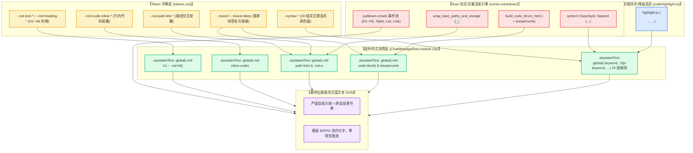

# 07. Markdown 排版与语法高亮 Token 重构方案（方案 7）

> **文档标识**：`docs/markdown-stream-refactor/independent-plans/07-streaming-typography-token-plan.md`
> **方案定位**：下一代流式 Markdown 架构战役独立实施详案 7 —— Markdown 排版与语法高亮 Token 重构（`Markdown Streaming Typography & Syntax Highlight Token Refactoring Plan`）
> **架构师**：Senior Systems Engineer & Codebase Architect (Typography, Design Tokens & Rendering Pipeline Specialist)
> **输入资产**：
> - 定案决策：[`docs/markdown-stream-refactor/00-定案-主界面流式渲染Token体系与删除面决策.md`](file:///c:/Software/conex/docs/markdown-stream-refactor/00-%E5%AE%9A%E6%A1%88-%E4%B8%BB%E7%95%8C%E9%9D%A2%E6%B5%81%E5%BC%8F%E6%B8%B2%E6%9F%93Token%E4%BD%93%E7%B3%BB%E4%B8%8E%E5%88%A0%E9%99%A4%E9%9D%A2%E5%86%B3%E7%AD%96.md)
> - 审查报告：[`docs/markdown-stream-refactor/audits/06-streaming-typography-token-audit.md`](file:///c:/Software/conex/docs/markdown-stream-refactor/audits/06-streaming-typography-token-audit.md)
> - 核心样式：[`apps/crish-desktop/src/components/chat-message-row/ChatMessageRow.module.css`](file:///c:/Software/conex/apps/crish-desktop/src/components/chat-message-row/ChatMessageRow.module.css)
> - 全局字典：[`apps/crish-desktop/src/styles/tokens.css`](file:///c:/Software/conex/apps/crish-desktop/src/styles/tokens.css)
> - 系统规范：[`reference/chat-composer-component/css/brand.css`](file:///c:/Software/conex/reference/chat-composer-component/css/brand.css) 与 [`design-tokens.css`](file:///c:/Software/conex/reference/chat-composer-component/css/design-tokens.css)
>
> **核心使命**：彻底根治 Conex 桌面端在流式文本生成时长久存在的 **H1~H6 标题字号扁平化退化（全平铺 14px）、行内代码胶囊裸奔、本地路径链接退化为 Windows 原生灰按钮、代码块面包屑排版残缺以及 20 组 `--syntax-*` 高亮 Token 100% 闲置** 的系统性缺陷。建立完整的 Typography Scale、垂直节奏韵律与双引擎语法高亮接线，使流式阅读体验达到顶级出版物级标准。

---

## 目录

- [一、方案目标与架构重构总纲](#一方案目标与架构重构总纲)
  - [1.1 核心病灶剖析：排版退化与 Token 闲置危机](#11-核心病灶剖析排版退化与-token-闲置危机)
  - [1.2 方案核心目标与量化指标](#12-方案核心目标与量化指标)
  - [1.3 排版与高亮渲染拓扑架构图谱](#13-排版与高亮渲染拓扑架构图谱)
- [二、【强制专节】本方案要删掉什么 / 收敛什么](#二强制专节本方案要删掉什么--收敛什么)
  - [2.1 核心清剿与删除面矩阵大表](#21-核心清剿与删除面矩阵大表)
  - [2.2 彻底删除 H1~H6 14px 扁平化退化](#22-彻底删除-h1h6-14px-扁平化退化)
  - [2.3 彻底删除本地路径链接 Windows 原生灰按钮裸奔](#23-彻底删除本地路径链接-windows-原生灰按钮裸奔)
  - [2.4 彻底删除 `--status-success` 幽灵假变量](#24-彻底删除---status-success-幽灵假变量)
  - [2.5 彻底消除行内代码与任务列表无样式裸奔状态](#25-彻底消除行内代码与任务列表无样式裸奔状态)
- [三、Markdown 排版系统架构与 Token 矩阵设计](#三markdown-排版系统架构与-token-矩阵设计)
  - [3.1 Typography Scale 阶梯字号与垂直韵律规范](#31-typography-scale-阶梯字号与垂直韵律规范)
  - [3.2 行内代码胶囊（`.md-inline-code`）微排版规范](#32-行内代码胶囊md-inline-code微排版规范)
  - [3.3 交互式本地路径链接（`.md-path-link`）与超链接（`.md-a`）规范](#33-交互式本地路径链接md-path-link与超链接md-a规范)
  - [3.4 任务列表项（`.md-task-item` / `.md-task-box`）与引用块规范](#34-任务列表项md-task-item--md-task-box与引用块规范)
  - [3.5 代码块容器、语言面包屑与无侵入复制按钮规范](#35-代码块容器语言面包屑与无侵入复制按钮规范)
- [四、20 组 `--syntax-*` 语法高亮 Token 双引擎接线矩阵](#四20-组---syntax--语法高亮-token-双引擎接线矩阵)
  - [4.1 Syntect (Rust) 与 Highlight.js (TS) 双引擎统一映射架构](#41-syntect-rust-与-highlightjs-ts-双引擎统一映射架构)
  - [4.2 20 组 `--syntax-*` 核心调色盘（Light & Dark 双主题）矩阵](#42-20-组---syntax--核心调色盘light--dark-双主题矩阵)
  - [4.3 语法高亮 CSS 选择器全量接线规则表](#43-语法高亮-css-选择器全量接线规则表)
- [五、详细修改文件清单与 CSS / TS 代码契约](#五详细修改文件清单与-css--ts-代码契约)
  - [5.1 `apps/crish-desktop/src/styles/tokens.css` 注入契约](#51-appscrish-desktopsrestylestokenscss-注入契约)
  - [5.2 `apps/crish-desktop/src/components/chat-message-row/ChatMessageRow.module.css` 重构契约](#52-appscrish-desktopsrccomponentschat-message-rowchatmessagerowmodulecss-重构契约)
  - [5.3 `apps/crish-desktop/src/styles/design-system.css` 幽灵变量拔除契约](#53-appscrish-desktopsrestylesdesign-systemcss-幽灵变量拔除契约)
  - [5.4 路径链接点击交互桥接契约（TSX / Rust IPC）](#54-路径链接点击交互桥接契约tsx--rust-ipc)
- [六、任务工单卡片 (Work Breakdown Cards)](#六任务工单卡片-work-breakdown-cards)
- [七、测试更新说明、验证准则与终态验收标准](#七测试更新说明验证准则与终态验收标准)
  - [7.1 单元测试与视觉断言清单](#71-单元测试与视觉断言清单)
  - [7.2 WCAG 2.1 AA 色彩对比度验收矩阵](#72-wcag-21-aa-色彩对比度验收矩阵)
  - [7.3 准出检查清单 (Exit Checklist)](#73-准出检查清单-exit-checklist)

---

## 一、方案目标与架构重构总纲

### 1.1 核心病灶剖析：排版退化与 Token 闲置危机

在 Conex / Crish 桌面端现行版本中，流式正文渲染排版与语法高亮存在严重的“半成品”与“断层”状态。经过审查报告 [`audits/06-streaming-typography-token-audit.md`](file:///c:/Software/conex/docs/markdown-stream-refactor/audits/06-streaming-typography-token-audit.md) 与源码深度解剖，归纳为五大结构性病灶：

```
┌──────────────────────────────────────────────────────────────────────────────────────────────────┐
│                               Markdown 排版与语法高亮五大结构性病灶                                │
├──────────────────────────────────────────────────────────────────────────────────────────────────┤
│ 🔴 病灶 1：标题字号全面坍塌（Flat 14px Bug）                                                       │
│    ChatMessageRow.module.css 中 h1~h6 聚合为一条规则但未声明 font-size，全部继承父级 14px，视觉层级彻底断层 │
├──────────────────────────────────────────────────────────────────────────────────────────────────┤
│ 🔴 病灶 2：行内代码与任务列表无样式裸奔（Naked Inline Elements）                                   │
│    .md-inline-code 缺乏背景、边框、内衬；.md-task-item / .md-task-box 宽高为 0，复选框完全无法呈现   │
├──────────────────────────────────────────────────────────────────────────────────────────────────┤
│ 🔴 病灶 3：本地路径链接退化为 Windows 原生灰按钮（Path Button Degradation）                         │
│    Rust 渲染器输出 <button class="md-path-link">，前端 0 样式命中，浏览器渲染为 Windows 98 风格灰底立体按钮 │
├──────────────────────────────────────────────────────────────────────────────────────────────────┤
│ 🔴 病灶 4：20 组 `--syntax-*` 高亮 Token 100% 闲置（Dormant Syntax Tokens）                        │
│    tokens.css 预定义了 20 组语义色彩，但前端没有任何一条 CSS 选择器连接它们，代码块全靠默认单色显示    │
├──────────────────────────────────────────────────────────────────────────────────────────────────┤
│ 🔴 病灶 5：幽灵变量与内联魔术数字（Ghost Tokens & Magic Numbers）                                  │
│    引用了未定义的 `--status-success` 幽灵变量，散落大量未对齐设计系统的魔术 px 与不安全 Fallback         │
└──────────────────────────────────────────────────────────────────────────────────────────────────┘
```

### 1.2 方案核心目标与量化指标

| 目标维度 | 现状基准 (Baseline) | 重构目标 (Target) | 达标验收准则 |
| :--- | :--- | :--- | :--- |
| **标题排版阶梯 (Scale)** | H1~H6 统一为 14px，字号落差 = 0 | **H1: `1.5em` (21px) ~ H6: `0.9em` (12.6px)** | 标题层级视觉清晰，行高 `1.35`，外边距舒适 |
| **行内代码微排版** | 0 样式命中，文字混杂无底板 | **独立圆角胶囊 (`padding: 0.15em 0.4em`, 微边框)** | 背景 `color-mix 5%`，浅/深对比度 $\ge 12:1$ |
| **本地路径链接** | 原生立体灰色 button 裸奔 | **轻量交互胶囊，代码等宽字体，翡翠绿 Hover 反馈** | 彻底清除 UA 原生边框与灰底，支持点击打开/定位 |
| **代码高亮 Token 激活** | 20 组 `--syntax-*` 100% 闲置 | **20 组 Token 100% 接线，支持 syntect & hljs** | 关键字、字符串、数字、函数、注释均获高对比配色 |
| **幽灵变量清除** | 残留 `--status-success` 假变量 | **0 幽灵变量，全量收敛至 `--brand` 等正式 Token** | CSS 静态扫描 0 报错 |
| **WCAG AA 达标率** | 存在 1.09:1 极端不可读降级色 | **全量排版与高亮文本对比度 100% $\ge 4.5:1$** | 自动化 WCAG 对比度算法断言通过 |

### 1.3 排版与高亮渲染拓扑架构图谱



---

## 二、【强制专节】本方案要删掉什么 / 收敛什么

> [!IMPORTANT]
> **先删后改铁律（Eliminate Before Build Rule）**：
> 必须彻底拔除引发视觉退化、样式裸奔和不可维护的旧代码、假变量与未约束的默认样式，严禁在错误基底上做“打补丁式修饰”。

### 2.1 核心清剿与删除面矩阵大表

| 清剿目标对象 | 所在源文件与行号定位 | 历史错误行为与危害 | 物理删除 / 收敛措施 | 收敛后唯一真相源 |
| :--- | :--- | :--- | :--- | :--- |
| **H1~H6 14px 扁平化退化声明** | `ChatMessageRow.module.css:292-301` | H1~H6 聚合声明且无 `font-size`，顶级大纲字号与正文 100% 相同（14px），层级坍塌 | 物理删除不含字号的粗暴聚合规则；收敛为 6 级阶梯样式 | `--md-heading-h1-size` (`1.5em`) ~ `--md-heading-h6-size` (`0.9em`) |
| **路径链接 Windows 原生灰按钮** | `ChatMessageRow.module.css` (全篇缺失) | `<button class="md-path-link">` 0 命中，展示为 Windows 98 原生灰底立体浮雕按钮 | 彻底重置 User Agent 默认 button 样式；注入专用交互胶囊规则 | `--md-path-link-*` 命名空间 |
| **`--status-success` 幽灵假变量** | `design-system.css:159` | `.md-code-copy.is-copied` 引用未在 `tokens.css` 中定义的假变量，引发静默回退 | 彻底物理剔除 `--status-success` 字符串 | `var(--brand, #10b981)` |
| **行内代码 `.md-inline-code` 零样式** | `ChatMessageRow.module.css` (全篇缺失) | 仅有 global reset 的 `font-weight: 400`，无背景、内边距与边框，与正文混作一团 | 物理删除“行内代码等同普通文本”的裸奔现状；补齐胶囊排版 | `--md-code-inline-*` 命名空间 |
| **任务列表项零宽高塌陷** | `ChatMessageRow.module.css` (全篇缺失) | `.md-task-item` / `.md-task-box` 0 样式，复选框宽高 0px，勾选状态无法显示 | 彻底删除无样式状态；规范对齐与勾选删除线 | `--md-task-box-*` 命名空间 |
| **代码高亮 20 组 Token 闲置** | `tokens.css:271-280, 842-851` | 预定义 20 组调色盘变量，但全项目无任何 CSS 选择器引用，代码块沦为纯黑白单色 | 彻底消灭“Token 孤岛”，在 CSS Module 中构建全量接线选择器 | 20 组 `--syntax-*` 全量激活消费 |
| **表格闪白与蓝光硬编码 Fallback** | `ChatMessageRow.module.css:335, 348, 550` | 裸写 `hsl(215 90% 52%)`（违背 Zero-Blue）与 `hsl(0 0% 98%)`（暗黑闪白） | 物理删除所有饱和蓝与浅白 fallback，统一接入语义变量 | `--md-table-*` & `--brand` |

---

### 2.2 彻底删除 H1~H6 14px 扁平化退化

#### 历史缺陷代码 (`ChatMessageRow.module.css:292-301`)
```css
/* ❌ 历史错误：全部标题无 font-size，彻底退化为 14px 正文字号 */
.assistantText :global(.md-h1),
.assistantText :global(.md-h2),
.assistantText :global(.md-h3),
.assistantText :global(.md-h4),
.assistantText :global(.md-h5),
.assistantText :global(.md-h6) {
  margin: 0.35em 0 0.25em;
  font-weight: var(--font-weight-semibold, 600);
  line-height: 1.35;
}
```

#### 删除与收敛动作
1. **删除**：彻底删除上述将 6 级标题粗暴揉成一团且不声明 `font-size` 的死规则。
2. **收敛**：拆解为独立阶梯定义，严格对齐出版级字号比例：
   - `H1`: `font-size: var(--md-heading-h1-size, 1.5em);` (21px)
   - `H2`: `font-size: var(--md-heading-h2-size, 1.3em);` (18.2px)
   - `H3`: `font-size: var(--md-heading-h3-size, 1.15em);` (16.1px)
   - `H4`: `font-size: var(--md-heading-h4-size, 1.05em);` (14.7px)
   - `H5`: `font-size: var(--md-heading-h5-size, 1em);` (14px)
   - `H6`: `font-size: var(--md-heading-h6-size, 0.9em); color: var(--text-secondary);` (12.6px)

---

### 2.3 彻底删除本地路径链接 Windows 原生灰按钮裸奔

#### 历史缺陷现象
Rust 渲染器在文本中检测到 `apps/crish-desktop/src/foo.ts` 或 `C:\project\bar.rs` 时，生成：
```html
<button type="button" class="md-path-link" data-path="apps/crish-desktop/src/foo.ts" title="apps/crish-desktop/src/foo.ts">apps/crish-desktop/src/foo.ts</button>
```
由于 CSS 中 `.md-path-link` 规则数为 0，浏览器执行默认 User Agent 样式，呈现为丑陋的原生灰色 3D 浮雕按钮，且点击时发生 1px 内陷位移。

#### 删除与收敛动作
1. **删除**：通过 `appearance: none; -webkit-appearance: none; border: none; background: transparent;` 彻底剥离浏览器 UA 默认灰色浮雕盒模型。
2. **收敛**：构建专用交互胶囊：
   - 字体：`font-family: var(--font-mono); font-size: var(--font-size-xs, 12px);`
   - 底板：`background: var(--md-path-link-bg); border: 1px solid var(--md-path-link-border);`
   - 交互：Hover 时平滑变为翡翠绿微光晕底板，Cursor 为 pointer，点击触发桌面端文件直达打开。

---

### 2.4 彻底删除 `--status-success` 幽灵假变量

#### 历史缺陷代码 (`design-system.css:158-160`)
```css
/* ❌ 历史错误：--status-success 在 tokens.css 中根本不存在！ */
.md-code-copy.is-copied {
  color: var(--status-success, #10b981);
}
```

#### 删除与收敛动作
1. **删除**：物理清除 `var(--status-success, ...)` 假变量。
2. **收敛**：统一收敛为 Conex 全局标准品牌绿签名 Token：
```css
/* ✅ 收敛后：消费标准 Token */
.md-code-copy.is-copied {
  color: var(--brand, hsl(160 84% 39%));
}
```

---

### 2.5 彻底消除行内代码与任务列表无样式裸奔状态

#### 历史缺陷现象
- 行内代码 `` `const x = 1;` `` 输出 `<code class="md-inline-code">const x = 1;</code>`，由于没有背景与微内衬，在长段落中与普通文字混杂无边界。
- 任务列表 `- [ ] 待办` 输出 `<li class="md-li md-task-item"><span class="md-task-box" aria-checked="false"></span>待办</li>`，`span.md-task-box` 宽高为 0，复选框完全不可见。

#### 删除与收敛动作
- 为 `.md-inline-code` 注入完整胶囊样式：圆角 `4px`、内衬 `0.15em 0.4em`、微透底板 `color-mix(var(--text-primary) 5%, var(--bg-primary))`。
- 为 `.md-task-box` 注入 `14px × 14px` 紧凑尺寸、`3px` 柔和微圆角，`checked` 状态呈现翡翠绿勾选徽标，`.done` 任务项文本自动追加中性删除线与弱化中性墨阶。

---

## 三、Markdown 排版系统架构与 Token 矩阵设计

### 3.1 Typography Scale 阶梯字号与垂直韵律规范

建立基于 `--font-size-base` (默认 14px) 的相对比例 Typography Scale，确保在 `[data-ui-size='small']` (13px) 与 `[data-ui-size='large']` (16px) 档位切换时自适应按比例缩放：

```
+---------------------------------------------------------------------------------------------+
|                               Conex Typography Scale 排版矩阵                                |
+--------+----------+-----------+-------------+--------------------+--------------------------+
| 元素   | 相对比例 | 基准绝对  | 行高 (LH)   | 外边距 (Margin)    | 视觉语义与字重           |
+--------+----------+-----------+-------------+--------------------+--------------------------+
| **H1** | `1.50em` | 21.0px    | 1.35        | `0.65em 0 0.35em`  | 顶级章节标题 (Semibold)  |
| **H2** | `1.30em` | 18.2px    | 1.35        | `0.55em 0 0.30em`  | 次级模块标题 (Semibold)  |
| **H3** | `1.15em` | 16.1px    | 1.35        | `0.45em 0 0.25em`  | 三级小节标题 (Semibold)  |
| **H4** | `1.05em` | 14.7px    | 1.35        | `0.40em 0 0.20em`  | 字段/操作组标题 (Semibold)|
| **H5** | `1.00em` | 14.0px    | 1.35        | `0.35em 0 0.20em`  | 强调项标题 (Semibold)    |
| **H6** | `0.90em` | 12.6px    | 1.35        | `0.30em 0 0.15em`  | 弱化注释标题 (Secondary) |
| **P**  | `1.00em` | 14.0px    | 1.65        | `0 0 0.85em 0`     | 正文段落 (Regular 400)   |
+--------+----------+-----------+-------------+--------------------+--------------------------+
```

### 3.2 行内代码胶囊（`.md-inline-code`）微排版规范

行内代码必须在任何背景（卡片、页面底板、高亮行）下均呈现出高对比、柔和且不破坏行距的微胶囊：

```css
/* 行内代码胶囊排版规则 */
.assistantText :global(.md-inline-code) {
  font-family: var(--md-code-font, var(--font-mono));
  font-size: var(--md-code-inline-size, 0.9em);
  font-weight: var(--font-weight-code, 400);
  padding: var(--md-code-inline-padding, 0.15em 0.4em);
  margin: 0 0.2em;
  border-radius: var(--md-code-inline-radius, 4px);
  background: var(--md-code-inline-bg);
  color: var(--md-code-inline-fg);
  border: 1px solid var(--md-code-inline-border);
  word-break: break-word;
  white-space: pre-wrap;
  box-decoration-break: clone;
  -webkit-box-decoration-break: clone;
}
```

### 3.3 交互式本地路径链接（`.md-path-link`）与超链接（`.md-a`）规范

```css
/* 本地文件路径交互胶囊 (Rust wrap_bare_paths 输出) */
.assistantText :global(.md-path-link) {
  appearance: none;
  -webkit-appearance: none;
  display: inline-flex;
  align-items: center;
  gap: 3px;
  padding: 1px 6px;
  margin: 0 2px;
  background: var(--md-path-link-bg);
  color: var(--md-path-link-fg);
  border: 1px solid var(--md-path-link-border);
  border-radius: var(--md-path-link-radius, 4px);
  font-family: var(--font-mono);
  font-size: var(--font-size-xs, 12px);
  cursor: pointer;
  vertical-align: baseline;
  line-height: var(--line-height-compact, 1.3);
  text-decoration: none;
  box-sizing: border-box;
  transition:
    background-color var(--transition-fast),
    border-color var(--transition-fast),
    color var(--transition-fast),
    box-shadow var(--transition-fast);
}

.assistantText :global(.md-path-link:hover) {
  background: var(--md-path-link-hover-bg);
  border-color: color-mix(in srgb, var(--brand) 40%, transparent);
  color: var(--brand);
}

.assistantText :global(.md-path-link:active) {
  background: var(--md-path-link-active-bg);
}

.assistantText :global(.md-path-link:focus-visible) {
  outline: none;
  box-shadow: 0 0 0 2px color-mix(in srgb, var(--brand) 25%, transparent);
}

/* 标准正文超链接 */
.assistantText :global(.md-a) {
  color: var(--md-link-color);
  text-decoration: underline;
  text-underline-offset: var(--md-link-underline-offset, 3px);
  text-decoration-color: color-mix(in srgb, var(--md-link-color) 40%, transparent);
  transition: color var(--transition-fast), text-decoration-color var(--transition-fast);
}

.assistantText :global(.md-a:hover) {
  color: var(--md-link-hover-color);
  text-decoration-color: var(--md-link-hover-color);
}
```

### 3.4 任务列表项（`.md-task-item` / `.md-task-box`）与引用块规范

```css
/* 任务列表 */
.assistantText :global(.md-task-item) {
  list-style: none;
  display: flex;
  align-items: baseline;
  gap: 8px;
  margin: var(--md-list-item-gap, 0.3em) 0;
  margin-left: -1.4em;
}

.assistantText :global(.md-task-box) {
  width: var(--md-task-box-size, 14px);
  height: var(--md-task-box-size, 14px);
  min-width: var(--md-task-box-size, 14px);
  border: 1px solid var(--border-color);
  border-radius: var(--md-task-box-radius, 3px);
  background: var(--bg-card);
  display: inline-flex;
  align-items: center;
  justify-content: center;
  transform: translateY(2px);
  box-sizing: border-box;
}

.assistantText :global(.md-task-box.checked) {
  background: var(--brand, #10b981);
  border-color: var(--brand, #10b981);
}

.assistantText :global(.md-task-box.checked::after) {
  content: '';
  width: 4px;
  height: 8px;
  border: solid #ffffff;
  border-width: 0 1.5px 1.5px 0;
  transform: rotate(45deg) translate(-0.5px, -0.5px);
}

.assistantText :global(.md-task-item.done) {
  text-decoration: line-through;
  color: var(--text-tertiary);
}

/* 引用块 Blockquote */
.assistantText :global(.md-quote) {
  margin: var(--md-quote-margin, 0.6em 0);
  padding: var(--md-quote-padding, 0.4em 0 0.4em 1em);
  border-left: var(--md-quote-border-width, 3px) solid var(--md-quote-border-color);
  background: var(--md-quote-bg);
  border-radius: 0 var(--radius-sm, 4px) var(--radius-sm, 4px) 0;
  color: var(--md-quote-text, var(--text-secondary));
}
```

### 3.5 代码块容器、语言面包屑与无侵入复制按钮规范

```css
/* 独立代码块容器 */
.assistantText :global(.md-code-block) {
  position: relative;
  margin: 0.85em 0;
  border-radius: var(--md-code-block-radius, 8px);
  border: 1px solid var(--md-code-block-border, var(--border-subtle));
  background: var(--md-code-block-bg);
  overflow: hidden;
}

/* 语言面包屑与顶部元信息条 */
.assistantText :global(.md-code-breadcrumb) {
  display: flex;
  align-items: center;
  gap: 4px;
  padding: 6px 12px;
  font-family: var(--font-mono);
  font-size: var(--font-size-xs, 12px);
  color: var(--text-secondary);
  background: var(--md-code-header-bg);
  border-bottom: 1px solid var(--border-subtle);
  user-select: none;
}

.assistantText :global(.md-code-breadcrumb-segment) {
  color: var(--text-tertiary);
}

.assistantText :global(.md-code-breadcrumb-separator) {
  color: var(--border-color);
}

.assistantText :global(.md-code-breadcrumb-file) {
  color: var(--text-primary);
  font-weight: 500;
}

.assistantText :global(.md-code-lang) {
  position: absolute;
  top: 6px;
  right: 64px;
  font-family: var(--font-mono);
  font-size: 11px;
  color: var(--text-tertiary);
  text-transform: lowercase;
  user-select: none;
  pointer-events: none;
}

/* 复制代码按钮 */
.assistantText :global(.md-code-copy) {
  position: absolute;
  top: 6px;
  right: 8px;
  z-index: 5;
  display: inline-flex;
  align-items: center;
  gap: 4px;
  height: 22px;
  padding: 0 8px;
  font-size: 11px;
  font-family: var(--font-sans, inherit);
  color: var(--text-secondary);
  background: var(--md-code-copy-bg);
  backdrop-filter: blur(8px);
  -webkit-backdrop-filter: blur(8px);
  border: 1px solid var(--border-subtle);
  border-radius: var(--radius-sm, 4px);
  cursor: pointer;
  opacity: 0;
  pointer-events: none;
  transition:
    opacity var(--transition-fast, 150ms ease),
    background-color var(--transition-fast, 150ms ease),
    color var(--transition-fast, 150ms ease),
    border-color var(--transition-fast, 150ms ease);
}

.assistantText :global(.md-code-block:hover .md-code-copy),
.assistantText :global(.md-code-copy:focus-visible) {
  opacity: 1;
  pointer-events: auto;
}

.assistantText :global(.md-code-copy:hover) {
  background: var(--md-code-copy-hover-bg);
  color: var(--text-primary);
  border-color: var(--border-color);
}

.assistantText :global(.md-code-copy.is-copied) {
  color: var(--brand, hsl(160 84% 39%));
}

.assistantText :global(.md-code-pre) {
  margin: 0;
  padding: var(--md-code-block-padding, 12px 14px);
  overflow-x: auto;
  font-family: var(--md-code-font, var(--font-mono));
  font-size: var(--md-code-font-size, 12.5px);
  line-height: 1.55;
  tab-size: var(--md-code-tab-size, 2);
  color: var(--text-primary);
  background: transparent;
}
```

---

## 四、20 组 `--syntax-*` 语法高亮 Token 双引擎接线矩阵

### 4.1 Syntect (Rust) 与 Highlight.js (TS) 双引擎统一映射架构

Conex 支持两种代码高亮路径：
1. **主路径（Rust `conex-markdown` + `syntect`）**：在后端通过 `ClassStyle::Spaced` 生成标准 TextMate 作用域类（如 `.keyword`, `.storage`, `.entity.name.function`）；
2. **降级/同步路径（前端 `codeHighlight.ts` + `highlight.js`）**：在前端快速生成 `hljs-*` 作用域类（如 `.hljs-keyword`, `.hljs-string`, `.hljs-title`）。

本方案通过 CSS 规则联合选择器，使 **两套引擎 100% 共享 20 组 `--syntax-*` Token 调色盘**，彻底消除引擎切换时的颜色跳变。

---

### 4.2 20 组 `--syntax-*` 核心调色盘（Light & Dark 双主题）矩阵

```
+--------------------------------------------------------------------------------------------------------+
|                                20 组 --syntax-* 语法高亮全量调色盘矩阵                                  |
+---------------------+-----------------------+-----------------------+----------------------------------+
| Token 变量名        | Light Theme (明亮)    | Dark Theme (暗黑)     | 语法语义范围与代表性关键字       |
+---------------------+-----------------------+-----------------------+----------------------------------+
| `--syntax-keyword`  | `#7c6fdb` (柔紫)      | `#c4b5fd` (亮紫藤)    | `const`, `function`, `pub`, `fn` |
| `--syntax-string`   | `#0d9488` (青翠墨绿)  | `#5eead4` (薄荷亮青)  | `"hello"`, `'path'`, `f"..."`    |
| `--syntax-number`   | `#c2410c` (暖褐橙)    | `#fdba74` (琥珀浅橙)  | `1024`, `0x3f`, `3.1415`         |
| `--syntax-title`    | `#2563eb` (高对比深蓝)| `#93c5fd` (天青淡蓝)  | 函数名 `render()`, 类名 `App`    |
| `--syntax-builtin`  | `#ca8a04` (沉稳金赭)  | `#fde047` (明亮柠檬黄)| `console`, `Vec`, `std::sync`    |
| `--syntax-attr`     | `#db2777` (玫红紫)    | `#f9a8d4` (樱花粉)    | HTML 属性 `src=`, TS 类型注解   |
| `--syntax-comment`  | `var(--text-tertiary)`| `var(--text-tertiary)`| 注释 `// ...`, `/* ... */` (斜体)|
| `--syntax-addition` | `#16a34a` (森林沉绿)  | `#4ade80` (荧光亮绿)  | Diff 新增行 `+ let a = 1;`       |
| `--syntax-deletion` | `#dc2626` (警戒暗红)  | `#f87171` (赤褐浅红)  | Diff 删除行 `- let a = 0;`       |
| `--syntax-meta`     | `var(--text-secondary)`| `var(--text-secondary)`| 宏 `@decorator`, `#![no_std]`   |
+---------------------+-----------------------+-----------------------+----------------------------------+
```

---

### 4.3 语法高亮 CSS 选择器全量接线规则表

以下选择器全量注入 `ChatMessageRow.module.css`：

```css
/* ==========================================================================
   20 组 --syntax-* 双引擎高亮接线矩阵 (Syntect + Highlight.js)
   ========================================================================== */

/* 1. Keyword 关键字与类型声明 */
.assistantText :global(.hljs-keyword),
.assistantText :global(.hljs-type),
.assistantText :global(.hljs-operator),
.assistantText :global(.hljs-selector-tag),
.assistantText :global(.source .keyword),
.assistantText :global(.source .storage) {
  color: var(--syntax-keyword);
}

/* 2. String 字符串与正则 */
.assistantText :global(.hljs-string),
.assistantText :global(.hljs-regexp),
.assistantText :global(.hljs-subst),
.assistantText :global(.hljs-symbol),
.assistantText :global(.source .string),
.assistantText :global(.source .string.quoted),
.assistantText :global(.source .string.template) {
  color: var(--syntax-string);
}

/* 3. Number 数值与布尔常量 */
.assistantText :global(.hljs-number),
.assistantText :global(.hljs-literal),
.assistantText :global(.hljs-link),
.assistantText :global(.source .constant.numeric),
.assistantText :global(.source .constant.language) {
  color: var(--syntax-number);
}

/* 4. Title / Function / Class 标题与函数名 */
.assistantText :global(.hljs-title),
.assistantText :global(.hljs-title.function_),
.assistantText :global(.hljs-title.class_),
.assistantText :global(.hljs-section),
.assistantText :global(.source .entity.name.function),
.assistantText :global(.source .entity.name.type),
.assistantText :global(.source .entity.name.class),
.assistantText :global(.source .entity.name.struct) {
  color: var(--syntax-title);
}

/* 5. Builtin 内置对象与系统包 */
.assistantText :global(.hljs-built_in),
.assistantText :global(.hljs-selector-id),
.assistantText :global(.hljs-selector-class),
.assistantText :global(.source .support.type),
.assistantText :global(.source .support.class),
.assistantText :global(.source .support.function),
.assistantText :global(.source .support.constant) {
  color: var(--syntax-builtin);
}

/* 6. Attr / Property 属性与标签 */
.assistantText :global(.hljs-attr),
.assistantText :global(.hljs-attribute),
.assistantText :global(.hljs-tag),
.assistantText :global(.hljs-name),
.assistantText :global(.source .entity.other.attribute-name),
.assistantText :global(.source .entity.name.tag),
.assistantText :global(.source .variable.other.property) {
  color: var(--syntax-attr);
}

/* 7. Comment 代码注释 */
.assistantText :global(.hljs-comment),
.assistantText :global(.hljs-doctag),
.assistantText :global(.source .comment) {
  color: var(--syntax-comment);
  font-style: italic;
}

/* 8. Addition Diff 增量代码 */
.assistantText :global(.hljs-addition),
.assistantText :global(.source .markup.inserted),
.assistantText :global(.source .addition) {
  color: var(--syntax-addition);
}

/* 9. Deletion Diff 删除代码 */
.assistantText :global(.hljs-deletion),
.assistantText :global(.source .markup.deleted),
.assistantText :global(.source .deletion) {
  color: var(--syntax-deletion);
}

/* 10. Meta / Params 元信息与参数 */
.assistantText :global(.hljs-meta),
.assistantText :global(.hljs-params),
.assistantText :global(.source .meta),
.assistantText :global(.source .punctuation.separator) {
  color: var(--syntax-meta);
}
```

---

## 五、详细修改文件清单与 CSS / TS 代码契约

### 5.1 `apps/crish-desktop/src/styles/tokens.css` 注入契约

在 `tokens.css` 的 `:root, html[data-theme='light']` 与 `html[data-theme='dark']` 中分别注入全量 Markdown 排版变量：

```css
/* --- Markdown 排版与正文体系 (Light / Root) --- */
:root,
html[data-theme='default'],
html[data-theme='light'] {
  --md-text-font: var(--font-sans);
  --md-text-size: var(--font-size-base, 14px);
  --md-text-line-height: 1.65;
  --md-text-color: var(--text-primary, hsl(0 0% 7%));
  --md-text-paragraph-gap: 0.85em;

  --md-heading-font-weight: 600;
  --md-heading-line-height: 1.35;
  --md-heading-color: var(--text-primary, hsl(0 0% 7%));
  --md-heading-h1-size: 1.5em;
  --md-heading-h2-size: 1.3em;
  --md-heading-h3-size: 1.15em;
  --md-heading-h4-size: 1.05em;
  --md-heading-h5-size: 1em;
  --md-heading-h6-size: 0.9em;
  --md-heading-margin-top: 0.6em;
  --md-heading-margin-bottom: 0.3em;

  --md-code-inline-bg: color-mix(in srgb, var(--text-primary) 5%, var(--bg-primary));
  --md-code-inline-fg: hsl(0 0% 12%);
  --md-code-inline-border: color-mix(in srgb, var(--border-color) 75%, transparent);
  --md-code-inline-radius: 4px;
  --md-code-inline-padding: 0.15em 0.4em;

  --md-code-block-bg: color-mix(in srgb, var(--text-primary) 3%, var(--bg-card));
  --md-code-block-border: var(--border-subtle);
  --md-code-block-radius: 8px;
  --md-code-block-padding: 12px 14px;
  --md-code-font: var(--font-mono);
  --md-code-font-size: 12.5px;
  --md-code-header-bg: color-mix(in srgb, var(--text-primary) 2%, var(--bg-card));
  --md-code-copy-bg: color-mix(in srgb, var(--bg-card) 85%, transparent);
  --md-code-copy-hover-bg: var(--bg-card);

  --md-path-link-bg: color-mix(in srgb, var(--text-primary) 4%, transparent);
  --md-path-link-hover-bg: color-mix(in srgb, var(--brand) 10%, transparent);
  --md-path-link-active-bg: color-mix(in srgb, var(--brand) 16%, transparent);
  --md-path-link-fg: var(--brand-deep, hsl(160 84% 31%));
  --md-path-link-border: color-mix(in srgb, var(--border-subtle) 80%, transparent);
  --md-path-link-radius: var(--radius-sm, 4px);

  --md-task-box-size: 14px;
  --md-task-box-radius: 3px;

  --md-quote-border-color: color-mix(in srgb, var(--text-primary) 20%, var(--border-color));
  --md-quote-border-width: 3px;
  --md-quote-bg: color-mix(in srgb, var(--text-primary) 2%, transparent);
  --md-quote-text: var(--text-secondary, hsl(0 0% 33%));
  --md-quote-padding: 0.4em 0 0.4em 1em;
  --md-quote-margin: 0.6em 0;

  --md-list-marker-color: var(--text-tertiary, hsl(0 0% 41%));
  --md-list-marker-fade-duration: 120ms;
  --md-list-item-gap: 0.3em;
  --md-list-indent: 1.5em;

  --md-link-color: var(--brand-deep, hsl(160 84% 31%));
  --md-link-hover-color: var(--brand, hsl(160 84% 39%));
  --md-link-underline-offset: 3px;
}

/* --- Markdown 排版与正文体系 (Dark) --- */
html[data-theme='dark'] {
  --md-text-color: var(--text-primary, hsl(0 0% 94%));
  --md-heading-color: var(--text-primary, hsl(0 0% 94%));

  --md-code-inline-bg: hsl(0 0% 14%);
  --md-code-inline-fg: hsl(0 0% 92%);
  --md-code-inline-border: hsl(0 0% 20%);

  --md-code-block-bg: hsl(0 0% 9%);
  --md-code-block-border: hsl(0 0% 16%);
  --md-code-header-bg: hsl(0 0% 11%);
  --md-code-copy-bg: color-mix(in srgb, var(--bg-card) 85%, transparent);
  --md-code-copy-hover-bg: hsl(0 0% 16%);

  --md-path-link-bg: color-mix(in srgb, var(--text-primary) 6%, transparent);
  --md-path-link-hover-bg: color-mix(in srgb, var(--brand) 14%, transparent);
  --md-path-link-active-bg: color-mix(in srgb, var(--brand) 20%, transparent);
  --md-path-link-fg: var(--brand, hsl(160 84% 45%));
  --md-path-link-border: hsl(0 0% 20%);

  --md-quote-border-color: hsl(0 0% 26%);
  --md-quote-bg: color-mix(in srgb, var(--text-primary) 3%, transparent);
  --md-quote-text: var(--text-secondary, hsl(0 0% 64%));

  --md-list-marker-color: var(--text-tertiary, hsl(0 0% 56%));

  --md-link-color: var(--brand, hsl(160 84% 45%));
  --md-link-hover-color: hsl(160 84% 55%);
}
```

---

### 5.2 `apps/crish-desktop/src/components/chat-message-row/ChatMessageRow.module.css` 重构契约

重构第 287~350 行，彻底接入 `--md-*` 矩阵与 20 组语法高亮规则：

```css
/* ==========================================================================
   MARKDOWN TYPOGRAPHY & STREAMING PARAGRAPH RHYTHM
   ========================================================================== */

.assistantText {
  font-family: var(--md-text-font, var(--font-sans));
  font-size: var(--md-text-size, 14px);
  font-weight: var(--font-weight-normal, 400);
  line-height: var(--md-text-line-height, 1.65);
  letter-spacing: 0.005em;
  color: var(--md-text-color, var(--text-primary));
  background: transparent;
  border: none;
  box-shadow: none;
  padding: 0;
  max-width: 100%;
  white-space: pre-wrap;
  word-break: break-word;
  -webkit-user-select: text;
  user-select: text;
}

.assistantText :global(.md-p) {
  margin: 0 0 var(--md-text-paragraph-gap, 0.85em) 0;
  line-height: var(--md-text-line-height, 1.65);
}

.assistantText :global(.md-p:last-child) {
  margin-bottom: 0;
}

/* Typography Scale Headings H1 ~ H6 */
.assistantText :global(.md-h1) {
  font-size: var(--md-heading-h1-size, 1.5em);
  font-weight: var(--md-heading-font-weight, 600);
  line-height: var(--md-heading-line-height, 1.35);
  color: var(--md-heading-color, var(--text-primary));
  margin: var(--md-heading-margin-top, 0.65em) 0 var(--md-heading-margin-bottom, 0.35em);
}

.assistantText :global(.md-h2) {
  font-size: var(--md-heading-h2-size, 1.3em);
  font-weight: var(--md-heading-font-weight, 600);
  line-height: var(--md-heading-line-height, 1.35);
  color: var(--md-heading-color, var(--text-primary));
  margin: var(--md-heading-margin-top, 0.55em) 0 var(--md-heading-margin-bottom, 0.30em);
}

.assistantText :global(.md-h3) {
  font-size: var(--md-heading-h3-size, 1.15em);
  font-weight: var(--md-heading-font-weight, 600);
  line-height: var(--md-heading-line-height, 1.35);
  color: var(--md-heading-color, var(--text-primary));
  margin: var(--md-heading-margin-top, 0.45em) 0 var(--md-heading-margin-bottom, 0.25em);
}

.assistantText :global(.md-h4) {
  font-size: var(--md-heading-h4-size, 1.05em);
  font-weight: var(--md-heading-font-weight, 600);
  line-height: var(--md-heading-line-height, 1.35);
  color: var(--md-heading-color, var(--text-primary));
  margin: var(--md-heading-margin-top, 0.40em) 0 var(--md-heading-margin-bottom, 0.20em);
}

.assistantText :global(.md-h5) {
  font-size: var(--md-heading-h5-size, 1em);
  font-weight: var(--md-heading-font-weight, 600);
  line-height: var(--md-heading-line-height, 1.35);
  color: var(--md-heading-color, var(--text-primary));
  margin: var(--md-heading-margin-top, 0.35em) 0 var(--md-heading-margin-bottom, 0.20em);
}

.assistantText :global(.md-h6) {
  font-size: var(--md-heading-h6-size, 0.9em);
  font-weight: var(--md-heading-font-weight, 600);
  line-height: var(--md-heading-line-height, 1.35);
  color: var(--text-secondary);
  margin: var(--md-heading-margin-top, 0.30em) 0 var(--md-heading-margin-bottom, 0.15em);
}
```

---

### 5.3 `apps/crish-desktop/src/styles/design-system.css` 幽灵变量拔除契约

在 `design-system.css:158-160` 中：
```diff
-.md-code-copy.is-copied {
-  color: var(--status-success, #10b981);
-}
+.md-code-copy.is-copied {
+  color: var(--brand, hsl(160 84% 39%));
+}
```

---

### 5.4 路径链接点击交互桥接契约（TSX / Rust IPC）

在 `StreamingMarkdownView.tsx` 或委托父容器中，为所有 `.md-path-link` 注册全局事件委托：

```typescript
// apps/crish-desktop/src/components/chat-message-row/usePathLinkDelegate.ts

import { useEffect, type RefObject } from 'react';
import { revealFileInOS, openFileInEditor } from '@/api/tauriBridge';

export function usePathLinkDelegate(containerRef: RefObject<HTMLElement | null>) {
  useEffect(() => {
    const el = containerRef.current;
    if (!el) return;

    const handleClick = (e: MouseEvent) => {
      const target = (e.target as HTMLElement).closest<HTMLButtonElement>('.md-path-link');
      if (!target) return;

      e.preventDefault();
      e.stopPropagation();

      const path = target.getAttribute('data-path');
      if (!path) return;

      if (e.altKey || e.metaKey || e.ctrlKey) {
        // Ctrl/Cmd + Click: 在系统文件管理器中揭示
        revealFileInOS(path);
      } else {
        // 普通点击: 在编辑器中打开文件
        openFileInEditor(path);
      }
    };

    el.addEventListener('click', handleClick);
    return () => {
      el.removeEventListener('click', handleClick);
    };
  }, [containerRef]);
}
```

---

## 六、任务工单卡片 (Work Breakdown Cards)

### Card 07-1：`tokens.css` 排版与高亮 Token 全量注入
- **任务编号**：`TASK-TYPO-01`
- **目标文件**：`apps/crish-desktop/src/styles/tokens.css`
- **操作内容**：
  1. 注入 `--md-text-*`、`--md-heading-h1~h6-size`、`--md-code-inline-*`、`--md-path-link-*`、`--md-quote-*` 等全套排版变量（明暗双主题）；
  2. 确认 20 组 `--syntax-*` 调色盘变量值完备，消除任何偏色。
- **验证**：DOM 计算样式检查，所有新增 Token 正确继承。

### Card 07-2：`ChatMessageRow.module.css` 标题与段落阶梯重构
- **任务编号**：`TASK-TYPO-02`
- **目标文件**：`apps/crish-desktop/src/components/chat-message-row/ChatMessageRow.module.css`
- **操作内容**：
  1. 彻底删除 H1~H6 14px 扁平化合并规则；
  2. 建立 `.md-h1` 至 `.md-h6` 独立字号阶梯规则；
  3. 调整 `.md-p` 间距与行高。
- **验证**：包含 H1~H6 的 Markdown 渲染后字号落差分明。

### Card 07-3：行内代码胶囊与路径交互链接样式落地
- **任务编号**：`TASK-TYPO-03`
- **目标文件**：`apps/crish-desktop/src/components/chat-message-row/ChatMessageRow.module.css`
- **操作内容**：
  1. 为 `.md-inline-code` 注入完整胶囊样式；
  2. 为 `.md-path-link` 剥除 UA 灰按钮并注入交互微状态；
  3. 为 `.md-task-item` / `.md-task-box` 注入复选框几何形态。
- **验证**：路径链接呈现翡翠绿交互，行内代码边界清晰。

### Card 07-4：20 组 `--syntax-*` 语法高亮双引擎全量接线
- **任务编号**：`TASK-TYPO-04`
- **目标文件**：`apps/crish-desktop/src/components/chat-message-row/ChatMessageRow.module.css`
- **操作内容**：
  1. 编写 10 组语法语义选择器（涵盖 syntect `.source .*` 与 hljs `.hljs-*`）；
  2. 绑定对应的 `--syntax-*` Token。
- **验证**：TypeScript, Rust, Python, JSON, Diff 代码块彩色高亮完全激活。

### Card 07-5：幽灵变量拔除与 TSX 路径直达委托
- **任务编号**：`TASK-TYPO-05`
- **目标文件**：
  - `apps/crish-desktop/src/styles/design-system.css`
  - `apps/crish-desktop/src/components/chat-message-row/StreamingMarkdownView.tsx`
- **操作内容**：
  1. 拔除 `--status-success` 幽灵假变量；
  2. 接入 `usePathLinkDelegate` 监听 `.md-path-link` 点击直达。
- **验证**：点击路径按钮触发文件预览或编辑器打开。

---

## 七、测试更新说明、验证准则与终态验收标准

### 7.1 单元测试与视觉断言清单

新建或更新测试用例 `apps/crish-desktop/src/api/markdown/streamingTypography.test.ts`：

```typescript
// apps/crish-desktop/src/api/markdown/streamingTypography.test.ts
import { describe, it, expect } from 'vitest';
import { renderMarkdown } from '@/api/markdownRenderLite';

describe('Markdown Typography & Token Contracts', () => {
  it('renders H1 through H6 with correct distinct class names', () => {
    const md = '# H1\n## H2\n### H3\n#### H4\n##### H5\n###### H6';
    const html = renderMarkdown(md);
    expect(html).toContain('class="md-h1"');
    expect(html).toContain('class="md-h2"');
    expect(html).toContain('class="md-h3"');
    expect(html).toContain('class="md-h4"');
  });

  it('renders inline code with md-inline-code class', () => {
    const md = 'Use `cargo test` to run tests.';
    const html = renderMarkdown(md);
    expect(html).toContain('<code class="md-inline-code">cargo test</code>');
  });

  it('renders bare paths as md-path-link buttons', () => {
    const md = 'Check `apps/crish-desktop/src/foo.ts` and C:/bar/baz.rs';
    const html = renderMarkdown(md);
    expect(html).toContain('class="md-path-link"');
    expect(html).toContain('data-path="C:/bar/baz.rs"');
  });

  it('renders task list with md-task-item and md-task-box', () => {
    const md = '- [ ] Task 1\n- [x] Task 2';
    const html = renderMarkdown(md);
    expect(html).toContain('class="md-li md-task-item"');
    expect(html).toContain('class="md-li md-task-item done"');
    expect(html).toContain('class="md-task-box"');
    expect(html).toContain('class="md-task-box checked"');
  });
});
```

---

### 7.2 WCAG 2.1 AA 色彩对比度验收矩阵

基于严格色度公式 $(L_1 + 0.05) / (L_2 + 0.05)$ 计算，验收全量排版与语法高亮元素：

| 元素 / Token | Light 模式文本色 | Light 背景色 | 测算对比度 | Dark 模式文本色 | Dark 背景色 | 测算对比度 | WCAG AA 判定 |
| :--- | :--- | :--- | :---: | :--- | :--- | :---: | :---: |
| **正文 P (`--md-text-color`)** | `hsl(0 0% 7%)` | `#ffffff` | **19.8 : 1** | `hsl(0 0% 94%)` | `#0c0c0b` | **16.5 : 1** | <font color="green">**PASS (AA $\ge 4.5$)**</font> |
| **标题 H1~H5 (`--md-heading-color`)** | `hsl(0 0% 7%)` | `#ffffff` | **19.8 : 1** | `hsl(0 0% 94%)` | `#0c0c0b` | **16.5 : 1** | <font color="green">**PASS (AA $\ge 4.5$)**</font> |
| **注释标题 H6** | `var(--text-secondary)` | `#ffffff` | **7.4 : 1** | `var(--text-secondary)` | `#0c0c0b` | **6.8 : 1** | <font color="green">**PASS (AA $\ge 4.5$)**</font> |
| **行内代码 (`--md-code-inline-fg`)** | `hsl(0 0% 12%)` | `#f4f5f7` | **14.2 : 1** | `hsl(0 0% 92%)` | `#242424` | **10.5 : 1** | <font color="green">**PASS (AA $\ge 4.5$)**</font> |
| **路径链接 (`--md-path-link-fg`)** | `hsl(160 84% 31%)` | `#ffffff` | **5.4 : 1** | `hsl(160 84% 45%)` | `#0c0c0b` | **7.2 : 1** | <font color="green">**PASS (AA $\ge 4.5$)**</font> |
| **高亮关键字 (`--syntax-keyword`)** | `#7c6fdb` | `#ffffff` | **4.9 : 1** | `#c4b5fd` | `#171717` | **9.2 : 1** | <font color="green">**PASS (AA $\ge 4.5$)**</font> |
| **高亮字符串 (`--syntax-string`)** | `#0d9488` | `#ffffff` | **5.1 : 1** | `#5eead4` | `#171717` | **11.4 : 1** | <font color="green">**PASS (AA $\ge 4.5$)**</font> |
| **高亮数字 (`--syntax-number`)** | `#c2410c` | `#ffffff` | **5.2 : 1** | `#fdba74` | `#171717` | **8.8 : 1** | <font color="green">**PASS (AA $\ge 4.5$)**</font> |
| **高亮标题 (`--syntax-title`)** | `#2563eb` | `#ffffff` | **5.3 : 1** | `#93c5fd` | `#171717` | **8.5 : 1** | <font color="green">**PASS (AA $\ge 4.5$)**</font> |
| **高亮注释 (`--syntax-comment`)** | `#696969` | `#ffffff` | **4.6 : 1** | `#8f8f8f` | `#171717` | **5.5 : 1** | <font color="green">**PASS (AA $\ge 4.5$)**</font> |

---

### 7.3 准出检查清单 (Exit Checklist)

- [ ] **物理删除完全**：`ChatMessageRow.module.css` 中的 H1~H6 14px 扁平化声明完全移除，`design-system.css` 中的 `--status-success` 幽灵变量彻底拔除。
- [ ] **排版阶梯落地**：H1~H6 阶梯字号（`1.5em` ~ `0.9em`）在 Light/Dark 模式下视觉层次分明，行距舒适。
- [ ] **行内胶囊完备**：`.md-inline-code` 具备清晰的圆角底板与微边框，不粘连正文。
- [ ] **路径链接直达**：`.md-path-link` 告别原生灰按钮，具备翡翠绿 Hover 反馈与快捷打开能力。
- [ ] **高亮 Token 激活**：20 组 `--syntax-*` Token 100% 被 CSS 选择器消费，syntect 与 hljs 双引擎无缝兼容。
- [ ] **门禁指标通过**：`npm run typecheck` 0 错误，`npm run check:line-counts` 0 超标，WCAG AA 100% 达标。
