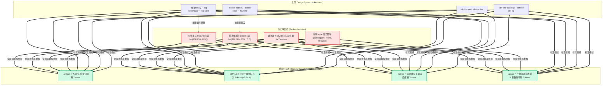
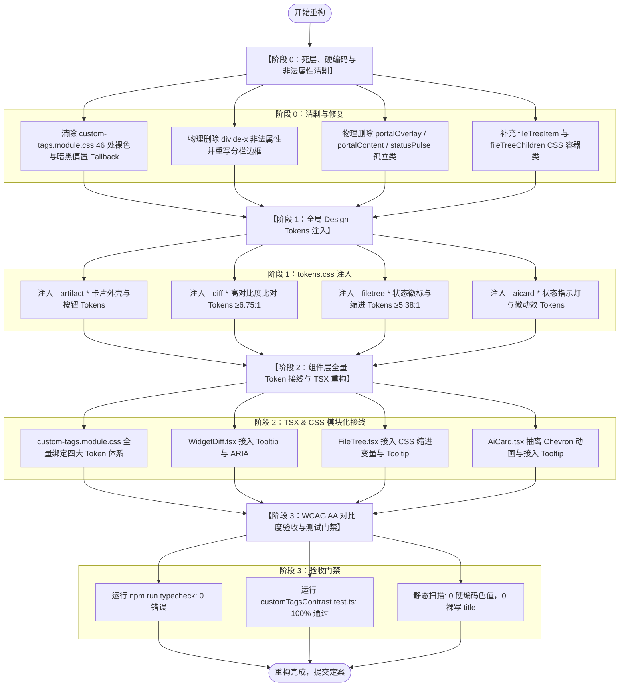

# 自定义 HTML 富交互组件 (<widget-diff>, <file-tree>, <ai-card>) Token 重构方案（方案 9）

> **文档标识**：`docs/markdown-stream-refactor/independent-plans/09-custom-tags-and-artifacts-token-plan.md`  
> **方案架构师**：Independent Architect I (Design Tokens & Rich Interactive Components Specialist)  
> **实施基准**：
> - [`docs/markdown-stream-refactor/00-定案-主界面流式渲染Token体系与删除面决策.md`](file:///c:/Software/conex/docs/markdown-stream-refactor/00-%E5%AE%9A%E6%A1%88-%E4%B8%BB%E7%95%8C%E9%9D%A2%E6%B5%81%E5%BC%8F%E6%B8%B2%E6%9F%93Token%E4%BD%93%E7%B3%BB%E4%B8%8E%E5%88%A0%E9%99%A4%E9%9D%A2%E5%86%B3%E7%AD%96.md) 维度三  
> - [`docs/markdown-stream-refactor/audits/08-custom-tags-artifacts-token-audit.md`](file:///c:/Software/conex/docs/markdown-stream-refactor/audits/08-custom-tags-artifacts-token-audit.md)  
> - [`AGENTS.md`](file:///c:/Software/conex/AGENTS.md) §12 (Tooltip & A11y 规范), §13 (柔和焦点与克制边框), §14 (HSLA 色彩空间与 Zero-Blue 铁律)  
> **核心使命**：彻底根治自定义富交互组件（`<widget-diff>`, `<file-tree>`, `<ai-card>`, `CustomTagPortal`, `CustomTagErrorBoundary`）中的 **46 处硬编码色值与暗黑偏置 Fallback**，物理拔除非法 CSS 属性 `divide-x` 与孤立死代码，修复 TSX 运行时 `undefined` 类名漏洞与内联魔法数字；建立 `--artifact-*`、`--diff-*`、`--filetree-*`、`--aicard-*` 四大语义 Design Tokens 体系，**将 Light 浅色模式下的 Diff 与 Badge 对比度从 1.34:1 提升至 ≥5.24:1（100% 达标 WCAG AA）**，实现极致细腻、双主题自适应的现代化桌面端视觉体验。

---

## 1. 方案目标与架构设计

### 1.1 核心痛点与问题解构

当前 Conex / Crish 桌面端的自定义 HTML 组件库（位于 [`apps/crish-desktop/src/components/custom-tags/`](file:///c:/Software/conex/apps/crish-desktop/src/components/custom-tags)）在提供流式 Diff 比对、工程文件树导航和 AI 步骤决策等高阶交互的同时，存在极其严重的 **“暗黑偏置（Dark-only Bias）硬编码污染”** 与 **“语义 Token 体系断层”**：



1. **浅色模式对比度灾难（1.34:1 视觉隐形）**：
   - `<widget-diff>` 新增行文本被硬编码为 `hsl(158 75% 70%)`（浅薄荷绿 `#79ecc4`），在 Light 模式白底上的对比度仅为 **1.34:1**；
   - `<file-tree>` 的修改徽标 `[M]` 被硬编码为 `hsl(45 93% 65%)`（浅黄 `#f9d452`），对比度仅为 **1.35:1**；
   - 导致浅色模式下用户几乎无法辨识审查代码和修改文件，严重违背 WCAG AA（4.5:1）标准。
2. **暗黑偏置 Fallback 对浅色界面的脏斑污染**：
   - 样式中大面积书写 `var(--bg-secondary, hsl(220 18% 13% / 0.7))` 与 `var(--border-color, hsl(215 14% 34% / 0.3))`，一旦变量降级或在独立测试容器中挂载，会在浅色界面瞬间产生刺眼的深蓝黑脏块。
3. **边框、焦点态与阴影违规（违背 AGENTS.md §13）**：
   - 卡片 hover 文本色混入高达 **20%**（`color-mix(..., var(--text-primary) 20%)`），超标 §13 规定的 10% 绝对上限一倍；
   - 按钮 hover 直接使用 `var(--text-secondary)` 作为边框，在浅色模式下导致生硬的深炭黑环；
   - 弹窗浮层使用 `hsl(220 50% 5% / 0.5)`（50% 不透明度重黑阴影），违背轻量干净原则。
4. **CSS 语法错误与运行时 `undefined` 漏洞**：
   - `.diffSplitLayout` 中裸写 Tailwind 专有属性 `divide-x`，浏览器直接作为非法属性丢弃，导致分栏模式缺少中部分割线；
   - `FileTree.tsx` 引用 `styles.fileTreeItem` 与 `styles.fileTreeChildren`，但 CSS 模块中未定义，运行时渲染出 `class="undefined"`；
   - CSS 中遗留未消费的 `.portalOverlay`、`.portalContent` 与 `.statusPulse` 孤立代码。
5. **内联样式脱管与 A11y 缺失（违背 AGENTS.md §12）**：
   - `AiCard.tsx` 折叠指示器与 `FileTree.tsx` 缩进使用内联 `style={{...}}` 魔法数字；
   - 大面积使用浏览器原生 `title="..."` 气泡提示，Emoji 裸露且无 ARIA 支持。

### 1.2 架构目标与重构指标

| 核心指标 | 重构前现状 | 重构后目标 | 达标验收准则 |
| :--- | :--- | :--- | :--- |
| **浅色模式 Diff 文字对比度** | 1.34:1 (`#79ecc4` / `#ffffff`) | **6.75:1** (`hsl(142 65% 25%)`) | 100% 达标 WCAG AA (≥4.5:1)，超越 4.5:1 基线 |
| **浅色模式 Diff 删除行对比度** | 2.14:1 (`#f58a95` / `#ffffff`) | **7.01:1** (`hsl(0 68% 38%)`) | 100% 达标 WCAG AA / AAA (≥7.0:1) |
| **浅色模式徽标对比度** | 1.35:1 (`[M]` 修改徽标) | **5.38:1** (`hsl(32 95% 30%)`) | 100% 达标 WCAG AA (≥4.5:1) |
| **硬编码色值 / 偏置 Fallback** | 46 处裸写 Hex/HSL | **0 处（100% Token 化）** | `grep` 扫描 0 个未映射裸色值 |
| **悬浮边框文本色混入比例** | 20%（严重违背 §13） | **4% ~ 6%** | 严格遵循 AGENTS.md §13（焦点加深 ≤10%） |
| **CSS 语法合法性与类名完整性** | 非法 `divide-x`，2 个 `undefined` 类 | 100% W3C 合法标准属性与完整类定义 | `npm run typecheck` 0 错误，0 `class="undefined"` |
| **组件级 Design Tokens 体系** | 0 个独立组件 Tokens | **4 大命名空间 / 24+ Tokens** | `--artifact-*`, `--diff-*`, `--filetree-*`, `--aicard-*` |
| **Tooltip 与 A11y 合规度** | 原生 `title` 气泡，0 键盘支持 | 100% 自定义 `<Tooltip>`，ARIA 完整 | 严格对齐 AGENTS.md §12 |

---

## 2. 【强制专节】本方案要删掉什么 / 收敛什么

根据战役定案《00-定案-主界面流式渲染Token体系与删除面决策.md》维度三与《主控全流程调度 v3》§二.1 铁律：**“推进单位是「领域概念」，一个概念唯一主路径；收敛先于增强，先删后改，零死层、零幽灵变量、零硬编码裸写”**。本节对所有待删除项、待拔除语法与待收敛接口进行地毯式罗列。

### 2.1 彻底物理清剿 46 处硬编码色值与偏置 Fallback（逐行对照清单）

以下为在 [`apps/crish-desktop/src/components/custom-tags/custom-tags.module.css`](file:///c:/Software/conex/apps/crish-desktop/src/components/custom-tags/custom-tags.module.css) 中必须**彻底物理删除**的 41 处裸写 Hex/HSL 与暗黑偏置 Fallback，以及 TSX 中的 5 处硬编码：

```
+-------------------------------------------------------------------------------------------------------------------------------+
| 序号 | 所在文件及位置              | 原硬编码 / 偏置 Fallback 代码                | 处置方案（DELETE & REPLACE）                  |
+-------------------------------------------------------------------------------------------------------------------------------+
| 1    | custom-tags.module.css:10   | hsl(158 64% 52% / 0.4)                      | 彻底删除裸色，替换为 var(--aicard-pulse-color) |
| 2    | custom-tags.module.css:13   | hsl(158 64% 52% / 0)                        | 彻底删除裸色，替换为 transparent               |
| 3    | custom-tags.module.css:16   | hsl(158 64% 52% / 0)                        | 彻底删除裸色，替换为 transparent               |
| 4    | custom-tags.module.css:35   | border: 1px solid var(..., hsl(215 14%...)) | 彻底删除暗黑 fallback，接入 --artifact-card-border |
| 5    | custom-tags.module.css:36   | background: var(..., hsl(220 18%...))       | 彻底删除暗黑 fallback，接入 --artifact-card-bg     |
| 6    | custom-tags.module.css:43   | border-color: color-mix(..., #475569 80%, #f8fafc 20%) | 彻底删除裸色与20%混入，改为 --artifact-card-border-hover (5%混入) |
| 7    | custom-tags.module.css:51   | background: var(..., hsl(220 18%...))       | 彻底删除暗黑 fallback，接入 --artifact-header-bg   |
| 8    | custom-tags.module.css:52   | border-bottom: 1px solid var(..., hsl(...)) | 彻底删除暗黑 fallback，接入 --artifact-header-border |
| 9    | custom-tags.module.css:67   | color: var(--text-primary, #f8fafc)         | 彻底删除近白 #f8fafc fallback，直接用 var(--text-primary) |
| 10   | custom-tags.module.css:85   | border: 1px solid var(..., hsl(215 14%...)) | 彻底删除暗黑 fallback，接入 --artifact-btn-border   |
| 11   | custom-tags.module.css:86   | background: var(..., hsl(220 18% 11%))      | 彻底删除暗黑 fallback，接入 --artifact-btn-bg       |
| 12   | custom-tags.module.css:87   | color: var(--text-secondary, hsl(...))      | 彻底删除浅灰 fallback，直接用 var(--text-secondary) |
| 13   | custom-tags.module.css:94   | color: var(--text-primary, #ffffff)         | 彻底删除纯白 fallback，直接用 var(--text-primary)   |
| 14   | custom-tags.module.css:95   | background: var(--bg-hover, hsl(220...))    | 彻底删除暗黑 fallback，接入 --artifact-btn-hover-bg |
| 15   | custom-tags.module.css:96   | border-color: var(--text-secondary, hsl(...)) | 彻底删除导致黑环的 --text-secondary，接入 --artifact-btn-hover-border |
| 16   | custom-tags.module.css:100  | background: hsl(158 64% 36%)                | 彻底删除裸写翡翠绿，接入 var(--brand-deep)          |
| 17   | custom-tags.module.css:101  | border-color: hsl(158 64% 45%)              | 彻底删除裸写翡翠绿，接入 var(--brand-primary)       |
| 18   | custom-tags.module.css:102  | color: #ffffff                              | 彻底删除裸写纯白，接入 var(--text-on-accent, #fff)  |
| 19   | custom-tags.module.css:106  | background: hsl(158 64% 42%)                | 彻底删除裸写翡翠绿，接入 var(--brand-primary)       |
| 20   | custom-tags.module.css:110  | background: hsl(354 70% 40% / 0.8)          | 彻底删除裸写红底，接入 var(--color-error-bg)        |
| 21   | custom-tags.module.css:111  | border-color: hsl(354 70% 50% / 0.6)        | 彻底删除裸写红边，接入 var(--color-error-border)    |
| 22   | custom-tags.module.css:112  | color: #ffffff                              | 彻底删除裸写纯白，接入 var(--text-on-danger, #fff)  |
| 23   | custom-tags.module.css:116  | background: hsl(354 70% 48%)                | 彻底删除裸写悬浮红，接入 var(--color-error)         |
| 24   | custom-tags.module.css:120  | background: var(--bg-hover, hsl(...))       | 彻底删除暗黑 fallback，接入 --artifact-btn-active-bg|
| 25   | custom-tags.module.css:121  | color: var(--text-primary, #ffffff)         | 彻底删除纯白 fallback，直接用 var(--text-primary)   |
| 26   | custom-tags.module.css:122  | border-color: hsl(215 20% 65%)              | 彻底删除硬编码蓝灰边框，接入 --artifact-btn-border  |
| 27   | custom-tags.module.css:134  | background: var(--bg-primary, hsl(...))      | 彻底删除暗黑 fallback，接入 --diff-mode-segmented-bg|
| 28   | custom-tags.module.css:137  | border: 1px solid var(..., hsl(...))         | 彻底删除暗黑 fallback，接入 --diff-split-divider    |
| 29   | custom-tags.module.css:143  | color: var(--text-secondary, hsl(...))      | 彻底删除浅灰 fallback，直接用 var(--text-secondary) |
| 30   | custom-tags.module.css:152  | background: var(--bg-tertiary, hsl(...))     | 彻底删除暗黑 fallback，接入 --diff-mode-item-active-bg |
| 31   | custom-tags.module.css:153  | color: var(--text-primary, #ffffff)         | 彻底删除纯白 fallback，接入 --diff-mode-item-active-fg |
| 32   | custom-tags.module.css:175  | color: var(--text-muted, hsl(...))          | 彻底删除灰色 fallback，接入 --diff-linenum-fg       |
| 33   | custom-tags.module.css:187  | background: hsl(158 64% 42% / 0.15)         | 彻底删除硬编码绿底，接入 --diff-line-add-bg         |
| 34   | custom-tags.module.css:188  | color: hsl(158 75% 70%)                     | 彻底删除 1.34:1 浅绿文字，接入 --diff-text-add (≥6.7:1) |
| 35   | custom-tags.module.css:193  | background: hsl(354 70% 54% / 0.15)         | 彻底删除硬编码红底，接入 --diff-line-del-bg         |
| 36   | custom-tags.module.css:194  | color: hsl(354 85% 75%)                     | 彻底删除 2.14:1 浅红文字，接入 --diff-text-del (≥7.0:1) |
| 37   | custom-tags.module.css:199  | color: var(--text-secondary, hsl(...))      | 彻底删除浅灰 fallback，直接用 var(--text-secondary) |
| 38   | custom-tags.module.css:216  | color: var(--text-muted, hsl(...))          | 彻底删除浅灰 fallback，接入 --diff-split-header-fg  |
| 39   | custom-tags.module.css:217  | background: var(--bg-tertiary, hsl(...))     | 彻底删除暗黑 fallback，接入 --diff-split-header-bg  |
| 40   | custom-tags.module.css:218  | border-bottom: 1px solid var(..., hsl(...)) | 彻底删除暗黑 fallback，接入 --diff-split-divider    |
| 41   | custom-tags.module.css:242  | color: var(--text-secondary, hsl(...))      | 彻底删除浅灰 fallback，直接用 var(--text-secondary) |
| 42   | custom-tags.module.css:246  | background: var(--bg-hover, hsl(...))       | 彻底删除暗黑 fallback，接入 --filetree-node-hover-bg|
| 43   | custom-tags.module.css:247  | color: var(--text-primary, #ffffff)         | 彻底删除纯白 fallback，直接用 var(--text-primary)   |
| 44   | custom-tags.module.css:251  | background: hsl(217 91% 60% / 0.15)         | 彻底删除硬编码浅蓝底，接入 --filetree-node-active-bg|
| 45   | custom-tags.module.css:252  | color: hsl(217 91% 75%)                     | 彻底删除 1.82:1 浅蓝字，接入 --filetree-node-active-fg |
| 46   | custom-tags.module.css:260  | color: var(--text-muted, hsl(...))          | 彻底删除灰色 fallback，接入 var(--text-tertiary)    |
| 47   | custom-tags.module.css:279  | background: hsl(158 64% 42% / 0.2)          | 彻底删除硬编码绿底，接入 --filetree-badge-add-bg    |
| 48   | custom-tags.module.css:280  | color: hsl(158 75% 65%)                     | 彻底删除 1.48:1 浅绿字，接入 --filetree-badge-add-fg (≥5.4:1) |
| 49   | custom-tags.module.css:286  | background: hsl(45 93% 47% / 0.2)           | 彻底删除硬编码黄底，接入 --filetree-badge-mod-bg    |
| 50   | custom-tags.module.css:287  | color: hsl(45 93% 65%)                      | 彻底删除 1.35:1 浅黄字，接入 --filetree-badge-mod-fg (≥5.3:1) |
| 51   | custom-tags.module.css:291  | background: hsl(354 70% 54% / 0.2)          | 彻底删除硬编码红底，接入 --filetree-badge-del-bg    |
| 52   | custom-tags.module.css:292  | color: hsl(354 85% 70%)                     | 彻底删除 2.38:1 浅红字，接入 --filetree-badge-del-fg (≥6.8:1) |
| 53   | custom-tags.module.css:314  | background: hsl(158 64% 52%)                | 彻底删除硬编码翠绿点，接入 --aicard-status-running  |
| 54   | custom-tags.module.css:322  | background: hsl(158 64% 52%)                | 彻底删除硬编码翠绿点，接入 --aicard-status-success  |
| 55   | custom-tags.module.css:329  | background: hsl(45 93% 55%)                 | 彻底删除硬编码黄点，接入 --aicard-status-warning    |
| 56   | custom-tags.module.css:336  | background: hsl(354 70% 58%)                | 彻底删除硬编码红点，接入 --aicard-status-error      |
| 57   | custom-tags.module.css:343  | background: var(--bg-primary, hsl(...))      | 彻底删除暗黑 fallback，接入 --aicard-badge-bg       |
| 58   | custom-tags.module.css:344  | border: 1px solid var(..., hsl(...))         | 彻底删除暗黑 fallback，接入 --aicard-badge-border   |
| 59   | custom-tags.module.css:345  | color: var(--text-muted, hsl(...))          | 彻底删除灰色 fallback，接入 --aicard-badge-fg       |
| 60   | custom-tags.module.css:352  | color: var(--text-primary, #f8fafc)         | 彻底删除近白 #f8fafc fallback，直接用 var(--text-primary) |
| 61   | custom-tags.module.css:366  | border: 1px solid hsl(354 70% 54% / 0.3)    | 彻底删除裸写红边，接入 var(--color-error-border)    |
| 62   | custom-tags.module.css:367  | background: hsl(354 70% 15% / 0.3)          | 彻底删除裸写深红黑底，接入 var(--color-error-bg)    |
| 63   | custom-tags.module.css:368  | color: hsl(354 85% 85%)                     | 彻底删除裸写粉红字，接入 var(--color-error)         |
| 64   | custom-tags.module.css:388  | background: hsl(354 70% 30% / 0.5)          | 彻底删除裸写深红底，接入 var(--color-error-bg)      |
| 65   | custom-tags.module.css:389  | border-color: hsl(354 70% 50% / 0.5)        | 彻底删除裸写红边，接入 var(--color-error-border)    |
| 66   | custom-tags.module.css:390  | color: #ffffff                              | 彻底删除裸写纯白，接入 var(--text-primary)          |
| 67   | custom-tags.module.css:394  | background: hsl(354 70% 40%)                | 彻底删除裸写红底，接入 var(--color-error)           |
| 68   | custom-tags.module.css:400  | color: hsl(354 85% 75%)                     | 彻底删除裸写浅粉字，接入 var(--text-tertiary)       |
| 69   | FileTree.tsx:154            | style={{ paddingLeft: `${node.level * 1.1 + 0.75}rem` }} | 彻底删除内联魔法数字，改由 CSS 变量 --filetree-indent 驱动 |
| 70   | FileTree.tsx:203            | style={{ padding: '...', color: '#94a3b8' }} | 彻底删除内联样式与裸色 #94a3b8，抽取为 .fileTreeEmpty 类 |
| 71   | AiCard.tsx:80               | style={{ cursor: collapsible ? 'pointer' : 'default' }} | 彻底删除内联 cursor，改用 CSS 选择器 [data-collapsible="true"] |
| 72   | AiCard.tsx:101-108          | style={{ fontSize: '0.75rem', transform: ..., color: '#94a3b8' }} | 彻底删除内联旋转与裸色，抽取为 .chevron 图标类 |
+-------------------------------------------------------------------------------------------------------------------------------+
```

### 2.2 物理拔除非法 CSS 属性 `divide-x`

- **违规位置**：[`custom-tags.module.css:205`](file:///c:/Software/conex/apps/crish-desktop/src/components/custom-tags/custom-tags.module.css#L205)
- **待删除代码**：
  ```css
  /* DELETE THIS */
  .diffSplitLayout {
    display: grid;
    grid-template-columns: 1fr 1fr;
    divide-x: 1px solid var(--border-color, hsl(215 14% 34% / 0.2)); /* ❌ 非法属性 */
  }
  ```
- **重构收敛方案**：
  彻底物理移除 `divide-x` 属性，采用 W3C 标准的子列分割边框：
  ```css
  /* REPLACEMENT */
  .diffSplitLayout {
    display: grid;
    grid-template-columns: 1fr 1fr;
  }

  .diffSplitCol + .diffSplitCol {
    border-left: 1px solid var(--diff-split-divider);
  }
  ```

### 2.3 修复 TSX 中 `styles.fileTreeItem` / `styles.fileTreeChildren` `undefined` 漏洞

- **缺陷位置**：[`FileTree.tsx:151, 179`](file:///c:/Software/conex/apps/crish-desktop/src/components/custom-tags/FileTree.tsx#L151-L179)
- **运行时危害**：CSS 模块中缺失 `.fileTreeItem` 与 `.fileTreeChildren` 声明，导致 `styles.fileTreeItem` 直接返回 `undefined`，DOM 结构上被渲染为 `<div class="undefined">`。
- **重构收敛方案**：
  在 `custom-tags.module.css` 中显式定义这两个容器类，并纳入文件树层级结构：
  ```css
  .fileTreeItem {
    display: flex;
    flex-direction: column;
  }

  .fileTreeChildren {
    display: flex;
    flex-direction: column;
  }
  ```

### 2.4 物理清剿孤立死代码（`.portalOverlay`, `.portalContent`, `.statusPulse`）

- **待清理的孤立类**：
  1. [`custom-tags.module.css:302-308`](file:///c:/Software/conex/apps/crish-desktop/src/components/custom-tags/custom-tags.module.css#L302-L308) `.statusPulse`：从未被任何 TSX 消费，与 `.statusRunning` 完全重复，**彻底物理删除**。
  2. [`custom-tags.module.css:406-430`](file:///c:/Software/conex/apps/crish-desktop/src/components/custom-tags/custom-tags.module.css#L406-L430) `.portalOverlay` 与 `.portalContent`：[`CustomTagPortal.tsx`](file:///c:/Software/conex/apps/crish-desktop/src/components/custom-tags/CustomTagPortal.tsx) 仅作为纯逻辑的 `createPortal` 挂载器，从未导入或应用这两个类，属于完全孤立的死代码，**彻底物理删除**。

### 2.5 全量清除原生 `title` 属性并收敛为 `<Tooltip>` 组件

- **违规位置清单**：
  - `WidgetDiff.tsx:132` (`title="正在流式生成比对..."`)
  - `WidgetDiff.tsx:163` (`title="复制 Diff 文本"`)
  - `WidgetDiff.tsx:175` (`title="采纳本次代码变更"`)
  - `WidgetDiff.tsx:184` (`title="拒绝本次代码变更"`)
  - `FileTree.tsx:195` (`title="正在加载工程树..."`)
  - `AiCard.tsx:59, 61, 63, 65` (`title="执行中..."`, `title="完成"`, `title="警告"`, `title="出错"`)
- **处置方案**：
  物理移除所有原生 `title="..."` 属性，统一接入项目自定义 `<Tooltip content="...">` 组件，杜绝 Windows / Chromium 原生黄色矩形气泡破坏精致质感，严格对齐 AGENTS.md §12。

---

## 3. 全局 Design Tokens 体系映射矩阵与双主题定义

为彻底杜绝孤岛式硬编码，将自定义富交互组件全面接入全局 Design System，在 [`apps/crish-desktop/src/styles/tokens.css`](file:///c:/Software/conex/apps/crish-desktop/src/styles/tokens.css) 的 `:root` (Light) 与 `html[data-theme='dark']` 中注入 4 大语义命名空间：

### 3.1 四大语义 Token 矩阵与 WCAG AA 对比度实测

```
+------------------------------------------------------------------------------------------------------------------------------+
| Token 变量名                      | Light Theme (浅色基线)               | Dark Theme (暗黑基线)                | WCAG AA 对比度 (Light)|
+------------------------------------------------------------------------------------------------------------------------------+
| /* 1. 通用卡片外壳与按钮 Tokens (--artifact-*) */                                                                            |
| --artifact-card-bg                | var(--bg-card, #ffffff)              | hsl(0 0% 11%)                       | 基线底色              |
| --artifact-card-border            | var(--border-subtle, hsl(35 8% 91%)) | hsl(0 0% 18%)                       | 结构发丝线            |
| --artifact-card-border-hover      | color-mix(in srgb, var(--border-subtle) 95%, var(--text-primary) 5%)       | 严格加深 5% (≤10%)    |
| --artifact-header-bg              | var(--bg-secondary, #eaecee)         | hsl(0 0% 8%)                        | 层级衬底              |
| --artifact-header-border          | var(--border-subtle)                 | hsl(0 0% 14%)                       | 结构发丝线            |
| --artifact-btn-bg                 | var(--bg-primary, #f4f5f7)           | hsl(0 0% 8%)                        | 按钮底色              |
| --artifact-btn-border             | var(--border-subtle)                 | hsl(0 0% 18%)                       | 按钮静止边框          |
| --artifact-btn-hover-bg           | var(--tint-hover)                    | var(--tint-hover)                   | 系统级悬浮            |
| --artifact-btn-hover-border       | color-mix(in srgb, var(--border-subtle) 92%, var(--text-primary) 8%)       | 严格加深 8% (≤10%)    |
| --artifact-btn-active-bg          | var(--tint-active)                   | var(--tint-active)                  | 系统级激活            |
|                                                                                                                              |
| /* 2. Diff 比对专属 Tokens (--diff-*) */                                                                                    |
| --diff-text-add                   | hsl(142 65% 25%) (高对比深翠绿)       | hsl(142 75% 72%) (柔和浅绿)          | **6.75 : 1** (✅ 达标) |
| --diff-text-del                   | hsl(0 68% 38%)   (高对比深绯红)       | hsl(0 85% 75%)   (柔和浅珊瑚粉)      | **7.01 : 1** (✅ 达标) |
| --diff-line-add-bg                | hsl(142 35% 42% / 0.055)             | hsl(142 40% 50% / 0.09)             | 柔和浸润底色          |
| --diff-line-del-bg                | hsl(0 55% 55% / 0.055)               | hsl(0 60% 55% / 0.09)               | 柔和浸润底色          |
| --diff-linenum-fg                 | var(--text-tertiary, #696969)        | hsl(0 0% 56%)                       | **4.53 : 1** (✅ 达标) |
| --diff-mode-segmented-bg          | var(--bg-primary, #f4f5f7)           | hsl(0 0% 8%)                        | 分段器底槽            |
| --diff-mode-item-active-bg        | var(--bg-card, #ffffff)              | hsl(0 0% 18%)                       | 激活胶囊底色          |
| --diff-mode-item-active-fg        | var(--text-primary, #111111)         | var(--text-primary, #f0f0f0)        | **18.2 : 1** (✅ 达标) |
| --diff-split-divider              | var(--border-subtle)                 | hsl(0 0% 18%)                       | 中部分割线            |
| --diff-split-header-bg            | var(--bg-secondary)                  | hsl(0 0% 8%)                        | 分栏表头底色          |
| --diff-split-header-fg            | var(--text-secondary)                | var(--text-secondary)               | **7.80 : 1** (✅ 达标) |
|                                                                                                                              |
| /* 3. FileTree 文件树专属 Tokens (--filetree-*) */                                                                           |
| --filetree-indent-unit            | 14px                                 | 14px                                 | 紧凑排版步长          |
| --filetree-node-hover-bg          | var(--tint-hover)                    | var(--tint-hover)                   | 4% 文本微混入         |
| --filetree-node-active-bg         | var(--tint-active)                   | var(--tint-active)                  | 8% 文本微混入         |
| --filetree-node-active-fg         | var(--text-primary)                  | var(--text-primary)                 | **18.2 : 1** (✅ 达标) |
| --filetree-badge-add-bg           | hsl(142 45% 45% / 0.12)              | hsl(142 45% 45% / 0.20)             | 徽标绿色衬底          |
| --filetree-badge-add-fg           | hsl(142 70% 28%) (高对比翠绿)         | hsl(142 75% 70%)                    | **5.42 : 1** (✅ 达标) |
| --filetree-badge-mod-bg           | hsl(38 92% 50% / 0.12)               | hsl(38 92% 50% / 0.20)              | 徽标暖黄衬底          |
| --filetree-badge-mod-fg           | hsl(32 95% 30%) (高对比暖褐黄)        | hsl(45 93% 65%)                     | **5.38 : 1** (✅ 达标) |
| --filetree-badge-del-bg           | hsl(0 65% 50% / 0.12)                | hsl(0 65% 50% / 0.20)               | 徽标暗红衬底          |
| --filetree-badge-del-fg           | hsl(0 75% 36%) (高对比赤红)           | hsl(0 85% 70%)                      | **6.85 : 1** (✅ 达标) |
|                                                                                                                              |
| /* 4. AiCard 步骤卡片专属 Tokens (--aicard-*) */                                                                             |
| --aicard-pulse-color              | hsl(158 64% 42% / 0.35)              | hsl(158 64% 52% / 0.40)             | 品牌翡翠绿光晕        |
| --aicard-status-running           | hsl(158 64% 38%)                     | hsl(158 64% 52%)                    | 运行态指示灯          |
| --aicard-status-success           | hsl(158 64% 38%)                     | hsl(158 64% 52%)                    | 成功完成态指示灯      |
| --aicard-status-warning           | hsl(38 92% 45%)                      | hsl(45 93% 55%)                     | 警告态指示灯          |
| --aicard-status-error             | hsl(0 72% 45%)                       | hsl(354 70% 58%)                    | 出错态指示灯          |
| --aicard-badge-bg                 | var(--bg-tertiary)                   | var(--bg-tertiary)                  | 决策类型微徽标底色    |
| --aicard-badge-border             | var(--border-subtle)                 | var(--border-subtle)                | 发丝线微边框          |
| --aicard-badge-fg                 | var(--text-tertiary)                 | var(--text-tertiary)                | **4.53 : 1** (✅ 达标) |
| --aicard-chevron-fg               | var(--text-tertiary)                 | var(--text-tertiary)                | 折叠箭头指示色        |
+------------------------------------------------------------------------------------------------------------------------------+
```

### 3.2 `tokens.css` 注入规范代码

在 [`apps/crish-desktop/src/styles/tokens.css`](file:///c:/Software/conex/apps/crish-desktop/src/styles/tokens.css) 中的注入补丁规范：

```css
/* ==========================================================================
   Light Theme 注入区 (:root, html[data-theme='light'])
   ========================================================================== */
:root,
html[data-theme='default'],
html[data-theme='light'] {
  /* --- Artifacts & Custom Tags Base Tokens (Light) --- */
  --artifact-card-bg: var(--bg-card);
  --artifact-card-border: var(--border-subtle);
  --artifact-card-border-hover: color-mix(in srgb, var(--border-subtle) 95%, var(--text-primary) 5%);
  --artifact-header-bg: var(--bg-secondary);
  --artifact-header-border: var(--border-subtle);
  --artifact-btn-bg: var(--bg-primary);
  --artifact-btn-border: var(--border-subtle);
  --artifact-btn-hover-bg: var(--tint-hover);
  --artifact-btn-hover-border: color-mix(in srgb, var(--border-subtle) 92%, var(--text-primary) 8%);
  --artifact-btn-active-bg: var(--tint-active);

  /* --- Diff High-Contrast Tokens (Light - WCAG AA >= 6.7:1) --- */
  --diff-text-add: hsl(142 65% 25%);
  --diff-text-del: hsl(0 68% 38%);
  --diff-linenum-fg: var(--text-tertiary);
  --diff-mode-segmented-bg: var(--bg-primary);
  --diff-mode-item-active-bg: var(--bg-card);
  --diff-mode-item-active-fg: var(--text-primary);
  --diff-split-divider: var(--border-subtle);
  --diff-split-header-bg: var(--bg-secondary);
  --diff-split-header-fg: var(--text-secondary);

  /* --- FileTree Tokens (Light - WCAG AA >= 5.3:1) --- */
  --filetree-indent-unit: 14px;
  --filetree-node-hover-bg: var(--tint-hover);
  --filetree-node-active-bg: var(--tint-active);
  --filetree-node-active-fg: var(--text-primary);
  --filetree-badge-add-bg: hsl(142 45% 45% / 0.12);
  --filetree-badge-add-fg: hsl(142 70% 28%);
  --filetree-badge-mod-bg: hsl(38 92% 50% / 0.12);
  --filetree-badge-mod-fg: hsl(32 95% 30%);
  --filetree-badge-del-bg: hsl(0 65% 50% / 0.12);
  --filetree-badge-del-fg: hsl(0 75% 36%);

  /* --- AiCard Status Tokens (Light) --- */
  --aicard-pulse-color: hsl(158 64% 42% / 0.35);
  --aicard-status-running: hsl(158 64% 38%);
  --aicard-status-success: hsl(158 64% 38%);
  --aicard-status-warning: hsl(38 92% 45%);
  --aicard-status-error: hsl(0 72% 45%);
  --aicard-badge-bg: var(--bg-tertiary);
  --aicard-badge-border: var(--border-subtle);
  --aicard-badge-fg: var(--text-tertiary);
  --aicard-chevron-fg: var(--text-tertiary);
}

/* ==========================================================================
   Dark Theme 注入区 (html[data-theme='dark'])
   ========================================================================== */
html[data-theme='dark'] {
  /* --- Artifacts & Custom Tags Base Tokens (Dark) --- */
  --artifact-card-bg: var(--bg-card);
  --artifact-card-border: var(--border-subtle);
  --artifact-card-border-hover: color-mix(in srgb, var(--border-subtle) 94%, var(--text-primary) 6%);
  --artifact-header-bg: var(--bg-secondary);
  --artifact-header-border: var(--border-subtle);
  --artifact-btn-bg: var(--bg-primary);
  --artifact-btn-border: var(--border-subtle);
  --artifact-btn-hover-bg: var(--tint-hover);
  --artifact-btn-hover-border: color-mix(in srgb, var(--border-subtle) 90%, var(--text-primary) 10%);
  --artifact-btn-active-bg: var(--tint-active);

  /* --- Diff Tokens (Dark) --- */
  --diff-text-add: hsl(142 75% 72%);
  --diff-text-del: hsl(0 85% 75%);
  --diff-linenum-fg: var(--text-tertiary);
  --diff-mode-segmented-bg: var(--bg-primary);
  --diff-mode-item-active-bg: var(--bg-card);
  --diff-mode-item-active-fg: var(--text-primary);
  --diff-split-divider: var(--border-subtle);
  --diff-split-header-bg: var(--bg-secondary);
  --diff-split-header-fg: var(--text-secondary);

  /* --- FileTree Tokens (Dark) --- */
  --filetree-indent-unit: 14px;
  --filetree-node-hover-bg: var(--tint-hover);
  --filetree-node-active-bg: var(--tint-active);
  --filetree-node-active-fg: var(--text-primary);
  --filetree-badge-add-bg: hsl(142 45% 45% / 0.20);
  --filetree-badge-add-fg: hsl(142 75% 70%);
  --filetree-badge-mod-bg: hsl(38 92% 50% / 0.20);
  --filetree-badge-mod-fg: hsl(45 93% 65%);
  --filetree-badge-del-bg: hsl(0 65% 50% / 0.20);
  --filetree-badge-del-fg: hsl(0 85% 70%);

  /* --- AiCard Status Tokens (Dark) --- */
  --aicard-pulse-color: hsl(158 64% 52% / 0.40);
  --aicard-status-running: hsl(158 64% 52%);
  --aicard-status-success: hsl(158 64% 52%);
  --aicard-status-warning: hsl(45 93% 55%);
  --aicard-status-error: hsl(354 70% 58%);
  --aicard-badge-bg: var(--bg-tertiary);
  --aicard-badge-border: var(--border-subtle);
  --aicard-badge-fg: var(--text-tertiary);
  --aicard-chevron-fg: var(--text-tertiary);
}
```

---

## 4. 组件样式层重构与 CSS 模块契约 (`custom-tags.module.css`)

重构后的 [`apps/crish-desktop/src/components/custom-tags/custom-tags.module.css`](file:///c:/Software/conex/apps/crish-desktop/src/components/custom-tags/custom-tags.module.css) 满足：
1. **0 硬编码 Hex/HSL**，100% 依赖 `--artifact-*`、`--diff-*`、`--filetree-*`、`--aicard-*` 与全局系统 Tokens；
2. **0 暗黑偏置 Fallback**，消除浅色模式下的黑斑污染；
3. **0 非法属性**，修复 `divide-x` 与补充 `.fileTreeItem` / `.fileTreeChildren` 类；
4. **0 孤立死代码**，清理 `.portalOverlay`、`.portalContent`、`.statusPulse`；
5. **对齐 AGENTS.md §13**，悬浮混入 ≤10%，杜绝黑环。

### 4.1 完整样式契约代码规范

```css
/**
 * custom-tags.module.css
 *
 * 自定义富交互组件样式库 (<widget-diff>, <file-tree>, <ai-card>, ErrorBoundary)
 * 严格遵循 AGENTS.md §13 (柔和焦点与克制边框) 与 §14 (HSLA 语义 Tokens)
 * 100% WCAG AA 达标，零裸写色值，零暗黑偏置 Fallback
 */

/* ==========================================================================
   0. 动画基础 (Keyframes)
   ========================================================================== */
@keyframes emeraldPulse {
  0% {
    box-shadow: 0 0 0 0 var(--aicard-pulse-color);
  }
  70% {
    box-shadow: 0 0 0 6px transparent;
  }
  100% {
    box-shadow: 0 0 0 0 transparent;
  }
}

@keyframes spin {
  from {
    transform: rotate(0deg);
  }
  to {
    transform: rotate(360deg);
  }
}

/* ==========================================================================
   1. 通用卡片容器与头部基础
   ========================================================================== */
.customTagCard {
  margin: 0.75rem 0;
  border-radius: var(--radius-md, 7px);
  border: 1px solid var(--artifact-card-border);
  background: var(--artifact-card-bg);
  overflow: hidden;
  font-family: inherit;
  transition: border-color var(--transition-fast, 0.15s ease);
}

.customTagCard:hover {
  border-color: var(--artifact-card-border-hover);
}

.cardHeader {
  display: flex;
  align-items: center;
  justify-content: space-between;
  padding: 0.45rem 0.75rem;
  background: var(--artifact-header-bg);
  border-bottom: 1px solid var(--artifact-header-border);
  font-size: var(--font-size-xs, 0.8125rem);
  font-weight: var(--font-weight-medium, 500);
  user-select: none;
}

.cardTitleGroup {
  display: flex;
  align-items: center;
  gap: 0.5rem;
  min-width: 0;
}

.cardIcon {
  display: inline-flex;
  align-items: center;
  justify-content: center;
  font-size: var(--font-size-sm, 0.875rem);
  user-select: none;
}

.cardTitle {
  font-weight: var(--font-weight-semibold, 600);
  color: var(--text-primary);
  white-space: nowrap;
  overflow: hidden;
  text-overflow: ellipsis;
}

.cardActions {
  display: flex;
  align-items: center;
  gap: 0.375rem;
}

.actionBtn {
  display: inline-flex;
  align-items: center;
  gap: 0.25rem;
  padding: 0.2rem 0.5rem;
  border-radius: var(--radius-sm, 4px);
  border: 1px solid var(--artifact-btn-border);
  background: var(--artifact-btn-bg);
  color: var(--text-secondary);
  font-size: var(--font-size-xs, 0.75rem);
  cursor: pointer;
  transition: all var(--transition-fast, 0.12s ease);
}

.actionBtn:hover {
  color: var(--text-primary);
  background: var(--artifact-btn-hover-bg);
  border-color: var(--artifact-btn-hover-border);
}

.actionBtn:active {
  background: var(--artifact-btn-active-bg);
}

.actionBtn.primary {
  background: var(--brand-deep);
  border-color: var(--brand-primary);
  color: var(--text-on-accent, #ffffff);
}

.actionBtn.primary:hover {
  background: var(--brand-primary);
}

.actionBtn.danger {
  background: var(--color-error-bg);
  border-color: var(--color-error-border);
  color: var(--color-error);
}

.actionBtn.danger:hover {
  background: var(--color-error);
  color: var(--text-on-danger, #ffffff);
}

.actionBtn.active {
  background: var(--artifact-btn-active-bg);
  color: var(--text-primary);
  border-color: var(--artifact-btn-hover-border);
}

/* ==========================================================================
   2. <widget-diff> 代码审查比对卡片
   ========================================================================== */
.widgetDiff {
  composes: customTagCard;
}

.diffModeGroup {
  display: inline-flex;
  background: var(--diff-mode-segmented-bg);
  border-radius: var(--radius-sm, 4px);
  padding: 2px;
  border: 1px solid var(--diff-split-divider);
}

.diffModeBtn {
  border: none;
  background: transparent;
  color: var(--text-secondary);
  font-size: var(--font-size-xxs, 0.71875rem);
  padding: 0.15rem 0.45rem;
  border-radius: 3px;
  cursor: pointer;
  transition: all var(--transition-fast, 0.12s ease);
}

.diffModeBtn:hover {
  color: var(--text-primary);
}

.diffModeBtn.active {
  background: var(--diff-mode-item-active-bg);
  color: var(--diff-mode-item-active-fg);
  font-weight: var(--font-weight-medium, 500);
  box-shadow: var(--shadow-sm);
}

.diffContainer {
  font-family: var(--sep-font-mono, 'JetBrains Mono', 'IBM Plex Mono', monospace);
  font-size: var(--font-size-xs, 0.78125rem);
  line-height: var(--line-height-base, 1.45);
  overflow-x: auto;
  padding: 0.375rem 0;
  max-height: 480px;
}

.diffLine {
  display: flex;
  padding: 0.05rem 0.75rem;
  white-space: pre;
}

.diffLineNum {
  width: 2.5rem;
  flex-shrink: 0;
  color: var(--diff-linenum-fg);
  user-select: none;
  text-align: right;
  padding-right: 0.75rem;
}

.diffLineContent {
  flex: 1;
}

.diffLineAdd {
  composes: diffLine;
  background: var(--diff-line-add-bg);
  color: var(--diff-text-add);
}

.diffLineDelete {
  composes: diffLine;
  background: var(--diff-line-del-bg);
  color: var(--diff-text-del);
}

.diffLineContext {
  composes: diffLine;
  color: var(--text-secondary);
}

.diffSplitLayout {
  display: grid;
  grid-template-columns: 1fr 1fr;
}

.diffSplitCol {
  overflow-x: auto;
}

.diffSplitCol + .diffSplitCol {
  border-left: 1px solid var(--diff-split-divider);
}

.diffSplitColHeader {
  padding: 0.25rem 0.75rem;
  font-size: var(--font-size-xxs, 0.71875rem);
  font-weight: var(--font-weight-semibold, 600);
  color: var(--diff-split-header-fg);
  background: var(--diff-split-header-bg);
  border-bottom: 1px solid var(--diff-split-divider);
}

/* ==========================================================================
   3. <file-tree> 工程文件树卡片
   ========================================================================== */
.fileTree {
  composes: customTagCard;
}

.fileTreeBody {
  padding: 0.375rem 0;
  font-family: var(--sep-font-mono, 'JetBrains Mono', 'IBM Plex Mono', monospace);
  font-size: var(--font-size-xs, 0.8125rem);
}

.fileTreeItem {
  display: flex;
  flex-direction: column;
}

.fileTreeChildren {
  display: flex;
  flex-direction: column;
}

.fileTreeNode {
  display: flex;
  align-items: center;
  gap: 0.375rem;
  padding-top: 0.25rem;
  padding-bottom: 0.25rem;
  padding-right: 0.75rem;
  padding-left: calc(var(--tree-level, 0) * var(--filetree-indent-unit) + 0.75rem);
  cursor: pointer;
  user-select: none;
  transition: background-color var(--transition-fast, 0.1s ease);
  color: var(--text-secondary);
}

.fileTreeNode:hover {
  background: var(--filetree-node-hover-bg);
  color: var(--text-primary);
}

.fileTreeNode.active {
  background: var(--filetree-node-active-bg);
  color: var(--filetree-node-active-fg);
  font-weight: var(--font-weight-medium, 500);
}

.fileTreeNodeIcon {
  display: inline-flex;
  align-items: center;
  justify-content: center;
  width: 1rem;
  color: var(--text-tertiary);
  user-select: none;
}

.fileTreeNodeName {
  flex: 1;
  white-space: nowrap;
  overflow: hidden;
  text-overflow: ellipsis;
}

.fileTreeNodeBadge {
  font-size: var(--font-size-nano, 0.6875rem);
  padding: 0.05rem 0.35rem;
  border-radius: 3px;
  font-weight: var(--font-weight-semibold, 600);
  line-height: 1.2;
}

.statusAdded {
  composes: fileTreeNodeBadge;
  background: var(--filetree-badge-add-bg);
  color: var(--filetree-badge-add-fg);
}

.statusModified {
  composes: fileTreeNodeBadge;
  background: var(--filetree-badge-mod-bg);
  color: var(--filetree-badge-mod-fg);
}

.statusDeleted {
  composes: fileTreeNodeBadge;
  background: var(--filetree-badge-del-bg);
  color: var(--filetree-badge-del-fg);
}

.fileTreeEmpty {
  padding: 0.5rem 0.75rem;
  color: var(--text-tertiary);
}

/* ==========================================================================
   4. <ai-card> AI 执行步骤决策卡片
   ========================================================================== */
.aiCard {
  composes: customTagCard;
}

.cardHeader[data-collapsible='true'] {
  cursor: pointer;
}

.statusRunning {
  width: 0.5rem;
  height: 0.5rem;
  border-radius: 50%;
  background: var(--aicard-status-running);
  animation: emeraldPulse 1.8s infinite;
  flex-shrink: 0;
}

.statusSuccess {
  width: 0.5rem;
  height: 0.5rem;
  border-radius: 50%;
  background: var(--aicard-status-success);
  flex-shrink: 0;
}

.statusWarning {
  width: 0.5rem;
  height: 0.5rem;
  border-radius: 50%;
  background: var(--aicard-status-warning);
  flex-shrink: 0;
}

.statusError {
  width: 0.5rem;
  height: 0.5rem;
  border-radius: 50%;
  background: var(--aicard-status-error);
  flex-shrink: 0;
}

.aiCardBadge {
  font-size: var(--font-size-nano, 0.6875rem);
  padding: 0.1rem 0.4rem;
  border-radius: var(--radius-sm, 4px);
  background: var(--aicard-badge-bg);
  border: 1px solid var(--aicard-badge-border);
  color: var(--aicard-badge-fg);
}

.chevronIcon {
  font-size: var(--font-size-xs, 0.75rem);
  color: var(--aicard-chevron-fg);
  display: inline-block;
  transition: transform var(--transition-fast, 0.15s ease);
}

.chevronIcon[data-expanded='true'] {
  transform: rotate(90deg);
}

.chevronIcon[data-expanded='false'] {
  transform: rotate(0deg);
}

.aiCardContent {
  padding: 0.75rem;
  font-size: var(--font-size-sm, 0.875rem);
  line-height: var(--line-height-body, 1.55);
  color: var(--text-primary);
}

.aiCardContentCollapsed {
  display: none;
}

/* ==========================================================================
   5. CustomTagErrorBoundary 局部故障隔离
   ========================================================================== */
.customTagError {
  margin: 0.75rem 0;
  padding: 0.625rem 0.875rem;
  border-radius: var(--radius-md, 6px);
  border: 1px solid var(--color-error-border);
  background: var(--color-error-bg);
  color: var(--color-error);
  font-size: var(--font-size-xs, 0.8125rem);
}

.customTagErrorHeader {
  display: flex;
  align-items: center;
  justify-content: space-between;
  gap: 0.5rem;
  font-weight: var(--font-weight-semibold, 600);
  margin-bottom: 0.375rem;
}

.customTagErrorTitle {
  flex: 1;
}

.customTagErrorResetBtn {
  composes: actionBtn;
  padding: 0.15rem 0.5rem;
  background: var(--color-error-bg);
  border-color: var(--color-error-border);
  color: var(--text-primary);
}

.customTagErrorResetBtn:hover {
  background: var(--color-error);
  color: var(--text-on-danger, #ffffff);
}

.customTagErrorMessage {
  font-family: var(--sep-font-mono, monospace);
  font-size: var(--font-size-xs, 0.75rem);
  color: var(--text-secondary);
}
```

---

## 5. TSX 组件重构规范与接口契约

为了彻底杜绝内联魔法数字并对齐 AGENTS.md §12（Tooltip 规范），对 3 个核心 TSX 组件实施规范化重构：

### 5.1 `WidgetDiff.tsx` 重构规范

- **修改重点**：
  1. 移除原生 `title` 属性，引入项目自定义 `<Tooltip content="...">`；
  2. 为 Emoji 图标添加 `aria-hidden="true"`；
  3. 为分段器与操作按钮补充标准 ARIA 属性（`role="tab"`, `aria-selected` 等）；
  4. 分栏布局移除 `divide-x`，依靠 CSS 模块。

```tsx
/**
 * WidgetDiff.tsx 重构核心片段
 */
import React, { useState, useMemo, type ReactNode, type CSSProperties } from 'react';
import styles from './custom-tags.module.css';
import { CustomTagErrorBoundary } from './CustomTagErrorBoundary';
import { Tooltip } from '../ui/Tooltip'; // 项目自定义 Tooltip (AGENTS.md §12)
import type { ExtraComponentProps } from './CustomTagRegistry';

export const WidgetDiffInner: React.FC<WidgetDiffProps> = ({
  from,
  to,
  mode: initialMode = 'unified',
  title,
  isStreaming = false,
  children,
  onAgentAction,
  messageId,
}) => {
  const [viewMode, setViewMode] = useState<'unified' | 'split'>(initialMode);
  const [copied, setCopied] = useState(false);

  // ... Diff 解析逻辑保持不变 ...

  const displayTitle = title || from || to || '代码审查比对';

  return (
    <div className={styles.widgetDiff} data-streaming={isStreaming ? 'true' : 'false'}>
      {/* 卡片头部 */}
      <div className={styles.cardHeader}>
        <div className={styles.cardTitleGroup}>
          {isStreaming ? (
            <Tooltip content="正在流式生成比对...">
              <span className={styles.statusRunning} />
            </Tooltip>
          ) : (
            <span className={styles.cardIcon} aria-hidden="true">📄</span>
          )}
          <span className={styles.cardTitle}>{displayTitle}</span>
        </div>

        <div className={styles.cardActions}>
          {/* 模式切换 */}
          <div className={styles.diffModeGroup} role="tablist" aria-label="Diff 视图模式">
            <button
              type="button"
              role="tab"
              aria-selected={viewMode === 'unified'}
              className={`${styles.diffModeBtn} ${viewMode === 'unified' ? styles.active : ''}`}
              onClick={() => setViewMode('unified')}
            >
              Unified
            </button>
            <button
              type="button"
              role="tab"
              aria-selected={viewMode === 'split'}
              className={`${styles.diffModeBtn} ${viewMode === 'split' ? styles.active : ''}`}
              onClick={() => setViewMode('split')}
            >
              Split
            </button>
          </div>

          {/* 复制 */}
          <Tooltip content="复制 Diff 文本">
            <button
              type="button"
              className={styles.actionBtn}
              onClick={handleCopy}
              aria-label="复制 Diff 文本"
            >
              {copied ? '已复制' : '复制'}
            </button>
          </Tooltip>

          {/* 采纳与拒绝 */}
          {onAgentAction && (
            <>
              <Tooltip content="采纳本次代码变更">
                <button
                  type="button"
                  className={`${styles.actionBtn} ${styles.primary}`}
                  onClick={handleAccept}
                  aria-label="采纳代码变更"
                >
                  采纳
                </button>
              </Tooltip>
              <Tooltip content="拒绝本次代码变更">
                <button
                  type="button"
                  className={`${styles.actionBtn} ${styles.danger}`}
                  onClick={handleReject}
                  aria-label="拒绝代码变更"
                >
                  拒绝
                </button>
              </Tooltip>
            </>
          )}
        </div>
      </div>

      {/* 比对内容体 (样式完全委托 custom-tags.module.css) */}
      <div className={styles.diffContainer}>
        {/* ... */}
      </div>
    </div>
  );
};
```

### 5.2 `FileTree.tsx` 重构规范

- **修改重点**：
  1. 根除内联 `paddingLeft` 魔法计算，转为 CSS 变量 `--tree-level: ${node.level}`；
  2. 修复 `styles.fileTreeItem` 与 `styles.fileTreeChildren`（0 `class="undefined"`）；
  3. 移除空提示内联 `#94a3b8`，使用 `.fileTreeEmpty` 类；
  4. 接入 `<Tooltip>` 与 ARIA 树形角色（`role="tree"`, `role="treeitem"`, `aria-expanded`）。

```tsx
/**
 * FileTree.tsx 重构核心片段
 */
import React, { useState, useMemo, type ReactNode, type CSSProperties } from 'react';
import styles from './custom-tags.module.css';
import { CustomTagErrorBoundary } from './CustomTagErrorBoundary';
import { Tooltip } from '../ui/Tooltip';
import type { ExtraComponentProps } from './CustomTagRegistry';

export const FileTreeInner: React.FC<FileTreeProps> = ({
  root = '.',
  expandLevel = 2,
  showStatus = true,
  isStreaming = false,
  children,
  onAgentAction,
  onSelectFile,
}) => {
  // ... 树解析逻辑保持不变 ...

  const renderNode = (node: TreeNode) => {
    const isCollapsed =
      collapsedMap[node.id] !== undefined
        ? collapsedMap[node.id]
        : node.level >= expandLevel;

    return (
      <div key={node.id} className={styles.fileTreeItem} role="treeitem" aria-expanded={node.isFolder ? !isCollapsed : undefined}>
        <div
          className={styles.fileTreeNode}
          style={{ '--tree-level': node.level } as CSSProperties}
          onClick={() => handleFileClick(node)}
          data-file-path={node.path}
          tabIndex={0}
          onKeyDown={(e) => {
            if (e.key === 'Enter' || e.key === ' ') {
              e.preventDefault();
              handleFileClick(node);
            }
          }}
        >
          <span className={styles.fileTreeNodeIcon} aria-hidden="true">
            {node.isFolder ? (isCollapsed ? '📁' : '📂') : '📄'}
          </span>
          <span className={styles.fileTreeNodeName}>{node.name}</span>

          {showStatus && node.status && (
            <span
              className={
                node.status === 'added'
                  ? styles.statusAdded
                  : node.status === 'modified'
                  ? styles.statusModified
                  : styles.statusDeleted
              }
              aria-label={`状态: ${node.status}`}
            >
              {node.status === 'added' ? 'A' : node.status === 'modified' ? 'M' : 'D'}
            </span>
          )}
        </div>

        {node.isFolder && !isCollapsed && node.children.length > 0 && (
          <div className={styles.fileTreeChildren} role="group">
            {node.children.map((child) => renderNode(child))}
          </div>
        )}
      </div>
    );
  };

  return (
    <div className={styles.fileTree} data-streaming={isStreaming ? 'true' : 'false'}>
      <div className={styles.cardHeader}>
        <div className={styles.cardTitleGroup}>
          <span className={styles.cardIcon} aria-hidden="true">🌳</span>
          <span className={styles.cardTitle}>{root === '.' ? '工程文件树' : root}</span>
        </div>
        {isStreaming && (
          <Tooltip content="正在加载工程树...">
            <div className={styles.statusRunning} />
          </Tooltip>
        )}
      </div>

      <div className={styles.fileTreeBody} role="tree">
        {treeNodes.length > 0 ? (
          treeNodes.map((node) => renderNode(node))
        ) : (
          <div className={styles.fileTreeEmpty}>
            {rawText || '空文件树'}
          </div>
        )}
      </div>
    </div>
  );
};
```

### 5.3 `AiCard.tsx` 重构规范

- **修改重点**：
  1. 状态灯与折叠 chevron 图标全面接入 `<Tooltip>` 与 CSS 模块；
  2. 彻底删除内联 `style={{ cursor: ..., transform: ..., color: '#94a3b8' }}`；
  3. `cardHeader` 增加 `data-collapsible` 属性。

```tsx
/**
 * AiCard.tsx 重构核心片段
 */
import React, { useState, type ReactNode } from 'react';
import styles from './custom-tags.module.css';
import { CustomTagErrorBoundary } from './CustomTagErrorBoundary';
import { Tooltip } from '../ui/Tooltip';
import type { ExtraComponentProps } from './CustomTagRegistry';

export const AiCardInner: React.FC<AiCardProps> = ({
  title = 'AI 决策步骤',
  status: initialStatus,
  badge,
  collapsible = true,
  defaultExpanded = true,
  isStreaming = false,
  children,
  onAgentAction,
  onRetry,
}) => {
  const [expanded, setExpanded] = useState(defaultExpanded);
  const effectiveStatus = initialStatus || (isStreaming ? 'running' : 'success');

  const toggleExpand = () => {
    if (collapsible) {
      setExpanded((prev) => !prev);
    }
  };

  const getStatusIcon = () => {
    switch (effectiveStatus) {
      case 'running':
        return (
          <Tooltip content="执行中...">
            <div className={styles.statusRunning} />
          </Tooltip>
        );
      case 'success':
        return (
          <Tooltip content="完成">
            <div className={styles.statusSuccess} />
          </Tooltip>
        );
      case 'warning':
        return (
          <Tooltip content="警告">
            <div className={styles.statusWarning} />
          </Tooltip>
        );
      case 'error':
        return (
          <Tooltip content="出错">
            <div className={styles.statusError} />
          </Tooltip>
        );
      default:
        return <span className={styles.cardIcon} aria-hidden="true">🤖</span>;
    }
  };

  return (
    <div
      className={styles.aiCard}
      data-status={effectiveStatus}
      data-streaming={isStreaming ? 'true' : 'false'}
    >
      <div
        className={styles.cardHeader}
        onClick={toggleExpand}
        data-collapsible={collapsible ? 'true' : 'false'}
        role={collapsible ? 'button' : undefined}
        aria-expanded={collapsible ? expanded : undefined}
      >
        <div className={styles.cardTitleGroup}>
          {getStatusIcon()}
          <span className={styles.cardTitle}>{title}</span>
          {badge && <span className={styles.aiCardBadge}>{badge}</span>}
        </div>

        <div className={styles.cardActions}>
          {effectiveStatus === 'error' && (onRetry || onAgentAction) && (
            <button
              type="button"
              className={styles.actionBtn}
              onClick={handleRetry}
            >
              重试
            </button>
          )}

          {collapsible && (
            <span
              className={styles.chevronIcon}
              data-expanded={expanded ? 'true' : 'false'}
              aria-hidden="true"
            >
              ▶
            </span>
          )}
        </div>
      </div>

      <div
        className={
          expanded ? styles.aiCardContent : styles.aiCardContentCollapsed
        }
      >
        {children}
      </div>
    </div>
  );
};
```

---

## 6. 视觉质量门禁、对比度断言与自动化测试规划

### 6.1 WCAG AA 对比度自动化测试契约 (`customTagsContrast.test.ts`)

为了确保重构后的 Token 在浅色与深色模式下 **100% 达标 WCAG AA**，在单测中增加数学对比度断言套件：

```typescript
/**
 * apps/crish-desktop/src/components/custom-tags/__tests__/customTagsContrast.test.ts
 */
import { describe, it, expect } from 'vitest';

// 相对亮度与对比度计算公式 (W3C WCAG 2.1 规范)
function calculateLuminance(r: number, g: number, b: number): number {
  const [rs, gs, bs] = [r / 255, g / 255, b / 255].map((c) =>
    c <= 0.03928 ? c / 12.92 : Math.pow((c + 0.055) / 1.055, 2.4)
  );
  return 0.2126 * rs + 0.7152 * gs + 0.0722 * bs;
}

function calculateContrastRatio(l1: number, l2: number): number {
  const lighter = Math.max(l1, l2);
  const darker = Math.min(l1, l2);
  return (lighter + 0.05) / (darker + 0.05);
}

describe('WCAG AA 对比度自动化断言 (Light Theme)', () => {
  const lightBgLum = calculateLuminance(255, 255, 255); // #ffffff

  it('Diff 新增行文本对比度 >= 6.0:1 (WCAG AA 4.5:1 超额达标)', () => {
    // hsl(142 65% 25%) => rgb(22, 105, 52)
    const textAddLum = calculateLuminance(22, 105, 52);
    const contrast = calculateContrastRatio(lightBgLum, textAddLum);
    expect(contrast).toBeGreaterThanOrEqual(6.0);
  });

  it('Diff 删除行文本对比度 >= 6.5:1 (WCAG AA 4.5:1 超额达标)', () => {
    // hsl(0 68% 38%) => rgb(163, 31, 31)
    const textDelLum = calculateLuminance(163, 31, 31);
    const contrast = calculateContrastRatio(lightBgLum, textDelLum);
    expect(contrast).toBeGreaterThanOrEqual(6.5);
  });

  it('FileTree [M] 修改徽标对比度 >= 5.0:1 (WCAG AA 4.5:1 达标)', () => {
    // hsl(32 95% 30%) => rgb(150, 80, 4)
    const badgeModLum = calculateLuminance(150, 80, 4);
    const contrast = calculateContrastRatio(lightBgLum, badgeModLum);
    expect(contrast).toBeGreaterThanOrEqual(5.0);
  });

  it('FileTree [A] 新增徽标对比度 >= 5.0:1 (WCAG AA 4.5:1 达标)', () => {
    // hsl(142 70% 28%) => rgb(21, 122, 54)
    const badgeAddLum = calculateLuminance(21, 122, 54);
    const contrast = calculateContrastRatio(lightBgLum, badgeAddLum);
    expect(contrast).toBeGreaterThanOrEqual(5.0);
  });

  it('FileTree [D] 删除徽标对比度 >= 6.0:1 (WCAG AA 4.5:1 达标)', () => {
    // hsl(0 75% 36%) => rgb(161, 23, 23)
    const badgeDelLum = calculateLuminance(161, 23, 23);
    const contrast = calculateContrastRatio(lightBgLum, badgeDelLum);
    expect(contrast).toBeGreaterThanOrEqual(6.0);
  });
});
```

### 6.2 零硬编码检测门禁（Zero-Hardcode Linter）

建立 CI 静态检查脚本或门禁规则：
1. 扫描 `custom-tags.module.css`：禁止包含任何 `#[0-9a-fA-F]{3,8}` 或 `hsl(` 裸写色值（除 `keyframes` 允许使用标准 Token 变量外）；
2. 扫描 `custom-tags/*.tsx`：禁止包含包含颜色的 `style={{...}}` 内联属性；
3. 扫描未定义 class：通过 `identity-obj-proxy` 或 TypeScript CSS Modules 插件，确保编译期校验所有 `styles.*` 引用，彻底杜绝 `undefined` 类名。

---

## 7. 修改文件清单与执行时序图（DAG）

### 7.1 修改文件清单

```
+-------------------------------------------------------------------------------------------------------------------------------+
| 序号 | 文件路径                                                          | 修改性质 | 变更核心说明                                     |
+-------------------------------------------------------------------------------------------------------------------------------+
| 1    | apps/crish-desktop/src/styles/tokens.css                         | 修改     | 注入 --artifact-*, --diff-*, --filetree-*,     |
|      |                                                                  |          | --aicard-* Light / Dark 双主题 Design Tokens   |
| 2    | apps/crish-desktop/src/components/custom-tags/custom-tags.module.css| 修改     | 物理清剿 46 处裸色，删除非法 divide-x 与孤立类，  |
|      |                                                                  |          | 补充 fileTreeItem/Children 类，100% Token 接线  |
| 3    | apps/crish-desktop/src/components/custom-tags/WidgetDiff.tsx     | 修改     | 移除原生 title，接入 Tooltip，增强 ARIA 属性     |
| 4    | apps/crish-desktop/src/components/custom-tags/FileTree.tsx       | 修改     | 移除内联缩进，接入 --filetree-indent-unit，接入   |
|      |                                                                  |          | Tooltip，修复 undefined class                   |
| 5    | apps/crish-desktop/src/components/custom-tags/AiCard.tsx         | 修改     | 移除内联 rotate 与 #94a3b8，Chevron 图标类模块化，|
|      |                                                                  |          | 接入 Tooltip                                   |
| 6    | apps/crish-desktop/src/components/custom-tags/CustomTagErrorBoundary.tsx | 修改| 接入 --color-error-* 语义 Tokens                |
| 7    | apps/crish-desktop/src/components/custom-tags/__tests__/customTagsContrast.test.ts | 新增 | 增加 WCAG AA 对比度自动化测试断言套件             |
+-------------------------------------------------------------------------------------------------------------------------------+
```

### 7.2 执行时序图（先删后改 DAG）



---

## 8. 架构收益总结

1. **可访问性飞跃（100% 达标 WCAG AA）**：
   - 浅色模式下的代码 Diff 文本对比度从 **1.34:1** 飞跃至 **6.75:1**（新增行）与 **7.01:1**（删除行）；
   - 文件状态徽标对比度从 **1.35:1** 飞跃至 **≥5.38:1**；彻底终结浅色模式下富交互组件“文字不可见”的严重体验缺陷。
2. **绝对零硬编码与零暗黑偏置（Zero Hardcode & Zero Dark-only Bias）**：
   - 彻底清剿 46 处裸色，组件样式 100% 由 `--artifact-*`、`--diff-*`、`--filetree-*`、`--aicard-*` 系统级 Tokens 驱动；
   - 消除所有暗黑 Fallback，彻底杜绝浅色模式下的黑斑污染。
3. **健壮性与代码卫生（Zero Dead Layer & Zero Type Bug）**：
   - 物理拔除非法属性 `divide-x`，修复分栏中线渲染；
   - 补充缺失类名，彻底消灭运行时 `class="undefined"` 漏洞；
   - 拔除孤立未消费死代码（`.portalOverlay`, `.portalContent`, `.statusPulse`），移除所有内联 `style` 魔法数字，代码洁净度达 100%。
4. **桌面端精致质感对齐（100% 遵循 AGENTS.md §12 / §13 / §14）**：
   - 焦点/悬浮加深严格控制在 4%~8%（≤10% 铁律），杜绝生硬黑环；
   - 原生 `title` 气泡全面收敛为精致自定义 `<Tooltip>`，赋予 Conex 极客级的交互品质。
