# 10. 思考链折叠与状态横幅 Token 体系重构方案（方案 10）

> **文档标识**：`docs/markdown-stream-refactor/independent-plans/10-thought-and-banner-token-plan.md`  
> **方案定位**：下一代流式 Markdown 架构战役独立实施详案 10 —— 思考链折叠与状态横幅 Token 重构（`Thought Chain Collapse & Status Banner Design Tokens Modular Isolation & Contrast Governance Plan`）  
> **架构师**：Senior Systems Engineer & Codebase Architect (UI Tokens & Component Modularity Specialist)  
> **输入与执行标准**：
> - 核心定案依据：[`00-定案-主界面流式渲染Token体系与删除面决策.md`](file:///c:/Software/conex/docs/markdown-stream-refactor/00-%E5%AE%9A%E6%A1%88-%E4%B8%BB%E7%95%8C%E9%9D%A2%E6%B5%81%E5%BC%8F%E6%B8%B2%E6%9F%93Token%E4%BD%93%E7%B3%BB%E4%B8%8E%E5%88%A0%E9%99%A4%E9%9D%A2%E5%86%B3%E7%AD%96.md) §一.4、§二 阶段 0~2
> - 严苛审查依据：[`audits/09-thought-and-banner-token-audit.md`](file:///c:/Software/conex/docs/markdown-stream-refactor/audits/09-thought-and-banner-token-audit.md)（9 大缺陷全景）
> - 设计蓝图支撑：[`audits/10-streaming-design-token-system-blueprint.md`](file:///c:/Software/conex/docs/markdown-stream-refactor/audits/10-streaming-design-token-system-blueprint.md)
> - 红线约束：[`ANTI_OVERENGINEERING_GUARDRAILS.md`](file:///c:/Software/conex/ANTI_OVERENGINEERING_GUARDRAILS.md)、[`AGENTS.md`](file:///c:/Software/conex/AGENTS.md) §13（克制边框）、§14（HSLA 现代色彩语法）
> - 调度依据：[`docs/agent-roles/prompts/主控-全流程调度-v3.md`](file:///c:/Software/conex/docs/agent-roles/prompts/%E4%B8%BB%E6%8E%A7-%E5%85%A8%E6%B5%81%E7%A8%8B%E8%B0%83%E5%BA%A6-v3.md) §二.1
> **核心原则**：推进单位是「领域概念」，一个概念唯一主路径；收敛先于增强，先做物理减法。彻底根除内联样式、拔除幽灵变量、消灭暗黑对比度崩塌、物理剥离样式模块，建立自治高内聚的思考链与错误横幅视觉体系。

---

## 目录

- [一、方案目标与架构设计总纲](#一方案目标与架构设计总纲)
  - [1.1 核心痛点与重构动因](#11-核心痛点与重构动因)
  - [1.2 方案核心目标与量化指标](#12-方案核心目标与量化指标)
  - [1.3 先删后改工程拓扑与阶段演进图谱 (DAG)](#13-先删后改工程拓扑与阶段演进图谱-dag)
- [二、【强制专节】本方案要删掉什么 / 收敛什么](#二强制专节本方案要删掉什么--收敛什么)
  - [2.1 彻底根除 `MessageContent.tsx` 中 8 处内联 `style={{...}}` 魔法属性](#21-彻底根除-messagecontenttsx-中-8-处内联-style-魔法属性)
  - [2.2 彻底拔除幽灵变量 `--bg-error-subtle` 与 10 余个未定义 `--flow-*` 变量簇](#22-彻底拔除幽灵变量---bg-error-subtle-与-10-余个未定义---flow--变量簇)
  - [2.3 彻底删除暗黑模式对比度仅 1.76:1 的不可读文字 fallback `#4a4a4a` 与 Hover 逆向变暗反模式](#23-彻底删除暗黑模式对比度仅-1761-的不可读文字-fallback-4a4a4a-与-hover-逆向变暗反模式)
  - [2.4 彻底删除暗黑穿透白雾遮罩与渐变插值脏灰缺陷](#24-彻底删除暗黑穿透白雾遮罩与渐变插值脏灰缺陷)
  - [2.5 彻底消除思考链双轨割裂与中英文单位混用](#25-彻底消除思考链双轨割裂与中英文单位混用)
- [三、Design Tokens 命名空间标准设计 (`--thought-*`, `--banner-error-*`)](#三design-tokens-命名空间标准设计---thought----banner-error-)
  - [3.1 `--thought-*` 命名空间矩阵与明暗双主题映射规范](#31---thought--命名空间矩阵与明暗双主题映射规范)
  - [3.2 `--banner-error-*` 命名空间矩阵与明暗双主题映射规范](#32---banner-error--命名空间矩阵与明暗双主题映射规范)
  - [3.3 `tokens.css` 生产级代码注入标准](#33-tokenscss-生产级代码注入标准)
- [四、组件物理独立与模块化重构方案](#四组件物理独立与模块化重构方案)
  - [4.1 物理独立文件 `TimelineThoughtSection.module.css` 规划](#41-物理独立文件-timelinethoughtsectionmodulecss-规划)
  - [4.2 `TimelineThoughtSection.tsx` 重构与 CSS 纯净解耦](#42-timelinethoughtsectiontsx-重构与-css-纯净解耦)
  - [4.3 `ErrorMessageBanner` 组件类模块化重构](#43-errormessagebanner-组件类模块化重构)
  - [4.4 抹平 `ThinkingBlock.tsx` 与 `narrative.module.css` 双轨视觉分叉](#44-抹平-thinkingblocktsx-与-narrativemodulecss-双轨视觉分叉)
- [五、修改文件清单与详细任务工单卡片](#五修改文件清单与详细任务工单卡片)
  - [5.1 全量修改与新增文件清单表](#51-全量修改与新增文件清单表)
  - [5.2 任务工单卡片 (Cards 10-1 ~ 10-5)](#52-任务工单卡片-cards-10-1--10-5)
- [六、CSS / TSX 完整代码契约与重构实现](#六css--tsx-完整代码契约与重构实现)
  - [6.1 `tokens.css` 补全定义契约](#61-tokenscss-补全定义契约)
  - [6.2 `TimelineThoughtSection.module.css` 完整样式实现](#62-timelinethoughtsectionmodulecss-完整样式实现)
  - [6.3 `TimelineThoughtSection.tsx` 完整重构代码契约](#63-timelinethoughtsectiontsx-完整重构代码契约)
  - [6.4 `ErrorMessageBanner` 类模块化完整重构代码契约](#64-errormessagebanner-类模块化完整重构代码契约)
  - [6.5 `ThinkingBlock.tsx` / `narrative.module.css` 统一格式化与防抖契约](#65-thinkingblocktsx--narrativemodulecss-统一格式化与防抖契约)
- [七、测试更新说明、WCAG AA 对比度核验与终态验收标准](#七测试更新说明wcag-aa-对比度核验与终态验收标准)
  - [7.1 单元与组件渲染测试用例更新 (Vitest)](#71-单元与组件渲染测试用例更新-vitest)
  - [7.2 WCAG AA 对比度数学验证大表 (Light / Dark)](#72-wcag-aa-对比度数学验证大表-light--dark)
  - [7.3 准出检查清单 (Exit Checklist)](#73-准出检查清单-exit-checklist)

---

## 一、方案目标与架构设计总纲

### 1.1 核心痛点与重构动因

经过对 [`TimelineThoughtSection.tsx`](file:///c:/Software/conex/apps/crish-desktop/src/components/chat-message-row/TimelineThoughtSection.tsx)、[`ChatMessageRow.module.css`](file:///c:/Software/conex/apps/crish-desktop/src/components/chat-message-row/ChatMessageRow.module.css) 与 [`MessageContent.tsx`](file:///c:/Software/conex/apps/crish-desktop/src/components/chat-message/MessageContent.tsx) 的深度源码审计，现行思考链折叠与状态横幅实现存在以下五大结构性缺陷：

```
┌────────────────────────────────────────────────────────────────────────────────────────┐
│                        当前思考链与状态横幅五大结构性痛点                                │
├────────────────────────────────────────────────────────────────────────────────────────┤
│                                                                                        │
│  🔴 痛点 1：样式表宿主寄生 ──► TimelineThoughtSection 无专属 CSS，寄生于 1086 行巨型文件     │
│  🔴 痛点 2：内联硬编码魔术 ──► ErrorMessageBanner 散落 8 处 style={{...}} 对象字面量       │
│  🔴 痛点 3：幽灵变量假体系 ──► --bg-error-subtle 与 10 余个 --flow-* 变量完全未定义        │
│  🔴 痛点 4：暗黑对比度崩塌 ──► #4a4a4a 暗色对比度仅 1.76:1 (严重违反 WCAG AA 4.5:1)      │
│  🔴 痛点 5：双轨视觉语言撕裂──► 原生翡翠绿呼吸光环 vs 叙事灰度淡入淡出，单位 s / 秒 混用    │
│                                                                                        │
└────────────────────────────────────────────────────────────────────────────────────────┘
```

1. **样式表边界侵蚀与巨型文件膨胀**：`TimelineThoughtSection` 作为独立交错时间线步骤组件，物理上未配备专属 CSS Module，而是强行寄生在 `ChatMessageRow.module.css`（612~825 行），导致 `ChatMessageRow.module.css` 膨胀至 **1086 行**，职责高度污染，类名全局泄漏。
2. **React 性能反模式与内联魔术数字**：`MessageContent.tsx` 中的 `ErrorMessageBanner` 包含 8 处内联 `style={{...}}` 声明，每一次父级流式更新都重新在堆上分配样式对象，导致子节点浅比较彻底失效；且混杂 `padding: '10px 14px'`、`borderRadius: 6`、`fontSize: 13` 等大量非标魔术数字。
3. **幽灵变量与非法色值渗漏**：代码中引用的 `--bg-error-subtle` 在全局 `tokens.css` 中**完全未定义**，被迫回退至 Tailwind 裸色 `rgba(239, 68, 68, 0.04)`，在暗色背景下对比度仅 1.05:1，背景几乎不可见；同时 `ChatMessageRow.module.css` 中充斥 10 余个未声明的 `--flow-*` 幽灵变量。
4. **WCAG AA 可访问性严重违规**：思考链折叠头文字回落值 `#4a4a4a` 在暗黑底色（`#0c0c0b`）下亮度对比度仅 **1.76:1**；其 Hover 态更反向回落至更暗的 `#2a2a2a`（对比度 **1.28:1**），造成暗黑模式下文字近乎隐形。
5. **双轨实现分叉与排版抖动**：行内时间线思考链（`TimelineThoughtSection`）与叙事流思考链（`ThinkingBlock`）在动画频率、脉冲光晕与文案结构上完全割裂；且实时计时数字缺失 `font-variant-numeric: tabular-nums`，导致计时每秒触发整行排版左右抖动（Layout Jitter）。

---

### 1.2 方案核心目标与量化指标

| 维度 | 重构前现状 (Baseline) | 重构后目标指标 (Target) | 达标验证方式 |
| :--- | :--- | :--- | :--- |
| **样式物理隔离** | `TimelineThoughtSection` 寄生于 1086 行样式表 | **创建物理独立的 `TimelineThoughtSection.module.css`，`ChatMessageRow.module.css` 净瘦身 230+ 行** | `npm run check:line-counts` + 独立 import |
| **内联样式清零** | `ErrorMessageBanner` 与组件内 9 处内联 `style` | **100% 根除内联样式（0 处内联对象），全面 Class 模块化** | AST / 正则源码断言 `style={{` 为 0 |
| **幽灵变量拔除** | `--bg-error-subtle` 及 10 余个 `--flow-*` 幽灵变量 | **100% 拔除幽灵变量，统一接入 `--thought-*` 与 `--banner-error-*` 命名空间** | 全局 grep `--flow-` 与 `--bg-error-subtle` 为 0 |
| **WCAG AA 对比度** | 暗黑模式文字对比度 **1.76:1**（不达标） | **明暗双主题所有文字/指示器对比度均 $\ge 4.5:1$（100% 达标）** | 自动化 WCAG 算法断言测试 |
| **排版防抖** | 计时数字递增引起宽度跳动，中英文单位混用 | **全量接入 `tabular-nums`，统一格式化函数（`2.4s` 规范），抖动量 0px** | 视觉回归测试与 DOM 宽度断言 |
| **渐变插值纯净度** | 暗黑白雾遮罩与 `hsl(0 0% 100% / 0)` 脏灰插值 | **基于 `color-mix` 与 `--bg-canvas` 动态推导遮罩，0 白雾 0 脏灰** | 渲染核验与暗黑截图比对 |

---

### 1.3 先删后改工程拓扑与阶段演进图谱 (DAG)

```mermaid
flowchart TD
    classDef purge fill:#fee2e2,stroke:#ef4444,stroke-width:2px;
    classDef token fill:#fef3c7,stroke:#f59e0b,stroke-width:2px;
    classDef modular fill:#dbeafe,stroke:#3b82f6,stroke-width:2px;
    classDef gate fill:#dcfce7,stroke:#10b981,stroke-width:2px;

    subgraph Step0 ["【阶段 0：死层、硬编码与幽灵变量清剿】(强制删除面)"]
        direction TB
        DEL_INLINE["0.1 彻底根除 MessageContent.tsx 8 处内联 style<br/>• 移除 width/padding/border/radius/font-size 等内联字面量"]:::purge
        DEL_GHOST["0.2 拔除幽灵变量与非法色值<br/>• 剔除 --bg-error-subtle 与 rgba(239, 68, 68, 0.04)<br/>• 剔除 10 余个未定义的 --flow-* 变量"]:::purge
        DEL_CONTRAST["0.3 剔除低对比度 Hex 与白雾遮罩<br/>• 删除 #4a4a4a (1.76:1) 与 Hover #2a2a2a (1.28:1)<br/>• 移除 #ffffff 白雾渐变与 hsl(0 0% 100% / 0) 脏灰色带"]:::purge
    end

    subgraph Step1 ["【阶段 1：全局 Design Tokens 注入 (tokens.css)】"]
        direction TB
        TOK_THOUGHT["1.1 注入 --thought-* 命名空间 (Light & Dark)<br/>• --thought-header-fg, --thought-rail, --thought-bg-body..."]:::token
        TOK_BANNER["1.2 注入 --banner-error-* 命名空间 (Light & Dark)<br/>• --banner-error-bg, --banner-error-border, --banner-error-fg..."]:::token
        TOK_JITTER["1.3 规范 font-variant-numeric: tabular-nums 与统一单位契约"]:::token
    end

    subgraph Step2 ["【阶段 2：组件物理隔离与模块化重构】"]
        direction TB
        CSS_SPLIT["2.1 创建物理文件 TimelineThoughtSection.module.css<br/>• 从 ChatMessageRow.module.css 剥离 230+ 行思考链样式"]:::modular
        TSX_THOUGHT["2.2 重构 TimelineThoughtSection.tsx<br/>• 引入专属样式表，移除 pre-wrap 内联，接入左侧微光对齐条"]:::modular
        TSX_BANNER["2.3 重构 ErrorMessageBanner 类模块化<br/>• 移入专属类名 .errorBanner，绑定标准 Token 与 Lucide 尺寸"]:::modular
        SYNC_NARRATIVE["2.4 抹平 ThinkingBlock.tsx 与 narrative.module.css 视觉分叉"]:::modular
    end

    subgraph Step3 ["【阶段 3：全链路测试门禁与 WCAG 对比度核验】"]
        direction TB
        TEST_UNIT["3.1 运行 Vitest 单元与组件渲染测试 (100% Pass)"]:::gate
        TEST_WCAG["3.2 WCAG AA 对比度数学验证 (Light & Dark 全部 ≥4.5:1)"]:::gate
        TEST_LINT["3.3 check:line-counts 与 AST 零内联门禁通过"]:::gate
    end

    DEL_INLINE --> DEL_GHOST --> DEL_CONTRAST
    DEL_CONTRAST --> TOK_THOUGHT --> TOK_BANNER --> TOK_JITTER
    TOK_JITTER --> CSS_SPLIT --> TSX_THOUGHT --> TSX_BANNER --> SYNC_NARRATIVE
    SYNC_NARRATIVE --> TEST_UNIT --> TEST_WCAG --> TEST_LINT
```



---

## 二、【强制专节】本方案要删掉什么 / 收敛什么

根据《主控全流程调度 v3》§二.1 铁律与《00-定案-核心维度与删除面决策》，重构必须坚持“先删后改，零死层、零幽灵变量、零硬编码裸写”。以下为本方案必须彻底物理删除与收敛的资产清单：

### 2.1 彻底根除 `MessageContent.tsx` 中 8 处内联 `style={{...}}` 魔法属性

在 [`apps/crish-desktop/src/components/chat-message/MessageContent.tsx:47-68`](file:///c:/Software/conex/apps/crish-desktop/src/components/chat-message/MessageContent.tsx#L47-L68) 中，存在严重违背 React 渲染规范的内联样式对象。**必须 100% 物理剔除，不得残留任何内联键值**：

```diff
- const ErrorMessageBanner: React.FC<{
-   errorDetail?: SessionMessage['errorDetail'];
-   className?: string;
- }> = ({ errorDetail, className }) => (
-   <div
-     className={`${styles.timelineText} ${className || ''}`}
-     style={{ width: '100%' }}
-   >
-     <div
-       style={{
-         padding: '10px 14px',
-         background: 'var(--bg-error-subtle, rgba(239, 68, 68, 0.04))',
-         border: '1px solid var(--border-color)',
-         borderRadius: 6,
-         fontSize: 13,
-         color: 'var(--text-secondary)',
-         display: 'inline-flex',
-         alignItems: 'center',
-         gap: 8,
-       }}
-     >
-       <AlertCircle size={13} style={{ color: 'var(--color-error)' }} />
-       <span>
-         {errorDetail?.message || '服务暂时不可用，请检查网络或后端配置'}
-       </span>
-     </div>
-   </div>
- );
```

#### 8 处内联魔法属性删除对照表：

| 序号 | 移除的内联属性 | 原始违规裸值 | 缺陷定性 | 收敛替代方案 |
| :---: | :--- | :--- | :--- | :--- |
| **1** | `style={{ width: '100%' }}` | `100%` 布局直写 | 破坏 CSS Module 声明纯净性 | 归入 `.errorBannerWrapper { width: 100%; }` |
| **2** | `padding` | `'10px 14px'` | 魔法数字 padding | 使用 `padding: var(--space-2) var(--space-3);` (8px 12px) |
| **3** | `background` | `var(--bg-error-subtle, rgba(...))` | 幽灵变量 + Tailwind RGBA | 使用 `background: var(--banner-error-bg);` |
| **4** | `border` | `'1px solid var(--border-color)'` | 语义错误（应为错误边框） | 使用 `border: 1px solid var(--banner-error-border);` |
| **5** | `borderRadius` | `6` | 裸写像素数字 | 使用 `border-radius: var(--radius-md, 6px);` |
| **6** | `fontSize` | `13` | 裸写像素字号 | 使用 `font-size: var(--font-size-sm, 13px);` |
| **7** | `color` | `'var(--text-secondary)'` | 错误文本误用次级文本色 | 使用 `color: var(--banner-error-fg);` |
| **8** | `gap` | `8` | 魔法数字间距 | 使用 `gap: var(--space-2, 8px);` |
| **+1**| `<AlertCircle style={{ color }} />` | `style={{ color: 'var(--color-error)' }}` | 内联样式 + 非标尺寸 13 | 移入 `.errorIcon` 类，尺寸规范为 `size={14}` (`--icon-size-sm`) |

---

### 2.2 彻底拔除幽灵变量 `--bg-error-subtle` 与 10 余个未定义 `--flow-*` 变量簇

在全仓库全局样式系统 [`apps/crish-desktop/src/styles/tokens.css`](file:///c:/Software/conex/apps/crish-desktop/src/styles/tokens.css) 中，以下变量**从未在 `:root` 或 `html[data-theme]` 中定义**，属于假变量。**本次重构全面物理拔除**：

```
【待拔除幽灵变量清单 (Ghost Tokens)】
  ❌ --bg-error-subtle          (在 MessageContent.tsx 中裸写)
  ❌ --flow-summary-indent      (在 ChatMessageRow.module.css 与 InlineAgentPanel.module.css 中散落)
  ❌ --flow-font-meta           (在 ChatMessageRow.module.css 与 InlineAgentPanel.module.css 中散落)
  ❌ --flow-meta                (在 ChatMessageRow.module.css 与 InlineAgentPanel.module.css 中散落)
  ❌ --flow-meta-hover          (在 ChatMessageRow.module.css 与 InlineAgentPanel.module.css 中散落)
  ❌ --flow-meta-soft           (在 ChatMessageRow.module.css 与 InlineAgentPanel.module.css 中散落)
  ❌ --flow-chevron-color       (在 ChatMessageRow.module.css 中散落)
  ❌ --flow-chevron-hover       (在 ChatMessageRow.module.css 中散落)
  ❌ --flow-thinking-max-h      (在 ChatMessageRow.module.css 中散落)
  ❌ --flow-font-plan-title     (在 ChatMessageRow.module.css 中散落)
  ❌ --flow-output-max          (在 ThinkingBlock/ActionRow 内联注入并回落)
```

#### 收敛映射方案：
- `--bg-error-subtle` $\longrightarrow$ **彻底废除**，收敛为 `--banner-error-bg`（Light: `color-mix(in srgb, var(--accent-red) 6%, var(--bg-card))`；Dark: `hsl(0 50% 12% / 0.45)`）。
- `--flow-summary-indent` $\longrightarrow$ **彻底废除**，收敛为 `--thought-indent: 0`（去除不规范的 0.35em 负偏置，采用左侧指示条对齐）。
- `--flow-font-meta` $\longrightarrow$ **彻底废除**，收敛为 `--font-size-sm: 13px`。
- `--flow-meta` / `--flow-meta-hover` $\longrightarrow$ **彻底废除**，收敛为 `--thought-header-fg: var(--text-secondary)` / `--thought-header-hover-fg: var(--text-primary)`。
- `--flow-meta-soft` $\longrightarrow$ **彻底废除**，收敛为 `var(--text-tertiary)`。
- `--flow-chevron-color` / `--flow-chevron-hover` $\longrightarrow$ **彻底废除**，收敛为 `--thought-chevron-fg: var(--text-tertiary)` / `--thought-chevron-hover-fg: var(--text-secondary)`。
- `--flow-thinking-max-h` $\longrightarrow$ **彻底废除**，收敛为 `--thought-scroll-max-h: 180px`。
- `InlineAgentPanel.module.css` 中的散落幽灵变量 $\longrightarrow$ 统一替换为系统的 `--text-secondary`、`--text-primary`、`--text-tertiary` 与 `--font-size-sm`。

---

### 2.3 彻底删除暗黑模式对比度仅 1.76:1 的不可读文字 fallback `#4a4a4a` 与 Hover 逆向变暗反模式

在 [`ChatMessageRow.module.css`](file:///c:/Software/conex/apps/crish-desktop/src/components/chat-message-row/ChatMessageRow.module.css) 历史代码中，思考链相关选择器使用了大量硬编码 HEX 作为 fallback：

```css
/* ❌ 历史违规代码示例 (严重违反 WCAG AA 4.5:1 门禁) */
.thoughtHeaderBtn {
  color: var(--flow-meta, var(--text-secondary, #4a4a4a)); /* ❌ Dark 下对比度仅 1.76:1 */
}
.thoughtHeaderBtn:hover {
  color: var(--flow-meta-hover, var(--text-primary, #2a2a2a)); /* ❌ 悬浮反而变黑，Dark 下对比度仅 1.28:1 */
}
.thoughtChevron {
  color: var(--flow-chevron-color, var(--text-tertiary, #a3a3a3)); /* ❌ 浅色模式对比度仅 2.45:1 */
}
.thoughtChevron:hover {
  color: var(--flow-chevron-hover, var(--text-secondary, #7a7a7a)); /* ❌ 悬浮反而变黑 */
}
```

#### 彻底删除项：
1. **删除所有 `#4a4a4a` 与 `#2a2a2a` 回落**：严禁在样式表中编写固定死色阶 fallback。
2. **删除 Hover 逆向变暗逻辑**：悬浮态必须保证向高对比度演进（Light 模式更深、Dark 模式更亮），由 Token 体系统一派发。

---

### 2.4 彻底删除暗黑穿透白雾遮罩与渐变插值脏灰缺陷

在 [`ChatMessageRow.module.css:790-808`](file:///c:/Software/conex/apps/crish-desktop/src/components/chat-message-row/ChatMessageRow.module.css#L790-L808) 与 [`narrative.module.css:198-208`](file:///c:/Software/conex/apps/crish-desktop/src/extensions/conversation-flow/narrative.module.css#L198-L208) 中：

1. **删除硬编码 `#ffffff` 渐变遮罩**：
   ```diff
   - background: linear-gradient(
   -   to bottom,
   -   var(--bg-page, #ffffff) 0%,
   -   color-mix(in srgb, var(--bg-page, #ffffff) 88%, transparent) 40%,
   -   transparent 100%
   - );
   + background: linear-gradient(
   +   to bottom,
   +   var(--thought-mask-bg) 0%,
   +   color-mix(in srgb, var(--thought-mask-bg) 85%, transparent) 45%,
   +   transparent 100%
   + );
   ```
   **删除原因**：当组件置于非纯白底板（如暗黑底色、卡片底色）时，`#ffffff` 回落导致严重的白雾穿透遮挡问题。

2. **删除 `hsl(0 0% 100% / 0)` 渐变脏灰色带**：
   ```diff
   - background: linear-gradient(
   -   to right,
   -   hsl(0 0% 100% / 0),
   -   var(--bg-primary)
   - );
   + background: linear-gradient(
   +   to right,
   +   color-mix(in srgb, var(--bg-card) 0%, transparent),
   +   var(--bg-card)
   + );
   ```
   **删除原因**：在默认 sRGB 空间中从白色透明（`hsl(0 0% 100% / 0)`）向深黑色（`#0c0c0b`）插值时，中点会出现严重的脏灰色带（Premultiplied Alpha 插值缺陷）。

---

### 2.5 彻底消除思考链双轨割裂与中英文单位混用

1. **消除双轨动效与视觉分裂**：
   - 彻底删除 `TimelineThoughtSection` 中的高饱和荧光绿扩散光环（`box-shadow: 0 0 0 5px ...`、`#10b981` 裸写）；
   - 彻底删除 `ThinkingBlock` 中与主界面不一致的 6px 纯灰淡入淡出动画；
   - 统一收敛为 **Conex 翡翠绿 5px 柔和活态圆点**（`--thought-live-dot: var(--brand)`，伴随 `0 0 0 3px color-mix(...)` 柔和呼吸）。
2. **根除时间单位中英文混用与数字跳动**：
   - 彻底删除无规律的 `${sec}秒` 与 `${sec}s` 散落拼接；
   - 统一由 `formatThoughtDuration(ms)` 输出（如 `2.4s`、`12s`）；
   - 所有耗时展示元素强制挂载 `font-variant-numeric: tabular-nums`，彻底消除宽度抖动。

---

## 三、Design Tokens 命名空间标准设计 (`--thought-*`, `--banner-error-*`)

### 3.1 `--thought-*` 命名空间矩阵与明暗双主题映射规范

专为思考链折叠头、左侧对齐指示条、展开容器、遮罩蒙版与实时呼吸动效设计的标准化 Token 矩阵：

| Token 名称 | Light Theme (明亮模式) | Dark Theme (暗黑模式) | 语义说明与使用场景 |
| :--- | :--- | :--- | :--- |
| **`--thought-header-fg`** | `var(--text-secondary, #555555)` | `var(--text-secondary, #a3a3a3)` | 思考链折叠头默认文字颜色 |
| **`--thought-header-hover-fg`** | `var(--text-primary, #111111)` | `var(--text-primary, #f0f0f0)` | 悬浮或聚焦时文字高亮颜色 |
| **`--thought-header-font-size`** | `var(--font-size-sm, 13px)` | `var(--font-size-sm, 13px)` | 折叠头统一字号 |
| **`--thought-header-line-height`**| `1.5` | `1.5` | 折叠头舒适行高 |
| **`--thought-live-title-fg`** | `var(--brand-deep, hsl(160 84% 31%))` | `var(--brand, hsl(160 84% 45%))` | 实时思考态「正在思考」标题文字色 |
| **`--thought-live-dot`** | `var(--brand, hsl(160 84% 39%))` | `var(--brand, hsl(160 84% 45%))` | 实时思考态翡翠绿脉冲圆点 |
| **`--thought-live-glow`** | `0 0 0 2.5px color-mix(in srgb, var(--brand) 20%, transparent)` | `0 0 0 2.5px color-mix(in srgb, var(--brand) 25%, transparent)` | 脉冲圆点柔和微光圈 |
| **`--thought-chevron-fg`** | `var(--text-tertiary, #696969)` | `var(--text-tertiary, #8f8f8f)` | 折叠指示箭头 `›` 默认颜色 |
| **`--thought-chevron-hover-fg`** | `var(--text-secondary, #555555)` | `var(--text-secondary, #a3a3a3)` | 悬浮时折叠箭头颜色 |
| **`--thought-rail-color`** | `color-mix(in srgb, var(--text-primary) 10%, transparent)` | `color-mix(in srgb, var(--text-primary) 14%, transparent)` | 展开内容左侧微光对齐线 (Rail) |
| **`--thought-rail-width`** | `2px` | `2px` | 左侧对齐线宽度 |
| **`--thought-body-fg`** | `var(--text-secondary, #555555)` | `var(--text-secondary, #a3a3a3)` | 展开后思考链正文主文字颜色 |
| **`--thought-body-font-size`** | `var(--font-size-sm, 13px)` | `var(--font-size-sm, 13px)` | 思考链正文字号 |
| **`--thought-body-line-height`** | `1.65` | `1.65` | 思考链正文行高 |
| **`--thought-scroll-max-h`** | `180px` | `180px` | 思考链滚动视口最大限制高度 |
| **`--thought-mask-bg`** | `var(--bg-card, #ffffff)` | `var(--bg-card, hsl(0 0% 11%))` | 上下渐变滚动边缘遮罩底色 |
| **`--thought-badge-bg`** | `color-mix(in srgb, var(--text-primary) 5%, transparent)` | `color-mix(in srgb, var(--text-primary) 7%, transparent)` | 耗时徽章背景 |
| **`--thought-badge-fg`** | `var(--text-tertiary, #696969)` | `var(--text-tertiary, #8f8f8f)` | 耗时徽章文字色（配合 tabular-nums） |

---

### 3.2 `--banner-error-*` 命名空间矩阵与明暗双主题映射规范

专为全局与消息尾部错误横幅（`ErrorMessageBanner`）设计的语义化 Token 矩阵，完全符合 AGENTS.md §14 色彩混合规范与 WCAG AA 4.5:1 对比度门禁：

| Token 名称 | Light Theme (明亮模式) | Dark Theme (暗黑模式) | 语义说明与使用场景 |
| :--- | :--- | :--- | :--- |
| **`--banner-error-bg`** | `color-mix(in srgb, var(--accent-red) 6%, var(--bg-card))` | `color-mix(in srgb, var(--accent-red) 12%, var(--bg-card))` | 错误横幅容器背景色（高质感轻透底板） |
| **`--banner-error-border`** | `color-mix(in srgb, var(--accent-red) 22%, transparent)` | `color-mix(in srgb, var(--accent-red) 32%, transparent)` | 错误横幅外框线 |
| **`--banner-error-fg`** | `var(--text-primary, #111111)` | `var(--text-primary, #f0f0f0)` | 错误描述正文文本颜色（高对比度阅读） |
| **`--banner-error-icon`** | `var(--color-error, hsl(0 55% 55%))` | `hsl(0 60% 65%)` | 错误警告图标着色（`AlertCircle`） |
| **`--banner-error-radius`** | `var(--radius-md, 6px)` | `var(--radius-md, 6px)` | 横幅圆角 |
| **`--banner-error-padding`**| `var(--space-2, 8px) var(--space-3, 12px)` | `var(--space-2, 8px) var(--space-3, 12px)` | 横幅内衬填充间距 |
| **`--banner-error-gap`** | `var(--space-2, 8px)` | `var(--space-2, 8px)` | 图标与文字之间的横向间距 |
| **`--banner-error-font-size`**| `var(--font-size-sm, 13px)` | `var(--font-size-sm, 13px)` | 错误文字字号 |

---

### 3.3 `tokens.css` 生产级代码注入标准

在 [`apps/crish-desktop/src/styles/tokens.css`](file:///c:/Software/conex/apps/crish-desktop/src/styles/tokens.css) 中注入的标准定义：

```css
/* ==========================================================================
   CONEX UI TOKENS — THOUGHT CHAIN & ERROR BANNER EXTENSION (LIGHT & DARK)
   ========================================================================== */

:root,
html[data-theme='default'],
html[data-theme='light'] {
  /* --- Thought Chain Tokens (Light) --- */
  --thought-header-fg: var(--text-secondary);
  --thought-header-hover-fg: var(--text-primary);
  --thought-header-font-size: var(--font-size-sm, 13px);
  --thought-header-line-height: 1.5;
  --thought-live-title-fg: var(--brand-deep, hsl(160 84% 31%));
  --thought-live-dot: var(--brand, hsl(160 84% 39%));
  --thought-live-glow: 0 0 0 2.5px color-mix(in srgb, var(--brand) 20%, transparent);
  --thought-chevron-fg: var(--text-tertiary);
  --thought-chevron-hover-fg: var(--text-secondary);
  --thought-rail-color: color-mix(in srgb, var(--text-primary) 10%, transparent);
  --thought-rail-width: 2px;
  --thought-body-fg: var(--text-secondary);
  --thought-body-font-size: var(--font-size-sm, 13px);
  --thought-body-line-height: 1.65;
  --thought-scroll-max-h: 180px;
  --thought-mask-bg: var(--bg-card, #ffffff);
  --thought-badge-bg: color-mix(in srgb, var(--text-primary) 5%, transparent);
  --thought-badge-fg: var(--text-tertiary);

  /* --- Error Banner Tokens (Light) --- */
  --banner-error-bg: color-mix(in srgb, var(--accent-red) 6%, var(--bg-card));
  --banner-error-border: color-mix(in srgb, var(--accent-red) 22%, transparent);
  --banner-error-fg: var(--text-primary);
  --banner-error-icon: var(--color-error);
  --banner-error-radius: var(--radius-md, 6px);
  --banner-error-padding: var(--space-2, 8px) var(--space-3, 12px);
  --banner-error-gap: var(--space-2, 8px);
  --banner-error-font-size: var(--font-size-sm, 13px);
}

html[data-theme='dark'] {
  /* --- Thought Chain Tokens (Dark) --- */
  --thought-header-fg: var(--text-secondary);
  --thought-header-hover-fg: var(--text-primary);
  --thought-header-font-size: var(--font-size-sm, 13px);
  --thought-header-line-height: 1.5;
  --thought-live-title-fg: var(--brand, hsl(160 84% 45%));
  --thought-live-dot: var(--brand, hsl(160 84% 45%));
  --thought-live-glow: 0 0 0 2.5px color-mix(in srgb, var(--brand) 25%, transparent);
  --thought-chevron-fg: var(--text-tertiary);
  --thought-chevron-hover-fg: var(--text-secondary);
  --thought-rail-color: color-mix(in srgb, var(--text-primary) 14%, transparent);
  --thought-rail-width: 2px;
  --thought-body-fg: var(--text-secondary);
  --thought-body-font-size: var(--font-size-sm, 13px);
  --thought-body-line-height: 1.65;
  --thought-scroll-max-h: 180px;
  --thought-mask-bg: var(--bg-card, hsl(0 0% 11%));
  --thought-badge-bg: color-mix(in srgb, var(--text-primary) 7%, transparent);
  --thought-badge-fg: var(--text-tertiary);

  /* --- Error Banner Tokens (Dark) --- */
  --banner-error-bg: color-mix(in srgb, var(--accent-red) 12%, var(--bg-card));
  --banner-error-border: color-mix(in srgb, var(--accent-red) 32%, transparent);
  --banner-error-fg: var(--text-primary);
  --banner-error-icon: hsl(0 60% 65%);
  --banner-error-radius: var(--radius-md, 6px);
  --banner-error-padding: var(--space-2, 8px) var(--space-3, 12px);
  --banner-error-gap: var(--space-2, 8px);
  --banner-error-font-size: var(--font-size-sm, 13px);
}
```

---

## 四、组件物理独立与模块化重构方案

### 4.1 物理独立文件 `TimelineThoughtSection.module.css` 规划

创建独立的样式模块 [`apps/crish-desktop/src/components/chat-message-row/TimelineThoughtSection.module.css`](file:///c:/Software/conex/apps/crish-desktop/src/components/chat-message-row/TimelineThoughtSection.module.css)，将 `ChatMessageRow.module.css` 中的 612~825 行完全剥离并重构：

```
【ChatMessageRow.module.css 瘦身规划】
  - 剥离前行数：1086 行
  - 剥离内容：.thoughtTimelineSection, .thoughtHeaderBtn, .thoughtLiveDot,
             @keyframes thought-dot-pulse, .thoughtTitle, .thoughtMeta,
             .thoughtDuration, .thinkingSec, .thinkingSep, .thinkingTick,
             .thoughtChevron, .thoughtAccordion, .thoughtAccordionInner,
             .thinkingBodyContainer, .thoughtScrollBody (共 214 行纯样式 + 注释)
  - 剥离后行数：约 850 行 (净瘦身 230+ 行，模块高内聚，行数严格受控)
```

#### 关键 CSS 特性实现：
1. **左侧微光对齐线（Shimmer Rail）**：
   在 `.thoughtAccordion` 展开区域增加 `padding-left: 10px; margin-left: 2px; border-left: var(--thought-rail-width) solid var(--thought-rail-color);`，使多轮嵌套推理与工具调用具备清晰的纵向视觉归属感。
2. **纯 CSS 网格高度折叠动画**：
   采用现代高性能 `grid-template-rows: 0fr -> 1fr` 方案，杜绝使用 JS 计算 `scrollHeight`，保证 60 FPS 丝滑展开收起。
3. **GPU 加速脉冲圆点**：
   `.thoughtLiveDot` 动画仅驱动 `transform` 与 `opacity`，配合 `will-change: transform, opacity`，合成器硬件加速，零重排。

---

### 4.2 `TimelineThoughtSection.tsx` 重构与 CSS 纯净解耦

1. **解绑寄生样式**：
   将 `import styles from './ChatMessageRow.module.css'` 替换为 `import styles from './TimelineThoughtSection.module.css'`。
2. **根除内联样式**：
   移除实时流式态下的内联 `style={{ whiteSpace: 'pre-wrap', wordBreak: 'break-word' }}`，移入 `.thoughtLiveContent` 专用类。
3. **统一耗时展示格式**：
   废除 `turnIndex` 分支下输出 `s`、默认输出 `秒` 的割裂逻辑，统一使用国际化标准缩写 `s`（如 `2.4s`）。

---

### 4.3 `ErrorMessageBanner` 组件类模块化重构

在 [`apps/crish-desktop/src/components/chat-message/MessageContent.tsx`](file:///c:/Software/conex/apps/crish-desktop/src/components/chat-message/MessageContent.tsx) 或配套样式表中，声明专用 `.errorBannerWrapper` 与 `.errorBanner` 类：

```tsx
// 重构后的 ErrorMessageBanner 纯净实现
export const ErrorMessageBanner: React.FC<{
  errorDetail?: SessionMessage['errorDetail'];
  className?: string;
}> = React.memo(({ errorDetail, className }) => (
  <div className={`${styles.errorBannerWrapper} ${className || ''}`}>
    <div className={styles.errorBanner} role="alert">
      <AlertCircle size={14} className={styles.errorBannerIcon} aria-hidden />
      <span className={styles.errorBannerText}>
        {errorDetail?.message || '服务暂时不可用，请检查网络或后端配置'}
      </span>
    </div>
  </div>
));
ErrorMessageBanner.displayName = 'ErrorMessageBanner';
```

---

### 4.4 抹平 `ThinkingBlock.tsx` 与 `narrative.module.css` 双轨视觉分叉

1. **收敛脉冲圆点**：将 `ThinkingBlock` 中的 `.pulse` 动画参数与 `TimelineThoughtSection` 对齐，接入统一的 `--thought-live-dot` 与 `--thought-live-glow`。
2. **注入 Tabular Nums**：在 `narrative.module.css` 的 `.meta` 类中显式添加 `font-variant-numeric: tabular-nums;`，彻底消除实时计时的宽度抖动。
3. **消除渐变脏灰**：将 `.previewFade` 的起始色从 `hsl(0 0% 100% / 0)` 替换为 `color-mix(in srgb, var(--bg-card) 0%, transparent)`。

---

## 五、修改文件清单与详细任务工单卡片

### 5.1 全量修改与新增文件清单表

| 文件路径 | 变动类型 | 核心变动说明 | 预计行数变动 |
| :--- | :---: | :--- | :---: |
| [`apps/crish-desktop/src/styles/tokens.css`](file:///c:/Software/conex/apps/crish-desktop/src/styles/tokens.css) | 修改 | 注入 `--thought-*` 与 `--banner-error-*` Light/Dark 命名空间 | +48 行 |
| [`apps/crish-desktop/src/components/chat-message-row/TimelineThoughtSection.module.css`](file:///c:/Software/conex/apps/crish-desktop/src/components/chat-message-row/TimelineThoughtSection.module.css) | **新增** | 物理独立思考链样式模块（含指示条、折叠网格、遮罩蒙版与硬件加速动画） | +160 行 |
| [`apps/crish-desktop/src/components/chat-message-row/ChatMessageRow.module.css`](file:///c:/Software/conex/apps/crish-desktop/src/components/chat-message-row/ChatMessageRow.module.css) | 修改 | 剥离 230+ 行思考链样式，清理 `--flow-*` 幽灵变量与硬编码 Hex | -235 行 |
| [`apps/crish-desktop/src/components/chat-message-row/TimelineThoughtSection.tsx`](file:///c:/Software/conex/apps/crish-desktop/src/components/chat-message-row/TimelineThoughtSection.tsx) | 修改 | 切换至专属 CSS Module，根除内联样式，统一耗时格式化 | ~20 行重构 |
| [`apps/crish-desktop/src/components/chat-message-row/ThinkingTimer.tsx`](file:///c:/Software/conex/apps/crish-desktop/src/components/chat-message-row/ThinkingTimer.tsx) | 修改 | 引入 `TimelineThoughtSection.module.css`，接入统一计时类 | ~10 行重构 |
| [`apps/crish-desktop/src/components/chat-message/MessageContent.tsx`](file:///c:/Software/conex/apps/crish-desktop/src/components/chat-message/MessageContent.tsx) | 修改 | 彻底根除 `ErrorMessageBanner` 8 处内联 `style`，使用 Memo + Class 模块化 | ~35 行重构 |
| [`apps/crish-desktop/src/components/agent-card/InlineAgentPanel.module.css`](file:///c:/Software/conex/apps/crish-desktop/src/components/agent-card/InlineAgentPanel.module.css) | 修改 | 拔除 7 处 `--flow-*` 幽灵变量与 `#4a4a4a` 低对比 fallback | ~15 行重构 |
| [`apps/crish-desktop/src/extensions/conversation-flow/narrative.module.css`](file:///c:/Software/conex/apps/crish-desktop/src/extensions/conversation-flow/narrative.module.css) | 修改 | 注入 `tabular-nums`，修复 `.previewFade` 脏灰色带插值缺陷 | ~15 行重构 |
| [`apps/crish-desktop/src/extensions/conversation-flow/ThinkingBlock.tsx`](file:///c:/Software/conex/apps/crish-desktop/src/extensions/conversation-flow/ThinkingBlock.tsx) | 修改 | 下沉 `--flow-output-max` 内联注入，统一视觉语言 | ~10 行重构 |

---

### 5.2 任务工单卡片 (Cards 10-1 ~ 10-5)

#### Card 10-1：Design Tokens 全局命名空间注入 (`tokens.css`)
- **目标**：在 `tokens.css` 中为 Light / Dark 双主题完整声明 `--thought-*` 与 `--banner-error-*`。
- **前置依赖**：无。
- **输入**：本方案 §3.3 规范代码。
- **交付物**：`tokens.css` 更新并通过语法检查。

#### Card 10-2：物理独立样式文件创建与 `ChatMessageRow.module.css` 瘦身
- **目标**：创建 `TimelineThoughtSection.module.css`，将 `ChatMessageRow.module.css` 612~825 行彻底移除。
- **前置依赖**：Card 10-1。
- **交付物**：
  - 新建 `apps/crish-desktop/src/components/chat-message-row/TimelineThoughtSection.module.css`；
  - `ChatMessageRow.module.css` 净瘦身 230+ 行。

#### Card 10-3：`TimelineThoughtSection.tsx` 与 `ThinkingTimer.tsx` 纯净化重构
- **目标**：解绑旧样式引用，接入专属样式表，移除 `pre-wrap` 内联样式，统一耗时格式。
- **前置依赖**：Card 10-2。
- **交付物**：`TimelineThoughtSection.tsx` 与 `ThinkingTimer.tsx` 重构落地。

#### Card 10-4：`ErrorMessageBanner` 8 处内联样式根除与 Class 模块化
- **目标**：彻底消除 `MessageContent.tsx` 中 `ErrorMessageBanner` 的 8 处内联对象字面量，接入标准 CSS 类。
- **前置依赖**：Card 10-1。
- **交付物**：`MessageContent.tsx` 内联清零，`ErrorMessageBanner` 具备标准 WCAG AA 对比度。

#### Card 10-5：叙事插件态抹平与幽灵变量清剿
- **目标**：修复 `narrative.module.css` 中的 `tabular-nums` 与渐变脏灰，清剿 `InlineAgentPanel.module.css` 中的 `--flow-*` 残留。
- **前置依赖**：Card 10-1。
- **交付物**：全仓库 grep `--flow-` 归零，计时防抖测试通过。

---

## 六、CSS / TSX 完整代码契约与重构实现

### 6.1 `tokens.css` 补全定义契约

```css
/* ─────────────────────────────────────────────────────────────────────────────
 * tokens.css 注入代码 (直接落盘标准)
 * ───────────────────────────────────────────────────────────────────────────── */

:root,
html[data-theme='default'],
html[data-theme='light'] {
  /* --- 思考链折叠与时间线 Token (Light) --- */
  --thought-header-fg: var(--text-secondary);
  --thought-header-hover-fg: var(--text-primary);
  --thought-header-font-size: var(--font-size-sm, 13px);
  --thought-header-line-height: 1.5;
  --thought-live-title-fg: var(--brand-deep, #059669);
  --thought-live-dot: var(--brand, #10b981);
  --thought-live-glow: 0 0 0 2.5px color-mix(in srgb, var(--brand, #10b981) 20%, transparent);
  --thought-chevron-fg: var(--text-tertiary);
  --thought-chevron-hover-fg: var(--text-secondary);
  --thought-rail-color: color-mix(in srgb, var(--text-primary) 10%, transparent);
  --thought-rail-width: 2px;
  --thought-body-fg: var(--text-secondary);
  --thought-body-font-size: var(--font-size-sm, 13px);
  --thought-body-line-height: 1.65;
  --thought-scroll-max-h: 180px;
  --thought-mask-bg: var(--bg-card, #ffffff);
  --thought-badge-bg: color-mix(in srgb, var(--text-primary) 5%, transparent);
  --thought-badge-fg: var(--text-tertiary);

  /* --- 状态与错误横幅 Token (Light) --- */
  --banner-error-bg: color-mix(in srgb, var(--accent-red) 6%, var(--bg-card));
  --banner-error-border: color-mix(in srgb, var(--accent-red) 22%, transparent);
  --banner-error-fg: var(--text-primary);
  --banner-error-icon: var(--color-error);
  --banner-error-radius: var(--radius-md, 6px);
  --banner-error-padding: var(--space-2, 8px) var(--space-3, 12px);
  --banner-error-gap: var(--space-2, 8px);
  --banner-error-font-size: var(--font-size-sm, 13px);
}

html[data-theme='dark'] {
  /* --- 思考链折叠与时间线 Token (Dark) --- */
  --thought-header-fg: var(--text-secondary);
  --thought-header-hover-fg: var(--text-primary);
  --thought-header-font-size: var(--font-size-sm, 13px);
  --thought-header-line-height: 1.5;
  --thought-live-title-fg: var(--brand, #10b981);
  --thought-live-dot: var(--brand, #10b981);
  --thought-live-glow: 0 0 0 2.5px color-mix(in srgb, var(--brand, #10b981) 25%, transparent);
  --thought-chevron-fg: var(--text-tertiary);
  --thought-chevron-hover-fg: var(--text-secondary);
  --thought-rail-color: color-mix(in srgb, var(--text-primary) 14%, transparent);
  --thought-rail-width: 2px;
  --thought-body-fg: var(--text-secondary);
  --thought-body-font-size: var(--font-size-sm, 13px);
  --thought-body-line-height: 1.65;
  --thought-scroll-max-h: 180px;
  --thought-mask-bg: var(--bg-card, hsl(0 0% 11%));
  --thought-badge-bg: color-mix(in srgb, var(--text-primary) 7%, transparent);
  --thought-badge-fg: var(--text-tertiary);

  /* --- 状态与错误横幅 Token (Dark) --- */
  --banner-error-bg: color-mix(in srgb, var(--accent-red) 12%, var(--bg-card));
  --banner-error-border: color-mix(in srgb, var(--accent-red) 32%, transparent);
  --banner-error-fg: var(--text-primary);
  --banner-error-icon: hsl(0 60% 65%);
  --banner-error-radius: var(--radius-md, 6px);
  --banner-error-padding: var(--space-2, 8px) var(--space-3, 12px);
  --banner-error-gap: var(--space-2, 8px);
  --banner-error-font-size: var(--font-size-sm, 13px);
}
```

---

### 6.2 `TimelineThoughtSection.module.css` 完整样式实现

新建文件 [`apps/crish-desktop/src/components/chat-message-row/TimelineThoughtSection.module.css`](file:///c:/Software/conex/apps/crish-desktop/src/components/chat-message-row/TimelineThoughtSection.module.css)：

```css
/**
 * TimelineThoughtSection.module.css
 * 思考链折叠容器专属独立样式表（高内聚、零幽灵变量、零硬编码裸色）。
 */

.thoughtTimelineSection {
  margin: 0;
  min-width: 0;
  border: none;
  background: transparent;
  padding: 0;
  box-sizing: border-box;
  max-width: 100%;
}

/* ───── 折叠头按钮 ───── */
.thoughtHeaderBtn {
  display: flex;
  align-items: center;
  gap: 4px;
  width: 100%;
  max-width: 100%;
  min-height: 22px;
  padding: 0;
  margin: 0;
  border: none;
  background: transparent;
  cursor: pointer;
  font-family: inherit;
  font-size: var(--thought-header-font-size);
  line-height: var(--thought-header-line-height);
  color: var(--thought-header-fg);
  text-align: left;
  box-sizing: border-box;
  user-select: none;
  -webkit-font-smoothing: antialiased;
  -moz-osx-font-smoothing: grayscale;
  text-rendering: optimizeLegibility;
  transition: color var(--transition-fast, 150ms ease);
}

.thoughtHeaderBtn:hover {
  color: var(--thought-header-hover-fg);
  background: transparent;
}

.thoughtHeaderBtn:focus-visible {
  outline: none;
  color: var(--thought-header-hover-fg);
}

/* ───── 翡翠绿脉冲呼吸圆点 (Compositor 硬件加速) ───── */
.thoughtLiveDot {
  width: 5px;
  height: 5px;
  min-width: 5px;
  min-height: 5px;
  border-radius: 50%;
  background: var(--thought-live-dot);
  box-shadow: var(--thought-live-glow);
  animation: thought-dot-pulse 1.4s ease-in-out infinite;
  display: inline-block;
  flex-shrink: 0;
  margin-right: 2px;
  will-change: transform, opacity;
}

@keyframes thought-dot-pulse {
  0%, 100% {
    transform: scale(0.85);
    opacity: 0.75;
  }
  50% {
    transform: scale(1.15);
    opacity: 1;
    box-shadow: 0 0 0 4.5px color-mix(in srgb, var(--thought-live-dot) 30%, transparent);
  }
}

.thoughtTimelineSection.isLive .thoughtTitle {
  color: var(--thought-live-title-fg);
  font-weight: 500;
}

.thoughtTitle {
  font-weight: 400;
  color: inherit;
  flex: 0 0 auto;
  pointer-events: none;
}

.thoughtMeta {
  display: inline-flex;
  align-items: center;
  gap: 2px;
  color: inherit;
  font-size: var(--thought-header-font-size);
  font-variant-numeric: tabular-nums;
  flex: 0 1 auto;
}

.thoughtDuration {
  color: inherit;
  font-variant-numeric: tabular-nums;
}

.thinkingSec {
  display: inline-flex;
  align-items: baseline;
  color: inherit;
  font-variant-numeric: tabular-nums;
}

.thinkingSep {
  margin: 0 2px;
  color: inherit;
  opacity: 0.6;
}

.thinkingTick {
  font-variant-numeric: tabular-nums;
  display: inline-block;
}

/* ───── 折叠指示箭头 ───── */
.thoughtChevron {
  display: inline-flex;
  align-items: center;
  justify-content: center;
  width: 12px;
  height: 12px;
  margin-left: 2px;
  color: var(--thought-chevron-fg);
  transition:
    transform var(--transition-fast, 150ms ease),
    color var(--transition-fast, 150ms ease);
  flex-shrink: 0;
}

.thoughtHeaderBtn:hover .thoughtChevron {
  color: var(--thought-chevron-hover-fg);
}

.thoughtChevron.isOpen {
  transform: rotate(90deg);
}

/* ───── 网格折叠容器与左侧微光对齐条 ───── */
.thoughtAccordion {
  display: grid;
  grid-template-rows: 0fr;
  transition: grid-template-rows 200ms cubic-bezier(0.16, 1, 0.3, 1);
  padding-left: 10px;
  margin-left: 2px;
  border-left: var(--thought-rail-width) solid transparent;
  transition:
    grid-template-rows 200ms cubic-bezier(0.16, 1, 0.3, 1),
    border-color 200ms ease;
}

.thoughtAccordion[data-expanded='true'] {
  grid-template-rows: 1fr;
  border-left-color: var(--thought-rail-color);
}

.thoughtAccordionInner {
  overflow: hidden;
  opacity: 0;
  transition: opacity 150ms ease;
}

.thoughtAccordion[data-expanded='true'] .thoughtAccordionInner {
  opacity: 1;
}

/* ───── 滚动容器与上下遮罩蒙版 ───── */
.thinkingBodyContainer {
  position: relative;
  max-height: var(--thought-scroll-max-h);
  overflow: hidden;
}

.thinkingBodyContainer::before,
.thinkingBodyContainer::after {
  content: '';
  position: absolute;
  left: 0;
  right: 0;
  height: 18px;
  pointer-events: none;
  z-index: 2;
  transition: opacity var(--transition-fast, 150ms ease);
}

.thinkingBodyContainer::before {
  top: 0;
  background: linear-gradient(
    to bottom,
    var(--thought-mask-bg) 0%,
    color-mix(in srgb, var(--thought-mask-bg) 85%, transparent) 45%,
    transparent 100%
  );
}

.thinkingBodyContainer::after {
  bottom: 0;
  background: linear-gradient(
    to top,
    var(--thought-mask-bg) 0%,
    color-mix(in srgb, var(--thought-mask-bg) 85%, transparent) 45%,
    transparent 100%
  );
}

.thoughtScrollBody {
  max-height: var(--thought-scroll-max-h);
  box-sizing: border-box;
  overflow-y: auto;
  padding: 6px 0 10px;
  margin: 0;
  font-size: var(--thought-body-font-size);
  line-height: var(--thought-body-line-height);
  color: var(--thought-body-fg);
  white-space: pre-wrap;
  word-break: break-word;
  overscroll-behavior-y: auto;
  border: none;
  background: transparent;
}

.thoughtLiveContent {
  white-space: pre-wrap;
  word-break: break-word;
  color: inherit;
  font-size: inherit;
  line-height: inherit;
}
```

---

### 6.3 `TimelineThoughtSection.tsx` 完整重构代码契约

```tsx
/**
 * TimelineThoughtSection.tsx
 * 交错多步骤时间线中的行内思维链组件（规范化独立样式与 Token 驱动）。
 */
import React, { useLayoutEffect, useRef, useState, useMemo } from 'react';
import styles from './TimelineThoughtSection.module.css';
import { StreamingMarkdownView } from './StreamingMarkdownView';
import { Priority } from '../../workers';
import { ThinkingTimer } from './ThinkingTimer';

export interface TimelineThoughtSectionProps {
  content: string;
  isLive?: boolean;
  durationMs?: number;
  turnIndex?: number;
  messageId?: string;
  defaultExpanded?: boolean;
}

export const TimelineThoughtSection: React.FC<TimelineThoughtSectionProps> = ({
  content,
  isLive = false,
  durationMs,
  turnIndex,
  defaultExpanded,
}) => {
  const [isOpen, setIsOpen] = useState(defaultExpanded ?? isLive);
  const bodyRef = useRef<HTMLDivElement>(null);
  const userScrolledUpRef = useRef(false);
  const prevIsLiveRef = useRef(isLive);

  useLayoutEffect(() => {
    if (!prevIsLiveRef.current && isLive) {
      userScrolledUpRef.current = false;
    }
    prevIsLiveRef.current = isLive;
  }, [isLive]);

  useLayoutEffect(() => {
    if (!isLive || !isOpen || !bodyRef.current) return;
    const el = bodyRef.current;
    if (!userScrolledUpRef.current) {
      el.scrollTop = el.scrollHeight;
    }
  }, [content, isLive, isOpen]);

  const handleScroll = () => {
    if (!bodyRef.current || !isLive) return;
    const { scrollTop, scrollHeight, clientHeight } = bodyRef.current;
    userScrolledUpRef.current = scrollHeight - (scrollTop + clientHeight) > 36;
  };

  const durationLabel = useMemo(() => {
    if (durationMs != null && durationMs > 0) {
      const sec = (durationMs / 1000).toFixed(1);
      return `${sec}s`;
    }
    return null;
  }, [durationMs]);

  const titleText = isLive
    ? '思考中'
    : turnIndex != null
      ? `第 ${turnIndex + 1} 阶段思考`
      : durationLabel
        ? `思考了 ${durationLabel}`
        : '思考过程';

  return (
    <div
      className={`${styles.thoughtTimelineSection} ${isLive ? styles.isLive : ''} ${isOpen ? styles.isOpen : ''}`}
      data-kind="thought"
      data-live={isLive ? 'true' : undefined}
    >
      <div
        className={styles.thoughtHeaderBtn}
        onClick={() => setIsOpen((prev) => !prev)}
        role="button"
        tabIndex={0}
        aria-expanded={isOpen}
      >
        {isLive ? (
          <span className={styles.thoughtLiveDot} aria-hidden />
        ) : null}

        <span className={styles.thoughtTitle}>{titleText}</span>

        {isLive ? (
          <ThinkingTimer isLive />
        ) : (
          <span className={styles.thoughtMeta}>
            {turnIndex != null && durationLabel ? (
              <span className={styles.thoughtDuration}> · {durationLabel}</span>
            ) : null}
          </span>
        )}

        <span
          className={`${styles.thoughtChevron} ${isOpen ? styles.isOpen : ''}`}
          aria-hidden
        >
          ›
        </span>
      </div>

      <div
        className={styles.thoughtAccordion}
        data-expanded={isOpen ? 'true' : 'false'}
      >
        <div className={styles.thoughtAccordionInner}>
          <div className={styles.thinkingBodyContainer}>
            <div
              ref={bodyRef}
              onScroll={handleScroll}
              className={styles.thoughtScrollBody}
            >
              {isLive ? (
                <div className={styles.thoughtLiveContent}>
                  {content}
                </div>
              ) : (
                <StreamingMarkdownView
                  text={content}
                  isStreaming={false}
                  priority={Priority.Low}
                />
              )}
            </div>
          </div>
        </div>
      </div>
    </div>
  );
};

TimelineThoughtSection.displayName = 'TimelineThoughtSection';
```

---

### 6.4 `ErrorMessageBanner` 类模块化完整重构代码契约

在 [`ChatMessageRow.module.css`](file:///c:/Software/conex/apps/crish-desktop/src/components/chat-message-row/ChatMessageRow.module.css) 中定义标准错误类，并在 [`MessageContent.tsx`](file:///c:/Software/conex/apps/crish-desktop/src/components/chat-message/MessageContent.tsx) 中重构消费：

#### CSS 定义 (注入 `ChatMessageRow.module.css`)：
```css
/* ───── Error Message Banner (Standard Token Driven) ───── */
.errorBannerWrapper {
  width: 100%;
  margin: var(--space-1) 0;
  box-sizing: border-box;
}

.errorBanner {
  display: inline-flex;
  align-items: center;
  gap: var(--banner-error-gap);
  padding: var(--banner-error-padding);
  background: var(--banner-error-bg);
  border: 1px solid var(--banner-error-border);
  border-radius: var(--banner-error-radius);
  font-size: var(--banner-error-font-size);
  color: var(--banner-error-fg);
  box-sizing: border-box;
  max-width: 100%;
  line-height: 1.45;
}

.errorBannerIcon {
  color: var(--banner-error-icon);
  flex-shrink: 0;
}

.errorBannerText {
  color: inherit;
  font-size: inherit;
  word-break: break-word;
}
```

#### TSX 实现 (`MessageContent.tsx` 内声明)：
```tsx
export const ErrorMessageBanner: React.FC<{
  errorDetail?: SessionMessage['errorDetail'];
  className?: string;
}> = React.memo(({ errorDetail, className }) => (
  <div className={`${styles.errorBannerWrapper} ${className || ''}`}>
    <div className={styles.errorBanner} role="alert">
      <AlertCircle size={14} className={styles.errorBannerIcon} aria-hidden />
      <span className={styles.errorBannerText}>
        {errorDetail?.message || '服务暂时不可用，请检查网络或后端配置'}
      </span>
    </div>
  </div>
));

ErrorMessageBanner.displayName = 'ErrorMessageBanner';
```

---

### 6.5 `ThinkingBlock.tsx` / `narrative.module.css` 统一格式化与防抖契约

#### `narrative.module.css` 修复补丁：
```css
/* 修复耗时徽章 tabular-nums 防抖 */
.meta {
  font-size: var(--font-size-xs, 11px);
  color: var(--text-tertiary);
  font-variant-numeric: tabular-nums;
  margin-left: auto;
}

/* 修复暗色渐变插值脏灰色带缺陷 */
.previewFade {
  position: absolute;
  inset: 0 0 0 auto;
  width: 56px;
  background: linear-gradient(
    to right,
    color-mix(in srgb, var(--bg-card) 0%, transparent),
    var(--bg-card)
  );
  pointer-events: none;
}
```

---

## 七、测试更新说明、WCAG AA 对比度核验与终态验收标准

### 7.1 单元与组件渲染测试用例更新 (Vitest)

在 [`apps/crish-desktop/src/components/chat-message-row/__tests__/TimelineThoughtSection.test.tsx`](file:///c:/Software/conex/apps/crish-desktop/src/components/chat-message-row/__tests__/TimelineThoughtSection.test.tsx) 与 [`MessageContent.test.tsx`](file:///c:/Software/conex/apps/crish-desktop/src/components/chat-message/__tests__/MessageContent.test.tsx) 中补充以下断言：

1. **零内联样式断言**：
   ```tsx
   it('ErrorMessageBanner does not render inline style attributes', () => {
     const { container } = render(
       <ErrorMessageBanner errorDetail={{ message: 'Error text' }} />
     );
     const banner = container.querySelector('[role="alert"]');
     expect(banner).toBeDefined();
     expect(banner?.getAttribute('style')).toBeNull();
   });
   ```
2. **样式类名隔离断言**：
   ```tsx
   it('TimelineThoughtSection uses isolated module classes', () => {
     const { container } = render(
       <TimelineThoughtSection content="Thinking steps" isLive={true} />
     );
     const section = container.querySelector('[data-kind="thought"]');
     expect(section?.className).toContain('thoughtTimelineSection');
     expect(section?.className).toContain('isLive');
   });
   ```
3. **数字防抖 `tabular-nums` 断言**：
   ```tsx
   it('ThinkingTimer renders with tabular-nums class and valid suffix', () => {
     const { container } = render(<ThinkingTimer isLive={true} />);
     const tick = container.querySelector('span');
     expect(tick).toBeDefined();
   });
   ```

---

### 7.2 WCAG AA 对比度数学验证大表 (Light / Dark)

采用标准相对亮度公式 $L = 0.2126 R + 0.7152 G + 0.0722 B$ 与对比度比率公式 $C = \frac{L_1 + 0.05}{L_2 + 0.05}$ 严格核验：

| 界面元素 | 背景色 (Light / Dark) | 实施前色值与对比度 | 实施后 Token 规范色值 | 实施后对比度 (Target) | WCAG AA 门禁 (4.5:1) |
| :--- | :--- | :---: | :--- | :---: | :---: |
| **思考折叠头默认文字** | Light: `#ffffff`<br/>Dark: `#0c0c0b` | Light: `#4a4a4a` (8.52:1)<br/>Dark: `#4a4a4a` (**1.76:1** 🔴) | Light: `var(--text-secondary)` (`#555555`)<br/>Dark: `var(--text-secondary)` (`#a3a3a3`) | Light: **7.46:1**<br/>Dark: **7.19:1** | ✅ 100% 达标 |
| **思考折叠头悬浮文字** | Light: `#ffffff`<br/>Dark: `#0c0c0b` | Light: `#2a2a2a` (13.2:1)<br/>Dark: `#2a2a2a` (**1.28:1** 🔴) | Light: `var(--text-primary)` (`#111111`)<br/>Dark: `var(--text-primary)` (`#f0f0f0`) | Light: **17.8:1**<br/>Dark: **16.14:1** | ✅ 100% 达标 |
| **折叠指示箭头 `›`** | Light: `#ffffff`<br/>Dark: `#0c0c0b` | Light: `#a3a3a3` (**2.45:1** 🔴)<br/>Dark: `#a3a3a3` (4.91:1) | Light: `var(--text-tertiary)` (`#696969`)<br/>Dark: `var(--text-tertiary)` (`#8f8f8f`) | Light: **4.78:1**<br/>Dark: **6.02:1** | ✅ 100% 达标 |
| **错误横幅背景可见性** | Light: `#ffffff`<br/>Dark: `#0c0c0b` | Light: `rgba(239,68,68,0.04)`<br/>Dark: `rgba(239,68,68,0.04)` (**1.05:1** 🔴) | Light: `--banner-error-bg` (`hsl(0 55% 97.5%)`)<br/>Dark: `--banner-error-bg` (`hsl(0 50% 12% / 0.45)`) | Light: **边界清晰**<br/>Dark: **质感深红微光** | ✅ 100% 达标 |
| **错误横幅描述文本** | Light: `--banner-error-bg`<br/>Dark: `--banner-error-bg` | Light: `#555555` (6.8:1)<br/>Dark: `#555555` (**2.1:1** 🔴) | Light: `var(--text-primary)` (`#111111`)<br/>Dark: `var(--text-primary)` (`#f0f0f0`) | Light: **16.5:1**<br/>Dark: **14.2:1** | ✅ 100% 达标 |

---

### 7.3 准出检查清单 (Exit Checklist)

- [ ] **物理文件建立**：`TimelineThoughtSection.module.css` 正式建立，`ChatMessageRow.module.css` 净减少 230+ 行。
- [ ] **内联样式清零**：`MessageContent.tsx` 中 `style={{` 命中为 0，`TimelineThoughtSection.tsx` 中内联 `style` 为 0。
- [ ] **幽灵变量归零**：全仓库源码检索 `--flow-` 与 `--bg-error-subtle`，匹配项为 0。
- [ ] **对比度 100% 达标**：Dark 模式下思考链文字与错误文字 WCAG AA 对比度全部 $\ge 7.0:1$。
- [ ] **防抖核验**：实时计时递增时，容器宽度抖动为 0px。
- [ ] **CI 门禁闭环**：`npm run typecheck` 0 错误，`npm run check:line-counts` 100% 通过。
