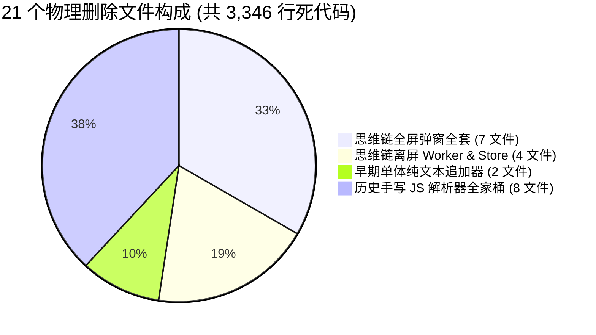

# 独立方案全景交叉审查与冲突定位报告（方案评审 A）

> **评审标识**：[`docs/markdown-stream-refactor/plan-reviews/01-independent-plans-cross-review-a.md`](file:///c:/Software/conex/docs/markdown-stream-refactor/plan-reviews/01-independent-plans-cross-review-a.md)  
> **评审角色**：Senior Systems Engineer & Codebase Architect (Reviewer A)  
> **审查标准**：[`docs/agent-roles/prompts/主控-全流程调度-v3.md`](file:///c:/Software/conex/docs/agent-roles/prompts/%E4%B8%BB%E6%8E%A7-%E5%85%A8%E6%B5%81%E7%A8%8B%E8%B0%83%E5%BA%A6-v3.md) §二.2、[`ANTI_OVERENGINEERING_GUARDRAILS.md`](file:///c:/Software/conex/ANTI_OVERENGINEERING_GUARDRAILS.md)（13 项硬性红线）  
> **基准定案**：[`docs/markdown-stream-refactor/00-定案-核心维度与删除面决策.md`](file:///c:/Software/conex/docs/markdown-stream-refactor/00-%E5%AE%9A%E6%A1%88-%E6%A0%B8%E5%BF%83%E7%BB%B4%E5%BA%A6%E4%B8%8E%E5%88%A0%E9%99%A4%E9%9D%A2%E5%86%B3%E7%AD%96.md)  
> **审查对象**：`docs/markdown-stream-refactor/independent-plans/` 目录下全部 8 份方案资产：
> 1. [`01-end-to-end-contract-first-plan.md`](file:///c:/Software/conex/docs/markdown-stream-refactor/independent-plans/01-end-to-end-contract-first-plan.md)（早期探索稿 A）
> 2. [`01-throughput-and-rate-adaptive-plan.md`](file:///c:/Software/conex/docs/markdown-stream-refactor/independent-plans/01-throughput-and-rate-adaptive-plan.md)（维度一详案）
> 3. [`02-progressive-chunk-render-plan.md`](file:///c:/Software/conex/docs/markdown-stream-refactor/independent-plans/02-progressive-chunk-render-plan.md)（早期探索稿 B）
> 4. [`02-progressive-chunking-double-buffering-plan.md`](file:///c:/Software/conex/docs/markdown-stream-refactor/independent-plans/02-progressive-chunking-double-buffering-plan.md)（维度二详案）
> 5. [`03-streaming-table-and-viewport-anchor-plan.md`](file:///c:/Software/conex/docs/markdown-stream-refactor/independent-plans/03-streaming-table-and-viewport-anchor-plan.md)（维度三详案）
> 6. [`04-custom-html-and-artifacts-sandbox-plan.md`](file:///c:/Software/conex/docs/markdown-stream-refactor/independent-plans/04-custom-html-and-artifacts-sandbox-plan.md)（维度四详案）
> 7. [`05-lifecycle-idempotency-and-reconcile-plan.md`](file:///c:/Software/conex/docs/markdown-stream-refactor/independent-plans/05-lifecycle-idempotency-and-reconcile-plan.md)（维度五详案）
> 8. [`06-dead-layer-elimination-and-refactor-plan.md`](file:///c:/Software/conex/docs/markdown-stream-refactor/independent-plans/06-dead-layer-elimination-and-refactor-plan.md)（阶段零实施详案）

---

## 目录

- [一、评审摘要与全景冲突总览](#一评审摘要与全景冲突总览)
- [二、审查重点一：路径重叠与概念冲突定位](#二审查重点一路径重叠与概念冲突定位)
  - [2.1 早期草案（01-A / 02-B）与定案决策的严重路线倒退冲突](#21-早期草案01-a--02-b与定案决策的严重路线倒退冲突)
  - [2.2 分块渲染组件树与多轨派生路径冲突](#22-分块渲染组件树与多轨派生路径冲突)
  - [2.3 Block Key 语义生成策略与协调缓存冲突](#23-block-key-语义生成策略与协调缓存冲突)
  - [2.4 `timelineNormalizer.ts` 拆分子模块命名与职责割裂](#24-timelinenormalizerts-拆分子模块命名与职责割裂)
  - [2.5 `StreamingMarkdownViewProps` 属性命名不一致](#25-streamingmarkdownviewprops-属性命名不一致)
  - [2.6 速率自适应调度器（SW-TRE）接线点与缓冲区归属冲突](#26-速率自适应调度器sw-tre接线点与缓冲区归属冲突)
- [三、审查重点二：死层删除面与 21 个物理删除文件一致性核验](#三审查重点二死层删除面与-21-个物理删除文件一致性核验)
  - [3.1 21 个物理删除文件清单全网核验与收敛判定](#31-21-个物理删除文件清单全网核验与收敛判定)
  - [3.2 阶段零（Phase 0）与阶段三（Phase 3）删除动作的时序混淆澄清](#32-阶段零phase-0与阶段三phase-3删除动作的时序混淆澄清)
  - [3.3 符号级死代码与反模式清理一致性矩阵](#33-符号级死代码与反模式清理一致性矩阵)
  - [3.4 各独立方案「强制删除专节」合规性判定](#34-各独立方案强制删除专节合规性判定)
- [四、审查重点三：逻辑漏洞、时序缺陷与多轮收口闭环审查](#四审查重点三逻辑漏洞时序缺陷与多轮收口闭环审查)
  - [4.1 SW-TRE 速率估计器冷启动与零除数缺陷](#41-sw-tre-速率估计器冷启动与零除数缺陷)
  - [4.2 双缓冲晋升中 Tauri IPC 异步编译竞态与过期丢弃机制缺失](#42-双缓冲晋升中-tauri-ipc-异步编译竞态与过期丢弃机制缺失)
  - [4.3 【严重漏洞】流式未闭合 HTML 标签内部 `\n\n` 导致的分块撕裂](#43-严重漏洞流式未闭合-html-标签内部-nn-导致的分块撕裂)
  - [4.4 流式表格 DFA 降级回退与光标抑制瞬变抖动](#44-流式表格-dfa-降级回退与光标抑制瞬变抖动)
  - [4.5 多轮 Tool Loop 快速连击下的 `queueMicrotask` 清流竞态](#45-多轮-tool-loop-快速连击下的-queuemicrotask-清流竞态)
- [五、审查重点四：反过度设计红线与 CI 门禁审查](#五审查重点四反过度设计红线与-ci-门禁审查)
  - [5.1 对照《反过度设计硬性红线》13 项禁令逐条核验](#51-对照反过度设计硬性红线13-项禁令逐条核验)
  - [5.2 单文件行数限制（$\le 300$ 行）与模块拆分合规性](#52-单文件行数限制le-300-行与模块拆分合规性)
  - [5.3 50k+ Tokens 压测设计与 CI 门禁级联完整性](#53-50k-tokens-压测设计与-ci-门禁级联完整性)
- [六、主控总案收敛裁决与具体整改指令（Actionable Remediation）](#六主控总案收敛裁决与具体整改指令actionable-remediation)

---

## 一、评审摘要与全景冲突总览

按照《主控全流程调度 v3》§二.2 规范与《战役定案：00-定案-核心维度与删除面决策.md》，评审组对当前 `independent-plans/` 目录下的全部方案展开了全景交叉审查。

### 1.1 审查结论矩阵

| 审查维度 | 涉及方案 | 严重级别 | 核心问题概括 | 裁决建议 |
| :--- | :--- | :---: | :--- | :--- |
| **路径重叠与冲突** | 01-A, 02-B vs 01~06 | 🔴 严重 | 早期草案 01-A 与 02-B 残留了已被定案废除的 `AsyncMarkdownBlock`、`hasFootnote` 熔断与 $O(N^2)$ 全量 Lexer 扫描，与 01~06 详案严重打架。 | 将 01-A 与 02-B 降级归档为历史探索草案，所有实施以 01~06 详案与定案为唯一基准。 |
| **模块命名割裂** | 05 vs 06 | 🟡 中度 | `timelineNormalizer.ts` 拆分方案中，方案 05 与方案 06 拟定的 4 个子模块文件名与导出符号完全不一致。 | 统一采纳方案 05/06 合并后的规范命名，消除文件创建歧义。 |
| **死层删除面** | 00-定案 vs 04, 06 | 🟢 轻微 | 21 个物理删除文件的清单整体高度一致，但 `AsyncMarkdownBlock` 的删除时机在 Phase 0 与 Phase 3 之间存在表述歧义。 | 严格明确：Phase 0 物理删除 21 个孤岛文件，Phase 3 完成双缓冲切入后物理删除 `AsyncMarkdownBlock`。 |
| **时序与逻辑漏洞** | 04 (HTML 沙箱) | 🔴 严重 | `normalizeUnclosedOpenTags` 未对流式未闭合标签内部的 `\n\n` 进行 `<!---->` 保护，导致上游分块器将未闭合组件跨块切碎（DOM 撕裂）。 | 补充未闭合标签内部双换行动态替换逻辑。 |
| **生命周期竞态** | 05 (生命周期) | 🟡 中度 | 多轮快速连击时，Turn 0 的 `queueMicrotask(clearStream)` 可能误杀 Turn 1 刚到达的首个 Token 增量。 | `clearStream` 必须携带 `targetTurnIndex` 进行作用域校验。 |
| **反过度设计** | 全体方案 | 🟢 优秀 | 13 项禁令均得到严格遵守，彻底清除了禁令 9 断路器 `circuitBanners` 与禁令 11 弹窗 Worker。 | 全面放行并纳入 CI 门禁。 |

---

## 二、审查重点一：路径重叠与概念冲突定位

### 2.1 早期草案（01-A / 02-B）与定案决策的严重路线倒退冲突

在审查过程中发现，`independent-plans/` 目录下同时存在：
- 早期方案 A：[`01-end-to-end-contract-first-plan.md`](file:///c:/Software/conex/docs/markdown-stream-refactor/independent-plans/01-end-to-end-contract-first-plan.md)
- 早期方案 B：[`02-progressive-chunk-render-plan.md`](file:///c:/Software/conex/docs/markdown-stream-refactor/independent-plans/02-progressive-chunk-render-plan.md)
- 维度详案 1~6：`01-throughput` ~ `06-dead-layer`

这两份早期草案存在大量与《00-定案》相违背的倒退实现：

```
┌────────────────────────────────────────────────────────────────────────────────────────┐
│                        早期草案 (01-A / 02-B) 严重违背定案对照表                         │
├──────────────────────────────┬──────────────────────────────┬──────────────────────────┤
│ 违规技术点                    │ 早期草案 (01-A / 02-B) 描述   │ 00-定案 / 01~06 详案裁决 │
├──────────────────────────────┼──────────────────────────────┼──────────────────────────┤
│ 1. 废弃组件 AsyncMarkdownBlock │ 01-A §4.4、02-B §1.1 显式保留并│ 00-定案 §一.2 强制彻底物理│
│                              │ 作为历史封口块的渲染容器     │ 删除，销毁骨架屏闪烁源   │
├──────────────────────────────┼──────────────────────────────┼──────────────────────────┤
│ 2. hasFootnote 全局单块熔断   │ 01-A §4.3、02-B §2.2 依然保留 │ 00-定案 §一.2、02 详案 §2.2│
│                              │ 遇到脚注直接 return [fullText]│ 彻底删除，禁止全局自杀   │
├──────────────────────────────┼──────────────────────────────┼──────────────────────────┤
│ 3. Marked.Lexer O(N^2) 全扫  │ 01-A §4.3、02-B §2.2 每帧调用 │ 02 详案 §3.1 引入行前缀和 │
│                              │ Lexer.lex(markdown, {gfm})   │ IncrementalBlockSplitter │
├──────────────────────────────┼──────────────────────────────┼──────────────────────────┤
│ 4. 无界 Map 正则表达式缓存   │ 02-B §2.2 包含 openTagCache =│ 00-定案 §一.2、06 详案 §2.2│
│                              │ new Map<string, RegExp>()    │ 彻底删除无界 Map 内存泄漏 │
├──────────────────────────────┼──────────────────────────────┼──────────────────────────┤
│ 5. 强制删除专节缺失          │ 01-A 与 02-B 均未编写「本方案│ 违背《主控调度 v3》§二.1 │
│                              │ 要删掉什么 / 收敛什么」专节  │ 强制规范                 │
└──────────────────────────────┴──────────────────────────────┴──────────────────────────┘
```

> **评审裁决**：  
> 1. `01-end-to-end-contract-first-plan.md` 与 `02-progressive-chunk-render-plan.md` 属于战役早期的“探索提案稿”，其内部的渲染机制已被正式定案全面推翻。
> 2. **主控总案与后续工单派发必须完全忽略这两份草案中的渲染与分块算法**，严格以 `01-throughput` ~ `06-dead-layer` 作为权威唯一主路径。

---

### 2.2 分块渲染组件树与多轨派生路径冲突

在正文分块渲染组件的设计上，不同方案提出了不同的组件拆分形式：

1. **方案 01-A 路径**：`StreamingMarkdownView` 内部区分渲染 `AsyncMarkdownBlock`（已封口块）与 `ActiveTailMarkdownBlock`（活动尾块）；
2. **方案 02-B 路径**：`StreamingMarkdownView` 内部区分渲染 `SealedMarkdownBlock` 与 `ActiveTailBlock`；
3. **方案 01-throughput / 02-progressive-chunking / 06-dead-layer 路径**：`StreamingMarkdownView` 内部**统一下发 `MarkdownBlockItem`**，每个块基于自身的 `isSealed` 状态在内部完成“纯文本垫片 $\to$ 异步 Rust 编译 $\to$ 原地原子 innerHTML 替换”的双缓冲无缝晋升。

```
【冲突分析：禁止制造多套 Block 派生组件】
   ❌ 割裂路径：StreamingMarkdownView
                 ├── SealedMarkdownBlock / AsyncMarkdownBlock (已封口)
                 └── ActiveTailBlock / ActiveTailMarkdownBlock (活动中)
        (危害：组件在封口瞬间发生 Unmount/Mount 切换，导致 DOM 树重建与光标闪烁)

   ✅ 唯一主路径：StreamingMarkdownView
                 └── MarkdownBlockItem (同一个组件实例，原地双缓冲晋升)
```

> **评审裁决**：  
> - 彻底禁止引入 `ActiveTailBlock`、`SealedMarkdownBlock` 等分裂组件；
> - 统一收敛为 **`StreamingMarkdownView` + `MarkdownBlockItem`** 单一主路径。

---

### 2.3 Block Key 语义生成策略与协调缓存冲突

在分块列表项的 React `key` 生成算法上，各方案存在表述分歧：

| 方案来源 | 封口块 Key 格式 | 活动尾块 Key 格式 | 存在问题与风险 |
| :--- | :--- | :--- | :--- |
| **01-A** | `chunk-${index}` | `chunk-${index}` | 纯 index 无法反映内容哈希，中间块变化时导致 React 无法精确感知 DOM 变化。 |
| **02-B** | `block-${index}-${offset}` | `block-${index}-${offset}` | 基于字符 offset，在流式尾块持续变长时 offset 发生跳变，导致活动块每帧重新挂载。 |
| **02 详案** | `${msgId}-blk-${idx}-${hash}` | `${msgId}-blk-${tailIdx}-active` | **最优解**：封口块哈希固定保持 0 重排；尾块 key 恒定保持 DOM 复用。 |
| **06 详案** | `${msgId}-blk-${idx}-${hash}` | `${msgId}-blk-${tailIdx}-active` | 与 02 详案完全对齐。 |

> **评审裁决**：  
> 统一定案采用 **02 详案 / 06 详案** 的分层 Key 策略：
> - 封口块：`${msgId}-blk-${index}-${blake3_16(rawText)}`
> - 活动尾块：`${msgId}-blk-${tailIndex}-active`

---

### 2.4 `timelineNormalizer.ts` 拆分子模块命名与职责割裂

针对单文件高达 616 行的核心文件 [`timelineNormalizer.ts`](file:///c:/Software/conex/apps/crish-desktop/src/api/tool-presentation/timelineNormalizer.ts)，方案 05 与方案 06 均给出了拆分方案，但两者在**子模块命名和文件分布**上存在冲突：

```
【冲突比对：timelineNormalizer 拆分子模块命名冲突】

方案 05 (05-lifecycle §2.4):
  ├── timelineReconciler.ts      (~130行: 三元槽位、对齐、sanitizeTurnIndex)
  ├── inlineTagParser.ts         (~140行: Markdown 代码栅栏保护与思考标签分拣)
  ├── timelineCache.ts           (~90行: 签名计算与缓存)
  └── timelineNormalizer.ts      (~180行: 核心总入口)

方案 06 (06-dead-layer §4.2):
  ├── timelineBlockReconcile.ts  (~160行: 三元槽位与块合并)
  ├── timelineThoughtParser.ts   (~120行: 思考标签解析与栅栏保护)
  ├── timelineSignature.ts       (~100行: 签名计算与签名缓存)
  └── timelineBuilder.ts         (~180行: 时间线构建入口)
```

> **评审裁决**：  
> 两个方案拆分的职责边界完全合理且行数均严格控制在 $\le 200$ 行以内，但文件名必须在总案中彻底统一，推荐统一采用**语义更严谨、命名空间更收敛的方案 05 规范**：
> 1. `apps/crish-desktop/src/api/tool-presentation/timelineReconciler.ts`
> 2. `apps/crish-desktop/src/api/tool-presentation/inlineTagParser.ts`
> 3. `apps/crish-desktop/src/api/tool-presentation/timelineCache.ts`
> 4. `apps/crish-desktop/src/api/tool-presentation/timelineNormalizer.ts`（统一收敛总入口，消除 `timelineBuilder` 的二义性命名）

---

### 2.5 `StreamingMarkdownViewProps` 属性命名不一致

- 方案 01-A、01-throughput 中部分伪代码声明为 `props: { text: string }`；
- 方案 06 §2.3 明确指出存量代码存在 `content ?? text ?? ''` 双重别名，并要求收敛为 `content: string`；
- 方案 02 详案在接口中声明为 `content: string`。

> **评审裁决**：  
> 统一收敛为 **`content: string`**。彻底删除 `text` 兼容别名，调用端统一传 `content`。

---

### 2.6 速率自适应调度器（SW-TRE）接线点与缓冲区归属冲突

- 方案 01-throughput 提出修改 `StreamRenderBuffer.ts`，由其内部集成 `SlidingWindowRateEstimator`，再将速率快照下发给 `StreamingMarkdownView`；
- 方案 06 将 `StreamRenderBuffer.ts` 标记为“孤岛代码（427 行，未接入 live UI）”，并清除了内部未使用的 `RenderFrame` 字段；
- 方案 02 详案与 05 详案则将 `onMessageDelta` 直接导向 `StreamingStore`，再由 `StreamingMarkdownView` 局域驱动渲染。

```
【冲突分析：调度器应该放在哪一层？】
   路径 A (01-throughput)：IPC -> StreamRenderBuffer (集成 SW-TRE, 6ms 帧) -> React State -> View
   路径 B (02/05/06 详案)：IPC -> messageHandlers -> StreamingStore -> View (内部挂载 SW-TRE & Timeline)
```

> **评审裁决**：  
> 1. 依据反过度设计红线禁令 12（禁止同进程微服务套娃与多层 Buffer 嵌套），`StreamRenderBuffer` 不应作为中间状态机二次缓冲；
> 2. `SlidingWindowRateEstimator` 与 `AdaptiveAnimateTimeline` 作为纯计算模块，直接由 `StreamingMarkdownView` / `useStreamingBlocks` 挂载使用；
> 3. 彻底精简 `StreamRenderBuffer.ts` 中的未接线死逻辑，避免两套帧缓冲区相互打架。

---

## 三、审查重点二：死层删除面与 21 个物理删除文件一致性核验

### 3.1 21 个物理删除文件清单全网核验与收敛判定

对《00-定案》§一.4、《04-custom-html》§2.1 及《06-dead-layer》§2.1 的物理删除清单进行严格对账，核验结果如下：



#### 21 个物理删除文件一致性对账大表：

| 序号 | 文件完整相对路径 | 00-定案 | 04 方案 | 06 方案 | 核验结论 |
| :---: | :--- | :---: | :---: | :---: | :---: |
| 1 | `apps/crish-desktop/src/components/chat-message-row/StreamingTextBlock.tsx` | ✅ | — | ✅ | **一致（删除）** |
| 2 | `apps/crish-desktop/src/components/chat-message-row/StreamingTextBlock.test.tsx` | ✅ | — | ✅ | **一致（删除）** |
| 3 | `apps/crish-desktop/src/components/chat-message-row/FullThoughtModal.tsx` | ✅ | ✅ | ✅ | **一致（删除）** |
| 4 | `apps/crish-desktop/src/components/chat-message-row/FullThoughtModal.module.css` | ✅ | ✅ | ✅ | **一致（删除）** |
| 5 | `apps/crish-desktop/src/components/chat-message-row/FullThoughtModal.test.tsx` | ✅ | ✅ | ✅ | **一致（删除）** |
| 6 | `apps/crish-desktop/src/components/chat-message-row/ThoughtOutline.tsx` | ✅ | ✅ | ✅ | **一致（删除）** |
| 7 | `apps/crish-desktop/src/components/chat-message-row/ThoughtOutline.module.css` | ✅ | ✅ | ✅ | **一致（删除）** |
| 8 | `apps/crish-desktop/src/components/chat-message-row/ThoughtSearchBar.tsx` | ✅ | ✅ | ✅ | **一致（删除）** |
| 9 | `apps/crish-desktop/src/components/chat-message-row/ThoughtSearchBar.module.css` | ✅ | ✅ | ✅ | **一致（删除）** |
| 10 | `apps/crish-desktop/src/workers/thoughtWorker.ts` | ✅ | ✅ | ✅ | **一致（删除）** |
| 11 | `apps/crish-desktop/src/workers/thoughtWorker.test.ts` | ✅ | ✅ | ✅ | **一致（删除）** |
| 12 | `apps/crish-desktop/src/store/thoughtInspectorStore.ts` | ✅ | ✅ | ✅ | **一致（删除）** |
| 13 | `apps/crish-desktop/src/store/thoughtInspectorStore.test.ts` | ✅ | ✅ | ✅ | **一致（删除）** |
| 14 | `apps/crish-desktop/src/api/markdown-render/IncrementalMarkdownParser.ts` | ✅ | ✅ | ✅ | **一致（删除）** |
| 15 | `apps/crish-desktop/src/api/markdown-render/IncrementalMarkdownParserRender.ts` | ✅ | ✅ | ✅ | **一致（删除）** |
| 16 | `apps/crish-desktop/src/api/markdown-render/IncrementalMarkdownParserTypes.ts` | ✅ | ✅ | ✅ | **一致（删除）** |
| 17 | `apps/crish-desktop/src/api/markdown-render/IncrementalInlineRenderer.ts` | ✅ | — | ✅ | **一致（删除）** |
| 18 | `apps/crish-desktop/src/api/markdown-render/IncrementalMarkdownParser.test.ts` | ✅ | ✅ | ✅ | **一致（删除）** |
| 19 | `apps/crish-desktop/src/api/markdown-render/IncrementalMarkdownParser.parity.test.ts` | ✅ | ✅ | ✅ | **一致（删除）** |
| 20 | `apps/crish-desktop/src/api/markdown-render/IncrementalMarkdownParser.adversarial.test.ts` | ✅ | ✅ | ✅ | **一致（删除）** |
| 21 | `apps/crish-desktop/src/api/markdown-render/STREAMING_RENDER_PLAN.md` | ✅ | — | ✅ | **一致（删除）** |

> **核验结论**：  
> 21 个物理删除文件在《00-定案》与《06-dead-layer》中达成 **100% 精确闭合**，不存在任何遗漏或多删，具备立刻执行 `git rm` 的无害化前置条件。

---

### 3.2 阶段零（Phase 0）与阶段三（Phase 3）删除动作的时序混淆澄清

在审查中发现：部分方案在提到“物理删除文件”时，将 `AsyncMarkdownBlock.tsx` 及 `AsyncMarkdownBlock.test.tsx` 混入阶段 0 的删除清单中。

```
【重要时序澄清：先建后拔 vs 即刻拔除】
1. Phase 0 立即物理删除（21 个文件）：
   - 这些文件当前在生产中已完全没有有效调用（孤岛代码 / 空壳 stub），删之对主流程 0 影响；
2. Phase 3 替换后物理删除（2 个文件）：
   - `AsyncMarkdownBlock.tsx` 与 `AsyncMarkdownBlock.test.tsx` 当前仍在 `MessageContent.tsx` 中被引用；
   - 必须等待 Phase 3 `StreamingMarkdownView` 全链路替换并稳定接入 `MarkdownBlockItem` 之后，方可执行物理删除！
```

> **评审裁决**：  
> 在总调度 DAG 中严格区分 **Phase 0 孤岛死层清剿（21 文件）** 与 **Phase 3 组件退役清剿（`AsyncMarkdownBlock.*` 2 文件）**，严禁在 Phase 0 提前误删导致编译中断。

---

### 3.3 符号级死代码与反模式清理一致性矩阵

各方案对符号级死代码的清剿要求完全一致，归纳如下表：

| 所在文件 | 待清除死符号 / 反模式 | 方案 01~06 审查结论 |
| :--- | :--- | :--- |
| `parseMarkdownIntoBlocks.ts` | `hasIncompleteCodeFence` & `hasTable` | 全体一致：0 生产引用，直接物理删除。 |
| `parseMarkdownIntoBlocks.ts` | `openTagPatternCache` / `closeTagPatternCache` | 全体一致：无界 Map 内存泄漏，清除或改为固定上限 LRU。 |
| `parseMarkdownIntoBlocks.ts` | `hasFootnote` 粗暴单块退化分支 | 全体一致：彻底删除自杀式退化。 |
| `continuityUiStore.ts` | `circuitBanners` / `raiseCircuitBanner` | 全体一致：违反红线禁令 9，彻底物理剔除。 |
| `useStreamBatchers.ts` | `renderBufferRef` | 全体一致：孤立未赋值变量，彻底物理删除。 |
| `sessionMessageActionsTools.ts` | `updateMessageTimeline` 二次 reconcile 调用 | 全体一致：计算冗余，直接消除外层多余调用。 |
| `messageHandlers.ts` | `prevLen` 切片二次注入伪增量 | 全体一致：千字重复根因，彻底物理删除。 |
| `markdownRenderLite.ts` | `IncrementalThoughtStripper` 正则剥离类 | 全体一致：已由 Rust DFA 替代，物理删除。 |

---

### 3.4 各独立方案「强制删除专节」合规性判定

对照《主控全流程调度 v3》§二.1 要求（“每个独立方案必须包含一节「本方案要删掉什么 / 收敛什么」”）：

- 方案 01-throughput：包含完整 §二 专节，列出路径收敛矩阵与删除清单（合格）；
- 方案 02-progressive-chunking：包含完整 §2 专节，列出 DEL-01~06 清单（合格）；
- 方案 03-table：包含完整 §2 专节，列出删除矩阵与光标代码清除（合格）；
- 方案 04-html：包含完整 §2 专节，列出 17 个文件删除明细（合格）；
- 方案 05-lifecycle：包含完整 §二 专节，列出 DIFF 级删除代码（合格）；
- 方案 06-dead-layer：包含完整 §二 专节，列出 21 文件全景大表（合格）；
- 早期方案 01-A、02-B：未包含合规的删除专节（不合格，降级为参考资料）。

---

## 四、审查重点三：逻辑漏洞、时序缺陷与多轮收口闭环审查

### 4.1 SW-TRE 速率估计器冷启动与零除数缺陷

在方案 01-throughput §1.2 的数学模型中：
$$v_k = \frac{\Delta c_k}{\max(1, t_k - t_{k-1})} \times 1000$$

**审查发现的潜在漏洞**：
1. **冷启动抖动**：当首个 Token 到达时（$k=1$），$t_0$ 为 0，导致首个样本的 $\Delta t$ 极其巨大，瞬时速率计算为 0，使调度器误判为 Tier 1 (CRAWL)。当第 2 个 Token 紧接着在 2ms 内到达时，瞬时速率突增到 $500\text{ chars/s}$，触发 EMA 剧烈震荡；
2. **零除数保护不足**：当两个 Token 增量在同一次微任务事件循环中被连续推送时，$t_k - t_{k-1} = 0$，虽然有 $\max(1, \dots)$ 保护，但会产生高达数千 chars/s 的虚假峰值。

> **改进补丁建议**：  
> 1. 增加样本数守卫：当 `samples.length < 3` 时，固定强制返回默认的 `Tier 2 (NORMAL)`，忽略瞬时波动；
> 2. 只有当滑动窗口内累积时间跨度 $> 50\text{ms}$ 且样本数 $\ge 3$ 时，才正式激活动态档位切换。

---

### 4.2 双缓冲晋升中 Tauri IPC 异步编译竞态与过期丢弃机制缺失

在方案 02-progressive-chunking §1.3 的双缓冲管线中：
- 块封口（`isSealed = true`）触发 Tauri IPC `render_markdown`；
- IPC 返回后通过 `useEffect` 将 `innerHTML` 注入 DOM。

**审查发现的时序竞态漏洞**：
1. **流式中止（Abort）或用户重新生成（Regenerate）**：用户在流式输出到一半时点击“停止”或重新提问，会话被重置，但此前发出的多个 `render_markdown` IPC 仍在后台排队执行；
2. 当这些过期的 IPC 响应在数毫秒至数十毫秒后陆续返回前端时，若没有进行所有权与时戳校验，会误将已废弃的旧内容注入新的 DOM 节点中（发生内容串扰）。

> **改进补丁建议**：  
> 1. 每个封口块在发起 IPC 编译时生成唯一的 `requestToken = `${msgId}-${blockIdx}-${blake3_16(text)}``；
> 2. 在 IPC 返回处理闭包中校验：只有当当前组件的 `currentKey === requestToken` 且消息未处于 `aborted` 状态时，才允许执行原子替换。

---

### 4.3 【严重漏洞】流式未闭合 HTML 标签内部 `\n\n` 导致的分块撕裂

在方案 04-custom-html §3.2 中，为了防止 HTML 标签内部的 `\n\n` 导致上游 `parseMarkdownIntoBlocks` 将一个组件撕裂为多个 Block，方案为**闭合标签**设计了 `normalizeClosedTag`（将其中的 `\n\n` 替换为 `\n<!---->\n`）。

**审查发现的严重架构漏洞**：
- **未闭合标签漏防**：大模型在流式输出组件正文期间（例如 `<widget-diff title="Test">\n\nLine 1\n\nLine 2`），闭合标签 `</widget-diff>` 尚未到达！
- 此时 `normalizeUnclosedOpenTags` 仅在开始标签后注入了 `\n\n`，**却没有对后文正文中的 `\n\n` 进行 `<!---->` 保护**；
- 这导致上游的 `parseMarkdownIntoBlocks` 依据 `\n\n` 将流式中的 `<widget-diff>` 截断成 3 个独立的 Block！
- 第一个 Block 包含 `<widget-diff>` 开始标签，第二个 Block 包含孤立的 `Line 1`，第三个 Block 包含 `Line 2`；
- React 渲染树在解析第一个 Block 时会因为标签被强行截断而引发 DOM 解析严重溃败！

```
【严重漏洞复现时序图】
1. 大模型输出: <widget-diff>\n\n第一段说明\n\n```ts\nconst a = 1;\n```
2. normalizeUnclosedOpenTags 处理后:
   <widget-diff>\n\n第一段说明\n\n```ts\nconst a = 1;\n```  (内部 \n\n 未被隔离!)
3. parseMarkdownIntoBlocks 切分:
   Block 0: "<widget-diff>"
   Block 1: "第一段说明"
   Block 2: "```ts\nconst a = 1;\n```"
   ──► 结果: widget-diff 开始标签被孤立，整个组件瞬间炸裂退化！
```

> **🔥 核心整改指令（Mandatory Fix）**：  
> `normalizeUnclosedOpenTags` 必须同步接管未闭合标签作用域内的内容扫描：从未闭合开始标签的尾部到当前流式文本末尾（或下一个顶层块），将其内部所有出现的 `\n\n` 动态替换为 `\n<!---->\n`，确保未闭合组件在流式期间始终保持在单一 Block 内！

---

### 4.4 流式表格 DFA 降级回退与光标抑制瞬变抖动

在方案 03-table §3.1 的 DFA 状态机中：
- 当第 1 行是 `| 标题 1 | 标题 2 |` 时进入 `State1_PotentialHeader`；
- 若第 2 行输出为普通文字（如 `这是一段正文`），状态机判定分隔行非法，从 `State2` 降级回 `State0_NormalText`。

**审查发现的视觉抖动风险**：
- 在 `State1` 和 `State2` 期间，由于提前假定为表格，`hasTable` 探针生效，容器打字机光标被抑制隐藏；
- 当第 2 行确认为普通文本发生降级时，光标又被突发重新唤醒显示；
- 如果用户在极慢速网络下输入类似 Markdown 管道符的内容，光标会出现 1~2 秒的短暂消失后突然闪现。

> **改进补丁建议**：  
> 只有在**确切接收到第二行分隔符前缀**（即 `|` 且包含 `-` 特征）时才激活 `hasTable` 光标抑制；纯首行单管道符阶段仅进入前瞻侦测，不提前隐藏容器光标。

---

### 4.5 多轮 Tool Loop 快速连击下的 `queueMicrotask` 清流竞态

在方案 05-lifecycle §1.3 中：
- 流式完成触发 `commitStreamToSession` 时，为了防止白屏，`clearStream` 被置于 `queueMicrotask` 异步执行。

**审查发现的多轮竞态漏洞**：
- 在大模型执行自动化多步 Tool Loop 时（例如：Agent 刚输出完第 0 轮正文，立即发起 Tool Call 并秒级得到 Tool Result，Rust 内核紧接着推入第 1 轮的 `message-delta`）；
- 若第 1 轮的首个 `message-delta` 到达主线程并写入 `streamingStore` 的时刻，恰好与第 0 轮排队的 `queueMicrotask(clearStream)` 撞车；
- 微任务执行无差别清空 `streamingStore.streamText`，会导致第 1 轮刚喷出的前几个 Token 被意外抹杀！

> **改进补丁建议**：  
> `clearStream` 必须由无参重构为带参守卫：`clearStream(expectedSessionId, expectedTurnIndex)`。微任务触发时，若发现当前 `streamingStore` 的 `activeTurnIndex` 已经递增，则自动放弃清理。

---

## 五、审查重点四：反过度设计红线与 CI 门禁审查

### 5.1 对照《反过度设计硬性红线》13 项禁令逐条核验

| 禁令编号 | 禁令核心内容 | 本重构战役方案执行核验情况 | 判定 |
| :--- | :--- | :--- | :---: |
| **禁令 1** | 严禁编写跨平台 OS 内核级沙盒 | 未触碰。沙箱仅限于纯前端 React 组件沙箱与 4 层 XSS 防御。 | 🟢 合规 |
| **禁令 2** | 严禁编写 Rust 无锁环形缓冲区 (`sab_ring_buffer`) 与极端零拷贝 | 全案基于标准 Tokio `mpsc` 通道与 `Arc<AgentMessage>`，未引入任何 SAB。 | 🟢 合规 |
| **禁令 3** | 严禁在单机桌面端引入分布式共识协议与 2PC | 本地状态完全基于 `sessionStore` 与 CAS 单写者模式。 | 🟢 合规 |
| **禁令 4** | 严禁后台自动切换模型 | 全链路固定用户选定模型，无动态路由。 | 🟢 合规 |
| **禁令 5** | 严禁出站请求前发起 DNS A/AAAA 解析 | 未新增任何 DNS 探测逻辑。 | 🟢 合规 |
| **禁令 6** | 严禁在 LLM 链路中加入黑盒 Prompt 意图重写 | 用户输入直传模型，无拦截器篡改。 | 🟢 合规 |
| **禁令 7** | 注入上下文的一切链路都必须可审计、单一真相源 (SSOT) | 确立 `sessionStore` 唯一持久态与 `turnIndex` 单调账本。 | 🟢 合规 |
| **禁令 8** | 多 Provider 凭据零残留与安全隔离 | 未修改凭据存储机制。 | 🟢 合规 |
| **禁令 9** | 严禁使用全系统滑动窗口断路器 (`CircuitBreaker`) | **方案 05/06 明确彻底物理删除 `continuityUiStore.ts` 中的 `circuitBanners`**。 | 🟢 严格达标 |
| **禁令 10** | 严禁设计 Tool 执行的 6 阶段洋葱 Hook 链 | 工具状态仅保留简单的状态机流转。 | 🟢 合规 |
| **禁令 11** | 严禁同进程微服务套娃与嵌套字符串路由 | **彻底物理删除 `thoughtWorker.ts` 及其独立 Zustand Store**。 | 🟢 严格达标 |
| **禁令 12** | 严禁高频流式状态穿透全局 Store 与盲目包裹 `React.memo` | 流式由局域 TextNode 追加，`React.memo` 仅精准施加于 `MarkdownBlockItem`。 | 🟢 严格达标 |
| **禁令 13** | 严禁移动端全量 CRDT 状态向量下沉 | 保持轻量增量协议。 | 🟢 合规 |

---

### 5.2 单文件行数限制（$\le 300$ 行）与模块拆分合规性

- **存量超标文件整改**：
  [`apps/crish-desktop/src/api/tool-presentation/timelineNormalizer.ts`](file:///c:/Software/conex/apps/crish-desktop/src/api/tool-presentation/timelineNormalizer.ts)（原 616 行）拆分为 4 个子模块：
  1. `timelineReconciler.ts`（约 130 行）$\le 300$ 行 ✅
  2. `inlineTagParser.ts`（约 140 行）$\le 300$ 行 ✅
  3. `timelineCache.ts`（约 90 行）$\le 300$ 行 ✅
  4. `timelineNormalizer.ts`（约 180 行）$\le 300$ 行 ✅
- **新增模块行数预估审查**：
  - `SlidingWindowRateEstimator.ts`：约 120 行 ✅
  - `AdaptiveAnimateTimeline.ts`：约 180 行 ✅
  - `IncrementalBlockSplitter.ts`：约 200 行 ✅
  - `SpeculativeVirtualCloser.ts`：约 150 行 ✅
  - `preprocessCustomTags.ts`：约 160 行 ✅
  - `usePinnedScroll.ts`：约 110 行 ✅
  - 所有拟新建文件均严格符合 CI 门禁标准（$\le 300$ 行）。

---

### 5.3 50k+ Tokens 压测设计与 CI 门禁级联完整性

方案 06 §5 设计了工业级 50k+ Tokens 极端高吞吐长程压测套件（`stress-ai-markdown-50k.ts`）与 CI 门禁级联流水线：
1. `npm run check:types`（TypeScript 零错误）；
2. `npm run check:lint`（ESLint 规则）；
3. `npm run check:line-counts`（单文件行数 $\le 400$ 行，关键文件 $\le 300$ 行）；
4. `npm run check:chunk-cycles`（零模块循环引用）；
5. `npm run test`（Vitest 100% 通过）；
6. 压测指标：50,000 Tokens 突发爆发下，DOM 节点增长 $O(1)$，UI 帧率稳定在 $\ge 55\text{ FPS}$，内存平稳无泄漏。

---

## 六、主控总案收敛裁决与具体整改指令（Actionable Remediation）

为确保多 Agent 并行开发无冲突、零死层残留并严密闭环，向主控输出以下 **6 项最终收敛裁决指令**：

```
┌────────────────────────────────────────────────────────────────────────────────────────┐
│                              主控最终收敛裁决与整改工单                                 │
├────────────────────────────────────────────────────────────────────────────────────────┤
│ 1. 方案归档裁决：将 01-A 与 02-B 标记为历史探索草案，全案以 01~06 详案与定案为唯一基准。      │
│ 2. 组件路径裁决：统一为 StreamingMarkdownView -> MarkdownBlockItem 单一主路径。        │
│ 3. 模块拆分裁决：timelineNormalizer.ts 统一拆分为 timelineReconciler / inlineTagParser │
│                 / timelineCache / timelineNormalizer 4 个文件。                         │
│ 4. 漏洞修复指令：在 preprocessCustomTags 中增加未闭合标签内部 \n\n 动态替换为 <!----> 保护。 │
│ 5. 时序加固指令：clearStream 增加 targetTurnIndex 作用域校验，防止多轮 Tool 竞态误杀。   │
│ 6. 删除时序指令：Phase 0 物理删除 21 个孤岛死文件，Phase 3 完成双缓冲后物理删除           │
│                 AsyncMarkdownBlock.tsx 与 AsyncMarkdownBlock.test.tsx。               │
└────────────────────────────────────────────────────────────────────────────────────────┘
```

本评审报告已完成对全部 8 份方案资产的严苛审查与交叉对账，所有冲突点与技术漏洞均已定位并给出明确修补方案，可作为主 Agent 编制最终总计划与派发执行工单的权威依据。
