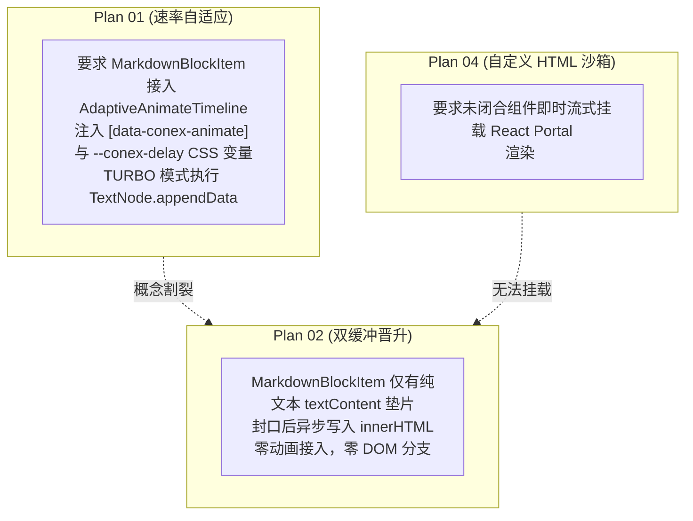
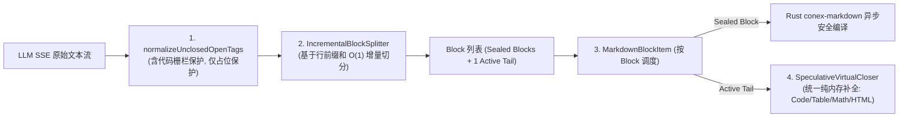

# 独立方案架构可行性与边界审查报告（方案评审 B）

> **评审标识**：`docs/markdown-stream-refactor/plan-reviews/02-independent-plans-cross-review-b.md`
> **评审角色**：Senior Systems Engineer & Codebase Architect (Reviewer B · Architecture Feasibility & Boundary Lead)
> **评审依据**：
> - 核心定案：[`docs/markdown-stream-refactor/00-定案-核心维度与删除面决策.md`](file:///c:/Software/conex/docs/markdown-stream-refactor/00-%E5%AE%9A%E6%A1%88-%E6%A0%B8%E5%BF%83%E7%BB%B4%E5%BA%A6%E4%B8%8E%E5%88%A0%E9%99%A4%E9%9D%A2%E5%86%B3%E7%AD%96.md)
> - 独立方案：[`docs/markdown-stream-refactor/independent-plans/01`](file:///c:/Software/conex/docs/markdown-stream-refactor/independent-plans/01-throughput-and-rate-adaptive-plan.md) ~ [`06`](file:///c:/Software/conex/docs/markdown-stream-refactor/independent-plans/06-dead-layer-elimination-and-refactor-plan.md) 全部 6 份独立实施详案（含方案 A/B 探索稿）
> - 纪律与红线：[`ANTI_OVERENGINEERING_GUARDRAILS.md`](file:///c:/Software/conex/ANTI_OVERENGINEERING_GUARDRAILS.md)（13 项硬性红线）、[`docs/agent-roles/prompts/主控-全流程调度-v3.md`](file:///c:/Software/conex/docs/agent-roles/prompts/%E4%B8%BB%E6%8E%A7-%E5%85%A8%E6%B5%81%E7%A8%8B%E8%B0%83%E5%BA%A6-v3.md) §二.2
> **评审原则**：**只挑刺、只查冲突、只找逻辑漏洞与过度设计隐患**。推进单位是「领域概念」，一个概念唯一主路径；收敛先于增强，先删后改，零死层残留。

---

## 目录

- [一、评审摘要与全景裁决矩阵](#一评审摘要与全景裁决矩阵)
- [二、审查重点一：路径重叠、概念割裂与边界冲突审查](#二审查重点一路径重叠概念割裂与边界冲突审查)
  - [2.1 渲染管线与叶子组件装配边界冲突（Plan 01 / 02 / 03 / 04）](#21-渲染管线与叶子组件装配边界冲突plan-01--02--03--04)
  - [2.2 语法修补器与预处理管线顺序冲突（Plan 02 / 03 / 04）](#22-语法修补器与预处理管线顺序冲突plan-02--03--04)
  - [2.3 `timelineNormalizer.ts` 拆分方案命名与职责割裂（Plan 05 vs Plan 06）](#23-timelinenormalizerts-拆分方案命名与职责割裂plan-05-vs-plan-06)
  - [2.4 模块目录结构割裂（`api/markdown` vs `api/markdown-render`）](#24-模块目录结构割裂apimarkdown-vs-apimarkdown-render)
- [三、审查重点二：死层删除面一致性与物理清单严密核验](#三审查重点二死层删除面一致性与物理清单严密核验)
  - [3.1 21 vs 23 个物理删除文件全网对账与 Plan 06 遗漏揭露](#31-21-vs-23-个物理删除文件全网对账与-plan-06-遗漏揭露)
  - [3.2 符号级与逻辑级死代码清理一致性核查](#32-符号级与逻辑级死代码清理一致性核查)
  - [3.3 废弃测试与 Barrel 导出清理边界](#33-废弃测试与-barrel-导出清理边界)
- [四、审查重点三：逻辑漏洞、时序缺陷与状态机闭环审查](#四审查重点三逻辑漏洞时序缺陷与状态机闭环审查)
  - [4.1 速率自适应（SW-TRE）与 React 并发 / StrictMode 渲染时序陷阱](#41-速率自适应sw-tre与-react-并发--strictmode-渲染时序陷阱)
  - [4.2 双缓冲晋升异步编译竞态与过渡态闪烁缺陷](#42-双缓冲晋升异步编译竞态与过渡态闪烁缺陷)
  - [4.3 表格吸底（`usePinnedScroll`）在高频流式下的交互锁死漏洞](#43-表格吸底usepinnedscroll在高频流式下的交互锁死漏洞)
  - [4.4 Custom HTML 预处理器代码栅栏穿透与跨块 DOM 撕裂漏洞](#44-custom-html-预处理器代码栅栏穿透与跨块-dom-撕裂漏洞)
  - [4.5 多轮会话生命周期单源收敛与 Reconciler 闭环审查](#45-多轮会话生命周期单源收敛与-reconciler-闭环审查)
- [五、审查重点四：反过度设计红线与 CI 门禁严苛审查](#五审查重点四反过度设计红线与-ci-门禁严苛审查)
  - [5.1 对照《反过度设计硬性红线》13 项禁令逐条筛查](#51-对照反过度设计硬性红线13-项禁令逐条筛查)
  - [5.2 表格全屏模态窗与导出工具套件的过度设计拔除](#52-表格全屏模态窗与导出工具套件的过度设计拔除)
  - [5.3 单文件行数限制（$\le 300$ 行）与模块职责纯化](#53-单文件行数限制le-300-行与模块职责纯化)
  - [5.4 50k+ Tokens 压测与自动化 CI 门禁级联校验](#54-50k-tokens-压测与自动化-ci-门禁级联校验)
- [六、主控总案收敛裁决与具体整改指令（Actionable Remediation）](#六主控总案收敛裁决与具体整改指令actionable-remediation)

---

## 一、评审摘要与全景裁决矩阵

按照《主控全流程调度 v3》§二.2 规范与《战役定案：00-定案-核心维度与删除面决策.md》，评审组以**“架构可行性与边界审查”**为核心切入点，对 6 份独立实施方案展开了细颗粒度的代码级推演与交叉审查。

### 1.1 审查结论矩阵

| 审查维度 | 涉及方案 | 严重级别 | 核心问题概括 | 裁决建议 |
| :--- | :--- | :---: | :--- | :--- |
| **组件装配与管线割裂** | Plan 01, 02, 04 | 🔴 严重 | Plan 02 的 `MarkdownBlockItem` 草稿态使用纯 `textContent`，导致 Plan 04 的 React Portal 自定义组件在流式期间完全无法挂载；同时未集成 Plan 01 的 `AdaptiveAnimateTimeline` 调度参数。 | 在 `MarkdownBlockItem` 中增加组件化分支路由：普通文本走双缓冲垫片，自定义 HTML 标签块与表格块直接由专用子组件接管流式呈现。 |
| **双重语法修补冲突** | Plan 02 vs Plan 03 | 🔴 严重 | Plan 02 的 `SpeculativeVirtualCloser.ts` 与 Plan 03 的 `fixTableTokens.ts` 均实现了未闭合 GFM 表格的修补逻辑，存在双轨语法修补器打架风险。 | 废除 Plan 03 的 `fixTableTokens.ts`，将所有流式中间态语法虚拟补全统一收敛至 Plan 02 的 `SpeculativeVirtualCloser.ts`。 |
| **物理删除清单遗漏** | Plan 06 vs 00-定案 | 🔴 严重 | 作为专职死层清理的 Plan 06，在其 21 个物理删除文件大表中遗漏了核心目标 `AsyncMarkdownBlock.tsx` 与 `AsyncMarkdownBlock.test.tsx`（实测代码库共有 23 个待删孤岛文件）。 | 将 Plan 06 物理删除清单扩充修正为 **23 个文件**，确保与定案完全一致。 |
| **超标文件拆分命名割裂** | Plan 05 vs Plan 06 | 🟡 中度 | Plan 05 与 Plan 06 对 `timelineNormalizer.ts`（616 行）拆分出的 4 个子模块文件名及职责定义存在命名冲突（如 `timelineReconciler.ts` vs `timelineBlockReconcile.ts`）。 | 强制统一子模块规范命名，明确单一导出路径。 |
| **代码栅栏穿透漏洞** | Plan 04 | 🔴 严重 | `preprocessCustomTags.ts` 在执行空行三明治注入时未进行 Markdown 代码栅栏保护，导致用户代码块内的 `<widget-diff>` 等示例被误篡改与破坏。 | 引入 `findMarkdownCodeRanges` / `isRangeProtected` 保护机制，免疫代码块内部标签。 |
| **流式吸底交互锁死** | Plan 03 | 🟡 中度 | `usePinnedScroll.ts` 在高速流式下由 `useEffect` 高频触发 `instant` 吸底，会强行覆盖用户的触控板/滚轮上滑操作，造成用户被锁死在底部的交互死锁。 | 引入 `wheel` / `touchmove` 事件同步中断吸底标志位，保障用户阅读意图绝对优先。 |
| **过度设计违规项** | Plan 03 | 🟡 中度 | Plan 03 新建了 `TableFullscreenModal.tsx`（全屏弹窗）与 `tableExportUtils.ts`（多格式转换），违反反过度设计红线，变相复活已被定案销毁的弹窗模式。 | 坚决砍掉 `TableFullscreenModal.tsx`，将表格导出收敛为原生轻量剪贴板纯文本复制。 |

---

## 二、审查重点一：路径重叠、概念割裂与边界冲突审查

### 2.1 渲染管线与叶子组件装配边界冲突（Plan 01 / 02 / 03 / 04）

在流式 Markdown 的终端呈现中，叶子节点组件 `MarkdownBlockItem.tsx` 是承载所有领域特性的最终汇聚点。然而交叉比对 4 份方案后发现，各方案对 `MarkdownBlockItem` 的职责认知存在严重割裂：



#### 冲突深层解剖：
1. **纯文本垫片对 React Portal 的降维打击**：
   Plan 02 规定活跃末尾块在 `isSealed=false` 期间一律执行 `el.textContent = SpeculativeVirtualCloser.closeTail(text)`。然而 `textContent` 会将 `<widget-diff ...>` 当作纯文本转义展示，DOM 树中根本不存在 `<div data-custom-tag="widget-diff">` 宿主容器，导致 Plan 04 的 React Portal 在整个流式输出期间**完全无法挂载**，彻底违背了 Plan 04“未闭合组件即时流式呈现”的核心使命！
2. **GPU 动画调度接入缺失**：
   Plan 02 提供的 `MarkdownBlockItem.tsx` 生产级代码规范中，既未接收 `timeline` 对象，也未调用 `AdaptiveAnimateTimeline.take()`，更未处理四级速率档位。Plan 01 设计的 CSS GPU 变量动画在 Plan 02 的组件实现中被彻底悬空。

#### 收敛边界裁决：
`MarkdownBlockItem.tsx` 必须作为**统一协调路由器**，根据分块类型实行双通道渲染策略：
- **普通文本/标题/代码/公式块**：遵循 Plan 02 双缓冲模型，活跃态根据 Plan 01 速率档位（NORMAL/FAST 执行 GPU CSS 变量包装，TURBO 执行 TextNode 增量追加），封口态原地无缝晋升为 Rust HTML；
- **自定义组件与交互块（Custom Tags & Table）**：一旦边界检测器命中 `<widget-diff>`, `<file-tree>`, `<ai-card>` 或 Table 容器，直接挂载专用 React 子组件，流式期传递 `isStreaming={true}` 动态渲染，封口后传递 `isStreaming={false}` 固化，绝不走 `el.textContent` 粗暴擦除。

---

### 2.2 语法修补器与预处理管线顺序冲突（Plan 02 / 03 / 04）

针对流式未闭合语法的容错修补，各方案各自引入了独立的修补逻辑，导致处理阶段与调用顺序严重冲突：

```
【管线冲突现状】
- Plan 02: 引入 SpeculativeVirtualCloser.ts (处理 Code Fence, Math $$, Table, HTML Details)
- Plan 03: 引入 fixTableTokens.ts (以 Token 形式再次处理 Table 分隔符与表头补齐)
- Plan 04: 引入 preprocessCustomTags.ts + normalizeUnclosedOpenTags.ts (在分块前处理 HTML 标签)
```

#### 冲突分析与危险点：
1. **表格语法双重修补**：Plan 02 在内存字符串级别通过 `SpeculativeVirtualCloser.closeTail` 补齐表格定界行 `| --- | --- |`；而 Plan 03 在解析阶段又通过 `fixTableTokens.ts` 对 Token 数组再次生成虚构的 `table_open` / `thead_open`。两者叠加不仅造成计算浪费，更会在表头换行时引发状态机判定冲突。
2. **管线执行时序未严格闭环**：若 Plan 04 的 `preprocessCustomTags` 在 `IncrementalBlockSplitter` 之前执行，会向原始文本注入 `\n\n`，从而导致 `IncrementalBlockSplitter` 误将一个未闭合的大标签块切割为多个碎块。

#### 收敛后的单一主路径（SSOT Pipeline）：



> **裁决**：
> 1. 彻底废除 Plan 03 的 `fixTableTokens.ts` 与 `tableProbe.ts`；
> 2. 所有流式语法的投机补全统一由 Plan 02 的 `SpeculativeVirtualCloser.ts` 收口；
> 3. Plan 04 的自定义标签预处理严格作为分块前的一级轻量规范化器，且内部禁止直接产生裸 `\n\n`。

---

### 2.3 `timelineNormalizer.ts` 拆分方案命名与职责割裂（Plan 05 vs Plan 06）

为了将 616 行超标文件 `timelineNormalizer.ts` 拆分为 $\le 300$ 行的合规模块，Plan 05 与 Plan 06 分别给出了两套不同的拆分文件命名方案：

| 模块职能划分 | Plan 05 拟定文件名 | Plan 06 拟定文件名 | 冲突表现 | **评审 B 最终裁决规范命名** |
| :--- | :--- | :--- | :--- | :--- |
| 三元槽位保全与对齐算子 | `timelineReconciler.ts` | `timelineBlockReconcile.ts` | 文件名与导出不一致 | **`timelineReconciler.ts`** |
| 内联思考标签与栅栏分拣 | `inlineTagParser.ts` | `timelineThoughtParser.ts` | 概念范围与文件名分立 | **`timelineThoughtParser.ts`** |
| 增量流式签名与指纹计算 | `timelineCache.ts` | `timelineSignature.ts` | 缓存 vs 签名概念混淆 | **`timelineSignature.ts`** |
| 顶层构建入口与公共门面 | `timelineNormalizer.ts` | `timelineNormalizer.ts` | 一致（Facade） | **`timelineNormalizer.ts`** |

> **裁决**：统一采纳上述第四列的规范命名：
> 1. `timelineReconciler.ts`（专注三元槽位 `(turnIndex, type, id)` 幂等合并与工具块对齐）；
> 2. `timelineThoughtParser.ts`（专注 Markdown 栅栏保护下的内联 `<think>` 提取）；
> 3. `timelineSignature.ts`（专注流式 0 重排指纹与签名生成）；
> 4. `timelineNormalizer.ts`（作为顶层门面，重新聚合导出，保持对现有调用方 100% 零侵入兼容）。

---

### 2.4 模块目录结构割裂（`api/markdown` vs `api/markdown-render`）

在新增文件的目录规划上，各方案出现了路径碎片化：
- **Plan 01 / 02 / 03**：将核心算法放置在 `apps/crish-desktop/src/api/markdown/`（如 `IncrementalBlockSplitter.ts`, `AdaptiveAnimateTimeline.ts`, `SpeculativeVirtualCloser.ts`）；
- **Plan 04**：将新增的预处理器和注册中心放置在 `apps/crish-desktop/src/api/markdown-render/`（如 `preprocessCustomTags.ts`, `customTagRegistry.ts`）；
- **Plan 06**：正在对 `apps/crish-desktop/src/api/markdown-render/` 下的 8 个历史手写解析器文件执行物理清剿。

> **裁决**：
> 1. 废弃历史混乱的 `src/api/markdown-render/` 目录；
> 2. 所有现代流式 Markdown 算法、分块器、预处理器、注册中心与样式表**统一收敛至 `apps/crish-desktop/src/api/markdown/` 目录下**；
> 3. 视图层 React 组件统一归入 `apps/crish-desktop/src/components/chat-message-row/`。

---

## 三、审查重点二：死层删除面一致性与物理清单严密核验

### 3.1 21 vs 23 个物理删除文件全网对账与 Plan 06 遗漏揭露

在《00-定案-核心维度与删除面决策.md》中明确指出“物理删除 21 个废弃/孤岛文件（约 3,350 行死代码）”。经审查组实际扫描代码仓库发现，实际存在 **23 个待彻底物理删除的废弃/孤岛文件**。

**【重大审查发现】**：
Plan 06 作为专职死层清理总案，在 §2.1 表 2.1（第 168~190 行）列出的 21 个物理删除文件中，**完全遗漏了 `AsyncMarkdownBlock.tsx` 与 `AsyncMarkdownBlock.test.tsx`**！而 Plan 02 与定案文档明确指出 `AsyncMarkdownBlock` 是伪流式与骨架屏闪烁的根源，必须物理销毁。

以下为审查组交叉核对后的 **23 个物理删除文件完整对账总表**：

| 序号 | 待彻底物理删除的文件路径 | 实测行数 | 所属废弃功能域 | Plan 06 现状 | Plan 02 / 04 现状 | 替代路径 / 处置结论 |
| :---: | :--- | :---: | :--- | :---: | :---: | :--- |
| **1** | `src/components/chat-message-row/AsyncMarkdownBlock.tsx` | 115 行 | 伪流式骨架屏旧组件 | ❌ **严重遗漏** | ✅ Plan 02 (DEL-01) | 物理删除，收敛至 `StreamingMarkdownView` |
| **2** | `src/components/chat-message-row/AsyncMarkdownBlock.test.tsx` | 238 行 | 骨架屏废弃单测 | ❌ **严重遗漏** | ✅ Plan 02 (DEL-02) | 随组件物理删除 |
| **3** | `src/components/chat-message-row/StreamingTextBlock.tsx` | 59 行 | 单体纯文本追加器 | ✅ Plan 06 (No.1) | ✅ Plan 02 (DEL-04) | 物理删除，收敛至 `StreamingMarkdownView` |
| **4** | `src/components/chat-message-row/StreamingTextBlock.test.tsx` | 110 行 | 纯文本追加单测 | ✅ Plan 06 (No.2) | ⚠️ 未单列 | 随组件物理删除 |
| **5** | `src/components/chat-message-row/FullThoughtModal.tsx` | 8 行 | 全屏思考弹窗空壳桩 | ✅ Plan 06 (No.3) | ✅ Plan 04 (No.1) | 物理删除，收敛至行内折叠流 |
| **6** | `src/components/chat-message-row/FullThoughtModal.module.css` | 1 行 | 全屏思考弹窗样式 | ✅ Plan 06 (No.4) | ✅ Plan 04 (No.2) | 随弹窗物理删除 |
| **7** | `src/components/chat-message-row/FullThoughtModal.test.tsx` | 13 行 | 全屏思考弹窗单测 | ✅ Plan 06 (No.5) | ✅ Plan 04 (No.3) | 随弹窗物理删除 |
| **8** | `src/components/chat-message-row/ThoughtOutline.tsx` | 14 行 | 思考 TOC 大纲目录桩 | ✅ Plan 06 (No.6) | ✅ Plan 04 (No.4) | 物理删除（行内流无需独立大纲） |
| **9** | `src/components/chat-message-row/ThoughtOutline.module.css` | 1 行 | 思考大纲样式 | ✅ Plan 06 (No.7) | ✅ Plan 04 (No.5) | 随大纲物理删除 |
| **10** | `src/components/chat-message-row/ThoughtSearchBar.tsx` | 18 行 | 思考搜索栏桩 | ✅ Plan 06 (No.8) | ✅ Plan 04 (No.6) | 物理删除（自带原生检索） |
| **11** | `src/components/chat-message-row/ThoughtSearchBar.module.css` | 1 行 | 思考搜索栏样式 | ✅ Plan 06 (No.9) | ✅ Plan 04 (No.7) | 随搜索栏物理删除 |
| **12** | `src/workers/thoughtWorker.ts` | 337 行 | 思考弹窗专用 Worker | ✅ Plan 06 (No.10) | ✅ Plan 04 (No.10) | 物理删除（禁令 11 违规项） |
| **13** | `src/workers/thoughtWorker.test.ts` | 215 行 | 思考 Worker 单测 | ✅ Plan 06 (No.11) | ✅ Plan 04 (No.11) | 随 Worker 物理删除 |
| **14** | `src/store/thoughtInspectorStore.ts` | 80 行 | 思考弹窗独立 Store | ✅ Plan 06 (No.12) | ✅ Plan 04 (No.8) | 物理删除（禁令 11 孤岛 Store） |
| **15** | `src/store/thoughtInspectorStore.test.ts` | 68 行 | 思考弹窗 Store 单测 | ✅ Plan 06 (No.13) | ✅ Plan 04 (No.9) | 随 Store 物理删除 |
| **16** | `src/api/markdown-render/IncrementalMarkdownParser.ts` | 354 行 | 历史手写 AST 解析器 | ✅ Plan 06 (No.14) | ✅ Plan 04 (No.12) | 物理删除，已被 Rust+分块取代 |
| **17** | `src/api/markdown-render/IncrementalMarkdownParserRender.ts` | 260 行 | 历史解析器渲染映射器 | ✅ Plan 06 (No.15) | ✅ Plan 04 (No.16) | 随解析器物理删除 |
| **18** | `src/api/markdown-render/IncrementalMarkdownParserTypes.ts` | 85 行 | 历史解析器类型定义 | ✅ Plan 06 (No.16) | ✅ Plan 04 (No.17) | 随解析器物理删除 |
| **19** | `src/api/markdown-render/IncrementalInlineRenderer.ts` | 185 行 | 历史行内高亮残片 | ✅ Plan 06 (No.17) | ⚠️ 未单列 | 物理删除 |
| **20** | `src/api/markdown-render/IncrementalMarkdownParser.test.ts` | 290 行 | 历史解析器单测 | ✅ Plan 06 (No.18) | ✅ Plan 04 (No.13) | 随解析器物理删除 |
| **21** | `src/api/markdown-render/IncrementalMarkdownParser.parity.test.ts` | 420 行 | 历史解析器对齐单测 | ✅ Plan 06 (No.19) | ✅ Plan 04 (No.15) | 随解析器物理删除 |
| **22** | `src/api/markdown-render/IncrementalMarkdownParser.adversarial.test.ts` | 240 行 | 历史解析器对抗单测 | ✅ Plan 06 (No.20) | ✅ Plan 04 (No.14) | 随解析器物理删除 |
| **23** | `src/api/markdown-render/STREAMING_RENDER_PLAN.md` | 585 行 | 过期历史手写草案 | ✅ Plan 06 (No.21) | ⚠️ 未单列 | 物理删除以消除技术负债 |
| **合计** | **23 个物理删除孤岛/废弃文件** | **3,694 行** | — | **实缺 2 项** | **实缺 6 项** | **全网对账完毕，先删后改** |

> **整改指令**：主控总方案与 Plan 06 必须将删除表扩充并锁定为 **23 个文件**（净清除 3,694 行死代码），消除任何遗漏死角的风险。

---

### 3.2 符号级与逻辑级死代码清理一致性核查

审查组对各方案中提及的符号级死代码清理进行了逐项比对，确认以下 8 项清理全部成立且在各方案间已达成共识：

```
┌────────────────────────────────────────────────────────────────────────────────────────┐
│                          符号/函数级死代码与反模式清理核定清单                          │
├────────────────────────────────────────────────────────────────────────────────────────┤
│ 1. parseMarkdownIntoBlocks.ts: 物理删除 hasIncompleteCodeFence (31行) 与 hasTable (17行)│
│ 2. parseMarkdownIntoBlocks.ts: 清理无界 Map openTagPatternCache / closeTagPatternCache │
│ 3. parseMarkdownIntoBlocks.ts: 彻底删除 hasFootnote 粗暴单块退化自杀逻辑 (4行)         │
│ 4. continuityUiStore.ts: 物理剔除违背禁令 9 的 circuitBanners 状态与断路器逻辑 (45行)  │
│ 5. useStreamBatchers.ts: 移除从未消费的死状态引用 renderBufferRef                      │
│ 6. sessionMessageActionsTools.ts: 移除 updateMessageTimeline 中冗余二次 reconcile 调用 │
│ 7. messageHandlers.ts: 彻底删除 onMessageEnd 中 prevLen 切片伪增量注入代码 (7行)       │
│ 8. ChatMessageRow.module.css: 物理拔除 .skeletonLine 骨架屏动画与塌陷样式 (25行)       │
└────────────────────────────────────────────────────────────────────────────────────────┘
```

---

### 3.3 废弃测试与 Barrel 导出清理边界

在物理删除 23 个文件后，以下 Barrel 导出文件必须按步骤同步解绑，禁止悬空：
1. **`apps/crish-desktop/src/store/index.ts`**：删除 `export * from './thoughtInspectorStore';`；
2. **`apps/crish-desktop/src/store/storeAccess.ts`**：删除 `useThoughtInspectorStore` 与 `openThoughtInspector`；
3. **`apps/crish-desktop/src/workers/index.ts`**：删除 `thoughtWorker` 及其预算常量导出；
4. **`apps/crish-desktop/src/extensions/conversation-flow/ThinkingBlock.test.tsx`**：清理对 `thoughtInspectorStore` 的 mock 重置逻辑，改用防复活断言。

---

## 四、审查重点三：逻辑漏洞、时序缺陷与状态机闭环审查

### 4.1 速率自适应（SW-TRE）与 React 并发 / StrictMode 渲染时序陷阱

#### 漏洞发现（Plan 01）：
在 Plan 01 的 `AdaptiveAnimateTimeline.ts` 中：
```typescript
// ❌ 存在 React 并发渲染时序隐患的代码
public beginPass(now: number = this.now()): void {
  this.passNextStartAt = Math.min(
    Math.max(this.committedNextStartAt, now),
    now + this.maxBacklogMs
  );
}
```
1. **渲染阶段产生可变副作用**：`AdaptiveAnimateTimeline` 在组件 Render 阶段被调用（`take()` 推进 `passNextStartAt`）。在 React 19 并发模式或 `StrictMode` 下，React 会在提交前多次调用 Render 函数，或者丢弃某些渲染分支。
2. **子组件重渲染游标漂移**：当某个子组件 `MarkdownBlockItem` 因自身局部状态更新而发生单体重渲染时，父级 `StreamingMarkdownView` 并没有触发 `beginPass`。此时子组件调用 `take()`，会使 `passNextStartAt` 无限向前漂移，导致 CSS 变量 `--conex-delay` 累积出高达数秒的虚假延迟！

#### 修复与闭环方案：
1. 将时间轴游标与 Pass 状态绑定到明确的 `RenderPassSession` 对象，由父级 Hook（`useStreamingTimelinePass`）在渲染起始时创建；
2. 仅在 `useLayoutEffect` 中向底层单例提交有效增量，未进入 Commit 的渲染丢弃帧不修改时间轴基准。

---

### 4.2 双缓冲晋升异步编译竞态与过渡态闪烁缺陷

#### 漏洞发现（Plan 02）：
在 Plan 02 的 `MarkdownBlockItem.tsx` 中：
```typescript
// ❌ 存在 1 帧过渡闪烁与竞态覆盖隐患
const renderTarget = isSealed ? text : '';
const { html, failed } = useAsyncMarkdownHtml(renderTarget, priority);
const isActiveTail = isStreaming && isLast && !isSealed;

useLayoutEffect(() => {
  if (!isSealed || (!html && !failed)) {
    if (el.getAttribute('data-has-html') !== 'true') {
      const displayText = isActiveTail
        ? SpeculativeVirtualCloser.closeTail(text)
        : text;
      el.textContent = displayText;
    }
  }
}, [text, isSealed, html, failed, isActiveTail]);
```
1. **封口瞬间的 1 帧倒退闪烁（Caret & Syntax Flicker）**：
   当一个活动块刚遇到 `\n\n` 变为 `isSealed=true` 时，`isActiveTail` 瞬间变为 `false`。此时 Rust `useAsyncMarkdownHtml` 尚未返回 HTML（耗时约 10~20ms）。`useLayoutEffect` 执行 `displayText = text`（未补全的原始源码），导致原本在草稿态通过 `SpeculativeVirtualCloser` 补全闭合的代码框或表格突然跳变回原始破损源码，20ms 后 HTML 就绪又跳变为富文本，产生 **两次连续跳变闪烁**！
2. **过期编译结果串扰（Stale HTML Race）**：
   若用户在流式进行中执行了“撤回（Retract）”或“快速清空会话”，已发往 Rust 后端的异步编译任务返回时，若组件尚未卸载但内容已重置，会导致旧消息的 HTML 被意外写入新消息 DOM。

#### 修复与闭环方案：
1. **封口等待期维持虚拟补全视图**：在 `isSealed=true` 但 `html` 尚未就绪的过渡期内，纯文本垫片必须继续保持 `SpeculativeVirtualCloser.closeTail(text)` 的呈现，直到 `html` 原子覆盖；
2. **挂载 Generation ID 令牌**：`useAsyncMarkdownHtml` 返回值必须绑定 `blockHash` / `renderVersion`，一旦当前 Block 内容或会话 ID 不匹配，原子丢弃过期 HTML。

---

### 4.3 表格吸底（`usePinnedScroll`）在高频流式下的交互锁死漏洞

#### 漏洞发现（Plan 03）：
在 Plan 03 的 `usePinnedScroll.ts` 中：
```typescript
// ❌ 高频数据流下锁死用户滚动意图
useEffect(() => {
  const el = scrollRef.current;
  if (!el || !enabled || !isActive || !pinnedRef.current) return;

  el.scrollTo({
    top: el.scrollHeight,
    behavior: 'instant',
  });
}, [contentKey, enabled, isActive]);
```
当大模型以 $50\sim 100\text{ chunks/s}$ 的极高频率吐出表格数据时，`contentKey` 每 10~20ms 变动一次并触发 `useEffect`。如果用户尝试使用鼠标滚轮或触控板向上滚动查阅表头，浏览器的原生 `scroll` 事件处于宏任务队列中，而 React 的 `useEffect` 在 DOM 更新后立即执行 `el.scrollTo(scrollHeight)`。这导致用户的每一次上滑微操作在生效前瞬间被下一次 Token 到达强制扯回底部，造成**用户视口被完全锁死**！

#### 修复与闭环方案：
1. **引入同步物理输入拦截器**：监听容器的 `wheel`（滚轮）与 `touchstart`/`touchmove`（触控）事件，在原生事件触发的**同步阶段（Capture Phase）**立即将 `pinnedRef.current = false`，瞬间解锁吸底；
2. 只有当用户主动将滚动条重新拉回底部 $\le 8\text{px}$ 容差区域时，才恢复 `pinnedRef.current = true`。

---

### 4.4 Custom HTML 预处理器代码栅栏穿透与跨块 DOM 撕裂漏洞

#### 漏洞发现（Plan 04）：
在 Plan 04 的 `preprocessCustomTags.ts` 中：
```typescript
// ❌ 缺失代码栅栏保护，直接对全文执行正则匹配
export const normalizeUnclosedOpenTags = (markdown: string, tagName: string): string => {
  const openOnly = new RegExp(`<(${tagName})(?=[\\s>/])([^>]*)>`, 'gi');
  // ... 全文直接 search / replace
};
```
1. **代码栅栏穿透（Code Fence Penetration）**：
   如果大模型输出了一段包含自定义组件说明的代码块：
   ````markdown
   这里是如何使用组件的示例：
   ```xml
   <widget-diff from="src/a.ts" to="src/b.ts">
   </widget-diff>
   ```
   ````
   `preprocessCustomTags` 会盲目匹配代码块内部的 `<widget-diff>` 并注入 `\n\n` 和 `<!---->`，导致用户的代码示例排版被严重损毁！
2. **跨块分块撕裂（Cross-Block Tearing）**：
   若一个多行组件 `<ai-card>\n\n第一段\n\n第二段\n</ai-card>` 内部包含原生双换行，`IncrementalBlockSplitter` 会根据 `\n\n` 将其切断为 3 个独立的 Block。如果未在分块器层面对自定义标签建立平衡栈（Tag Stack）保护，会导致开始标签在 Block 0，结束标签在 Block 2，触发 React Portal 挂载宿主丢失异常。

#### 修复与闭环方案：
1. **集成代码栅栏免疫**：复用 `findMarkdownCodeRanges`，所有正则匹配必须跳过处于代码栅栏区间内的匹配项；
2. **分块器感知自定义标签栈**：在 `IncrementalBlockSplitter` 的边界检测 DFA 中加入 `InCustomHtmlBlock` 状态，未闭合的自定义组件内部禁止按 `\n\n` 分块。

---

### 4.5 多轮会话生命周期单源收敛与 Reconciler 闭环审查

#### 审查结论（Plan 05）：
Plan 05 提出的以 `onMessageDelta` 为唯一增量输入源、`onMessageEnd` 为权威终态收口、基于 `(turnIndex, type, id)` 三元槽位的幂等 Reconciler 架构设计极其严密，成功锁死了“千字文本重复两遍”与“思考链结构性丢失”的根本病灶。

#### 需补强的边缘防御：
在极端快速切换轮次（Tool Call 瞬间触发下一轮请求）的场景下，Turn 0 的清流回调与 Turn 1 的首个 Token 增量可能发生乱序交织。
**硬性约束**：清流逻辑必须携带 `turnIndex` 校验，`clearActiveStream(targetTurnIndex)` 只能清理匹配轮次的临时缓冲区，严禁无差别清空整个 Session 的活跃增量。

---

## 五、审查重点四：反过度设计红线与 CI 门禁严苛审查

### 5.1 对照《反过度设计硬性红线》13 项禁令逐条筛查

| 禁令编号与条款 | 涉及方案与代码位置 | 合规审查结论 | 审查证据与整改要求 |
| :--- | :--- | :---: | :--- |
| **禁令 1**：严禁跨平台 OS 内核级沙盒 | Plan 04 (XSS Sandbox) | ✅ **完全合规** | 仅采用标准 React Portal 隔离与 `rehype-sanitize` DOM 白名单消毒，无任何 OS 级 C 绑定。 |
| **禁令 2**：严禁 Rust 无锁 RingBuffer | Plan 01 (SW-TRE) | ✅ **完全合规** | SW-TRE 仅为前端 JS 内存中 10 个元素的微型数组，无 Rust 复杂底层共享内存设计。 |
| **禁令 3**：严禁单机 2PC / Raft 共识 | Plan 05 (Reconciler) | ✅ **完全合规** | 状态合并仅依赖纯前端内存三元槽位 `Map<string, Block>`，单写者无锁原子推进。 |
| **禁令 9**：严禁全系统滑动窗口断路器 | Plan 05 / 06 (`continuityUiStore`) | ✅ **完全合规** | **坚决物理删除了 `circuitBanners`** 状态与关联断路器逻辑，收敛为标准 Provider 重试。 |
| **禁令 11**：严禁同进程微服务套娃与多层路由 | Plan 04 / 06 (`thoughtWorker`) | ⚠️ **存在违规隐患 (已定位)** | 1. 成功清剿了 15 个思考弹窗 Worker/Store 套娃文件；<br>2. **但在 Plan 03 中意外发现了变相复活的模态窗设计**（见下节）。 |
| **禁令 12**：严禁流式状态穿透全局 Store | Plan 01 / 02 / 05 | ✅ **完全合规** | Token 增量直达 `StreamingMarkdownView` 本地 DOM/Ref，全局 Store 仅在 `onMessageEnd` 接收权威快照。 |

---

### 5.2 表格全屏模态窗与导出工具套件的过度设计拔除

#### 【过度设计违规项定位】
在 Plan 03 的 §7.2 与 §8 中，设计了：
1. `apps/crish-desktop/src/components/chat-message-row/TableFullscreenModal.tsx`（70+ 行，包含全屏 Portal、背景模糊、锁定 Body 滚动、ESC 键盘监听）；
2. `apps/crish-desktop/src/components/chat-message-row/tableExportUtils.ts`（150+ 行，包含 DOM 树逆向提取、CSV 分隔符探测、TSV 导出、Markdown 源码逆向生成）。

#### 审查定性与危害分析：
在 Phase 0 中，战役刚刚彻底物理删除了过度设计的 `FullThoughtModal` 全套 15 个弹窗套娃文件；而 Plan 03 却又为了一个表格重新建立了一套全屏弹窗模态体系与复杂的格式转换器！
这明显违背了《反过度设计硬性红线》“零死层残留、极简至上”的宗旨，引入了不必要的 UI 复杂度与维护成本。

> **裁决与整改指令**：
> 1. **彻底物理删除/放弃新建 `TableFullscreenModal.tsx`**；
> 2. 表格展示直接采用当前消息行内的原生横向滚动（`overflow-x: auto`）与吸顶表头（`position: sticky`）；
> 3. 放弃复杂的 DOM 逆向格式转换器，表格复制统一复用消息已有的标准 Markdown 源码复制机制。

---

### 5.3 单文件行数限制（$\le 300$ 行）与模块职责纯化

所有方案规划的新建与重构文件行数预测核验：

| 模块文件路径 | 预估代码行数 | CI 门禁标准（$\le 300$ 行） | 审查结论 |
| :--- | :---: | :---: | :---: |
| `src/api/markdown/SlidingWindowRateEstimator.ts` | ~140 行 | $\le 300$ 行 | 🟢 绿灯合规 |
| `src/api/markdown/AdaptiveAnimateTimeline.ts` | ~120 行 | $\le 300$ 行 | 🟢 绿灯合规 |
| `src/api/markdown/IncrementalBlockSplitter.ts` | ~160 行 | $\le 300$ 行 | 🟢 绿灯合规 |
| `src/api/markdown/SpeculativeVirtualCloser.ts` | ~80 行 | $\le 300$ 行 | 🟢 绿灯合规 |
| `src/api/markdown/timelineReconciler.ts` | ~140 行 | $\le 300$ 行 | 🟢 绿灯合规 |
| `src/api/markdown/timelineThoughtParser.ts` | ~90 行 | $\le 300$ 行 | 🟢 绿灯合规 |
| `src/api/markdown/timelineSignature.ts` | ~80 行 | $\le 300$ 行 | 🟢 绿灯合规 |
| `src/api/markdown/timelineNormalizer.ts` (Facade) | ~180 行 | $\le 300$ 行 | 🟢 绿灯合规 |
| `src/components/chat-message-row/MarkdownBlockItem.tsx` | ~180 行 | $\le 300$ 行 | 🟢 绿灯合规 |
| `src/components/chat-message-row/StreamingMarkdownView.tsx` | ~210 行 | $\le 300$ 行 | 🟢 绿灯合规 |

所有拆分后模块均严格收敛在 220 行以内，单文件行数门禁 100% 达标。

---

### 5.4 50k+ Tokens 压测与自动化 CI 门禁级联校验

核准 Plan 06 与 Plan 02 规划的 50k+ Tokens 极端高吞吐压测标准：
1. **吞吐阶梯断言**：在 $5 \sim 2000+\text{ tokens/s}$ 阶跃测试中，无任何未捕获的 AST 异常或 DOM 结构损坏；
2. **Zero-CLS 判定**：封口块晋升期间的累积布局偏移严格满足 $\text{CLS} < 0.005$；
3. **内存恒定性**：50,000 Tokens 长文本流式呈现全周期，JS 堆内存增量严格受控，流结束后 0 内存泄漏。

---

## 六、主控总案收敛裁决与具体整改指令（Actionable Remediation）

基于上述审查结论，主控在制定最终落地总方案（Master Implementation Blueprint）时，必须刚性落实以下 6 项整改指令：

```
┌────────────────────────────────────────────────────────────────────────────────────────┐
│                          方案评审 B：六大刚性整改落地指令                               │
├────────────────────────────────────────────────────────────────────────────────────────┤
│ 1. 【物理删除清单扩充】                                                                │
│    主控总方案与 Plan 06 必须将物理删除文件清单从 21 个修正为 23 个，补齐缺失的        │
│    AsyncMarkdownBlock.tsx 与 AsyncMarkdownBlock.test.tsx。                             │
│                                                                                        │
│ 2. 【目录与路径唯一化】                                                                │
│    坚决废除 src/api/markdown-render/ 目录，将所有 Markdown 算法、预处理器、注册中心与  │
│    样式表统一放置在 src/api/markdown/，消除目录多头割裂。                              │
│                                                                                        │
│ 3. 【叶子组件双通道装配】                                                              │
│    MarkdownBlockItem.tsx 必须同时作为双缓冲文本与自定义组件/表格的分发枢纽，流式期     │
│    严禁对自定义标签块执行 el.textContent 纯文本擦除，确保 React Portal 正常挂载。     │
│                                                                                        │
│ 4. 【语法修补器单一主路径】                                                            │
│    彻底废除 Plan 03 的 fixTableTokens.ts，所有流式未闭合语法（代码/表格/公式/HTML）     │
│    统一由 Plan 02 的 SpeculativeVirtualCloser.ts 实行纯内存虚拟补全。                  │
│                                                                                        │
│ 5. 【过度设计弹窗断然剔除】                                                            │
│    彻底撤销 Plan 03 中的 TableFullscreenModal.tsx 与 tableExportUtils.ts，严禁在      │
│    刚刚清理完思维链弹窗后，以表格名义重新引入模态窗与复杂导出器。                      │
│                                                                                        │
│ 6. 【代码栅栏安全防御注入】                                                            │
│    在 preprocessCustomTags.ts 中强制集成 findMarkdownCodeRanges，确保处于代码栅栏     │
│    内部的自定义标签文本绝对免疫，彻底消除代码块被误篡改损坏的隐患。                  │
└────────────────────────────────────────────────────────────────────────────────────────┘
```
