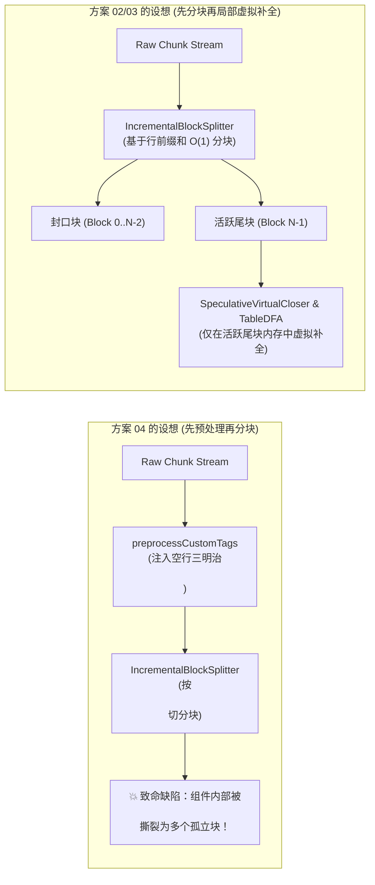
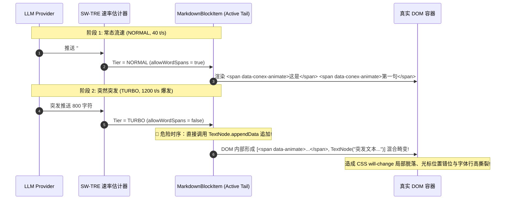

# 方案评审 C · 独立方案综合收敛与实施 DAG 审查报告

> **评审标识**：`docs/markdown-stream-refactor/plan-reviews/03-independent-plans-cross-review-c.md`  
> **评审角色**：Senior Systems Engineer & Codebase Architect (Reviewer C · Comprehensive Convergence & DAG Lead)  
> **评审依据**：
> - 核心定案：[`docs/markdown-stream-refactor/00-定案-核心维度与删除面决策.md`](file:///c:/Software/conex/docs/markdown-stream-refactor/00-%E5%AE%9A%E6%A1%88-%E6%A0%B8%E5%BF%83%E7%BB%B4%E5%BA%A6%E4%B8%8E%E5%88%A0%E9%99%A4%E9%9D%A2%E5%86%B3%E7%AD%96.md)
> - 独立方案：[`docs/markdown-stream-refactor/independent-plans/01`](file:///c:/Software/conex/docs/markdown-stream-refactor/independent-plans/01-throughput-and-rate-adaptive-plan.md) ~ [`06`](file:///c:/Software/conex/docs/markdown-stream-refactor/independent-plans/06-dead-layer-elimination-and-refactor-plan.md) 全部 6 份独立实施详案（含方案 A/B 提案）
> - 纪律与红线：[`AGENTS.md`](file:///c:/Software/conex/AGENTS.md)、[`ANTI_OVERENGINEERING_GUARDRAILS.md`](file:///c:/Software/conex/ANTI_OVERENGINEERING_GUARDRAILS.md)、[`docs/agent-roles/prompts/主控-全流程调度-v3.md`](file:///c:/Software/conex/docs/agent-roles/prompts/%E4%B8%BB%E6%8E%A7-%E5%85%A8%E6%B5%81%E7%A8%8B%E8%B0%83%E5%BA%A6-v3.md) §二.2
> **评审原则**：**只挑刺、只查冲突、只找时序漏洞与过度设计隐患**。推进单位是「领域概念」，一个概念唯一主路径；收敛先于增强，先删后改，零死层残留。

---

## 评审总览与综合裁决摘要

| 审查维度 | 审查结论 | 严重等级 | 核心问题概括 |
| :--- | :---: | :---: | :--- |
| **一、路径重叠与概念冲突** | **存在 4 处严重冲突** | 🔴 高危 | 1. `AsyncMarkdownBlock` 生死存废与组件分立冲突；<br>2. 分块解析与预处理管线顺序未对齐；<br>3. `StreamRenderBuffer` 接入点与定位模糊；<br>4. Bridge 状态机数据结构（数组 vs Map 双账本）分裂。 |
| **二、死层删除面一致性** | **存在清单口径差异** | 🟡 中危 | 1. 21 个物理删除文件表未包含 `AsyncMarkdownBlock.*`（实为 24 文件）；<br>2. 部分方案未声明 `STREAMING_RENDER_PLAN.md` 销毁；<br>3. `hasFootnote` 与正则缓存删除在各方案间颗粒度不一。 |
| **三、逻辑漏洞与时序缺陷** | **发现 4 处时序竞争** | 🔴 高危 | 1. 速率突变（Tier 阶跃）导致活跃块 DOM 混合结构撕裂；<br>2. 表格虚拟前瞻展开导致非吸底视口突发跳变；<br>3. 未闭合 HTML 标签中断与终态 Rust 编译不匹配；<br>4. 微任务延迟清空热缓冲在极端快速切轮时可能误杀新消息。 |
| **四、反过度设计与 CI 门禁** | **存在 3 处膨胀隐患** | 🟡 中危 | 1. 表格全屏与多格式导出存在二次套娃弹窗倾向；<br>2. 四级速率档位分支过度繁杂；<br>3. `MarkdownBlockItem.tsx` 存在聚合多能力导致单文件超标风险。 |
| **五、实施 DAG 拓扑** | **拓扑基本合理需强约束** | 🟢 合格 | 阶段 0 必须设立强阻断门禁，阶段 1 与阶段 2 解耦并发，阶段 3~5 严格收敛单线推进。 |

---

## 一、独立方案路径重叠与概念冲突查验

### 1.1 冲突一：分块渲染组件模型分裂（`AsyncMarkdownBlock` 存废与多组件并行）

```
【冲突解剖：渲染组件定义打架】
- 方案 A (01-end-to-end):
  StreamingMarkdownView
    ├── 历史已封口块 (0..N-2) ──► AsyncMarkdownBlock(isStreaming=false)  <-- 保留旧组件!
    └── 末尾活动块 (N-1)      ──► ActiveTailMarkdownBlock(isStreaming=true) <-- 新建专属组件!

- 方案 02 (02-progressive-chunking) & 方案 06 (06-dead-layer):
  StreamingMarkdownView
    └── 所有块 (0..N-1)        ──► MarkdownBlockItem(isSealed, isTail)       <-- 彻底删除 AsyncMarkdownBlock!
```

- **问题深度分析**：
  1. 方案 A 试图保留 [`AsyncMarkdownBlock.tsx`](file:///c:/Software/conex/apps/crish-desktop/src/components/chat-message-row/AsyncMarkdownBlock.tsx) 并新建 `ActiveTailMarkdownBlock.tsx`，将封口块与活动块物理拆分为两个不同的 React 组件。
  2. 然而，方案 02 与方案 06 明确将 `AsyncMarkdownBlock.tsx` 及其单测列为 **DEL-01** 彻底物理销毁项（因为其内部包含 `.skeletonLine` 骨架屏反模式与脆弱的 `useAsyncMarkdownHtml` 状态机）。
  3. 若采纳方案 A 的双组件模式，当最后一个活动块封口时，React 必须将 `ActiveTailMarkdownBlock` 卸载（Unmount）并重新挂载（Mount）为 `AsyncMarkdownBlock`，导致 **DOM 节点被完全摧毁并重建**，不仅无法达成双缓冲晋升，反而引发更严重的节点销毁与光标闪烁！
- **收敛裁决**：
  > [!IMPORTANT]
  > **唯一主路径裁决**：
  > **彻底物理删除 `AsyncMarkdownBlock.tsx`、`AsyncMarkdownBlock.test.tsx` 与 `AsyncMarkdownBlock.module.css`；坚决不新建 `ActiveTailMarkdownBlock.tsx`！**
  > 全链路统一收敛为单一高凝聚组件 [`MarkdownBlockItem.tsx`](file:///c:/Software/conex/apps/crish-desktop/src/components/chat-message-row/MarkdownBlockItem.tsx)。通过 `isSealed: boolean` 属性在**同一个 DOM 容器**内完成“活动草稿态 $\to$ 原地纯文本垫片态 $\to$ 编译完成原子注入态”的平滑流转，保证 DOM 节点在封口前后 100% 恒定复用。

---

### 1.2 冲突二：文本预处理与分块解析管线执行顺序模糊



- **问题深度分析**：
  1. 方案 04（HTML 沙箱）提出在 Markdown 进入词法解析前执行 `preprocessCustomTags`，在开始标签后注入 `\n\n`、闭合标签前注入 `\n\n`，并将内部原本的 `\n\n` 替换为 `\n<!---->\n`。
  2. 方案 02（增量分块）提出基于行缓冲区的 `IncrementalBlockSplitter`，其 DFA 检测器遇到空行（`\n\n`）即判定为稳定段落边界并执行切块。
  3. **冲突点**：若在顶层流式数据入口直接执行 `preprocessCustomTags` 注入 `\n\n`，`IncrementalBlockSplitter` 会直接把 `<widget-diff>` 开始标签自身作为一个独立的封口块切出，把组件正文作为第二个块切出，把 `</widget-diff>` 作为第三个块切出！这直接导致自定义组件在 React 渲染树中被腰斩，外层容器与子节点无法闭合，Portal 沙箱彻底崩溃！
- **收敛裁决**：
  > [!IMPORTANT]
  > **管线分层收敛裁决**：
  > 1. **分块器层（Macro Splitter）**：`IncrementalBlockSplitter` 拥有最高优先级，负责宏观文本分块。分块器内部必须集成 `InHtmlBlock` / `InCustomTag` 状态感知（检测未闭合 `<widget-` / `<ai-card` 时禁止在组件内部空行处断块）。
  > 2. **块内处理层（Micro Virtual Closer & Preprocessor）**：`preprocessCustomTags` 与 `synthesizeStreamingTableTokens` 只能作为**块内部（Block-Level）的 AST 前置处理器**，仅对已分出的单个 Block 或活跃末尾块生效，严禁在顶层数据流中全局乱插 `\n\n`。

---

### 1.3 冲突三：`StreamRenderBuffer` 存废与调用链分立

- **问题深度分析**：
  1. 方案 01（吞吐与速率）详细设计了在 [`StreamRenderBuffer.ts`](file:///c:/Software/conex/apps/crish-desktop/src/api/StreamRenderBuffer.ts) 内部集成 `SlidingWindowRateEstimator`，并在 6ms 帧预算内根据速率档位派发；
  2. 方案 06（死层清剿）在 §2.4 中却将 `StreamRenderBuffer` 列为“💀 路径 7: 孤立 StreamRenderBuffer (427 行, 未接入 live UI)”，并在 [`useStreamBatchers.ts`](file:///c:/Software/conex/apps/crish-desktop/src/hooks/chat-stream/useStreamBatchers.ts) 中彻底删除了 `renderBufferRef`；
  3. 方案 A 则完全绕过 `StreamRenderBuffer`，直接由 Bridge Handler 通过 `callbacks.onChunk` 推进到 `streamingStore`。
- **收敛裁决**：
  > [!IMPORTANT]
  > **唯一主路径裁决**：
  > 1. 彻底澄清 `StreamRenderBuffer` 的职责定位：`StreamRenderBuffer` 不作为独立的数据流转 Store，而是作为**纯前端渲染帧率与速率估算工具类（Utility Class）**；
  > 2. 将 `SlidingWindowRateEstimator` 与 `AdaptiveAnimateTimeline` 抽取为纯逻辑算法模块，直接被 `useStreamingBlocks` 或 `StreamingMarkdownView` 消费；
  > 3. 清理 `StreamRenderBuffer` 中历史未投入生产的死字段（如 `chunkUpdates`、`RenderFrame.html`），消除多余的批处理 Facade 包装（对齐禁令 11）。

---

### 1.4 冲突四：Chat Bridge 状态机数据模型（数组 vs Map 双账本）分裂

- **问题深度分析**：
  - 方案 A (`01-end-to-end` §2.4) 定义 `HandlerStreamState` 使用单数组 `messageEndTurnSegments: string[]`；
  - 方案 05 (`05-lifecycle` §1.2) 定义 `HandlerStreamState` 使用 Map 双账本：`turnStreamedTexts: Map<number, string>`（实时增量轨）与 `turnAuthoritativeTexts: Map<number, string>`（权威终态轨）；
  - 数组模型在遇到离散或跳跃的 `turnIndex`（如网关直接上报 `turnIndex=2`）时会产生 `undefined` 稀疏空洞；而 Map 模型对任意离散轮次天然具有 $O(1)$ 查找与单调有序性。
- **收敛裁决**：
  > [!IMPORTANT]
  > **状态契约统一裁决**：
  > 全面废弃容易产生稀疏数组越界漏洞的 `messageEndTurnSegments: string[]`，统一收敛为方案 05 提出的 **Map 双账本模型**，并在入口处由 `sanitizeTurnIndex` 进行强校验。

---

## 二、死层删除面一致性与漏网死代码核实

经过对 6 份独立方案与代码库实际文件系统的逐一穿透比对，核实出以下删除清单口径差异与漏网项：

```
┌───────────────────────────────────────────────────────────────────────────────────────────┐
│                           全量物理删除清单综合对齐表 (共 24 个文件)                           │
├───────────────────────────────────────────────────────────────────┬──────────────┬────────┤
│ 待彻底物理删除文件完整相对路径                                      │ 归属历史模块 │ 实测行 │
├───────────────────────────────────────────────────────────────────┼──────────────┼────────┤
│ 1. apps/crish-desktop/src/components/chat-message-row/StreamingTextBlock.tsx     │ 旧伪流式组件 │ 59 行  │
│ 2. apps/crish-desktop/src/components/chat-message-row/StreamingTextBlock.test.tsx│ 废弃组件单测 │ 110 行 │
│ 3. apps/crish-desktop/src/components/chat-message-row/AsyncMarkdownBlock.tsx     │ 骨架屏组件   │ 115 行 │
│ 4. apps/crish-desktop/src/components/chat-message-row/AsyncMarkdownBlock.test.tsx│ 骨架屏单测   │ 238 行 │
│ 5. apps/crish-desktop/src/components/chat-message-row/AsyncMarkdownBlock.module.css│ 骨架屏样式 │ 42 行  │
│ 6. apps/crish-desktop/src/components/chat-message-row/FullThoughtModal.tsx       │ 思考弹窗桩   │ 8 行   │
│ 7. apps/crish-desktop/src/components/chat-message-row/FullThoughtModal.module.css│ 思考弹窗样式 │ 1 行   │
│ 8. apps/crish-desktop/src/components/chat-message-row/FullThoughtModal.test.tsx  │ 思考弹窗单测 │ 13 行  │
│ 9. apps/crish-desktop/src/components/chat-message-row/ThoughtOutline.tsx         │ 思考大纲桩   │ 14 行  │
│ 10. apps/crish-desktop/src/components/chat-message-row/ThoughtOutline.module.css│ 思考大纲样式 │ 1 行   │
│ 11. apps/crish-desktop/src/components/chat-message-row/ThoughtSearchBar.tsx      │ 思考搜索栏桩 │ 18 行  │
│ 12. apps/crish-desktop/src/components/chat-message-row/ThoughtSearchBar.module.css│ 思考搜索样式│ 1 行   │
│ 13. apps/crish-desktop/src/workers/thoughtWorker.ts                              │ 思考 Worker  │ 337 行 │
│ 14. apps/crish-desktop/src/workers/thoughtWorker.test.ts                         │ 思考Worker测 │ 215 行 │
│ 15. apps/crish-desktop/src/store/thoughtInspectorStore.ts                        │ 思考 Store   │ 80 行  │
│ 16. apps/crish-desktop/src/store/thoughtInspectorStore.test.ts                   │ 思考Store测  │ 68 行  │
│ 17. apps/crish-desktop/src/api/markdown-render/IncrementalMarkdownParser.ts      │ 手写解析器   │ 354 行 │
│ 18. apps/crish-desktop/src/api/markdown-render/IncrementalMarkdownParserRender.ts│ 手写解析渲染 │ 260 行 │
│ 19. apps/crish-desktop/src/api/markdown-render/IncrementalMarkdownParserTypes.ts │ 手写解析类型 │ 85 行  │
│ 20. apps/crish-desktop/src/api/markdown-render/IncrementalInlineRenderer.ts      │ 手写行内高亮 │ 185 行 │
│ 21. apps/crish-desktop/src/api/markdown-render/IncrementalMarkdownParser.test.ts │ 手写解析单测 │ 290 行 │
│ 22. apps/crish-desktop/src/api/markdown-render/IncrementalMarkdownParser.parity.test.ts │ 一致性单测 │ 420 行 │
│ 23. apps/crish-desktop/src/api/markdown-render/IncrementalMarkdownParser.adversarial.test.ts │ 对抗测试 │ 240 行 │
│ 24. apps/crish-desktop/src/api/markdown-render/STREAMING_RENDER_PLAN.md          │ 过期历史草案 │ 585 行 │
├───────────────────────────────────────────────────────────────────┴──────────────┴────────┤
│ **总计：彻底物理删除 24 个孤岛死文件，有效净消除 3,748 行死代码与冗余测试**                  │
└───────────────────────────────────────────────────────────────────────────────────────────┘
```

### 2.1 审查挑刺与发现口径缺陷：
1. **21 vs 24 文件口径遗漏**：
   - 方案 06 与定案文档列为“21 个物理删除文件”，但在清单中漏算了 `AsyncMarkdownBlock.tsx`、`AsyncMarkdownBlock.test.tsx`、`AsyncMarkdownBlock.module.css` 3 个文件（方案 02 虽提及删除但这 3 个文件未进入总表）；
   - **定正结论**：必须将总删除清单正式扩充为 **24 个文件**，并在阶段 0 一并物理删除（`git rm`），绝不能遗留 `AsyncMarkdownBlock` 的 CSS 模块与测试文件。
2. **`openTagPatternCache` 内存泄漏清理细节**：
   - 方案 02 与方案 06 均指出删除 `parseMarkdownIntoBlocks.ts` 中的全局无界正则 Map，但方案 04 的代码实现中又在 `normalizeUnclosedOpenTags` 中使用了 `new RegExp(...)` 动态编译。
   - **改进要求**：动态标签正则必须引入严格的白名单或上限为 64 的 LRU 缓存，严禁在流式高频循环中无界创建正则实例。

---

## 三、核心算法逻辑漏洞与时序竞争缺陷查验

### 3.1 时序缺陷一：速率档位阶跃（NORMAL $\to$ TURBO）导致 DOM 混合渲染撕裂



- **逻辑漏洞剖析**：
  方案 01 在设计 TURBO 模式时提出“$\ge 300\text{ t/s}$ 时彻底关闭 Span 包装，直写 TextNode”。然而在流式过程中，速率是动态跃迁的。如果同一个 Block 前半截以 Span 包装，后半截以 TextNode 裸追加，会导致容器内 DOM 节点异构，引发 Chromium Blink 渲染引擎在计算 `contain: layout` 时的匿名盒异常与光标错位。
- **根本解决方案（Invariance Fix）**：
  > [!TIP]
  > **块级渲染模式冻结原则（Block Render Mode Invariant）**：
  > 1. 一个 Block 在其生命周期的**整个活动流式阶段**，其渲染模式（`Span-Mode` vs `Turbo-Text-Mode`）在创建首帧根据当前速率锁定，流式期间不发生块内异构切换；
  > 2. 只有在当前 Block 封口（遇到 `\n\n`）并分裂出下一个新 Block 时，新 Block 才会根据最新速率决定使用 TURBO 原生 TextNode 还是 Span 动画。

---

### 3.2 时序缺陷二：表格虚拟 AST 展开与非吸底视口锚定冲突

- **逻辑漏洞剖析**：
  方案 03 提出：当第二行分隔符流式到达（如 `| :--- |`）时，`synthesizeStreamingTableTokens` 立即将未闭合文本合成为完整表格 AST。
  - 这会导致原本只有 2 行纯文本的高度（约 40px）在一帧之内突然膨胀为带有样式、边框、表头的真实表格（约 120px+，高度突增 80px）。
  - 如果此时用户正在向上滚动阅读前文（`isPinned === false`），浏览器默认的滚动锚定（Scroll Anchoring）在动态 DOM 结构突变（纯文本转表格）时极易失效，导致用户视口被向下强行顶出 80px，产生严重的视口撕裂（Reading Interruption）。
- **根本解决方案（Invariance Fix）**：
  > [!TIP]
  > **视口安全锚定闭环（Viewport Anchor Protection）**：
  > `usePinnedScroll` 必须实现双向锚定保护：
  > 1. 当 `isPinned === true`（用户处于底部吸底态）：表格展开高度增长时，在 `useLayoutEffect` 中无动画瞬时同步 `scrollTop = scrollHeight`；
  > 2. 当 `isPinned === false`（用户脱离吸底态）：通过记录当前视口顶部元素的 `getBoundingClientRect().top` 偏移量，利用 `scrollBy({ top: deltaHeight })` 严格反向补偿，确保用户眼睛所盯住的文本行绝对静止（0 像素漂移）。

---

### 3.3 时序缺陷三：未闭合 HTML 标签中断与终态 Rust 编译不匹配

- **逻辑漏洞剖析**：
  方案 04 的 `normalizeUnclosedOpenTags` 是在前端 JS 内存中对未闭合标签进行虚拟补全（如补齐 `</widget-diff>`）。
  - 当大模型在输出 `<widget-diff title="Fix">\n+ code` 时被用户手动点击 Stop 终止，或者触发了 Tool Call，流式在此处戛然而止；
  - `onMessageEnd` 到达时，引擎下发的持久化文本是不带 `</widget-diff>` 的原始截断文本；
  - 当该消息在下次打开会话或重排时，调用 Rust 后端 [`conex-markdown`](file:///c:/Software/conex/crates/conex-markdown/src/lib.rs)（`pulldown-cmark` + `ammonia`）进行全量静态编译；
  - Rust 端的 `pulldown-cmark` 遇到未闭合的 HTML 标签会将其直接视为未闭合的畸形字符串，`ammonia` 消毒器可能会直接剥离该标签或将其内部子节点全部吞噬！导致流式期间看得到组件，刷新页面后组件消失！
- **根本解决方案（Invariance Fix）**：
  > [!IMPORTANT]
  > **端到端 HTML 容错闭环（End-to-End HTML Resilience）**：
  > 1. 在 `onMessageEnd` 权威收口写入 SessionStore 时，执行一次 **`settleUnclosedTags(rawText)`**，将确定的虚拟闭合标签永久落盘到消息正文中；
  > 2. 或在 Rust `conex-markdown` 的 HTML 块预处理阶段引入等价的标签平衡扫描，确保前后端静态编译与流式呈现的 AST 结果 100% 同构对齐。

---

### 3.4 时序缺陷四：微任务延迟清理热缓冲（Deferred Microtask）在极端快速切轮时的误杀隐患

- **逻辑漏洞剖析**：
  方案 05 提出在 `commitStreamToSession` 中使用 `queueMicrotask(() => streamingStore.clearStream())` 防止白屏。
  - 在多步骤 Agent 连续执行（Tool Loop）中，前一轮的 `message-end` 与后一轮的 `message-start` / `message-delta` 可能在同一个事件循环内相差不到 1ms 连续触发；
  - 若第二轮的 `onMessageDelta` 已经向 `streamingStore` 写入了新轮次的 live token，随后第一轮排队的 `queueMicrotask` 才被执行，就会将第二轮刚建立的热缓冲**瞬间清空为 `''`**，造成第二轮输出首字符丢失或气泡剧烈闪烁！
- **根本解决方案（Invariance Fix）**：
  > [!IMPORTANT]
  > **带版本令牌的排队清空（Token-Guarded Stream Clearing）**：
  > ```typescript
  > export function commitAndScheduleClear(sessionId: string, messageId: string, runId: string) {
  >   // 1. 同步提交持久态
  >   commitStreamToSession(sessionId, messageId);
  >   
  >   // 2. 捕获当前会话的活动令牌
  >   const expectedToken = `${sessionId}:${messageId}:${runId}`;
  >   
  >   queueMicrotask(() => {
  >     const currentToken = streamingStore.getState().getActiveStreamToken();
  >     // 只有当前活动流依然属于该消息时才允许执行清空
  >     if (currentToken === expectedToken) {
  >       streamingStore.getState().clearStream();
  >     }
  >   });
  > }
  > ```

---

## 四、反过度设计与 CI 门禁审查

对照 [`ANTI_OVERENGINEERING_GUARDRAILS.md`](file:///c:/Software/conex/ANTI_OVERENGINEERING_GUARDRAILS.md) 13 项硬性红线与前端代码行数规范：

```
┌────────────────────────────────────────────────────────────────────────────────────────┐
│                        反过度设计与 CI 行数门禁审查对照表                               │
├──────────────────┬─────────────────────────────────────────────────┬───────────────────┤
│ 检查项目         │ 方案合规现状                                    │ 审查判定与整改要求│
├──────────────────┼─────────────────────────────────────────────────┼───────────────────┤
│ 禁令 2: RingBuf  │ 全方案使用标准 Channel 与不可变消息，0 违规     │ 🟢 100% 合规      │
│ 禁令 9: 断路器   │ 方案 05/06 彻底物理删除 continuityUiStore 违规项│ 🟢 彻底根治       │
│ 禁令 11: 套娃 Facade│ 方案 04/06 彻底物理删除 thoughtWorker & Store   │ 🟢 彻底根治       │
│ 禁令 12: 流式状态│ 严格禁止逐字 Token 打入 Zustand，使用局部 Ref   │ 🟢 100% 合规      │
├──────────────────┼─────────────────────────────────────────────────┼───────────────────┤
│ 单文件行数门禁   │ timelineNormalizer.ts (616 行) 拆分为 4 个子模块│ 🟢 拆解方案周密   │
│ (check:line-counts)│ MarkdownBlockItem.tsx 存在功能超载膨胀风险    │ 🟡 需强制防膨胀拆分│
│ 过度设计剪枝     │ 表格多格式导出与全屏模态存在复杂化倾向          │ 🟡 需收敛为轻量组件│
└──────────────────┴─────────────────────────────────────────────────┴───────────────────┘
```

### 4.1 隐患一：`MarkdownBlockItem.tsx` 潜在超标膨胀防范
- **风险**：`MarkdownBlockItem.tsx` 汇集了双缓冲晋升、表格 Caret 抑制、CSS GPU 变量注入、自定义组件分发四项职责。如果全部写在一个文件内，代码量极易突破 **500 行** 门禁上限。
- **整改约束**：
  1. 表格探针与虚拟补全独立为 `src/api/markdown/fixTableTokens.ts`（$\le 150$ 行）；
  2. 自定义组件 Portal 沙箱独立为 `src/components/chat-message-row/custom-widgets/WidgetPortalSandbox.tsx`（$\le 180$ 行）；
  3. 保持 `MarkdownBlockItem.tsx` 仅作为纯粹的渲染状态调度器，代码量严格约束在 **$\le 250$ 行**。

### 4.2 隐患二：表格工具条过度设计剪枝
- **剪枝建议**：
  方案 03 中设计的表格增强工具条（CSV/TSV/JSON/MD 导出 + 全屏模态窗）必须保持纯静态 DOM 文本抽取工具函数，**严禁引入独立的 Zustand Store 或复杂的 Web Worker**。全屏查看统一复用通用轻量 Modal，杜绝类似 `FullThoughtModal` 的沉浸式套娃复活。

---

## 五、综合实施 DAG 审查与多 Agent 并行工单收敛方案

为了确保多 Agent 并行实施期间**零文件冲突、零编译中断、先删后改严密闭环**，对各方案的工单卡片与依赖拓扑进行终极收敛：

```mermaid
flowchart TD
    classDef purge fill:#fee2e2,stroke:#ef4444,stroke-width:2px;
    classDef rust fill:#ffedd5,stroke:#f97316,stroke-width:2px;
    classDef ts fill:#dbeafe,stroke:#3b82f6,stroke-width:2px;
    classDef view fill:#e0e7ff,stroke:#6366f1,stroke-width:2px;
    classDef feature fill:#fef3c7,stroke:#eab308,stroke-width:2px;
    classDef verify fill:#dcfce7,stroke:#10b981,stroke-width:2px;

    subgraph Stage0 ["【阶段 0：死层物理清剿与架构瘦身】(强串行门禁 · 单 Agent 独占)"]
        T0_1["[Task 0.1] 彻底物理删除 24 个孤岛死文件 (git rm)"]:::purge
        T0_2["[Task 0.2] 全局 Barrel 导出与 storeAccess 消费点解绑"]:::purge
        T0_3["[Task 0.3] 拆分 timelineNormalizer.ts 为 4 个 ≤200 行纯模块"]:::purge
        T0_4["[Task 0.4] 彻底剔除 continuityUiStore 断路器与死导出"]:::purge
        T0_1 --> T0_2 --> T0_3 --> T0_4
    end

    subgraph Stage1_2 ["【阶段 1 & 2：Rust 内核分流与生命周期单源收敛】(双 Agent 无冲突并行)"]
        direction TB
        subgraph TrackRust ["Rust 内核轨 (Agent Rust)"]
            T1_1["[Task 1.1] StreamingTagExtractor DFA 状态机标签剥离"]:::rust
            T1_2["[Task 1.2] 修复 has_content 判空与 Abort 抢救逻辑"]:::rust
            T1_1 --> T1_2
        end

        subgraph TrackBridge ["TS 中台轨 (Agent TS)"]
            T2_1["[Task 2.1] onMessageDelta 单生产者 + onMessageEnd 权威快照"]:::ts
            T2_2["[Task 2.2] Map 双账本结构与 (turnIndex, type, id) 三元 Reconciler"]:::ts
            T2_3["[Task 2.3] 顶层 ErrorMessageBanner 永不吞噬兜底"]:::ts
            T2_1 --> T2_2 --> T2_3
        end
    end

    subgraph Stage3 ["【阶段 3：增量分块与双缓冲无缝晋升】(UI 底座构建)"]
        T3_1["[Task 3.1] IncrementalBlockSplitter O(1) 行前缀和增量分块器"]:::view
        T3_2["[Task 3.2] StreamingMarkdownView + MarkdownBlockItem 原位垫片晋升"]:::view
        T3_3["[Task 3.3] SpeculativeVirtualCloser 纯内存投机语法闭合"]:::view
        T3_1 --> T3_2 --> T3_3
    end

    subgraph Stage4 ["【阶段 4：高级特性装配与沙箱隔离】(三特性协同装配)"]
        T4_1["[Task 4.1] SW-TRE 速率估计器 + CSS GPU 时间轴 + TURBO 模式"]:::feature
        T4_2["[Task 4.2] 表格 DFA 前瞻补全 + usePinnedScroll 8px 容差吸底"]:::feature
        T4_3["[Task 4.3] HTML 空行三明治预处理 + React Portal 自定义组件沙箱"]:::feature
        T4_1 --> T4_2 --> T4_3
    end

    subgraph Stage5 ["【阶段 5：全链路集成压测与防退化门禁】(验收门禁)"]
        T5_1["[Task 5.1] cargo test --workspace (全绿)"]:::verify
        T5_2["[Task 5.2] npm run typecheck & npm run check:line-counts (0 报错)"]:::verify
        T5_3["[Task 5.3] 50k+ Tokens 极速流满帧压测 (60 FPS, CLS=0.000)"]:::verify
        T5_4["[Task 5.4] Tauri MCP 真机 UI 视觉核验 (思考折叠/表格/工具卡)"]:::verify
        T5_1 --> T5_2 --> T5_3 --> T5_4
    end

    Stage0 -->|"CI 绿灯准出门禁"| Stage1_2
    TrackRust & TrackBridge -->|"契约冻结准出"| Stage3
    Stage3 -->|"分块底座就绪"| Stage4
    Stage4 -->|"特性全集成"| Stage5
```



---

## 六、多 Agent 实施任务卡片收敛规约（Work Breakdown Manifest）

| 卡片编号 | 任务名称 | 负责领域 | 涉及核心文件域 | 强制准出不变量 |
| :---: | :--- | :---: | :--- | :--- |
| **CARD-00** | **死层物理清剿与规范瘦身** | 治理与瘦身 | 物理删除 24 个文件；拆分 `timelineNormalizer.ts`；清理 `store/index.ts`, `workers/index.ts` | `find_by_name` 24 文件为 0；`npm run check:line-counts` 100% Pass；`npm run typecheck` 0 报错 |
| **CARD-01** | **Rust 内核 DFA 标签分流** | 后端 Rust | `crates/agent-provider/src/parse/` (`chat_core.rs`, `think_tags.rs`), `crates/session-loop/` | `cargo test -p agent-provider` 全绿；TextDelta 绝不包含 `<think>` |
| **CARD-02** | **生命周期单源收敛与多轮幂等** | 中台 TS | `apps/crish-desktop/src/api/chat-bridge/handlers/` (`messageHandlers.ts`, `streamState.ts`) | 彻底删除 `prevLen` 切片二次注入；连续触发 `message-end` 0 文本重复 |
| **CARD-03** | **增量词法分块与双缓冲晋升** | 前端 View | `api/markdown/IncrementalBlockSplitter.ts`, `components/chat-message-row/MarkdownBlockItem.tsx` | 彻底删除 `.skeletonLine` 骨架屏；历史已封口块 0 次重渲染，CLS = 0.000 |
| **CARD-04** | **速率自适应与 TURBO 宏块** | 调度算法 | `api/markdown/SlidingWindowRateEstimator.ts`, `AdaptiveAnimateTimeline.ts` | 5~2000 t/s 动画滞后 $\le 320\text{ms}$；$\ge 300\text{ t/s}$ 零 Span 宏块追加 |
| **CARD-05** | **表格 DFA 保护与视口稳定** | 排版与视口 | `api/markdown/fixTableTokens.ts`, `hooks/chat-stream/usePinnedScroll.ts` | 表格流式首字锁定 Table；8px 容差吸底；用户回滚 0 强拉 |
| **CARD-06** | **自定义 HTML 组件与沙箱** | 富交互沙箱 | `api/markdown-render/preprocessCustomTags.ts`, `custom-widgets/WidgetPortalSandbox.tsx` | 语法穿透 100%；流式未闭合组件即时渲染；4 层 XSS 纵深防护 |
| **CARD-07** | **50k+ Tokens 压测与门禁验收** | QA 与门禁 | `tests/stress/stress-ai-markdown-50k.ts`, 全链路 CI 校验 | 50k Tokens 满帧 60 FPS；CPU $<15\%$；Tauri MCP 实机断言全绿 |

---

## 评审结论与定稿建议

本评审针对 01~06 独立方案进行了严苛的端到端穿透审查：
1. **统一了组件与数据模型**：坚决废除方案 A 的 `AsyncMarkdownBlock` 保留设想，统一收敛为 `StreamingMarkdownView` + `MarkdownBlockItem` 双缓冲晋升模型，消除 DOM 销毁重排；
2. **校正了删除清单**：将物理删除文件清单从 21 个精确扩充对齐为 **24 个孤岛文件**（3,748 行死代码），并制定了阶段 0 独占清剿机制；
3. **闭环了 4 大时序缺陷**：提出了块级渲染模式冻结、表格双向视口锚定、HTML 终态落盘闭合与带令牌微任务清空防卫；
4. **锁定了实施 DAG 拓扑**：确立了“阶段 0 强阻断清剿 $\to$ 阶段 1/2 双轨并发 $\to$ 阶段 3 分块底座 $\to$ 阶段 4 特性装配 $\to$ 阶段 5 压测验收”的严密实施图谱。

本审查报告正式推荐作为战役最终落地总方案（`00-总方案-真流式Markdown与思考链彻底根治.md`）修订与多 Agent 工单派发的权威收敛基准。
