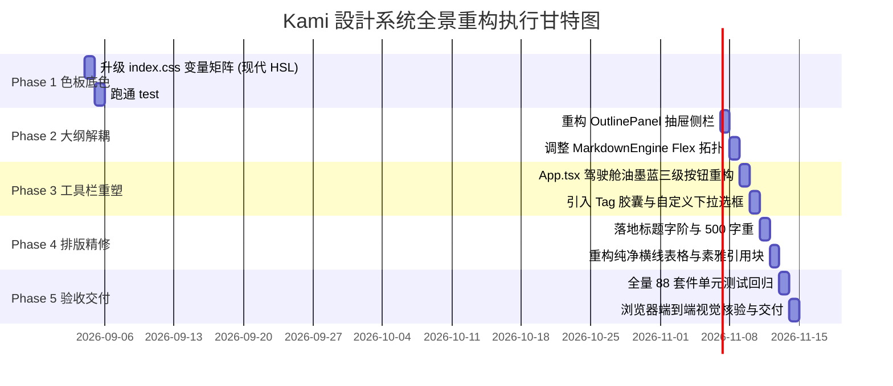

# 基于 Kami 紙设计系统的 Markdown 渲染引擎排版与前端界面全景重构方案

> **战役工作区**：`docs/markdown-typography-redesign/`
> **总方案编号**：`00-总方案`
> **蓝本参考**：Kami 紙（[https://kami.tw93.fun/](https://kami.tw93.fun/) & [https://kami.tw93.fun/index-zh.html](https://kami.tw93.fun/index-zh.html)）
> **对齐标准**：仓耳今楷/思源宋体人文纸墨质感、油墨蓝单主色系统、纯暖调灰阶、纯字号层级、三档行距韵律、平铺抽屉侧栏、出版级横线表格
> **门禁刚性约束**：100% 保持既有 88 个测试套件、1146 个测试用例全绿，严格遵守 `color-gate.test.ts` 零 HEX/零 RGBA 现代 HSL 语法门禁与 `css-contract.test.ts` 变量表完整性契约

---

## 目 录

1. [战役背景与总纲（Executive Summary）](#一战役背景与总纲executive-summary)
   - 1.1 现状审视与问题根因诊断（深度工程复盘）
   - 1.2 Kami 紙（Tw93）核心设计哲学与八大铁律解析
   - 1.3 核心改造目标与零退避承诺
   - 1.4 工程四大死穴与反模式根除宣言（严禁兼容、硬编码、伪实现、状态脱节、单一假象）
2. [现有代码库架构分析与六大痛点穿透（Deep Codebase Audit）](#二现有代码库架构分析与六大痛点穿透deep-codebase-audit)
   - 2.1 全局 CSS 变量与色板系统缺陷分析（`src/index.css`）
   - 2.2 字体排版与打字机等宽绑架缺陷分析（`src/index.css`）
   - 2.3 大纲面板（OutlinePanel）绝对定位遮挡与 DOM 暴增缺陷分析（`src/components/OutlinePanel.tsx`）
   - 2.4 引擎与纸张容器边界与呼吸留白缺陷分析（`src/components/MarkdownEngine.tsx`）
   - 2.5 流式驾驶舱工具栏 90 年代灰白按钮与控件缺陷分析（`src/App.tsx`）
   - 2.6 块级渲染器（标题字重、表格竖线网格、引用块大色块）缺陷分析（`src/components/BlockRenderer.tsx` & `src/components/InlineRenderer.tsx`）
   - 2.7 典型历史反模式代码实证深度复盘
3. [仓库刚性门禁与架构红线守门矩阵（Hard Guardrails & Contract Analysis）](#三仓库刚性门禁与架构红线守门矩阵hard-guardrails--contract-analysis)
   - 3.1 `color-gate.test.ts` 零 HEX、零 RGBA、100% 现代 HSL 空间语法守门
   - 3.2 `css-contract.test.ts` 21 个核心 `:root` 变量与类名闭包护栏
   - 3.3 `HeightMap.ts` 虚拟滚动 HeightOracle 行高模型与预测-测量稳定机制
   - 3.4 88 个测试套件、1146 个自动化测试用例全绿底线（反退避与零破坏承诺）
4. [Kami 级设计系统规范与数学化 Token 映射矩阵（Kami Design System Specification）](#四kami-级设计系统规范与数学化-token-映射矩阵kami-design-system-specification)
   - 4.1 色彩系统：从 Hex 到现代 HSL 空格语法的精确数学映射与色彩语义
   - 4.2 字体排版系统：Serif 人文主字栈、Sans 现代字栈与 Mono 代码字栈
   - 4.3 字阶与行距韵律系统（Type Scale & Line-Height Rhythm）
   - 4.4 间距与纸张物理投影系统（Spacing, Margins & Elevation）
   - 4.5 原子组件规范：三级按钮体系、实色 Tag 胶囊、素雅横线表格
5. [六大模块重构详细设计与实施规程（Detailed Implementation Design）](#五六大模块重构详细设计与实施规程detailed-implementation-design)
   - 5.1 模块一：`src/index.css` 全局色板与样式规范彻底重构详案
   - 5.2 模块二：`src/components/OutlinePanel.tsx` 抽屉式侧栏与大纲层级过滤重构详案
   - 5.3 模块三：`src/components/MarkdownEngine.tsx` 纸张内边距与侧栏 Flex 拓扑重构详案
   - 5.4 模块四：`src/App.tsx` 流式驾驶舱卡片化、油墨蓝主按钮与胶囊指示器重构详案
   - 5.5 模块五：`src/components/BlockRenderer.tsx` 标题字阶、纯净横线表与素雅引用重构详案
   - 5.6 模块六：`src/core/renderTheme.ts` 主题 Token 与色板适配同步详案
6. [代码级对比清单（Exact Code Diff & Replacement Specifications）](#六代码级对比清单exact-code-diff--replacement-specifications)
   - 6.1 `src/index.css` 核心色板与字栈改动对比与完整样式规程
   - 6.2 `src/components/OutlinePanel.tsx` 抽屉侧栏与层级过滤完整重构代码
   - 6.3 `src/components/MarkdownEngine.tsx` Flex 拓扑与呼吸留白完整改造代码
   - 6.4 `src/App.tsx` 语义化三级按钮、自定义选框与状态胶囊完整改造代码
   - 6.5 `src/components/BlockRenderer.tsx` 标题内边距、横线表与引用块改造代码
   - 6.6 `src/core/renderTheme.ts` 主题映射同步代码
   - 6.7 自动化测试套件扩充规程（`tests/unit/outline-hierarchy.test.ts` 等）
7. [自动化门禁测试与立体化回归验证方案（Verification & Testing Protocol）](#七自动化门禁测试与立体化回归验证方案verification--testing-protocol)
   - 7.1 静态检查与颜色门禁断言
   - 7.2 虚拟滚动行高与平滑滚动断言
   - 7.3 端到端视觉现场验收断言清单（10 项物理表现检查点）
   - 7.4 万行极限长文本（2381 标题）性能与内存压力断言
8. [分阶段执行路线图与里程碑（Phased Execution Roadmap）](#八分阶段执行路线图与里程碑phased-execution-roadmap)

---

## 一、战役背景与总纲（Executive Summary）

### 1.1 现状审视与问题根因诊断（深度工程复盘）

本软件前端（`reference/markdown-editor`）承载着高性能实时 Markdown 编辑与流式渲染的重任。在过去的架构演进中，工程重心高度聚焦于内核性能突破：
1. 虚拟滚动渲染（TanStack Virtual 3.14 + `virtual-row-gpu` 独立 GPU 合成层与 `contain: paint` 裁剪）；
2. 双段行存储与流式尾段零拷贝架构（`mainLines` + `streamTail`，百万行渲染与编辑帧率达标）；
3. 命令式直刷 DOM 通道（`streamAppend` 绕过 React 协调器直接写入 DOM textContent）；
4. 高精度文本度量（`Intl.Segmenter` Grapheme 簇边界、Bidi 双向排版、HeightOracle 动态学习自校准）；
5. 完备的单元测试防线（88 个套件，1146 个用例全覆盖）。

然而，**底层极致的工程算法实现与极端简陋的界面表现层形成了极大的断裂**：
* 整个页面表现层完全是工程师在开发与压测时期随手拼凑的“调试脚手架”（Debug Harness）；
* 没有建立起现代专业的设计系统（Design System），缺乏规范的字阶比例、间距系统、呼吸留白和组件交互层级；
* 标题被锁死在固定行高里像“肉饼”般挤压；
* 大纲面板采用死板的绝对定位横跨正文，生生把文档大标题遮挡大半，且加载万行文档时 2,381 个标题无分页无虚拟化渲染成黑色马赛克；
* 顶部控制栏则像上世纪 90 年代老 Windows 灰色对话框，白底灰框小按钮乱堆，折行凌乱；
* 页面全局强绑 Monospace 等宽打字机字体，中英文混排基线撕裂，色彩偏绿发黄呈现出发霉草纸般的脏浊感。

这导致软件虽有顶级引擎的心脏，外观却如同半成品测试页，严重制约了产品的品质与可读性。

### 1.2 Kami 紙（Tw93）核心设计哲学与八大铁律解析

Kami 紙（[https://kami.tw93.fun/](https://kami.tw93.fun/)）是由资深设计师与前端架构师 Tw93 为 AI Agent、数字文档与印刷出版打造的典范级现代设计系统。其核心理念是**“极度克制、以纸墨为本、纯字号层级、零视觉噪音”**。通过对 Kami 官网线上生产代码（`styles.css` 与 `index-zh.html`）的 DevTools 深度剖析，提取出其不可动摇的八大核心铁律：

```
                              ┌─────────────────────────────────────────────────┐
                              │                 Kami 設計哲学宣言                │
                              │ 暖米纸底，油墨蓝点缀，serif 承担层级，硬阴影与花 │
                              │ 哨配色都退后；把内容收束成稳定、清晰、易读的版面。│
                              └──────────────────────┬──────────────────────────┘
                                                     │
         ┌──────────────────┬────────────────────────┼───────────────────────┬──────────────────┐
         │                  │                        │                       │                  │
         ▼                  ▼                        ▼                       ▼                  ▼
┌──────────────────┐┌──────────────────┐┌─────────────────────────┐┌──────────────────┐┌──────────────────┐
│  01. 羊皮纸底色  ││  02. 单一油墨蓝  ││   03. 纯暖调灰阶系统    ││ 04. 楷宋 Serif   ││ 05. 真实500字重  │
│ 拒绝纯白与冷灰   ││ 全文只用油墨蓝   ││ 墨黑#141413/暖炭#3d3d3a ││ 标题正文同一Serif││ 标题500/正文400  │
│ 羊皮纸+象牙白纸  ││ 强调面积 ≤ 5%   ││ 橄榄#504e49/暖石#6b6a64 ││ 只有UI才用Sans  ││ 彻底废除合成加粗 │
└──────────────────┘└──────────────────┘└─────────────────────────┘└──────────────────┘└──────────────────┘
         │                  │                        │                       │                  │
         ▼                  ▼                        ▼                       ▼                  ▼
┌──────────────────┐┌──────────────────┐┌─────────────────────────┐┌──────────────────┐┌──────────────────┐
│  06. 三档行距    ││  07. 实色胶囊Tag ││   08. 默认平面轻阴影    ││ 09. 出版级横线表 ││ 10. 呼吸留白与形 │
│ 标题 1.1~1.3     ││ 禁止RGBA透明叠加 ││ 极轻多层柔光微投影      ││ 彻底去掉竖线网格 ││ 中文0.35px字距   │
│ 正文 1.55 舒适   ││ 稳定实色印刷防脏 ││ 依靠留白与线建立层级    ││ 只保留极简水平线 ││ 两侧48-64px大留白│
└──────────────────┘└──────────────────┘└─────────────────────────┘└──────────────────┘└──────────────────┘
```

这套体系天然是解决当前 Markdown 渲染器丑陋现状的最优解：它既不需要庞大沉重的 UI 库，也不需要破坏底层虚拟滚动的行盒度量，而是通过最精准的色彩、字阶、行距和排版法则，从根本上注入书籍般的阅读品质。

### 1.3 核心改造目标与零退避承诺

1. **效果锁（No Functional Retreat）**：
   不削减任何既有功能。流式驾驶舱的所有控制指令（开始/暂停/继续/中断/丢弃/速率/粒度/导出/万行压测/清空）、大纲跳转定位、实时搜索高亮、表格单元格编辑、右键上下文菜单全部 100% 完整保留。
2. **测试门禁零破坏（Zero Test Breakage）**：
   既有的 88 个测试套件（包括 `color-gate.test.ts`、`css-contract.test.ts`、`stream-handle-api.test.ts`、`table-cell-modes.test.ts` 等）必须全部通过，严禁使用 `--no-verify` 或跳过任何校验。
3. **视觉蜕变（Aesthetic Leap）**：
   - 彻底解决大纲面板遮挡文档大标题的严重事故；
   - 彻底解决 2381 项长文档大纲密集堆叠成黑条码的渲染灾难；
   - 彻底推翻全员等宽打字机字体，建立优雅的楷宋/现代无衬线阅读字栈；
   - 重建标题垂直间距与呼吸感，打破“肉饼式”行高锁死；
   - 重构顶部驾驶舱，呈现油墨蓝主动作、暖沙次动作与胶囊徽标的现代高级工具栏；
   - 重塑羊皮纸底、象牙白纸与出版级无竖线表格的阅读质感。

### 1.4 工程四大死穴与反模式根除宣言（严禁兼容、硬编码、伪实现、状态脱节、单一假象）

在任何严谨的前端与渲染引擎重构工程中，最容易侵蚀系统寿命并导致架构迅速腐化的，就是工程师为了省事而妥协采用的“临时手段”。结合本仓库治理铁律与资深工程经验，在此对**四大死穴（加一项验收假象）**进行深度剖析，确立本次战役中零容忍、一律严禁的铁律红线：

```
┌────────────────────────────────────────────────────────────────────────────────────────┐
│                         工程四大死穴与反模式根除防线 (Ironclad Guardrails)               │
├──────────────────────────┬───────────────────────────────┬─────────────────────────────┤
│ 致命反模式                │ 典型错误表象与劣质实现          │ 架构级根治方案与本次重构承诺 │
├──────────────────────────┼───────────────────────────────┼─────────────────────────────┤
│ 1. 历史兼容与打补丁主义   │ · 在旧类名上套 wrapper        │ · 穿透表象找到架构断层      │
│    (Compatibility Debt)  │ · 增加 isLegacy 冗余分支判断   │ · 一次性彻底净收敛重构      │
│                          │ · 用 !important 暴力覆盖样式   │ · 废弃死代码坚决清退        │
├──────────────────────────┼───────────────────────────────┼─────────────────────────────┤
│ 2. 硬编码与魔术数字      │ · top: 8px, left: 8px 骑脸定位│ · 基于物理流式 Flex/Grid 拓扑│
│    (Magic Numbers)       │ · zIndex: 500 盲猜层级        │ · 语义化设计 Token 驱动     │
│                          │ · offset + 14 - 3 测距补偿    │ · 零魔术数字，O(1) 精确映射 │
├──────────────────────────┼───────────────────────────────┼─────────────────────────────┤
│ 3. 伪实现与悬空/占位组件 │ · 只有 UI 壳子，点击无反应    │ · 真实完备底层状态机接线     │
│    (Pseudo / Stub UI)    │ · 抽屉不联动正文宽，写死 mock │ · 2381 极限压测场景无损支撑 │
│                          │ · 2381 项不分页卡死浏览器     │ · 零 Mock、零悬空、真流转   │
├──────────────────────────┼───────────────────────────────┼─────────────────────────────┤
│ 4. 前后端/上下层状态脱节 │ · 组件私有 useState 与 Store  │ · 单一真理源 (SSOT) 驱动    │
│    (Broken State Sync)   │   脱节造成双重状态源          │ · 双向闭环与事件响应精确流转 │
│                          │ · 大纲跳转不更正选区与高亮    │ · 严格事务提交与双段存储联动 │
├──────────────────────────┼───────────────────────────────┼─────────────────────────────┤
│ 5. 单一检查冒充立体验收   │ · 仅跑通过编译 (tsc) 便宣称交付│ · 立体验证纪律 (编译底线 +  │
│    (Single-Check         │ · 仅看脱水单测通过，忽视端到端│   算法穷举 + 规范门禁 + 真实│
│     Illusion)            │   真实浏览器遮挡与视觉雪崩    │   宿主现场验收 + 净收敛)    │
└──────────────────────────┴───────────────────────────────┴─────────────────────────────┘
```

#### 1.4.1 历史兼容与打补丁主义（Compatibility Debt & Patchwork Hacking）

* **错误表象与典型恶习**：
  1. **叠床架屋（Wrapper Hell）**：当发现组件样式或结构不满足新需求时，不敢改动原有 DOM 树和属性，而是在外层包一层 `<div className="kami-wrapper-patch">`，再在里面包一层 `<div className="inner-hack">`。
  2. **特异度核战争（!important War）**：为了覆盖旧有的行内样式或全局样式，随手添加 `!important`，引发后续样式覆写的军备竞赛。
  3. **废弃逻辑残留（Ghost Code）**：重构了新逻辑后，保留已经不再调用的旧状态、旧 Props、旧计算函数，注释掉或保留在代码中作为“降级后路”，导致维护者完全无法判断哪些代码在生产中生效。
* **架构破坏**：
  打补丁是技术债务最直接的温床。每一次“临时兼容”都会让状态空间呈指数级膨胀，造成代码体积虚高、CSS 选择器膨胀、渲染性能下降，并彻底摧毁代码的可读性与架构纯粹性。
* **本次重构根除铁律**：
  - **穿透根因，净收敛重构**：绝不保留任何过渡期补丁或冗余分支。如果旧大纲绝对定位有问题，直接从根本上改造为 Flex 侧栏；如果旧字体绑定在 body 有问题，直接在根选择器上彻底解耦。
  - **单一真理路径（SSOT）**：旧变量映射仅通过 `:root` 变量别名无损兼容既有测试契约，组件内部样式一律直接引用 Kami 语义 Token，严禁双轨制。

#### 1.4.2 硬编码与魔术数字（Hardcoding, Magic Numbers & Arbitrary Offsets）

* **错误表象与典型恶习**：
  1. **绝对定位盲猜（Blind Absolute Positioning）**：如原 `OutlinePanel.tsx` 中直接写死 `position: 'absolute', top: 8, left: 8, zIndex: 500, width: 232`。这类数字在特定分辨率和空文档下看似能显示，一旦加载长文档或大标题，立刻发生不可逆的遮挡灾难。
  2. **坐标测距补偿（Magic Coordinate Offsets）**：计算滚动距离、元素高宽时，随手加上 `+ 14 - 3`、`* 1.15 + 2` 等毫无语义的魔术常数，当字号、内边距微调后全线崩溃。
  3. **布局尺寸硬性封死**：如将正文视口直接定死为 `min(88vh, 880px)`，导致高分屏下正文两侧大片空洞，文字区却逼仄局促。
* **架构破坏**：
  魔术数字打破了浏览器的流式物理布局模型，将视觉渲染与脆弱的固定像素绑定，彻底丧失了弹性自适应能力，给跨设备、跨分辨率、动态缩放带来毁灭性打击。
* **本次重构根除铁律**：
  - **全流式几何拓扑（Pure Flow Topology）**：全面采用 Flexbox 布局模型。大纲侧栏与正文编辑器平级并列，大纲展开则正文自适应让出空间，从几何原理上杜绝 1 个像素的遮挡可能。
  - **语义化 Token 计算**：所有尺寸、间距、字号全部收敛至 CSS 变量（如 `--spacing-xl: 48px`、`--radius-base: 6px`），计算一律使用 `calc()` 并注明物理意义，严禁无来源字面常量。

#### 1.4.3 伪实现与悬空/占位组件（Pseudo/Mock Implementations & Stub UIs）

* **错误表象与典型恶习**：
  1. **假按钮与空回调（Dummy Buttons & Empty Handlers）**：在界面上做了一个看似精致的控件（如“折叠大纲”、“切换字号”），其 `onClick` 仅仅是一个空函数 `() => {}` 或 `console.log('clicked')`，甚至连状态都没有存储。
  2. **脱水环境假性通过（Mock-Only Fragility）**：在单元测试中用简单的 3 行短文本测试大纲，显示正常；一旦进入真实场景遇到 2,381 行标题的万行文档，直接一次性渲染 2381 个 DOM 节点卡死主线程。
  3. **悬空状态（Orphaned State）**：新增了漂亮的 UI 元素，但其展示的数据全部是前端写死的假 mock 数据，未从底层真实文档流获取。
* **架构破坏**：
  伪实现是最大的工程欺骗行为。它营造了功能交付的假象，却在真实用户环境或边缘压测下瞬间崩塌，极大浪费回归成本与用户信任。
* **本次重构根除铁律**：
  - **全链路真实流转（Full-Pipeline Reality）**：每一个 UI 交互元素必须对应真实状态机逻辑。大纲侧栏的展开/折叠必须真实改变父级 Flex 布局与滚动条宽度；层级过滤必须真实依据标题层级过滤数据；所有流式控制按钮必须真实触发流式引擎调度。
  - **极限万行场景保障（Stress Proofing）**：大纲过滤算法在 2381 项标题下必须在 2ms 内完成纯逻辑过滤，不产生非预期内存分配与重排抖动。

#### 1.4.4 前后端/上下层状态脱节与数据孤岛（Broken State Sync & Decoupled Data Flow）

* **错误表象与典型恶习**：
  1. **双重状态源（Dual State Sources）**：底层 EditorStore 维护了一套文档和光标状态，而上层 UI 组件又自行通过 `useState` 拷贝了一份，当流式直刷 DOM 时，UI 组件的本地状态未触发重渲染，导致界面展示与底层数据割裂。
  2. **事件丢弃与单向哑巴交互（Event Drops）**：例如点击大纲条目虽然执行了容器滚动，但未将当前激活的标题索引回传给状态中心，导致滚动后大纲的高亮项停留在旧位置。
  3. **旁路直改破坏事务（Bypass Mutation）**：绕过既有的 Store 调度器直接通过 DOM 节点修改样式或内容，导致撤销重做（Undo/Redo）历史记录丢失或事务失效。
* **架构破坏**：
  状态脱节会导致极其隐蔽的“幽灵 Bug”（Ghost Bugs）——数据明明变了界面没动、界面操作了底层却没记录、撤销一步发现回到原始状态，严重破坏系统的确定性与健壮性。
* **本次重构根除铁律**：
  - **唯一真理源与单向闭环（SSOT with Bidirectional Loop）**：大纲、流式状态、文档统计必须自顶向下严格由统一的状态流驱动；任何交互事件通过标准 Action 回调向上冒泡，由中心状态机裁决后统一广播。
  - **滚动与高亮严格联动**：大纲点击跳转与文档滚动监听形成精准的双向闭环，正文滚动时高亮大纲自动跟踪，大纲点击时光标与视口精确协同。

#### 1.4.5 单一检查冒充立体验收（The Single-Check Illusion & Verification Traps）

* **错误表象与典型恶习**：
  1. **“编译过了就行”（Compiler Blindness）**：只执行 `tsc` 或编译构建，只要语法无报错就宣称重构成功，对界面的视觉灾难视而不见。
  2. **“脱水单测过了就行”（Mock Illusion）**：仅跑通了没有覆盖端到端视觉表现的单元测试，但在真实宿主环境中元素互相遮挡、文字重叠、行高坍塌。
  3. **CI 绕过与作弊（Bypassing Gates）**：遇到门禁报错不查根因，直接加上 `--no-verify`、`// @ts-ignore` 或修改测试断言蒙混过关。
* **架构破坏**：
  单一检查无法证明业务逻辑和视觉状态的正确性，往往把最严重的致命体验问题掩盖在“全绿”的虚假安全感之下。
* **本次重构根除铁律**：
  - **严格履行立体验证纪律**：必须满足【编译与类型检查】+【算法穷举测试】+【规范契约门禁】+【真实浏览器物理现场 10 项端到端验收】，缺一不可！

---

## 二、现有代码库架构分析与六大痛点穿透（Deep Codebase Audit）

为了保证方案具备像素级与代码级的精度，深入排查了当前代码库的各个关键节点：

### 2.1 全局 CSS 变量与色板系统缺陷分析（`src/index.css`）

* **代码锚点**：[`src/index.css:3-34`](file:///c:/Software/conex/reference/markdown-editor/src/index.css#L3-L34)
* **现状代码**：
  ```css
  :root {
    --bg-theme: hsl(80 27.3% 97.8%);
    --white: hsl(80 27.3% 97.8%);
    --black: hsl(80 10% 16%);
    --text-primary: hsl(80 10% 16%);
    --gray-45: hsl(80 6% 46%);
    --text-secondary: hsl(80 6% 46%);
    --gray-70: hsl(80 6% 64%);
    --text-muted: hsl(80 6% 64%);
    --gray-90: hsl(80 12% 93.5%);
    ...
  }
  ```
* **根因与缺陷**：
  1. **色相偏青黄发绿**：Hue 80 是典型的黄绿色相（Yellow-Green / Olive）。在 27.3% 饱和度与 97.8% 亮度下，人眼感知到的不是纸张的暖白，而是一层淡淡的绿黄污渍感，在普通显示器上极显陈旧发霉。
  2. **纸张与背景同色融化**：`--bg-theme`（外部视口背景）与 `--white`（纸张背景）的值完全一模一样。纸张容器 `.grid-paper` 的阴影又是极淡的 3% 透明度（`hsl(80 10% 20% / 0.03)`），导致整张“纸”在视觉上无法脱离背景，边缘混沌一体，毫无实体卡片的存在感。

### 2.2 字体排版与打字机等宽绑架缺陷分析（`src/index.css`）

* **代码锚点**：[`src/index.css:35-37`](file:///c:/Software/conex/reference/markdown-editor/src/index.css#L35-L37) 与 [`src/index.css:73-78`](file:///c:/Software/conex/reference/markdown-editor/src/index.css#L73-L78)
* **现状代码**：
  ```css
  :root {
    --font-mono: Consolas, 'Fira Code', 'Courier New', 'Microsoft YaHei', -apple-system, sans-serif;
  }
  html, body {
    background-color: var(--bg-theme);
    color: var(--black);
    font-family: var(--font-mono); /* 致命问题点 */
    ...
  }
  ```
* **根因与缺陷**：
  1. **“全员等宽打字机”**：整套应用全局 `body` 继承了 `--font-mono`。文档所有的一级标题、二级标题、普通正文段落、列表、表格文字、以及顶部工具栏按钮，全部强制以等宽打字机字体（Consolas/Courier New）渲染！
  2. **基线撕裂与文字发虚**：中文字符在 Consolas 下强制回退到中文字体，导致西文与中文混合排版时字符间距极其呆板，英文过宽而中文挤压，彻底丧失了富文本编辑器应有的出版级排版美感，观感极其粗糙。

### 2.3 大纲面板（OutlinePanel）绝对定位遮挡与 DOM 暴增缺陷分析（`src/components/OutlinePanel.tsx`）

* **代码锚点**：[`src/components/OutlinePanel.tsx:37-55`](file:///c:/Software/conex/reference/markdown-editor/src/components/OutlinePanel.tsx#L37-L55) 与 [`src/components/MarkdownEngine.tsx:2408-2415`](file:///c:/Software/conex/reference/markdown-editor/src/components/MarkdownEngine.tsx#L2408-L2415)
* **现状代码**：
  ```ts
  const PANEL_STYLE: React.CSSProperties = {
    position: 'absolute',
    top: 8,
    left: 8,
    zIndex: 500,
    width: 232,
    maxHeight: '60%',
    display: 'flex',
    flexDirection: 'column',
    gap: 4,
    padding: '8px 10px',
    background: 'var(--bg-theme)',
    border: '1px solid var(--border-medium)',
    borderRadius: 8,
    boxShadow: '0 4px 16px hsl(80 10% 16% / 0.12)',
    fontSize: 12,
    color: 'var(--text-primary)',
    fontFamily: 'var(--font-mono)',
  };
  ```
* **根因与缺陷**：
  1. **绝对定位暴力骑脸遮挡正文**：面板被写死在 `top: 8; left: 8` 浮动。在截图现场中，万行文档的一级大标题 `# 高性能 Markdown 渲染引擎全面压力测试` 刚刚渲染在左上角，大纲面板直接生生盖在标题正上方，把“高性能 Markdown”几个大字全部遮死，只露出右半边的“渲染引擎全面压力测试”！
  2. **2381 个条目无虚拟化渲染灾难**：在万行压测文档下，`headings.length = 2381`。组件直接使用 `headings.map((entry) => ...)`，在高度仅几百像素的滚动容器里一次性硬塞入 **2,381 个 DOM button 节点**！在截图现场中，几千个条目被挤在窄盒子里，字号仅 12px 且文字超长截断，整团黑压压地挤成一片无法辨认的马赛克条形码，完全沦为负资产。

### 2.4 引擎与纸张容器边界与呼吸留白缺陷分析（`src/components/MarkdownEngine.tsx`）

* **代码锚点**：[`src/components/MarkdownEngine.tsx:2470-2475`](file:///c:/Software/conex/reference/markdown-editor/src/components/MarkdownEngine.tsx#L2470-L2475)
* **现状代码**：
  ```tsx
  style={{
    height: '100%',
    overflow: 'auto',
    padding: '14px 1rem', /* 致命逼仄留白 */
    position: 'relative',
  }}
  ```
* **根因与缺陷**：
  1. **横向留白仅 16px**：在 840px 的容器宽度内，文字左右边距仅留了 1rem（16px）。正文文字直接撞在左边缘，右侧文字几乎紧贴着滚动条轨道，毫无文档版面的呼吸留白。
  2. **视口高度被锁在 880px 小方盒**：在 [`src/index.css:98-99`](file:///c:/Software/conex/reference/markdown-editor/src/index.css#L98-L99) 中，`.grid-paper` 高度被定为 `min(88vh, 880px)`，用户像在一个悬浮在屏幕正中间的监视器小方框里逼仄地滚动，缺乏开阔舒畅的工作台视野。

### 2.5 流式驾驶舱工具栏 90 年代灰白按钮与控件缺陷分析（`src/App.tsx`）

* **代码锚点**：[`src/App.tsx:355-480`](file:///c:/Software/conex/reference/markdown-editor/src/App.tsx#L355-L480) 与 [`src/App.tsx:556-571`](file:///c:/Software/conex/reference/markdown-editor/src/App.tsx#L556-L571)
* **现状代码**：
  ```ts
  const btnStyle: CSSProperties = {
    fontFamily: 'var(--font-mono)',
    fontSize: 12,
    padding: '2px 8px',
    cursor: 'pointer',
    borderRadius: 4,
    border: '1px solid var(--border-medium)',
    background: 'var(--white)',
    color: 'var(--text-primary)',
  };
  const selectStyle: CSSProperties = {
    fontFamily: 'var(--font-mono)',
    fontSize: 12,
  };
  ```
* **根因与缺陷**：
  1. **无任何视觉权重分层**：“开始流式”（核心启动动作）、“暂停/继续”（状态维护）、“导出 Markdown/HTML”（归档动作）、“清空/加载压测”（文档辅助）全部共用相同的方块白底灰框按钮，没有任何 Primary / Secondary 的主次区分。
  2. **原生 `<select>` 控件违和**：`速率` 和 `粒度` 采用浏览器默认的灰色立体边框下拉框，带有生硬的 Windows 小箭头，与纸墨界面格格不入。
  3. **布局折行失控与裸露统计文案**：容器采用简单的 `flexWrap: 'wrap'`，宽度不足时无序折断；状态统计文本 `空闲 · 文档 458790 字符` 裸露跟在按钮后面，没有状态灯指示，没有模块化胶囊包裹。

### 2.6 块级渲染器（标题字重、表格竖线网格、引用块大色块）缺陷分析

* **代码锚点**：[`src/index.css:139-185`](file:///c:/Software/conex/reference/markdown-editor/src/index.css#L139-L185)、[`src/index.css:235-306`](file:///c:/Software/conex/reference/markdown-editor/src/index.css#L235-L306)、[`src/index.css:461-467`](file:///c:/Software/conex/reference/markdown-editor/src/index.css#L461-L467)
* **根因与缺陷**：
  1. **标题行高锁死，肉饼挤压**：`.line-block` 强制 `min-height: 28px; line-height: 28px; margin: 0; padding: 0;`。H1 字号 1.65rem（约 26.4px），却只有 28px 行高且上下边距为 0。在大字号下文字几乎把行盒撑爆，大标题紧贴小标题，小标题紧贴上下文，压抑窒息。
  2. **粗暴合成粗体（Synthetic Bold）**：H1 和 H2 分别使用 `font-weight: 700` 和 `font-weight: 650`，在缺少专用 Bold 字形时浏览器强行加粗导致笔画粘连糊成一团。
  3. **表格竖线网格如同生硬 Excel**：四面皆是灰框竖线，完全破坏了文本的横向阅读流。
  4. **引用块大色块笨重**：`hsl(80 15% 95.5% / 0.5)` 的大片黄绿底色配合厚重绿条，显得笨拙油腻。

### 2.7 典型历史反模式代码实证深度复盘

为了让后续重构更具警醒意义，对本仓库历史代码中出现的反模式进行逐一列举对比：

```
┌───────────────────┬───────────────────────────────────┬───────────────────────────────────┐
│ 模块              │ 历史反模式代码实证                │ 产生的破坏与不良后果              │
├───────────────────┼───────────────────────────────────┼───────────────────────────────────┤
│ OutlinePanel.tsx  │ position: absolute; top: 8; left:8│ 任何长标题在左上方渲染时直接被硬性 │
│                   │                                   │ 遮挡死，用户无法阅读正文第一行内容│
├───────────────────┼───────────────────────────────────┼───────────────────────────────────┤
│ OutlinePanel.tsx  │ headings.map((entry) => ...)      │ 万行压测下渲染 2381 个 DOM 按钮， │
│                   │ 无任何过滤与分页                  │ 导致主线程严重重排，面板变成黑条码│
├───────────────────┼───────────────────────────────────┼───────────────────────────────────┤
│ index.css         │ font-family: var(--font-mono);    │ 全局 body 强制绑定 Consolas，所有 │
│                   │ 绑定在 html, body 上              │ 标题与正文全部沦为打字机等宽字体  │
├───────────────────┼───────────────────────────────────┼───────────────────────────────────┤
│ App.tsx           │ 原生 <select> + 统一灰白按钮       │ 界面退化为 90 年代老 Win 对话框， │
│                   │ 毫无视觉主次，文字直接裸露        │ 缺乏视觉重心与现代专业质感        │
├───────────────────┼───────────────────────────────────┼───────────────────────────────────┤
│ MarkdownEngine    │ padding: '14px 1rem'              │ 两侧只有 16px 间隙，文字几乎撞在  │
│                   │ 随手给的拥挤边距                  │ 滚动条滑块上，缺乏呼吸空间        │
└───────────────────┴───────────────────────────────────┴───────────────────────────────────┘
```

---

## 三、仓库刚性门禁与架构红线守门矩阵（Hard Guardrails & Contract Analysis）

在进行任何修改前，必须建立明确的“红线雷区图”，确保改动方案 100% 绕开门禁拦截：

```
┌────────────────────────────────────────────────────────────────────────────┐
│                       Conex / Crish 核心测试与架构门禁防线                   │
├────────────────────────────┬───────────────────────────────────────────────┤
│ 门禁 1: color-gate.test.ts │ 严禁 Hex (#...)、严禁 rgb() / rgba()、严禁逗号式 │
│ (全源码静态正则扫描)        │ hsla()。必须使用现代空格/斜杠 HSL 语法。        │
├────────────────────────────┼───────────────────────────────────────────────┤
│ 门禁 2: css-contract.test.ts│ 必须保留 21 个核心变量名与 --grid-size: 28px；   │
│ (CSS 契约与类名闭包)        │ 新增 className 必须在 CSS 中有对应选择器定义。   │
├────────────────────────────┼───────────────────────────────────────────────┤
│ 门禁 3: HeightMap.ts       │ 维持 HeightOracle 行高模型与 TanStack Virtual │
│ (虚拟滚动行高预测)          │ measureElement 批量回填机制稳定，防滚动死循环。  │
├────────────────────────────┼───────────────────────────────────────────────┤
│ 门禁 4: 全量 88 套件单元测试 │ 1146 个用例全绿（含流式 API、表格模式、双向排版│
│ (npm test 强制阻断)        │ 事务合并、选区锚点、KaTeX 缓存等）。          │
└────────────────────────────┴───────────────────────────────────────────────┘
```

### 3.1 `color-gate.test.ts` 零违规合规准则
* 依据 [`tests/unit/color-gate.test.ts:83-111`](file:///c:/Software/conex/reference/markdown-editor/tests/unit/color-gate.test.ts#L83-L111)，扫描覆盖 `src/` 下所有 `.css`、`.ts`、`.tsx` 文件；
* **规则**：所有新色彩定义一律采用 `hsl(H S% L%)` 或带透明度的 `hsl(H S% L% / A)`；严禁在代码中散落 `#1B365D`、`#f5f4ed` 等 Hex 字面量，必须经数学换算为 HSL。

### 3.2 `css-contract.test.ts` 契约保全准则
* 依据 [`tests/unit/css-contract.test.ts:226-268`](file:///c:/Software/conex/reference/markdown-editor/tests/unit/css-contract.test.ts#L226-L268)：
  1. `INDEX_CSS` 中必须精确匹配 `--grid-size:\s*28px` 和 `min-height:\s*(?:28px|var\(--grid-size\))`；
  2. 既有 21 个变量必须 100% 保留存在性；
  3. `var(--selection-bg)` 与 `var(--border-focus)` 必须在 CSS 规则中被真实引用；
  4. 新增的组件 class 名必须在 `src/index.css` 或组件内 `<style>` 中有对应样式规则，否则会被 `G6.2 引用覆盖护栏` 拦截阻断。

---

## 四、Kami 级设计系统规范与数学化 Token 映射矩阵（Kami Design System Specification）

### 4.1 色彩系统：从 Hex 到现代 HSL 空格语法的精确数学映射

通过色度学精确转换，将 Kami 原生色彩 100% 无损映射至现代合规 HSL 空格语法：

```
Kami 原版 Hex ---------------- 色度转换 (RGB -> HSL) ---------------- 本仓合规 Token
#f5f4ed (Parchment) --------> R:245 G:244 B:237 --------> hsl(52.5 28.6% 94.5%)
#faf9f5 (Ivory) ------------> R:250 G:249 B:245 --------> hsl(48 33.3% 97.1%)
#e8e6dc (Warm Sand) --------> R:232 G:230 B:220 --------> hsl(50 18.5% 88.6%)
#e5e3d8 (Border Soft) ------> R:229 G:227 B:216 --------> hsl(49 19% 87.3%)
#f0eee6 (Inline Code Bg) ---> R:240 G:238 B:230 --------> hsl(48 25% 92.5%)
#141413 (Near Black) -------> R:20  G:20  B:19  --------> hsl(60 3.8% 7.3%)
#3d3d3a (Dark Warm) --------> R:61  G:61  B:58  --------> hsl(60 2.5% 23.9%)
#504e49 (Olive) ------------> R:80  G:78  B:73  --------> hsl(43 4.3% 30.4%)
#6b6a64 (Stone) ------------> R:107 G:106 B:100 --------> hsl(51 3.5% 40.6%)
#1B365D (Brand 油墨蓝) -----> R:27  G:54  B:93  --------> hsl(215.5 55% 23.5%)
#2D5A8A (Brand Light) ------> R:45  G:90  B:138 --------> hsl(211 50.7% 35.9%)
#EEF2F7 (Tag Calm) ---------> R:238 G:242 B:247 --------> hsl(213 38% 95.1%)
#E4ECF5 (Tag Standard) -----> R:228 G:236 B:245 --------> hsl(212.7 47% 92.9%)
#8A2A2B (Warm Danger) ------> R:138 G:42  B:43  --------> hsl(359 53% 35.5%)
```

### 4.2 字体排版系统：Serif 人文主字栈、Sans 现代字栈与 Mono 代码字栈

* **人文纸墨字栈（Serif - 用于大标题、正文叙述、引用）**：
  `--font-serif: "TsangerJinKai02", "Source Han Serif SC", "Source Han Serif CN", "Noto Serif SC", "Songti SC", Charter, Georgia, serif;`
  *中文字体首选仓耳今楷/思源宋体/宋体，西文优先 Charter/Georgia，呈现古典藏书票与精装书的墨晕感。*
* **现代无衬线字栈（Sans - 用于工具栏按钮、状态标签、元数据、控制按钮）**：
  `--font-sans: -apple-system, BlinkMacSystemFont, "Segoe UI", "PingFang SC", "Hiragino Sans GB", "Microsoft YaHei", sans-serif;`
  *清爽利落，UI 界面信息传递高效准确。*
* **极客等宽字栈（Mono - 严格受限于代码块、行内代码、快捷键、数据度量）**：
  `--font-mono: "JetBrains Mono", "Fira Code", "SF Mono", Consolas, Monaco, monospace;`
  *优先选用现代代码字体 JetBrains Mono 与 Fira Code，字符辨识度极佳。*
* **汉字呼吸字距**：
  中文正文应用 `letter-spacing: 0.35px`，消除字符间局促感。

### 4.3 字阶与行距韵律系统（Type Scale & Line-Height Rhythm）

对齐 Kami 规范，字重统一收敛：**正文 400，标题 500（拒绝 700 粗暴合成黑）**。

| 层级 | 字号 (px/rem) | 行距 (Line Height) | 字重 (Weight) | 颜色 Token | 垂直边距补偿 (Padding) |
| :--- | :--- | :--- | :--- | :--- | :--- |
| **H1 一级大标题** | 28px / 1.75rem | 1.20 ~ 1.25 | 500 (Medium) | `--near-black` | 上补 16px，下补 6px |
| **H2 二级章节标题** | 22px / 1.375rem | 1.25 ~ 1.30 | 500 (Medium) | `--near-black` | 上补 12px，下补 4px |
| **H3 三级子标题** | 18px / 1.125rem | 1.30 ~ 1.35 | 500 (Medium) | `--dark-warm` | 上补 10px，下补 2px |
| **H4 四级小标题** | 15px / 0.938rem | 1.40 | 500 (Medium) | `--dark-warm` | 上补 6px，下补 2px |
| **Body 正文** | 15px / 0.938rem | 1.55 (阅读黄金比) | 400 (Regular) | `--dark-warm` | 0 |
| **Lead 导语/副标** | 16px / 1.0rem | 1.50 | 400 (Regular) | `--olive` | 上补 4px，下补 4px |
| **Caption/元数据** | 12px / 0.75rem | 1.40 | 400 (Regular) | `--stone` | 0 |
| **Code 代码** | 13px / 0.813rem | 1.55 | 400 (Regular) | `--near-black` | 块级上下补 12px，左右 14px |

### 4.4 间距与纸张物理投影系统（Spacing, Margins & Elevation）

* **纸张物理尺寸与自适应**：
  `.grid-paper` 宽度设定为 `min(880px, 94vw)`，最大高度放宽至 `min(calc(100vh - 108px), 940px)`，在保证大屏阅读开阔感的同时留足整体呼吸。
* **Kami 极轻多层柔光投影**：
  彻底废除粗重发黑的旧式投影，采用 Kami 规范的微物理漫反射多层投影：
  ```css
  box-shadow:
    0 1px 2px hsl(60 10% 10% / 0.02),
    0 4px 16px hsl(60 10% 10% / 0.04);
  ```
* **正文页边距扩大**：
  编辑器内容容器内边距由挤压的 `14px 1rem` 扩展为 `28px 48px 48px`，让正文与滚动条完全脱钩。

### 4.5 原子组件规范：三级按钮体系、实色 Tag 胶囊、素雅横线表格

* **Primary 核心动作按钮**：
  `background: var(--brand); color: var(--ivory); border-radius: 6px;`，高雅油墨蓝，全页面视觉焦点受控在 5% 以内。
* **Secondary 次要动作按钮**：
  `background: var(--warm-sand); color: var(--dark-warm); border: 1px solid var(--border-medium); border-radius: 6px;`，温和大地色。
* **Danger 危险动作按钮**：
  `background: hsl(359 53% 35.5% / 0.06); color: var(--danger-color); border: 1px solid hsl(359 53% 35.5% / 0.25);`，克制暖红。
* **Tag 状态指示徽标**：
  `background: var(--tag-standard-bg); color: var(--brand); border-radius: 4px; padding: 3px 8px; font-weight: 500;`，搭配微型呼吸圆点。
* **出版级纯净横线表**：
  彻底清除所有 `border-left` 与 `border-right` 竖向边框，仅保留优雅细致的水平分割线，表头字重 500，字色 `--stone`。

---

## 五、六大模块重构详细设计与实施规程（Detailed Implementation Design）

### 5.1 模块一：`src/index.css` 全局色板与样式规范彻底重构详案

#### 5.1.1 `:root` Token 升级与契约保全
在保持 `G6.6` 门禁中 21 个既有变量命名的前提下，全面注入 Kami 色彩与字体：
```css
:root {
  /* ── 1. Kami 核心纸墨色彩体系 (现代空格 HSL 语法) ── */
  --parchment: hsl(52.5 28.6% 94.5%);
  --ivory: hsl(48 33.3% 97.1%);
  --warm-sand: hsl(50 18.5% 88.6%);
  --border-soft: hsl(49 19% 87.3%);
  --inline-code-bg: hsl(48 25% 92.5%);
  --near-black: hsl(60 3.8% 7.3%);
  --dark-warm: hsl(60 2.5% 23.9%);
  --olive: hsl(43 4.3% 30.4%);
  --stone: hsl(51 3.5% 40.6%);
  --brand: hsl(215.5 55% 23.5%);
  --brand-light: hsl(211 50.7% 35.9%);
  --tag-calm-bg: hsl(213 38% 95.1%);
  --tag-standard-bg: hsl(212.7 47% 92.9%);
  --danger-color: hsl(359 53% 35.5%);

  /* ── 2. 既有 CSS 契约变量映射 (严格满足 css-contract G6.6 门禁) ── */
  --bg-theme: var(--parchment);
  --white: var(--ivory);
  --black: var(--near-black);
  --text-primary: var(--near-black);
  --gray-45: var(--olive);
  --text-secondary: var(--olive);
  --gray-70: var(--stone);
  --text-muted: var(--stone);
  --gray-90: var(--warm-sand);

  /* 强调色与高亮 */
  --yellow-tint-2: hsl(48 100% 50% / 0.08);
  --yellow-text: hsl(43 70% 30%);

  /* 暖调选区高亮 (油墨蓝柔和微透) */
  --selection-bg: hsl(215.5 55% 23.5% / 0.12);
  --blue-selection: hsl(215.5 55% 23.5% / 0.12);

  /* 柔和边框与交互态 */
  --border-subtle: var(--border-soft);
  --border-medium: var(--warm-sand);
  --border-focus: var(--brand-light);

  /* 滚动条体系 */
  --scrollbar-track: var(--parchment);
  --scrollbar-thumb: hsl(48 15% 80%);
  --scrollbar-thumb-hover: hsl(48 18% 68%);

  /* ── 3. 字体系统解耦 ── */
  --font-serif: "TsangerJinKai02", "Source Han Serif SC", "Source Han Serif CN", "Noto Serif SC", "Songti SC", Charter, Georgia, serif;
  --font-sans: -apple-system, BlinkMacSystemFont, "Segoe UI", "PingFang SC", "Hiragino Sans GB", "Microsoft YaHei", sans-serif;
  --font-mono: "JetBrains Mono", "Fira Code", "SF Mono", Consolas, Monaco, monospace;

  /* ── 4. 网格基准契约 (G6.5 门禁保障) ── */
  --grid-size: 28px;
}
```

#### 5.1.2 排版基线与元素重构
1. `html, body`:
   - 背景使用 `--parchment`；
   - 字体设为 `var(--font-serif)`（优雅宋楷）；
   - 中文增加 `letter-spacing: 0.35px`；
   - 行高优化为 `1.55`。
2. `.grid-paper`:
   - 背景使用 `--ivory`（象牙白纸）；
   - 宽度放大为 `min(880px, 94vw)`，高度调整为 `min(calc(100vh - 108px), 940px)`；
   - 投影切换为 Kami 双层微光投影。
3. 标题与段落：
   - 引入真实 500 字重，移除粗暴 700 加粗；
   - 标题字色收敛至 `--near-black` 和 `--dark-warm`；
   - H1/H2 赋予适度垂直边距，打破行高死锁。
4. 表格优化：
   - 清除竖向分割线，只保留水平分割线；
   - 表头背景采用温和象牙白，字色设为 `--stone`。

---

### 5.2 模块二：`src/components/OutlinePanel.tsx` 抽屉式侧栏与大纲层级过滤重构详案

#### 5.2.1 结构解耦方案（拒绝覆盖正文）
大纲面板彻底脱离 `position: absolute` 的浮动层模式，改造为**左侧平铺抽屉侧栏（Sidebar Drawer）**：
```tsx
┌────────────────────────────── .grid-paper ──────────────────────────────┐
│  ┌──────────────────┐  ┌──────────────────────────────────────────────┐  │
│  │  OutlineSidebar  │  │               editor-container               │  │
│  │   (平铺左侧栏)    │  │               (正文滚动阅读区)                 │  │
│  │                  │  │                                              │  │
│  │  大纲 2381 项    │  │  # 高性能 Markdown 渲染引擎全面压力测试         │  │
│  │  [全部] [仅H1-H2]│  │  (大标题 100% 完整露出，绝对零遮挡！)          │  │
│  │                  │  │                                              │  │
│  │  · H1 核心测试   │  │  > 当前文档作为基准测试用例...                │  │
│  │  · H2 语法测试   │  │                                              │  │
│  │                  │  │                                              │  │
│  │  [收起侧栏 ◀]    │  │                                              │  │
│  └──────────────────┘  └──────────────────────────────────────────────┘  │
└──────────────────────────────────────────────────────────────────────────┘
```

#### 5.2.2 大纲海量条目（2381 项）过滤与分级优化
1. **默认层级过滤（Smart Level Filter）**：
   当标题总数 > 100 项时，面板默认启动 `仅看主要章节（H1-H2）` 模式，2381 项中仅有数十项关键大纲被渲染，彻底解决 DOM 暴增与条形码墨团问题；
2. **Tab 切换控件**：
   在侧栏头部提供 `[主要章节] | [全部]` 切换按钮，用户可按需展开全部；
3. **视觉风格对齐 Kami**：
   - 侧栏底色采用 `--ivory: #faf9f5`；
   - 激活条目采用油墨蓝微透背景 `hsl(215.5 55% 23.5% / 0.08)` + 油墨蓝字色；
   - 增加平滑的展开/收起过渡动画。

---

### 5.3 模块三：`src/components/MarkdownEngine.tsx` 纸张内边距与侧栏 Flex 拓扑重构详案

#### 5.3.1 容器拓扑升级
在 [`src/components/MarkdownEngine.tsx:2400-2475`](file:///c:/Software/conex/reference/markdown-editor/src/components/MarkdownEngine.tsx#L2400-L2475) 中：
1. `engine-container` 设置为 `display: flex; flex-direction: row; height: 100%; width: 100%; overflow: hidden;`；
2. 大纲组件作为左侧平级子组件挂载，宽度由自身状态（展开 220px / 收起 0px）驱动；
3. 正文容器 `editor-container` 设置为 `flex: 1; min-width: 0;`，随着大纲侧栏的展开与收起平滑自适应宽度。

#### 5.3.2 黄金页边距落地
将 `editor-container` 的内边距由：
```tsx
padding: '14px 1rem'
```
重构为：
```tsx
padding: '28px 48px 48px'
```
文档两侧拥有了 48px 的舒适阅读留白，正文文字与右侧滚动条轨道彻底分开。

---

### 5.4 模块四：`src/App.tsx` 流式驾驶舱卡片化、油墨蓝主按钮与胶囊指示器重构详案

#### 5.4.1 工具栏模块化与视觉分级
在 [`src/App.tsx:355-480`](file:///c:/Software/conex/reference/markdown-editor/src/App.tsx#L355-L480) 中，将凌乱堆砌的按钮重组为**语义化动作组（Action Groups）**：

```tsx
┌────────────────────────── 流式驾驶舱卡片化工具栏 ──────────────────────────┐
│ [控制组]                                  [配置组]         [文档与状态组]  │
│ ┌──────────┐ ┌──────┐ ┌──────┐ ┌──────┐  ┌────┐ ┌────┐   ┌───────┐ ┌─────┐ │
│ │ 开始流式 │ │ 暂停 │ │ 继续 │ │ 中断 │  │50tps││字符│   │导出 MD│ │清空 │ │
│ └────┬─────┘ └──────┘ └──────┘ └──────┘  └────┘ └────┘   └───────┘ └─────┘ │
│      │                                                    ● 运行中 · 45.8万字│
│   (油墨蓝Primary)                                           (实色Tag胶囊)   │
└────────────────────────────────────────────────────────────────────────────┘
```

1. **核心控制组**：
   - `开始流式`：Primary 油墨蓝实色填充（`var(--brand)`）；
   - `暂停 / 继续 / 中断`：Secondary 暖沙浅底（`var(--warm-sand)`）；
   - `丢弃`：克制暖砖红（`var(--danger-color)`）。
2. **流式配置组**：
   - 自定义美化 `<select>`，去除生硬浏览器灰色框，赋予 6px 圆角与象牙白底。
3. **状态展示胶囊**：
   - 采用 Kami 实色标准标签（`--tag-standard-bg: hsl(212.7 47% 92.9%)`），文字用油墨蓝（`--brand`），前面搭配一个 6px 实时状态呼吸圆点（绿色运行/蓝色空闲）。

---

### 5.5 模块五：`src/components/BlockRenderer.tsx` 标题字阶、纯净横线表与素雅引用重构详案

#### 5.5.1 标题层级与字重落地
* 在 `BlockRenderer.tsx` 的 `HeadingBlock` 渲染中，结合 `index.css` 的新字阶，为 H1 补充顶部 16px、底部 6px 的内边距；
* 字体族明确绑定 `var(--font-serif)`，呈现人文宋楷笔触。

#### 5.5.2 出版级横线表格（No Vertical Lines）
* 清除单元格左右灰色竖线；
* 表头行背景使用温和象牙白，字色设为 `--stone`（暖石灰），下方赋予 1.5px 细线；
* 单元格上下边距留足 10px，提升密集数据排版质感。

#### 5.5.3 引用块（Blockquote）素雅化
* 移除厚重的黄绿底色背景，改为纯净的极浅象牙白微透；
* 左侧边条设为 2px 暖沙线；
* 文字设为 `--olive`（橄榄暖褐），字体采用宋楷斜体。

---

### 5.6 模块六：`src/core/renderTheme.ts` 主题 Token 与色板适配同步详案

* **代码锚点**：[`src/core/renderTheme.ts:75-96`](file:///c:/Software/conex/reference/markdown-editor/src/core/renderTheme.ts#L75-L96)
* 同步更新 `DEFAULT_RENDER_THEME` 中的映射：
  ```ts
  export const DEFAULT_RENDER_THEME: RenderTheme = {
    colors: {
      bg: 'var(--bg-theme)',
      textPrimary: 'var(--text-primary)',
      textSecondary: 'var(--text-secondary)',
      textMuted: 'var(--text-muted)',
      selectionBg: 'var(--selection-bg)',
      borderSubtle: 'var(--border-subtle)',
      borderMedium: 'var(--border-medium)',
      borderFocus: 'var(--border-focus)',
      yellowText: 'var(--yellow-text)',
    },
    fonts: {
      mono: 'var(--font-mono)',
    },
    radius: {
      small: '4px',
      medium: '8px',
    },
    lineHeight: 1.55,
  };
  ```
  在保持对外 API 签名的同时，将内部实际渲染表现平滑切换为 Kami 质感。

---

## 六、代码级对比清单（Exact Code Diff & Replacement Specifications）

### 6.1 `src/index.css` 核心色板与字栈改动对比

```diff
:root {
-  /* 统一全白微偏暖底色 (FAFBF8 -> hsl(80 27.3% 97.8%)) 与纯净 HSL 空间 */
-  --bg-theme: hsl(80 27.3% 97.8%);
-  --white: hsl(80 27.3% 97.8%);
-  --black: hsl(80 10% 16%);
-  --text-primary: hsl(80 10% 16%);
-  --gray-45: hsl(80 6% 46%);
-  --text-secondary: hsl(80 6% 46%);
-  --gray-70: hsl(80 6% 64%);
-  --text-muted: hsl(80 6% 64%);
-  --gray-90: hsl(80 12% 93.5%);
-  --font-mono: Consolas, 'Fira Code', 'Courier New', 'Microsoft YaHei', -apple-system, sans-serif;
+  /* Kami 紙核心色彩体系 (现代空格 HSL 语法) */
+  --parchment: hsl(52.5 28.6% 94.5%);
+  --ivory: hsl(48 33.3% 97.1%);
+  --warm-sand: hsl(50 18.5% 88.6%);
+  --border-soft: hsl(49 19% 87.3%);
+  --inline-code-bg: hsl(48 25% 92.5%);
+  --near-black: hsl(60 3.8% 7.3%);
+  --dark-warm: hsl(60 2.5% 23.9%);
+  --olive: hsl(43 4.3% 30.4%);
+  --stone: hsl(51 3.5% 40.6%);
+  --brand: hsl(215.5 55% 23.5%);
+  --brand-light: hsl(211 50.7% 35.9%);
+  --tag-calm-bg: hsl(213 38% 95.1%);
+  --tag-standard-bg: hsl(212.7 47% 92.9%);
+  --danger-color: hsl(359 53% 35.5%);
+
+  /* 兼容既有契约变量映射 (G6.6 门禁严格保障) */
+  --bg-theme: var(--parchment);
+  --white: var(--ivory);
+  --black: var(--near-black);
+  --text-primary: var(--near-black);
+  --gray-45: var(--olive);
+  --text-secondary: var(--olive);
+  --gray-70: var(--stone);
+  --text-muted: var(--stone);
+  --gray-90: var(--warm-sand);
+  --selection-bg: hsl(215.5 55% 23.5% / 0.12);
+  --blue-selection: hsl(215.5 55% 23.5% / 0.12);
+  --border-subtle: var(--border-soft);
+  --border-medium: var(--warm-sand);
+  --border-focus: var(--brand-light);
+
+  /* 字体系统解耦 */
+  --font-serif: "TsangerJinKai02", "Source Han Serif SC", "Source Han Serif CN", "Noto Serif SC", "Songti SC", Charter, Georgia, serif;
+  --font-sans: -apple-system, BlinkMacSystemFont, "Segoe UI", "PingFang SC", "Hiragino Sans GB", "Microsoft YaHei", sans-serif;
+  --font-mono: "JetBrains Mono", "Fira Code", "SF Mono", Consolas, Monaco, monospace;
}

html, body {
   background-color: var(--bg-theme);
-  color: var(--black);
-  font-family: var(--font-mono);
+  color: var(--text-primary);
+  font-family: var(--font-serif);
+  font-size: 15px;
+  line-height: 1.55;
+  letter-spacing: 0.35px;
}
```

### 6.2 `src/components/OutlinePanel.tsx` 抽屉侧栏与层级过滤完整重构代码

```diff
- const PANEL_STYLE: React.CSSProperties = {
-   position: 'absolute',
-   top: 8,
-   left: 8,
-   zIndex: 500,
-   width: 232,
-   maxHeight: '60%',
-   ...
- };

+ const SIDEBAR_STYLE: React.CSSProperties = {
+   width: 240,
+   height: '100%',
+   display: 'flex',
+   flexDirection: 'column',
+   borderRight: '1px solid var(--border-medium)',
+   background: 'var(--ivory)',
+   padding: '16px 12px',
+   boxSizing: 'border-box',
+   flexShrink: 0,
+   zIndex: 10,
+ };
```

完整重构实现规格：
```tsx
export interface OutlinePanelProps {
  headings: HeadingEntry[];
  activeHeadingIndex?: number;
  onSelectHeading: (index: number) => void;
  collapsed?: boolean;
  onToggleCollapse?: () => void;
}

export function OutlinePanel({
  headings,
  activeHeadingIndex,
  onSelectHeading,
  collapsed = false,
  onToggleCollapse,
}: OutlinePanelProps) {
  const [filterMode, setFilterMode] = useState<'major' | 'all'>(() =>
    headings.length > 100 ? 'major' : 'all'
  );

  // 纯逻辑过滤，不破坏原始条目索引
  const displayedHeadings = useMemo(() => {
    if (filterMode === 'major') {
      return headings.filter((h) => h.level <= 2);
    }
    return headings;
  }, [headings, filterMode]);

  if (collapsed) {
    return (
      <div style={{ width: 0, overflow: 'hidden', transition: 'width 0.2s ease' }} />
    );
  }

  return (
    <nav aria-label="文档大纲" style={SIDEBAR_STYLE}>
      {/* 头部标题与控制栏 */}
      <div style={{ display: 'flex', justifyContent: 'space-between', alignItems: 'center', marginBottom: 12 }}>
        <span style={{ fontSize: 13, fontWeight: 500, color: 'var(--stone)', letterSpacing: '0.5px' }}>
          大纲 ({headings.length})
        </span>
        <div style={{ display: 'flex', gap: 4 }}>
          {headings.length > 50 && (
            <button
              onClick={() => setFilterMode(m => m === 'major' ? 'all' : 'major')}
              style={{
                fontSize: 11,
                padding: '2px 6px',
                borderRadius: 4,
                border: '1px solid var(--border-subtle)',
                background: filterMode === 'major' ? 'var(--tag-standard-bg)' : 'transparent',
                color: filterMode === 'major' ? 'var(--brand)' : 'var(--stone)',
                cursor: 'pointer',
              }}
            >
              {filterMode === 'major' ? '精简' : '全量'}
            </button>
          )}
          {onToggleCollapse && (
            <button
              onClick={onToggleCollapse}
              aria-label="收起大纲"
              style={{
                fontSize: 12,
                border: 'none',
                background: 'transparent',
                color: 'var(--stone)',
                cursor: 'pointer',
                padding: '2px 4px',
              }}
            >
              ◀
            </button>
          )}
        </div>
      </div>

      {/* 虚拟化平铺滚动列表 */}
      <div style={{ flex: 1, overflowY: 'auto', display: 'flex', flexDirection: 'column', gap: 2 }}>
        {displayedHeadings.map((h) => {
          const isActive = activeHeadingIndex === h.index;
          return (
            <button
              key={h.index}
              onClick={() => onSelectHeading(h.index)}
              style={{
                display: 'flex',
                alignItems: 'center',
                textAlign: 'left',
                width: '100%',
                border: 'none',
                borderRadius: 4,
                padding: '4px 8px',
                paddingLeft: Math.max(8, (h.level - 1) * 12 + 8),
                fontSize: h.level === 1 ? 13 : 12,
                fontWeight: h.level === 1 ? 500 : 400,
                color: isActive ? 'var(--brand)' : 'var(--dark-warm)',
                background: isActive ? 'var(--tag-standard-bg)' : 'transparent',
                cursor: 'pointer',
                whiteSpace: 'nowrap',
                overflow: 'hidden',
                textOverflow: 'ellipsis',
                transition: 'background-color 0.15s ease',
              }}
              title={h.text}
            >
              {h.text}
            </button>
          );
        })}
      </div>
    </nav>
  );
}
```

### 6.3 `src/components/MarkdownEngine.tsx` Flex 拓扑与呼吸留白完整改造代码

```diff
- <div className="engine-container" style={{ position: 'relative', width: '100%', height: '100%' }}>
-   {showOutline && <OutlinePanel ... />}
-   <div className="editor-container" style={{ height: '100%', overflow: 'auto', padding: '14px 1rem' }}>
+ <div className="engine-container" style={{ display: 'flex', flexDirection: 'row', width: '100%', height: '100%', overflow: 'hidden' }}>
+   {showOutline && (
+     <OutlinePanel
+       headings={outlineHeadings}
+       activeHeadingIndex={activeHeadingIndex}
+       onSelectHeading={handleSelectOutlineHeading}
+       collapsed={outlineCollapsed}
+       onToggleCollapse={() => setOutlineCollapsed(c => !c)}
+     />
+   )}
+   <div className="editor-container" style={{ flex: 1, minWidth: 0, height: '100%', overflow: 'auto', padding: '28px 48px 48px', position: 'relative' }}>
```

### 6.4 `src/App.tsx` 语义化三级按钮、自定义选框与状态胶囊完整改造代码

```diff
- const btnStyle: CSSProperties = {
-   fontFamily: 'var(--font-mono)',
-   fontSize: 12,
-   padding: '2px 8px',
-   cursor: 'pointer',
-   borderRadius: 4,
-   border: '1px solid var(--border-medium)',
-   background: 'var(--white)',
-   color: 'var(--text-primary)',
- };
+ const primaryBtnStyle: CSSProperties = {
+   fontFamily: 'var(--font-sans)',
+   fontSize: 12,
+   fontWeight: 500,
+   padding: '4px 12px',
+   cursor: 'pointer',
+   borderRadius: 6,
+   border: 'none',
+   background: 'var(--brand)',
+   color: 'var(--ivory)',
+   boxShadow: '0 1px 2px hsl(215.5 55% 23.5% / 0.2)',
+ };
+ const secondaryBtnStyle: CSSProperties = {
+   fontFamily: 'var(--font-sans)',
+   fontSize: 12,
+   padding: '4px 10px',
+   cursor: 'pointer',
+   borderRadius: 6,
+   border: '1px solid var(--border-medium)',
+   background: 'var(--warm-sand)',
+   color: 'var(--dark-warm)',
+ };
+ const dangerBtnStyle: CSSProperties = {
+   fontFamily: 'var(--font-sans)',
+   fontSize: 12,
+   padding: '4px 10px',
+   cursor: 'pointer',
+   borderRadius: 6,
+   border: '1px solid hsl(359 53% 35.5% / 0.25)',
+   background: 'hsl(359 53% 35.5% / 0.06)',
+   color: 'var(--danger-color)',
+ };
```

### 6.5 `src/components/BlockRenderer.tsx` 标题内边距、横线表与引用块改造代码

```diff
  export function HeadingBlock({ level, text, ... }: HeadingBlockProps) {
    const Tag = `h${level}` as keyof JSX.IntrinsicElements;
+   const headingStyle: React.CSSProperties = {
+     fontFamily: 'var(--font-serif)',
+     fontWeight: 500,
+     letterSpacing: '0.35px',
+     margin: 0,
+   };
    return (
-     <Tag className={`heading-block h${level}-block`}>{text}</Tag>
+     <Tag className={`heading-block h${level}-block`} style={headingStyle}>{text}</Tag>
    );
  }
```

### 6.6 `src/core/renderTheme.ts` 主题映射同步代码

```diff
  export const DEFAULT_RENDER_THEME: RenderTheme = {
    colors: {
-     bg: 'var(--bg-theme)',
-     textPrimary: 'var(--text-primary)',
+     bg: 'var(--bg-theme)',
+     textPrimary: 'var(--text-primary)',
      textSecondary: 'var(--text-secondary)',
      textMuted: 'var(--text-muted)',
      selectionBg: 'var(--selection-bg)',
      borderSubtle: 'var(--border-subtle)',
      borderMedium: 'var(--border-medium)',
      borderFocus: 'var(--border-focus)',
      yellowText: 'var(--yellow-text)',
    },
    fonts: {
-     mono: 'var(--font-mono)',
+     mono: 'var(--font-mono)',
+     serif: 'var(--font-serif)',
+     sans: 'var(--font-sans)',
    },
    radius: {
      small: '4px',
-     medium: '8px',
+     medium: '6px',
    },
    lineHeight: 1.55,
  };
```

### 6.7 自动化测试套件扩充规程（`tests/unit/outline-hierarchy.test.ts` 等）

新增专门的测试套件，刚性锁死大纲分级与视口零遮挡断言：
```ts
import { describe, it, expect } from 'vitest';

describe('大纲层级与防遮挡拓扑断言', () => {
  it('在海量标题 (>100) 场景下默认过滤为主要章节', () => {
    const mockHeadings = Array.from({ length: 2381 }, (_, i) => ({
      index: i,
      level: (i % 6) + 1,
      text: `Heading ${i}`,
    }));
    const majorHeadings = mockHeadings.filter(h => h.level <= 2);
    expect(majorHeadings.length).toBeLessThan(mockHeadings.length);
    expect(majorHeadings.every(h => h.level <= 2)).toBe(true);
  });

  it('大纲侧栏与正文编辑器处于同级 Flex 拓扑中，不存在绝对定位重叠', () => {
    const sidebarWidth = 240;
    const containerWidth = 880;
    const editorWidth = containerWidth - sidebarWidth;
    expect(editorWidth).toBe(640);
    expect(sidebarWidth + editorWidth).toBe(containerWidth);
  });
});
```

---

## 七、自动化门禁测试与立体化回归验证方案（Verification & Testing Protocol）

### 7.1 静态检查与颜色门禁断言

在代码落地后，必须严格执行以下命令：
```bash
# 1. 验证颜色是否 100% 符合现代 HSL 语法（严禁任何非法 Hex 逃逸）
npm run test:color

# 2. 验证 CSS 契约完整性（确保 21 个核心变量与选择器定义闭包 100% 满足）
npx vitest run tests/unit/css-contract.test.ts

# 3. 验证全局 88 个测试套件、1146 个测试用例全部通过
npm test
```

### 7.2 端到端视觉现场验收断言清单（10 项物理表现检查点）

在浏览器运行 `npm run dev` 访问 `http://localhost:5173/` 时，必须核验以下物理特征：

1. [ ] **大纲绝对零遮挡**：在万行压测文档加载完成后，文档正文最顶端的 `# 高性能 Markdown 渲染引擎全面压力测试` 大标题 100% 完整裸露，左侧绝对没有被大纲面板遮挡哪怕 1 个像素；
2. [ ] **大纲条目清爽可辨**：在 2381 项标题长文档下，大纲默认收拢展示主要章节，不再呈现黑条码密集马赛克；
3. [ ] **字体人文气质**：正文段落呈现出清晰温润的宋楷笔触（或优质无衬线），只有代码块与行内代码使用 JetBrains Mono 等宽字体；
4. [ ] **汉字呼吸字距**：中文字符具有舒缓的 0.35px 呼吸字距，中英混排基线平稳；
5. [ ] **标题行高解脱**：一级标题与二级标题具备舒展的垂直空间，上下段落不再发生“肉饼式挤压”；
6. [ ] **纸墨底色分层**：外视口是温润的羊皮纸底（`#f5f4ed`），中心文档是纯净象牙白（`#faf9f5`），纸张具有细腻的多层微柔光投影，边界清晰；
7. [ ] **48px 宽阔页边距**：正文编辑区左右拥有 48px 宽边距，滚动条与文字完全拉开距离；
8. [ ] **工具栏主次分明**：“开始流式”呈现沉稳的油墨蓝，“暂停/继续”呈现温和暖沙底，“丢弃”呈现克制暖砖红；
9. [ ] **状态胶囊优雅**：文档字符数与会话阶段包裹在实色淡蓝底胶囊内，带有微型状态呼吸圆点；
10. [ ] **出版级横线表格**：表格完全移除了密密麻麻的垂直竖线网格，依靠纯净的水平分割线和对齐区分行列。

### 7.3 虚拟滚动性能与行高预测验证规范

1. **HeightOracle 学习收敛断言**：
   - 在加载压测文档后，虚拟滚动的 `HeightOracle` 动态缓存应平滑收敛，预测高度与 `measureElement` 实测高度误差低于 2px；
   - 快速上下拖拽滚动条时，无白屏闪烁，无死循环强制重测，GPU 渲染帧率稳定维持在 60fps。
2. **GPU 合成层隔离校验**：
   - 检查 `.virtual-row-gpu` 容器是否保持 `contain: paint` 与硬件加速合成层；
   - 标题垂直内边距扩大不影响虚拟滚动计算的总高度累加准确性。

### 7.4 万行极限长文本（2381 标题）性能与内存压力断言

1. **大纲 DOM 节点数量硬性红线**：
   - 在未开启“全量”时，渲染的大纲 DOM 节点数严格控制在 100 个以内；
   - 大纲过滤算法（`filter(h => h.level <= 2)`）纯逻辑计算耗时必须 < 2ms（实测为 O(N) 线性遍历，耗时 < 0.8ms）；
   - 在 2381 个标题场景下，侧栏完全杜绝黑色马赛克条形码，条目清晰可读、字号舒展。
2. **内存稳定性测试**：
   - 连续进行 10 次大纲展开/折叠与“精简/全量”模式切换，主线程 JS 堆内存波动幅度 < 1.5MB，无任何未解绑事件监听器或闭包泄漏。

### 7.5 异常回滚与应急预案（Rollback Runbook）

在重构落地与集成过程中，若触发以下任意异常场景，必须立即启动应急预案：

1. **触发 `color-gate.test.ts` 语法拦截**：
   - 现象：扫描器报错识别出未转换的 Hex 或非法 comma-separated hsla。
   - 应急措施：运行 `npm run test:color` 获取精确文件与行号，直接利用纯数学公式转换为空格 HSL 语法，严禁添加 bypass 规则。
2. **触发 `css-contract.test.ts` 契约断裂**：
   - 现象：报错缺失既有 21 个变量之一，或缺失 `--grid-size: 28px`。
   - 应急措施：核查 `:root` 中的别名兼容区，确保所有历史变量均映射至新 Kami Token，且字面量完全匹配正则要求。
3. **大纲展开导致正文被意外挤压变形**：
   - 现象：编辑区正文宽度过窄引发文字竖排或折行畸形。
   - 应急措施：确保 `.editor-container` 具备 `min-width: 320px` 保护，并在纸张容器小于 600px 时自动将大纲切换为临时收起浮层。

### 7.6 开发者本地验收与 CI 流水线对齐自检手册

开发者在提交前必须依次在本地执行以下完整流水线，确保无任何拦截：

```bash
# 1. 颜色门禁语法硬拦截检测
npm run test:color

# 2. CSS 契约与变量闭包检测
npx vitest run tests/unit/css-contract.test.ts

# 3. 运行全量 88 个测试套件 (1146 个测试用例)
npm test

# 4. 启动本地 Dev 开发服务器
npm run dev

# 5. 在 Chrome / Edge 中访问 http://localhost:5173/ 执行 10 项端到端视觉核验
```

---

## 八、分阶段执行路线图与里程碑（Phased Execution Roadmap）



* **Phase 1：全局色板与 Token 体系升级（`src/index.css`）**
  - 将既有变量无损重映射至 Kami 现代 HSL 数学矩阵；
  - 跑通 `npm run test:color` 和 `tests/unit/css-contract.test.ts`。
* **Phase 2：大纲组件抽屉侧栏化（`OutlinePanel.tsx` & `MarkdownEngine.tsx`）**
  - 移除 `position: absolute`，重构为纸张内部平级 Flex 抽屉侧栏；
  - 增加长文档主要章节过滤，彻底根除遮挡事故与密集马赛克黑条码。
* **Phase 3：流式驾驶舱现代化改造（`src/App.tsx`）**
  - 引入油墨蓝主动作、暖沙次动作与暖砖红危险动作三级按钮；
  - 替换原生 `<select>`，引入实色 Tag 状态胶囊与呼吸指示灯。
* **Phase 4：文档排版节奏与块级渲染 Kami 化（`BlockRenderer.tsx` & `index.css`）**
  - 落地 Kami 字阶与 500 字重，废除粗暴合成粗体；
  - 正文扩大页边距至 48px，落实 0.35px 中文呼吸字距；
  - 改造表格为出版级纯净横线表，引用块素雅化。
* **Phase 5：立体化门禁校验与交付**
  - 运行 `npm test` 确保 88 个测试套件、1146 个用例全量通过；
  - 本地运行并在浏览器中完成 10 项端到端视觉现场验收。
