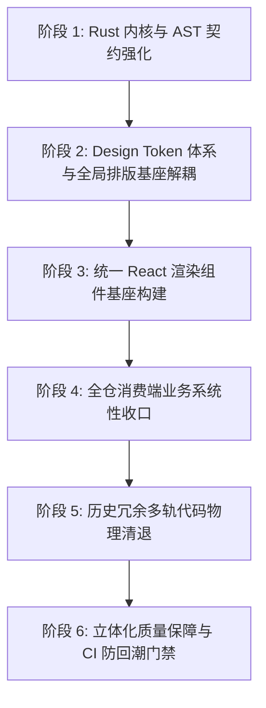

# Conex / Crish — Markdown 统一渲染与排版架构实现总方案

> **战役工作区**：`docs/markdown-unified-architecture/`  
> **文档定位**：战役根目录方案实现总文档（SSOT 权威总纲）  
> **参谋输入**：综合收敛 `independent-plans/01~06` 六份跨领域专家方案的核心洞察与批判性审查  
> **核心使命**：彻底根除文件管理器等外部预览“排版逼仄、表格崩塌、Emoji 暴露为生文本、无边框无间距”的严重视效缺陷，终结多轨代码割裂与功能伪连通，实现系统净收敛与 GitHub 级现代文档体验。

---

## 一、 现状架构断层诊断与现场取证

通过对 6 份独立专家方案与真实源码的交叉比对，文件管理器与对话流渲染差异巨大且体验恶劣的深层根因已彻底查清：

### 1. 样式彻底真空（Style Blackout）
- [`FilePreview.tsx:218-221`](file:///c:/Software/conex/apps/crish-desktop/src/components/files/FilePreview.tsx#L218-L221) 声明的容器类名是 `${styles.filesMdBody} md-rendered msg-assistant-text`；
- 全局样式中**根本不存在 `msg-assistant-text` 类名**（幽灵类）；
- 所有精心调整的 Markdown 样式被私有封锁在 [`ChatMessageRow.module.css`](file:///c:/Software/conex/apps/crish-desktop/src/components/chat-message-row/ChatMessageRow.module.css) 的 `.assistantText :global(...)` 深度后代选择器中；
- 文件预览容器从未且无法匹配 `.assistantText`，导致文件管理器内的 HTML 节点**处于完全裸奔状态**，以浏览器出厂 User-Agent 样式排版，无 padding、无 border、无单元格间距，必然崩塌为一团生文本。

### 2. 底层数据静默丢失雷区（Silent Truncation Trap）
- Rust 引擎入口 [`crates/conex-markdown/src/lib.rs`](file:///c:/Software/conex/crates/conex-markdown/src/lib.rs) 硬编码了 `MAX_MARKDOWN_INPUT = 100_000`（100KB）；
- 但前端文件管理器在 `content.length <= 256 * 1024`（256KB）内均送入渲染；
- **后果**：100KB ~ 256KB 的 Markdown 文件在进入 Rust 引擎时后半截被静默丢弃，若截断点恰巧位于表格、代码块或列表中间，导致 HTML 标签闭合失效，造成毁灭性全屏渲染瘫痪。

### 3. CJK 断字硬编码破坏表格网格（CJK Word-Break Distortion）
- Rust 引擎内部硬编码了 `split_long_cjk_runs`，每 10 个中文字符强行插入一个 `<wbr>` 标签；
- 在表格单元格中，`<wbr>` 导致 Blink/WebKit 的表格自动列宽计算发生畸变，表头与内容单元格发生断裂和横向列宽抽搐。必须切除，交由现代 CSS 国际化属性接管。

### 4. 表格物理边框与吸顶表头的物理 Bug
- **W3C 规范冲突**：原生 `table` 上同时应用 `border-collapse: collapse` 与 `border-radius` 时，外层圆角会被子单元格直角直接裁切穿透；
- **Sticky 表头脱落**：Blink 渲染引擎在处理 `position: sticky` 表头单元格时，滚动时 `border-bottom` 会发生物理脱落；必须使用 `box-shadow: inset 0 -1px 0 ...` 替代。

### 5. 功能伪连通与主线程性能自残（Pseudo-Connectivity & Self-Harm）
- **代码复制伪连通**：`useChatMessageState.ts` 仅调用异步剪贴板 API，从未向按钮注入 `.is-copied` 类名，也从未更新文案；文件管理器中更无任何点击事件监听，按钮点击毫无反应；
- **路径跳转伪连通**：`.md-path-link` 未剥离 `:line:col` 或 `#L10`，直接传入路径解析函数导致因非法字符被拒绝；
- **主线程自残**：`codeBlockIndent.ts` 的 `rematerializeMarkdownHtml` 在主线程执行“String → DOM TreeWalker 遍历 GCD 算缩进 → String → React innerHTML”三次解析循环，严重消耗帧率。

---

## 二、 总体架构演进蓝图（单一真理源 SSOT）

```
                     Markdown 源文本 (.md / Chat Payload)
                                      │
                                      ▼
             ┌──────────────────────────────────────────────────┐
             │      Rust 权威编译内核 (crates/conex-markdown)     │
             │  1. 扩容输入上限至 5MB，切除硬编码截断雷区         │
             │  2. GFM Emoji 原生短代码词法转义 (:x: -> ❌)     │
             │  3. 表格齐次化补齐 (短行短单元格补 <td>)          │
             │  4. 切除 <wbr> 硬编码，恢复标准 <hr> 语义        │
             │  5. 纯净 HTML 结构 (md-table-wrap, md-h1~h4)     │
             └────────────────────────┬─────────────────────────┘
                                      │  Tauri IPC (core_md_render)
                                      ▼
             ┌──────────────────────────────────────────────────┐
             │    React 统一渲染基座 (<MarkdownDocumentView>)    │
             │  1. 统一替代全仓 dangerouslySetInnerHTML 碎片    │
             │  2. 前置 >256KB 大文件硬熔断，转入极速虚拟化查看器  │
             │  3. 容器级事件总线 (复制/路径拆解跳转/外链沙箱)     │
             │  4. CSS 原生 tab-size 替代主线程 DOM 缩进重写    │
             └────────────────────────┬─────────────────────────┘
                                      │
                                      ▼
             ┌──────────────────────────────────────────────────┐
             │    Design Tokens & 全局排版引擎 (.conex-markdown)│
             │  1. tokens.css 全量覆盖 Markdown 语义化变量       │
             │  2. 100% 杜绝裸 Hex，现代 color-mix / hsl 混色   │
             │  3. 双模态变体引擎:                               │
             │     - [data-md-variant="document"]: GitHub/Typora│
             │     - [data-md-variant="chat"]: 对话气泡紧凑流   │
             └──────────────────────────────────────────────────┘
```

---

## 三、 纯逻辑执行顺序方案（Logical Dependency Topology）

本方案严格依据软件工程有向无环依赖（DAG）编排，**所有问题在逻辑上同权**，不包含工期、人天与优先级划分。



---

### 阶段一：Rust 内核与 AST 契约强化（Kernel & AST Protocol）
> **前置依赖**：无。作为整条渲染流水线的物理输入源头。

#### 1.1 消除截断雷区与硬编码逻辑切除
- **输入扩容**：修改 `crates/conex-markdown/src/lib.rs`，将 `MAX_MARKDOWN_INPUT` 从 100KB 提升至 5MB，超出时安全返回截断标记而非直接静默截断破坏末尾标签；
- **切除 CJK 硬断字**：彻底删除 `split_long_cjk_runs` 及在 CJK 文本中每 10 字插入 `<wbr>` 的逻辑；
- **恢复 `<hr>` 语义**：废除剥离分割线的粗暴逻辑，允许 CommonMark 标准 Thematic Break 正常输出 `<hr class="md-hr" />`。

#### 1.2 GFM Emoji 原生短代码词法转义
- 在 `Renderer::handle_text` 流式消费阶段构建基于编译期常量跳转表的无分配 $O(N)$ 扫描器；
- **严格词法隔离**：处于代码围栏（`in_code_block`）、行内代码（`in_inline_code`）、HTML 属性内部时，绝对禁止短代码匹配；
- 完整映射工程高频集合：`:white_check_mark:` $\to$ `✅`、`:x:` $\to$ `❌`、`:warning:` $\to$ `⚠️`、`:bulb:` $\to$ `💡`、`:memo:` $\to$ `📝`、`:rocket:` $\to$ `🚀` 等。

#### 1.3 表格网格齐次化与 AST 规范
- 统一以表头列数 $C$ 为基准，遇数据单元格不足的短行（Ragged Rows）自动补充 `<td class="md-td"></td>`，杜绝网格畸变；
- Header-only 表格强制输出标准空体 `<tbody></tbody>`；
- 外壳统一定界：`<div class="md-table-wrap" role="region" aria-label="表格"><table class="md-table">...</table></div>`。

---

### 阶段二：Design Token 体系与全局排版基座解耦（Typography Engine）
> **前置依赖**：依赖阶段一固化的 HTML 标签与 Class 命名契约。

#### 2.1 补全 Markdown 专属 Design Tokens
在 `apps/crish-desktop/src/styles/tokens.css` 中完整声明亮暗双模态变量：
- **排版字阶**：`--md-font-family`, `--md-line-height-body: 1.68`, `--md-paragraph-margin-bottom: 1em`；
- **标题体系**：`--md-h1-size: 1.85em`, `--md-h1-border: 1px solid var(--border-subtle)`, `--md-h2-size: 1.45em`, `--md-h2-border: 1px solid var(--border-subtle)`；
- **表格系统**：`--md-table-border: var(--border-color)`, `--md-table-header-bg: color-mix(in srgb, var(--text-primary) 3.5%, var(--bg-card))`, `--md-table-row-alt-bg`, `--md-table-cell-padding: 8px 14px`, `--md-table-radius: var(--radius-lg, 8px)`；
- **列表与引用**：`--md-list-padding-left: 1.6em`, `--md-quote-border: 3px solid var(--border-color)`；
- **铁律**：100% 杜绝裸色值，全量采用 `tokens.css` 既有变量与现代 CSS `color-mix` / `hsl` 语法。

#### 2.2 抽离构建全局排版基座 `src/styles/markdown-typography.css`
- 彻底从 `ChatMessageRow.module.css` 抽离局部锁死的 `.assistantText :global(...)` 规则；
- 统一收拢至顶级命名空间 `.conex-markdown` / `.md-rendered`；
- **表格核心渲染解耦**：
  ```css
  .md-rendered .md-table-wrap {
    width: 100%;
    margin: 0.8em 0;
    overflow-x: auto;
    overscroll-behavior-x: contain;
    border: 1px solid var(--md-table-border);
    border-radius: var(--md-table-radius);
    background: var(--bg-card);
    box-sizing: border-box;
  }
  .md-rendered .md-table {
    width: 100%;
    min-width: 100%;
    border-collapse: collapse;
    border: none;
    font-size: var(--font-size-sm, 13px);
    line-height: var(--md-line-height-body);
  }
  .md-rendered .md-th {
    position: sticky;
    top: 0;
    z-index: 2;
    background-color: var(--md-table-header-bg);
    font-weight: 600;
    text-align: left;
    padding: var(--md-table-cell-padding);
    border-bottom: 1px solid var(--md-table-border);
    box-shadow: inset 0 -1px 0 var(--md-table-border); /* 杜绝 Blink 吸顶脱落 */
  }
  .md-rendered .md-td {
    padding: var(--md-table-cell-padding);
    border-bottom: 1px solid var(--border-subtle);
  }
  .md-rendered .md-tr:last-child .md-td {
    border-bottom: none;
  }
  .md-rendered .md-tr-alt,
  .md-rendered .md-table tbody tr:nth-child(even) {
    background-color: var(--md-table-row-alt-bg);
  }
  ```

#### 2.3 双模态排版变体架构
- **Document 模式 (`[data-md-variant="document"]`)**：长文档排版，大行高 1.68，H1/H2 拥有标准底部分割线，充裕段距与列表缩进；
- **Chat 模式 (`[data-md-variant="chat"]`)**：对话气泡排版，紧凑行距 1.60，消除最后一个段落的底部 Margin。

---

### 阶段三：统一 React 渲染组件基座构建（Component Architecture）
> **前置依赖**：依赖阶段二的全局排版样式基座。

#### 3.1 研发单一真理源组件 `MarkdownDocumentView`
- 落位：`apps/crish-desktop/src/components/ui/MarkdownDocumentView.tsx`并在 `ui/index.ts` 导出；
- **前置大文件硬熔断**：当 `content.length > 256KB` 时，**严格拦截 IPC 调用**，向 Rust 传入空串，直接原地挂载 `VirtualPlainCodeViewer`，消除无效编译与内存风暴；
- **CSS 原生 tab-size 替代**：彻底移除 `rematerializeMarkdownHtml`，利用 CSS 变量 `--md-code-tab-size` 配合 `tab-size` 原生实现代码缩进，0 毫秒运行时开销；
- **三级容灾保证零白屏**：Rust IPC 编译 $\to$ Worker Pool 降级 $\to$ `<pre class="md-text-fallback">` 原位垫片，Zero-CLS = 0.000。

#### 3.2 容器级事件委托中枢（消除功能伪连通）
- 在 `MarkdownDocumentView` 容器上统一部署事件代理，捕获子节点事件：
  - **代码复制**：捕获 `.md-code-copy` 点击，写入剪贴板并即时切换 `.is-copied` 类名与“已复制”对勾文案，1500ms 自动平滑复位；
  - **路径跳转拆解**：捕获 `.md-path-link`，解析出文件路径与目标行列号（支持 `path:line:col` 与 `path#L10-L20`），联动调用工作区面板；
  - **安全外链沙箱**：拦截 `<a class="md-a">`，调用 `@tauri-apps/plugin-opener` 移交系统默认浏览器安全打开，阻断 WebView2 内部跳转。

---

### 阶段四：全仓消费端业务系统性收口（Consumer Integration）
> **前置依赖**：依赖阶段三交付的统一渲染组件与事件中枢。

#### 4.1 文件管理器全面收口 (`FilePreview.tsx`)
- 物理拔除 `FilePreview.tsx` 内部手写的 `useAsyncMarkdownHtml` + `rematerializeMarkdownHtml` + `dangerouslySetInnerHTML` 碎片逻辑；
- 移除散落的行内 `256 * 1024` 大文件判断分支；
- 统一声明：
  ```tsx
  <MarkdownDocumentView
    content={displayContent || '（空文件）'}
    filePath={selected || ''}
    variant="document"
    onOpenPath={onOpenFile}
  />
  ```

#### 4.2 技能详情预览收口 (`SkillDetailPreview.tsx`)
- 彻底移除 `useSkillEditor.ts` 与组件内部在主线程同步调用 `parseMarkdownToHtml` 的卡顿代码；
- 统一挂载 `<MarkdownDocumentView content={skillContent} variant="document" />`。

#### 4.3 产物轻阅读面收口 (`ArtifactNotebookSurface.tsx`)
- 剥离不恰当的流式状态机，改由统一文档视图接管静态阅读面。

---

### 阶段五：历史冗余多轨代码物理清退（Dead Code Elimination）
> **前置依赖**：依赖阶段四全仓消费端收敛完毕，确保零业务依赖遗留。

#### 5.1 物理删除已退役的冗余解析与孤岛组件
- 物理清退 `apps/crish-desktop/src/components/chat-message-row/StreamingTableContainer.tsx`（未被消费的死代码）；
- 清除 `ChatMessageRow.module.css` 中冗余的 150+ 行私有 `.assistantText :global(.md-*)` 规则；
- 将 `markdownPlugins.ts`、`markdownTable.ts` 中手写的正则多轨解析收敛退役；
- 彻底拔除全仓所有 `msg-assistant-text` 幽灵类名。

---

### 阶段六：立体化质量保障与 CI 防回潮门禁（Verification & Gates）
> **前置依赖**：贯穿阶段一至五的最终产物，执行闭环验证。

#### 6.1 双端结构语义 100% 对齐自动化测试
- 扩展 `apps/crish-desktop/src/api/markdownRender.parity.test.ts`：
  - 断言 GFM 表格生成标准的 `md-table-wrap`、`md-table`、`md-th`、`md-td`、`md-tr-alt` 结构；
  - 断言 `:white_check_mark:` 与 `:x:` 在双端均正确输出 `✅` 与 `❌`；
  - 断言代码块与行内代码内部的短代码不发生转义。

#### 6.2 静态 Design Token 守门脚本
- 新建 `scripts/check-markdown-style-compliance.mjs`，接入 `npm run check:desktop`：
  - 检查 Markdown 样式表中裸色值（裸 Hex / 裸 RGB）命中数为 0；
  - 检查所有引用的 `--md-*` 变量 100% 在 `tokens.css` 中声明。

#### 6.3 真实环境现场视觉对齐验收
- 以 `c:/Software/conex/SECURITY.md` 真实文件为基准载体：
  - 验证标题具备清晰底边分割与呼吸留白；
  - 验证表格呈现为圆角边框、表头底色、单元格 Padding 规范、两列彻底解开粘连；
  - 验证列表项圆点缩进自然、无贴边；
  - 验证表格内呈现绿对勾与红叉 Emoji；
  - 验证代码块一键复制按钮悬停可见、点击反馈“已复制”、1.5s 后复位。

---

## 四、 产出文档索引与工件清单

本战役所有专家详案均已在 `docs/markdown-unified-architecture/independent-plans/` 严格按规范留痕：

| 编号 | 文档路径 | 专家领域 | 核心贡献与被吸收亮点 |
| :--- | :--- | :--- | :--- |
| **01** | [`independent-plans/01-kernel-and-ast-plan.md`](file:///c:/Software/conex/docs/markdown-unified-architecture/independent-plans/01-kernel-and-ast-plan.md) | 内核与 AST 契约 | GFM Emoji 常量跳转表、表格短行齐次化补齐、输入上限扩容至 5MB |
| **02** | [`independent-plans/02-token-and-typography-plan.md`](file:///c:/Software/conex/docs/markdown-unified-architecture/independent-plans/02-token-and-typography-plan.md) | 令牌与排版体系 | 亮暗双模态 `--md-*` 变量体系、`.md-rendered` 全局解耦、Document/Chat 双模态变体 |
| **03** | [`independent-plans/03-unified-component-architecture-plan.md`](file:///c:/Software/conex/docs/markdown-unified-architecture/independent-plans/03-unified-component-architecture-plan.md) | 统一组件架构 | `MarkdownDocumentView` 单一真理源设计、>256KB 大文件硬熔断、全仓 4 处消费端收拢图谱 |
| **04** | [`independent-plans/04-table-and-interaction-plan.md`](file:///c:/Software/conex/docs/markdown-unified-architecture/independent-plans/04-table-and-interaction-plan.md) | 表格与交互总线 | 穿透 `border-collapse` 冲突、Sticky 表头 `box-shadow` 补丁、代码复制状态机与路径跳转拆解 |
| **05** | [`independent-plans/05-verification-and-gates-plan.md`](file:///c:/Software/conex/docs/markdown-unified-architecture/independent-plans/05-verification-and-gates-plan.md) | 立体验证与门禁 | 双端 Parity 黄金测试集、WCAG 对比度静态门禁脚本、快中慢三层 CI 防回潮策略 |
| **06** | [`independent-plans/06-challenger-fullstack-plan.md`](file:///c:/Software/conex/docs/markdown-unified-architecture/independent-plans/06-challenger-fullstack-plan.md) | 全栈批判与净收敛 | 揭露 100KB 静默截断与 CJK `<wbr>` 表格列宽破坏、清退 1,260+ 行多轨冗余负债代码 |
