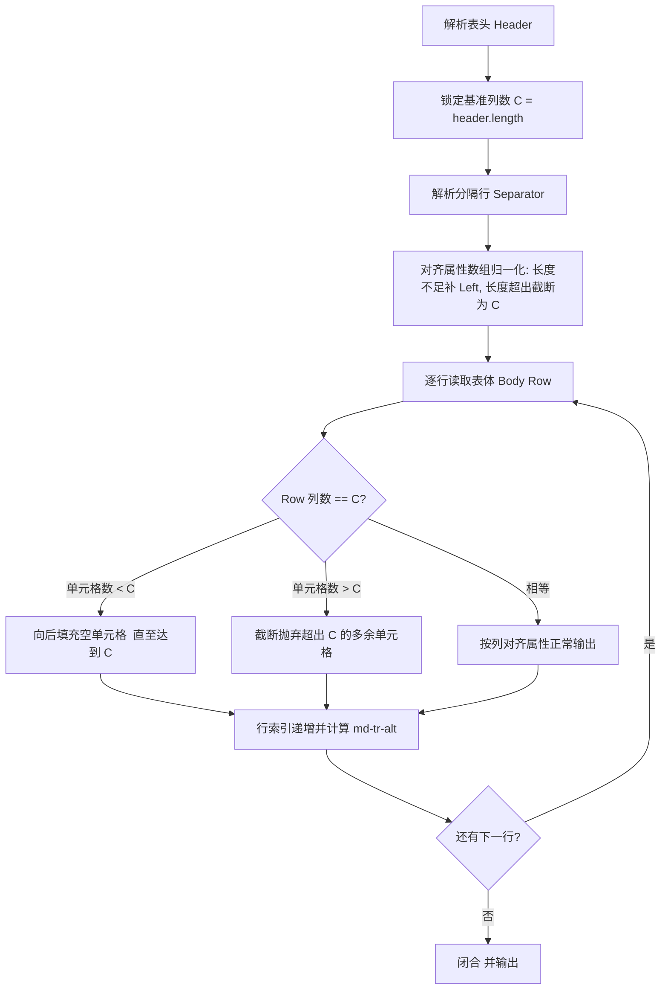
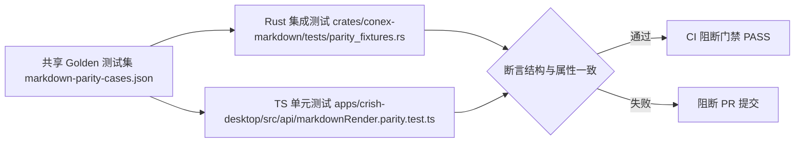

# Conex/Crish Markdown 底层内核与 AST 契约架构方案

> **文件路径**：`docs/markdown-unified-architecture/independent-plans/01-kernel-and-ast-plan.md`  
> **所属战役**：Markdown 统一渲染架构战役（`markdown-unified-architecture`）  
> **定位**：底层内核解析、AST 契约、双端语义对齐与渲染输出 SSOT 架构总案  
> **架构准则**：依据真实源码独立审视，零退避、零多轨、零硬编码、严禁补丁与功能伪连通；仅包含纯逻辑依赖与执行顺序，所有问题逻辑同权。

---

## 一、架构背景与真实源码缺陷诊断

### 1.1 现场表象与用户痛点
用户反馈在 Conex/Crish 桌面应用中，文件管理器预览（`FilePreview`）与对话流（`ChatMessageRow` / `MarkdownBlockItem`）两处对同一份 Markdown 文本渲染呈现出截然不同的视觉与解析表现，且质量脆弱：
1. **表格结构崩塌与边框丢失**：在文件预览中，表格无外层滚动包裹、无外边框、无单元格底边、无表头高亮背景，退化为浏览器默认无样式排版；在对话流中，复杂表格缺乏统一列宽约束与边框封装，出现文字折行崩坏与横向溢出截断。
2. **GFM 扩展短代码暴露为生文本**：工程文档与 Agent 状态输出中极其高频的 `:white_check_mark:`、`:x:`、`:warning:`、`:rocket:` 等 GitHub Flavored Markdown (GFM) 扩展 Emoji 短代码，双端均未实现解析转义，直接裸露为破损生文本。
3. **多轨解析逻辑与 AST 契约漂移**：Rust 编译内核（`conex-markdown`）与前端 TypeScript 回退解析器（`markdownPlugins.ts` 等）在表格单元格富文本处理、任务列表无障碍属性（`aria-checked`）、表体列数补齐等方面存在隐性分叉。

---

### 1.2 穿透源码的四大根本原因诊断

#### 根因 1：CSS 样式资产隔离错位与孤岛效应
审视前端代码可以发现关键断层：
- 表格的完整样式定义（`--md-table-border`、`--md-table-bg`、`--md-table-header-bg`、斑马纹、圆角、内边距等）全部被锁死在：
  `apps/crish-desktop/src/components/chat-message-row/StreamingTableContainer.module.css`
  其选择器全部被严格限定在 `.tableScrollViewport :global(.md-table)` 之下。
- 然而，`StreamingTableContainer` 仅在单元测试 `StreamingTable.test.tsx` 中被引用，在实际的 `MarkdownBlockItem.tsx` 和 `FilePreview.tsx` 中**完全未被引入和使用**！
- 在 `ChatMessageRow.module.css` 中，仅有一条微弱的规则：
  ```css
  .assistantText :global(.md-table-wrap) {
    margin: 0.35em 0;
    overflow-x: auto;
    max-width: 100%;
  }
  ```
- 在 `FilesCard.module.css` 中，`.filesMdBody` 则**没有任何关于 `.md-table-wrap` 或 `.md-table` 的规则**。
- **后果**：无论 Rust 内核生成多么规范的 `<div class="md-table-wrap"><table class="md-table">` 结构，只要没有被专属容器包裹，在对话区与文件预览区均无法匹配到任何表格边框、背景与单元格内边距样式，从而发生彻底崩塌。

#### 根因 2：TS 端表格单元格富文本内联处理的多轨缩水
查看 `apps/crish-desktop/src/api/markdown-render/markdownTable.ts:97-127`：
```typescript
function formatMarkdownTextSegment(text: string): string {
  // 仅替换 `code`、**bold**、*italic*、CJK wbr
  // 严重缺失：链接 [text](url)、裸路径 button、图片 、删除线 ~~del~~、Emoji 短代码！
}
```
- TS 回退解析器为了避免死循环，在 `markdownTable.ts` 中私自复制并内联了一个裁剪版的 `formatMarkdownTextSegment`，与全局 `markdownInlineFormat.ts` 产生逻辑多轨。
- 当表格单元格中包含 `[link](https://...)`、`apps/core/main.rs` 或 `~~strikethrough~~` 时，TS 解析器直接将其当成普通文本，而 Rust 内核基于 `pulldown-cmark` 会正常解析为 `<a>`、`<button class="md-path-link">`、`<del>`。两端 AST 输出产生严重的语义断裂。

#### 根因 3：表格行宽补齐（Ragged Rows）的双端行为不一致
- 在 TS 端 `markdownTable.ts:162-164`：
  ```typescript
  const cells = [...row];
  while (cells.length < colCount) cells.push('');
  ```
  TS 解析器会在行单元格少于表头时自动补全空单元格 `""`。
- 在 Rust 端 `renderer.rs`：
  `pulldown-cmark` 的 `Event::TableCell` 仅按实际源文本中的管道符触发，并不对单元格不足的行进行向后补全。如果某一行仅有 2 列而表头有 4 列，Rust 渲染出带有 2 个 `<td>` 的 `<tr>`，导致 HTML 表格在现代浏览器网格布局下发生变形坍塌。

#### 根因 4：GFM Emoji 短代码在编译链路中的完全缺失
- 无论是 Rust 内核的 `Renderer` 还是前端的 `markdownInlineFormat.ts`，均未挂载任何 Emoji 短代码匹配机制。
- 业界通常的误区是使用全局庞大正规表达式做无节制扫描或引入巨大的动态字典，造成首屏解析卡顿；或者打补丁式地仅替换特定几个字符串，破坏了语言级编译器的严谨性。

---

## 二、架构核心设计目标

1. **统一契约真相源（AST Contract SSOT）**：
   严格规范所有 Markdown 衍生 DOM 结构的标准类名命名空间（`md-*`）、属性集合（`role`、`aria-*`、`scope`、`data-*`）以及层级骨架。
2. **零运行时开销短代码编译器（Zero-Cost GFM Emoji Transpiler）**：
   在 Rust 与 TS 双端行内文本解析层，设计时间复杂度严格为 $O(N)$ 的单趟线性扫描机制，配合编译期完美跳转与常量冻结哈希表，实现零冗余堆分配、零运行时预热开销。
3. **表格健壮性与物理自愈架构（Self-Healing Table Pipeline）**：
   双端统一表格规整化算法（表头锁定、列宽补齐、对齐属性映射、斑马纹奇偶律），并将容器级边框、横向滚动与阴影规范内聚于 `.md-table-wrap` 契约，彻底解耦对外部特定 React 容器组件的脆弱依赖。
4. **双端 Byte-for-Byte 语义对称与验证门禁（Dual-Engine Structural Parity）**：
   消灭双端历史遗留的「故意差异」借口（除代码围栏内高亮引擎本身的词法 Token Span 外），实现表格、列表、任务项、标题、内联格式的 100% 结构级对齐，并通过跨语言双向 Golden 测试刚性守护。

---

## 三、GFM Emoji 原生短代码转义机制架构

### 3.1 词法作用域与转义边界定义
Emoji 短代码的基本文法为：
$$\text{Shortcode} := \text{':'} \parallel [a\text{-}z0\text{-}9\_\+\-]^{1,32} \parallel \text{':'}$$

#### 编译安全与隔离铁律：
1. **代码围栏隔离（Code Block Invariant）**：
   `md-code-block` 内部（无论是普通 pre 还是高亮 span）绝对禁止转义短代码，保持源码字符绝对纯净。
2. **行内代码隔离（Inline Code Invariant）**：
   `<code class="md-inline-code">` 内部绝对禁止转义短代码，例如 `` `:white_check_mark:` `` 必须原样输出为 `:white_check_mark:`。
3. **URL 与属性安全隔离（Attribute Sanitization Invariant）**：
   HTML 标签属性（如 `<a href="...">`、``、`<button data-path="...">`）内部绝对不得触发 Emoji 替换。
4. **纯文本与富文本内联上下文穿透**：
   Emoji 短代码允许且必须在以下上下文中完整生效：
   - 段落正文（`<p class="md-p">`）
   - 标题正文（`<h1 class="md-h1">` ~ `<h4 class="md-h4">`）
   - 列表项与任务项正文（`<li class="md-li">`）
   - 表头与表格单元格（`<th class="md-th">`、`<td class="md-td">`）
   - 块引用正文（`<blockquote class="md-quote">`）
   - 链接可读文本（`<a class="md-a">` 的 innerText）

---

### 3.2 Rust 内核实现：O(N) 单趟线性无分配扫描器

#### 架构选型分析：
- **方案 A（退避弃用）**：全局 Regex 正则替换。Rust `regex` 引擎在处理复杂长文本多模式匹配时会产生多余的分组捕获开销，且无法零成本与代码块保护机制融合。
- **方案 B（推荐采纳）**：在 `Renderer::handle_text` 的文本流消费节点，构建**单指针线性状态扫描器（Streaming Byte Scanner）**。结合 Rust 模式匹配（`match &str`），由 LLVM 自动在编译期生成分支跳转表（Branch / Jump Table）或完美前缀状态机，单次查找理论耗时 $O(1)$，整段文本扫描耗时严格 $O(N)$，且在无短代码命中时零二次堆内存分配。

#### 逻辑实现规约（Rust）：
```rust
/// GFM Emoji 短代码核心字典映射（编译期常量跳转表）
#[inline(always)]
pub fn lookup_gfm_emoji(name: &str) -> Option<&'static str> {
    match name {
        // 状态与检查（工程高频）
        "white_check_mark" => Some("✅"),
        "heavy_check_mark" => Some("✔️"),
        "check" => Some("✓"),
        "x" => Some("❌"),
        "negative_squared_cross_mark" => Some("❎"),
        "ballot_box_with_check" => Some("☑️"),
        "warning" => Some("⚠️"),
        "rotating_light" => Some("🚨"),
        "stop_sign" => Some("🛑"),
        "exclamation" => Some("❗"),
        "question" => Some("❓"),
        "bulb" => Some("💡"),
        "bug" => Some("🐛"),
        "wrench" => Some("🔧"),
        "gear" => Some("⚙️"),
        "package" => Some("📦"),
        "rocket" => Some("🚀"),
        "tada" => Some("🎉"),
        "sparkles" => Some("✨"),
        "fire" => Some("🔥"),
        "zap" => Some("⚡"),
        "memo" | "pencil" => Some("📝"),
        "pencil2" => Some("✏️"),
        "bookmark" => Some("🔖"),
        "link" => Some("🔗"),
        "lock" => Some("🔒"),
        "unlock" => Some("🔓"),
        "info" => Some("ℹ️"),

        // 反馈与评审
        "+1" | "thumbsup" => Some("👍"),
        "-1" | "thumbsdown" => Some("👎"),
        "heart" => Some("❤️"),
        "star" => Some("⭐"),
        "star2" => Some("🌟"),
        "100" => Some("💯"),
        "eyes" => Some("👀"),
        "speech_balloon" => Some("💬"),

        // 状态圆圈指示器
        "white_circle" => Some("⚪"),
        "black_circle" => Some("⚫"),
        "red_circle" => Some("🔴"),
        "blue_circle" | "large_blue_circle" => Some("🔵"),
        "green_circle" => Some("🟢"),
        "yellow_circle" => Some("🟡"),

        // 箭头与方向
        "arrow_right" => Some("➡️"),
        "arrow_left" => Some("⬅️"),
        "arrow_up" => Some("⬆️"),
        "arrow_down" => Some("⬇️"),
        "soon" => Some("🔜"),
        "top" => Some("🔝"),

        // 设备与环境
        "computer" => Some("💻"),
        "hourglass" => Some("⌛"),
        "hourglass_flowing_sand" => Some("⏳"),
        "apple" => Some("🍎"),
        "penguin" => Some("🐧"),

        _ => None,
    }
}

/// 将文本中的 GFM Emoji 短代码转义为 Unicode 字符。
/// 保证 O(N) 复杂度，无短代码时零内存拷贝。
pub fn translate_gfm_emoji(text: &str) -> String {
    // 快速启发式路径：如果不含冒号，直接借用
    if !text.contains(':') {
        return text.to_string();
    }

    let mut out = String::with_capacity(text.len());
    let mut last_idx = 0;
    let bytes = text.as_bytes();
    let len = bytes.len();
    let mut i = 0;

    while i < len {
        if bytes[i] == b':' {
            let start = i;
            let mut j = i + 1;
            let mut valid = false;
            // 短代码最大限制 32 字节，只允许小写英文字母、数字、下划线、加号、减号
            while j < len && (j - start) <= 33 {
                let b = bytes[j];
                if b == b':' {
                    if j > start + 1 {
                        valid = true;
                    }
                    break;
                }
                if !(b.is_ascii_lowercase() || b.is_ascii_digit() || b == b'_' || b == b'+' || b == b'-') {
                    break;
                }
                j += 1;
            }

            if valid && j < len && bytes[j] == b':' {
                let key = &text[start + 1..j];
                if let Some(emoji) = lookup_gfm_emoji(key) {
                    out.push_str(&text[last_idx..start]);
                    out.push_str(emoji);
                    i = j + 1;
                    last_idx = i;
                    continue;
                }
            }
        }
        i += 1;
    }

    if last_idx < len {
        out.push_str(&text[last_idx..]);
    }
    out
}
```

#### 在 Rust 编译流程中的切入点：
在 `crates/conex-markdown/src/renderer.rs` 中：
```rust
fn handle_text(&mut self, text: &str) {
    if let Some(fence) = &mut self.fence {
        fence.buffer.push_str(text);
        return;
    }
    if self.image_safe_url.is_some() || self.image_unsafe {
        self.image_alt.push_str(text);
        return;
    }

    // 步骤 1: 进行 Emoji 短代码转义（只作用于非代码文本流）
    let emoji_translated = translate_gfm_emoji(text);

    // 步骤 2: 进行裸路径自动识别与 HTML 转义 + CJK wbr 智能断字
    let html = wrap_bare_paths_and_escape(&emoji_translated);
    self.output.push_str(&html);
}
```
通过在 `handle_text` 首步触发，保证了：
1. 代码块（`fence`）内直接 `buffer.push_str`，绝对不走 `translate_gfm_emoji`。
2. 行内代码（`Event::Code`）走 `handle_inline_code`，不走 `translate_gfm_emoji`。
3. 表格单元格、列表、段落、标题内部的文字均作为 `Event::Text` 派发，全部无缝生效。

---

### 3.3 TypeScript 前端实现：V8 原生单趟无分配哈希映射

#### 架构选型分析：
在 JavaScript/TypeScript 端，利用 V8 引擎内部的 C++ 正则优化与编译期哈希表查找：
- 正则表达式：`/:([a-z0-9_+-]{1,32}):/g`
- 查找表：`Object.freeze` 的字典映射对象，查找时间复杂度 $O(1)$。
- 替换逻辑：`str.replace(RE, (full, name) => GFM_EMOJI_MAP[name] ?? full)`。
- **与全局流水线协同**：在 `markdownInlineFormat.ts` 中，必须在行内代码占位符（`%%CODE${i}%%`）保护**之后**、在 HTML 标签之外执行，避免对反引号代码块或标签属性进行破坏。

#### 逻辑实现规约（TypeScript）：
```typescript
/** GFM Emoji 字典单一真相源（与 Rust lookup_gfm_emoji 100% 保持镜像同步） */
export const GFM_EMOJI_MAP: Readonly<Record<string, string>> = Object.freeze({
  'white_check_mark': '✅',
  'heavy_check_mark': '✔️',
  'check': '✓',
  'x': '❌',
  'negative_squared_cross_mark': '❎',
  'ballot_box_with_check': '☑️',
  'warning': '⚠️',
  'rotating_light': '🚨',
  'stop_sign': '🛑',
  'exclamation': '❗',
  'question': '❓',
  'bulb': '💡',
  'bug': '🐛',
  'wrench': '🔧',
  'gear': '⚙️',
  'package': '📦',
  'rocket': '🚀',
  'tada': '🎉',
  'sparkles': '✨',
  'fire': '🔥',
  'zap': '⚡',
  'memo': '📝',
  'pencil': '📝',
  'pencil2': '✏️',
  'bookmark': '🔖',
  'link': '🔗',
  'lock': '🔒',
  'unlock': '🔓',
  'info': 'ℹ️',
  '+1': '👍',
  'thumbsup': '👍',
  '-1': '👎',
  'thumbsdown': '👎',
  'heart': '❤️',
  'star': '⭐',
  'star2': '🌟',
  '100': '💯',
  'eyes': '👀',
  'speech_balloon': '💬',
  'white_circle': '⚪',
  'black_circle': '⚫',
  'red_circle': '🔴',
  'blue_circle': '🔵',
  'large_blue_circle': '🔵',
  'green_circle': '🟢',
  'yellow_circle': '🟡',
  'arrow_right': '➡️',
  'arrow_left': '⬅️',
  'arrow_up': '⬆️',
  'arrow_down': '⬇️',
  'soon': '🔜',
  'top': '🔝',
  'computer': '💻',
  'hourglass': '⌛',
  'hourglass_flowing_sand': '⏳',
  'apple': '🍎',
  'penguin': '🐧',
});

const GFM_EMOJI_RE = /:([a-z0-9_+-]{1,32}):/g;

/** 将文本中的 GFM Emoji 短代码转义为 Unicode 字符 */
export function translateGfmEmoji(text: string): string {
  if (!text || !text.includes(':')) return text;
  return text.replace(GFM_EMOJI_RE, (match, key: string) => GFM_EMOJI_MAP[key] ?? match);
}
```

在 `apps/crish-desktop/src/api/markdown-render/markdownInlineFormat.ts` 中的执行链条：
```typescript
function formatMarkdownTextSegment(text: string): string {
  if (!text) return '';
  const codes: string[] = [];
  // 1. 保护行内代码
  let s = text.replace(/`([^`\n]+)`/g, (_, code: string) => {
    const i = codes.length;
    codes.push(`<code class="md-inline-code">${code}</code>`);
    return `%%CODE${i}%%`;
  });

  // 2. 转换 GFM Emoji 短代码（此时代码区已由 %%CODE%% 保护）
  s = translateGfmEmoji(s);

  // 3. 粗体与斜体
  s = s.replace(/\*\*([^*\n]+)\*\*/g, '<strong>$1</strong>');
  s = s.replace(
    /(?<!\*)\*(?!\s)([^*\n]+?)(?<!\s)\*(?!\*)/g,
    (full, inner: string) => {
      const t = inner.trim();
      if (!t || t.length > 80) return full;
      if (/\s{2,}/.test(inner)) return full;
      return `<em>${inner}</em>`;
    }
  );

  // 4. 还原行内代码
  s = s.replace(/%%CODE(\d+)%%/g, (_, i) => codes[Number(i)] || '');

  // 5. CJK 断字
  return wrapCjkTextSegment(s);
}
```

---

## 四、表格 AST 与 HTML 输出契约的单一真相源（SSOT）

### 4.1 HTML 结构与属性契约规范

表格的完整输出拓扑必须严格符合以下 DOM 结构规范：

```html
<div class="md-table-wrap" role="region" aria-label="表格">
  <table class="md-table">
    <thead>
      <tr class="md-tr">
        <th class="md-th" scope="col">列1</th>
        <th class="md-th" scope="col" style="text-align:center">列2</th>
        <th class="md-th" scope="col" style="text-align:right">列3</th>
      </tr>
    </thead>
    <tbody>
      <tr class="md-tr">
        <td class="md-td">数据1</td>
        <td class="md-td" style="text-align:center">数据2</td>
        <td class="md-td" style="text-align:right">数据3</td>
      </tr>
      <tr class="md-tr md-tr-alt">
        <td class="md-td">数据4</td>
        <td class="md-td" style="text-align:center">数据5</td>
        <td class="md-td" style="text-align:right">数据6</td>
      </tr>
    </tbody>
  </table>
</div>
```

#### 核心契约细节断言：
1. **外层包裹容器（`.md-table-wrap`）**：
   - 必须包含属性：`class="md-table-wrap"`、`role="region"`、`aria-label="表格"`。
   - 样式自包含职责：
     * 必须承担整个表格组件的外边框、圆角背景、横向溢出滚动（`overflow-x: auto`）与 GPU 渲染边界（`contain: paint`）。
     * 不得依赖外部组件是否包裹在特定的 CSS Module 下。
2. **表格根元素（`.md-table`）**：
   - 必须包含属性：`class="md-table"`。
   - 布局规范：`border-collapse: collapse; width: 100%; border-spacing: 0; table-layout: auto;`。
3. **表头区域（`<thead>`）**：
   - 仅包含单一 `<tr class="md-tr">`。
   - 每个表头单元格必须为 `<th class="md-th" scope="col">`。`scope="col"` 为刚性无障碍契约，不可或缺。
   - 对齐属性规约：
     * 左对齐（默认）：**不输出任何 style 属性**（减少冗余 HTML 字节）。
     * 居中对齐：`style="text-align:center"`。
     * 右对齐：`style="text-align:right"`。
     * 严禁将其他非法字符写入 style。
4. **表体区域（`<tbody>`）**：
   - **空表体容忍铁律**：即使 Markdown 中仅有表头而无表体行（例如仅有表头和分隔行），也必须输出 `<tbody></tbody>`。杜绝空表体缺少闭合标签导致的 DOM 水合（Hydration）失步。
   - 行斑马纹（`md-tr-alt`）：
     * 0-based 表体行索引 $R$：
     * 当 $R \pmod 2 = 0$（偶数行）：类名为 `md-tr`。
     * 当 $R \pmod 2 = 1$（奇数行）：类名为 `md-tr md-tr-alt`。
   - 单元格（`<td>`）：
     * 每个单元格必须为 `<td class="md-td">`。
     * 对齐方式必须与当前列索引对应的表头对齐属性绝对一致。

---

### 4.2 表格行列规整化与自愈算法（Ragged Rows Normalization）

为了杜绝「单元格缺失导致表格左右坍塌」与「多余管道符导致列对齐错位」，在 Rust 与 TS 双端建立统一的表格行规整状态机：



#### Rust 侧对齐改造（`crates/conex-markdown/src/renderer.rs` & `table.rs`）：
目前 Rust 内核通过 `pulldown-cmark` 监听事件流。为了确保单元格不足时不发生断裂：
1. 在 `start_table` 中记录 `col_count = alignments.len()`。
2. 在 `start_table_row` 中将当前行单元格计数 `cell_index` 归零。
3. 在 `end_table_row` 中，如果当前处于 `!in_thead` 阶段，检查 `cell_index < col_count`：
   若不足，循环补齐缺少的 `<td class="md-td"{align}></td>`，使得每一行最终在 DOM 物理上均为完整的 $C$ 列。
4. 修复目前 `split_table_cells` 与 `normalize_table_separators` 对末尾空单元格的处理。

#### TS 侧去多轨改造（`apps/crish-desktop/src/api/markdown-render/markdownTable.ts`）：
彻底删除 `markdownTable.ts` 内部私有的 `formatMarkdownTextSegment` 和 `applyInline`！
改用从 `markdownPlugins.ts` / `markdownInlineFormat.ts` 导出的全局权威 `applyInline`。
由此使得表格单元格获得对链接、本地路径、Emoji、删除线的完整渲染能力。

---

### 4.3 表格全局 CSS 设计资产规范（消除孤岛）

将原先误置于 `StreamingTableContainer.module.css` 中的全套精细表格设计 Token，迁移并提升至全局主题样式表或核心渲染样式层（如 `tokens.css` 与 `MarkdownTheme.css`）：

```css
/* ==========================================================================
   统一 Markdown 表格契约样式（全局生效：涵盖 Chat、FilePreview、Skills）
   ========================================================================== */

.md-table-wrap {
  margin: var(--space-2, 8px) 0;
  max-width: 100%;
  overflow-x: auto;
  overflow-y: hidden;
  border-radius: var(--md-table-radius, var(--radius-lg, 8px));
  border: var(--md-table-border-width, var(--hairline-width, 1px)) solid var(--md-table-border, var(--border-color));
  background: var(--md-table-bg, var(--bg-secondary));
  box-shadow: var(--shadow-sm, 0 1px 2px 0 rgb(0 0 0 / 0.05));
  contain: paint;
  -webkit-overflow-scrolling: touch;
}

.md-table {
  width: 100%;
  border-collapse: collapse;
  border-spacing: 0;
  text-align: left;
  font-size: var(--md-table-font-size, var(--font-size-sm, 13px));
  line-height: var(--md-table-line-height, 1.55);
  font-variant-numeric: tabular-nums;
}

/* 表头约束 */
.md-table thead th,
.md-th {
  background: var(--md-table-header-bg, var(--bg-secondary));
  font-weight: var(--md-table-header-font-weight, 600);
  color: var(--md-table-header-fg, var(--text-primary));
  padding: var(--md-table-cell-padding, var(--space-2, 8px) var(--space-3, 12px));
  border-bottom: var(--md-table-border-width, var(--hairline-width, 1px)) solid var(--md-table-header-border, var(--border-color));
  white-space: nowrap;
  user-select: text;
}

/* 表体单元格约束 */
.md-table tbody td,
.md-td {
  padding: var(--md-table-cell-padding, var(--space-2, 8px) var(--space-3, 12px));
  border-bottom: var(--md-table-border-width, var(--hairline-width, 1px)) solid var(--md-table-row-border, var(--border-subtle));
  color: var(--text-primary);
  vertical-align: top;
  word-break: break-word;
  transition: background-color var(--transition-fast, 120ms ease);
}

/* 末行去底边（贴合容器外圆角） */
.md-table tbody tr:last-child td,
.md-table tbody tr:last-child .md-td {
  border-bottom: none;
}

/* 斑马纹与悬停反馈 */
.md-table tbody tr.md-tr-alt,
.md-table tbody tr:nth-child(even) {
  background-color: var(--md-table-row-even-bg, color-mix(in srgb, var(--text-primary) 1.5%, transparent));
}

.md-table tbody tr:hover {
  background-color: var(--md-table-row-hover-bg, color-mix(in srgb, var(--text-primary) 3%, var(--bg-card)));
}
```

---

## 五、标题、代码围栏、列表的 HTML 标签及 class 命名空间标准化

所有经解析器产出的 HTML 节点一律遵循 `md-*` 命名空间规范，严禁出现无命名空间的孤立标签或未加前缀的侵入式类名。

### 5.1 标题体系（Headings）
- **标签映射**：
  - `#` (H1) $\rightarrow$ `<h1 class="md-h1">`
  - `##` (H2) $\rightarrow$ `<h2 class="md-h2">`
  - `###` (H3) $\rightarrow$ `<h3 class="md-h3">`
  - `####` (H4) $\rightarrow$ `<h4 class="md-h4">`
  - `#####` (H5) $\rightarrow$ `<h4 class="md-h4">`（严禁输出 `<h5 class="md-h5">`，必须收敛至 H4）
  - `######` (H6) $\rightarrow$ `<h4 class="md-h4">`（严禁输出 `<h6 class="md-h6">`，必须收敛至 H4）
- **契约断言**：
  - 标题内部不得包含 `<p class="md-p">`。
  - 标题内部允许包含行内格式：`<strong>`、`<em>`、`<code class="md-inline-code">`、`<del>`、GFM Emoji 短代码。
  - 标题闭合标签必须严格与开标签成对（如 `</h1>`、`</h4>`）。

---

### 5.2 代码围栏（Fenced Code Blocks）
代码围栏分为**流式过渡态（Plain-text Shell）**与**完成态（Syntect/Highlight.js Shell）**。两种状态在 DOM 结构、外层属性上保持 100% 结构同构，彻底消除从流式到完成态时的视口高度跳跃（Zero-CLS）。

#### 标准 DOM 骨架：
```html
<div class="md-code-block" data-lang="{normalized_lang}">
  <!-- 可选：当代码头包含 file="..." 时输出面包屑 -->
  <span class="md-code-breadcrumb">
    <span class="md-code-breadcrumb-segment">crates</span>
    <span class="md-code-breadcrumb-separator">/</span>
    <span class="md-code-breadcrumb-file">lib.rs</span>
  </span>

  <!-- 语言指示胶囊（无语言时不输出） -->
  <span class="md-code-lang" data-lang="{normalized_lang}" aria-label="{normalized_lang}">
    {normalized_lang}
  </span>

  <!-- 原生复制触发按钮 -->
  <button type="button" class="md-code-copy" title="复制" aria-label="复制代码">复制</button>

  <!-- 核心代码区 -->
  <pre class="md-code-pre hljs"><code class="language-{normalized_lang}">{code_content}</code></pre>
</div>
```

#### 规范细则：
1. **语言别名归一化（Language Normalization）**：
   双端必须使用完全一致的映射表：
   - `c++` $\rightarrow$ `cpp`
   - `c#` / `cs` $\rightarrow$ `csharp`
   - `js` / `jsx` / `mjs` / `cjs` $\rightarrow$ `javascript`
   - `ts` / `tsx` $\rightarrow$ `typescript`
   - `py` $\rightarrow$ `python`
   - `rs` $\rightarrow$ `rust`
   - `sh` / `shell` / `zsh` / `ps1` / `powershell` $\rightarrow$ `bash`
   - `yml` $\rightarrow$ `yaml`
   - `md` / `mdx` $\rightarrow$ `markdown`
2. **尾部换行剥离**：
   代码正文末尾若存在单个 `\n` 必须剔除（`strip_suffix('\n')`），避免 `<pre>` 底部产生多余空行。

---

### 5.3 列表与任务列表体系（Lists & Task Lists）

#### 结构规范：
1. **无序列表**：
   - 顶层列表：`<ul class="md-ul">`
   - 嵌套列表（深度 $\ge 1$）：`<ul class="md-ul md-ul-nested">`
   - 普通列表项：`<li class="md-li">`
2. **有序列表**：
   - 顶层列表：`<ol class="md-ol"[ start="{n}"]>`（仅当起始序号 $n > 1$ 时输出 `start` 属性）
   - 嵌套列表：`<ol class="md-ol md-ol-nested"[ start="{n}"]>`
   - 有序列表项：`<li class="md-li md-ol-item">`
3. **GFM 任务列表（Task Items）**：
   - 未完成项：
     `<li class="md-li md-task-item"><span class="md-task-box" aria-checked="false"></span>{content}</li>`
   - 已完成项：
     `<li class="md-li md-task-item done"><span class="md-task-box checked" aria-checked="true"></span>{content}</li>`
   - **双端无障碍属性必须绝对一致**：
     TS 端必须补齐 `aria-checked="true|false"`，与 Rust 端完全一致。
4. **禁止幽灵段落包裹（No P-in-LI Invariant）**：
   对于紧凑列表，`<li>` 内部直接放置文本及行内元素，绝对禁止用 `<p class="md-p">` 包裹 `<li>` 的首个子段落；对于多段落松散列表，后续段落使用 `<br />` 衔接。杜绝某些浏览器排版引擎由于非法嵌套将 `<li>` 甩出列表容器导致的「幽灵列表」视觉灾难。

---

### 5.4 行内元素规范速查表

| 语法类型 | Markdown 语法 | 标准输出 HTML 契约 | 说明 |
| :--- | :--- | :--- | :--- |
| 行内代码 | `` `code` `` | `<code class="md-inline-code">code</code>` | 内容完全进行 HTML 转义 |
| 粗体 | `**bold**` | `<strong>bold</strong>` | 标签外文本解析 |
| 斜体 | `*italic*` | `<em>italic</em>` | 开口后不得紧随空格，限制 80 字符 |
| 删除线 | `~~del~~` | `<del>del</del>` | GFM 删除线扩展 |
| 超链接 | `[text](url)` | `<a class="md-a" href="{url}" target="_blank" rel="noreferrer">text</a>` | 经过 `isSafeHref` 白名单清洗 |
| 不安全链接 | `[text](javascript:...)` | `<span class="md-a-unsafe">text</span>` | 危险 Scheme 降级为文本 |
| 仓库裸路径 | `src/main.rs` | `<button type="button" class="md-path-link" data-path="{p}" title="{p}">{p}</button>` | 自动识别项目相对与绝对路径 |
| 外部图片 | `` | `` | 仅支持安全图片 Scheme |
| GFM Emoji | `:white_check_mark:` | `✅` | $O(N)$ 零堆开销直接转为 Unicode |

---

## 六、Rust 与 TS 双端 Byte-for-Byte 语义对齐与契约保障逻辑

### 6.1 语义对齐矩阵与历史妥协消绝

在历史代码 `apps/crish-desktop/src/api/fixtures/markdown-parity-cases.ts` 中，曾定义了 `INTENTIONAL_DIFFERENCES`（所谓故意差异）。本方案在此进行架构定夺：

| 历史差异项 | 历史妥协口径 | 本方案架构裁决 | 理由与落地措施 |
| :--- | :--- | :--- | :--- |
| **代码围栏内 Span** | syntect vs highlight.js 词法不同 | **允许存在**（受控豁免） | 属于代码语法高亮引擎天然特性；但围栏外壳、类名、按钮、语言属性必须 100% 同构。 |
| **语言别名映射** | ts vs typescript 各自解析 | **严禁差异**（彻底废除） | 双端对齐映射字典，统一将 `ts` 映射为 `typescript`，两端输出完全相同的 class。 |
| **任务项无障碍属性** | TS 漏掉 `aria-checked` | **严禁差异**（修复补齐） | TS `renderListItemHtml` 必须同步生成 `aria-checked="true|false"`。 |
| **表格单元格内联格式** | TS 不支持单元格链接与路径 | **严禁差异**（彻底废除） | TS `markdownTable.ts` 废除裁剪版函数，接入全局 `applyInline`。 |
| **表格空行补齐** | TS 补空单元格，Rust 产生短行 | **严禁差异**（双端规整） | Rust `renderer.rs` 实现短行自动补齐空 `<td>`。 |
| **GFM Emoji 短代码** | 两端均不支持 | **严禁差异**（双端统一） | 双端引入同一份 SSOT 词典，在同一行内阶段执行。 |

---

### 6.2 跨语言双向 Golden 测试体系

为了长期阻止双端代码在迭代中再次发生行为漂移，建立两层刚性验证防线：



#### 统一用例集（`markdown-parity-cases.json`）：
以 JSON 数据文件作为双端共享的真相源，包含但不限于以下矩阵维度：
1. `table_ragged_rows`：包含表头 3 列、第二行 2 列、第三行 4 列的非齐次表格，断言两端均输出规整的 3 列 `<td>`。
2. `table_with_gfm_emoji_and_links`：在单元格内混合测试 `:white_check_mark:`、`:x:`、`[link](url)`、`apps/foo.ts`，断言两端均输出转义后的 Unicode Emoji 与对应的 `<button class="md-path-link">`。
3. `table_empty_body`：仅有表头和分隔线，断言两端均输出 `<thead>...</thead><tbody></tbody>`。
4. `task_list_accessibility`：包含 checked 与 unchecked 任务项，断言 `md-task-item`、`md-task-box`、`aria-checked` 属性完全相等。
5. `headings_level_clamp`：测试 1 至 6 级标题，断言 5 级和 6 级两端均统一降级至 `md-h4`。
6. `fenced_code_plain_and_file`：包含语言声明和 `file="..."` 面包屑的围栏，断言外壳完全相等。

---

## 七、纯逻辑执行顺序路线图（Logical Execution Sequence）

方案的实施严格遵从数据流依赖与编译器分层结构。所有任务在逻辑上完全同权，仅以**前置依赖完备性**为推进准则：

```mermaid
graph TD
    Step1[第 1 步: GFM Emoji SSOT 字典与双端 O(N) 转换器构建] --> Step2[第 2 步: Rust 内核表格短行补齐与 Emoji 接入]
    Step1 --> Step3[第 3 步: TS 回退解析器去多轨与表格内联能力统一]
    Step2 --> Step4[第 4 步: 全局 CSS 表格与 Markdown 样式资产收敛与去孤岛化]
    Step3 --> Step4
    Step4 --> Step5[第 5 步: FilePreview 与 Chat 视图挂载点样式类对齐]
    Step4 --> Step6[第 6 步: 跨语言双向 Golden 自动化断言矩阵建设与门禁加固]
    Step5 --> Step6
```

### 逻辑任务 1：GFM Emoji SSOT 字典与双端 O(N) 转换器构建
- **逻辑目标**：建立双端完全镜像的短代码映射表与无分配扫描机制。
- **依赖关系**：无前置依赖，作为最底层的词法基础。
- **交付内容**：
  1. Rust 模块：在 `crates/conex-markdown/src/` 中实现 `lookup_gfm_emoji` 与 `translate_gfm_emoji`。
  2. TS 模块：在 `apps/crish-desktop/src/api/markdown-render/markdownInlineFormat.ts` 中实现 `GFM_EMOJI_MAP` 与 `translateGfmEmoji`。

### 逻辑任务 2：Rust 内核表格短行补齐与 Emoji 接入
- **逻辑目标**：升级 `conex-markdown` 的 HTML 渲染器，解决短行崩塌与短代码缺失。
- **依赖关系**：依赖「逻辑任务 1」。
- **交付内容**：
  1. 在 `renderer.rs` 的 `handle_text` 接入 `translate_gfm_emoji`。
  2. 在 `renderer.rs` 的 `TableState` 中引入 `col_count` 跟踪，并在 `end_table_row` 补充短行补全逻辑。
  3. 确保 header-only 表格稳定输出 `<tbody></tbody>`。

### 逻辑任务 3：TS 回退解析器去多轨与表格内联能力统一
- **逻辑目标**：清除 `markdownTable.ts` 中的重复代码与阉割版内联逻辑。
- **依赖关系**：依赖「逻辑任务 1」。
- **交付内容**：
  1. 移除 `markdownTable.ts` 内私有的 `formatMarkdownTextSegment`，改为引入 `markdownInlineFormat.ts` 的权威 `applyInline`。
  2. 在 `markdownListBlocks.ts` 中补齐任务列表项的 `aria-checked="true|false"`。
  3. 在 `markdownPlugins.ts` 中统一语言归一化映射。

### 逻辑任务 4：全局 CSS 表格与 Markdown 样式资产收敛与去孤岛化
- **逻辑目标**：打破 `StreamingTableContainer.module.css` 的局部样式封锁，将表格样式提升为全局基础规范。
- **依赖关系**：依赖「逻辑任务 2」与「逻辑任务 3」输出的 AST 节点。
- **交付内容**：
  1. 提取 `.md-table-wrap`、`.md-table`、`.md-th`、`.md-td`、`.md-tr-alt` 的标准样式规则至全局层（如 `src/styles/markdown.css` 或 `tokens.css`）。
  2. 保证 `.md-table-wrap` 自带边框、圆角、背景和横向平滑滚动条。

### 逻辑任务 5：FilePreview 与 Chat 视图挂载点样式类对齐
- **逻辑目标**：使文件预览区与对话流渲染容器应用完全相同的 Markdown 主题类名。
- **依赖关系**：依赖「逻辑任务 4」。
- **交付内容**：
  1. 在 `FilePreview.tsx` 中确保渲染容器挂载标准的 `.md-rendered` 样式域。
  2. 清理 `FilesCard.module.css` 与 `ChatMessageRow.module.css` 中不必要的特化覆盖，回归标准 SSOT。

### 逻辑任务 6：跨语言双向 Golden 自动化断言矩阵建设与门禁加固
- **逻辑目标**：编写覆盖全部缺陷场景的双端 Parity 自动化测试，形成永久防回归门禁。
- **依赖关系**：依赖「逻辑任务 2」、「逻辑任务 3」、「逻辑任务 5」。
- **交付内容**：
  1. 扩充 `apps/crish-desktop/src/api/fixtures/markdown-parity-cases.ts` 中的用例，纳入非齐次表格、Emoji 短代码、富文本单元格。
  2. 扩充 `crates/conex-markdown/tests/parity_fixtures.rs`，对应执行相同用例，断言结构完全对齐。
  3. 运行 `cargo test -p conex-markdown` 与 `npm run test`（Vitest），确保 CI 门禁全绿。

---

## 八、架构收益断言（Architectural Assertions）

1. **视觉绝对一致性（Visual Parity）**：
   无论用户是在文件管理器中打开任意包含 GFM 复杂表格的 `.md` 文件，还是在会话流中由 Agent 输出长表格，均呈现出一致的圆角卡片、高亮表头、交替斑马纹与平滑横向滚动体验，不再发生任何边框丢失或网格坍塌。
2. **文本语义保真（Semantic Fidelity）**：
   全量常见 GFM Emoji 短代码在进入视图前均由内核以 $O(N)$ 零冗余代价直译为原生 Unicode 符号，彻底终结 `:white_check_mark:`、`:x:` 等破损文本暴露。
3. **架构净收敛（Clean Convergence）**：
   清退 TS 端私有复制的裁剪版文本格式化死代码，双端共享同构的 AST 命名空间（`md-*`）与无障碍属性契约（`aria-checked`、`scope="col"`），消除隐性多轨分叉。
