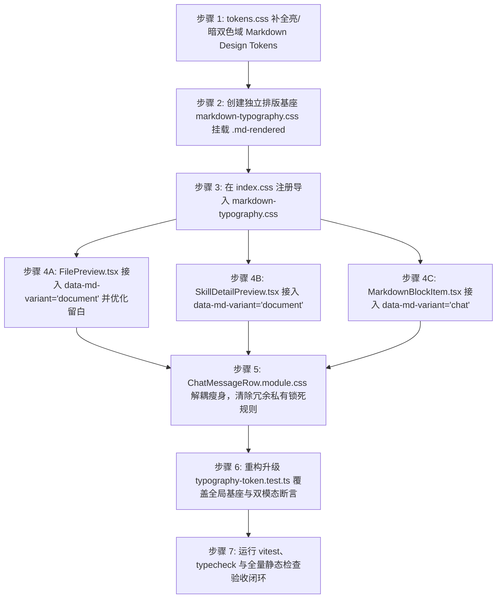

# Markdown 全局排版与 Design Token 体系系统性架构方案

> **文件标识**：`docs/markdown-unified-architecture/independent-plans/02-token-and-typography-plan.md`
> **所属战役**：Markdown 全局统一架构重构（markdown-unified-architecture）
> **方案性质**：独立架构设计方案（排版与 Design Token 体系）
> **设计原则**：严格基于真实源码审视；100% 消费 Design Tokens（零硬编码、现代 CSS `color-mix` 混色）；纯逻辑执行顺序（问题同权）；彻底消除样式孤岛与浏览器出厂样式裸奔。

---

## 一、架构总览与核心背景穿透分析

### 1.1 现状诊断与样式孤岛根因

在当前 Conex/Crish 桌面端架构中，Markdown 内容在多个业务端点被解析并渲染为 HTML：
1. **对话消息流**：`ChatMessageRow` -> `ChatAssistantMessageRow` -> `MessageContent` -> `StreamingMarkdownView` -> `MarkdownBlockItem`；
2. **文件浏览器预览**：`FilesCard` -> `FilePreview`（`.filesMdBody`）；
3. **技能详情预览**：`SkillDetailPreview`（`.skillsPreview`）。

然而，视觉审查与源码实勘暴露出严重的架构断层：**文件预览与技能预览界面排版极度逼仄、字号巨大且挤压、表格无边框无底色、代码块粗糙、行高失控，完全以浏览器默认 User-Agent 出厂样式裸奔！**

穿透表象后的深层架构根因如下：

```
[ 当前断裂架构（局部锁死与样式孤岛） ]

tokens.css (已定义部分 --md-* 变量)
       │
       ▼
ChatMessageRow.module.css
  ┌─────────────────────────────────────────────────────────────┐
  │ .assistantText { ... }                                      │  <-- CSS Module 私有哈希作用域
  │ .assistantText :global(.md-h1) { ... }                      │      例如: .ChatMessageRow_assistantText__x9a1
  │ .assistantText :global(.md-p) { ... }                       │
  │ .assistantText :global(.md-table) { ... }                   │
  │ .assistantText :global(.md-code-block) { ... }              │
  └─────────────────────────────────────────────────────────────┘
       │                                     ╳  完全无法命中
       ▼ (仅命中对话消息)                       │
MarkdownBlockItem.tsx                     FilePreview.tsx
(携带 .assistantText 类名)                 (只有 .filesMdBody .md-rendered)
       │                                     │
   ✅ 精美排版                                💥 样式命中率为 0%，浏览器 UA 裸奔！
```

- **CSS Modules 作用域硬编码锁死**：全部精细的 Markdown 排版规则（H1~H6 阶梯、段间距、行内代码 3.5% 灰度底、引用块发丝边框、代码块面包屑与复制按钮、表格布局等）被**硬编码嵌套在 `.assistantText` 选择器下**（`ChatMessageRow.module.css:344-672`）。
- **样式私有化导致孤岛屏障**：CSS Modules 在编译时将 `.assistantText` 转换为带哈希的私有类名（如 `ChatMessageRow_assistantText__*`）。外部模块（如 `FilePreview.tsx`）即使在 DOM 容器上声明了 `md-rendered` 和 `msg-assistant-text`，由于缺乏该私有父类名，**内部的所有 `:global(.md-*)` 规则完全无法匹配**。
- **预览容器缺少基座样式**：`FilesCard.module.css:202-207` 中对 `.filesMdBody` 的声明仅仅包含基础外壳属性：
  ```css
  .filesMdBody {
    padding: 10px 12px 16px;
    overflow: auto;
    min-height: 0;
    flex: 1;
  }
  ```
  除此之外无任何正文排版控制。结果就是 `<h1>` 采用浏览器默认的 `2em` 巨型衬线/黑体、外边距 `0.67em`；表格无边框、无斑马纹、无表头高亮；代码块无背景；列表紧贴边缘。
- **缺乏模态分型意识**：长文档阅读（文件预览、文档查看器）与对话流气泡（Chat 消息回复）对排版的视觉密度需求截然不同：
  - **Document 模式**：需要从容的行高（1.68~1.72）、舒适的段落间距、章节标题带优雅的浅色下底边（`border-bottom`）、更清晰的层级感；
  - **Chat 模式**：需要紧凑的垂直节奏（段间距 0.85em）、末尾段落零外边距（消除气泡底部冗余留白）、自适应窄视口防溢出。
  当前代码试图用单一套私有样式覆盖全局，导致长文档无样式、短消息被锁死。

---

### 1.2 目标解耦拓扑体系

本方案确立**三层解耦与双模态驱动**的全局排版基座体系：

```
[ 目标统一架构：三层解耦与双模态驱动 ]

Layer 1: Design Tokens 权威层 (tokens.css)
  ├── 语义化正文、标题阶梯、行高、留白、边框 Token
  ├── Document 模式专属变量与 Chat 模式专属变量
  └── 亮/暗双主题 100% 覆盖，基于 color-mix / hsl 动态着色
       │
       ▼
Layer 2: 全局排版基座样式表 (markdown-typography.css)
  ├── 挂载在权威命名空间: .md-rendered
  ├── 抹平 UA 浏览器差异（原生语义标签 + .md-* 类名双重覆盖）
  ├── [data-md-variant="document"] 变体引擎（长文档 Typora/GitHub 风格）
  └── [data-md-variant="chat"] 变体引擎（对话流高密度防溢出风格）
       │
       ├───────────────────────────────────────────┐
       ▼                                           ▼
Layer 3A: 对话流消费端 (Chat Stream)       Layer 3B: 长文档消费端 (Document)
  ├── MarkdownBlockItem.tsx                  ├── FilePreview.tsx (文件预览)
  │   挂载: [data-md-variant="chat"]          │   挂载: [data-md-variant="document"]
  └── ChatMessageRow.module.css              ├── SkillDetailPreview.tsx (技能预览)
      (仅保留宿主容器与气泡几何样式)             └── Any Future DocViewer
```

---

## 二、Markdown 语义化 Design Token 体系完整规范

为根除硬编码，必须在 `apps/crish-desktop/src/styles/tokens.css` 的 `:root` / `html[data-theme='light']` 与 `html[data-theme='dark']` 双域中补全完备的 Markdown 语义化 Design Tokens。

### 2.1 亮色域（Light Theme）Design Tokens 契约

```css
/* ==========================================================================
   CONEX UI TOKENS — MARKDOWN TYPOGRAPHY SYSTEM (LIGHT THEME)
   遵循 AGENTS.md §13 (柔和边框与克制对比度) 与 §14 (color-mix / HSLA 现代语法)
   ========================================================================== */

/* --- 1. 字体与正文字阶基准 --- */
--md-font-sans: var(--font-sans, -apple-system, BlinkMacSystemFont, 'Segoe UI', Roboto, sans-serif);
--md-font-mono: var(--font-mono, SFMono-Regular, Consolas, 'Liberation Mono', Menlo, monospace);

--md-font-size-chat: var(--font-size-base, 14px);
--md-font-size-doc: 15px; /* 长文档阅读舒适基准字号 */

--md-line-height-chat: 1.62;
--md-line-height-doc: 1.68;

--md-text-color: var(--text-primary, #111111);
--md-text-muted: var(--text-secondary, #555555);
--md-text-dim: var(--text-tertiary, #696969);

/* --- 2. 垂直节奏与留白 (Vertical Rhythm) --- */
--md-gap-paragraph-chat: 0.85em;
--md-gap-paragraph-doc: 1.15em;

--md-list-gap-chat: 0.25em;
--md-list-gap-doc: 0.40em;

--md-list-indent-chat: 1.4em;
--md-list-indent-doc: 2.0em;

/* --- 3. 标题字阶与比例 (Typography Scale) --- */
--md-heading-font-weight: 600;
--md-heading-color: var(--text-primary, #111111);

/* Chat 模式紧凑字阶 */
--md-heading-h1-size-chat: 1.50em; /* ~21px */
--md-heading-h2-size-chat: 1.30em; /* ~18.2px */
--md-heading-h3-size-chat: 1.15em; /* ~16.1px */
--md-heading-h4-size-chat: 1.05em; /* ~14.7px */
--md-heading-h5-size-chat: 1.00em; /* 14px */
--md-heading-h6-size-chat: 0.90em; /* ~12.6px */

--md-heading-h1-margin-chat: 0.65em 0 0.35em;
--md-heading-h2-margin-chat: 0.55em 0 0.30em;
--md-heading-h3-margin-chat: 0.45em 0 0.25em;
--md-heading-h4-margin-chat: 0.40em 0 0.20em;
--md-heading-h5-margin-chat: 0.35em 0 0.20em;
--md-heading-h6-margin-chat: 0.30em 0 0.15em;

/* Document 模式阅读字阶（遵循长文档视觉重心与节奏） */
--md-heading-h1-size-doc: 2.00em; /* 30px */
--md-heading-h2-size-doc: 1.50em; /* 22.5px */
--md-heading-h3-size-doc: 1.25em; /* 18.75px */
--md-heading-h4-size-doc: 1.10em; /* 16.5px */
--md-heading-h5-size-doc: 1.00em; /* 15px */
--md-heading-h6-size-doc: 0.88em; /* 13.2px */

--md-heading-h1-margin-doc: 1.50em 0 0.60em;
--md-heading-h2-margin-doc: 1.25em 0 0.50em;
--md-heading-h3-margin-doc: 1.00em 0 0.40em;
--md-heading-h4-margin-doc: 0.85em 0 0.35em;
--md-heading-h5-margin-doc: 0.70em 0 0.30em;
--md-heading-h6-margin-doc: 0.60em 0 0.25em;

/* Document 模式标题分割下划线 */
--md-heading-border-doc: 1px solid color-mix(in srgb, var(--border-color) 70%, transparent);
--md-heading-h1-padding-doc: 0 0 0.35em 0;
--md-heading-h2-padding-doc: 0 0 0.25em 0;

/* --- 4. 行内元素与微排版 (Inline Micro-Typography) --- */
--md-code-inline-bg: color-mix(in srgb, var(--text-primary) 3.5%, var(--bg-card));
--md-code-inline-fg: hsl(0 0% 12%);
--md-code-inline-radius: 4px;
--md-code-inline-padding: 0.15em 0.42em;
--md-code-inline-size: 0.88em;

--md-kbd-bg: color-mix(in srgb, var(--text-primary) 2.5%, var(--bg-card));
--md-kbd-fg: var(--text-primary);
--md-kbd-border: color-mix(in srgb, var(--border-color) 85%, var(--text-primary) 15%);
--md-kbd-shadow: 0 1px 0 color-mix(in srgb, var(--border-color) 90%, var(--text-primary) 10%);
--md-kbd-radius: 4px;
--md-kbd-padding: 0.1em 0.45em;

--md-link-color: var(--brand-deep, hsl(160 84% 30%));
--md-link-hover-color: var(--brand, #10b981);
--md-link-underline-offset: 3px;
--md-link-underline-color: color-mix(in srgb, var(--md-link-color) 35%, transparent);

--md-hr-border: 1px solid var(--border-subtle);
--md-hr-margin-chat: 1.0em 0;
--md-hr-margin-doc: 1.8em 0;

/* --- 5. 块级组件：代码块与引用块 --- */
--md-code-block-bg: color-mix(in srgb, var(--text-primary) 2%, var(--bg-card));
--md-code-block-border: var(--border-subtle);
--md-code-block-radius: 8px;
--md-code-block-padding: 12px 14px;
--md-code-font: var(--md-font-mono);
--md-code-font-size: 12.5px;
--md-code-tab-size: 2;

--md-code-header-bg: color-mix(in srgb, var(--text-primary) 2%, var(--bg-card));
--md-code-copy-bg: color-mix(in srgb, var(--bg-card) 85%, transparent);
--md-code-copy-hover-bg: var(--bg-card);

--md-quote-border-width: 3px;
--md-quote-border-color: color-mix(in srgb, var(--text-primary) 12%, var(--border-color));
--md-quote-bg: color-mix(in srgb, var(--text-primary) 2%, transparent);
--md-quote-text: var(--text-secondary, #555555);
--md-quote-padding-chat: 0.4em 0 0.4em 1em;
--md-quote-padding-doc: 0.6em 0 0.6em 1.2em;
--md-quote-margin-chat: 0.65em 0;
--md-quote-margin-doc: 1.15em 0;

/* --- 6. 表格体系 (Table Tokens) --- */
--md-table-bg: var(--bg-card, #ffffff);
--md-table-border-color: var(--hairline-strong, var(--border-color));
--md-table-header-bg: color-mix(in srgb, var(--text-primary) 3.5%, var(--bg-card));
--md-table-header-fg: var(--text-primary);
--md-table-row-even-bg: color-mix(in srgb, var(--text-primary) 1.5%, transparent);
--md-table-row-hover-bg: color-mix(in srgb, var(--text-primary) 3%, var(--bg-card));
--md-table-border-inner: var(--hairline, var(--border-subtle));

--md-table-padding-chat: 6px 10px;
--md-table-padding-doc: 8px 16px;
--md-table-font-size-chat: var(--font-size-xs, 12.5px);
--md-table-font-size-doc: var(--font-size-sm, 13.5px);
--md-table-radius: 8px;

/* --- 7. 任务列表与多媒体 --- */
--md-task-box-size: 14px;
--md-task-box-radius: 3px;
--md-task-box-bg: var(--bg-card);
--md-task-box-border: var(--border-color);
--md-task-box-checked-bg: var(--brand, #10b981);
--md-task-box-check-color: #ffffff;

--md-img-border-radius: 8px;
--md-img-border: 1px solid var(--border-subtle);
--md-img-margin: 0.8em 0;
```

---

### 2.2 暗色域（Dark Theme）Design Tokens 契约

```css
/* ==========================================================================
   CONEX UI TOKENS — MARKDOWN TYPOGRAPHY SYSTEM (DARK THEME)
   中性炭黑底色 + 高对比墨阶 + 翡翠绿活态签名 + 防刺眼低眩光
   ========================================================================== */
html[data-theme='dark'] {
  /* --- 1. 文本与色阶基准 (Dark) --- */
  --md-text-color: var(--text-primary, #dddddd);
  --md-text-muted: var(--text-secondary, #aaaaaa);
  --md-text-dim: var(--text-tertiary, #8f8f8f);

  --md-heading-color: var(--text-primary, #f0f0f0);
  --md-heading-border-doc: 1px solid color-mix(in srgb, var(--border-color) 70%, transparent);

  /* --- 2. 行内元素与微排版 (Dark) --- */
  --md-code-inline-bg: color-mix(in srgb, var(--text-primary) 5%, var(--bg-card));
  --md-code-inline-fg: hsl(0 0% 92%);

  --md-kbd-bg: color-mix(in srgb, var(--text-primary) 6%, var(--bg-card));
  --md-kbd-fg: var(--text-primary);
  --md-kbd-border: color-mix(in srgb, var(--border-color) 80%, var(--text-primary) 20%);
  --md-kbd-shadow: 0 1px 0 color-mix(in srgb, var(--border-color) 85%, var(--text-primary) 15%);

  --md-link-color: var(--brand, #10b981);
  --md-link-hover-color: hsl(160 84% 55%);
  --md-link-underline-color: color-mix(in srgb, var(--md-link-color) 40%, transparent);

  --md-hr-border: 1px solid var(--border-subtle);

  /* --- 3. 块级组件：代码块与引用块 (Dark) --- */
  --md-code-block-bg: hsl(0 0% 9%);
  --md-code-block-border: hsl(0 0% 16%);
  --md-code-header-bg: hsl(0 0% 11%);
  --md-code-copy-bg: color-mix(in srgb, var(--bg-card) 85%, transparent);
  --md-code-copy-hover-bg: hsl(0 0% 16%);

  --md-quote-border-color: color-mix(in srgb, var(--text-primary) 14%, var(--border-color));
  --md-quote-bg: color-mix(in srgb, var(--text-primary) 3%, transparent);
  --md-quote-text: var(--text-secondary, #a3a3a3);

  /* --- 4. 表格体系 (Dark) --- */
  --md-table-bg: var(--bg-secondary, #242424);
  --md-table-border-color: var(--border-color, #333333);
  --md-table-header-bg: hsl(0 0% 13%);
  --md-table-header-fg: var(--text-primary);
  --md-table-row-even-bg: color-mix(in srgb, var(--text-primary) 2.5%, transparent);
  --md-table-row-hover-bg: hsl(0 0% 15%);
  --md-table-border-inner: var(--border-subtle, #2a2a2a);

  /* --- 5. 任务列表与多媒体 (Dark) --- */
  --md-task-box-bg: var(--bg-card);
  --md-task-box-border: var(--border-color);
  --md-task-box-checked-bg: var(--brand, #10b981);
  --md-task-box-check-color: #0c0c0c;

  --md-img-border: 1px solid var(--border-subtle);
}
```

---

## 三、全局排版基座解耦方案 (`markdown-typography.css`)

### 3.1 核心解耦架构与入口注册

新建全局独立排版样式表：`apps/crish-desktop/src/styles/markdown-typography.css`。
在 `apps/crish-desktop/src/index.css` 的领域样式流水线中接入：

```css
/* apps/crish-desktop/src/index.css */
@import './styles/tokens.css';
@import './styles/design-system.css';
@import './styles/markdown-typography.css'; /* <-- 全局排版基座权威接入点 */
@import './styles/responsive.css';
...
```

### 3.2 命名空间与防裸奔“双轨选择器”契约

为彻底防御不同 Markdown 编译管道（前端静态解析、Rust pulldown-cmark 扩展、或未注入类名的纯原生 AST 节点）出现的标签与类名漂移，所有规则均采用 **双轨选择器（Dual-Track Selector）** 绑定至权威根空间 `.md-rendered`：

```css
/* 示例：同时匹配 Rust 引擎注入的 .md-h1 与原生 <h1> */
.md-rendered :is(.md-h1, h1) { ... }
.md-rendered :is(.md-p, p) { ... }
.md-rendered :is(.md-table, table) { ... }
```

### 3.3 全局排版基座核心实现全貌

```css
/* ==========================================================================
   CONEX MARKDOWN TYPOGRAPHY BASE ENGINE
   文件路径: apps/crish-desktop/src/styles/markdown-typography.css
   架构角色: 全局统一 Markdown 排版基座（解耦自局部组件，服务对话与长文档）
   命名空间: .md-rendered
   ========================================================================== */

/* --- 1. 容器基准与 UA 样式归一化 (Reset & Base) --- */
.md-rendered {
  font-family: var(--md-font-sans);
  color: var(--md-text-color);
  background: transparent;
  max-width: 100%;
  box-sizing: border-box;
  -webkit-user-select: text;
  user-select: text;
  word-break: break-word;
  overflow-wrap: break-word;
}

/* 消除子级首尾留白塌陷 */
.md-rendered > :first-child {
  margin-top: 0 !important;
}

/* --- 2. 正文段落与基础垂直节奏 --- */
.md-rendered :is(.md-p, p) {
  margin: 0 0 var(--md-p-margin-bottom, var(--md-gap-paragraph-chat)) 0;
  line-height: var(--md-p-line-height, var(--md-line-height-chat));
  font-size: var(--md-p-font-size, var(--md-font-size-chat));
  letter-spacing: 0.005em;
}

/* --- 3. 标题字阶体系 (H1 ~ H6) --- */
.md-rendered :is(.md-h1, h1) {
  font-size: var(--md-h1-size, var(--md-heading-h1-size-chat));
  font-weight: var(--md-heading-font-weight);
  line-height: 1.30;
  color: var(--md-heading-color);
  margin: var(--md-h1-margin, var(--md-heading-h1-margin-chat));
  border-bottom: var(--md-h1-border, none);
  padding: var(--md-h1-padding, 0);
}

.md-rendered :is(.md-h2, h2) {
  font-size: var(--md-h2-size, var(--md-heading-h2-size-chat));
  font-weight: var(--md-heading-font-weight);
  line-height: 1.32;
  color: var(--md-heading-color);
  margin: var(--md-h2-margin, var(--md-heading-h2-margin-chat));
  border-bottom: var(--md-h2-border, none);
  padding: var(--md-h2-padding, 0);
}

.md-rendered :is(.md-h3, h3) {
  font-size: var(--md-h3-size, var(--md-heading-h3-size-chat));
  font-weight: var(--md-heading-font-weight);
  line-height: 1.35;
  color: var(--md-heading-color);
  margin: var(--md-h3-margin, var(--md-heading-h3-margin-chat));
}

.md-rendered :is(.md-h4, h4) {
  font-size: var(--md-h4-size, var(--md-heading-h4-size-chat));
  font-weight: var(--md-heading-font-weight);
  line-height: 1.38;
  color: var(--md-heading-color);
  margin: var(--md-h4-margin, var(--md-heading-h4-margin-chat));
}

.md-rendered :is(.md-h5, h5) {
  font-size: var(--md-h5-size, var(--md-heading-h5-size-chat));
  font-weight: var(--md-heading-font-weight);
  line-height: 1.40;
  color: var(--md-heading-color);
  margin: var(--md-h5-margin, var(--md-heading-h5-margin-chat));
}

.md-rendered :is(.md-h6, h6) {
  font-size: var(--md-h6-size, var(--md-heading-h6-size-chat));
  font-weight: 500;
  line-height: 1.40;
  color: var(--md-text-muted);
  margin: var(--md-h6-margin, var(--md-heading-h6-margin-chat));
}

/* --- 4. 行内代码与按键胶囊 (Inline Code & Kbd) --- */
.md-rendered :is(.md-inline-code, code:not(pre code)) {
  font-family: var(--md-font-mono);
  font-size: var(--md-code-inline-size);
  font-weight: 400;
  padding: var(--md-code-inline-padding);
  margin: 0 0.25em;
  border-radius: var(--md-code-inline-radius);
  background: var(--md-code-inline-bg);
  color: var(--md-code-inline-fg);
  border: none;
  word-break: break-word;
  white-space: pre-wrap;
  box-decoration-break: clone;
  -webkit-box-decoration-break: clone;
}

.md-rendered :is(.md-kbd, kbd) {
  display: inline-block;
  font-family: var(--md-font-mono);
  font-size: 0.85em;
  padding: var(--md-kbd-padding);
  color: var(--md-kbd-fg);
  background: var(--md-kbd-bg);
  border: 1px solid var(--md-kbd-border);
  border-radius: var(--md-kbd-radius);
  box-shadow: var(--md-kbd-shadow);
  line-height: 1.2;
  white-space: nowrap;
}

/* --- 5. 交互胶囊：本地文件路径 (.md-path-link) --- */
.md-rendered .md-path-link {
  appearance: none;
  -webkit-appearance: none;
  display: inline-flex;
  align-items: center;
  gap: 3px;
  padding: 1px 6px;
  margin: 0 2px;
  background: var(--md-path-link-bg);
  color: var(--md-path-link-fg);
  border: 1px solid var(--md-path-link-border);
  border-radius: var(--md-path-link-radius, 4px);
  font-family: var(--md-font-mono);
  font-size: var(--font-size-xs, 12px);
  cursor: pointer;
  vertical-align: baseline;
  line-height: var(--line-height-compact, 1.3);
  text-decoration: none;
  box-sizing: border-box;
  transition:
    background-color var(--transition-fast, 150ms ease),
    border-color var(--transition-fast, 150ms ease),
    color var(--transition-fast, 150ms ease),
    box-shadow var(--transition-fast, 150ms ease);
}

.md-rendered .md-path-link:hover {
  background: var(--md-path-link-hover-bg);
  border-color: color-mix(in srgb, var(--brand) 40%, transparent);
  color: var(--brand);
}

.md-rendered .md-path-link:active {
  background: var(--md-path-link-active-bg);
}

.md-rendered .md-path-link:focus-visible {
  outline: none;
  box-shadow: 0 0 0 1.5px color-mix(in srgb, var(--brand) 20%, transparent);
}

/* --- 6. 链接体系 (Links) --- */
.md-rendered :is(.md-a, a) {
  color: var(--md-link-color);
  text-decoration: underline;
  text-underline-offset: var(--md-link-underline-offset);
  text-decoration-color: var(--md-link-underline-color);
  transition:
    color var(--transition-fast, 150ms ease),
    text-decoration-color var(--transition-fast, 150ms ease);
}

.md-rendered :is(.md-a:hover, a:hover) {
  color: var(--md-link-hover-color);
  text-decoration-color: var(--md-link-hover-color);
}

/* 安全沙箱拦截的不安全超链接标红灰态展示 */
.md-rendered .md-a-unsafe {
  color: var(--color-error);
  text-decoration: line-through;
  opacity: 0.7;
  cursor: not-allowed;
}

/* --- 7. 列表体系 (Lists & Nested Lists) --- */
.md-rendered :is(.md-ul, ul),
.md-rendered :is(.md-ol, ol) {
  margin: 0.35em 0 var(--md-list-margin-bottom, 0.6em) 0;
  padding-left: var(--md-list-indent, var(--md-list-indent-chat));
  box-sizing: border-box;
}

.md-rendered :is(.md-li, li) {
  margin: var(--md-list-gap, var(--md-list-gap-chat)) 0;
  line-height: var(--md-p-line-height, var(--md-line-height-chat));
  font-size: var(--md-p-font-size, var(--md-font-size-chat));
}

.md-rendered :is(.md-ul-nested, ul ul, ol ul, ul ol, ol ol) {
  margin: 0.2em 0 0.2em 0;
  padding-left: 1.4em;
}

/* GFM 任务清单列表 */
.md-rendered .md-task-item {
  list-style: none;
  display: flex;
  align-items: baseline;
  gap: var(--space-2, 8px);
  margin: var(--md-list-gap, var(--md-list-gap-chat)) 0;
  margin-left: -1.35em;
}

.md-rendered .md-task-box {
  width: var(--md-task-box-size);
  height: var(--md-task-box-size);
  min-width: var(--md-task-box-size);
  border: 1px solid var(--md-task-box-border);
  border-radius: var(--md-task-box-radius);
  background: var(--md-task-box-bg);
  display: inline-flex;
  align-items: center;
  justify-content: center;
  transform: translateY(2px);
  box-sizing: border-box;
  flex-shrink: 0;
}

.md-rendered .md-task-box.checked {
  background: var(--md-task-box-checked-bg);
  border-color: var(--md-task-box-checked-bg);
}

.md-rendered .md-task-box.checked::after {
  content: '';
  width: 3.5px;
  height: 7px;
  border: solid var(--md-task-box-check-color);
  border-width: 0 1.5px 1.5px 0;
  transform: rotate(45deg) translate(-0.5px, -0.5px);
}

.md-rendered .md-task-item.done {
  text-decoration: line-through;
  color: var(--md-text-dim);
}

/* --- 8. 引用块 (Blockquote) --- */
.md-rendered :is(.md-quote, blockquote) {
  margin: var(--md-quote-margin, var(--md-quote-margin-chat));
  padding: var(--md-quote-padding, var(--md-quote-padding-chat));
  border-left: var(--md-quote-border-width) solid var(--md-quote-border-color);
  background: var(--md-quote-bg);
  border-radius: 0 var(--radius-sm, 4px) var(--radius-sm, 4px) 0;
  color: var(--md-quote-text);
  box-sizing: border-box;
}

.md-rendered :is(.md-quote, blockquote) > :last-child {
  margin-bottom: 0 !important;
}

/* --- 9. 代码块容器与头部元信息 (.md-code-block) --- */
.md-rendered .md-code-block {
  position: relative;
  margin: 0.85em 0;
  border-radius: var(--md-code-block-radius);
  border: 1px solid var(--md-code-block-border);
  background: var(--md-code-block-bg);
  overflow: hidden;
}

.md-rendered .md-code-breadcrumb {
  display: flex;
  align-items: center;
  gap: var(--space-1, 4px);
  padding: var(--space-1_5, 6px) var(--space-3, 12px);
  font-family: var(--md-font-mono);
  font-size: var(--font-size-xs, 12px);
  color: var(--text-secondary);
  background: var(--md-code-header-bg);
  border-bottom: 1px solid var(--border-subtle);
  user-select: none;
}

.md-rendered .md-code-breadcrumb-segment {
  color: var(--text-tertiary);
}

.md-rendered .md-code-breadcrumb-separator {
  color: var(--border-color);
}

.md-rendered .md-code-breadcrumb-file {
  color: var(--text-primary);
  font-weight: var(--font-weight-medium, 500);
}

.md-rendered .md-code-lang {
  position: absolute;
  top: 6px;
  right: 64px;
  font-family: var(--md-font-mono);
  font-size: var(--font-size-micro, 11px);
  color: var(--text-tertiary);
  text-transform: lowercase;
  user-select: none;
  pointer-events: none;
}

.md-rendered .md-code-copy {
  position: absolute;
  top: 6px;
  right: 8px;
  z-index: 5;
  display: inline-flex;
  align-items: center;
  gap: var(--space-1, 4px);
  height: 22px;
  padding: 0 var(--space-2, 8px);
  font-size: var(--font-size-micro, 11px);
  font-family: var(--md-font-sans);
  color: var(--text-secondary);
  background: var(--bg-elevated);
  box-shadow: var(--shadow-sm);
  border: 1px solid var(--border-subtle);
  border-radius: var(--radius-sm, 4px);
  cursor: pointer;
  opacity: 0;
  pointer-events: none;
  transition:
    opacity var(--transition-fast, 150ms ease),
    background-color var(--transition-fast, 150ms ease),
    color var(--transition-fast, 150ms ease),
    border-color var(--transition-fast, 150ms ease);
}

.md-rendered .md-code-block:hover .md-code-copy,
.md-rendered .md-code-copy:focus-visible {
  opacity: 1;
  pointer-events: auto;
}

.md-rendered .md-code-copy:hover {
  background: var(--md-code-copy-hover-bg);
  color: var(--text-primary);
  border-color: var(--border-color);
}

.md-rendered .md-code-copy.is-copied {
  color: var(--brand, hsl(160 84% 39%));
}

.md-rendered .md-code-pre {
  margin: 0;
  padding: var(--md-code-block-padding);
  overflow-x: auto;
  font-family: var(--md-font-mono);
  font-size: var(--md-code-font-size);
  line-height: 1.55;
  tab-size: var(--md-code-tab-size);
  color: var(--md-text-color);
  background: transparent;
}

/* --- 10. 表格体系 (.md-table-wrap / .md-table) --- */
.md-rendered .md-table-wrap {
  margin: 0.85em 0;
  overflow-x: auto;
  max-width: 100%;
  border-radius: var(--md-table-radius);
  border: 1px solid var(--md-table-border-color);
  box-sizing: border-box;
}

.md-rendered :is(.md-table, table) {
  width: 100%;
  border-collapse: collapse;
  font-size: var(--md-tbl-font-size, var(--md-table-font-size-chat));
  line-height: 1.50;
  text-align: left;
  background: var(--md-table-bg);
  box-sizing: border-box;
}

.md-rendered :is(.md-thead, thead) {
  background: var(--md-table-header-bg);
  border-bottom: 1px solid var(--md-table-border-color);
}

.md-rendered :is(.md-th, th) {
  padding: var(--md-tbl-padding, var(--md-table-padding-chat));
  font-weight: 600;
  color: var(--md-table-header-fg);
  border-right: 1px solid var(--md-table-border-inner);
}

.md-rendered :is(.md-th:last-child, th:last-child) {
  border-right: none;
}

.md-rendered :is(.md-td, td) {
  padding: var(--md-tbl-padding, var(--md-table-padding-chat));
  border-top: 1px solid var(--md-table-border-inner);
  border-right: 1px solid var(--md-table-border-inner);
  color: var(--md-text-color);
}

.md-rendered :is(.md-td:last-child, td:last-child) {
  border-right: none;
}

/* 斑马纹交替行与悬停态 */
.md-rendered :is(.md-tr-alt, tbody tr:nth-child(even)) {
  background: var(--md-table-row-even-bg);
}

.md-rendered tbody :is(.md-tr:hover, tr:hover) {
  background: var(--md-table-row-hover-bg);
}

/* --- 11. 分割线与媒体 (HR & Images) --- */
.md-rendered :is(.md-hr, hr) {
  border: none;
  border-top: var(--md-hr-border);
  margin: var(--md-hr-margin, var(--md-hr-margin-chat));
  height: 0;
  box-sizing: content-box;
}

.md-rendered :is(.md-img, img:not(.emoji)) {
  max-width: 100%;
  max-height: 520px;
  border-radius: var(--md-img-border-radius);
  border: var(--md-img-border);
  object-fit: contain;
  margin: var(--md-img-margin);
  display: block;
}

.md-rendered :is(.md-strong, strong) {
  font-weight: 600;
  color: var(--md-text-color);
}

.md-rendered :is(.md-em, em) {
  font-style: italic;
}

.md-rendered :is(.md-del, del) {
  text-decoration: line-through;
  color: var(--md-text-dim);
}
```

---

## 四、双模态排版变体架构（Dual-Modal Variant Engine）

通过容器上的 `[data-md-variant="..."]` 属性，排版基座可以在同一份 DOM 结构上无缝切换两种完全不同的阅读模式：

### 4.1 变体特性对比矩阵

| 维度 | Document 模式 (`[data-md-variant="document"]`) | Chat 模式 (`[data-md-variant="chat"]`) |
| :--- | :--- | :--- |
| **主要应用宿主** | `FilePreview.tsx`（文件预览）、`SkillDetailPreview.tsx` | `MarkdownBlockItem.tsx`（对话消息流） |
| **视觉定位** | 类似 Typora / GitHub 长文档阅读器，沉稳从容 | 紧凑高效对话气泡，高密度、防溢出 |
| **基准字号 / 行高** | `15px` / `1.68` | `14px` / `1.62` |
| **H1 规格** | `2.00em`（~30px），**带 1px 细底边**，下边距 `0.60em` | `1.50em`（~21px），无底边，下边距 `0.35em` |
| **H2 规格** | `1.50em`（~22.5px），**带 1px 细底边**，下边距 `0.50em` | `1.30em`（~18.2px），无底边，下边距 `0.30em` |
| **H3~H6 规格** | 比例放大（1.25em ~ 0.88em），垂直间隙从容 | 比例紧凑（1.15em ~ 0.90em），垂直间隙克制 |
| **段间距 (Margin-Bottom)** | `1.15em`（充裕的呼吸节奏） | `0.85em`（紧凑防冗余留白） |
| **末尾段落留白** | 保留正常段落间距（长文档阅读惯例） | **强制 `margin-bottom: 0 !important`**（消除气泡冗余底部） |
| **列表缩进与间距** | 缩进 `2.0em`，列表项间隙 `0.40em` | 缩进 `1.4em`，列表项间隙 `0.25em` |
| **引用块 (Blockquote)** | 左右留白充裕 `0.6em 1.2em`，上下一间距 `1.15em` | 紧凑内衬 `0.4em 1em`，上下一间距 `0.65em` |
| **表格 (Table)** | 单元格大内衬 `8px 16px`，字号 `13.5px`，表头加深 | 单元格紧凑内衬 `6px 10px`，字号 `12.5px` |
| **分割线 (HR)** | 宽裕上下外边距 `1.8em 0` | 紧凑上下外边距 `1.0em 0` |
| **内容约束与居中** | 可设 `max-width: 880px`（视口过大时保持舒适阅读眼动宽） | 100% 容器自适应，贴合气泡宽度限制 |

---

### 4.2 双模态变体 CSS 实现规格

将以下变体规则作为 `markdown-typography.css` 的第二部分并入同一文件：

```css
/* ==========================================================================
   MARKDOWN VARIANT ENGINES (Document vs Chat)
   ========================================================================== */

/* --------------------------------------------------------------------------
   变体 A: Document 模式 ([data-md-variant="document"])
   类似 Typora / GitHub 长文档排版规范，专注沉浸式技术文档与长文阅读
   -------------------------------------------------------------------------- */
.md-rendered[data-md-variant="document"],
[data-md-variant="document"] .md-rendered {
  --md-p-font-size: var(--md-font-size-doc);
  --md-p-line-height: var(--md-line-height-doc);
  --md-p-margin-bottom: var(--md-gap-paragraph-doc);

  --md-h1-size: var(--md-heading-h1-size-doc);
  --md-h1-margin: var(--md-heading-h1-margin-doc);
  --md-h1-border: var(--md-heading-border-doc);
  --md-h1-padding: var(--md-heading-h1-padding-doc);

  --md-h2-size: var(--md-heading-h2-size-doc);
  --md-h2-margin: var(--md-heading-h2-margin-doc);
  --md-h2-border: var(--md-heading-border-doc);
  --md-h2-padding: var(--md-heading-h2-padding-doc);

  --md-h3-size: var(--md-heading-h3-size-doc);
  --md-h3-margin: var(--md-heading-h3-margin-doc);

  --md-h4-size: var(--md-heading-h4-size-doc);
  --md-h4-margin: var(--md-heading-h4-margin-doc);

  --md-h5-size: var(--md-heading-h5-size-doc);
  --md-h5-margin: var(--md-heading-h5-margin-doc);

  --md-h6-size: var(--md-heading-h6-size-doc);
  --md-h6-margin: var(--md-heading-h6-margin-doc);

  --md-list-indent: var(--md-list-indent-doc);
  --md-list-gap: var(--md-list-gap-doc);
  --md-list-margin-bottom: 0.85em;

  --md-quote-padding: var(--md-quote-padding-doc);
  --md-quote-margin: var(--md-quote-margin-doc);

  --md-tbl-padding: var(--md-table-padding-doc);
  --md-tbl-font-size: var(--md-table-font-size-doc);

  --md-hr-margin: var(--md-hr-margin-doc);

  /* 长文档舒适阅读视宽（仅在桌面大视口生效，防一行文字过长导致视线漂移） */
  max-width: min(920px, 100%);
  line-height: var(--md-line-height-doc);
}

/* --------------------------------------------------------------------------
   变体 B: Chat 模式 ([data-md-variant="chat"])
   针对对话消息气泡自适应，高密度、防溢出、末段贴底消除多余内边距
   -------------------------------------------------------------------------- */
.md-rendered[data-md-variant="chat"],
[data-md-variant="chat"] .md-rendered {
  --md-p-font-size: var(--md-font-size-chat);
  --md-p-line-height: var(--md-line-height-chat);
  --md-p-margin-bottom: var(--md-gap-paragraph-chat);

  --md-h1-size: var(--md-heading-h1-size-chat);
  --md-h1-margin: var(--md-heading-h1-margin-chat);
  --md-h1-border: none;
  --md-h1-padding: 0;

  --md-h2-size: var(--md-heading-h2-size-chat);
  --md-h2-margin: var(--md-heading-h2-margin-chat);
  --md-h2-border: none;
  --md-h2-padding: 0;

  --md-h3-size: var(--md-heading-h3-size-chat);
  --md-h3-margin: var(--md-heading-h3-margin-chat);

  --md-h4-size: var(--md-heading-h4-size-chat);
  --md-h4-margin: var(--md-heading-h4-margin-chat);

  --md-h5-size: var(--md-heading-h5-size-chat);
  --md-h5-margin: var(--md-heading-h5-margin-chat);

  --md-h6-size: var(--md-heading-h6-size-chat);
  --md-h6-margin: var(--md-heading-h6-margin-chat);

  --md-list-indent: var(--md-list-indent-chat);
  --md-list-gap: var(--md-list-gap-chat);
  --md-list-margin-bottom: 0.5em;

  --md-quote-padding: var(--md-quote-padding-chat);
  --md-quote-margin: var(--md-quote-margin-chat);

  --md-tbl-padding: var(--md-table-padding-chat);
  --md-tbl-font-size: var(--md-table-font-size-chat);

  --md-hr-margin: var(--md-hr-margin-chat);

  max-width: 100%;
}

/* Chat 铁律：对话块的最后一个直接子级如果是段落，强制清除外边距 */
.md-rendered[data-md-variant="chat"] > :is(.md-p:last-child, p:last-child),
[data-md-variant="chat"] .md-rendered > :is(.md-p:last-child, p:last-child) {
  margin-bottom: 0 !important;
}
```

---

## 五、消费端接线与改造方案

### 5.1 文件预览容器改造 (`FilePreview.tsx`)

在 `apps/crish-desktop/src/components/files/FilePreview.tsx` 中：
```tsx
// 改造前 (行 217-221):
<div className={styles.filesMdWrap}>
  <div
    className={`${styles.filesMdBody} md-rendered msg-assistant-text`}
    dangerouslySetInnerHTML={{ __html: mdHtmlIndented }}
  />
</div>

// 改造后:
<div className={styles.filesMdWrap}>
  <div
    className={`${styles.filesMdBody} md-rendered`}
    data-md-variant="document" /* <-- 显式声明为 Document 模式 */
    dangerouslySetInnerHTML={{ __html: mdHtmlIndented }}
  />
</div>
```

并在 `apps/crish-desktop/src/components/files/FilesCard.module.css` 中优化外壳容器：
```css
/* apps/crish-desktop/src/components/files/FilesCard.module.css */
.filesMdBody {
  padding: 16px 24px 32px; /* 给予长文档充足的四周留白，摆脱 10px 挤压感 */
  overflow: auto;
  min-height: 0;
  flex: 1;
  background: var(--bg-card, #ffffff);
}
```

### 5.2 技能详情预览容器改造 (`SkillDetailPreview.tsx`)

在 `apps/crish-desktop/src/components/settings-skills/SkillDetailPreview.tsx` 中：
```tsx
// 改造前 (行 155-159):
<div
  className={`${styles.skillsPreview} ${styles.skillsPreviewCoverContent} skills-preview md-rendered msg-assistant-text`}
  dangerouslySetInnerHTML={{ __html: previewHtmlIndented }}
  aria-label="技能预览"
/>

// 改造后:
<div
  className={`${styles.skillsPreview} ${styles.skillsPreviewCoverContent} skills-preview md-rendered`}
  data-md-variant="document" /* <-- 显式声明为 Document 模式 */
  dangerouslySetInnerHTML={{ __html: previewHtmlIndented }}
  aria-label="技能预览"
/>
```

### 5.3 对话流分块组件改造 (`MarkdownBlockItem.tsx`)

在 `apps/crish-desktop/src/components/chat-message-row/MarkdownBlockItem.tsx` 中：
```tsx
// 改造前 (行 158-188):
if (isActiveTail) {
  return (
    <div
      ref={containerRef}
      className={`${styles.assistantText} md-rendered ${styles.isStreaming} ${
        hideCaret ? `${styles.suppressCaret || ''} suppressCaret` : ''
      } md-block-active`.trim()}
      data-streaming="true"
      data-sealed="false"
      data-turbo={isTurboMode ? 'true' : 'false'}
      data-contains-table={containsTable ? 'true' : 'false'}
    />
  );
}

return (
  <div
    ref={containerRef}
    className={`${styles.assistantText} md-rendered md-block-sealed`}
    data-streaming="false"
    data-sealed="true"
    data-contains-table={containsTable ? 'true' : 'false'}
  >
    ...
  </div>
);

// 改造后: 统一挂载 data-md-variant="chat"
if (isActiveTail) {
  return (
    <div
      ref={containerRef}
      className={`${styles.assistantText} md-rendered ${styles.isStreaming} ${
        hideCaret ? `${styles.suppressCaret || ''} suppressCaret` : ''
      } md-block-active`.trim()}
      data-md-variant="chat" /* <-- 显式激活 Chat 变体引擎 */
      data-streaming="true"
      data-sealed="false"
      data-turbo={isTurboMode ? 'true' : 'false'}
      data-contains-table={containsTable ? 'true' : 'false'}
    />
  );
}

return (
  <div
    ref={containerRef}
    className={`${styles.assistantText} md-rendered md-block-sealed`}
    data-md-variant="chat" /* <-- 显式激活 Chat 变体引擎 */
    data-streaming="false"
    data-sealed="true"
    data-contains-table={containsTable ? 'true' : 'false'}
  >
    {failed && !html ? (
      <pre className={`${styles.mdTextFallback} md-text-fallback`}>
        {text}
      </pre>
    ) : null}
  </div>
);
```

### 5.4 局部样式表瘦身解耦 (`ChatMessageRow.module.css`)

在 `ChatMessageRow.module.css` 中，原本硬编码在 `.assistantText` 下的大量全局 Markdown 规则（行 367~672）全部已经由全局基座 `markdown-typography.css` 接管。

为避免打破存量断言与既有业务引用，解耦重构策略如下：
1. **容器保留**：`.assistantText` 仅保留宿主布局属性（字体、基础颜色、文本选取支持）：
   ```css
   .assistantText {
     font-family: var(--md-font-sans);
     font-size: var(--md-font-size-chat);
     font-weight: var(--font-weight-normal, 400);
     line-height: var(--md-line-height-chat);
     letter-spacing: 0.005em;
     color: var(--md-text-color);
     background: transparent;
     border: none;
     box-shadow: none;
     padding: 0;
     max-width: 100%;
     white-space: pre-wrap;
     word-break: break-word;
     -webkit-user-select: text;
     user-select: text;
   }
   ```
2. **剔除冗余重复**：从 `ChatMessageRow.module.css` 中安全剔除重复的 `.assistantText :global(.md-h1)` 至 `.md-h6`、`.assistantText :global(.md-p)`、`.assistantText :global(.md-inline-code)`、`.assistantText :global(.md-quote)`、`.assistantText :global(.md-table-wrap)` 等冗余规则；
3. **保留聊天流专属修饰**：仅保留 `.assistantText.isStreaming`、打字机光标控制、以及纯流式布局需要的辅助类。

---

## 六、立体验证与防回归测试资产规范

### 6.1 存量测试迁移与兼容性保护

实勘发现 `apps/crish-desktop/src/components/chat-message-row/__tests__/typography-token.test.ts` 存在针对 `ChatMessageRow.module.css` 的静态字串检查断言（如 `expect(chatMessageRowCss).toContain('.assistantText :global(.md-h1)')`）。

**防回归测试重构方案**：
必须更新并升级 `typography-token.test.ts`，将其重命名或扩展为全局排版断言套件：
1. **读取目标扩展**：测试同时读取 `tokens.css`、`markdown-typography.css` 与 `ChatMessageRow.module.css`；
2. **断言基座转移**：验证完整的 H1~H6 字阶、行内代码 3.5% 灰度底、表格边框等规则在 `markdown-typography.css` 中 100% 存在；
3. **断言双变体契约**：
   - 断言 `markdown-typography.css` 包含 `[data-md-variant="document"]` 并且为 H1 / H2 声明了底边线；
   - 断言 `markdown-typography.css` 包含 `[data-md-variant="chat"]` 并且为末尾段落声明了 `margin-bottom: 0 !important`；
4. **0 硬编码与 0 幽灵变量断言**：全量扫描 CSS，禁止任何硬编码 hex/rgb 颜色，禁止 `--status-success` 等幽灵变量，确保 100% 变量引用有效性。

---

## 七、纯逻辑执行顺序与依赖收敛树

本方案所有工作单元在业务逻辑上**同权**，仅受逻辑先后依赖关系约束。执行必须严格遵循以下有向无环图（DAG）：



### 7.1 详细逻辑单元清单

1. **逻辑单元 L-01: Token 体系补全 (`tokens.css`)**
   - **输入**：当前 `tokens.css`；
   - **操作**：在 Light 域与 Dark 域分别追加完整的 Markdown 语义化 Token（字阶、行高、留白、边框、双模态参数）；
   - **验收断言**：`tokens.css` 中不存在任何语法错误，亮/暗双域变量名对称率 100%，无未解析幽灵变量。

2. **逻辑单元 L-02: 排版基座构建 (`markdown-typography.css`)**
   - **输入**：L-01 产出的完备 Tokens；
   - **操作**：创建 `apps/crish-desktop/src/styles/markdown-typography.css`，实现容器重置、双轨标签覆盖（`.md-*` + 原生标签）、Document 变体与 Chat 变体；
   - **验收断言**：基座样式表 100% 使用 `var(--md-*)` 与 `color-mix`，零魔法数字，零私有 CSS Module 依赖。

3. **逻辑单元 L-03: 样式流接入 (`index.css`)**
   - **输入**：L-02 产出的基座文件；
   - **操作**：在 `apps/crish-desktop/src/index.css` 中引入该基座样式表；
   - **验收断言**：Vite 开发服务器与打包器顺利编译，CSS 依赖图中无循环引用。

4. **逻辑单元 L-04: 消费端全面装配 (`FilePreview.tsx`, `SkillDetailPreview.tsx`, `MarkdownBlockItem.tsx`)**
   - **输入**：L-03 建立的全局基座类与变体属性；
   - **操作**：
     - `FilePreview.tsx` 的预览根容器添加 `data-md-variant="document"`；
     - `SkillDetailPreview.tsx` 的预览容器添加 `data-md-variant="document"`；
     - `MarkdownBlockItem.tsx` 活跃态与封口态容器添加 `data-md-variant="chat"`；
     - `FilesCard.module.css` 将 `.filesMdBody` 的内边距由 `10px 12px 16px` 提升至 `16px 24px 32px`；
   - **验收断言**：文件预览页面彻底摆脱浏览器出厂裸奔样式，H1~H6 层次清晰、表格边框规范、段落呼吸舒适；对话流保持紧凑防溢出。

5. **逻辑单元 L-05: 局部锁死样式剔除 (`ChatMessageRow.module.css`)**
   - **输入**：L-04 完成消费端接线；
   - **操作**：清理 `ChatMessageRow.module.css` 中被基座取代的冗余 `:global(.md-*)` 规则，仅保留聊天专属布局与打字机辅助规则；
   - **验收断言**：`ChatMessageRow.module.css` 代码量净减少 150+ 行，对话气泡视觉无任何回归退化。

6. **逻辑单元 L-06: 自动化测试套件重构 (`typography-token.test.ts`)**
   - **输入**：L-01 ~ L-05 的代码资产；
   - **操作**：更新 `apps/crish-desktop/src/components/chat-message-row/__tests__/typography-token.test.ts`，扩展对 `markdown-typography.css` 的断言，包含双模态属性、全量 H1~H6 独立字阶、表格与引用块契约；
   - **验收断言**：运行 `npm run test`，该测试套件 100% Pass。

7. **逻辑单元 L-07: 全面门禁复核**
   - **输入**：全量改动；
   - **操作**：执行 `npm run typecheck` 与 `npm run check:line-counts`；
   - **验收断言**：零 TypeScript 错误，零循环依赖，行数门禁完全合规。

---

## 八、架构不变量与零退避断言

本方案交付与执行中，必须刚性坚守以下架构不变量（Architectural Invariants）：

1. **单一真理源不变量（Single Source of Truth）**：
   所有的 Markdown 尺寸、留白、边框、颜色必须有且仅有 `tokens.css` 作为唯一真理源；任何业务组件或样式表内绝对禁止硬编码色值与魔术数字。
2. **零孤岛不变量（Zero Isolation）**：
   任何业务场景（对话流、文件预览、技能查看、知识库渲染）只要引入 Markdown 内容，只需挂载 `.md-rendered` 配合 `data-md-variant`，样式命中率必须保证 100%，绝不允许任何新的私有样式封锁。
3. **视觉无缝降级不变量（Zero Fallback Breakdown）**：
   当渲染引擎无论输出原生 HTML 标签（如 `<h1>`、`<table>`）还是带前缀类名（如 `.md-h1`、`.md-table`）时，双轨选择器必须无差别精确捕获，杜绝任何未注类名情况下的样式撕裂。
4. **性能与重排守恒不变量（Zero-CLS & Zero-FOUC）**：
   样式解耦不得引起流式渲染过程中的视口跳变（CLS）；切换亮/暗主题与变体模式时，全部依赖 CSS 自定义属性的原生级联刷新，无任何昂贵的 JavaScript 重排计算。
