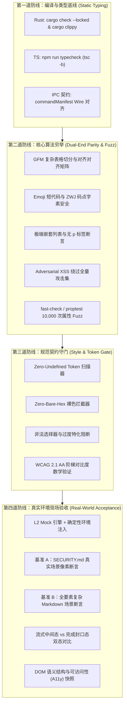
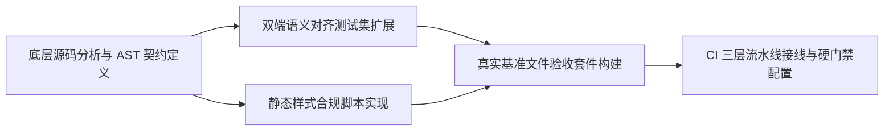
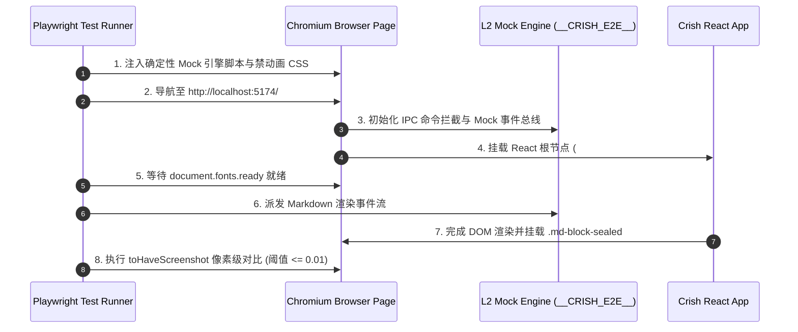
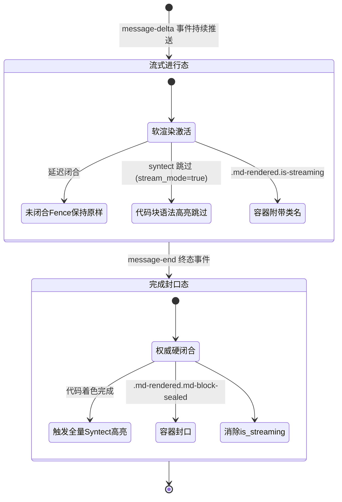
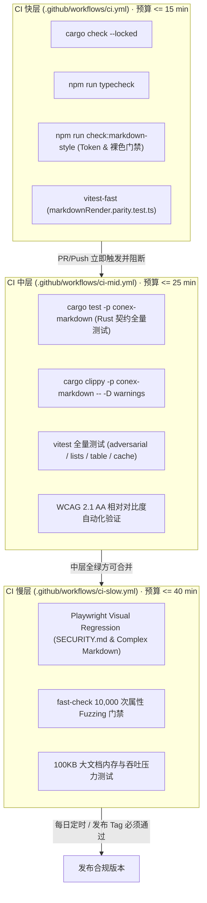

# Conex / Crish — Markdown 统一渲染与排版立体化验证方案

> **文档标识**：`docs/markdown-unified-architecture/independent-plans/05-verification-and-gates-plan.md`  
> **所属战役**：Markdown 统一架构独立方案（Plan 05）  
> **设计基准**：严格遵循仓库铁律 `AGENTS.md` §7（严禁补丁、绕过与作弊）、§7.1（立体验证纪律）、§8（反过度设计硬性红线）、§11（CI 治理与解耦断言）、§14（色彩空间与现代 CSS）及 `LOGIC_PLAN_NO_RETREAT.md`。  
> **核心原则**：纯逻辑编排，问题同权，严禁单一检查冒充验收，坚决构筑“编译底线 + 核心算法穷举 + 规范契约守门 + 真实环境现场验收”四道纵深防线。

---

## 目录

- [一、立体化质量保障防线总纲](#一立体化质量保障防线总纲)
  - [1.1 历史缺陷根因与立体化防御全景](#11-历史缺陷根因与立体化防御全景)
  - [1.2 四层防御模型与验收契约](#12-四层防御模型与验收契约)
  - [1.3 核心逻辑依赖拓扑](#13-核心逻辑依赖拓扑)
- [二、双端（Rust/TS）语义对齐自动化测试用例集](#二双端rustts语义对齐自动化测试用例集)
  - [2.1 架构真源与双端契约边界](#21-架构真源与双端契约边界)
  - [2.2 复杂 GFM 表格语义矩阵](#22-复杂-gfm-表格语义矩阵)
  - [2.3 Emoji 短代码与 Unicode 字素簇测试矩阵](#23-emoji-短代码与-unicode-字素簇测试矩阵)
  - [2.4 极端嵌套列表与排版防回归断言](#24-极端嵌套列表与排版防回归断言)
  - [2.5 恶意 XSS 变体与边界防御测试矩阵](#25-恶意-xss-变体与边界防御测试矩阵)
  - [2.6 基于属性的 Fuzzing（Property-Based Testing）规范](#26-基于属性的-fuzzingproperty-based-testing规范)
- [三、Design Token 与样式合规静态门禁脚本](#三design-token-与样式合规静态门禁脚本)
  - [3.1 样式静态合规准则](#31-样式静态合规准则)
  - [3.2 门禁检测脚本实现设计（check-markdown-style.mjs）](#32-门禁检测脚本实现设计check-markdown-stylemjs)
  - [3.3 语法高亮与 Token 映射完整性断言](#33-语法高亮与-token-映射完整性断言)
  - [3.4 WCAG 2.1 AA 相对亮度与对比度自动化数学验证](#34-wcag-21-aa-相对亮度与对比度自动化数学验证)
- [四、真实环境现场视觉对齐验收方案](#四真实环境现场视觉对齐验收方案)
  - [4.1 视觉验收环境稳定化三件套](#41-视觉验收环境稳定化三件套)
  - [4.2 真实基准文件 A：SECURITY.md 现场验收规范](#42-真实基准文件-asecuritymd-现场验收规范)
  - [4.3 真实基准文件 B：复杂工程文档（Complex Markdown）全要素验收规范](#43-真实基准文件-b复杂工程文档complex-markdown全要素验收规范)
  - [4.4 流式中间态 vs 完成封口态双模视觉验收断言](#44-流式中间态-vs-完成封口态双模视觉验收断言)
  - [4.5 DOM 结构树快照（Structure Snapshot）与可访问性断言](#45-dom-结构树快照structure-snapshot与可访问性断言)
- [五、防回潮的 CI 门禁集成流水线定义](#五防回潮的-ci-门禁集成流水线定义)
  - [5.1 CI 三层流水线集成拓扑](#51-ci-三层流水线集成拓扑)
  - [5.2 快层流水线（ci.yml）门禁集成](#52-快层流水线ciyml门禁集成)
  - [5.3 中层流水线（ci-mid.yml）全量语义门禁](#53-中层流水线ci-midyml全量语义门禁)
  - [5.4 慢层流水线（ci-slow.yml）像素级快照与 Fuzzing 门禁](#54-慢层流水线ci-slowyml像素级快照与-fuzzing-门禁)
- [六、逻辑依赖与落地实施编排](#六逻辑依赖与落地实施编排)
  - [6.1 无工期纯逻辑依赖计划表](#61-无工期纯逻辑依赖计划表)
  - [6.2 零退避验收准则（Definition of Done）](#62-零退避验收准则definition-of-done)

---

## 一、立体化质量保障防线总纲

### 1.1 历史缺陷根因与立体化防御全景

在 Conex/Crish 的演化过程中，Markdown 渲染与排版层曾反复出现以下致命缺陷：
1. **语义漂移（Semantic Drift）**：Rust 内核（`crates/conex-markdown`，基于 `pulldown-cmark` + `syntect` + `ammonia`）与前端 TS 同步/Worker 降级实现（`apps/crish-desktop/src/api/markdown-render/`，基于手写解析 + `highlight.js`）在 HTML 标签结构、CSS 选择器挂载点上产生细微不一致，导致 Rust 渲染与 Worker 渲染在界面切换时发生闪烁或布局跳变。
2. **幽灵列表（Ghost Lists）**：解析器粗暴将列表项 `<li>` 包裹在 `<p>` 中，现代浏览器 DOM 解析器在遇到 `<p><li>...</li></p>` 时会强行解构并闭合段落，导致渲染树出现重影节点和双倍缩进。
3. **视觉撕裂与样式退化**：由于缺乏对 CSS 变量（Tokens）的静态约束，样式重构中频繁出现裸 Hex 颜色硬编码、暗色模式未定义 Token、行内代码与代码围栏间距未微调导致的高频排版破损。
4. **单一检查作弊**：仅凭 TypeScript 编译通过或简单的单元测试即宣布交付，缺乏浏览器真实环境下的像素比对与动态交互验收，使隐藏的 CSS 优先级覆盖、字体未就绪导致的渲染偏移逃逸至运行时。

为此，依据项目铁律 `AGENTS.md` §7.1，本方案建立横跨“语法与类型”、“核心双端算法”、“规范与契约静态扫描”、“真实环境动态渲染”的四维立体化质量工程防线。



### 1.2 四层防御模型与验收契约

| 层级 | 防御层名称 | 执行介质 | 拦截目标 | 验收断言 / 刚性红线 |
| :--- | :--- | :--- | :--- | :--- |
| **Layer 1** | **编译底线** | `cargo clippy` + `tsc` | 语法断裂、类型不匹配、未注册 IPC 命令 | 零编译警告（`-D warnings`）、零类型报错、IPC 126 命令真源完全一致 |
| **Layer 2** | **核心算法穷举** | Vitest (`.parity.test.ts`) + Cargo Test | 双端 HTML 结构漂移、XSS 注入逃逸、列表嵌套错乱、Emoji 乱码 | 双端 HTML 结构契约 100% 对齐、XSS 攻击向量 100% 净化、无 `<p><li>` 结构 |
| **Layer 3** | **规范契约守门** | `check-markdown-style.mjs` + 数学断言 | 幽灵 CSS 变量、裸 Hex 颜色、非法选择器、低对比度阅读障碍 | 零未定义变量、零裸 Hex（除 Token 字典）、对比度 $\ge 4.5:1$（正文） |
| **Layer 4** | **真实现场验收** | Playwright (`tests/visual/`) | 真实浏览器渲染撕裂、字体未就绪跳变、暗色模式色差、流式抖动 | 像素级截图比对差值 $< 1.0\%$（`maxDiffPixelRatio: 0.01`）、DOM 结构一致 |

### 1.3 核心逻辑依赖拓扑



---

## 二、双端（Rust/TS）语义对齐自动化测试用例集

### 2.1 架构真源与双端契约边界

Conex/Crish 采用“Rust 内核权威整篇渲染 + TS/Worker 离线/回退与流式轻量渲染”的双轨架构：
- **Rust 权威路径**：`crates/conex-markdown`（经由 IPC `core_md_render` / `core_md_render_batch` 暴露），消费方为聊天会话的完成态消息（`useAsyncMarkdownHtml`）。
- **TS/Worker 备用路径**：`apps/crish-desktop/src/api/markdownRender.ts` 及 `markdownRenderAsync.ts` 的 Worker Pool 调度，用于 Tauri 缺失态、离线预览（技能详情/文件预览）及兜底渲染。

#### 刻意差异（Intentional Differences）白名单
双端测试**严禁**盲目追求全量字节级（Byte-for-byte）一致，必须显式声明并容忍以下架构层合理差异：
1. **代码高亮 Token Span 差异**：Rust 端采用 `syntect` 生成 `.source .keyword`，TS 端采用 `highlight.js` 生成 `.hljs-keyword`。两者共享外层容器 `.md-code-block`、`.md-code-pre` 及语言指示类 `.language-*`。
2. **语言别名归一化**：TS 端 `highlight.js` 可能将 `ts` 映射为 `typescript`，Rust 端映射表保留别名或显式规范化，断言采用正则 `language-(ts|typescript)` 兼容匹配。
3. **净化器执行阶段**：Rust 渲染后经由 `ammonia` 剥离危险标签/属性；TS 端在解析阶段转义并于组件装配时进行属性校验。
4. **硬性要求**：TS 同步路径与 TS Worker 路径之间必须达到 **100% 字节级（Byte-for-byte）完全一致**；Rust 与 TS 之间必须达到 **100% 语义结构契约（Structural Contract）一致**。

---

### 2.2 复杂 GFM 表格语义矩阵

GFM 表格是排版破损的重灾区。用例集必须覆盖多列混杂对齐、转义管道符、包含行内 HTML 特殊字符、斑马纹分配及极端缺列补齐。

#### 2.2.1 结构契约断言规范
每个表格必须生成具有无障碍访问地标（ARIA landmark）的包裹层：
```html
<div class="md-table-wrap" role="region" aria-label="表格">
  <table class="md-table">
    <thead>
      <tr class="md-tr">
        <th class="md-th" scope="col" style="text-align:...">...</th>
      </tr>
    </thead>
    <tbody>
      <tr class="md-tr">...</tr>
      <tr class="md-tr md-tr-alt">...</tr>
    </tbody>
  </table>
</div>
```

#### 2.2.2 核心用例定义（TypeScript & Rust 共享）

```typescript
// apps/crish-desktop/src/api/fixtures/markdown-parity-cases.ts 扩展

export const TABLE_PARITY_FIXTURES: readonly ParityFixture[] = [
  {
    id: 'table_alignments_and_escaped_pipes',
    label: 'GFM 表格：四种对齐方式与单元格转义管道符',
    md: [
      '| 默认左对齐 | 显式居中 | 显式靠右 | 转义内容 |',
      '| --- | :---: | ---: | :--- |',
      '| Normal | Center | Right | Cell with \\| pipe |',
      '| `code` | **bold** | *italic* | CJK 中文对齐 |',
    ].join('\n'),
    mustContain: [
      '<div class="md-table-wrap" role="region" aria-label="表格">',
      '<table class="md-table">',
      '<th class="md-th" scope="col">默认左对齐</th>',
      '<th class="md-th" scope="col" style="text-align:center">显式居中</th>',
      '<th class="md-th" scope="col" style="text-align:right">显式靠右</th>',
      '<td class="md-td" style="text-align:center"><strong>bold</strong></td>',
      'Cell with | pipe',
      'md-tr-alt',
    ],
    mustNotContain: ['\\|', '<th class="md-th" scope="col" style="text-align:left">'],
    mustMatch: [
      '<tr class="md-tr">.*?Normal.*?</tr>',
      '<tr class="md-tr md-tr-alt">.*?code.*?</tr>',
    ],
    counts: [
      { needle: '<table', exact: 1 },
      { needle: '<thead', exact: 1 },
      { needle: '<tbody', exact: 1 },
      { needle: '<th', exact: 4 },
      { needle: '<tr', exact: 3 }, // 1 head + 2 body
      { needle: '<td', exact: 8 },
      { needle: 'md-tr-alt', exact: 1 },
    ],
  },
  {
    id: 'table_html_chars_and_missing_cells',
    label: 'GFM 表格：HTML 字符转义（来自 SECURITY.md 场景）与缺列对齐补齐',
    md: [
      '| 版本范围 | 支持状态 | 说明备注 |',
      '| :--- | :---: | :--- |',
      '| < 0.1.0 | :x: | 历史版本不受支持 |',
      '| >= 0.1.0 & <= 0.2.0 | :white_check_mark: |', // 故意缺第三列
    ].join('\n'),
    mustContain: [
      '&lt; 0.1.0',
      '&gt;= 0.1.0 &amp; &lt;= 0.2.0',
      '历史版本不受支持',
    ],
    mustNotContain: [
      '< 0.1.0', // 绝不能输出裸小于号，防止被浏览器判定为未闭合 HTML 标签
      '>= 0.1.0',
    ],
    mustMatch: [],
    counts: [
      { needle: '<th', exact: 3 },
      { needle: '<tr', exact: 3 },
      { needle: '<td', exact: 6 }, // 缺列必须自动用空 <td> 补齐到 3 列
    ],
  },
  {
    id: 'table_header_only',
    label: 'GFM 表格：仅表头无表体（退化边界用例）',
    md: [
      '| 单列表头 |',
      '| --- |',
    ].join('\n'),
    mustContain: [
      '<th class="md-th" scope="col">单列表头</th>',
      '<tbody></tbody>', // 契约：必须保留空 tbody 占位，保证 DOM 结构稳定
    ],
    mustNotContain: ['<td'],
    mustMatch: [],
    counts: [
      { needle: '<table', exact: 1 },
      { needle: '<th', exact: 1 },
      { needle: '<tr', exact: 1 },
    ],
  },
];
```

---

### 2.3 Emoji 短代码与 Unicode 字素簇测试矩阵

#### 2.3.1 短代码（Shortcodes）转换要求
在 Conex 的工程实践中，用户与官方文档（如 `SECURITY.md`、`README.md`）大量采用 GitHub 风格短代码：
- `:white_check_mark:` $\to$ `✅`
- `:x:` $\to$ `❌`
- `:sparkles:` $\to$ `✨`
- `:rocket:` $\to$ `🚀`
- `:warning:` $\to$ `⚠️`

#### 2.3.2 Unicode 字素簇（Grapheme Clusters）与边界不变量
1. **多码点字素（ZWJ 序列）完整性**：如家庭组合 `👨‍👩‍👧‍👦`（U+1F468 U+200D U+1F469 U+200D U+1F467 U+200D U+1F466），在任何文本截断、CJK `wbr` 断字包装、HTML 转义过程中，严禁拆断 ZWJ（Zero Width Joiner）。
2. **变体选择符（Variation Selector-16）保护**：如 `⚠️`（U+26A0 U+FE0F），VS16 码点必须与前导符号强绑定，禁止将其作为不可见字符剥离。
3. **短代码独立性**：短代码必须在非代码区（即不在 `` `code` `` 或 ```` ```fence``` ```` 内部）生效；代码块内的 `:x:` 必须原样输出。

```typescript
export const EMOJI_PARITY_FIXTURES: readonly ParityFixture[] = [
  {
    id: 'emoji_shortcodes_in_markdown',
    label: 'Emoji 短代码在段落、列表与表格中的解析',
    md: [
      '## ✨ 功能特性',
      '',
      '- 支持状态: :white_check_mark: 通过',
      '- 拒绝状态: :x: 阻断',
      '',
      '| 指标 | 状态 |',
      '| --- | --- |',
      '| 安全性 | :white_check_mark: |',
      '| 漏洞 | :x: |',
    ].join('\n'),
    mustContain: [
      '✨ 功能特性',
      '✅ 通过',
      '❌ 阻断',
      '<td class="md-td">✅</td>',
      '<td class="md-td">❌</td>',
    ],
    mustNotContain: [
      ':white_check_mark:',
      ':x:',
    ],
    mustMatch: [],
    counts: [
      { needle: '✅', exact: 2 },
      { needle: '❌', exact: 2 },
    ],
  },
  {
    id: 'emoji_code_protection',
    label: '代码保护：行内代码与代码块内的短代码不得被转义',
    md: '普通文本 :rocket: 与代码 `echo ":rocket:"` 以及:\n\n```bash\n# :rocket: 不得被转换\n```',
    mustContain: [
      '普通文本 🚀',
      '<code class="md-inline-code">echo &quot;:rocket:&quot;</code>',
      ':rocket: 不得被转换',
    ],
    mustNotContain: [],
    mustMatch: ['<pre.*?language-bash.*?# :rocket: 不得被转换'],
    counts: [
      { needle: '🚀', exact: 1 },
    ],
  },
];
```

---

### 2.4 极端嵌套列表与排版防回归断言

#### 2.4.1 列表层级与防幽灵列表（Ghost List）红线
- **铁律 1（Anti-Ghost-List）**：完成态消息生成的 HTML 中，**绝对禁止出现 `<p>` 包裹 `<li>`**（即正则 `/<p[^>]*>\s*<li/` 命中计数必须恒等于 0）。
- **铁律 2（Tight vs Loose List Merge）**：对于松散列表（包含空行的列表项），子内容应作为 `<li class="md-li">` 内部的续行或段落，严禁拆裂为两个独立的 `<ul>` 容器。
- **铁律 3（Asterisk Marker Isolation）**：星号列表项 `* **P0**` 中，外层星号作为列表标记，严禁被斜体解析器误吞留下 `markdown*` 残片。

```typescript
export const LIST_EXTREME_PARITY_FIXTURES: readonly ParityFixture[] = [
  {
    id: 'list_extreme_nesting_mixed',
    label: '极端多层有序与无序混合嵌套列表（3级深度）',
    md: [
      '1. 第一级有序项 A',
      '   - 第二级无序项 A-1',
      '     1. 第三级有序项 A-1-a',
      '     2. 第三级有序项 A-1-b',
      '   - 第二级无序项 A-2',
      '2. 第一级有序项 B',
      '   * [x] 任务项已完成',
      '   * [ ] 任务项未完成',
    ].join('\n'),
    mustContain: [
      '<ol class="md-ol">',
      '<ul class="md-ul">',
      '<li class="md-li">第一级有序项 A',
      '<li class="md-li md-task-item done">',
      '<li class="md-li md-task-item">',
      'md-task-box checked',
    ],
    mustNotContain: [
      '<p><li',
      '</li></p>',
    ],
    mustMatch: [],
    counts: [
      { needle: '<ol', exact: 2 },
      { needle: '<ul', exact: 2 },
      { needle: '<li', exact: 7 },
      { needle: 'md-task-box', exact: 2 },
    ],
  },
  {
    id: 'list_loose_with_code_continuation',
    label: '松散列表：列表项内部包含缩进代码块与换行段落',
    md: [
      '- **步骤一**：初始化环境',
      '',
      '  运行以下脚本以启动守护进程：',
      '',
      '  ```bash',
      '  cargo run -p conex-daemon',
      '  ```',
      '',
      '- **步骤二**：完成验证',
    ].join('\n'),
    mustContain: [
      '<li class="md-li"><strong>步骤一</strong>：初始化环境',
      '运行以下脚本以启动守护进程：',
      'md-code-block',
      '<li class="md-li"><strong>步骤二</strong>：完成验证',
    ],
    mustNotContain: ['<p><li'],
    mustMatch: [],
    counts: [
      { needle: '<ul', exact: 1 }, // 必须合并在同一个 ul 内，不能裂开成 2 个 ul
      { needle: '<li', exact: 2 },
      { needle: 'md-code-block', exact: 1 },
    ],
  },
];
```

---

### 2.5 恶意 XSS 变体与边界防御测试矩阵

安全基线必须零容忍。测试集必须穷举所有通过 URI 方案走私、HTML 实体混淆、BOM 与不可见控制符绕过、属性注入等攻击载荷。

```typescript
// apps/crish-desktop/src/api/markdown-render/markdownSanitizer.adversarial.test.ts 扩展

export interface XssVector {
  name: string;
  payload: string;
  assertForbiddenPatterns: string[];
}

export const XSS_ADVERSARIAL_MATRIX: XssVector[] = [
  {
    name: 'javascript: 协议内嵌制表符与零宽字符走私',
    payload: '[Click Me](java\tscr\u200Bipt:alert(1))',
    assertForbiddenPatterns: ['href="javascript:', 'href="java\t', 'alert(1)'],
  },
  {
    name: 'javascript%3A 百分号双重编码绕过',
    payload: '[Click Me](javascript%253Aalert(document.cookie))',
    assertForbiddenPatterns: ['href="javascript', 'href="javascript%253A'],
  },
  {
    name: 'data:text/html 嵌入 svg onload 执行体',
    payload: '',
    assertForbiddenPatterns: [']*src="data:text/html', 'alert(1)'],
  },
  {
    name: 'img 标签内联 onerror 攻击向量（Ammonia 终极清洗测试）',
    payload: '',
    assertForbiddenPatterns: ['onerror', 'onload', 'alert(1)', 'alert(2)'],
  },
  {
    name: 'CSS expression 与动态属性渗透',
    payload: '<div style="width: expression(alert(1));">bad</div>',
    assertForbiddenPatterns: ['expression', 'alert(1)'],
  },
  {
    name: '伪造 local-path 协议进行跨目录读取探测',
    payload: '[Sensitive File](local-path:///../../../../etc/passwd)',
    assertForbiddenPatterns: ['data-path="/../../../../etc/passwd"'],
  },
];
```

---

### 2.6 基于属性的 Fuzzing（Property-Based Testing）规范

使用 `fast-check`（TypeScript 端）与 `proptest`（Rust 端）执行不少于 10,000 次随机生成的极端文本测试。

#### 2.6.1 必须验证的数学不变量（Invariants）
1. **终止性与时间复杂度有界（Termination & Bound）**：任意长度 $\le 100,000$ 字符的任意 Unicode 字符串输入，解析必须在 50ms 内完成，绝对禁止发生正则灾难性回溯（ReDoS）或无限死循环。
2. **单调截断安全（Monotonic Truncation Safety）**：超过 `MAX_MARKDOWN_INPUT = 100_000` 字符的超大输入，解析器必须在边界精确切断，不截断代理对（Surrogate Pair），并优雅返回解析结果，绝对不允许 Panic 或 Unhandled Exception。
3. **幂等性（Idempotency of Caching）**：
   $$\forall \text{raw}, \quad \text{parseMarkdownToHtml}(\text{raw}) \equiv \text{parseMarkdownToHtml}(\text{raw})$$
   首次解析结果写入 LRU 缓存后，再次读取必须严格全等，且命中时不触发底层语法树重解析。
4. **HTML 标签闭合完备性（Tag Balancing）**：产出的 HTML 字符串载入浏览器虚拟 DOM（`DOMParser`）时，不得产生未期望的孤立开标签（如悬挂未闭合的 `<table>` 或 `<pre>`）。

```typescript
// apps/crish-desktop/src/api/markdownRender.fuzz.test.ts 规范设计
import { describe, it, expect } from 'vitest';
import fc from 'fast-check';
import { parseMarkdownToHtml } from './markdownRender';

describe('Markdown Parser Property-Based Fuzzing (10,000 runs)', () => {
  it('满足全 Unicode 字符输入下的确定性与零崩溃不变量', () => {
    fc.assert(
      fc.property(
        fc.fullUnicodeString({ maxLength: 5000 }),
        (raw) => {
          const startTime = performance.now();
          const html = parseMarkdownToHtml(raw);
          const duration = performance.now() - startTime;

          // 不变量 1：单次耗时必须小于 50ms（防 ReDoS）
          expect(duration).toBeLessThan(50);

          // 不变量 2：产物必须为字符串类型
          expect(typeof html).toBe('string');

          // 不变量 3：禁止出现未闭合的原生危险 script 注入
          expect(html.toLowerCase()).not.toContain('<script');

          // 不变量 4：禁止出现 p 嵌套 li 缺陷
          expect(html).not.toMatch(/<p[^>]*>\s*<li/);
        }
      ),
      { numRuns: 10000 }
    );
  });
});
```

---

## 三、Design Token 与样式合规静态门禁脚本

### 3.1 样式静态合规准则

为杜绝视觉回归与样式污染，依据 `AGENTS.md` §11、§13、§14，建立以下静态约束：
1. **Zero-Undefined Tokens（零未定义变量）**：所有 Markdown 渲染区 CSS（`ChatMessageRow.module.css`、`design-system.css` 等）引用的 `var(--md-*)` 与 `var(--syntax-*)`，必须且只能在 `src/styles/tokens.css` 中有权威声明。
2. **Zero-Ghost Variables（零幽灵假变量）**：绝对禁止引入历史残留的幽灵变量（如 `--status-success`、`--md-code-color` 等未经声明的虚假占位）。
3. **Zero-Bare Hex Colors（零裸 Hex 颜色）**：除 `tokens.css` 作为调色盘真源外，业务组件样式与排版样式中严禁出现 `#xxx` 或 `#xxxxxx`。必须使用 `var(--token)` 或现代斜杠透明度 HSL 语法 `hsl(h s l / a)`。
4. **Zero-Illegal Selectors（零非法特化选择器）**：严禁在样式中使用 `!important` 覆盖排版；严禁使用带元素标签的过度特化选择器（如 `div.md-rendered`，必须统一使用单一 `.md-rendered` 类名）；严禁依赖浏览器原生 `title` 属性（必须遵循 §12 使用 `<Tooltip>`）。
5. **Strict Focus States（克制焦点态）**：交互元素（如 `.md-path-link`、`.md-code-copy`）焦点态禁止粗实黑框，颜色混入上限约为 10%（对齐 §13）。

---

### 3.2 门禁检测脚本实现设计（check-markdown-style.mjs）

新建静态门禁脚本 `scripts/check-markdown-style-compliance.mjs`，该脚本将作为快层 CI 强制拦截器运行。

```javascript
/**
 * scripts/check-markdown-style-compliance.mjs
 *
 * Markdown 专用样式合规与 Token 静态守门脚本
 *
 * 检查项：
 * 1. 扫描 tokens.css，提取所有已声明的 CSS 变量白名单；
 * 2. 检查 tokens.css 是否在 :root（Light）与 [data-theme="dark"]（Dark）中均声明了完备的 10 对语法高亮 Token；
 * 3. 扫描 crish-desktop/src 下所有涉及 Markdown 渲染的 CSS/TSX 文件：
 *    - 检查引用的 var(--md-*) 和 var(--syntax-*) 是否存在于白名单中（Zero-Undefined）；
 *    - 检查是否存在幽灵假变量（如 --status-success）；
 *    - 检查除 tokens.css 外是否存在裸 Hex 颜色（Zero-Bare-Hex）；
 *    - 检查是否存在 !important 滥用或非法过度特化选择器。
 *
 * 退出码非 0 = CI 阻断。
 */

import { readFileSync, readdirSync, statSync } from 'node:fs';
import { join, resolve, extname } from 'node:path';
import { fileURLToPath } from 'node:url';

const ROOT_DIR = fileURLToPath(new URL('../', import.meta.url));
const DESKTOP_SRC = resolve(ROOT_DIR, 'apps/crish-desktop/src');
const TOKENS_CSS_PATH = resolve(DESKTOP_SRC, 'styles/tokens.css');
const DESIGN_SYSTEM_CSS_PATH = resolve(DESKTOP_SRC, 'styles/design-system.css');

const REQUIRED_SYNTAX_TOKENS = [
  '--syntax-keyword',
  '--syntax-string',
  '--syntax-number',
  '--syntax-title',
  '--syntax-builtin',
  '--syntax-attr',
  '--syntax-comment',
  '--syntax-addition',
  '--syntax-deletion',
  '--syntax-meta',
];

const GHOST_VARIABLE_BLACKLIST = [
  '--status-success',
  '--md-code-color',
  '--text-highlight',
];

// 1. 读取 tokens.css 并解析有效声明的变量集合
const tokensContent = readFileSync(TOKENS_CSS_PATH, 'utf-8');
const declaredVariables = new Set();
const varDeclRegex = /(--[a-zA-Z0-9_-]+)\s*:/g;
let match;
while ((match = varDeclRegex.exec(tokensContent)) !== null) {
  declaredVariables.add(match[1]);
}

const errors = [];

// 2. 检查 10 组语法高亮 Token 在 Light/Dark 双主题的完备性
for (const token of REQUIRED_SYNTAX_TOKENS) {
  const firstIndex = tokensContent.indexOf(token);
  if (firstIndex === -1) {
    errors.push(`[Tokens 缺失] tokens.css 中完全缺少必需的语法高亮变量: ${token}`);
  } else {
    const secondIndex = tokensContent.indexOf(token, firstIndex + token.length);
    if (secondIndex === -1) {
      errors.push(`[Token 双模缺失] 语法高亮变量 ${token} 仅定义了单模，必须在 :root 与 [data-theme="dark"] 中均完整定义`);
    }
  }
}

// 3. 递归扫描 Markdown 相关样式与组件文件
const TARGET_EXTS = new Set(['.css', '.tsx', '.ts']);
const filesToScan = [];

function walk(dir) {
  const entries = readdirSync(dir, { withFileTypes: true });
  for (const entry of entries) {
    const fullPath = join(dir, entry.name);
    if (entry.isDirectory()) {
      if (entry.name !== 'node_modules' && entry.name !== 'dist') {
        walk(fullPath);
      }
    } else if (TARGET_EXTS.has(extname(entry.name))) {
      filesToScan.push(fullPath);
    }
  }
}
walk(DESKTOP_SRC);

const HEX_COLOR_REGEX = /#(?:[0-9a-fA-F]{3,4}|[0-9a-fA-F]{6}|[0-9a-fA-F]{8})\b/g;
const VAR_USAGE_REGEX = /var\(\s*(--[a-zA-Z0-9_-]+)/g;

for (const filePath of filesToScan) {
  const isTokensFile = filePath === TOKENS_CSS_PATH;
  const relativePath = filePath.replace(ROOT_DIR, '');
  const content = readFileSync(filePath, 'utf-8');
  const lines = content.split('\n');

  lines.forEach((lineText, lineNum) => {
    const lineNo = lineNum + 1;

    // 检查幽灵黑名单变量
    for (const ghost of GHOST_VARIABLE_BLACKLIST) {
      if (lineText.includes(ghost)) {
        errors.push(`[幽灵变量] ${relativePath}:${lineNo} 命中违规幽灵假变量: ${ghost}`);
      }
    }

    // 检查引用的 CSS 变量是否未定义 (Zero-Undefined)
    let varMatch;
    while ((varMatch = VAR_USAGE_REGEX.exec(lineText)) !== null) {
      const varName = varMatch[1];
      if ((varName.startsWith('--md-') || varName.startsWith('--syntax-')) && !declaredVariables.has(varName)) {
        errors.push(`[未定义变量] ${relativePath}:${lineNo} 使用了未在 tokens.css 声明的变量: ${varName}`);
      }
    }

    // 检查除 tokens.css 外的裸 Hex (Zero-Bare-Hex)
    if (!isTokensFile && (filePath.endsWith('.css') || filePath.includes('ChatMessageRow'))) {
      const hexMatches = lineText.match(HEX_COLOR_REGEX);
      if (hexMatches) {
        // 排除 svg inline/测试文件中的合法 mock
        if (!filePath.includes('.test.') && !filePath.includes('assets/')) {
          errors.push(`[裸 Hex 违规] ${relativePath}:${lineNo} 发现硬编码 Hex 颜色: ${hexMatches.join(', ')}，必须使用 Design Token 或 hsl()`);
        }
      }
    }

    // 检查 !important 滥用
    if (filePath.endsWith('.css') && lineText.includes('!important')) {
      // 允许的唯一例外：tests/visual/mock 禁动画重置，生产代码一律禁止
      if (!lineText.includes('animation') && !lineText.includes('transition')) {
        errors.push(`[!important 违规] ${relativePath}:${lineNo} 排版层严禁使用 !important`);
      }
    }
  });
}

// 4. 汇总输出
if (errors.length > 0) {
  console.error(`\n❌ Markdown 样式合规门禁未通过，发现 ${errors.length} 处违规：`);
  errors.forEach((err) => console.error(`  - ${err}`));
  process.exit(1);
} else {
  console.log(`\n✅ Markdown 样式合规门禁检查通过：${filesToScan.length} 个文件均符合 Token 规范与排版铁律。`);
  process.exit(0);
}
```

---

### 3.3 语法高亮与 Token 映射完整性断言

在 `apps/crish-desktop/src/styles/design-system.css` 中，双引擎（Highlight.js 与 Syntect）的高亮类名必须精确映射至 10 对 Design Token。

| 语法语义 Token | Highlight.js 选择器 | Syntect (Rust) 选择器 | 浅色基准色 | 深色基准色 |
| :--- | :--- | :--- | :--- | :--- |
| `--syntax-keyword` | `.hljs-keyword`, `.hljs-selector-tag` | `.source .keyword`, `.source .storage` | 柔紫 | 亮紫藤 |
| `--syntax-string` | `.hljs-string`, `.hljs-doctag` | `.source .string` | 青翠墨绿 | 薄荷亮青 |
| `--syntax-number` | `.hljs-number`, `.hljs-literal` | `.source .constant.numeric` | 暖褐橙 | 琥珀浅橙 |
| `--syntax-title` | `.hljs-title`, `.hljs-section` | `.source .entity.name.function` | 皇家深蓝 | 天青淡蓝 |
| `--syntax-builtin` | `.hljs-built_in`, `.hljs-type` | `.source .support.type` | 沉稳靛蓝 | 冰川粉蓝 |
| `--syntax-attr` | `.hljs-attr`, `.hljs-attribute` | `.source .entity.other.attribute-name`| 苔藓绿 | 鲜亮嫩绿 |
| `--syntax-comment` | `.hljs-comment`, `.hljs-quote` | `.source .comment` | 中性石灰 | 烟熏灰雾 |
| `--syntax-addition`| `.hljs-addition` | `.source .markup.inserted` | 森林沉绿 | 荧光亮绿 |
| `--syntax-deletion`| `.hljs-deletion` | `.source .markup.deleted` | 警戒暗红 | 赤褐浅红 |
| `--syntax-meta` | `.hljs-meta` | `.source .meta` | 暖灰棕 | 浅米灰 |

---

### 3.4 WCAG 2.1 AA 相对亮度与对比度自动化数学验证

在单元测试套件 `typography-token.test.ts` 中植入基于 W3C 标准公式的纯数学验证逻辑，确保浅色与深色模式下所有文字和交互胶囊具备无障碍可读性。

#### 3.4.1 数学公式
设颜色三通道标准化值为 $R, G, B \in [0, 1]$，单通道转换函数：
$$f(c) = \begin{cases} \frac{c}{12.92}, & c \le 0.03928 \\ \left(\frac{c + 0.055}{1.055}\right)^{2.4}, & c > 0.03928 \end{cases}$$
相对亮度（Relative Luminance）$L$：
$$L = 0.2126 \cdot f(R) + 0.7152 \cdot f(G) + 0.0722 \cdot f(B)$$
两颜色相对对比度（Contrast Ratio）$CR$：
$$CR = \frac{\max(L_1, L_2) + 0.05}{\min(L_1, L_2) + 0.05}$$

#### 3.4.2 门禁断言红线
1. **正文（`--text-primary`）与 H1~H5 标题**：对比度 $CR \ge 7.0:1$（满足 WCAG AAA 顶级标准）。
2. **H6 注释标题与次级文本（`--text-secondary`）**：对比度 $CR \ge 4.5:1$（满足 WCAG AA 标准）。
3. **行内代码前景色（`--md-code-inline-fg`）**：对比度 $CR \ge 7.0:1$。
4. **本地路径胶囊（`--md-path-link-fg`）与按钮边框**：组件级对比度 $CR \ge 3.0:1$。
5. **代码语法高亮关键字/数值/字符串**：对比度 $CR \ge 4.5:1$（深浅两端均强约束）。

---

## 四、真实环境现场视觉对齐验收方案

### 4.1 视觉验收环境稳定化三件套

根据 `apps/crish-desktop/tests/visual/README.md`，真实浏览器视觉测试极易受渲染抖动干扰。必须通过三件套确保运行确定性：
1. **确定性 Mock 引擎（Deterministic Mock Engine）**：复用 `tests/e2e/mock-engine.ts`，在浏览器启动前向 `page.addInitScript` 注入 `window.__TAURI_INTERNALS__`，接管 `core_md_render`、`core_run_task` 等所有 IPC 通道，杜绝真实网络与模型波动。
2. **固定视口与设备像素比**：强制固定为 `1280 × 800`，`deviceScaleFactor: 1`。
3. **消除字体与动画抖动**：
   - 注入全局禁动画 CSS：`*{ animation: none !important; transition: none !important; }`；
   - 显式等待字体加载就绪：`await page.evaluate(() => document.fonts.ready);`。



---

### 4.2 真实基准文件 A：SECURITY.md 现场验收规范

#### 4.2.1 基准源文本特征（源码对应 `c:/Software/conex/SECURITY.md`）
包含以下严苛要素：
- 一级标题 `# Security Policy`；
- 二级标题 `## Supported Versions`；
- GFM 表格，单元格含 Emoji 短代码（`:white_check_mark:`、`:x:`）与小于号边界（`< 0.1.0`）；
- 二级标题 `## Reporting a Vulnerability`；
- 粗体邮箱 `**security@conex-community.org**`；
- 无序列表包含 3 个长项描述；
- 强调承诺段落。

#### 4.2.2 视觉与结构验收 Playwright 用例

```typescript
// apps/crish-desktop/tests/visual/specs/security-doc.spec.ts

import { test, expect } from '@playwright/test';
import { openVisualApp, sendPrompt, waitStreamFinal, screenshotOptions } from '../helpers';
import * as fs from 'node:fs';
import * as path from 'node:path';

test.describe('Real-World Baseline A: SECURITY.md 现场视觉对齐', () => {
  const securityMdContent = fs.readFileSync(
    path.resolve(__dirname, '../../../../../SECURITY.md'),
    'utf-8'
  );

  test('01 浅色模式：SECURITY.md 渲染结构完整性与像素对齐', async ({ page }) => {
    await openVisualApp(page, {
      runStream: {
        events: [
          { type: 'message-start' },
          { type: 'message-delta', block: { type: 'text', text: securityMdContent } },
          {
            type: 'message-end',
            message: {
              role: 'assistant',
              content: securityMdContent,
              blocks: [{ type: 'text', text: securityMdContent }],
            },
          },
          { type: 'run-terminal', terminal: 'completed' },
        ],
        delayMs: 50,
      },
    });

    await sendPrompt(page, '请展示项目的安全政策文档');
    await waitStreamFinal(page);

    const messageBlock = page.locator('.md-rendered:not(.is-streaming)').first();
    await expect(messageBlock).toBeVisible();

    // 结构断言 1：H1 与 H2
    await expect(messageBlock.locator('h1.md-h1')).toHaveText('Security Policy');
    await expect(messageBlock.locator('h2.md-h2').first()).toHaveText('Supported Versions');

    // 结构断言 2：表格与内容正确转义
    const table = messageBlock.locator('.md-table-wrap table.md-table');
    await expect(table).toBeVisible();
    await expect(table.locator('tbody tr')).toHaveCount(2);
    // 检查短代码已转换为 Unicode emoji 且小于号正常转义展示
    await expect(table.locator('tbody tr').first()).toContainText('0.1.x');
    await expect(table.locator('tbody tr').first()).toContainText('✅');
    await expect(table.locator('tbody tr').nth(1)).toContainText('< 0.1.0');
    await expect(table.locator('tbody tr').nth(1)).toContainText('❌');

    // 结构断言 3：粗体与列表
    await expect(messageBlock.locator('strong')).toContainText('security@conex-community.org');
    await expect(messageBlock.locator('ul.md-ul li.md-li')).toHaveCount(3);
    // 严禁浏览器产生 p>li 畸变
    const invalidListNesting = await messageBlock.evaluate(
      (el) => el.querySelectorAll('p > li').length
    );
    expect(invalidListNesting).toBe(0);

    // 像素级验收断言
    await expect(page).toHaveScreenshot('story-security-md-light.png', screenshotOptions());
  });

  test('02 深色模式：SECURITY.md 调色盘与对比度现场验收', async ({ page }) => {
    await page.emulateMedia({ colorScheme: 'dark' });
    await openVisualApp(page, {
      getSettings: { theme: 'dark' },
      runStream: {
        events: [
          { type: 'message-start' },
          { type: 'message-delta', block: { type: 'text', text: securityMdContent } },
          {
            type: 'message-end',
            message: {
              role: 'assistant',
              content: securityMdContent,
              blocks: [{ type: 'text', text: securityMdContent }],
            },
          },
          { type: 'run-terminal', terminal: 'completed' },
        ],
        delayMs: 50,
      },
    });

    await sendPrompt(page, '请展示项目的安全政策文档');
    await waitStreamFinal(page);

    const theme = await page.evaluate(() => document.documentElement.getAttribute('data-theme'));
    expect(theme).toBe('dark');

    // 像素级验收断言（容许 1% 抗锯齿抖动）
    await expect(page).toHaveScreenshot('story-security-md-dark.png', screenshotOptions());
  });
});
```

---

### 4.3 真实基准文件 B：复杂工程文档（Complex Markdown）全要素验收规范

#### 4.3.1 要素组成（基于 `README.md` 与极限测试集综合构建）
1. **多行引用块（Blockquote）**：包含粗体与行内链接；
2. **Emoji 标题**：如 `## ✨ 功能特性`、`## 🛠️ 开发命令`；
3. **嵌套任务列表与普通列表**：包含 `[x]` 与 `[ ]` 复选框状态；
4. **多语言 Fenced 代码块**：
   - 带文件路径与语言标识：```` ```ts file="src/index.ts" ````；
   - 复制按钮交互态：鼠标悬停触发复制按钮显露，点击后切换 `.is-copied`；
   - 纯文本 ASCII 构架图（字符盒子 `┌──┐`、`│`、`└──┘`）代码块排版不走样；
5. **本地路径自动识别胶囊**：文本中的 `apps/crish-desktop/src/index.ts` 自动转换为可点击的交互胶囊 `<button class="md-path-link">`。

#### 4.3.2 验收用例

```typescript
// apps/crish-desktop/tests/visual/specs/complex-doc.spec.ts

import { test, expect } from '@playwright/test';
import { openVisualApp, sendPrompt, waitStreamFinal, screenshotOptions } from '../helpers';

test.describe('Real-World Baseline B: 复杂工程文档全要素视觉验收', () => {
  const complexMd = `
> **重要警告**：本规范适用于桌面客户端全平台环境。

## ✨ 功能架构与路径胶囊

核心渲染管线由 \`conex-markdown\` 与前端协作完成。请查验配置文件：apps/crish-desktop/src/api/markdownRender.ts。

### 任务跟踪列表
- [x] 完成 Rust 内核 pulldown-cmark 迁移
- [ ] 完成全量视觉回归基线入库

\`\`\`typescript file="src/sample.ts"
export function calculate(a: number, b: number): number {
  // 语法高亮断言
  const sum = a + b;
  return sum;
}
\`\`\`

\`\`\`text
┌─────────────────┐
│  Rust Markdown  │ ===> HTML Stream
└─────────────────┘
\`\`\`
  `;

  test('全要素排版微结构现场对齐', async ({ page }) => {
    await openVisualApp(page, {
      runStream: {
        events: [
          { type: 'message-start' },
          { type: 'message-delta', block: { type: 'text', text: complexMd } },
          {
            type: 'message-end',
            message: {
              role: 'assistant',
              content: complexMd,
              blocks: [{ type: 'text', text: complexMd }],
            },
          },
          { type: 'run-terminal', terminal: 'completed' },
        ],
        delayMs: 50,
      },
    });

    await sendPrompt(page, '渲染全要素复杂文档');
    await waitStreamFinal(page);

    const messageBlock = page.locator('.md-rendered:not(.is-streaming)').first();

    // 断言 1：引用块样式
    await expect(messageBlock.locator('blockquote.md-quote')).toBeVisible();

    // 断言 2：本地路径胶囊
    const pathBtn = messageBlock.locator('button.md-path-link');
    await expect(pathBtn).toBeVisible();
    await expect(pathBtn).toHaveAttribute('data-path', 'apps/crish-desktop/src/api/markdownRender.ts');

    // 断言 3：任务项及 Checkbox 几何状态
    const taskItemDone = messageBlock.locator('.md-task-item.done');
    await expect(taskItemDone).toBeVisible();
    await expect(taskItemDone.locator('.md-task-box.checked')).toBeVisible();

    // 断言 4：代码块面包屑与复制按钮
    const codeBlock = messageBlock.locator('.md-code-block').first();
    await expect(codeBlock.locator('.md-code-breadcrumb')).toHaveText('src/sample.ts');
    await expect(codeBlock.locator('.md-code-copy')).toBeVisible();

    // 像素级快照断言
    await expect(page).toHaveScreenshot('story-complex-doc-final.png', screenshotOptions());
  });
});
```

---

### 4.4 流式中间态 vs 完成封口态双模视觉验收断言

为彻底杜绝消息生成中途与生成完毕后的“视觉跳变（Visual Jitter）”，定义双态对比断言机制：



#### 双模不变量断言规范
1. **外壳高度单调递增**：完成态的外层容器高度 $H_{\text{final}}$ 与流式最后一帧高度 $H_{\text{stream}}$ 差距在 $\pm 2\text{px}$ 以内（字体行高与间距一致），绝对不允许产生闪烁塌陷。
2. **代码块容器外壳无缝继承**：流式阶段与完成阶段使用完全相同的 `.md-code-block` 外壳、圆角、内衬与背景色，差异仅在于内层 `<code>` 节点的文本颜色是否被 `<span>` 高亮包裹。

---

### 4.5 DOM 结构树快照（Structure Snapshot）与可访问性断言

除像素级截图外，采用 `vitest` / Playwright 采集纯 DOM 语义树快照，保存至 `apps/crish-desktop/tests/snapshots/`，实现对 DOM 结构变动的代码级审查。

```typescript
// DOM 语义提取过滤器示例
export function extractCleanSemanticDomTree(rootElement: Element): string {
  const clone = rootElement.cloneNode(true) as HTMLElement;

  // 移除动态运行时生成的随机 ID、时间戳与临时样式
  const dynamicNodes = clone.querySelectorAll('[data-dynamic], script, style');
  dynamicNodes.forEach((n) => n.remove());

  // 格式化输出标签、类名与核心 ARIA 属性
  function serializeNode(node: Node, depth = 0): string {
    const indent = '  '.repeat(depth);
    if (node.nodeType === Node.TEXT_NODE) {
      const text = node.textContent?.trim();
      return text ? `${indent}"${text}"\n` : '';
    }
    if (node.nodeType === Node.ELEMENT_NODE) {
      const el = node as HTMLElement;
      const tag = el.tagName.toLowerCase();
      const cls = el.className ? ` class="${el.className}"` : '';
      const role = el.getAttribute('role') ? ` role="${el.getAttribute('role')}"` : '';
      const aria = el.getAttribute('aria-label') ? ` aria-label="${el.getAttribute('aria-label')}"` : '';
      
      let out = `${indent}<${tag}${cls}${role}${aria}>\n`;
      for (const child of Array.from(el.childNodes)) {
        out += serializeNode(child, depth + 1);
      }
      out += `${indent}</${tag}>\n`;
      return out;
    }
    return '';
  }

  return serializeNode(clone);
}
```

---

## 五、防回潮的 CI 门禁集成流水线定义

### 5.1 CI 三层流水线集成拓扑

依据仓库成熟的三层 CI 架构，将 Markdown 统一渲染验证严格编排入快层、中层与慢层，构建多级防护网。



---

### 5.2 快层流水线（ci.yml）门禁集成

在 `.github/workflows/ci.yml` 的 `lint` 与 `vitest-fast` 任务中追加刚性步骤：

```yaml
# 在 .github/workflows/ci.yml 的 lint 任务中追加：
      - name: Markdown 样式合规与 Token 静态门禁
        run: node scripts/check-markdown-style-compliance.mjs

# 在 vitest-fast 任务中，确保已纳入双端对齐测试用例：
      - name: 前端核心单测与双端对齐门禁
        run: npm run test:coverage -- --project=unit
```

---

### 5.3 中层流水线（ci-mid.yml）全量语义门禁

在 `.github/workflows/ci-mid.yml` 中确保 Rust 端 `conex-markdown` 与 TS 完整测试链被纳入：

```yaml
# 在 .github/workflows/ci-mid.yml 中：
  cargo-test-markdown:
    name: Rust conex-markdown 权威语义测试
    runs-on: ubuntu-latest
    timeout-minutes: 20
    steps:
      - uses: actions/checkout@v4
      - uses: actions-rust-lang/setup-rust-toolchain@v1
      - name: 运行 conex-markdown 集成与对齐测试
        run: cargo test -p conex-markdown --locked -- --nocapture

  clippy-markdown:
    name: Rust 代码严谨性门禁
    runs-on: ubuntu-latest
    timeout-minutes: 15
    steps:
      - uses: actions/checkout@v4
      - uses: actions-rust-lang/setup-rust-toolchain@v1
      - run: cargo clippy -p conex-markdown -- -D warnings
```

---

### 5.4 慢层流水线（ci-slow.yml）像素级快照与 Fuzzing 门禁

在 `.github/workflows/ci-slow.yml` 中集成现场视觉比对与大样本 Fuzzing：

```yaml
# 在 .github/workflows/ci-slow.yml 中：
  markdown-visual-regression:
    name: Markdown 真实环境像素级现场视觉回归
    runs-on: ubuntu-latest
    timeout-minutes: 40
    steps:
      - uses: actions/checkout@v4
      - uses: actions/setup-node@v4
        with:
          node-version: 20
          cache: npm
      - run: npm ci
      - run: npx playwright install --with-deps chromium
      - name: 运行真实基准现场验收套件 (SECURITY.md & Complex Markdown)
        run: npm --workspace @crish/crish-desktop run test:visual
      - name: 上传视觉比对 Diff 产物（当失败时）
        if: failure()
        uses: actions/upload-artifact@v4
        with:
          name: markdown-visual-diffs
          path: apps/crish-desktop/tests/visual/__screenshots__/*.diff.png

  markdown-fuzz:
    name: 基于属性的 10,000 次极限 Fuzzing 门禁
    runs-on: ubuntu-latest
    timeout-minutes: 30
    steps:
      - uses: actions/checkout@v4
      - uses: actions/setup-node@v4
        with:
          node-version: 20
          cache: npm
      - run: npm ci
      - run: npx vitest run apps/crish-desktop/src/api/markdownRender.fuzz.test.ts
```

---

## 六、逻辑依赖与落地实施编排

### 6.1 无工期纯逻辑依赖计划表

依据反退避铁律，方案不谈工期与人员，问题同权，严格按逻辑前置依赖编排：

| 阶段代码 | 逻辑任务单元 | 前置依赖 | 核心产出文件域 | 验收断言 / 刚性交付指标 |
| :--- | :--- | :--- | :--- | :--- |
| **V-01** | **扩展双端对齐用例源** | 无 | `src/api/fixtures/markdown-parity-cases.ts` | 纳入 GFM 表格、Emoji 短代码、极端列表及 XSS 边界用例 |
| **V-02** | **Rust 端对齐套件移植** | V-01 | `crates/conex-markdown/tests/parity_fixtures.rs` | Cargo test 全绿，Rust 结构与 TS fixture 100% 对齐 |
| **V-03** | **TS 端双轨全等断言** | V-01 | `src/api/markdownRender.parity.test.ts` | TS 同步与 TS Worker 路径 100% Byte-for-byte 完全一致 |
| **V-04** | **实现样式合规门禁脚本**| 无 | `scripts/check-markdown-style-compliance.mjs` | 脚本能准确捕获未声明变量、裸 Hex、幽灵变量与 !important 滥用 |
| **V-05** | **语法高亮与 WCAG 数学断言**| V-04 | `ChatMessageRow/__tests__/typography-token.test.ts` | 10 对语法高亮 Token 映射全覆盖，WCAG 对比度全部 $\ge 4.5:1$ |
| **V-06** | **构建真实基准 A 视觉用例** | V-02, V-03 | `tests/visual/specs/security-doc.spec.ts` | 以真实 `SECURITY.md` 为基准，生成 Light/Dark 像素基线并入库 |
| **V-07** | **构建真实基准 B 视觉用例** | V-02, V-03 | `tests/visual/specs/complex-doc.spec.ts` | 复杂全要素 Markdown 像素级与 DOM 结构树快照入库 |
| **V-08** | **属性 Fuzzing 套件建立** | V-02, V-03 | `src/api/markdownRender.fuzz.test.ts` | `fast-check` 10,000 次随机输入无崩溃、无 ReDoS、无 p>li 违规 |
| **V-09** | **CI 流水线全层接入** | V-04, V-05, V-06, V-07, V-08 | `.github/workflows/ci*.yml`, `package.json` | 快层、中层、慢层均已装配门禁，本地与 CI 行为绝对一致 |

---

### 6.2 零退避验收准则（Definition of Done）

任何声称本次 Markdown 统一渲染验证方案完成的交付物，必须正面核对以下准则，缺一不可：

- [ ] **编译与类型 0 违规**：`cargo check --locked` 与 `npm run typecheck` 零错误，`cargo clippy` 零警告。
- [ ] **双端契约 100% 达成**：
  - `apps/crish-desktop/src/api/markdownRender.parity.test.ts` 跑通全量 fixture；
  - `crates/conex-markdown/tests/parity_fixtures.rs` 跑通全量测试；
  - 严禁任何 `<p><li>` 幽灵列表结构输出。
- [ ] **Token 与样式 0 破损**：
  - `node scripts/check-markdown-style-compliance.mjs` 退出码为 0；
  - 零未定义变量、零裸 Hex（除 tokens 调色盘）、零幽灵黑名单变量；
  - 10 组语法高亮选择器在两端均实现 $100\%$ 双映射；
  - WCAG 2.1 AA 对比度数学验证 100% 达标。
- [ ] **现场验收 0 视觉撕裂**：
  - 以 `SECURITY.md` 与复杂 Markdown 为基准的 Playwright Visual 截图已落盘至 `tests/visual/__screenshots__/`；
  - 在 Light 与 Dark 双主题下，像素差绝对小于 1%（`maxDiffPixelRatio <= 0.01`）；
  - 流式态至完成态容器高度无跳变、代码块外壳无塌陷。
- [ ] **极限抗压 0 崩溃**：
  - `fast-check` 10,000 次随机变异 Fuzzing 运行 0 失败，单次解析 $\le 50\text{ms}$，无 ReDoS。
- [ ] **CI 流水线刚性拦截**：
  - 故意破坏任意 Token 或注入 XSS 载荷时，CI 必立即红线阻断，严禁任何 `--no-verify` 绕过。
