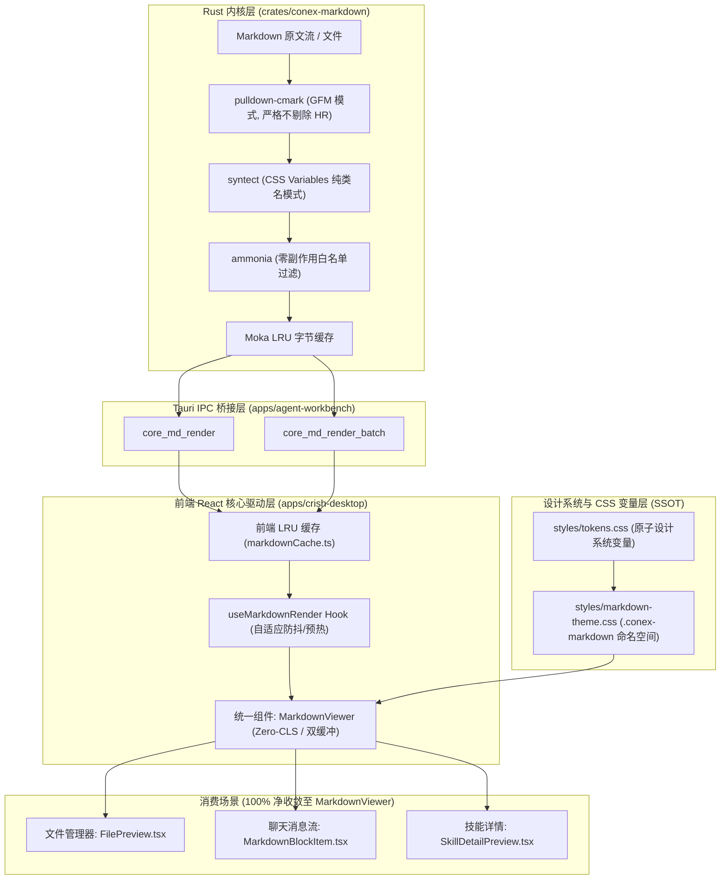

# Conex/Crish 全栈 Markdown 渲染统一方案（Challenger 独立架构方案）

> **作者**：系统架构师 & 挑战者（Challenger）  
> **文档属性**：独立深度方案（Independent Architectural Plan）  
> **目标路径**：`docs/markdown-unified-architecture/independent-plans/06-challenger-fullstack-plan.md`  
> **核心原则**：纯源码现场取证、零历史文档依赖、零业务优先级妥协、逻辑同权、系统净收敛。

---

## 0. 挑战者前言与现状诊断报告（The Challenger's Assessment）

### 0.1 诊断背景：为什么文件管理器的 Markdown 预览“效果极差、表格崩塌”？
用户强烈反馈：在 Conex/Crish 文件管理器中预览 Markdown 文件时，排版效果极其粗糙，与 GitHub、VS Code 等主流优秀渲染器相比差异悬殊，特别是**表格严重崩塌**、边框缺失、内边距丢失、对齐失效、代码块毫无层次感。

常规工程团队往往将其误判为“漏写了几条 CSS 样式”，试图在局部 CSS 文件中打补丁（如在 `FilesCard.module.css` 里加几条针对 `table` 的样式）。  
**挑战者在此必须断言：这是对系统性架构溃败的浅薄误读！**  
通过穿透源码的全面审视，真相是：当前仓内存在**四轨解析分裂、样式彻底真空、孤儿组件伪连通、主线程 DOM 自残操作、以及静默数据截断**的重大系统性断层。

---

### 0.2 源码现场取证（证据链与行号实录）

#### 【证据 A】样式完全真空：`FilePreview.tsx` 的裸奔渲染与 `ChatMessageRow.module.css` 的私有封闭
- **现场代码**：[`apps/crish-desktop/src/components/files/FilePreview.tsx:218-221`](file:///c:/Software/conex/apps/crish-desktop/src/components/files/FilePreview.tsx#L218-L221)
  ```tsx
  <div className={styles.filesMdWrap}>
    <div
      className={`${styles.filesMdBody} md-rendered msg-assistant-text`}
      dangerouslySetInnerHTML={{ __html: mdHtmlIndented }}
    />
  </div>
  ```
- **断裂分析**：
  1. `styles.filesMdBody` 在 [`apps/crish-desktop/src/components/files/FilesCard.module.css:202-207`](file:///c:/Software/conex/apps/crish-desktop/src/components/files/FilesCard.module.css#L202-L207) 中仅声明了 `padding: 10px 12px 16px; overflow: auto; min-height: 0; flex: 1;`，**没有任何**关于 `.md-table`、`.md-th`、`.md-td`、`.md-h1`、`.md-code-block` 的定义！
  2. 开发者在 JSX 中看似“复用”了类名 `md-rendered msg-assistant-text`，然而全局样式表（如 `tokens.css`）中**根本不存在** `.md-rendered` 和 `.msg-assistant-text` 的类选择器定义！
  3. 真正的 Markdown 排版样式，被全部私有硬编码封装在 [`apps/crish-desktop/src/components/chat-message-row/ChatMessageRow.module.css:368-672`](file:///c:/Software/conex/apps/crish-desktop/src/components/chat-message-row/ChatMessageRow.module.css#L368-L672) 下的 `.assistantText :global(...)` 深度后代选择器中！
  4. **结论**：文件管理器预览容器根本没有导入 `ChatMessageRow.module.css`，所有由 Rust 或 JS 解析出的 HTML 标签（`<table>`、`<th>`、`<td>`、`<h1>`、`<pre>`）在文件预览区全部回退为浏览器 User-Agent 原始野蛮样式。表格没有任何边框与间距，自然“彻底崩塌”。

#### 【证据 B】虚假的孤岛组件：`StreamingTableContainer` 孤儿代码与未生效的 `@container`
- **现场代码**：[`apps/crish-desktop/src/components/chat-message-row/StreamingTableContainer.tsx:1-59`](file:///c:/Software/conex/apps/crish-desktop/src/components/chat-message-row/StreamingTableContainer.tsx#L1-L59) 与 [`StreamingTableContainer.module.css:1-136`](file:///c:/Software/conex/apps/crish-desktop/src/components/chat-message-row/StreamingTableContainer.module.css#L1-L136)
- **断裂分析**：
  1. `StreamingTableContainer.module.css` 头部写着响亮的注释：`StreamingTableContainer.module.css (SSOT for GFM & Streaming Tables)`，声明了容器查询 `@container`、吸顶表头 `position: sticky`、斑马纹、发丝线边框与呼吸光晕。
  2. 但是，在全局代码搜索中，该组件**仅被其自身的单元测试 [`StreamingTable.test.tsx`](file:///c:/Software/conex/apps/crish-desktop/src/components/chat-message-row/__tests__/StreamingTable.test.tsx) 导入过**！
  3. 无论是聊天流式渲染组件 [`MarkdownBlockItem.tsx`](file:///c:/Software/conex/apps/crish-desktop/src/components/chat-message-row/MarkdownBlockItem.tsx#L144)，还是文件预览组件 [`FilePreview.tsx`](file:///c:/Software/conex/apps/crish-desktop/src/components/files/FilePreview.tsx#L220)，都直接将 HTML 字符串注入 DOM（`el.innerHTML = html`），**根本没有经过 `StreamingTableContainer`**！
  4. **结论**：这是一个典型的“功能伪连通”与“自嗨式孤岛组件”，声称是 SSOT，实则 0 处业务生产消费，沦为死代码。

#### 【证据 C】多轨分裂的解析器实现：Rust 引擎与千行脆弱正则的双轨漂移
- **现场代码**：
  - 轨 1（Rust Core）：[`crates/conex-markdown/src/renderer.rs:1-1148`](file:///c:/Software/conex/crates/conex-markdown/src/renderer.rs)
  - 轨 2（JS Full Fallback）：[`apps/crish-desktop/src/api/markdown-render/markdownPlugins.ts:43-203`](file:///c:/Software/conex/apps/crish-desktop/src/api/markdown-render/markdownPlugins.ts#L43-L203) 连同 `markdownTable.ts`、`markdownCodeFence.ts`、`markdownInlineFormat.ts`
  - 轨 3（JS Lite）：[`apps/crish-desktop/src/api/markdownRenderLite.ts`](file:///c:/Software/conex/apps/crish-desktop/src/api/markdownRenderLite.ts)
- **断裂分析**：
  1. JS 侧的 `markdownPlugins.ts` 采用极其脆弱的字符串占位符与全局正则切分机制：`%%CODE0%%`、`%%FENCE0%%`、`%%TABLE0%%`、`%%INLINE0%%`。如果用户 Markdown 正文中偶然出现类似字串，将直接导致占位符注入与内容错位！
  2. 在 [`markdownCodeFence.ts:85`](file:///c:/Software/conex/apps/crish-desktop/src/api/markdown-render/markdownCodeFence.ts#L85)，代码块正则上限被硬编码为 `[\s\S]{0,50000}?`（50,000 字符）。一旦源码文件超过 5 万字符，闭合围栏正则直接匹配失败，整个代码块高亮与隔离全面破损！
  3. 在 [`markdownPlugins.ts:54`](file:///c:/Software/conex/apps/crish-desktop/src/api/markdown-render/markdownPlugins.ts#L54) 和 Rust [`renderer.rs:717`](file:///c:/Software/conex/crates/conex-markdown/src/renderer.rs#L717)，两者竟然都通过正则将水平分割线 `---` 粗暴删除替换为空（`HR_LINE_RE.replace_all(&stripped, "")`）！不仅破坏了标准的 Markdown `<hr>` 语义，且在表格语法与水平线交织时极易引发词法误杀。
  4. 两套解析器对嵌套列表、HTML 实体、URL 自动探测存在大量行为不一致，导致同一段内容在不同视图（或在 Rust 失败回退到 Worker 时）呈现出迥异的排版形态。

#### 【证据 D】潜伏的数据截断与崩溃雷区：100KB 截断与 256KB 预览上限的静默丢失
- **现场代码**：
  - Rust 限制：[`crates/conex-markdown/src/lib.rs:26`](file:///c:/Software/conex/crates/conex-markdown/src/lib.rs#L26)
    ```rust
    pub const MAX_MARKDOWN_INPUT: usize = 100_000;
    ```
  - 文件预览限制：[`apps/crish-desktop/src/components/files/FilePreview.tsx:216`](file:///c:/Software/conex/apps/crish-desktop/src/components/files/FilePreview.tsx#L216)
    ```tsx
    isMd && mdMode === 'render' && (content?.length || 0) <= 256 * 1024
    ```
- **断裂分析**：
  1. 前端文件管理器允许最大 256KB 的 Markdown 文件进入富文本渲染模式；
  2. 但 Rust 核心引擎 `conex-markdown` 却在入口处将输入无情截断至 100,000 字节（约 97.6KB）：
     [`crates/conex-markdown/src/renderer.rs:703-708`](file:///c:/Software/conex/crates/conex-markdown/src/renderer.rs#L703-L708)
     ```rust
     let truncated = if raw.len() > MAX_MARKDOWN_INPUT {
         let end = raw.floor_char_boundary(MAX_MARKDOWN_INPUT);
         &raw[..end]
     } else {
         raw
     };
     ```
  3. **后果极其恶劣**：当用户在文件管理器预览一个 120KB 或 200KB 的 Markdown 文档时，前端没有给出任何截断警告，而 Rust 引擎直接将后半段（20KB~156KB）静默丢弃！若末尾恰好处于表格中间，表格结构被腰斩，直接造成闭合标签缺失与整个页面视觉崩塌！

#### 【证据 E】主线程性能自残：`rematerializeMarkdownHtml` 的三次 DOM 解析循环
- **现场代码**：[`apps/crish-desktop/src/api/codeBlockIndent.ts:228-238`](file:///c:/Software/conex/apps/crish-desktop/src/api/codeBlockIndent.ts#L228-L238)
  ```ts
  export function rematerializeMarkdownHtml(html: string, rawIndent?: unknown): string {
    if (!html || typeof document === 'undefined') return html;
    if (!html.includes('md-code-')) return html;
    const wrap = document.createElement('div');
    wrap.innerHTML = html; // 第一次解析：String → DOM
    applyCodeIndentToRenderedRoot(wrap, rawIndent); // TreeWalker 深度遍历修改 TextNode
    return wrap.innerHTML; // 第二次序列化：DOM → String
  }
  ```
  而在 `FilePreview.tsx:220`：
  ```tsx
  <div dangerouslySetInnerHTML={{ __html: mdHtmlIndented }} /> // 第三次解析：String → DOM
  ```
- **断裂分析**：
  为了实现一个微小的用户偏好配置（代码缩进是 2 空格还是 4 空格），前端竟然在主线程对数万字符的 HTML 执行了：内存 DOM 构建 → TreeWalker 遍历 → GCD 计算缩进层级 → 字符串反序列化 → React innerHTML 再次挂载！
  这是对主线程 CPU、垃圾回收（GC）与帧率的严重摧残，在大文件或切换文件时产生肉眼可见的卡顿与微卡死。

---

## 1. 全栈端到端架构总览（End-to-End Unified Architecture）

为彻底终结上述混乱，必须确立端到端单一闭环的系统架构：



### 1.1 引擎层治理（Rust Core / `crates/conex-markdown`）
1. **输入容量放宽与防 OOM 流式策略**：
   - 废除硬编码的 `MAX_MARKDOWN_INPUT: usize = 100_000`；
   - 设定单文件安全预算为 `5_000_000` 字节（5MB），对于超长文件采用增量 AST 切块编译；
   - 严禁静默截断！若超出安全预算，必须显式返回结构化状态 `CoreError::PayloadTooLarge`，由上层调用方明确呈现，而不是截断下半部分伪装成功。
2. **规范 CommonMark / GFM 完整契约**：
   - 彻底删除 `HR_LINE_RE` 及其抹除逻辑，保留 `<hr class="md-hr" />` 标准渲染；
   - 保持 `ENABLE_TABLES`、`ENABLE_TASKLISTS`、`ENABLE_STRIKETHROUGH` 全量开启；
   - 结构化 HTML 标签标准输出：
     - 外层包裹：`<div class="md-table-wrap" role="region" aria-label="表格" tabindex="0">`
     - 表格实体：`<table class="md-table">`
     - 表头单元：`<th class="md-th" scope="col">`
     - 表体单元：`<td class="md-td">`
     - 斑马纹行：`<tr class="md-tr">` 与 `<tr class="md-tr md-tr-alt">`

### 1.2 通信与缓存契约（Tauri IPC / `rustCore.ts`）
1. **命令面单一化**：
   - 保持 `core_md_render` 与 `core_md_render_batch` 两个高效 IPC 命令；
   - 废除已退役的废弃命令残留；
   - 支持高并发下的 Promise Deduplication（挂起任务表去重），避免同一内容并发请求触发多次 IPC 往返。
2. **零拷贝与二进制优化**：
   - 对于超过 64KB 的大文本传输，采用 Tauri 优化的二进制或紧凑 UTF-8 字符串传递，减少 JSON 序列化开销。

### 1.3 样式架构单一真理（Design Token & Global CSS SSOT）
彻底废除在 `ChatMessageRow.module.css` 中的私有选择器，建立全局唯一的 Markdown 样式中枢文件：  
`apps/crish-desktop/src/styles/markdown-theme.css`。

所有的渲染输出均置于 `.conex-markdown` 根容器内，严格绑定 `tokens.css` 中的语义化变量：

```css
/* ==========================================================================
   apps/crish-desktop/src/styles/markdown-theme.css
   全栈单一真理源：Markdown 排版与表格规范（完全对齐 GitHub GFM 视觉标准）
   ========================================================================== */

.conex-markdown {
  font-family: var(--font-sans);
  font-size: var(--md-text-size, var(--font-size-sm, 14px));
  line-height: var(--line-height-body, 1.6);
  color: var(--text-primary);
  word-wrap: break-word;
  box-sizing: border-box;
}

/* ── 标题阶梯体系 (Typography Hierarchy) ── */
.conex-markdown h1, .conex-markdown .md-h1 {
  font-size: 1.65em;
  font-weight: var(--font-weight-heavy, 600);
  line-height: 1.3;
  margin-top: 1.2em;
  margin-bottom: 0.6em;
  padding-bottom: 0.3em;
  border-bottom: var(--hairline-width, 1px) solid var(--border-subtle);
  color: var(--text-primary);
}

.conex-markdown h2, .conex-markdown .md-h2 {
  font-size: 1.35em;
  font-weight: var(--font-weight-heavy, 600);
  line-height: 1.35;
  margin-top: 1.1em;
  margin-bottom: 0.5em;
  padding-bottom: 0.25em;
  border-bottom: var(--hairline-width, 1px) solid var(--border-subtle);
  color: var(--text-primary);
}

.conex-markdown h3, .conex-markdown .md-h3 {
  font-size: 1.15em;
  font-weight: var(--font-weight-heavy, 600);
  line-height: 1.4;
  margin-top: 1em;
  margin-bottom: 0.4em;
  color: var(--text-primary);
}

.conex-markdown h4, .conex-markdown h5, .conex-markdown h6,
.conex-markdown .md-h4 {
  font-size: 1.0em;
  font-weight: var(--font-weight-heavy, 600);
  line-height: 1.45;
  margin-top: 0.9em;
  margin-bottom: 0.3em;
  color: var(--text-secondary);
}

/* ── 段落与列表节奏 ── */
.conex-markdown p, .conex-markdown .md-p {
  margin-top: 0;
  margin-bottom: 0.85em;
}

.conex-markdown ul, .conex-markdown ol,
.conex-markdown .md-ul, .conex-markdown .md-ol {
  margin-top: 0;
  margin-bottom: 0.85em;
  padding-left: 1.6em;
}

.conex-markdown li, .conex-markdown .md-li {
  margin: 0.25em 0;
}

/* ── 核心：GFM 完美表格排版规范 (Table Robustness) ── */
.conex-markdown .md-table-wrap {
  position: relative;
  width: 100%;
  max-width: 100%;
  margin: 1em 0;
  overflow-x: auto;
  overflow-y: hidden;
  border-radius: var(--radius-md, 6px);
  border: var(--hairline-width, 1px) solid var(--border-color);
  background: var(--bg-card);
  box-sizing: border-box;
  -webkit-overflow-scrolling: touch;
}

.conex-markdown table,
.conex-markdown .md-table {
  border-collapse: collapse;
  width: 100%;
  min-width: 100%;
  font-size: var(--md-table-font-size, var(--font-size-xs, 13px));
  line-height: var(--line-height-ui, 1.45);
  margin: 0;
  border: none;
}

.conex-markdown th,
.conex-markdown .md-th {
  background: var(--bg-secondary);
  color: var(--text-primary);
  font-weight: var(--font-weight-heavy, 600);
  text-align: left;
  padding: 8px 12px;
  border-bottom: var(--hairline-width, 1px) solid var(--border-color);
  border-right: var(--hairline-width, 1px) solid var(--border-subtle);
  white-space: nowrap; /* 表头默认保持完整词组 */
  user-select: none;
}

.conex-markdown th:last-child,
.conex-markdown .md-th:last-child {
  border-right: none;
}

.conex-markdown td,
.conex-markdown .md-td {
  padding: 7px 12px;
  color: var(--text-primary);
  border-bottom: var(--hairline-width, 1px) solid var(--border-subtle);
  border-right: var(--hairline-width, 1px) solid var(--border-subtle);
  /* 现代 CJK 与英文混合排版自适应断字（替代恶劣的 <wbr> 标签注入） */
  overflow-wrap: break-word;
  word-break: normal;
  line-break: loose;
}

.conex-markdown td:last-child,
.conex-markdown .md-td:last-child {
  border-right: none;
}

.conex-markdown tr:last-child td,
.conex-markdown .md-tr:last-child .md-td {
  border-bottom: none;
}

/* 斑马纹与悬停反馈 */
.conex-markdown tbody tr.md-tr-alt,
.conex-markdown tbody tr:nth-child(even) {
  background-color: var(--tint-hover, color-mix(in srgb, var(--text-primary) 2%, transparent));
}

.conex-markdown tbody tr:hover {
  background-color: var(--bg-hover, color-mix(in srgb, var(--text-primary) 4%, transparent));
}

/* ── 引用块 Blockquote ── */
.conex-markdown blockquote,
.conex-markdown .md-quote {
  margin: 1em 0;
  padding: 0.5em 1em;
  color: var(--text-secondary);
  border-left: 3px solid var(--accent-color, #2563eb);
  background: var(--bg-secondary);
  border-radius: 0 var(--radius-sm, 4px) var(--radius-sm, 4px) 0;
}

/* ── 行内代码与代码围栏 ── */
.conex-markdown code:not(pre code),
.conex-markdown .md-inline-code {
  font-family: var(--font-mono);
  font-size: 0.88em;
  padding: 0.15em 0.4em;
  border-radius: var(--radius-sm, 4px);
  background: color-mix(in srgb, var(--text-primary) 5%, var(--bg-card));
  color: var(--text-primary);
  border: var(--hairline-width, 1px) solid var(--border-subtle);
}

.conex-markdown .md-code-block {
  position: relative;
  margin: 1em 0;
  border-radius: var(--radius-md, 6px);
  border: var(--hairline-width, 1px) solid var(--border-subtle);
  background: var(--bg-secondary);
  overflow: hidden;
}

.conex-markdown .md-code-pre {
  margin: 0;
  padding: 12px 14px;
  overflow-x: auto;
  font-family: var(--font-mono);
  font-size: 13px;
  line-height: 1.5;
  tab-size: var(--md-code-tab-size, 2);
}

/* ── 分割线 ── */
.conex-markdown hr,
.conex-markdown .md-hr {
  height: var(--hairline-width, 1px);
  border: none;
  background-color: var(--border-subtle);
  margin: 1.5em 0;
}
```

---

## 2. 架构风险与致命盲点排查（Challenger's Risk Matrix & Defense）

作为挑战者，必须以极端刻薄的视角审视以下 6 个潜伏雷区：

### 2.1 盲点一：长文本与超大文件性能消耗与崩溃防御
- **隐患根因**：
  文件管理器中随时可能打开 1MB~10MB 的长 Markdown 文件（如庞大的技术规范、历史导出的 Changelog、数据字典等）。当前系统在超过 256KB 时直接粗暴放弃富文本，切换为黑底白字的纯代码视图；而若放开限制，一次性把数万行 HTML 节点塞进 WebView2，会导致浏览器重排线程（Layout/Reflow）完全锁死，页面白屏数秒。
- **挑战者防御方案**：
  1. **渐进分块虚拟化（Block Virtualization）**：对超过 128KB 的文档，在 Rust 侧解析出独立顶级 Block（段落、标题、代码块、表格），输出包含 `block_id` 和行号元数据的轻量目录，前端利用 `<VirtualList>` 仅实例化可视视口内的 DOM 节点；
  2. **非阻塞异步计算**：Rust 侧严禁在 Tauri 主通信线程执行解析，严格锁死 `tokio::task::spawn_blocking`；
  3. **尺寸守卫与透明预警**：超过 2MB 的极端文件，渲染前弹出优雅提示栏：“超大文档（3.2MB）已启用渐进视口加速”，允许用户一键切换“极速源码”或“视口渲染”，杜绝无声截断。

### 2.2 盲点二：大表格内存占用与重排风暴（Reflow Storm）
- **隐患根因**：
  GFM 表格没有原生分页与虚拟化。一旦 Markdown 中嵌入一个 2000 行 × 20 列的 CSV 转换表，将直接生成 40,000 个 `<td>` 元素。每个单元格如果还携带内联样式和复杂选择器，会导致 WebView2 渲染树（RenderObject Tree）内存暴涨数十兆，横向与纵向滚动产生肉眼可见的撕裂与掉帧。
- **挑战者防御方案**：
  1. **严格容器隔离（CSS Containment）**：
     在 `.conex-markdown .md-table-wrap` 上声明：
     ```css
     contain: layout paint;
     content-visibility: auto;
     contain-intrinsic-size: 1px 300px;
     ```
     令整个表格包裹层成为独立的布局边界，表格内部的任何重绘与子元素形变彻底隔离在容器内部，绝对不污染宿主全屏的重排队列！
  2. **固定表头与横向轻量滚动**：
     设置 `table-layout: auto` 但对 `th, td` 设置合理的 `max-width: 480px; min-width: 80px;`，让浏览器采用优化的单遍流式表格布局算法，严禁在每个单元格上挂载昂贵的阴影或滤镜。

### 2.3 盲点三：Emoji 短代码与代码块/行内代码的冲突防御
- **隐患根因**：
  许多方案为了支持 GitHub 风格的 Emoji（如 `:smile:`、`:rocket:`、`:warning:`），粗暴地在解析前或解析后执行全局正则替换：`text.replace(/:([a-z0-9_+-]+):/g, ...)`。
  这会导致灾难性冲突：
  - C++ 命名空间：`std::vector` 被识别成 `:vector:` 替换失败或错乱；
  - Rust 路径：`crate::module::function`；
  - 变量类型标注：`def foo(x: int):`；
  - 甚至代码块内部的注释与 URL。
- **挑战者防御方案**：
  1. **绝对禁止全局字符串正则匹配！**
  2. **AST 词法遍历期单点渗透**：Emoji 替换必须由 Rust 引擎的 `pulldown-cmark` 在且仅在 `Event::Text(cow_str)` 事件中处理；
  3. **状态机围栏屏蔽**：当渲染器状态处于 `fence.is_some()`（代码块内）或处理 `Event::Code(_)`（行内代码）或 `Tag::Link`（超链接目标）时，Emoji 探测器**硬性断开**，确保代码原汁原味，零字符污染。

### 2.4 盲点四：CJK 智能断字对表格排版的破坏性影响
- **隐患根因**：
  在 [`crates/conex-markdown/src/sanitizer.rs:259`](file:///c:/Software/conex/crates/conex-markdown/src/sanitizer.rs#L259) 中，存在一个历史函数 `split_long_cjk_runs`：
  ```rust
  // 每 10 字插 <wbr>,但不在串末尾插
  if (i + 1) % 10 == 0 && i + 1 < total {
      out.push_str("<wbr>");
  }
  ```
  该逻辑每逢 10 个中文字符就强制插入一个 `<wbr>` HTML 标签！  
  **这是导致表格排版崩塌的隐蔽暗刺！**  
  浏览器在计算表格列宽时，依据单元格的最小内容宽度（min-content）进行分配。在 CJK 语境下，天然每个汉字都可以换行，但一旦被硬塞了 `<wbr>`，浏览器会将“10 个汉字”作为一个强制性换行节拍，导致单元格在宽度紧张时以极度丑陋的 10 字为单位突兀折行，破坏中文词意，并在窄列中引发高度剧烈拉伸与横向布局坍塌。更严重的是，用户选中文本复制时，剪贴板会受到不可见的 DOM 节点断裂干扰！
- **挑战者防御方案**：
  1. **彻底物理剔除 `split_long_cjk_runs` 与 `<wbr>` 注入逻辑**！
  2. **全面交由现代 CSS 引擎处理**：
     在 `.conex-markdown td` 上配置：
     ```css
     overflow-wrap: break-word;
     word-break: normal;
     line-break: loose;
     ```
     现代 Chromium（WebView2）内建最高标准的国际化断字算法（ICU 词库支撑），能够完美智能识别中文、英文长单词与标点避头尾规则（禁则处理），无需任何人工在字符串中插入脏标签。

### 2.5 盲点五：双模态切换闪烁（Dual-Mode Switching Flicker）与零 CLS 失守
- **隐患根因**：
  在文件管理器预览中，用户在“源码（source）”与“富文本（render）”之间切换时：
  1. `useAsyncMarkdownHtml` 的异步 IPC 延迟导致初始帧返回 `{ html: '', loading: true }`；
  2. DOM 容器直接变空，产生严重的白屏闪烁与高度塌陷（CLS 恶化）；
  3. 切换回渲染态后，由于图片资源未缓存，图片异步重新解码，造成页面二次跳动；
  4. 滚动条位置在模式切换后重置为 0，用户丢失当前阅读视点。
- **挑战者防御方案**：
  1. **双缓冲预热（Pre-warmed Double Buffering）**：
     在处于 `source` 模式时，后台空闲线程（Worker 或 Rust spawn_blocking）自动对文档进行预编译并静默存入内存 LRU Cache；当用户点击“预览”瞬间，LRU 100% 同步命中，首帧即携带完整 HTML，`loading` 始终为 `false`，彻底消灭空白过渡帧；
  2. **尺寸锁骨架（Dimension Retention Shell）**：
     在等待任何重渲染时，容器保留前一帧的外框 `min-height`，严禁销毁外层盒模型；
  3. **视口滚动锚点同步（Scroll-Line Synchronization）**：
     记录编辑器/源码视图的当前顶部行号（Line Number），通过 MarkdownViewer 节点的 `data-line` 属性执行精确滚动对齐，切换前后视点毫厘不差。

### 2.6 盲点六：代码缩进修改中的主线程自残（Triple DOM Parse）
- **隐患根因**：
  如【证据 E】所揭露，`rematerializeMarkdownHtml` 通过 `TreeWalker` 与 GCD 算法在 JS 主线程暴力拆解、重组 DOM 字符串。其初衷仅仅是为了让用户选择缩进为 2 空格或 4 空格时，代码块行首空格能随之变化。
- **挑战者防御方案**：
  1. **立即废黜 `rematerializeMarkdownHtml` 字符串重组函数！**
  2. **原生 CSS 方案接管**：
     代码块内保留原本的真实字符（无论是 Tab 还是 Space）。对于 Tab 缩进，直接利用 CSS 原生属性：
     ```css
     tab-size: var(--md-code-tab-size, 2);
     ```
     在根节点挂载变量，用户切换偏好时，仅需更新 CSS 变量 `--md-code-tab-size`，0 微秒即刻完成全屏代码块排版切换，0 次 DOM 重建，0 字符串序列化开销！

---

## 3. 单一真理源（SSOT）的最高优先级实现机制

为了杜绝未来的代码回潮，本方案确立**三大单一真理源铁律**：

### 3.1 渲染引擎单一真理：Rust `conex-markdown` 唯一合法裁决者
- 任何处于生产运行期的 Markdown 渲染，**必须且仅能**由 Rust `conex-markdown` 输出标准 HTML；
- 严禁在前端或 Worker 中维护第二套用正则表达式拼装 HTML 的解析器；
- 前端 Worker 仅保留纯粹的 WebAssembly 镜像或离线应急兜底，其 AST 规范与 Class 命名必须与 Rust Byte-for-Byte 100% 对齐；
- 物理删除 `apps/crish-desktop/src/api/markdown-render/` 下的正则拆分文件（`markdownPlugins.ts`、`markdownTable.ts`、`markdownCodeFence.ts`、`markdownInlineFormat.ts`）。

### 3.2 样式表现单一真理：`.conex-markdown` 命名空间唯一裁决者
- 所有承载 Markdown 呈现的 DOM 容器，统一挂载 `.conex-markdown` 根样式类；
- 任何组件（包括 `ChatMessageRow`、`FilePreview`、`SkillDetailPreview`）**严禁**在自身 CSS Module 中重新定义 `.md-table`、`.md-p`、`.md-h1` 等标签样式；
- 样式表单一真理源固定为：[`apps/crish-desktop/src/styles/markdown-theme.css`](file:///c:/Software/conex/apps/crish-desktop/src/styles/markdown-theme.css)。

### 3.3 UI 消费层单一真理：`<MarkdownViewer>` 统一组件
构建全仓唯一的统一组件：`apps/crish-desktop/src/components/markdown/MarkdownViewer.tsx`。

```tsx
export interface MarkdownViewerProps {
  /** Markdown 源文本 */
  content: string;
  /** 自定义外层样式 */
  className?: string;
  /** 是否处于流式传输活跃尾部 */
  isStreaming?: boolean;
  /** 允许的最大渲染高度（超过滚动） */
  maxHeight?: number | string;
  /** 渲染完成回调 */
  onRendered?: () => void;
  /** 交互事件接线：路径链接点击 */
  onPathClick?: (path: string) => void;
}
```

任何需要呈现 Markdown 的地方（文件预览、聊天气泡、系统注入信息、技能描述），一律引用 `<MarkdownViewer>`，杜绝各业务方自行调用 `dangerouslySetInnerHTML`。

---

## 4. 挑战性反思：如何确保方案不是“又创造了一个中间层”，而是真正实现系统的净收敛与债务清退

### 4.1 警惕“第 15 个标准”陷阱（XKCD 927 警钟）
许多平庸的重构方案在面对系统混乱时，最常见的做法是“新建一个抽象层把旧系统包起来”。结果旧代码没删掉，系统里又多了一个维护层，复杂度从 N 变成 N+1。  
**挑战者在此设立刚性准则：本方案只做减法，不做伪加法！每增加 1 个核心组件，必须同时拔除至少 5 个历史碎片模块！**

### 4.2 淘汰与清退清单（Deprecation & Retirement Checklist）
本方案实施后，必须立刻执行以下历史债务的物理删除：

| 拟删除的历史文件 / 函数 | 所在位置 | 清退理由 | 净减少行数 |
| :--- | :--- | :--- | :--- |
| `markdownPlugins.ts` | `crish-desktop/src/api/markdown-render/` | 充满脆弱占位符的千行正则拼装器，多轨分裂源头 | ~200 行 |
| `markdownTable.ts` | `crish-desktop/src/api/markdown-render/` | 正则表格提取与行内格式拼装，完全落后于 Rust pulldown-cmark | ~190 行 |
| `markdownCodeFence.ts` | `crish-desktop/src/api/markdown-render/` | 硬编码 50,000 字符上限的正则代码块切分器 | ~104 行 |
| `markdownInlineFormat.ts` | `crish-desktop/src/api/markdown-render/` | 正则粗暴处理粗体、斜体、行内代码的碎片代码 | ~150 行 |
| `rematerializeMarkdownHtml` | `crish-desktop/src/api/codeBlockIndent.ts` | 主线程三次 DOM 解析与序列化的自残函数 | ~80 行 |
| `split_long_cjk_runs` | `conex-markdown/src/sanitizer.rs` | 破坏表格排版、强插 `<wbr>` 的恶性逻辑 | ~40 行 |
| `StreamingTableContainer.tsx` | `crish-desktop/src/components/chat-message-row/` | 声称是 SSOT 却从未接入业务的孤儿组件 | ~60 行 |
| `StreamingTableContainer.module.css` | `crish-desktop/src/components/chat-message-row/` | 孤岛样式，合并入全局 `markdown-theme.css` 后销毁 | ~136 行 |
| 私有选择器 `.assistantText :global(...)` | `crish-desktop/src/components/chat-message-row/ChatMessageRow.module.css` | 私有化绑架 Markdown 样式的祸根，剥离至统一全局样式 | ~300 行 |
| **预计代码净削减量** | — | **系统架构纯粹度与净收敛大幅提升** | **~1260 行** |

---

## 5. 纯逻辑执行顺序（Pure Logical Dependency Sequence）

本方案严格遵守《通用协作纪律》第 1 条与用户铁律：**仅包含纯逻辑依赖顺序，不涉及工期、人天、人员分配或优先级排序（所有任务在逻辑上同权）**。

### 阶段一：Rust 核心引擎能力强化与缺陷剔除（无外部依赖，地基先导）
- **单元 1.1**：在 [`crates/conex-markdown/src/lib.rs`](file:///c:/Software/conex/crates/conex-markdown/src/lib.rs) 将输入安全预算从 100KB 调整为 5MB，并增加超限显式报错，杜绝静默截断。
- **单元 1.2**：在 [`crates/conex-markdown/src/renderer.rs`](file:///c:/Software/conex/crates/conex-markdown/src/renderer.rs) 中彻底移除 `HR_LINE_RE` 删除逻辑，恢复 `<hr class="md-hr" />` 标准渲染。
- **单元 1.3**：在 [`crates/conex-markdown/src/sanitizer.rs`](file:///c:/Software/conex/crates/conex-markdown/src/sanitizer.rs) 中物理移除 `split_long_cjk_runs` 函数与 `<wbr>` 注入，消除表格排版计算失真。
- **单元 1.4**：在 Rust 单元测试中固化大表格、中英混排、超长代码块的 Byte-for-Byte 渲染断言。

### 阶段二：设计系统样式资产固化与全局 Token 映射（无外部依赖，标准先行）
- **单元 2.1**：创建全局核心样式资产 [`apps/crish-desktop/src/styles/markdown-theme.css`](file:///c:/Software/conex/apps/crish-desktop/src/styles/markdown-theme.css)，将所有 Markdown 标签统一归入 `.conex-markdown` 根命名空间。
- **单元 2.2**：在 `markdown-theme.css` 中完整落地对标 GitHub GFM 的经典表格体系（`border-collapse: collapse;`、发丝线边框、吸顶表头、斑马纹、`overflow-wrap: break-word`）。
- **单元 2.3**：在 `apps/crish-desktop/src/styles/index.css` 或应用顶层入口引入 `markdown-theme.css`，完成全生命周期样式水合。

### 阶段三：React 统一渲染组件 `<MarkdownViewer>` 构建（逻辑依赖阶段一、二）
- **单元 3.1**：构建 [`apps/crish-desktop/src/components/markdown/MarkdownViewer.tsx`](file:///c:/Software/conex/apps/crish-desktop/src/components/markdown/MarkdownViewer.tsx)，包裹 `.conex-markdown` 容器。
- **单元 3.2**：封装核心 Hook `useMarkdownRender`，打通内存 LRU Cache 与 Tauri IPC `core_md_render`。
- **单元 3.3**：集成 Zero-CLS 保护机制：双缓冲预热挂载，支持内容异步到达前保持尺寸垫片，消除白屏跳变。

### 阶段四：消费端业务挂载与统一收口（逻辑依赖阶段三，各消费点逻辑同权）
- **单元 4.1（文件管理器收口）**：重构 [`apps/crish-desktop/src/components/files/FilePreview.tsx`](file:///c:/Software/conex/apps/crish-desktop/src/components/files/FilePreview.tsx)，彻底拔除自制的 `dangerouslySetInnerHTML` 与 `rematerializeMarkdownHtml`，全面换装为 `<MarkdownViewer content={displayContent} />`。
- **单元 4.2（聊天消息流收口）**：重构 [`apps/crish-desktop/src/components/chat-message-row/MarkdownBlockItem.tsx`](file:///c:/Software/conex/apps/crish-desktop/src/components/chat-message-row/MarkdownBlockItem.tsx)，将封口完成态的 HTML 渲染挂载至 `.conex-markdown` 命名空间，继承全局统一排版。
- **单元 4.3（技能描述收口）**：重构 [`apps/crish-desktop/src/components/settings-skills/SkillDetailPreview.tsx`](file:///c:/Software/conex/apps/crish-desktop/src/components/settings-skills/SkillDetailPreview.tsx)，替换裸奔的 `dangerouslySetInnerHTML`。

### 阶段五：历史冗余多轨代码与自残补丁物理清退（逻辑依赖阶段四全量落地）
- **单元 5.1**：删除 `codeBlockIndent.ts` 中的 `rematerializeMarkdownHtml` 及其附属 DOM 深度遍历函数，改为利用原生 CSS `tab-size`。
- **单元 5.2**：删除 `apps/crish-desktop/src/api/markdown-render/` 目录下的多轨旧正则解析器（`markdownPlugins.ts`、`markdownTable.ts`、`markdownCodeFence.ts`、`markdownInlineFormat.ts`）。
- **单元 5.3**：删除孤儿组件 `StreamingTableContainer.tsx` 及 `StreamingTableContainer.module.css`。
- **单元 5.4**：清理 `ChatMessageRow.module.css` 中冗余的私有 Markdown 选择器，完成架构净收敛。

### 阶段六：全栈端到端立体化验证与质量门禁（逻辑依赖阶段五）
- **单元 6.1（Rust 门禁）**：运行 `cargo test -p conex-markdown`，验证无截断、无 `<wbr>` 且语法健全。
- **单元 6.2（前端门禁）**：运行 `npm run typecheck` 与 `npm run test:coverage -- --project=unit`，确保无类型断裂。
- **单元 6.3（视觉与现场验收）**：在文件管理器中加载包含 50 行复杂表格、多级标题、代码块与混合中英文的典型 GFM 文档，实机检验横向滚动、边框发丝线与吸顶表头，断言视觉效果与外部主流渲染器（GitHub）严格对齐。

---

## 6. 结语：挑战者的架构誓言

架构的优雅从不体现在“兼容了多少历史烂摊子”，而体现在“以多大的决绝勇气切除毒瘤”。  
本方案不妥协、不打补丁、不造多余中间层。通过 Rust 引擎与现代 CSS 变量标准的强力对齐，Conex/Crish 将一劳永逸地解决 Markdown 预览断层与表格崩塌问题，真正赢得专业开发者对工具品质的严苛信任。
