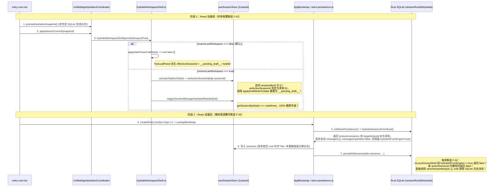

# 02 — 会话水合（Hydration）与持久化链路断层专项审计报告

> **审计范围**：前端从 Rust SQLite 数据库 / Engine Event Store 水合历史消息的全链路（启动编排、工作区壳层恢复、会话懒水合、SQLite 读写与写回保护、内存驱逐、视图作用域绑定）及当前工作区未提交改动（`git diff`）。
> **审计模式**：只读代码取证 + 调用链时序推演（零业务代码修改）。
> **核心结论**：本次排查共定位出 **5 处精确架构断层（3 处 P0 致命断层、2 处 P1 高危断层）**。其中**启动时序倒置叠加视图作用域（`LeafScopeContext`）解耦**直接导致冷启动/恢复工作区时消息无法上屏（停留在 `__pending_draft__` 草稿态或空数组）；**`hydratedFromEngine: true` 穿透懒壳叠加启动即触发 `persistAllSessions`** 则会在满足条件时将 SQLite 中的真实历史消息**物理覆写为空数组 `[]`**，造成永久性消息抹除。

---

## 一、核心断层总览矩阵

| 编号     |    严重度     | 断层名称                                                                                                                                                             | 核心定位 (`文件路径:行号`)                                                                                                                                                                                                                                                                  |            对应审计问题             | 表现症状                                                                                                                                                                                                                                                                                                                                                                                                                                |
| :------- | :-----------: | :------------------------------------------------------------------------------------------------------------------------------------------------------------------- | :------------------------------------------------------------------------------------------------------------------------------------------------------------------------------------------------------------------------------------------------------------------------------------------ | :---------------------------------: | :-------------------------------------------------------------------------------------------------------------------------------------------------------------------------------------------------------------------------------------------------------------------------------------------------------------------------------------------------------------------------------------------------------------------------------------- |
| **F-01** |  **P0 致命**  | **启动时序倒置 + `LeafScopeContext` 作用域解耦**：`hydrateWorkspaceShell` 在 `sessionStore` SQLite 水合完成前抢跑，且 `TreeLeafPanel` 不再回退全局 `activeSessionId` | `entry-core.tsx:186-196`<br>`UnifiedAppHydrationCoordinator.ts:309-315, 412`<br>`hydrateWorkspaceShell.ts:80-89, 150-185`<br>`AppBootstrap.ts:82-86`<br>`store-persistence.ts:170-296`<br>`TreeLeafPanel.tsx:88-92, 384-386`<br>`useChatSessionMeta.ts:37-43`<br>`useChatMessages.ts:57-60` |  问题 1<br>问题 2(b)<br>问题 2(d)   | 1. 默认冷启动（`restoreLastWorkspace=false`）时 SQLite 虽已水合活跃会话，但主面板因无 Tab 恒渲染 `__pending_draft__:<leafId>` 空白草稿页；<br>2. 恢复工作区（`restoreLastWorkspace=true`）时因 `sessionsById` 尚为空，`activateTab` 触发未知 ID 保护重置为草稿态，首屏与分屏预水合全部打空；<br>3. 非主活跃分屏在 `hydrateSessionsFromRust` 完成后因 `useEffect([activeSessionId])` 依赖未变，永远停留在 `messages: []`。               |
| **F-02** |  **P0 致命**  | **`hydratedFromEngine: true` 穿透懒壳 + 启动后立即全量 `persistAllSessions`**，绕过 `isLazySessionShell` 守卫把空数组 `[]` 写回 SQLite                               | `sessionRustDbHydrate.ts:32-40, 158-181, 298-319`<br>`store-persistence.ts:297-301`<br>`sessionRustDbWriteGuard.ts:68-73`<br>`sessionLocalStorage.ts:240`                                                                                                                                   |       问题 2(a)<br>问题 2(b)        | 凡是曾从 Engine 水合过（索引或 SQLite 行带 `hydratedFromEngine: true`）的非活跃会话，在下次启动构建懒壳（`messages: [], messagesHydrated: false`）时被 `isLazySessionShell` 误判为**非懒壳（`return false`）**，紧接着被 `store-persistence.ts:297` 的 `persistAllSessions` 调用 `saveSessionBody(id, [], null)` **将 SQLite 里的历史消息物理清空为 `[]`**！                                                                            |
| **F-03** |  **P0 高危**  | **`sessionActivateHydrate.ts` 卫语句与失败兜底提前锁死 `messagesHydrated = true`**，且 `loadSessionBody` 吞掉 IPC 异常返回 `[]`                                      | `sessionActivateHydrate.ts:65-71, 111-183`<br>`sessionRustDbSql.ts:77-102`<br>`store-persistence.ts:224-253`                                                                                                                                                                                | 问题 2(a)<br>问题 2(b)<br>问题 2(d) | 1. `store-persistence.ts:236-252` 合并会话时漏拷贝 `messagesHydrated`（变为 `undefined`），导致 `shouldSkipSessionHydrate`（`messagesHydrated !== false`）在 `hydratedFromEngine === true` 或含单条乐观消息时直接跳过水合；<br>2. `loadSessionBody` IPC 报错不抛异常而是返回 `[]`，导致 `triggerSessionMessageHydrateIfNeeded` 误判数据库为空，并在 Phase 2 结束后强写 `messagesHydrated = true`，永久锁死空屏并触发空数组覆写 SQLite。 |
| **F-04** |  **P1 高危**  | **新 `sessionEviction.ts` 完全未接线（孤岛死代码）**，生产路径仍调用旧 `sessionMessageEviction.ts`，无视分屏可见叶与流式状态强行驱逐消息                             | `sessionEviction.ts:1-212`<br>`sessionCrudActions.ts:40-41, 164-177`<br>`sessionMessageEviction.ts:4-47`<br>`sessionStateActions.ts:115-128`                                                                                                                                                |              问题 2(c)              | 1. `sessionCrudActions.ts:168` 硬编码传入 `new Set()` 作为 `streamingSessionIds`，正在流式生成的后台/分屏会话被驱逐；<br>2. 旧驱逐器不检查 `LayoutTreeStore` 分屏可见叶，多栏分屏下非焦点分屏会话一旦超出 `KEEP_K` 即被清空为 `messages: []` 且无法自动重水合；<br>3. 旧驱逐器只统计 `hydratedFromEngine === true`，对仅从 SQLite Phase 1 水合的会话失效。                                                                              |
| **F-05** | **P1 中高危** | **`sessionRustDbWire.ts` 丢弃 `engineSequence` 持久化**，导致每次从 SQLite 水合必然触发 `healMessagesCausalOrder` 全会话重排与角色 1:1 强行交错                      | `sessionRustDbWire.ts:37-58, 167-187, 241-272`<br>`sessionHydrationMessages.ts:201-324`                                                                                                                                                                                                     |       问题 2(b)<br>问题 2(d)        | SQLite `session_messages` 不保存 `engineSequence`，读出时 `allHaveUniqueSeq` 恒为 `false`。一旦会话含连续助手消息（如上下文注入载体、工具拆包或撤回后重发）或混合 ID 格式，`isCausalGroupCorrupted(healed)` 对整段会话触发 `healCausalGroup`，将所有 user/assistant 消息按 ID 强行 1:1 交错重排并固化错误 `engineSequence`。                                                                                                            |

---

## 二、问题 1 专项审计：未提交改动与水合/持久化文件逐一排查

### 1.1 `apps/crish-desktop/src/app/UnifiedAppHydrationCoordinator.ts`（工作区已修改）

- **改动内容**（`UnifiedAppHydrationCoordinator.ts:276-288, 309-315, 405-419`）：
  - 新增 `readPersistedLayoutTree()` 读取 `localStorage` 中的 `crish-layout-tree-storage`。
  - 在 `preloadHydrationSnapshot()` 中并行执行 `hydratePreferences()`, `hydrateSettings()`, `hydrateRecentWorkspaces()`, `readPersistedLayoutTree()`。
  - 在 `applyAtomicCommit(snapshot)` 的同步 `batch()` 块末尾（第 412 行）新增调用 `hydrateWorkspaceShell(snapshot.persistedLayoutTree)`。
- **断层判定（F-01 根因之一）**：
  - `UnifiedAppHydrationCoordinator.ts` **完全没有纳入 `sessionStore` 的 SQLite 水合（`initStorePersistence` / `hydrateSessionsFromRust`）**！
  - 在 `entry-core.tsx:186-190` 中，`preloadHydrationSnapshot()` 和 `applyAtomicCommit(snapshot)` 是在 `createRoot(rootEl).render(<App />)` **之前**执行的。
  - 此时 `<App />` 尚未挂载，`useAppBootstrap`（`AppBootstrap.ts:82-86`）中的 `initStorePersistence(useSessionStore)` 根本还没运行！
  - 同时，`sessionStore.ts:82-99` 的 Zustand `withPersist` `merge` 钩子明确注释并物理拦截了从 `localStorage` 恢复任何会话列表（`sessions` 保持初始 `[]`，`sessionsById` 保持 `{}`）。
  - **直接后果**：当 `UnifiedAppHydrationCoordinator.ts:412` 调用 `hydrateWorkspaceShell()` 时，`useSessionStore.getState().sessions` **100% 是空数组 `[]`**，`sessionsById` **100% 是空对象 `{}`**！

### 1.2 `apps/crish-desktop/src/app/hydrateWorkspaceShell.ts`（工作区新文件/未跟踪）

- **代码逻辑**（`hydrateWorkspaceShell.ts:68-193`）：
  - **路径 A（`restoreLastWorkspace !== true`，默认值为 `false`，见 `settingsStore.ts:210`）**：
    - 第 80-89 行调用 `applySafeCleanColdStart()`，将 `LayoutTreeStore` 重置为单个空白叶子 `{ type: 'leaf', id: leafId, panelType: 'chat', tabs: [], activeTabId: '' }`，并将 `WorkspaceShellStore` 的 `tabs` 置为 `[]`。
  - **路径 B（`restoreLastWorkspace === true`）**：
    - 第 137-155 行恢复持久化的分屏布局树与 tabs，随后在第 150 行调用 `root.shell.activateTab(firstTabId)`。
    - 第 157-160 行对当前焦点叶调用 `triggerSessionMessageHydrateIfNeeded(activeTab.sessionId)`。
    - 第 164-185 行将其他可见分屏叶的 `activeTab.sessionId` 排入 `staggeredIdleQueue` 依次调用 `triggerSessionMessageHydrateIfNeeded(sid)`。
- **断层判定（F-01 核心断层）**：
  1. **路径 A 下主视口永远卡在 `__pending_draft__` 草稿页**：
     - `applySafeCleanColdStart()` 创建的唯一 `ChatLeaf` 没有 Tab（`tabs: []`, `activeTabId: ''`）。
     - 稍后 `<App />` 挂载，`store-persistence.ts:190-218, 295` 从 SQLite 水合了会话列表与上次活跃会话的消息，并调用 `useSessionStore.getState().setActiveSessionId(after.activeSessionId)`，但第 290 行明确写着 `/* 冷启动保留上次选中会话 ID 供列表高亮，但不建 shell tab，主屏呈空态 */`。
     - 而在当前架构下，`TreeLeafPanel.tsx:88-92, 384-386` 通过 `<LeafScopeProvider leafId={leaf.id} sessionId={effectiveSessionId}>` 向子组件注入会话作用域，其中 `effectiveSessionId = activeTab?.sessionId || mintDraftSessionId(leaf.id)`（即 `__pending_draft__:<leaf.id>`）！
     - `useChatSessionMeta.ts:37-43` 与 `useScopedSessionField.ts:35-38` 均优先读取 `LeafScopeContext.sessionId`，**不再回退到全局 `useSessionStore.activeSessionId`**！
     - 结果：即便 SQLite 里有历史会话且 `store-persistence.ts` 已经把 `activeSessionId` 的消息水合进了 `useSessionStore`，主聊天面板读取的却是 `__pending_draft__:<leafId>`，在 `sessionsById` 中查不到该草稿 ID，直接渲染空白新对话页！
  2. **路径 B 下首屏激活与后台分屏预水合 100% 打空**：
     - 因为 `hydrateWorkspaceShell()` 运行在 `initStorePersistence` 之前，此时 `useSessionStore.getState().sessionsById` 为 `{}`。
     - 第 150 行 `root.shell.activateTab(firstTabId)` 内部调用 `syncSessionFromActiveLeaf` → `useSessionStore.getState().setActiveSessionId(tab.sessionId)`（`workspaceShellStore.ts:81-94`）。
     - 进入 `sessionCrudActions.ts:128-161` 的 `setActiveSessionId`：第 138 行检测到 `!state.sessionsById[id]`，判定为“未知 ID”（`skipped = true`），第 140 行直接调用 `applyDraftModeToState(state, { draftLeafId: activeLeafId })` 将全局 `activeSessionId` 强行改写为 `__pending_draft__`！
     - 紧接着第 159 行和第 178 行调用的 `triggerSessionMessageHydrateIfNeeded(sid)` 在 `sessionActivateHydrate.ts:91-94` 检查 `const sess = store.getSessionById(id); if (!sess) return;` —— 因 `sessionsById` 为空，**所有首屏水合与分屏后台水合请求全部静默早退（100% 沦为 no-op）**！
  3. **路径 B 下非主活跃分屏永远无法恢复显示消息**：
     - 稍后 `<App />` 挂载完成，`store-persistence.ts:172` 执行 `hydrateSessionsFromRust()`，但它只对**单个** `targetActiveId`（`sessionRustDbHydrate.ts:144-155`）调用了 `ensureSessionBodyHydrated`，其余所有会话均以 `messages: [], messagesHydrated: false` 的懒壳形式写入 `sessionStore`。
     - 对于分屏中打开的其他会话面板，`useChatMessages.ts:57-60` 中的兜底水合副作用为：
       ```ts
       useEffect(() => {
         if (!activeSessionId || isDraftSessionId(activeSessionId)) return;
         triggerSessionMessageHydrateIfNeeded(activeSessionId);
       }, [activeSessionId]);
       ```
     - 该 `useEffect` 在 `<App />` 首次渲染时已经跑过一次（当时 `sessionsById` 为空，静默早退）；当 `hydrateSessionsFromRust()` 把懒壳写入 `sessionStore` 后，由于分屏叶的 `activeSessionId`（来自 `activeTab.sessionId`）字符串并未发生改变，**`useEffect` 不会重新触发**！导致除 `targetActiveId` 外的其他分屏面板永远停留在 `messages: []` 空屏状态！

### 1.3 `apps/crish-desktop/src/store/sessionActivateHydrate.ts`（工作区已修改）

- **改动内容**（`sessionActivateHydrate.ts:65-71, 102-183`）：
  - 新增 `shouldSkipSessionHydrate(sess)`：
    ```ts
    export function shouldSkipSessionHydrate(
      sess: Pick<
        ChatSession,
        'messages' | 'messagesHydrated' | 'hydratedFromEngine'
      >
    ): boolean {
      const hasMessages =
        Array.isArray(sess.messages) && sess.messages.length > 0;
      return (
        sess.messagesHydrated !== false &&
        (hasMessages || sess.hydratedFromEngine === true)
      );
    }
    ```
  - 在 `triggerSessionMessageHydrateIfNeeded` 中串联 Phase 1（`ensureSessionBodyHydrated` 读 SQLite `session_messages`）与 Phase 2（当 `sqlMessages.length === 0 && sessAfterSql.hydratedFromEngine !== true` 时调用 `hydrateSessionMessagesFromEngine` 读 Rust Engine Events）。
- **断层判定（F-03 核心断层）**：
  1. **`messagesHydrated !== false` 对 `undefined` 失守**：
     - 在 `store-persistence.ts:224-263`（当 `cur.sessions.length > 0` 合并 `restored.sessions` 时），第 236-252 行手工枚举了从 `restored` 合并到已有 `s` 的字段（`title`, `messages`, `updatedAt`, `folderId`, `streaming` 等），**唯独漏掉了 `messagesHydrated` 和 `hydratedFromEngine`**！
     - 若某会话在 `cur.sessions` 中 `messagesHydrated` 为 `undefined`，且带有 1 条刚注入的乐观消息或 `hydratedFromEngine === true`，`sess.messagesHydrated !== false` 即为 `true`，导致 `shouldSkipSessionHydrate` 直接返回 `true`，永久跳过 SQLite 历史消息水合！
  2. **Phase 1 IPC 异常被静默吞没为 `[]`，并被 Phase 2 永久锁死为 `messagesHydrated = true`**：
     - `ensureSessionBodyHydrated(id)` 底层调用 `loadSessionBody(id)`（`sessionRustDbSql.ts:77-102`）。
     - 查看 `sessionRustDbSql.ts:94-101`：当 `invokeDb('session_db_load_body', ...)` 抛出 IPC 错误（例如启动期数据库锁竞争、超时或反序列化错误）时，`catch (e)` **仅打印 `console.warn` 并直接 `return []`，根本不向上抛出异常**！
     - 因此 `sessionActivateHydrate.ts:114` 的 `catch` 块永远捕获不到 `loadSessionBody` 的失败，`sqlMessages` 静默变成 `[]`！
     - 随后进入第 144 行分支判断：
       - **情况 1**：若该懒壳从索引恢复了 `hydratedFromEngine === true`（见 F-02），则跳过第 144 行 `if`，直接落入第 173 行 `else if (sessAfterSql && sessAfterSql.messagesHydrated === false)`，执行 `s.messagesHydrated = true`！
       - **情况 2**：若 `hydratedFromEngine !== true`，进入 Phase 2 调用 `hydrateSessionMessagesFromEngine(id)`；若该会话是旧版纯 SQLite 会话或 Engine Event Store 中无事件（返回 `{ ok: true, messages: [] }`），第 164-165 行执行 `s.messagesHydrated = true; s.hydratedFromEngine = true;`！
     - **致命后果**：一旦单次读取返回 `[]`，该空会话立即被盖上 `messagesHydrated = true` 的戳：
       1. 后续任何 `triggerSessionMessageHydrateIfNeeded(id)` 调用在 `shouldSkipSessionHydrate` 处直接被拒之门外，用户切换 Tab 再也无法恢复消息；
       2. `isLazySessionShell`（`sessionRustDbHydrate.ts:32-40`）因 `messagesHydrated === true` 立即返回 `false`，解除写回保护，下一次自动保存就会把 `messages: []` 写回 SQLite 覆盖原有历史数据！

### 1.4 `apps/crish-desktop/src/api/session-persistence/sessionRustDbHydrate.ts`（关联核心未修改文件，与改动产生致命耦合）

- **代码定位**：
  - `isLazySessionShell`（第 32-40 行）：
    ```ts
    export function isLazySessionShell(
      session: Pick<
        ChatSession,
        'id' | 'messages' | 'messagesHydrated' | 'hydratedFromEngine'
      >,
      activeSessionId: string
    ): boolean {
      const msgs = Array.isArray(session.messages) ? session.messages : [];
      if (msgs.length > 0) return false;
      if (
        session.messagesHydrated === true ||
        session.hydratedFromEngine === true
      )
        return false;
      if (session.id === activeSessionId) return false;
      return true;
    }
    ```
  - `hydrateSessionsFromRust`（第 158-181 行）：
    ```ts
    const hydrated: ChatSession[] = index.sessions.map((e) => {
      const isTarget = Boolean(targetActiveId && e.id === targetActiveId);
      const rawMsgs = isTarget ? activeMessages : [];
      ...
      return {
        ...
        messages: msgs,
        messagesHydrated: isTarget,
        ...
        ...(e.hydratedFromEngine !== undefined ? { hydratedFromEngine: e.hydratedFromEngine } : {}),
      };
    });
    ```
- **断层判定（F-02 P0 致命数据抹除漏洞）**：
  - 当会话通过 Phase 2 水合过一次后，`hydratedFromEngine: true` 会被持久化写入 `localStorage` 会话索引（`sessionLocalStorage.ts:240`）以及 SQLite `sessions.hydrated_from_engine` 列（`sessionRustDbWire.ts:98, 152`）。
  - 下次应用启动执行 `hydrateSessionsFromRust()` 时，对于所有**非活跃会话**（`isTarget === false`），构造出的 `ChatSession` 对象同时具有：
    - `messages: []`
    - `messagesHydrated: false`（明确标记为尚未水合消息体的懒壳！）
    - `hydratedFromEngine: true`（从持久化索引 `e.hydratedFromEngine` 原样拷贝而来！）
  - 紧接着在 `store-persistence.ts:297`：启动水合刚完成，立即调用 `void persistAllSessions(after.sessions, after.activeSessionId, after.folderOrder)`！
  - 进入 `persistAllSessionsRust`（`sessionRustDbHydrate.ts:298-319`）：
    - 第 299 行计算 `shouldSaveBody = msgs.length > 0 || !isLazySessionShell(s, activePersistable)`。
    - 调用 `isLazySessionShell(s, activePersistable)`：尽管 `s.messagesHydrated === false` 且 `s.messages` 为 `[]`，但第 37 行判断 `if (session.messagesHydrated === true || session.hydratedFromEngine === true) return false;`！
    - 因为 `s.hydratedFromEngine === true`，**`isLazySessionShell` 竟返回 `false`（认为它不是懒壳，而是用户主动清空了消息的已水合会话）**！
    - 于是 `shouldSaveBody` 变为 `true`！
    - 再加上进程刚启动时内存态 `lastSavedBodyFingerprint` Map 为空，`isSessionBodyDirty(s.id, bodyFp)` 返回 `true`，且 `lastSavedBatchVersion` 为空（`batchVersion = null`，在 `sessionRustDbWriteGuard.ts:68-73` 中 `expectedBatchVersion === null` 代表强制 rebase 跳过 CAS 校验），第 303 行直接执行：
      ```ts
      await saveSessionBody(s.id, [], null);
      ```
    - **Rust 端 `session_db_save_body` 在事务中执行 `DELETE FROM session_messages WHERE session_id = ?1` 并写入 0 条记录**！所有非活跃且带有 `hydratedFromEngine: true` 标记的历史会话消息，在应用重启瞬间被**静默、批量、永久清空**！

### 1.5 `apps/crish-desktop/src/api/session-persistence/sessionHydrationMessages.ts`（工作区已修改）

- **改动内容**（`sessionHydrationMessages.ts:116-324`）：
  - 新增 `parseComparableId`, `isCausalGroupCorrupted`, `healCausalGroup`, `healMessagesCausalOrder`。
  - 在 `sanitizeMessagesForHydrate` 末尾（第 369 行）对所有水合消息调用 `healMessagesCausalOrder(out)`。
- **断层判定（F-05 因果重排误伤真实消息序）**：
  1. **`sessionRustDbWire.ts` 未持久化 `engineSequence`**：
     - 检查 `sessionRustDbWire.ts:37-58`（`RustSessionMessage` 接口）、`167-187`（`messageToRust`）和 `241-272`（`rustToMessage`）：SQLite 序列化层**完全没有读写 `engineSequence` 字段**！
     - 因此，任何从 SQLite `loadSessionBody` 读出的历史消息，其 `engineSequence` **100% 为 `undefined`**。
  2. **`healMessagesCausalOrder` 退化为全会话桶重排**：
     - 在 `healMessagesCausalOrder`（`sessionHydrationMessages.ts:250-324`）中，第 253 行检查 `allHaveUniqueSeq` 恒为 `false`。
     - 第 279-302 行按 `engineSequence` 分组时，由于所有消息都没有 `engineSequence`，所有消息的 `lastAnchorSeq` 全部是 `-1`，整段会话的所有消息被放进同一个桶 `groups.get(-1)`。
     - 更严重的是第 307-309 行：
       ```ts
       if (isCausalGroupCorrupted(healed)) {
         healed = healCausalGroup(healed);
       }
       ```
     - 查看 `isCausalGroupCorrupted`（第 201-227 行）：
       - 只要会话中出现 `seenAssts > seenUsers && seenUsers < totalUsers`（第 210 行）——例如：用户使用了上下文注入（`addContextInjection` 会插入一条 `role: 'assistant', isContextInjection: true` 的载体消息，见 `sessionMessageActions.ts:392-399`）、或者某轮对话產生了两条助手消息、或者删除/回滚了某条用户消息——就会立即被判定为 `isCausalGroupCorrupted === true`！
       - 或者只要会话中混用了不同格式的 ID（如 UUID / `inject-...` 与时间戳 ID）导致字符串或数值比较出现 `minUserId > maxAsstId`（第 215-225 行），也会被判定为 `true`！
     - 一旦触发 `healCausalGroup(healed)`（第 229-244 行），它会把**整个会话的所有 `user` 消息和 `assistant` 消息全部拆开排序，再按 1:1 强行交错拼接**，最后在第 314-323 行固化打上 `engineSequence: 0, 1, 2...`！这会彻底打乱含上下文注入或多轮工具/助手消息的真实历史顺序。

### 1.6 `apps/crish-desktop/src/api/sessionEventHydrate.ts`（工作区未修改，与 `sessionActivateHydrate.ts` 耦合）

- **代码逻辑**（`sessionEventHydrate.ts:43-97`）：
  - 调用 `listSessionEvents(sessionId, 0)` 从 Rust 端拉取事件并投影为 `ChatMessage[]`。
- **隐患点**：
  - 当 `events.length === 0` 时返回 `{ ok: true, messages: [], lastSeq: 0 }`（第 61-63 行）。
  - 在 `sessionActivateHydrate.ts:154-169` 中，未区分“该会话本来就是从未走过 Engine Event 的纯 SQLite 历史会话（因 Phase 1 IPC 偶发失败误入 Phase 2）”与“真正为空的新会话”，当收到 `{ ok: true, messages: [] }` 时直接将 `s.messagesHydrated = true; s.hydratedFromEngine = true` 写入 store，锁死空状态。

### 1.7 `apps/crish-desktop/src/store/sessionEviction.ts` & `sessionEvictionProbes.ts`（工作区新文件/未跟踪） vs `sessionMessageEviction.ts` & `sessionCrudActions.ts`

- **代码核查（F-04 核心断层）**：
  - 新文件 `apps/crish-desktop/src/store/sessionEviction.ts`（第 1-212 行）和 `sessionEvictionProbes.ts`（第 1-94 行）实现了完整的三级保护驱逐策略（保护当前焦点 `activeSessionId`、所有正在流式生成的 `getActiveStreamingSessionIds`、所有分屏可见叶 `getVisibleSplitSessionIds`、以及后台 Tab 软保护）。
  - **然而，全局搜索 `sessionEviction` 发现：除测试文件外，没有任何生产代码导入或调用了 `sessionEviction.ts` 或 `sessionEvictionProbes.ts`！**
  - 相反，`apps/crish-desktop/src/store/sessionCrudActions.ts:40-41, 164-177` 仍然在调用旧的 `findInactiveHydratedSessionIdsToEvict`（位于 `sessionMessageEviction.ts:4-47`）和 `evictSessionMessagesInState`（位于 `sessionStateActions.ts:115-128`）：
    ```ts
    // apps/crish-desktop/src/store/sessionCrudActions.ts:166-176
    const toEvict = findInactiveHydratedSessionIdsToEvict(
      state.sessions,
      state.sessionsById,
      id,
      new Set(), // <--- 硬编码空集合！正在流式生成的会话完全不设防！
      SESSION_HYDRATE_KEEP_K
    );
    for (const evictId of toEvict) {
      evictSessionMessagesInState(state, evictId);
    }
    ```
  - **直接后果**：
    1. **流式会话被中途清空**：第 168 行硬编码传入 `new Set()`，当用户在流式生成过程中连续切换几个历史会话时，后台或分屏中正在流式输出的会话一旦超过 `SESSION_HYDRATE_KEEP_K`（8 个），其 `messages` 数组会被 `evictSessionMessagesInState` 当场清空为 `[]`！
    2. **多栏分屏可见会话被当场清空且不恢复**：旧 `findInactiveHydratedSessionIdsToEvict` 只排除了单个 `activeSessionId`，完全不知道 `LayoutTreeStore` 中还有其他可见分屏叶。当非焦点分屏中的会话被驱逐（`messages = [], messagesHydrated = false`）后，因为该分屏组件的 `activeSessionId` prop 并未改变，`useChatMessages.ts:57-60` 的 `useEffect([activeSessionId])` 不会重新运行，导致**用户眼前正在看着的副分屏聊天记录突然消失变白**！
    3. **驱逐统计口径分裂**：旧 `sessionMessageEviction.ts:21, 41` 仅检查 `full.hydratedFromEngine === true`，对于只从 SQLite 水合（`messagesHydrated: true`，但 `hydratedFromEngine` 为 `undefined`）的会话既不纳入预算也不设置 `messagesHydrated = false`。

### 1.8 `apps/crish-desktop/src/store/sessionActions.ts` & `sessionCrudActions.ts` & `sessionStateActions.ts`（工作区已修改）

- **改动内容与断层交互**：
  - `sessionCrudActions.ts:128-161` 的 `setActiveSessionId` 增加了对未知会话 ID 的拦截：当 `!state.sessionsById[id]` 时，设置 `skipped = true` 并调用 `applyDraftModeToState(state, { draftLeafId: activeLeafId })` 将状态切回 `__pending_draft__`。
  - 这一改动与 **F-01（启动时序倒置）** 产生了正面碰撞：启动时 `hydrateWorkspaceShell` 先于 `hydrateSessionsFromRust` 调用 `activateTab` → `setActiveSessionId`，此时 `sessionsById` 尚为空对象 `{}`，所有持久化的合法 Tab 会话 ID 全部被误判为“未知 ID”并打入草稿模式！

---

## 三、问题 2 四大核心场景逐项根因解答

### 2(a) 是否存在“水合尚未完成前，空消息数组 `[]` 被自动保存回写到 SQLite 覆盖原有消息”的竞态漏洞？

**结论：存在，且有两条确定性触发路径（P0 致命漏洞 F-02 与 F-03）！**

#### 路径一：`hydratedFromEngine: true` 穿透懒壳 + 启动即调 `persistAllSessions`（最危险、批量抹除）

1. **前置条件**：任意会话曾触发过 Engine Event 水合（或迁移），其 `hydratedFromEngine: true` 已被持久化在 `localStorage` 索引（`sessionLocalStorage.ts:240`）和 SQLite `sessions.hydrated_from_engine` 列（`sessionRustDbWire.ts:98`）。
2. **启动构造懒壳**：下次启动执行 `hydrateSessionsFromRust`（`sessionRustDbHydrate.ts:158-181`）时，所有非当前焦点会话（`isTarget === false`）被构造成：
   ```ts
   { id: e.id, messages: [], messagesHydrated: false, hydratedFromEngine: true, ... }
   ```
3. **守卫失效**：在 `isLazySessionShell`（`sessionRustDbHydrate.ts:32-40`）中：
   ```ts
   if (session.messagesHydrated === true || session.hydratedFromEngine === true)
     return false;
   ```
   因为 `session.hydratedFromEngine === true`，该函数对这个 **`messagesHydrated: false` 的未水合空壳返回了 `false`（判定为非懒壳）**！
4. **启动立即写回覆盖**：`store-persistence.ts:297` 在 `hydrateSessionsFromRust` 返回后立即调用 `void persistAllSessions(after.sessions, after.activeSessionId, after.folderOrder)`。
5. **物理抹除**：`persistAllSessionsRust`（`sessionRustDbHydrate.ts:299-304`）计算出 `shouldSaveBody = !isLazySessionShell(...) = true`，且启动首次保存 `batchVersion = null`（跳过 CAS 守护），直接执行 `await saveSessionBody(s.id, [], null)`，将该会话在 SQLite `session_messages` 表中的所有历史消息**全部删除并覆写为空**！

#### 路径二：`loadSessionBody` 吞错返回 `[]` + `messagesHydrated = true` 强行落锁

1. **`loadSessionBody` 吞掉异常**：`sessionRustDbSql.ts:94-101` 在 IPC 调用 `session_db_load_body` 失败时 catch 住错误并返回 `[]`（而非 reject）。
2. **激活水合或启动水合误判**：
   - 在启动时：`hydrateSessionsFromRust`（`sessionRustDbHydrate.ts:148-154, 169`）将 `targetActiveId` 的 `messages` 置为 `[]`、**`messagesHydrated` 置为 `true`**；
   - 在切换会话时：`triggerSessionMessageHydrateIfNeeded`（`sessionActivateHydrate.ts:112, 164, 174`）收到 `[]` 后同样将 **`messagesHydrated` 置为 `true`**。
3. **覆写数据库**：一旦 `messagesHydrated` 变为 `true`（或 `s.id === activePersistable`，见 `isLazySessionShell` 第 38 行 `if (session.id === activeSessionId) return false;`），`isLazySessionShell` 立即返回 `false`。紧接着 `store-persistence.ts:297` 的启动保存或 320ms 防抖订阅保存就会把 `[]` 写入 SQLite，覆盖原本存在的历史消息！
   - _注_：尤其注意 `isLazySessionShell` 第 38 行 `if (session.id === activeSessionId) return false;` —— 这意味着**哪怕焦点会话是一个 `messages: [], messagesHydrated: false` 的未水合懒壳，只要它成为了 `activeSessionId`，`isLazySessionShell` 也会返回 `false`，允许把 `[]` 写回 SQLite**！

---

### 2(b) 是否存在“会话列表索引（Index）已水合，但当前激活会话的 `messages` 懒加载未触发或静默失败，导致界面显示为空会话”？

**结论：存在，共有 4 条独立断层路径会导致该现象（F-01、F-03）：**

1. **冷启动无 Tab 导致视口绑定到 `__pending_draft__`（F-01 分支 A）**：
   - 默认设置 `restoreLastWorkspace === false` 下，`hydrateWorkspaceShell.ts:80-89` 将唯一 `ChatLeaf` 的 `tabs` 清空为 `[]`。
   - 稍后 `store-persistence.ts:190-296` 虽然水合了会话列表索引和 `activeSessionId` 的消息，但未创建 Shell Tab。
   - `TreeLeafPanel.tsx:88-92` 计算 `effectiveSessionId = activeTab?.sessionId || mintDraftSessionId(leaf.id)` 得到 `__pending_draft__:<leafId>`，并通过 `LeafScopeContext` 传给 `useChatSessionMeta` 和 `useChatMessages`。
   - 结果：侧边栏显示会话已选中，但主聊天区读取的是草稿 ID，界面完全空白！
2. **恢复工作区时 `hydrateWorkspaceShell` 抢跑在 SQLite 水合之前（F-01 分支 B）**：
   - `restoreLastWorkspace === true` 时，`hydrateWorkspaceShell.ts:150-185` 在 `<App />` 挂载前运行，此时 `useSessionStore.getState().sessionsById` 为 `{}`。
   - `triggerSessionMessageHydrateIfNeeded` 在 `sessionActivateHydrate.ts:91-94` 因 `!store.getSessionById(id)` 全部静默 `return`。
   - 稍后 `hydrateSessionsFromRust` 仅水合了单个 `targetActiveId`；其余分屏叶中的可见会话虽然在 `sessionStore` 中有了懒壳（`messages: [], messagesHydrated: false`），但因分屏组件的 `activeSessionId` 未变，`useChatMessages.ts:57-60` 的 `useEffect([activeSessionId])` 不再触发，永远停留在空屏。
3. **`store-persistence.ts` 合并分支漏拷贝 `messagesHydrated` 导致 `shouldSkipSessionHydrate` 误跳过（F-03）**：
   - 当 `store-persistence.ts:224` 走 `cur.sessions.length > 0` 合并分支时，第 236-252 行漏拷贝了 `restored` 的 `messagesHydrated` 字段。若内存中该会话的 `messagesHydrated` 为 `undefined` 且带有 `hydratedFromEngine: true`，`shouldSkipSessionHydrate`（`sess.messagesHydrated !== false && ...`）直接返回 `true`，导致点击切换该会话时懒加载根本不触发。
4. **`loadSessionBody` IPC 异常被静默吞为 `[]` 并锁死 `messagesHydrated = true`（F-03）**：
   - `sessionRustDbSql.ts:94-101` 吞掉异常返回 `[]` 后，`sessionActivateHydrate.ts:164, 174` 将 `messagesHydrated` 设为 `true`，导致界面显示为空且后续切入不再重试水合。

---

### 2(c) `sessionEviction.ts` 是否误驱逐了当前可见或正在使用的会话消息？

**结论：是的！因为新的 `sessionEviction.ts` 根本没有接入生产代码，当前生效的仍是旧版 `sessionMessageEviction.ts`（断层 F-04）：**

1. **新模块未接线**：`apps/crish-desktop/src/store/sessionEviction.ts` 和 `sessionEvictionProbes.ts` 在生产代码中 **0 引用**。
2. **旧驱逐器 `sessionMessageEviction.ts` 在 `sessionCrudActions.ts:166-176` 中造成两类误驱逐**：
   - **误驱逐多栏分屏中的可见会话**：旧 `findInactiveHydratedSessionIdsToEvict` 只排除了当前传入的单个 `activeSessionId`（第 37 行 `if (s.id === activeSessionId) continue;`），完全不感知 `LayoutTreeStore` 中正在并排显示的副分屏会话。当已水合会话数超过 `SESSION_HYDRATE_KEEP_K`（8 个）时，副分屏正在显示的会话消息被直接清空为 `messages: []`；且因为副分屏的 `activeSessionId` 未变，不会触发重新水合，副分屏当场变白屏！
   - **误驱逐正在流式生成的会话**：`sessionCrudActions.ts:168` 调用 `findInactiveHydratedSessionIdsToEvict` 时第 4 个参数 `streamingSessionIds` **硬编码传了 `new Set()`**！导致正在后台或副分屏流式输出响应的会话完全失去流式保活保护，消息在中途被直接清空！

---

### 2(d) `UnifiedAppHydrationCoordinator` 与 `hydrateWorkspaceShell` 在恢复工作区/分屏标签时，是否把已有关联会话的 Leaf 重置成了 Draft 或空会话？

**结论：是的，在冷启动和恢复工作区两条路径下均发生了重置或错位（断层 F-01）：**

1. **当 `restoreLastWorkspace === true`（恢复分屏/标签）时**：
   - `UnifiedAppHydrationCoordinator.ts:412` 在 `sessionStore` 水合前调用 `hydrateWorkspaceShell(snapshot.persistedLayoutTree)`。
   - `hydrateWorkspaceShell.ts:150` 调用 `root.shell.activateTab(firstTabId)` → `syncSessionFromActiveLeaf` → `useSessionStore.getState().setActiveSessionId(tab.sessionId)`。
   - 在 `sessionCrudActions.ts:138-146` 中，由于此时 `state.sessionsById` 为空对象 `{}`，`!state.sessionsById[id]` 为 `true`（判定为未知会话 ID），代码立即执行：
     ```ts
     applyDraftModeToState(state, { draftLeafId: activeLeafId });
     ```
     **将全局 `activeSessionId` 强行重置为 `__pending_draft__:<activeLeafId>`（草稿模式）**！
2. **当 `restoreLastWorkspace === false`（默认冷启动）时**：
   - `hydrateWorkspaceShell.ts:80-89` 的 `applySafeCleanColdStart()` 将布局树重置为单个无 Tab 的空 `ChatLeaf`（`tabs: [], activeTabId: ''`）。
   - 虽然稍后 `store-persistence.ts:295` 恢复了 `useSessionStore` 的 `activeSessionId`，但由于没有同步在活跃 `ChatLeaf` 中挂载或对齐对应的 Tab（或者让未挂载 Tab 的主叶回退读取全局 `activeSessionId`），`TreeLeafPanel.tsx:88` 派生出的 `effectiveSessionId` 始终是 `mintDraftSessionId(leaf.id)`（即 `__pending_draft__:<leafId>`），导致已有关联活跃会话的主面板被固定在 Draft 空会话视图！

---

## 四、全链路断层时序图（Mermaid）



---

## 五、根治修复建议（供主控调度实现波参考）

1. **修复 F-02（最高优先级：阻断空数组写回 SQLite 抹除历史消息）**：
   - **文件**：`apps/crish-desktop/src/api/session-persistence/sessionRustDbHydrate.ts:32-40, 158-181`
   - **修复要点**：
     1. 在 `isLazySessionShell` 中，**只要 `session.messagesHydrated === false` 且 `msgs.length === 0`，无条件返回 `true`（判定为懒壳）**！绝不能因为 `session.hydratedFromEngine === true` 或 `session.id === activeSessionId` 就把一个明确标记为 `messagesHydrated === false` 的未水合空壳当成已水合会话写回数据库！
        ```ts
        export function isLazySessionShell(
          session: Pick<
            ChatSession,
            'id' | 'messages' | 'messagesHydrated' | 'hydratedFromEngine'
          >,
          activeSessionId: string
        ): boolean {
          const msgs = Array.isArray(session.messages) ? session.messages : [];
          if (msgs.length > 0) return false;
          if (session.messagesHydrated === false) return true; // 铁律：明确未水合的空壳绝不允许覆写 SQLite
          if (session.messagesHydrated === true) return false;
          if (session.id === activeSessionId) return false;
          return true;
        }
        ```
     2. 在 `store-persistence.ts:297` 中，刚从 SQLite 水合完成时，如果没有发生本地 `localStorage` 乐观增量合并（即纯从 SQLite 读出），无需立即反向全量 `persistAllSessions` 写回 SQLite；即便写回，也受上述 `session.messagesHydrated === false` 铁律保护。

2. **修复 F-01（对齐启动水合时序与 `LeafScopeContext` 视图绑定）**：
   - **文件**：`apps/crish-desktop/src/app/UnifiedAppHydrationCoordinator.ts`、`apps/crish-desktop/src/app/hydrateWorkspaceShell.ts`、`apps/crish-desktop/src/store/layout-helpers/store-persistence.ts`、`apps/crish-desktop/src/components/chat-card/useChatMessages.ts`
   - **修复要点**：
     1. **时序对齐**：在 `store-persistence.ts` 完成 `hydrateSessionsFromRust()` 并将 `sessions` / `sessionsById` 写入 `useSessionStore` 后，若 `restoreLastWorkspace === true`，应对当前所有打开的 Shell Tab / 分屏叶重新对齐 `syncSessionFromActiveLeaf` 并触发 `triggerSessionMessageHydrateIfNeeded`；或者将 `initStorePersistence` 的索引水合前置到 `UnifiedAppHydrationCoordinator.preloadHydrationSnapshot()` 中，确保 `hydrateWorkspaceShell` 执行时 `sessionsById` 已经就绪。
     2. **分屏懒壳响应式触发水合**：在 `useChatMessages.ts:57-60` 中，不仅监听 `activeSessionId`，还应订阅该会话在 store 中的存在性与 `messagesHydrated` 状态（例如 `const isHydrated = useSessionStore(s => s.sessionsById[activeSessionId]?.messagesHydrated)`），当懒壳写入 store（`isHydrated === false`）时立即触发 `triggerSessionMessageHydrateIfNeeded(activeSessionId)`。
     3. **冷启动首屏一致性**：明确冷启动产品契约——若冷启动恢复了 `activeSessionId`（非 `__pending_draft__`），要么在主 `ChatLeaf` 中同步挂载该会话的 Tab（或让无 Tab 的单叶回退消费全局 `activeSessionId`），要么在冷启动要求纯草稿页时将 `activeSessionId` 也设为草稿 ID，消除“侧边栏高亮历史会话、主视图却因 `LeafScopeContext` 绑定 `__pending_draft__` 显示空白”的状态分裂。

3. **修复 F-03（消除 `loadSessionBody` 静默吞错与 `messagesHydrated` 过早落锁）**：
   - **文件**：`apps/crish-desktop/src/api/session-persistence/sessionRustDbSql.ts:77-102`、`apps/crish-desktop/src/store/sessionActivateHydrate.ts:65-71, 111-183`、`apps/crish-desktop/src/store/layout-helpers/store-persistence.ts:236-252`
   - **修复要点**：
     1. `loadSessionBody` 在 IPC 调用失败时应区分“数据库确无记录（返回 `[]`）”与“IPC/SQL 异常（抛出错误或返回 `{ ok: false }`）”，禁止在异常时返回 `[]` 欺骗上层将其标记为 `messagesHydrated = true`。
     2. `store-persistence.ts:236-252` 在合并 `cur.sessions` 与 `restored.sessions` 时，必须同步合并 `messagesHydrated` 与 `hydratedFromEngine`（若未水合消息体且非 `targetActiveId`，明确保持 `messagesHydrated: false`）。
     3. `shouldSkipSessionHydrate` 应收紧为：`return sess.messagesHydrated === true;`（仅当明确完成水合 `messagesHydrated === true` 时才跳过，禁止用 `messagesHydrated !== false` 放过 `undefined`）。

4. **修复 F-04（接线 `sessionEviction.ts` 替换旧 `sessionMessageEviction.ts`）**：
   - **文件**：`apps/crish-desktop/src/store/sessionCrudActions.ts:40-41, 164-177`
   - **修复要点**：
     1. 将 `sessionCrudActions.ts` 中的旧 `findInactiveHydratedSessionIdsToEvict` 替换为 `sessionEviction.ts` 的 `evictSessionMessagesIfNeeded()`（或在 `setActiveSessionId` / `triggerSessionMessageHydrateIfNeeded` 完成后统一调用 `evictSessionMessagesIfNeeded`），接入 `getActiveStreamingSessionIds`、`getVisibleSplitSessionIds` 与 `getOpenTabSessionIds` 探针，彻底保护分屏可见会话与流式生成会话不被驱逐。
     2. 清理孤岛死代码，保持驱逐状态机单一真理源（SSOT）。

5. **修复 F-05（持久化 `engineSequence` 并收紧 `healMessagesCausalOrder` 触发条件）**：
   - **文件**：`apps/crish-desktop/src/api/session-persistence/sessionRustDbWire.ts`、`apps/crish-desktop/src/api/session-persistence/sessionHydrationMessages.ts:201-324`
   - **修复要点**：
     1. 在 `sessionRustDbWire.ts`（或消息 metadata / JSON 字段）中保留 `engineSequence`，避免每次从 SQLite 水合都丢失序号。
     2. 在 `isCausalGroupCorrupted` 中排除 `isContextInjection === true` 等合法非对称消息，且禁止在无确凿同锚点逆序证据时对整个会话做全局 `healCausalGroup` 1:1 强行交错重排。
