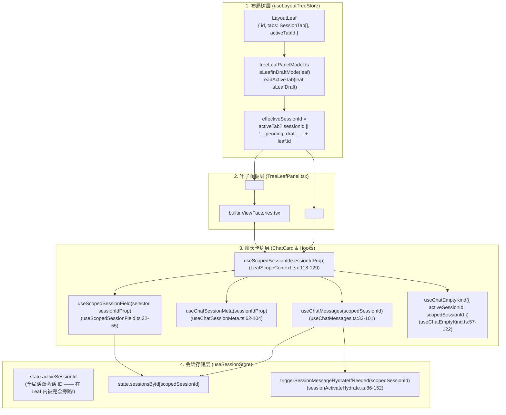

# 05 — 分屏作用域与会话绑定链路专项审计报告

> **审计角色**：多分屏作用域隔离与会话绑定专项审计员
> **审计范围**：`LeafScopeContext`、`TreeLeafPanel`、`treeLeafPanelModel`、`PaneHeader`、`ChatCard`、`useChatSessionMeta`、`useChatSessionActions`、`useScopedSessionField`、`layoutStore`、`sessionTabMigration` 及关联启动/回水/驱逐链路
> **核心问题**：近期 `multi-pane-isolation` 等改动是否切断了分屏叶子（`TreeLeafPanel` / `LeafScopeContext`）与历史会话之间的绑定或激活回水触发器，导致历史会话消息不显示或显示为空态？

---

## 一、核心结论先行（Executive Summary）

本次专项审计确认：**`multi-pane-isolation` 改动在将 `ChatCard` 从全局 `activeSessionId` 切换为叶子作用域（`LeafScopeContext` + `effectiveSessionId`）强绑定后，切断或遗漏了 5 处关键的「会话绑定 / 激活回水 / 缓存引用更新 / 内存保活」契约**，直接导致历史会话在冷启动、工作区恢复、草稿转正、旁路切换、多窗格并存等场景下出现**消息消失、永久卡空态（`session-empty`）或消息未回水（`messages: []`）**。

### 五大断层总览

| 编号     | 断层名称                                                                                       | 严重度      | 触发场景                                                              | 现象表现                                                                                                                                                                                                                                                                | 核心位置                                                                                                                                |
| :------- | :--------------------------------------------------------------------------------------------- | :---------- | :-------------------------------------------------------------------- | :---------------------------------------------------------------------------------------------------------------------------------------------------------------------------------------------------------------------------------------------------------------------- | :-------------------------------------------------------------------------------------------------------------------------------------- |
| **F-01** | **冷启动双源状态撕裂（Leaf Draft 强锁覆盖全局 `activeSessionId`）**                            | **P0 致命** | 默认冷启动（`restoreLastWorkspace = false`）                          | SQLite 已回水最近一条历史会话并设为 `sessionStore.activeSessionId`，但 `TreeLeafPanel` 因 `tabs: []` 强制注入 `__pending_draft__:<leafId>`，完全屏蔽 `sessionStore.activeSessionId`，主画布显示空白落地页                                                               | `TreeLeafPanel.tsx:88-92`<br>`LeafScopeContext.tsx:118-129`<br>`store-persistence.ts:270-295`<br>`hydrateWorkspaceShell.ts:83-90`       |
| **F-02** | **开启工作区恢复时的启动时序竞态与 `useChatMessages` 依赖缺失**                                | **P0 致命** | 开启恢复（`restoreLastWorkspace = true`）且含历史标签/多窗格          | `hydrateWorkspaceShell()` 在 `<App />` 挂载前同步运行，此时 SQLite 尚未回水（`sessionsById` 为空），`triggerSessionMessageHydrateIfNeeded` 沦为空操作；随后 SQLite 仅回水单条 `activeSessionId`，其余分屏/标签因 `scopedSessionId` 未变，永远不再触发回水，消息列表为空 | `entry-core.tsx:187-192`<br>`hydrateWorkspaceShell.ts:94-175`<br>`sessionActivateHydrate.ts:91-93`<br>`useChatMessages.ts:57-60`        |
| **F-03** | **`BinaryTreeWorkspace` 的 `tabsIdentityEqual` 漏判 `sessionId` 导致 `React.memo` 吞掉重渲染** | **P1 高危** | 草稿转正（`promoteDraftTab`）或原地修改 `tab.sessionId` / `tab.title` | `tabsIdentityEqual` 只比对 `tabId` 和 `dock`，未比对 `sessionId`；`stabilizeLeafEntries` 复用旧 `cached.leaf` 引用，`TreeLeafPanel` 的 `React.memo` 跳过渲染，`LeafScopeProvider` 继续持有旧 `__pending_draft__:<leafId>`，转正后的真实会话消息无法显示                 | `BinaryTreeWorkspace.tsx:67-89`<br>`BinaryTreeWorkspace.tsx:113-142`<br>`TreeLeafPanel.tsx:520-526`<br>`layoutTreeTransform.ts:122-136` |
| **F-04** | **多处旁路直调 `setActiveSessionId` 未同步写入布局树（`openOrFocusSession`）**                 | **P1 高危** | 侧边栏右键分支会话、撤回分支、概览页/运行面板跳转会话                 | `sessionStore.activeSessionId` 已切换并触发回水，但当前活跃 `LayoutLeaf` 的 `activeTabId` / `tabs` 未更新，`ChatCard` 被 `LeafScopeContext` 锁死在旧会话或草稿态                                                                                                        | `useSidebarContextMenu.ts:157,164`<br>`useOverviewState.ts:142`<br>`useRuntimePanelData.ts:101`<br>`openAgentPanel.ts:365`              |
| **F-05** | **新旧两套消息内存驱逐器并存，`sessionCrudActions` 仍调用无视分屏的旧驱逐器**                  | **P1 高危** | 多分屏打开超过 `SESSION_HYDRATE_KEEP_K`（8 个）已回水会话并切换焦点   | `sessionCrudActions.ts` 仍导入旧版 `sessionMessageEviction.ts`（仅保护全局 `activeSessionId`，无视分屏可见叶子），将非焦点分屏的 `messages` 清空为 `[]` 且 `messagesHydrated = false`；而被清空的分屏因 `scopedSessionId` 未变，不会重新回水，画面瞬间变白              | `sessionCrudActions.ts:40,164-177`<br>`sessionMessageEviction.ts:4-47`<br>`sessionEviction.ts:135-177`                                  |

---

## 二、问题 (a) 深度解答：`ChatCard` 如何获取 `sessionId` 与 `messages`？

### 1. 完整数据流链路图



### 2. 逐层代码证据与关键机制剖析

#### （1）`TreeLeafPanel` 永远构造非空的 `effectiveSessionId`

在 [TreeLeafPanel.tsx](file:///c:/Software/conex/apps/crish-desktop/src/components/binary-tree/TreeLeafPanel.tsx#L88-L92) 中：

```ts
const isLeafDraft = isLeafInDraftMode(leaf);
const activeTab = readActiveTab(leaf, isLeafDraft);
const effectiveSessionId = activeTab?.sessionId || mintDraftSessionId(leaf.id);
```

结合 [treeLeafPanelModel.ts](file:///c:/Software/conex/apps/crish-desktop/src/components/binary-tree/treeLeafPanelModel.ts#L30-L56)：

- 当 `leaf.tabs.length === 0` 或 `leaf.activeTabId === ''` 时，`isLeafInDraftMode(leaf)` 返回 `true`；
- `readActiveTab(leaf, true)` 返回 `undefined`；
- `mintDraftSessionId(leaf.id)` 返回 `"__pending_draft__:${leaf.id}"`（一个**非空真值字符串**）。
- 随后，[TreeLeafPanel.tsx](file:///c:/Software/conex/apps/crish-desktop/src/components/binary-tree/TreeLeafPanel.tsx#L291-L299) 将 `sessionId: sessionForPanel ?? undefined`（即 `effectiveSessionId`）传入 `chatCtx`，由 [builtinViewFactories.tsx](file:///c:/Software/conex/apps/crish-desktop/src/builtinViewFactories.tsx#L19-L23) 渲染 `<ChatCard sessionId={ctx.sessionId} />`；同时 [TreeLeafPanel.tsx](file:///c:/Software/conex/apps/crish-desktop/src/components/binary-tree/TreeLeafPanel.tsx#L384-L390) 用 `<LeafScopeProvider leafId={leaf.id} sessionId={effectiveSessionId}>` 包裹整棵子树。

#### （2）`useScopedSessionId` 与 `useScopedSessionField` 彻底屏蔽全局 `activeSessionId`

在 [LeafScopeContext.tsx](file:///c:/Software/conex/apps/crish-desktop/src/contexts/LeafScopeContext.tsx#L118-L129) 中：

```ts
export function useScopedSessionId(explicitSessionId?: string | null): string {
  const scope = useContext(LeafScopeContext);
  const globalActiveSessionId = useSessionStore((s) => s.activeSessionId);
  if (
    explicitSessionId !== undefined &&
    explicitSessionId !== null &&
    explicitSessionId !== ''
  ) {
    return explicitSessionId;
  }
  if (scope.inLeafScope && scope.sessionId) {
    return scope.sessionId;
  }
  return globalActiveSessionId;
}
```

由于在 `TreeLeafPanel` 内部，`explicitSessionId`（来自 `ChatCard` 的 `sessionId` prop）和 `scope.sessionId` 恒为非空字符串（真实 `tab.sessionId` 或 `"__pending_draft__:${leaf.id}"`），**`useScopedSessionId` 在分屏叶子内永远不会回退到 `globalActiveSessionId`！**

不仅如此，在 [useScopedSessionField.ts](file:///c:/Software/conex/apps/crish-desktop/src/components/chat-card/useScopedSessionField.ts#L38-L49) 中：

```ts
if (typeof resolveSidOrSessionId === 'function') {
  const resolved = resolveSidOrSessionId(st);
  if (resolved === st.activeSessionId && leafScopedSid) {
    return leafScopedSid;
  }
  return resolved;
}
```

即便上层传入了 `selectActiveSessionId` 函数，只要当前处于 `LeafScope` 内（`leafScopedSid` 非空），`useScopedSessionField` 也会强制将 `st.activeSessionId` 劫持替换为 `leafScopedSid`。

#### （3）`ChatCard` 获取会话元数据与消息列表的完整路径

1. **解析作用域会话 ID**：
   - [ChatCard.tsx](file:///c:/Software/conex/apps/crish-desktop/src/components/chat-card/ChatCard.tsx#L73)：`const scopedSessionId = useScopedSessionId(sessionIdProp);`
2. **读取会话元数据**：
   - [useChatSessionMeta.ts](file:///c:/Software/conex/apps/crish-desktop/src/components/chat-card/useChatSessionMeta.ts#L62-L64)：通过 `useScopedSessionId(sessionIdProp)` 拿到 `activeSessionId`（实为 `scopedSessionId`），再从 `useSessionStore` 的 `s.sessionsById?.[activeSessionId]` 读取 `currentSession`。
   - 当 `scopedSessionId` 为 `"__pending_draft__:<leafId>"` 时，`sessionsById` 中不存在该键，`currentSession` 为 `undefined`。
3. **读取消息列表与触发按需回水**：
   - [ChatCard.tsx](file:///c:/Software/conex/apps/crish-desktop/src/components/chat-card/ChatCard.tsx#L83)：调用 `useChatMessages(scopedSessionId)`。
   - [useChatMessages.ts](file:///c:/Software/conex/apps/crish-desktop/src/components/chat-card/useChatMessages.ts#L34-L60)：
     ```ts
     const rawMessages = useSessionStore((s) => {
       if (!activeSessionId) return EMPTY_MESSAGES;
       const session = getSessionById(s, activeSessionId);
       return session?.messages ?? EMPTY_MESSAGES;
     });
     ...
     useEffect(() => {
       if (!activeSessionId) return;
       triggerSessionMessageHydrateIfNeeded(activeSessionId);
     }, [activeSessionId]);
     ```
4. **计算空态类型（`emptyKind`）**：
   - [useChatEmptyKind.ts](file:///c:/Software/conex/apps/crish-desktop/src/components/chat-card/useChatEmptyKind.ts#L68-L121)：当 `messages.length === 0` 且无流式输出时，若 `isPendingDraftSessionId(activeSessionId)` 为 `true` 或 `!hasActiveSession` 或 `currentSession.messages.length === 0`，返回 `'session-empty'`，渲染空白欢迎落地页。

---

## 三、问题 (b) 深度解答：点击侧边栏会话 vs 应用冷启动时，`TreeLeafPanel` 的 `activeTab` 是否同步更新？是否存在脱节？

**审计结论：严重脱节！** 在 `multi-pane-isolation` 之前，当 `leaf.tabs` 为空时，画布可回退读取 `sessionStore.activeSessionId`；而隔离改造后，**「`sessionStore.activeSessionId` 已指向有效历史会话，但 `TreeLeafPanel` 的 `activeTab` 仍为 `undefined`（`tabs: []`）或停留在旧标签，导致 `LeafScopeContext` 一直停留在 `__pending_draft__:<leafId>`」** 的情况在以下多条路径上真实发生：

### 场景 1：默认冷启动（`restoreLastWorkspace = false`）—— 100% 必现双源状态撕裂（Finding F-01）

1. **布局树被强制重置为空草稿叶子**：
   - [hydrateWorkspaceShell.ts](file:///c:/Software/conex/apps/crish-desktop/src/app/hydrateWorkspaceShell.ts#L47-L90) 与 [layoutTreeStore.ts](file:///c:/Software/conex/apps/crish-desktop/src/store/layout-tree/layoutTreeStore.ts#L70-L79) 中，`readRestoreLastWorkspace()` 默认返回 `false`（除非用户显式开启了 `ui.restoreLastWorkspace`）。
   - 在启动阶段，[hydrateWorkspaceShell.ts](file:///c:/Software/conex/apps/crish-desktop/src/app/hydrateWorkspaceShell.ts#L85) 调用 `applySafeCleanColdStart()`（[layoutRestorePolicy.ts](file:///c:/Software/conex/apps/crish-desktop/src/store/workspace-shell/layoutRestorePolicy.ts#L88-L95)）→ `shellApi.resetToCleanDraft()`（[workspaceShellStore.ts](file:///c:/Software/conex/apps/crish-desktop/src/store/workspace-shell/workspaceShellStore.ts#L294-L310)）。
   - 此时 `layoutTreeStore.tree.root` 被重置为单叶子 `{ id: leafId, tabs: [], activeTabId: '' }`。
2. **随后 SQLite 持久化回水却将 `sessionStore.activeSessionId` 设为历史会话，且故意不建 Tab**：
   - `<App />` 挂载后，[AppBootstrap.ts](file:///c:/Software/conex/apps/crish-desktop/src/app/AppBootstrap.ts#L82-L86) 异步执行 `initLayoutStorePersistence()` → `initStorePersistence()`（[store-persistence.ts](file:///c:/Software/conex/apps/crish-desktop/src/store/layout-helpers/store-persistence.ts#L170-L306)）。
   - `hydrateSessionsFromRust()`（[sessionRustDbHydrate.ts](file:///c:/Software/conex/apps/crish-desktop/src/api/session-persistence/sessionRustDbHydrate.ts#L139-L200)）从 SQLite 读取 `active_session_id`（若无则取 `ordered[0].id` 即最近一条历史会话），并从 SQLite 加载该会话的消息，返回 `activeSessionId: targetActiveId`。
   - [store-persistence.ts](file:///c:/Software/conex/apps/crish-desktop/src/store/layout-helpers/store-persistence.ts#L191-L205) 将 `sessionStore.activeSessionId` 更新为该历史会话 `targetActiveId`，并在 [store-persistence.ts](file:///c:/Software/conex/apps/crish-desktop/src/store/layout-helpers/store-persistence.ts#L270-L295) 明确写道：
     ```ts
     // 仅 hydrate 激活、不建 shell tab：建 tab / 绑 leaf 由 shell 手势统一决策
     if (
       after.activeSessionId &&
       !isPendingDraftSessionId(after.activeSessionId)
     ) {
       after.setActiveSessionId(after.activeSessionId);
     }
     ```
3. **撕裂后果**：
   - `sessionStore.activeSessionId` 是历史会话 `targetActiveId`（且消息已从 SQLite 加载进内存）；
   - 但 `layoutTreeStore` 的唯一叶子仍是 `tabs: [], activeTabId: ''`；
   - `TreeLeafPanel` 计算出 `effectiveSessionId = "__pending_draft__:<leafId>"`，通过 `LeafScopeContext` 传给 `ChatCard`，导致 **`ChatCard` 完全无视已回水的 `sessionStore.activeSessionId`，只显示空草稿态**！

### 场景 2：开启「恢复上次工作区」（`restoreLastWorkspace = true`）时的启动时序倒挂（Finding F-02）

即便用户开启了 `restoreLastWorkspace = true`，启动链路依然存在致命的**同步/异步时序倒挂**：

1. **`hydrateWorkspaceShell()` 在 SQLite 回水前过早同步执行**：
   - 在 [entry-core.tsx](file:///c:/Software/conex/apps/crish-desktop/src/entry-core.tsx#L187-L192) 中，`preloadHydrationSnapshot()` + `applyAtomicCommit()` 在 `root.render(<App />)` **之前**执行。
   - [UnifiedAppHydrationCoordinator.ts](file:///c:/Software/conex/apps/crish-desktop/src/app/UnifiedAppHydrationCoordinator.ts#L412) 在 `applyAtomicCommit` 中同步调用 `hydrateWorkspaceShell()`。
   - 然而，由于 [sessionStore.ts](file:///c:/Software/conex/apps/crish-desktop/src/store/sessionStore.ts#L51-L99) 已将 `sessions` 从 `localStorage` 剥离（迁移至 SQLite），而 SQLite 回水（`initStorePersistence`）要等到 `root.render(<App />)` 之后的 `useAppBootstrap` `useEffect`（[AppBootstrap.ts](file:///c:/Software/conex/apps/crish-desktop/src/app/AppBootstrap.ts#L82-L86)）才会启动！
   - 因此，**当 `hydrateWorkspaceShell()` 执行时，`useSessionStore.getState().sessions` 恒为 `[]`，`sessionsById` 恒为 `{}`！**
2. **导致 `hydrateWorkspaceShell()` 内的激活与回水全部失效**：
   - [hydrateWorkspaceShell.ts](file:///c:/Software/conex/apps/crish-desktop/src/app/hydrateWorkspaceShell.ts#L94)：`const sessions = root.layout.getSessions() || [];` 拿到空数组 `[]`。
   - [hydrateWorkspaceShell.ts](file:///c:/Software/conex/apps/crish-desktop/src/app/hydrateWorkspaceShell.ts#L150)：调用 `root.shell.activateTab(activeLeaf.id, activeTabId)` → `syncSessionFromActiveLeaf` → `session.setActiveSessionId(tab.sessionId)`。
   - 在 [sessionCrudActions.ts](file:///c:/Software/conex/apps/crish-desktop/src/store/sessionCrudActions.ts#L128-L162) 中：
     ```ts
     if (!getSessionById(state, nextId)) {
       skipped = true;
       return;
     }
     ...
     if (skipped) {
       set((state) => {
         applyDraftModeToState(state);
       });
       return;
     }
     ```
     因为此时 `sessionsById` 为空，`getSessionById(state, tab.sessionId)` 返回 `undefined`，`setActiveSessionId` 判定为 `skipped` 并**反向把 `sessionStore.activeSessionId` 重置成了 `"__pending_draft__"`**！
   - 同时，[hydrateWorkspaceShell.ts](file:///c:/Software/conex/apps/crish-desktop/src/app/hydrateWorkspaceShell.ts#L164-L175) 为活跃叶子与后台分屏叶子调用的 `triggerSessionMessageHydrateIfNeeded(activeTab.sessionId)`，在 [sessionActivateHydrate.ts](file:///c:/Software/conex/apps/crish-desktop/src/store/sessionActivateHydrate.ts#L91-L93) 中因 `const sess = getSessionById(get(), sessionId)` 为 `undefined` 而**直接 `return Promise.resolve()`（空操作）**！

### 场景 3：草稿会话发消息转正（`promoteDraftTab`）时，引用比较漏洞吞掉更新（Finding F-03）

当用户在草稿叶子（`__pending_draft__:<leafId>`）发送第一条消息时：

1. [slashSendDraftManager.ts](file:///c:/Software/conex/apps/crish-desktop/src/hooks/chat-stream/slashSendDraftManager.ts#L105-L120) 创建真实会话 `sid`，并调用 `treeState.promoteDraftTab(targetLeafId, sid, ...)`。
2. 若该草稿叶子此前已存在一个草稿态 `SessionTab`（例如 `sessionId` 为 `__pending_draft__:<leafId>`），[layoutTreeTransform.ts](file:///c:/Software/conex/apps/crish-desktop/src/store/layout-tree/layoutTreeTransform.ts#L122-L136) 的 `promoteDraftTab` 会**保持原有 `tabId` 不变**，仅将 `tab.sessionId` 替换为新创建的真实 `realSessionId`。
3. 然而在 [BinaryTreeWorkspace.tsx](file:///c:/Software/conex/apps/crish-desktop/src/components/binary-tree/BinaryTreeWorkspace.tsx#L67-L89) 中，用于稳定化叶子 props 的 `tabsIdentityEqual` 函数存在严重漏判：
   ```ts
   function tabsIdentityEqual(a: unknown, b: unknown): boolean {
     ...
     for (let i = 0; i < a.length; i++) {
       const x = a[i] as { tabId?: string; dock?: unknown } | string;
       const y = b[i] as { tabId?: string; dock?: unknown } | string;
       if (x === y) continue;
       if (
         typeof x === 'object' &&
         typeof y === 'object' &&
         x &&
         y &&
         x.tabId === y.tabId &&
         dockIdentityEqual(x.dock, y.dock)
       ) {
         continue;
       }
       return false;
     }
     return true;
   }
   ```
   **`tabsIdentityEqual` 只检查了 `x.tabId === y.tabId` 和 `dock`，完全没有检查 `x.sessionId === y.sessionId` 及 `x.title === y.title`！**
4. 结果：[BinaryTreeWorkspace.tsx](file:///c:/Software/conex/apps/crish-desktop/src/components/binary-tree/BinaryTreeWorkspace.tsx#L124-L134) 的 `stabilizeLeafEntries` 认为 `tabsIdentityEqual` 为 `true`，直接复用了缓存中的旧 `cached.leaf` 对象引用；而 [TreeLeafPanel.tsx](file:///c:/Software/conex/apps/crish-desktop/src/components/binary-tree/TreeLeafPanel.tsx#L520-L526) 被 `React.memo`（`leafPropsEqual` 首行 `if (a === b) return true`）包裹，直接跳过重渲染！`LeafScopeContext` 依然停留在旧的 `__pending_draft__:<leafId>`，新会话的消息无法渲染。

### 场景 4：点击侧边栏 vs 旁路直调 `setActiveSessionId`（Finding F-04）

- **左键常规点击侧边栏会话（正常路径）**：
  [useSidebarHandlers.ts](file:///c:/Software/conex/apps/crish-desktop/src/components/sidebar/useSidebarHandlers.ts#L92-L117) `handleSelectSession` → `navigateToChatSession(id, { title, workspaceKey })`（[surfaceRouter.ts](file:///c:/Software/conex/apps/crish-desktop/src/store/surfaceRouter.ts#L69-L83)）→ `root.session.openOrFocusSession(sessionId, opts)`（[workspaceShellStore.ts](file:///c:/Software/conex/apps/crish-desktop/src/store/workspace-shell/workspaceShellStore.ts#L145-L173)）。该路径会先调用 `treeOpenSession` 更新当前活跃 `LayoutLeaf` 的 `tabs` 与 `activeTabId`，再调用 `setActiveSessionId(sid)`，因此左键点击时 `TreeLeafPanel` 的 `activeTab` 会同步更新。
- **旁路直调 `setActiveSessionId`（断裂路径）**：
  以下入口绕过了 `openOrFocusSession` / `navigateToChatSession`，仅修改了 `sessionStore.activeSessionId`，导致 `TreeLeafPanel` 的 `activeTab` 纹丝不动，画面不切换或停留在草稿态：
  1. **侧边栏右键菜单「创建分支（Branch）」**：[useSidebarContextMenu.ts](file:///c:/Software/conex/apps/crish-desktop/src/components/sidebar/useSidebarContextMenu.ts#L157) 调用 `root.session.branchSession(sessionId, newTitle)`，其内部只更新了 `sessionStore.activeSessionId = newId`，未调用 `openOrFocusSession(newId)`（对比 [useChatHandlers.ts](file:///c:/Software/conex/apps/crish-desktop/src/components/chat-card/useChatHandlers.ts#L495-L508) 中显式调用了 `treeState.openSession(newBranchId, ...)`）。
  2. **分支创建后的「撤回（Undo）」按钮**：[useSidebarContextMenu.ts](file:///c:/Software/conex/apps/crish-desktop/src/components/sidebar/useSidebarContextMenu.ts#L164)、[useChatHandlers.ts](file:///c:/Software/conex/apps/crish-desktop/src/components/chat-card/useChatHandlers.ts#L513)、[AppShortcuts.ts](file:///c:/Software/conex/apps/crish-desktop/src/app/AppShortcuts.ts#L131) 均只调用 `setActiveSessionId(oldId)`，未将分屏叶子 Tab 切回 `oldId`。
  3. **概览页与运行时面板跳转会话**：[useOverviewState.ts](file:///c:/Software/conex/apps/crish-desktop/src/components/overview/useOverviewState.ts#L142)、[useRuntimePanelData.ts](file:///c:/Software/conex/apps/crish-desktop/src/components/workspace/useRuntimePanelData.ts#L101)、[openAgentPanel.ts](file:///c:/Software/conex/apps/crish-desktop/src/store/openAgentPanel.ts#L365) 均直接调用 `setActiveSessionId(sid)`，未同步布局树 Tab。

---

## 四、问题 (c) 深度解答：非激活分屏或切换分屏时，`triggerSessionMessageHydrateIfNeeded` 是否被正确调用？

**审计结论：在两类关键场景下未被调用，直接导致分屏内会话 `messages` 永久为 `[]`（空白）！**

### 1. 断层一：SQLite 元数据回水完成后，非主激活分屏不会补触发 `triggerSessionMessageHydrateIfNeeded`（Finding F-02 延续）

让我们追踪分屏叶子在应用启动时的生命周期：

1. **挂载时刻（T1）**：
   - `TreeLeafPanel` 挂载，假设分屏 A 绑定会话 `S1`，分屏 B 绑定会话 `S2`。
   - 两个分屏内的 `ChatCard` 分别执行 [useChatMessages.ts](file:///c:/Software/conex/apps/crish-desktop/src/components/chat-card/useChatMessages.ts#L57-L60)：
     ```ts
     useEffect(() => {
       if (!activeSessionId) return;
       triggerSessionMessageHydrateIfNeeded(activeSessionId);
     }, [activeSessionId]);
     ```
   - 但在 T1 时刻，`initStorePersistence` 的异步 `hydrateSessionsFromRust()` 尚未完成，`sessionStore.sessionsById` 仍为 `{}`。
   - [sessionActivateHydrate.ts](file:///c:/Software/conex/apps/crish-desktop/src/store/sessionActivateHydrate.ts#L91-L93) 检查 `const sess = getSessionById(get(), sessionId); if (!sess || ...) return Promise.resolve();`，于是 **`S1` 和 `S2` 的首次回水请求双双被静默丢弃**！
2. **SQLite 回水完成时刻（T2）**：
   - `hydrateSessionsFromRust()`（[sessionRustDbHydrate.ts](file:///c:/Software/conex/apps/crish-desktop/src/api/session-persistence/sessionRustDbHydrate.ts#L139-L176)）为了首屏性能，**只加载了 SQLite 中记录的单条 `targetActiveId`（假设为 `S1`）的消息**，而将 `S2`（以及所有其他会话）以 `messages: [], messagesHydrated: false` 写入 `sessionStore.sessionsById`。
   - [store-persistence.ts](file:///c:/Software/conex/apps/crish-desktop/src/store/layout-helpers/store-persistence.ts#L295) 仅对 `after.activeSessionId`（即 `S1`）调用了 `setActiveSessionId(S1)`。
   - **此时看分屏 B（绑定 `S2`）**：
     - 分屏 B 的 `scopedSessionId` 从 T1 到 T2 一直是 `"S2"`，**没有发生变化**！
     - 因为 [useChatMessages.ts](file:///c:/Software/conex/apps/crish-desktop/src/components/chat-card/useChatMessages.ts#L60) 的 `useEffect` 依赖数组**只有 `[activeSessionId]`**，不含 `sessionExists` 或 `messagesHydrated` 状态，所以当 T2 时刻 `sessionsById["S2"]` 从 `undefined` 变成 `{ id: "S2", messages: [], messagesHydrated: false }` 时，**`useChatMessages` 的 `useEffect` 根本不会重新执行**！
     - 结果：分屏 B（以及任何未命中的活动叶子）的 `S2` 永远停留在 `messages: [], messagesHydrated: false`，画面显示为空态！

### 2. 断层二：`sessionCrudActions` 仍使用旧版无视分屏的驱逐函数，驱逐后可见分屏不重回水（Finding F-05）

仓库中存在两套消息内存驱逐模块：

1. **新版分屏感知驱逐器** [sessionEviction.ts](file:///c:/Software/conex/apps/crish-desktop/src/store/sessionEviction.ts#L135-L177)：通过 `getVisibleSplitSessionIds` 与 `getOpenTabSessionIds` 保护所有分屏可见会话与已打开 Tab。
2. **旧版朴素驱逐器** [sessionMessageEviction.ts](file:///c:/Software/conex/apps/crish-desktop/src/store/sessionMessageEviction.ts#L4-L47)：
   ```ts
   export function findInactiveHydratedSessionIdsToEvict(
     sessions: ChatSession[],
     activeSessionId: string,
     keepHydratedCount: number = SESSION_HYDRATE_KEEP_K
   ): string[] {
     const keepIds = new Set<string>([activeSessionId]);
     ...
   ```
   它**只保护全局单一的 `activeSessionId`** 和 `state.sessions` 数组前 `K-1`（7 个）已回水会话，完全不知道 `layoutTreeStore` 中有哪些分屏叶子正在屏幕上显示！

**致命接线错误**：
在 [sessionCrudActions.ts](file:///c:/Software/conex/apps/crish-desktop/src/store/sessionCrudActions.ts#L40) 及 [sessionCrudActions.ts](file:///c:/Software/conex/apps/crish-desktop/src/store/sessionCrudActions.ts#L164-L177) 中，`setActiveSessionId` **至今导入并调用的仍是旧版 `sessionMessageEviction.ts`**！

- 当用户在多窗格中打开或切换过多个会话，且某个**当前正显示在左/右侧分屏中的会话 `S_pane`** 在 `state.sessions` 列表中的位置排在第 7 个已回水会话之后时：
- 用户点击另一个分屏，`setActiveSessionId` 在微任务中调用 `evictSessionMessagesInState(current, evictedSessionIds)`，将正在屏幕上显示的 `S_pane` 的 `messages` 直接置为 `[]`、`messagesHydrated = false`！
- 而显示 `S_pane` 的那个分屏 `ChatCard`，因为其 `scopedSessionId` 仍是 `S_pane` 未变，`useChatMessages` 的 `useEffect([activeSessionId])` **不会再次触发回水**，导致用户眼睁睁看着分屏里的历史消息瞬间消失变成空白！

---

## 五、根因修复建议（Architecture-Clean Fixes）

遵循仓库「穿透根因与净收敛、严禁打补丁」原则，针对上述 5 处断层提出精确修复方案：

### 1. 修复 F-02 & F-05：`useChatMessages` 响应式订阅会话存在性与回水状态

在 [useChatMessages.ts](file:///c:/Software/conex/apps/crish-desktop/src/components/chat-card/useChatMessages.ts#L57-L60) 中，不仅监听 `activeSessionId`，还应订阅目标会话在 store 中是否已存在但尚未回水（`needsHydrate`）：

```ts
const needsHydrate = useSessionStore((s) => {
  if (!activeSessionId || isPendingDraftSessionId(activeSessionId))
    return false;
  const sess = getSessionById(s, activeSessionId);
  return Boolean(
    sess && sess.messagesHydrated === false && sess.messages.length === 0
  );
});

useEffect(() => {
  if (!activeSessionId || isPendingDraftSessionId(activeSessionId)) return;
  triggerSessionMessageHydrateIfNeeded(activeSessionId);
}, [activeSessionId, needsHydrate]);
```

**效果**：

- 无论 `hydrateWorkspaceShell()` 与 `hydrateSessionsFromRust()` 谁先谁后，一旦 `sessionsById` 被 SQLite 元数据填充（此时 `sess` 存在且 `messagesHydrated === false`），所有挂载中的分屏 `ChatCard` 都会自动感知 `needsHydrate === true` 并立即触发 `triggerSessionMessageHydrateIfNeeded(activeSessionId)`；
- 若某会话被驱逐（`messagesHydrated` 变回 `false`）但仍挂载在某分屏上，也会立即自动重回水，彻底杜绝白屏。

### 2. 修复 F-01 & F-02：统一冷启动与工作区恢复的树-店（Tree-Store）对齐时序

- 在 [store-persistence.ts](file:///c:/Software/conex/apps/crish-desktop/src/store/layout-helpers/store-persistence.ts#L266-L300) 中，当 `hydrateSessionsFromRust()` 完成且 `sessionsById` 已就绪后：
  - 若 `readRestoreLastWorkspace()` 为 `true`：在此刻（`sessionsById` 已填充后）重新执行一次 `hydrateWorkspaceShell()`（或将 `hydrateWorkspaceShell` 移至 `hydrateSessionsFromRust` 落盘 `sessionStore` 之后执行），确保 `resolveMeta(id)`、`activateTab` 与 `triggerSessionMessageHydrateIfNeeded` 面对的是真实的 `sessionsById`。
  - 若 `readRestoreLastWorkspace()` 为 `false`（干净冷启动）：`store-persistence.ts` 不应再把 `sessionStore.activeSessionId` 偷偷设为历史会话 `sanitized.activeSessionId` 而不建 Tab（造成侧边栏高亮历史会话、主画布却是 Draft 的分裂态）；应当调用 `applyDraftModeToState` 保持 `sessionStore.activeSessionId` 与单叶子草稿态一致，**或者**若业务期望冷启动默认展示最近会话，则通过 `openOrFocusSession(sanitized.activeSessionId)` 将其正式绑定到根叶子 Tab。

### 3. 修复 F-03：补全 `BinaryTreeWorkspace` 的 `tabsIdentityEqual` 比较字段

在 [BinaryTreeWorkspace.tsx](file:///c:/Software/conex/apps/crish-desktop/src/components/binary-tree/BinaryTreeWorkspace.tsx#L76-L86) 中，将 `sessionId`、`title`、`workspaceKey` 纳入 `tabsIdentityEqual` 判定：

```ts
const x = a[i] as
  | {
      tabId?: string;
      sessionId?: string;
      title?: string;
      workspaceKey?: string;
      dock?: unknown;
    }
  | string;
const y = b[i] as
  | {
      tabId?: string;
      sessionId?: string;
      title?: string;
      workspaceKey?: string;
      dock?: unknown;
    }
  | string;
if (x === y) continue;
if (
  typeof x === 'object' &&
  typeof y === 'object' &&
  x &&
  y &&
  x.tabId === y.tabId &&
  x.sessionId === y.sessionId &&
  x.title === y.title &&
  x.workspaceKey === y.workspaceKey &&
  dockIdentityEqual(x.dock, y.dock)
) {
  continue;
}
```

同时检查 [TreeLeafPanel.tsx](file:///c:/Software/conex/apps/crish-desktop/src/components/binary-tree/TreeLeafPanel.tsx#L62-L67) 中的 `leafPropsEqual`，确保 `prev.tabs[i].sessionId !== next.tabs[i].sessionId` 时必然触发重渲染。

### 4. 修复 F-04：收口所有旁路 `setActiveSessionId` 调用至 `openOrFocusSession`

- 将 [useSidebarContextMenu.ts](file:///c:/Software/conex/apps/crish-desktop/src/components/sidebar/useSidebarContextMenu.ts#L157)（分支创建后切换）、[useSidebarContextMenu.ts](file:///c:/Software/conex/apps/crish-desktop/src/components/sidebar/useSidebarContextMenu.ts#L164)（撤回分支）、[useChatHandlers.ts](file:///c:/Software/conex/apps/crish-desktop/src/components/chat-card/useChatHandlers.ts#L513)、[AppShortcuts.ts](file:///c:/Software/conex/apps/crish-desktop/src/app/AppShortcuts.ts#L131)、[useOverviewState.ts](file:///c:/Software/conex/apps/crish-desktop/src/components/overview/useOverviewState.ts#L142)、[useRuntimePanelData.ts](file:///c:/Software/conex/apps/crish-desktop/src/components/workspace/useRuntimePanelData.ts#L101)、[openAgentPanel.ts](file:///c:/Software/conex/apps/crish-desktop/src/store/openAgentPanel.ts#L365) 中的裸 `setActiveSessionId(sid)` 统一替换为 `useWorkspaceShellStore.getState().openOrFocusSession(sid)`（或 `navigateToChatSession(sid)`），保证布局树 Tab 与 `sessionStore.activeSessionId` 始终原子同步。

### 5. 修复 F-05：在 `sessionCrudActions` 中 protéger 所有分屏可见会话与打开标签页

- 在 [sessionCrudActions.ts](file:///c:/Software/conex/apps/crish-desktop/src/store/sessionCrudActions.ts#L40) 與 [sessionCrudActions.ts](file:///c:/Software/conex/apps/crish-desktop/src/store/sessionCrudActions.ts#L164-L177) 中，废弃无视分屏的 `sessionMessageEviction.ts`（或向其传入由 [sessionEvictionProbes.ts](file:///c:/Software/conex/apps/crish-desktop/src/store/sessionEvictionProbes.ts#L22-L60) `readPinnedOpenSessionIds()` 采集的所有分屏可见 `visibleSplitSessionIds` + `openTabSessionIds` 集合放入 `keepIds`），严禁驱逐任何正挂载在分屏叶子上的会话消息。
