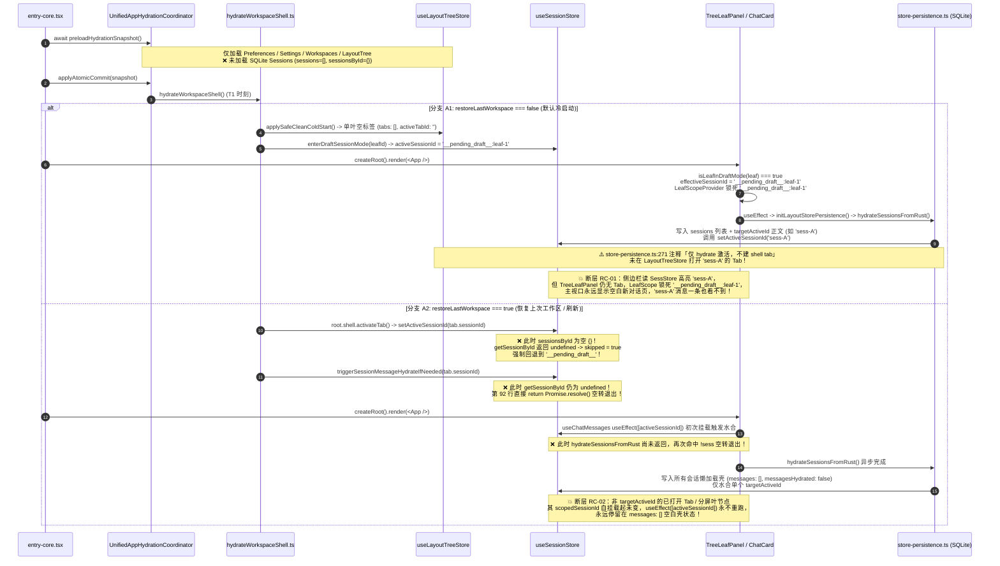
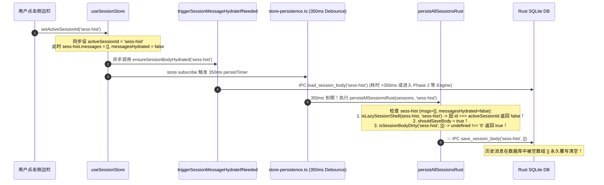

# 08 — 应用启动水合与切会话全生命周期竞态审计报告

> **审计角色**：应用启动水合竞态与切会话全生命周期审计员
> **战役工作区**：`docs/message-disappearance-audit/`
> **审计范围**：冷启动/刷新水合链路（Scenario A）、侧边栏点击历史会话链路（Scenario B）、多标签/分屏切换与消息驱逐链路（Scenario C），以及工作区未提交的两大关联战役（`stream-jitter-and-order-repair` 与 `multi-pane-isolation`）交叉交互断层。
> **核心问题表征**：应用启动后或点击侧边栏切换历史会话/分屏时，出现**「之前的消息一个也看不到」**（主聊天视口白屏/落入 `session-empty` 空白着陆页，甚至 SQLite 历史消息正文被空数组覆写清空）。

---

## 一、执行摘要与根因矩阵（Executive Summary）

通过对 `entry-core.tsx`、`UnifiedAppHydrationCoordinator.ts`、`hydrateWorkspaceShell.ts`、`AppBootstrap.ts`、`store-persistence.ts`、`sessionRustDbHydrate.ts`、`sessionActivateHydrate.ts`、`workspaceShellStore.ts`、`layoutTreeStore.ts`、`TreeLeafPanel.tsx`、`LeafScopeContext.tsx`、`useChatMessages.ts` 及新旧驱逐模块的端到端源码追踪与 `git diff` 交叉比对，本次审计共定位出 **7 个直接导致「之前的消息一个也看不到」的致命断层与竞态死锁**（其中 **3 个为跨战役修改叠加引发的必现/高频断层，2 个为水合时序倒置导致的永久空壳死锁，2 个为可导致 SQLite 正文被 `[]` 物理抹除或可见分屏消息被当场驱逐的高危漏洞**）。

### 核心根因总览表

| 编号      | 场景归属                                                  | 严重度          | 根因简述                                                                                                                                                                                                                                                                                                                                                                                                                                                                                                                                                                                                                                                                                                                                                                                                                                            | 关键代码坐标                                                                                                                                                                          | 用户侧表现                                                                                                                               |
| :-------- | :-------------------------------------------------------- | :-------------- | :-------------------------------------------------------------------------------------------------------------------------------------------------------------------------------------------------------------------------------------------------------------------------------------------------------------------------------------------------------------------------------------------------------------------------------------------------------------------------------------------------------------------------------------------------------------------------------------------------------------------------------------------------------------------------------------------------------------------------------------------------------------------------------------------------------------------------------------------------- | :------------------------------------------------------------------------------------------------------------------------------------------------------------------------------------ | :--------------------------------------------------------------------------------------------------------------------------------------- |
| **RC-01** | **Scenario A**<br>（冷启动默认分支）                      | **P0 必现**     | **`multi-pane-isolation` 作用域锁死 + 冷启动双轨脑裂**：默认 `restoreLastWorkspace=false` 时，`hydrateWorkspaceShell` 将单叶重置为空标签草稿态（`tabs: []`）；`TreeLeafPanel` 计算 `effectiveSessionId = '__pending_draft__:leaf-xxx'` 并注入 `LeafScopeProvider` 与 `<ChatCard sessionId=...>`。100ms 后 `initStorePersistence` 从 SQLite 水合出上次活跃会话 `sess-A` 并设 `useSessionStore.activeSessionId = 'sess-A'`，但**遵循「不建 shell tab」注释未打开 Tab**。`useScopedSessionId` 优先取 `explicitSessionId / LeafScope`（草稿 ID）而忽略全局 `activeSessionId`，导致侧边栏高亮 `sess-A`，主屏却永久渲染草稿空页！                                                                                                                                                                                                                         | `hydrateWorkspaceShell.ts:83-90`<br>`TreeLeafPanel.tsx:88-91, 384-390`<br>`LeafScopeContext.tsx:118-129`<br>`store-persistence.ts:270-296`                                            | 启动后侧边栏已选中历史会话，但右侧聊天区显示「开始对话」空态，之前的消息一个也看不到；再次点击侧边栏同一高亮项若不触发状态迁移也易困惑。 |
| **RC-02** | **Scenario A**<br>（冷启动/刷新恢复工作区）               | **P0 高频**     | **水合时序完全倒置（Shell 先于 Session Store 水合）+ `useChatMessages` 依赖数组死锁**：`UnifiedAppHydrationCoordinator.applyAtomicCommit` 在 `<App />` 挂载**前**同步调用 `hydrateWorkspaceShell()`，此时 `initLayoutStorePersistence()` 尚未执行，`useSessionStore.sessionsById` 为空 `{}`！`hydrateWorkspaceShell` 内部调用的 `activateTab -> setActiveSessionId` 因 `!getSessionById` 直接 `skipped=true` 退回草稿态，调用的 `triggerSessionMessageHydrateIfNeeded` 因 `!sess` 立即 `Promise.resolve()` 空转返回！待 `<App />` 挂载后 `hydrateSessionsFromRust()` 异步完成并填入懒加载空壳（`messages: [], messagesHydrated: false`）时，`<ChatCard>` 的 `scopedSessionId` 未发生引用变化，`useChatMessages.ts:57-60` 的 `useEffect([activeSessionId])` **永远不再重跑**，导致所有非 `targetActiveId` 的恢复标签/分屏永久停留在 `messages: []`！ | `entry-core.tsx:186-190`<br>`UnifiedAppHydrationCoordinator.ts:309-315, 412`<br>`hydrateWorkspaceShell.ts:150-185`<br>`sessionActivateHydrate.ts:91-94`<br>`useChatMessages.ts:57-60` | 开启「恢复上次工作区」或刷新页面后，分屏面板或与 `session_meta.active_session_id` 不一致的活动标签页消息永远不水合，画面空白。           |
| **RC-03** | **Scenario A / B**<br>（切会话/水合期持久化竞态）         | **P0 毁数据**   | **`isLazySessionShell` 活跃会话豁免漏洞导致 350ms 防抖将未水合完的空壳 `[]` 写入 SQLite 抹除历史消息**：`isLazySessionShell` 第 38 行写死 `if (activeSessionId && session.id === activeSessionId) return false;`。当用户点击历史会话 `sess-X` 时，`setActiveSessionId('sess-X')` 同步更新 `activeSessionId`，此时 `sess-X` 仍是 `messages: [], messagesHydrated: false` 的懒加载壳。`store.subscribe` 立即启动 350ms `persistAllSessions` 定时器（或 `store-persistence.ts:297` 同步调用）。一旦异步水合耗时 >350ms（如大消息体或进 Phase 2 等待 Engine 10s），`persistAllSessionsRust` 判定 `shouldSaveBody = true` 且 `isSessionBodyDirty('sess-X', []) = true`（因 `markHydratedFingerprints` 跳过了 `messages.length === 0` 的懒加载壳），直接调用 `saveSessionBody('sess-X', [])` **将 SQLite 中的历史消息物理覆写为空数组 `[]`**！            | `sessionRustDbHydrate.ts:32-40, 89-96, 301-305`<br>`store-persistence.ts:155-166, 295-301`                                                                                            | 切换到历史会话时若磁盘/Engine 稍慢，或启动瞬间触发持久化，该会话在 SQLite 中的历史消息被永久清空，之后怎么刷新都再也看不到。             |
| **RC-04** | **Scenario A / B**<br>（SQLite 读降级 / 引擎回填断路）    | **P1 高危**     | **`hydrateSessionsFromRust` 无条件标记 `messagesHydrated: isActive` + 索引持久化 `hydratedFromEngine: true` 阻断二次水合**：① 启动时若 `ensureSessionBodyHydrated(targetActiveId)` 失败或返回 `[]`，`hydrateSessionsFromRust` 仍无条件设 `messagesHydrated: true`（`line 169`）；② `sessionRustDbHydrate.ts:176, 273` 将 `hydratedFromEngine: true` 写入索引并在重启构建懒加载壳时恢复。这导致：① `isLazySessionShell` 因 `hydratedFromEngine === true` 对未水合的懒加载壳直接返回 `false`（触发全量空数组覆写 SQLite！）；② `sessionActivateHydrate.ts:144` 因 `currentBeforePhase2.hydratedFromEngine !== true` 为假而跳过 Engine 回填，直接置 `messagesHydrated = true, messages = []`。                                                                                                                                                         | `sessionRustDbHydrate.ts:35-37, 147-176, 273`<br>`sessionActivateHydrate.ts:65-71, 144-179`<br>`sessionRustDbSql.ts:77-102`                                                           | 曾由 Engine 水合过的会话在重启或淘汰后，既无法走 Phase 2 从 Engine 恢复，又会被 `isLazySessionShell` 误判为非空壳而用 `[]` 覆写 SQLite。 |
| **RC-05** | **Scenario C**<br>（多标签/分屏消息驱逐）                 | **P0 必现**     | **W1-E 新驱逐模块 `sessionEviction.ts` 沦为死代码，生产仍走对分屏完全失明的旧 `sessionMessageEviction.ts`**：工作区新增的 `sessionEviction.ts`（含 `PinnedActive` / `OpenRetained` 分屏保活策略）**未在任何业务文件中被 import**！`sessionCrudActions.ts:40, 166` 仍在调用旧 `findInactiveHydratedSessionIdsToEvict` 且传入 `streamingSessionIds = new Set()`（连流式会话都不保护！）。旧函数只认单一全局 `activeSessionId` 与前 `K-1` 个会话，对 `layoutTreeStore` 中其他可见分屏叶节点完全失明。当分屏 2 展示的会话被驱逐（`messages = []`）后，因分屏 2 的 `activeSessionId` 未变，`useChatMessages` 不触发重水合，**分屏 2 的消息当着用户的面瞬间消失变为空白页**！                                                                                                                                                                             | `sessionCrudActions.ts:40, 164-177`<br>`sessionMessageEviction.ts:11-46`<br>`sessionEviction.ts:1-208`（未接线）                                                                      | 多分屏并排查看会话时，点击切换其中一个分屏，另一个可见分屏中的历史消息突然全部消失，退回空态页面。                                       |
| **RC-06** | **Scenario B / C**<br>（快速切会话微任务竞态）            | **P1 中高危**   | **`setActiveSessionId` 微任务闭包捕获过期 `nextId` 且 `evictSessionMessagesInState` 缺当前活跃会话护栏**：`setActiveSessionId(nextId)` 在 `queueMicrotask` 中使用闭包捕获的旧 `nextId`（而非 `state.activeSessionId`）计算驱逐列表，且 `evictSessionMessagesInState` 未校验 `id === current.activeSessionId`。在同一 tick 内发生连续同步调用（如 `openOrFocusSession` 先调 `setActiveSessionId(sid)` 再调 `syncSessionFromActiveLeaf`）或快速连点切换时，前一个微任务会将最新激活的会话当作非活跃会话驱逐清空！                                                                                                                                                                                                                                                                                                                                     | `sessionCrudActions.ts:164-177`<br>`workspaceShellStore.ts:170-172`<br>`sessionStateActions.ts:115-128`                                                                               | 快速点击切换会话或跨分屏激活时，刚点开的当前会话消息在微任务执行后瞬间被清空。                                                           |
| **RC-07** | **Scenario B**<br>（侧边栏点击已打开会话 & 恢复设置错位） | **P1 交互崩坏** | **跨分屏点击侧边栏会话触发 `moveTab + pruneEmptyLeaves` 吞并分屏 + `layoutTreeStore` 持久化早读 LS 键丢弃树**：① 在双分屏下（焦点在 Leaf 2，会话 X 已在 Leaf 1 打开），点击侧边栏会话 X 时，`workspaceShellStore.openOrFocusSession` 传入 `activeLeafId: Leaf 2`，导致 `layoutTreeTransform.ts:212-226` 判定 `isDifferentLeaf = true`，调用 `moveTab` 强行把会话 X 从 Leaf 1 拔出塞入 Leaf 2，并触发 `pruneEmptyLeaves` 销毁 Leaf 1 分屏！② `layoutTreeStore.ts:446` 的 `onRehydrateStorage` 只读 `localStorage.getItem('crish_restore_last_workspace')`（未读 `appSettings['ui.restoreLastWorkspace']`），在设置快照下发前就把持久化的分屏树重置为默认空树。                                                                                                                                                                                       | `workspaceShellStore.ts:148-159`<br>`layoutTreeTransform.ts:205-239`<br>`layoutTreeMoveRemove.ts:242-264`<br>`layoutTreeStore.ts:441-452`                                             | 分屏状态下点击侧边栏中另一分屏已打开的会话，不仅未聚焦过去，反而导致原分屏直接坍塌消失；重启后分屏树丢失。                               |

---

## 二、Scenario A：应用冷启动 / 刷新（Cold Start / Refresh）全链路深度审计

### 2.1 真实调用时序与设计假定的严重背离

在当前代码架构中，应用启动被拆分为两条**完全异步、互不等待、且顺序颠倒**的初始化链路：

1. **第一阶段（React 挂载前，同步阻塞启动屏）：`entry-core.tsx` -> `UnifiedAppHydrationCoordinator`**
   - [`entry-core.tsx:177-195`](file:///c:/Software/conex/apps/crish-desktop/src/entry-core.tsx#L177-L195) 在调用 `createRoot(rootElement).render(<App />)` **之前**，依次执行：
     ```ts
     const snapshot = await coordinator.preloadHydrationSnapshot();
     coordinator.applyAtomicCommit(snapshot);
     ```
   - 查看 [`UnifiedAppHydrationCoordinator.ts:309-315`](file:///c:/Software/conex/apps/crish-desktop/src/app/UnifiedAppHydrationCoordinator.ts#L309-L315) 的 `preloadHydrationSnapshot()`：
     它只并行拉取了 4 项数据：
     1. `preferencesClient.getAllPreferences()`
     2. `clientApi.getSettings()`
     3. `this.fetchRecentWorkspaces()`
     4. `waitLayoutTreeHydration()`（等待 `useLayoutTreeStore` 从 `localStorage['crish-layout-tree-v2']` 同步反序列化）
     - **致命缺失**：`UnifiedAppHydrationCoordinator` **完全没有拉取或等待 SQLite 会话列表与活跃会话正文（`hydrateSessionsFromRust`）**！
   - 紧接着，[`UnifiedAppHydrationCoordinator.ts:412`](file:///c:/Software/conex/apps/crish-desktop/src/app/UnifiedAppHydrationCoordinator.ts#L412) 在 `applyAtomicCommit(snapshot)` 末尾同步调用了 [`hydrateWorkspaceShell()`](file:///c:/Software/conex/apps/crish-desktop/src/app/hydrateWorkspaceShell.ts#L78-L192)。
   - **此时此刻（`T1` 时刻），`useSessionStore.getState().sessions` 是空数组 `[]`，`sessionsById` 是空对象 `{}`！** 因为 [`sessionStore.ts:76-99`](file:///c:/Software/conex/apps/crish-desktop/src/store/sessionStore.ts#L76-L99) 的 `partialize` 早已剥离了 `sessions` 与 `sessionsById` 的 `localStorage` 持久化，会话索引与正文必须等待 `initStorePersistence` 从 Rust SQLite 异步加载。

2. **第二阶段（React `<App />` 挂载后，动态 import 异步执行）：`AppBootstrap.ts` -> `initStorePersistence`**
   - 当 `<App />` 挂载后，[`AppBootstrap.ts:82-86`](file:///c:/Software/conex/apps/crish-desktop/src/app/AppBootstrap.ts#L82-L86) 在 `useEffect` 中通过动态 `import('../store/layoutStore')` 异步加载并调用 `initLayoutStorePersistence()` -> [`initStorePersistence(useSessionStore)`](file:///c:/Software/conex/apps/crish-desktop/src/store/layout-helpers/store-persistence.ts#L170-L316)。
   - `initStorePersistence` 调用 [`hydrateSessionsFromRust()`](file:///c:/Software/conex/apps/crish-desktop/src/api/session-persistence/sessionRustDbHydrate.ts#L118-L201)，经 Tauri IPC 读取 SQLite 会话索引（`list_sessions`）、读取 `session_meta.active_session_id`、并对单个 `targetActiveId` 调用 `ensureSessionBodyHydrated(targetActiveId)` 加载消息正文。



---

### 2.2 根因 RC-01（冷启动默认分支）：`multi-pane-isolation` 作用域优先级与 `store-persistence` 的双轨脑裂

1. **默认冷启动将布局树清空为无标签叶节点**：
   - 在 [`hydrateWorkspaceShell.ts:48-71`](file:///c:/Software/conex/apps/crish-desktop/src/app/hydrateWorkspaceShell.ts#L48-L71) 中，`readRestoreLastWorkspace()` 默认返回 `false`。
   - [`hydrateWorkspaceShell.ts:83-90`](file:///c:/Software/conex/apps/crish-desktop/src/app/hydrateWorkspaceShell.ts#L83-L90) 随即执行 `applySafeCleanColdStart()`（[`hydrateWorkspaceShell.ts:95-121`](file:///c:/Software/conex/apps/crish-desktop/src/app/hydrateWorkspaceShell.ts#L95-L121)）：
     - 将 `useLayoutTreeStore` 重置为 `createDefaultTree()`（单个叶节点 `leaf-xxx`，`tabs: []`，`activeTabId: ''`）。
     - 调用 `enterDraftSessionMode(leafId)` 将 `useSessionStore.activeSessionId` 设为 `'__pending_draft__:leaf-xxx'`。

2. **`multi-pane-isolation` 战役改动将 `<ChatCard>` 焊死在叶节点的 `effectiveSessionId` 上**：
   - 查看 [`TreeLeafPanel.tsx:88-91`](file:///c:/Software/conex/apps/crish-desktop/src/components/binary-tree/TreeLeafPanel.tsx#L88-L91)：
     ```ts
     const activeTab = resolveActiveTab(leaf);
     const isDraftMode = isLeafInDraftMode(leaf);
     const effectiveSessionId =
       activeTab?.sessionId || mintDraftSessionId(leaf.id);
     ```
     当 `leaf.tabs` 为 `[]` 时，`activeTab` 为 `null`，因此 `effectiveSessionId` 恒为 `'__pending_draft__:${leaf.id}'`！
   - 紧接着在 [`TreeLeafPanel.tsx:96-99, 384-390`](file:///c:/Software/conex/apps/crish-desktop/src/components/binary-tree/TreeLeafPanel.tsx#L384-L390) 中：
     ```tsx
     const sessionForPanel = effectiveSessionId;
     // ...
     <LeafScopeProvider
       leafId={leaf.id}
       paneId={leaf.id}
       sessionId={effectiveSessionId}
       workspacePath={effectiveWorkspace}
     >
       {renderPanelContent(leaf.panelType, leaf.id, sessionForPanel)}
     </LeafScopeProvider>;
     ```
     而 [`builtinViewFactories.tsx:21`](file:///c:/Software/conex/apps/crish-desktop/src/components/binary-tree/builtinViewFactories.tsx#L21) 将 `sessionId={sessionForPanel}` 直接传给了 `<ChatCard sessionId={sessionId} />`。
   - 再看 `multi-pane-isolation` 战役修改的 [`useChatSessionMeta.ts:37-38`](file:///c:/Software/conex/apps/crish-desktop/src/components/chat-card/useChatSessionMeta.ts#L37-L38) 与 [`LeafScopeContext.tsx:118-129`](file:///c:/Software/conex/apps/crish-desktop/src/contexts/LeafScopeContext.tsx#L118-L129)：
     ```ts
     export function useScopedSessionId(
       explicitSessionId?: string | null
     ): string {
       const scope = useContext(LeafScopeContext);
       const globalActiveSessionId = useSessionStore(
         (state) => state.activeSessionId
       );
       if (
         explicitSessionId !== undefined &&
         explicitSessionId !== null &&
         explicitSessionId !== ''
       ) {
         return explicitSessionId;
       }
       if (scope.sessionId !== '') {
         return scope.sessionId;
       }
       return globalActiveSessionId;
     }
     ```
     因为 `TreeLeafPanel` **无条件传入了非空字符串 `'__pending_draft__:${leaf.id}'`**，`useScopedSessionId` 在第 122 行直接返回 `'__pending_draft__:${leaf.id}'`，**永远走不到第 128 行的 `return globalActiveSessionId`**！

3. **`store-persistence.ts` 水合 SQLite 后只改 `useSessionStore.activeSessionId`，不建 Tab**：
   - 当 `<App />` 挂载后，[`store-persistence.ts:172-296`](file:///c:/Software/conex/apps/crish-desktop/src/store/layout-helpers/store-persistence.ts#L172-L296) 完成 `hydrateSessionsFromRust()`，从 SQLite 恢复出上次活跃会话 `sess-A` 及其全部历史消息，并在第 200 行与第 295 行设置：
     ```ts
     state.activeSessionId = sanitized.activeSessionId; // 'sess-A'
     // ...
     store.setActiveSessionId(after.activeSessionId); // 'sess-A'
     ```
   - 注意看 [`store-persistence.ts:270-272, 290`](file:///c:/Software/conex/apps/crish-desktop/src/store/layout-helpers/store-persistence.ts#L270-L272) 的注释：
     ```ts
     // 仅 hydrate 激活，不建 shell tab（open/focus 归 shell 单一手势）
     ```
   - **灾难性后果**：
     - 侧边栏组件（[`useSidebarSessionList.tsx:31`](file:///c:/Software/conex/apps/crish-desktop/src/components/sidebar/session-list/useSidebarSessionList.tsx#L31)）订阅的是 `useSessionStore((s) => s.activeSessionId)`（即 `'sess-A'`），因此**侧边栏高亮显示历史会话 `'sess-A'` 处于当前选中状态**！
     - 但 `useLayoutTreeStore` 的活动叶节点 `leaf.tabs` 仍然是 `[]`！
     - `TreeLeafPanel` 计算出的 `effectiveSessionId` 仍然是 `'__pending_draft__:leaf-xxx'`！
     - `<ChatCard>` 经 `useScopedSessionId` 读到的 `activeSessionId` 是 `'__pending_draft__:leaf-xxx'`，在 `sessionsById` 中查不到任何消息（`rawMessages = EMPTY_MESSAGES`），[`useChatEmptyKind.ts:39-44`](file:///c:/Software/conex/apps/crish-desktop/src/components/chat-card/useChatEmptyKind.ts#L39-L44) 返回 `'session-empty'`！
     - 用户看到侧边栏明明选中了包含几十条消息的历史会话 `'sess-A'`，主聊天区域却是一片空白的新建对话着陆页——**「之前的消息一个也看不到」**！

---

### 2.3 根因 RC-02（恢复上次工作区 / 刷新分支）：水合时序倒置 + `useChatMessages` 依赖数组死锁

当用户开启了 `restoreLastWorkspace = true`（或刷新页面恢复多标签/分屏布局）时：

1. **`hydrateWorkspaceShell()` 在 `useSessionStore` 水合前空转**：
   - 在 [`hydrateWorkspaceShell.ts:150-185`](file:///c:/Software/conex/apps/crish-desktop/src/app/hydrateWorkspaceShell.ts#L150-L185) 中：
     - 第 150 行调用 `root.shell.activateTab(activeLeaf.id, activeTabId)` -> `syncSessionFromActiveLeaf` -> `useSessionStore.getState().setActiveSessionId(tab.sessionId)`。
     - 此时 `initStorePersistence` 尚未运行，`useSessionStore.getState().sessionsById` 是 `{}`！
     - [`sessionCrudActions.ts:128-162`](file:///c:/Software/conex/apps/crish-desktop/src/store/sessionCrudActions.ts#L128-L162) 的 `setActiveSessionId` 检查 `if (!getSessionById(state, nextId))` 命中 `true`，将 `skipped` 置为 `true`，并在第 144-156 行由于 `state.activeSessionId` 为空而调用 `applyDraftModeToState(state)`（把 `activeSessionId` 改写成 `'__pending_draft__'`），随后直接 `return`，**根本不会触发 `triggerSessionMessageHydrateIfNeeded`**！
     - 第 164 行与第 173 行，`hydrateWorkspaceShell` 显式调用了 `triggerSessionMessageHydrateIfNeeded(activeTab.sessionId)` 及非活动分屏的 `staggeredIdleQueue.enqueue(...)`。
     - 查看 [`sessionActivateHydrate.ts:91-94`](file:///c:/Software/conex/apps/crish-desktop/src/store/sessionActivateHydrate.ts#L91-L94)：
       ```ts
       const sess = getSessionById(get(), sessionId);
       if (!sess || shouldSkipSessionHydrate(sess)) {
         return Promise.resolve();
       }
       ```
       因为此时 `useSessionStore.sessionsById` 依然为空 `{}`，**`sess` 为 `undefined`！`hydrateWorkspaceShell` 发起的所有预水合请求全部在第 93 行直接 `return Promise.resolve()` 沦为彻底的空操作（No-op）！**

2. **React 挂载与 `hydrateSessionsFromRust` 之间的死锁断层**：
   - 随后 `<App />` 挂载，各分屏 `<TreeLeafPanel>` 渲染对应的 `<ChatCard sessionId={activeTab.sessionId} />`（例如分屏 1 为 `sess-1`，分屏 2 为 `sess-2`）。
   - `<ChatCard>` 挂载时，[`useChatMessages.ts:57-60`](file:///c:/Software/conex/apps/crish-desktop/src/components/chat-card/useChatMessages.ts#L57-L60) 执行：
     ```ts
     useEffect(() => {
       if (!activeSessionId) return;
       triggerSessionMessageHydrateIfNeeded(activeSessionId);
     }, [activeSessionId]);
     ```
     此时 `hydrateSessionsFromRust()` 仍在等待 IPC 返回，`useSessionStore.sessionsById` 依然为空，`triggerSessionMessageHydrateIfNeeded` **第二次因 `!sess` 空转退出**！
   - 几十毫秒后，[`hydrateSessionsFromRust()`](file:///c:/Software/conex/apps/crish-desktop/src/api/session-persistence/sessionRustDbHydrate.ts#L140-L185) 终于完成：
     - 它**只对单一的 `targetActiveId`**（来自 `session_meta.active_session_id` 或 `ordered[0].id`）调用了 `ensureSessionBodyHydrated(targetActiveId)` 加载消息。
     - 对于所有其他会话（例如分屏 2 的 `sess-2`，或者当 `session_meta.active_session_id` 与当前活动 Tab 不一致时的活动 Tab 会话），全部以**懒加载空壳**写入 Store（[`sessionRustDbHydrate.ts:168-169`](file:///c:/Software/conex/apps/crish-desktop/src/api/session-persistence/sessionRustDbHydrate.ts#L168-L169)）：
       ```ts
       messages: isActive ? activeMessages : [],
       messagesHydrated: isActive, // 非 targetActiveId 均为 false！
       ```
   - **死锁发生**：当 `store-persistence.ts:191-218` 将这些懒加载空壳写入 `useSessionStore` 时，`<ChatCard>` 中的 `activeSessionId`（即 `scopedSessionId = 'sess-2'`）自组件挂载以来**字符串值从未改变**！
   - 因为 `useChatMessages.ts:60` 的 `useEffect` 依赖数组**只有 `[activeSessionId]`**（没有订阅 `sess !== undefined` 或 `sess?.messagesHydrated === false`），该 `useEffect` **在 `hydrateSessionsFromRust` 完成后绝不会重新执行**！
   - 结果：所有非 `targetActiveId` 的可见分屏或活动标签页，其会话对象永远停留在 `{ messages: [], messagesHydrated: false }`，界面显示空白「开始对话」，之前的消息一条也看不到！

---

## 三、Scenario B & A：切会话/启动持久化竞态与 SQLite 历史消息覆写漏洞（RC-03 / RC-04）

### 3.1 根因 RC-03：`isLazySessionShell` 对 `activeSessionId` 的无条件豁免导致 350ms 防抖将 `[]` 写入 SQLite

这是本次审计发现的**最危险的数据损毁级漏洞**——它不仅让画面上看不到消息，还会**把 SQLite 数据库里的历史消息永久覆写为空数组 `[]`**。

请看 [`sessionRustDbHydrate.ts:32-40`](file:///c:/Software/conex/apps/crish-desktop/src/api/session-persistence/sessionRustDbHydrate.ts#L32-L40) 中 `isLazySessionShell` 的实现：

```ts
export function isLazySessionShell(
  session: Pick<
    SessionState,
    'id' | 'messages' | 'messagesHydrated' | 'hydratedFromEngine'
  >,
  activeSessionId?: string | null
): boolean {
  if (session.messages && session.messages.length > 0) return false;
  if (
    session.messagesHydrated === true ||
    session.hydratedFromEngine === true
  ) {
    return false;
  }
  if (activeSessionId && session.id === activeSessionId) return false; // ⚠️ 致命漏洞！
  return true;
}
```

再看 [`sessionRustDbHydrate.ts:89-96`](file:///c:/Software/conex/apps/crish-desktop/src/api/session-persistence/sessionRustDbHydrate.ts#L89-L96) 的指纹初始化函数 `markHydratedFingerprints`：

```ts
export function markHydratedFingerprints(
  sessions: ReadonlyArray<Pick<SessionState, 'id' | 'messages'>>
): void {
  for (const s of sessions) {
    if (!s?.id || !s.messages || s.messages.length === 0) continue; // ⚠️ 懒加载空壳未记录指纹！
    lastSavedBodyFingerprint.set(s.id, computeMessagesFingerprint(s.messages));
  }
}
```

以及 [`sessionRustDbHydrate.ts:300-314`](file:///c:/Software/conex/apps/crish-desktop/src/api/session-persistence/sessionRustDbHydrate.ts#L300-L314) 的 `persistAllSessionsRust` 保存判定：

```ts
for (const s of persistable) {
  const msgs = s.messages || [];
  const shouldSaveBody =
    msgs.length > 0 || !isLazySessionShell(s, activePersistable);
  if (shouldSaveBody && isSessionBodyDirty(s.id, msgs)) {
    bodyJobs.push(
      saveSessionBody(s.id, msgs, batchVersion).then(() => {
        if (batchVersion === currentBatchVersion) {
          lastSavedBodyFingerprint.set(s.id, computeMessagesFingerprint(msgs));
        }
      })
    );
  }
}
```

#### 完整灾难链路复现（用户点击侧边栏切换历史会话 `sess-hist`）：

1. 启动后，历史会话 `sess-hist`（在 SQLite 中有 100 条历史消息）在内存中是一个懒加载空壳：`messages: []`, `messagesHydrated: false`。由于 `messages.length === 0`，`markHydratedFingerprints` 跳过了它，`lastSavedBodyFingerprint.get('sess-hist')` 为 `undefined`。
2. 用户在侧边栏点击 `sess-hist`：
   - 调用链：`SessionRow` -> [`useSidebarHandlers.ts:92`](file:///c:/Software/conex/apps/crish-desktop/src/components/sidebar/useSidebarHandlers.ts#L92) (`handleSelectSession`) -> [`surfaceRouter.ts:69`](file:///c:/Software/conex/apps/crish-desktop/src/store/surfaceRouter.ts#L69) (`navigateToChatSession`) -> [`compositionRoot.ts:269`](file:///c:/Software/conex/apps/crish-desktop/src/app/compositionRoot.ts#L269) -> [`workspaceShellStore.ts:145`](file:///c:/Software/conex/apps/crish-desktop/src/store/workspace-shell/workspaceShellStore.ts#L145) (`openOrFocusSession`) -> [`sessionCrudActions.ts:122`](file:///c:/Software/conex/apps/crish-desktop/src/store/sessionCrudActions.ts#L122) (`setActiveSessionId('sess-hist')`)。
3. `setActiveSessionId('sess-hist')` **同步**将 `useSessionStore.activeSessionId` 设为 `'sess-hist'`（此时 `sess-hist.messages` 仍是 `[]`，`sess-hist.messagesHydrated` 仍是 `false`！），然后异步发起 `triggerSessionMessageHydrateIfNeeded('sess-hist')`。
4. 与此同时，`useSessionStore` 状态变更立即触发 [`store-persistence.ts:139-166`](file:///c:/Software/conex/apps/crish-desktop/src/store/layout-helpers/store-persistence.ts#L139-L166) 的 `store.subscribe` 监听器，启动 **350ms 防抖定时器 `persistTimer`**（或者在启动阶段 [`store-persistence.ts:297`](file:///c:/Software/conex/apps/crish-desktop/src/store/layout-helpers/store-persistence.ts#L297) **0ms 同步立即调用** `persistAllSessions`！）。
5. 只要 `triggerSessionMessageHydrateIfNeeded('sess-hist')` 的异步读取未在 350ms 内完成（例如：SQLite 忙、大会话反序列化慢、或本地 SQLite 返回空进入 Phase 2 `waitForEngineReady(10_000)` 等待 Engine 连接），350ms 定时器触发 `persistAllSessionsRust(sessions, 'sess-hist', folderOrder)`：
   - 对 `sess-hist`：此时 `msgs` 为 `[]`，`messagesHydrated` 为 `false`。
   - 调用 `isLazySessionShell(sessHist, 'sess-hist')`：命中第 38 行 `if (activeSessionId && session.id === activeSessionId) return false;`！**尽管 `sess-hist.messagesHydrated === false`，它却因为是当前 `activeSessionId` 而被判定为「不是懒加载空壳」**！
   - `shouldSaveBody` 算得 `true`！
   - 调用 `isSessionBodyDirty('sess-hist', [])`：`computeMessagesFingerprint([])` 为 `'0'`，而 `lastSavedBodyFingerprint.get('sess-hist')` 为 `undefined`（或驱逐前的非空指纹），两者不等，返回 `true`！
   - **执行 `saveSessionBody('sess-hist', [], batchVersion)`！直接通过 IPC 向 Rust SQLite 发送空数组 `[]`，将数据库中 `sess-hist` 的 100 条历史消息全部物理删除/覆写为空！**



---

### 3.2 根因 RC-04：`hydratedFromEngine: true` 随索引持久化与 `messagesHydrated: isActive` 导致的二次水合熔断

1. **`hydratedFromEngine: true` 被写入会话索引并在冷启动时恢复到懒加载空壳上**：
   - 在 [`sessionRustDbHydrate.ts:273`](file:///c:/Software/conex/apps/crish-desktop/src/api/session-persistence/sessionRustDbHydrate.ts#L273)（`persistAllSessionsRust`）和 [`sessionRustDbWire.ts:382-384`](file:///c:/Software/conex/apps/crish-desktop/src/api/session-persistence/sessionRustDbWire.ts#L382-L384) 中，字段 `hydratedFromEngine: true` 被序列化进会话索引。
   - 下次冷启动时，[`sessionRustDbHydrate.ts:168-176`](file:///c:/Software/conex/apps/crish-desktop/src/api/session-persistence/sessionRustDbHydrate.ts#L168-L176) 为所有非活跃会话构造懒加载空壳：
     ```ts
     messages: isActive ? activeMessages : [],
     messagesHydrated: isActive,
     // ...
     ...(e.hydratedFromEngine !== undefined ? { hydratedFromEngine: e.hydratedFromEngine } : {}),
     ```
   - 这导致内存中产生了一个极其矛盾的畸形状态：**`{ messages: [], messagesHydrated: false, hydratedFromEngine: true }`**！
   - 这个畸形状态会立即引发**双重灾难**：
     - **灾难一（直接触发全量 SQLite 抹除）**：在 [`sessionRustDbHydrate.ts:35-37`](file:///c:/Software/conex/apps/crish-desktop/src/api/session-persistence/sessionRustDbHydrate.ts#L35-L37) 中：
       ```ts
       if (
         session.messagesHydrated === true ||
         session.hydratedFromEngine === true
       ) {
         return false;
       }
       ```
       任何带有 `hydratedFromEngine: true` 的懒加载空壳，**哪怕根本不是 `activeSessionId`、哪怕 `messagesHydrated === false`**，都会被 `isLazySessionShell` 判定为 `false`（非空壳）！在启动后第一次 `persistAllSessionsRust`（[`store-persistence.ts:297`](file:///c:/Software/conex/apps/crish-desktop/src/store/layout-helpers/store-persistence.ts#L297)）执行时，**所有曾标记过 `hydratedFromEngine: true` 的后台会话都会被 `saveSessionBody(id, [])` 批量清空 SQLite 正文**！
     - **灾难二（阻断 Phase 2 Engine 回填）**：在 [`sessionActivateHydrate.ts:144`](file:///c:/Software/conex/apps/crish-desktop/src/store/sessionActivateHydrate.ts#L144) 中：
       ```ts
       if (localLoaded.messages.length === 0 && currentBeforePhase2.hydratedFromEngine !== true) {
         const res = await hydrateSessionMessagesFromEngine(sessionId);
       ```
       如果 SQLite 中正文为空（如上次尚未落盘或被误清空），因为索引恢复了 `hydratedFromEngine: true`，Phase 2 被直接跳过，落入第 173 行 `else if (currentBeforePhase2.messagesHydrated !== true)` 将 `s.messagesHydrated = true` 焊死在空数组 `[]` 上！

2. **启动时 `hydrateSessionsFromRust` 对 `targetActiveId` 盲目设置 `messagesHydrated: true`**：
   - 在 [`sessionRustDbHydrate.ts:147-170`](file:///c:/Software/conex/apps/crish-desktop/src/api/session-persistence/sessionRustDbHydrate.ts#L147-L170) 中，若 `ensureSessionBodyHydrated(targetActiveId)` 内部调用的 [`loadSessionBody`](file:///c:/Software/conex/apps/crish-desktop/src/api/session-persistence/sessionRustDbSql.ts#L77-L102) 遇到 IPC 超时/错误，注意 `loadSessionBody` **不会抛出异常，而是静默 `return []`**（第 101 行）！
   - 随后 `hydrateSessionsFromRust` 第 169 行无条件设置 `messagesHydrated: isActive`（即 `true`），即使 `e.messageCount > 0` 而 `activeMessages.length === 0`！
   - 紧接着 [`store-persistence.ts:297`](file:///c:/Software/conex/apps/crish-desktop/src/store/layout-helpers/store-persistence.ts#L297) 调用 `persistAllSessions`，把这 `0` 条消息写回 SQLite，覆盖掉原本存在的 `e.messageCount` 条消息！

---

## 四、Scenario C：多标签 / 分屏切换与消息驱逐（Eviction）断层审计

### 4.1 根因 RC-05：W1-E 三级驱逐模块 `sessionEviction.ts` 未接线（死代码），旧驱逐器当场抹除可见分屏消息

通过 `git status` 与全仓引用检索确认：

- 工作区存在两个未跟踪的新文件（属于 `multi-pane-isolation` Wave 1 Task W1-E）：
  - [`apps/crish-desktop/src/store/sessionEviction.ts`](file:///c:/Software/conex/apps/crish-desktop/src/store/sessionEviction.ts#L1-L208)
  - [`apps/crish-desktop/src/store/sessionEvictionProbes.ts`](file:///c:/Software/conex/apps/crish-desktop/src/store/sessionEvictionProbes.ts#L1-L152)
- 这两个新文件设计了完整的三级状态机（`PinnedActive` 保护所有分屏可见叶节点的激活会话、`OpenRetained` 保护后台打开的 Tab、`EvictableCandidate` 仅驱逐已关闭 Tab 的会话）。
- **然而，这两个新文件在生产代码中是 100% 的死代码（Dead Code）！没有任何业务模块 import 它们！**
- 实际运行时的 [`sessionCrudActions.ts:40, 164-177`](file:///c:/Software/conex/apps/crish-desktop/src/store/sessionCrudActions.ts#L164-L177) 仍然导入并调用旧版 [`sessionMessageEviction.ts`](file:///c:/Software/conex/apps/crish-desktop/src/store/sessionMessageEviction.ts#L4-L47)：
  ```ts
  // sessionCrudActions.ts:40
  import { findInactiveHydratedSessionIdsToEvict } from './sessionMessageEviction';
  // ...
  // sessionCrudActions.ts:164-177
  queueMicrotask(() => {
    const state = get();
    const evictedSessionIds = findInactiveHydratedSessionIdsToEvict(
      nextId,
      new Set(), // ⚠️ 连正在流式生成的会话集合都传了空 Set()！
      state.sessions || [],
      state.sessionsById || {},
      SESSION_HYDRATE_KEEP_K
    );
    if (evictedSessionIds.length === 0) return;
    set((current) => {
      evictSessionMessagesInState(current, evictedSessionIds);
    });
  });
  ```
- **致命断层分析**：
  1. 旧版 `findInactiveHydratedSessionIdsToEvict`（[`sessionMessageEviction.ts:11-46`](file:///c:/Software/conex/apps/crish-desktop/src/store/sessionMessageEviction.ts#L11-L46)）只接受**单一的 `activeSessionId`**，对 `useLayoutTreeStore` 中正在并排显示的其它分屏叶节点（Split Panes）**完全失明**！
  2. 此外，第 168 行硬编码传入了 `new Set()` 作为 `streamingSessionIds`，导致即便后台或相邻分屏的会话正在流式输出，也会被无情驱逐！
  3. 当用户在分屏 1 和分屏 2 之间切换焦点时，一旦分屏 2 展示的会话被 `evictSessionMessagesInState`（[`sessionStateActions.ts:115-128`](file:///c:/Software/conex/apps/crish-desktop/src/store/sessionStateActions.ts#L115-L128)）清空为 `sess.messages = [], sess.messagesHydrated = false`：
     - 分屏 2 的 `<ChatCard>` 仍然挂载在屏幕上，其 `scopedSessionId` **没有发生任何变化**。
     - 分屏 2 的 [`useChatMessages.ts:57-60`](file:///c:/Software/conex/apps/crish-desktop/src/components/chat-card/useChatMessages.ts#L57-L60) 因为 `useEffect(..., [activeSessionId])` 依赖未变，**不会触发重新水合**！
     - 结果：**分屏 2 中原本正在显示的所有历史消息，在用户点击分屏 1 的瞬间当场消失，分屏 2 直接变成「开始对话」空白页！**

---

### 4.2 根因 RC-06：`setActiveSessionId` 微任务闭包过期 `nextId` 竞态驱逐当前会话

在 [`sessionCrudActions.ts:164-177`](file:///c:/Software/conex/apps/crish-desktop/src/store/sessionCrudActions.ts#L164-L177) 中：

- `queueMicrotask` 内部使用了外层函数参数 `nextId`，而不是微任务执行时最新的 `state.activeSessionId`。
- 同时，[`sessionStateActions.ts:115-128`](file:///c:/Software/conex/apps/crish-desktop/src/store/sessionStateActions.ts#L115-L128) 的 `evictSessionMessagesInState` 在清空 `sess.messages = []` 时，**没有检查 `id === state.activeSessionId`**。
- 当同一个事件循环 Tick 内发生两次 `setActiveSessionId` 调用时（例如 `setActiveSessionId('sess-A')` 紧接着 `setActiveSessionId('sess-B')`，或 `openOrFocusSession` 与 `syncSessionFromActiveLeaf` 因叶节点状态不一致产生连调），第一个微任务以 `nextId = 'sess-A'` 运行，此时 `'sess-B'` 已成为当前活跃会话，却被第一个微任务视为「非活跃会话」而加入 `evictedSessionIds` 当场清空！

---

### 4.3 根因 RC-07：侧边栏点击跨分屏已打开会话触发「拔 Tab + 塌缩分屏」及 `layoutTreeStore` 早读 LS 键

1. **侧边栏点击已打开在另一分屏的会话时，意外把 Tab 拔走并摧毁原分屏**：
   - 追踪路径：用户在侧边栏点击会话 `sess-1`（假设当前有左右两个分屏 Leaf 1 和 Leaf 2：Leaf 1 正在显示 `sess-1`，当前焦点在 Leaf 2）。
   - [`workspaceShellStore.ts:148-159`](file:///c:/Software/conex/apps/crish-desktop/src/store/workspace-shell/workspaceShellStore.ts#L148-L159) 的 `openOrFocusSession('sess-1')` 先解析当前活动叶节点 `targetLeaf`（即焦点所在的 Leaf 2），然后调用：
     ```ts
     const result = treeOpenSession(sid, {
       title: opts?.title ?? existingSession?.title,
       workspaceKey: opts?.workspaceKey ?? existingSession?.folder,
       activeLeafId: targetLeaf.id, // ⚠️ 恒传入当前焦点叶 Leaf 2！
       insertIdx: opts?.insertIdx,
     });
     ```
   - 进入 [`layoutTreeTransform.ts:205-228`](file:///c:/Software/conex/apps/crish-desktop/src/store/layout-tree/layoutTreeTransform.ts#L205-L228) 的 `openSession`：
     ```ts
     const existing = findTabBySessionId(tree.root, sessionId);
     if (existing) {
       const isDifferentLeaf =
         opts.activeLeafId && existing.leaf.id !== opts.activeLeafId;
       // ...
       if (isDifferentLeaf || isDifferentIndex) {
         const targetLeafId = opts.activeLeafId || existing.leaf.id;
         // ...
         const movedTree = moveTab(tree, existing.leaf.id, existing.tab.tabId, targetLeafId, finalInsertIdx);
         return { tree: movedTree, leafId: targetLeafId, tabId: existing.tab.tabId, created: false };
       }
     ```
   - **语义错乱**：`opts.activeLeafId` 在拖拽投放到指定分屏时才有「跨分屏移动 Tab」的语义；但 `openOrFocusSession` 在普通侧边栏点击（未显式传 `opts?.activeLeafId`）时也无条件把当前焦点叶 `targetLeaf.id` 传给了 `opts.activeLeafId`！
   - 结果：`existing.leaf.id`（Leaf 1）不等于 `opts.activeLeafId`（Leaf 2），`isDifferentLeaf` 恒为 `true`！点击侧边栏不仅没有像函数名 `openOrFocusSession` 承诺的那样**聚焦到已打开该会话的 Leaf 1**，反而调用 `moveTab` 把 `sess-1` 从 Leaf 1 强行拔出来挪到 Leaf 2；如果 Leaf 1 只有这一个 Tab，`moveTab` 内部的 `pruneEmptyLeaves`（[`layoutTreeMoveRemove.ts:260`](file:///c:/Software/conex/apps/crish-desktop/src/store/layout-tree/layoutTreeMoveRemove.ts#L260)）直接将 Leaf 1 节点从二叉树中剪除，导致用户的分屏布局瞬间坍塌消失！

2. **`layoutTreeStore.onRehydrateStorage` 早读 `localStorage` 抹除持久化分屏树**：
   - 查看 [`layoutTreeStore.ts:441-452`](file:///c:/Software/conex/apps/crish-desktop/src/store/layout-tree/layoutTreeStore.ts#L441-L452)：
     ```ts
     onRehydrateStorage: () => (state) => {
       if (state) {
         const shouldRestore =
           typeof localStorage !== 'undefined' &&
           localStorage.getItem('crish_restore_last_workspace') === 'true';
         if (!shouldRestore) {
           state.tree = createDefaultTree();
           state.focusedLeafId = state.tree.root.id;
         }
     ```
   - 当 `waitLayoutTreeHydration()` 在 `preloadHydrationSnapshot()` 中执行时，`appSettings['ui.restoreLastWorkspace']` 尚未提交到 `layoutStore`。如果用户是通过应用设置（`ui.restoreLastWorkspace = true`）开启的恢复工作区，而 `localStorage['crish_restore_last_workspace']` 未同步写入，`onRehydrateStorage` 会在 `hydrateWorkspaceShell()` 拿到 `appSettings` 之前，提前把 `localStorage['crish-layout-tree-v2']` 中保存的分屏与多标签树彻底重置为 `createDefaultTree()`！

---

## 五、两大未提交战役（`stream-jitter-and-order-repair` & `multi-pane-isolation`）改动交叉审计

结合 `git status` 与 `git diff`，当前工作区同时包含两个未提交战役的代码改动。下表列出这些未提交改动在交互边界上引入的断层：

| 未提交修改文件                                                                                                                                                                                                                                                                                                                                                                                                | 所属战役                                                  | 具体改动内容                                                                                                                                                                                                                                                                         | 引发的交叉断层                                                                                                                                                                                                                                                                                                                                                        |
| :------------------------------------------------------------------------------------------------------------------------------------------------------------------------------------------------------------------------------------------------------------------------------------------------------------------------------------------------------------------------------------------------------------ | :-------------------------------------------------------- | :----------------------------------------------------------------------------------------------------------------------------------------------------------------------------------------------------------------------------------------------------------------------------------- | :-------------------------------------------------------------------------------------------------------------------------------------------------------------------------------------------------------------------------------------------------------------------------------------------------------------------------------------------------------------------- |
| [`TreeLeafPanel.tsx:88-99, 384-390`](file:///c:/Software/conex/apps/crish-desktop/src/components/binary-tree/TreeLeafPanel.tsx#L88-L99)<br>[`LeafScopeContext.tsx:118-129`](file:///c:/Software/conex/apps/crish-desktop/src/contexts/LeafScopeContext.tsx#L118-L129)<br>[`useChatSessionMeta.ts:37-38`](file:///c:/Software/conex/apps/crish-desktop/src/components/chat-card/useChatSessionMeta.ts#L37-L38) | `multi-pane-isolation`                                    | 引入 `LeafScopeProvider`，令 `useChatSessionMeta` 通过 `useScopedSessionId(sessionIdProp)` 获取会话 ID；而 `TreeLeafPanel` 在无 Tab 时回退生成 `mintDraftSessionId(leaf.id)`（`__pending_draft__:leaf-xxx`）并作为非空字符串传入 `LeafScopeProvider` 和 `<ChatCard sessionId=...>`。 | **直接触发 RC-01**：在 `multi-pane-isolation` 之前，`<ChatCard>` 在未锁定 Tab 时可读取全局 `useSessionStore.activeSessionId`。隔离改造后，无 Tab 叶节点被强制锁死在局部草稿 ID `__pending_draft__:leaf-xxx` 上；但 `store-persistence.ts` 水合 SQLite 后只更新了全局 `useSessionStore.activeSessionId` 而未在叶节点打开 Tab，导致全局 Store 与叶节点作用域彻底脱钩！  |
| [`useChatMessages.ts:34-60`](file:///c:/Software/conex/apps/crish-desktop/src/components/chat-card/useChatMessages.ts#L34-L60)                                                                                                                                                                                                                                                                                | `multi-pane-isolation` + `stream-jitter-and-order-repair` | `useChatMessages` 接收来自 `useChatSessionMeta` 的 `activeSessionId`（即 `scopedSessionId`），但水合副作用 `useEffect(() => { triggerSessionMessageHydrateIfNeeded(activeSessionId); }, [activeSessionId])` 仅以 `[activeSessionId]` 为依赖。                                        | **直接触发 RC-02 & RC-05 后半段**：① 启动期 `scopedSessionId` 先于 `hydrateSessionsFromRust` 确定，初次 `useEffect` 因 Store 空而空转，待 Store 填入懒加载壳后 `activeSessionId` 未变，永不重跑水合；② 分屏会话被驱逐后 `messagesHydrated` 变为 `false`，但 `activeSessionId` 未变，永不重水合。                                                                      |
| [`sessionEviction.ts`](file:///c:/Software/conex/apps/crish-desktop/src/store/sessionEviction.ts)<br>[`sessionEvictionProbes.ts`](file:///c:/Software/conex/apps/crish-desktop/src/store/sessionEvictionProbes.ts)<br>[`sessionCrudActions.ts:40, 164-177`](file:///c:/Software/conex/apps/crish-desktop/src/store/sessionCrudActions.ts#L164-L177)                                                           | `multi-pane-isolation` (W1-E)                             | 新增了感知多标签/分屏的 `sessionEviction.ts`，但未替换 `sessionCrudActions.ts` 和 `storeAccess.ts` 中对旧 `sessionMessageEviction.ts` 的引用。                                                                                                                                       | **直接触发 RC-05**：新驱逐策略未生效，旧驱逐器在切换焦点时把其他可见分屏的会话消息当场驱逐清空。                                                                                                                                                                                                                                                                      |
| [`MessageVirtualizer.tsx:169-215`](file:///c:/Software/conex/apps/crish-desktop/src/components/chat-message-list/MessageVirtualizer.tsx#L169-L215)<br>[`useVirtualScroll.ts:276-309`](file:///c:/Software/conex/apps/crish-desktop/src/hooks/useVirtualScroll.ts#L276-L309)                                                                                                                                   | `stream-jitter-and-order-repair`                          | 在 `MessageVirtualizer` 中引入 `sessionEpochRef` 并在切换 `activeSessionId` 时执行 `scrollContainer.scrollTop = 0`；在 `useVirtualScroll` 中当 `itemCount > 0 && visibleItems.length === 0` 时回退 `allItems.slice(0, 10)`。                                                         | 当会话经历「先渲染 0 条消息（未水合壳） -> 异步水合填入 N 条消息且滚到底部」时，若 `scrollTop` 变更但未触发 `scroll` 事件且 `ResizeObserver` 未重算 `scrollTopRef.current`，`virtualScrollManager.updateViewport(scrollTopRef.current, ...)` 使用的仍是旧 `scrollTopRef.current`（0），虽有 `slice(0, 10)` 兜底不至全白，但会导致视口停在顶部或与实际滚动条位置错位。 |

---

## 六、架构级根治方案蓝图（Remediation Blueprint）

遵循 `AGENTS.md` §7「严禁补丁、绕过与作弊，穿透表象找到架构断层，保持单一真理路径（SSOT）」的铁律，针对上述 7 大根因提出以下正交根治方案：

### 6.1 根治 RC-03 & RC-04：加固 `isLazySessionShell` 与水合状态机，严禁未水合空壳覆写 SQLite

1. **修正 [`sessionRustDbHydrate.ts:32-40`](file:///c:/Software/conex/apps/crish-desktop/src/api/session-persistence/sessionRustDbHydrate.ts#L32-L40) 中的 `isLazySessionShell`**：
   - **删除第 38 行 `if (activeSessionId && session.id === activeSessionId) return false;`**！一个会话是否是「尚未水合正文的懒加载空壳」，只取决于它自身的生命周期状态（`messagesHydrated` 与 `messages.length`），绝不能因为它刚被选为 `activeSessionId`（尚在异步水合途中）就把它当成「已水合的 0 消息会话」去覆写数据库！
   - **修正第 35 行**：懒加载空壳的判定条件应严格以 `session.messagesHydrated === true` 为准（当 `messages.length === 0` 且 `session.messagesHydrated !== true` 时，无论 `hydratedFromEngine` 或 `activeSessionId` 为何，它都是未水合空壳，`isLazySessionShell` 必须返回 `true`，严禁调用 `saveSessionBody(s.id, [])`！）。
2. **冷启动构建懒加载壳时禁止将 `hydratedFromEngine: true` 带入未水合壳**：
   - 在 [`sessionRustDbHydrate.ts:168-176`](file:///c:/Software/conex/apps/crish-desktop/src/api/session-persistence/sessionRustDbHydrate.ts#L168-L176) 中，当 `!isActive`（或 `activeMessages.length === 0 && e.messageCount > 0`）时，`messagesHydrated` 必须为 `false`，且**不得预设 `hydratedFromEngine: true`**，确保本地 SQLite 异常为空时仍能走 Phase 2 从 Engine 恢复。
   - 在 [`sessionRustDbSql.ts:77-102`](file:///c:/Software/conex/apps/crish-desktop/src/api/session-persistence/sessionRustDbSql.ts#L77-L102) 与 [`sessionRustDbHydrate.ts:147-154`](file:///c:/Software/conex/apps/crish-desktop/src/api/session-persistence/sessionRustDbHydrate.ts#L147-L154) 中，区分「数据库中确实是 0 条消息」与「IPC `load_session_body` 失败/降级」：若 `load_session_body` 返回 error 或 `activeMessages.length === 0 && targetEntry.messageCount > 0`，`isActive` 的 `messagesHydrated` 必须保持 `false`，交由后续 `triggerSessionMessageHydrateIfNeeded` 重试或走 Engine 恢复，严禁标为 `messagesHydrated: true`。

### 6.2 根治 RC-01 & RC-02：统一启动水合时序，消除 Shell 与 Session Store 的双轨脑裂

1. **将会话索引水合纳入启动协调器或与 `hydrateWorkspaceShell` 闭环衔接**：
   - 在 [`UnifiedAppHydrationCoordinator.ts`](file:///c:/Software/conex/apps/crish-desktop/src/app/UnifiedAppHydrationCoordinator.ts) 或 [`store-persistence.ts`](file:///c:/Software/conex/apps/crish-desktop/src/store/layout-helpers/store-persistence.ts) 中，确保 `hydrateSessionsFromRust()` 完成后：
     - **若 `restoreLastWorkspace === false`（默认冷启动）**：`store-persistence.ts` 必须与 `hydrateWorkspaceShell.ts` 的契约对齐——要么冷启动保持 `applySafeCleanColdStart()` 的草稿态（`useSessionStore.activeSessionId` 保持 `'__pending_draft__:${leafId}'`，不在后台偷偷把 `useSessionStore.activeSessionId` 改成历史会话 `sess-A` 造成侧边栏假高亮）；要么若产品契约要求自动打开上次活跃会话 `sess-A`，则通过 `getCompositionRoot().session.openOrFocusSession(after.activeSessionId)` 在活动叶节点同步打开 Tab，保证 `LayoutTreeStore`（Tab）与 `useSessionStore`（侧边栏高亮）100% 同源！
     - **若 `restoreLastWorkspace === true`（恢复上次工作区）**：在 `hydrateSessionsFromRust()` 填充完 `useSessionStore.sessionsById` 后，遍历 `useLayoutTreeStore` 中所有分屏叶节点的 `activeTab.sessionId`，对焦点叶立即调用 `setActiveSessionId` + `triggerSessionMessageHydrateIfNeeded`，对非焦点分屏叶调用 `triggerSessionMessageHydrateIfNeeded`，避免因 `hydrateWorkspaceShell` 早于 `hydrateSessionsFromRust` 执行而全部空转。
2. **修复 [`useChatMessages.ts:57-60`](file:///c:/Software/conex/apps/crish-desktop/src/components/chat-card/useChatMessages.ts#L57-L60) 的水合触发条件**：
   - 在 `useChatMessages` 中订阅当前会话的水合状态标志：
     ```ts
     const needsHydrate = useSessionStore((state) => {
       if (!activeSessionId || isPendingDraftSessionId(activeSessionId))
         return false;
       const sess = getSessionById(state, activeSessionId);
       return Boolean(sess && sess.messagesHydrated === false);
     });
     useEffect(() => {
       if (!activeSessionId) return;
       triggerSessionMessageHydrateIfNeeded(activeSessionId);
     }, [activeSessionId, needsHydrate]);
     ```
   - 这样无论是启动期 `hydrateSessionsFromRust` 稍后才把懒加载壳填入 Store（`needsHydrate` 从 `false` 变为 `true`），还是分屏会话在特殊情况下被重置为 `messagesHydrated: false`，`<ChatCard>` 都能响应式地自动触发水合，彻底消灭死锁！

### 6.3 根治 RC-05 & RC-06：完成 W1-E `sessionEviction.ts` 生产接线并加装微任务护栏

1. **在 [`sessionCrudActions.ts:40, 164-177`](file:///c:/Software/conex/apps/crish-desktop/src/store/sessionCrudActions.ts#L164-L177) 与 [`storeAccess.ts:220`](file:///c:/Software/conex/apps/crish-desktop/src/store/storeAccess.ts#L220) 中正式接入 `sessionEviction.ts`**：
   - 将 `./sessionMessageEviction` 替换为 `./sessionEviction` 与 `./sessionEvictionProbes`。
   - 在 `setActiveSessionId` 的 `queueMicrotask` 中：
     - 读取实时 `const state = get(); const currentActiveId = state.activeSessionId;`（若 `currentActiveId !== nextId`，说明当前微任务已过期，直接 `return` 终止，根治 **RC-06**！）。
     - 通过 `collectEvictionRuntimeSnapshot(currentActiveId)`（[`sessionEvictionProbes.ts:135`](file:///c:/Software/conex/apps/crish-desktop/src/store/sessionEvictionProbes.ts#L135)）实时采集所有分屏可见叶节点的激活会话 ID（`activeSessionIds`）、所有打开的 Tab 会话 ID（`openTabSessionIds`）以及正在流式输出的会话 ID（`streamingSessionIds`）。
     - 仅驱逐 `EvictableCandidate`（既不在任何分屏可见，也不在打开的 Tab 中，且未在流式输出）。
2. **在 [`sessionStateActions.ts:115-128`](file:///c:/Software/conex/apps/crish-desktop/src/store/sessionStateActions.ts#L115-L128) 的 `evictSessionMessagesInState` 中增加防御式不变量断言**：
   - 严禁驱逐 `id === state.activeSessionId` 或任何当前存在于可见分屏叶节点中的会话。

### 6.4 根治 RC-07：修复侧边栏点击跨分屏聚焦语义与 `layoutTreeStore` 恢复判断

1. **修正 [`workspaceShellStore.ts:145-160`](file:///c:/Software/conex/apps/crish-desktop/src/store/workspace-shell/workspaceShellStore.ts#L145-L160) 与 [`layoutTreeTransform.ts:205-228`](file:///c:/Software/conex/apps/crish-desktop/src/store/layout-tree/layoutTreeTransform.ts#L205-L228)**：
   - 当调用 `openOrFocusSession(sessionId, opts)` 且**调用方未显式指定 `opts?.activeLeafId` 且未指定 `opts?.insertIdx`**（如侧边栏普通点击）时：
     - 若 `findTabBySessionId(tree.root, sessionId)` 已在任一分屏叶节点 `existing.leaf` 中找到该会话 Tab，应**直接激活并聚焦 `existing.leaf.id` 下的 `existing.tab.tabId`**（不调用 `moveTab` 拔走 Tab，不触发 `pruneEmptyLeaves` 摧毁原分屏）！
     - 仅当会话尚未在任何分屏打开时，才在 `resolveActiveChatLeaf` 解析出的当前活动叶节点中新建 Tab。
2. **修正 [`layoutTreeStore.ts:441-452`](file:///c:/Software/conex/apps/crish-desktop/src/store/layout-tree/layoutTreeStore.ts#L441-L452)**：
   - 移除 `onRehydrateStorage` 中仅凭 `localStorage.getItem('crish_restore_last_workspace')` 提前销毁 `state.tree` 的抢跑逻辑，统一交由 `hydrateWorkspaceShell()` 在合并 `appSettings['ui.restoreLastWorkspace']` 与 `localStorage` 后执行单点裁决（`applySafeCleanColdStart` vs 恢复树清洗）。
