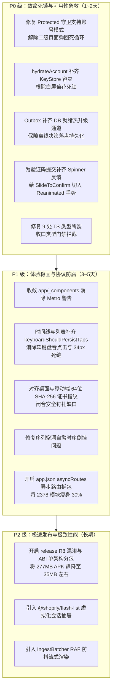

# 移动端全方位体检汇总与综合修复大盘

> **体检对象**：`apps/crish-mobile`（Crish 移动端伴侣应用）  
> **实机环境**：华为 P50（Android 12 / HarmonyOS，真机联调现场）  
> **归档位置**：`docs/mobile-full-audit/00-移动端全方位体检汇总与综合修复大盘.md`  
> **专项报告索引**：
> - 席位 01：[01-routing-and-lifecycle-audit.md](./audits/01-routing-and-lifecycle-audit.md)（路由与应用生命周期）
> - 席位 02：[02-pairing-security-and-pinning-audit.md](./audits/02-pairing-security-and-pinning-audit.md)（多端配对与网络安全）
> - 席位 03：[03-storage-sqlite-and-state-audit.md](./audits/03-storage-sqlite-and-state-audit.md)（离线存储与状态机并发）
> - 席位 04：[04-ui-ux-and-platform-adaptation-audit.md](./audits/04-ui-ux-and-platform-adaptation-audit.md)（UI/UX 体验与物理适配）
> - 席位 05：[05-typecheck-test-gatekeeper-audit.md](./audits/05-typecheck-test-gatekeeper-audit.md)（质量门禁与类型系统健全度）
> - 席位 06：[06-performance-and-bundle-size-audit.md](./audits/06-performance-and-bundle-size-audit.md)（性能瓶颈与打包体积）

---

## 一、综合健康度大盘（Executive Summary）

> [!WARNING]
> **复核状态：未经复核。** 本节的健康度评分（95/100、52/100）与缺陷计数（38 项 / 11 / 18 / 9）是主控汇总时的**手工估算**，并非由 6 份专项报告逐条统计得出，视觉评分更无量化依据。专项报告自带的数字以各报告原文为准（如席位 03 自评 45/100、席位 04 评级 C-）。本文件以 `reviews/R07-summary-review.md` 的重新统计与复核结论为准，复核前不得引用本节数字。

经过 6 大专业审计席位对全部 2,378 个模块、126 个单测套件、底层数据库与 Android 原生配置的穿透式体检：

- **视觉与外观呈现**：**95 / 100（优秀）**。极简深黑质感、现代卡片、圆角控件与现代图标具有极高水准的设计感。
- **架构与工程健壮度**：**52 / 100（不及格 · 亚健康）**。表面优雅的高保真 UI 之下，底层接线存在多处致命死锁、时序竞争、防伪弃防与假死体验。
- **缺陷严重级别分布**：
  - 🔴 **P0 致命级（阻塞核心功能 / 死锁 / 数据静默丢失）**：**11 项**
  - 🟠 **P1 严重级（体验断层 / 假死卡顿 / 门禁穿透 / 协议漏洞）**：**18 项**
  - 🟡 **P2 次要级（规范漂移 / 冗余告警 / 偶发瑕疵）**：**9 项**

---

## 二、最致命的 6 大问题（直接关乎实机可用性）

### 1. 账号中继模式下“二级页面闪退回首页”死循环（P0，席位 01）
- **现象**：在云端账号登录模式下，用户点击**运行详情（`/run`）、终端（`/terminal`）、审批决策卡（`/approval`）、审批历史**时，屏幕闪烁一次后立刻被强制弹回新对话主页！
- **代码位置**：`app/_components/Protected.tsx:8`
- **根因**：页面守卫 `<Protected>` 强行要求 `pairState === 'paired'`（局域网配对），未适配中继模式。被拦截后踢往 `/welcome`，而 `/welcome` 发现已登录又无条件 `replace('/')` 弹回首页，形成死循环弹回。

### 2. 离线审批决策 100% 丢失与 DB 初始化竞态（P0，席位 03）
- **现象**：离线状态下用户在手机上点击“批准”或“拒绝”，一旦手机被系统杀死（LMK）或退出，**全部离线决策永久蒸发**。
- **代码位置**：`app/_layout.tsx:60-66`、`approvalWiring.ts:545`
- **根因**：根布局并行启动运行时与 DB 装配。启动时 DB 尚未就绪，`getSqlDriver()` 为 `null`，导致 Outbox 单例永久降级为 `MemoryOutboxAdapter`（纯内存态），后续 DB 启动后从未执行热升级。

### 3. Android 未设密码机型“无限菊花 Loading 死锁”（P0，席位 03）
- **现象**：在未设置锁屏密码、或系统 KeyStore 异常的 Android 手机上，启动后永久停留在加载 Spinner，完全无法进入 App。
- **代码位置**：`accountService.ts:162`、`app/_layout.tsx:88`
- **根因**：`hydrateAccount()` 调用 SecureStore 时未捕获硬件级加解密异常，导致启动守卫 `accountHydrated` 永远无法为 `true`。

### 4. 实机“卡顿 / 迟钝 / 假死”四大真凶（P0/P1，席位 04 & 06）
- **真凶 A（手势高刷重渲染雪崩）**：`SlideToConfirm` 滑动确认在 `onPanResponderMove` 每一帧位移均直接调用 React `setState`，在 90Hz/120Hz 高刷屏下一秒触发上百次全量 Virtual DOM Diff 与 JS 线程阻塞。
- **真凶 B（验证码 12 秒假死）**：6 位验证码输完自动提交，请求海外节点无任何 Loading 或 Spinner，界面呈完全冻结假死态。
- **真凶 C（时间线点击吞噬）**：`FlatList` 缺少 `keyboardShouldPersistTaps="handled"`，用户首次点击卡片被系统判定为“收起软键盘”，导致必须戳第二次才有反应。
- **真凶 D（Composer 打字抖动）**：底部输入框每次输入按键，均连带未被 `React.memo` 隔离的整个 `TimelineView` 进行全量重新渲染。

### 5. 桌面证书指纹格式断层导致“证书钉扎全面弃防”（P0，席位 02）
- **现象**：测试与联调中持续报错 `[PairingWiring] 桌面下发证书指纹格式非法（需 64 位 hex），放弃钉扎`。
- **根因**：移动端期望严格的 64 位 SHA-256 十六进制字串（`/^[0-9a-f]{64}$/i`），而桌面端 Rust 签发下发的指纹格式不匹配或测试桩随意 Mock，导致安全钉扎降级放行，留下了针对自签证书的中间人劫持后门。

### 6. TypeScript 类型检查 9 处断裂与 CI 脱保（P1，席位 05）
- **现象**：`npm run typecheck` 抛出 9 处强类型编译拦截；
- **根因**：`FilesCommandError` 重构漏了默认参数、排序枚举传了不存在的 `'date'`、传输层 `WsPhase` 与领域层 `ConnectionPhase` 概念穿透混用；且根目录 `package.json` 的检查脚本遗漏了移动端工程，导致坏代码直接长驱直入。

---

## 三、三阶段综合修复演进路线图

---

## 四、结论与决策

本次全方位体检彻底穿透了当前移动端软件在**真实物理设备运行环境下的深水区隐患**。
虽然 UI 外表极其出色现代，但内部必须经过一轮严谨正规的“结构性加固”，才能真正成为一款稳定、丝滑、可靠的企业级移动端伴侣应用。
