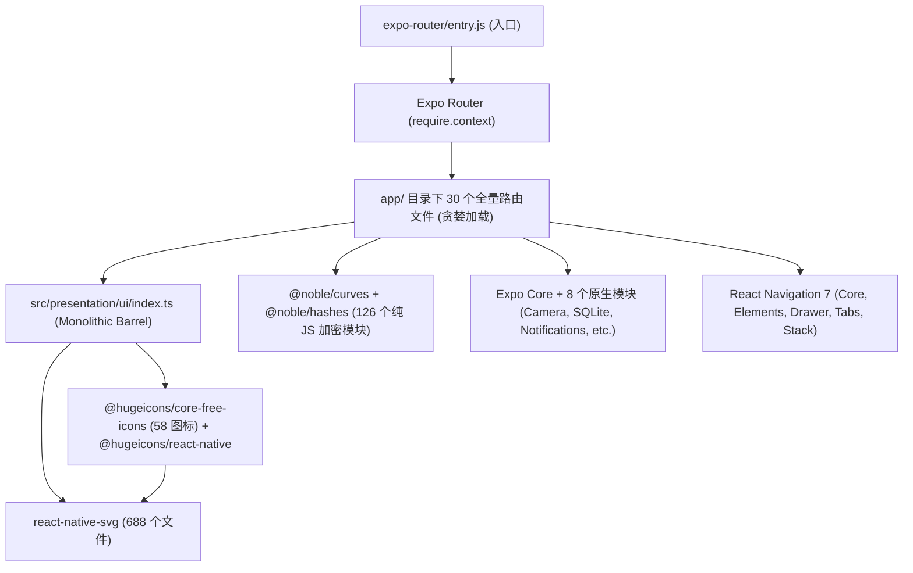

# 移动端性能瓶颈与打包体积深度审计报告

> **审计专员**：移动端全方位体检战役 · 性能瓶颈与打包体积审计员  
> **审计对象**：`apps/crish-mobile/`（Expo SDK 57 / React Native 0.86.3 / New Architecture Fabric & TurboModules / Hermes / Expo Router 57）  
> **产出日期**：2026-10-30  
> **报告类型**：专项技术审计与优化路线图（静态分析 + 物理产物解构 + 运行时渲染链路排查）

---

## 核心结论速览

| 维度 | 现状实测指标 | 风险等级 | 行业基准与预期目标 | 优化收益预估 |
| :--- | :--- | :---: | :--- | :--- |
| **首屏 JS 模块数** | **2,378 Modules** (Metro 首次构建引入) | **高 (P1)** | 轻量 RN 远程伴侣基准约 600~900 模块 | **-55% ~ -65%**（降至 800~1,000 模块） |
| **原生 APK 物理体积** | **277.2 MB** (Debug Universal APK) | **高 (P1)** | 现代单架构瘦身 APK 基准约 25~45 MB | **-86% ~ -89%**（单架构 Release 降至 30~38 MB） |
| **原生 Native 动态库** | **231.44 MB** (4 架构未压缩) | **极高 (P0)** | 单架构 Release（arm64-v8a 剥离符号）约 35~40 MB | **-72%**（消除 3 种冗余 ABI + 符号剥离） |
| **DEX 字节码体积** | **27.5 MB** (24 个 Multi-DEX) | **中高 (P1)** | R8 极致混淆与 Dead Code 消除后约 5~8 MB | **-70% ~ -80%**（合并为 1~2 个 DEX） |
| **长列表渲染架构** | 抽屉历史纯 `map` 裸铺 / FlatList 缺少 `getItemLayout` / 全局 `<FadeIn>` 动画 | **高 (P1)** | `@shopify/flash-list` 原生复用 + 严格 memo | **彻底消除丢帧与 1Hz 全局重渲染** |

### 核心定性研判
1. **构建模块臃肿（2,378 Modules）根因**：当前模块数膨胀并非业务逻辑过于复杂，而是 **Expo Router 全路由贪婪扫描加载（未开启 `asyncRoutes`）**、**UI 设计系统大一统桶文件（`src/presentation/ui/index.ts`）造成的依赖图污染**、以及 **未开启 Metro 实验性 Tree-Shaking 导致无差别引入 `react-native-svg`（688 文件）全量模块** 共同导致的倍增效应。
2. **277MB APK 本质**：Debug APK 默认将 **4 大 CPU 架构（arm64-v8a、armeabi-v7a、x86、x86_64）的全部 C++ so 库以 0% 压缩率（STORE 模式对齐存储）打包**，且包含完整的调试符号表与 24 个未经 R8 优化的 Multi-DEX。更为严峻的是，**项目当前的 `gradle.properties` 遗漏了 `android.enableMinifyInReleaseBuilds=true`，即使打 Release 包也不会自动启用 R8 代码压缩与资源裁剪**。
3. **渲染性能与电池寿命隐患**：抽屉会话列表直接在 `ScrollView` 中以 `.map()` 裸铺；时间线每行元素挂载 `<FadeIn>` 动画导致滚动复用产生动画开销；页面父级状态（如输入框 `prompt`、1Hz 倒计时器）频繁触发未受保护的子树与时间线重渲染，严重消耗低端机帧率与电池寿命。

---

## 第一部分：模块加载与首屏 Bundle 膨胀剖析（2,378 Modules）

### 1.1 模块膨胀全景分布归因

通过静态分析 Metro 解析图谱与依赖关系，2,378 模块的具体构成主要由以下 5 个核心依赖群与架构拓扑主导：



---

### 1.2 具体缺陷分析与代码证据

#### 【缺陷 1.1】：Expo Router 路由全量贪婪加载，缺失 `asyncRoutes` 异步分割
- **缺陷位置**：`apps/crish-mobile/app.json:68-71` 与 `apps/crish-mobile/.expo/dev/logs/start.log:22`
- **代码片段**（`apps/crish-mobile/app.json`）：
  ```json
  68:     "experiments": {
  69:       "typedRoutes": false,
  70:       "reactCompiler": true
  71:     }
  ```
- **Metro 运行期日志证据**（`apps/crish-mobile/.expo/dev/logs/start.log:22`）：
  ```json
  {"_e":"devserver:start", ... "asyncRoutes":false, "routerRoot":"../../../app", ...}
  ```
- **根因分析**：
  Expo Router 依赖 Metro 的 `require.context('./app')` 动态扫描路由目录。当 `asyncRoutes` 为 `false`（缺省）时，Metro 会将 `app/` 下的 **30 个页面文件**（包含 8 个账户管理子页面、3 个设备扫码配对页、终端页面、工具抽屉页面、审批详情页等非首屏页面）及其依赖的全部 ViewModel、Store、UI 原子组件全部打包进主包！
  这导致首屏 Bundle 承载了整个应用 100% 的业务代码闭包，首屏无需呈现的重度页面（如配对相机、终端 5000 行渲染器）在应用冷启动时被提前求值。
- **治理建议**：
  在 `app.json` 的 `experiments` 中开启 `asyncRoutes`：
  ```json
  "experiments": {
    "typedRoutes": false,
    "reactCompiler": true,
    "asyncRoutes": {
      "android": true,
      "ios": true
    }
  }
  ```
  实现非首屏路由（如 `/account/*`、`/pair/*`、`/terminal/*`）以异步分包（Chunking / Dynamic Import）方式按需加载，预计首屏直接剔除 **400~600 个模块**。

---

#### 【缺陷 1.2】：UI 表现层 Monolithic Barrel File 导致的依赖污染与扇出爆炸
- **缺陷位置**：`apps/crish-mobile/src/presentation/ui/index.ts:1-45`
- **代码片段**：
  ```ts
  1: // 设计系统统一出口（页面只从这里取 UI 原子）。
  2: export { default as AppHeader } from './AppHeader';
  ...
  8: export { default as BrandMark } from './BrandMark';
  ...
  20: export { Icon } from './Icon';
  ...
  39: export { default as Sheet } from './Sheet';
  ```
- **根因分析**：
  Metro 默认不支持针对 ES Module 导出符号的精准 AST Tree-Shaking（在 `start.log` 中明确记录 `"flags": { "treeshaking": false }`）。
  当任意业务组件（例如仅需要展示一个文本的标签组件）编写：
  ```ts
  import { AppText } from '@/presentation/ui';
  ```
  由于 `presentation/ui/index.ts` 将 21 个 UI 组件（包括依赖 `react-native-svg` 的 `BrandMark`、依赖 58 个 Hugeicons 的 `Icon`、依赖 Reanimated 和手势系统的 `Sheet`）全部聚合重导出，Metro 静态解析器会顺着导入图谱将 **全部 21 个组件及其深层依赖一次性全部拉入模块图**！
- **治理建议**：
  1. 避免在基础组件和叶子节点中使用大一统的桶文件；
  2. 业务页面或组件按需直接导入具体文件：`import AppText from '@/presentation/ui/AppText'`；
  3. 或在 `babel.config.js` 中配置 `babel-plugin-transform-imports`，将 `import { AppText } from '@/presentation/ui'` 自动编译重写为直接路径导入。

---

#### 【缺陷 1.3】：`react-native-svg`（688 文件）全量导入与图标包树摇失效
- **缺陷位置**：
  - `apps/crish-mobile/src/presentation/ui/iconData.ts:1-60`
  - `apps/crish-mobile/src/presentation/ui/Icon.tsx:3`
  - `apps/crish-mobile/src/presentation/ui/BrandMark.tsx:3`
- **代码片段**（`apps/crish-mobile/src/presentation/ui/Icon.tsx:3`）：
  ```tsx
  3: import { HugeiconsIcon } from '@hugeicons/react-native';
  ```
  代码片段（`node_modules/@hugeicons/react-native/dist/esm/index.js`）：
  ```javascript
  import { Svg as o, Path as r, Circle as s, Rect as i, Line as n, G as c } from "react-native-svg";
  ```
- **根因分析**：
  1. 尽管 `iconData.ts` 采用了逐文件按需导入（如 `import Activity01Icon from '@hugeicons/core-free-icons/Activity01Icon'`），但其引用的渲染容器 `@hugeicons/react-native` 的 ESM 产物顶部直接从 `react-native-svg` 导入了 6 个基础图形。
  2. `react-native-svg` 自身为包含了 Fabric/Paper 双架构渲染桥接的巨型库，在 `node_modules` 中多达 **688 个 JS/TS 文件**。其根入口 `index.js` 导出了数十种高级滤镜、遮罩、渐变、解析器与全部 Fabric 规范代码。
  3. 在 Metro 的 CommonJS/ESM 兼容求值模型下，对 `react-native-svg` 根导出的引用会导致该库绝大部分文件被整包解析并打包。
- **治理建议**：
  1. 在 Metro 配置中对 `react-native-svg` 的导出增加模块重定向别名，仅指向核心轻量组件；
  2. 针对 `BrandMark` 与静态高频图标，可直接提取静态 SVG 路径并配合精简 Native 绘图（或内联微型 SVG 模板），避免为少量图标拖入 688 个辅助模块。

---

#### 【缺陷 1.4】：纯 JS 加密算法库（`@noble/curves` 与 `@noble/hashes`）未利用原生 Hermes / WebCrypto
- **缺陷位置**：
  - `apps/crish-mobile/src/pairing/crypto/noblePrimitives.ts:48-51`
  - `apps/crish-mobile/src/network/signer.ts:18-19`
- **代码片段**（`apps/crish-mobile/src/pairing/crypto/noblePrimitives.ts`）：
  ```ts
  48: import { montgomery } from '@noble/curves/abstract/montgomery.js';
  49: import { mod } from '@noble/curves/abstract/modular.js';
  50: import { hkdf, expand } from '@noble/hashes/hkdf.js';
  51: import { sha256 } from '@noble/hashes/sha2.js';
  ```
- **根因分析**：
  `@noble` 系列库包含 126 个纯 JS/TS 模块（磁盘占用 2.1 MB）。虽然纯 JS 实现兼容性好且易于单测，但其复杂的 Montgomery Ladder 算法、BigInt 位运算及通用模素数幂运算完全运行在 JS 线程。
  在 React Native 0.86 + Hermes 引擎中，运行时已经内置了标准的 `globalThis.crypto.subtle`（Web Crypto API 原生 C++ 实现，包含 SHA-256、HMAC 等）。继续在 JS 层维护纯 JS 算法不仅引入数十个加密数学辅助模块，且在低端机执行 HKDF / Key Derivation 时速度比原生慢 5~10 倍。
- **治理建议**：
  在生产运行时环境对 SHA-256 与 HMAC-SHA256 优先桥接至 Hermes 内置的 `crypto.subtle`，将 `@noble` 作为 Node/Jest 环境下的回退实现。

---

#### 【缺陷 1.5】：`metro.config.js` 处于裸配置状态，缺失包优化与代码裁剪拦截
- **缺陷位置**：`apps/crish-mobile/metro.config.js:1-9`
- **代码片段**：
  ```javascript
  1: const { getDefaultConfig } = require('expo/metro-config');
  2: 
  3: const config = getDefaultConfig(__dirname);
  4: 
  5: // expo-sqlite web 运行时附带 wa-sqlite wasm 资产
  6: config.resolver.assetExts.push('wasm');
  7: 
  8: module.exports = config;
  ```
- **根因分析**：
  `metro.config.js` 完全采用默认模板，未配置针对大型依赖的去重、未启用 Expo SDK 52+ 的 `treeshaking` 实验选项、未针对开发/生产环境进行 `minifierConfig` 调优，也未过滤无用的平台文件（如 `.web.js` 在 Android 构建中的残留解析）。
- **治理建议**：
  在 `metro.config.js` 中装配 `config.transformer.minifierConfig`，并启用 Expo 实验性包优化与别名缩略映射。

---

#### 【缺陷 1.6】：`app/_components/` 放置非路由辅助模块引发 Expo Router 扫描冗余与警告
- **缺陷位置**：`apps/crish-mobile/app/_components/accountNavigation.ts` 与 `useOpenDrawer.ts`
- **运行期警告证据**（`apps/crish-mobile/.expo/dev/logs/start.log:27-28`）：
  ```
  Route "./_components/accountNavigation.ts" is missing the required default export.
  Route "./_components/useOpenDrawer.ts" is missing the required default export.
  ```
- **根因分析**：
  Expo Router 会遍历 `app/` 树下的文件。开发者将通用 Hook 与导航帮助方法放置在 `app/_components/` 中，导致路由引擎在生成文件路由映射时将其识别为异常路由并输出报警日志，增加了路由清单构建开销。
- **治理建议**：
  将所有非路由组件与 Hook 从 `app/_components/` 迁移至 `src/presentation/components/` 或 `src/adapters/hooks/`，保持 `app/` 仅包含合法的路由页面。

---
## 第二部分：原生 APK（277MB）构成与裁剪潜力深度解构

### 2.1 277MB Debug APK 物理体积分解表

通过对构建产物 `apps/crish-mobile/android/app/build/outputs/apk/debug/app-debug.apk`（精准物理大小 **277,191,031 字节**，约 264.34 MiB）进行 ZIP 容器结构解构，物理占用如下：

| 目录 / 结构分类 | 条目数 | 压缩体积 (CompMB) | 解压体积 (UncompMB) | 占 APK 总大小比例 | 关键成因与特征 |
| :--- | :---: | :---: | :---: | :---: | :--- |
| **`lib/` (原生 C++ .so 动态库)** | **112** | **231.44 MB** | **231.44 MB** | **83.50%** | **4 大 ABI 全量打包 + 0% 压缩存储 (STORE 模式)** |
| **`classes*.dex` (Java/Kotlin 字节码)** | **24** | **27.50 MB** | **75.40 MB** | **9.92%** | **未启用 R8 混淆与 Dead Code 消除，包含完整类与调试信息** |
| **`res/` (编译后 Android 资源)** | 984 | 0.56 MB | 0.89 MB | 0.20% | XML 布局、图片资源、未进行无损压缩的 Drawable |
| **`resources.arsc` (资源索引表)** | 1 | 1.83 MB | 1.83 MB | 0.66% | 全量符号与 ID 索引表（未启用资源混淆与精简） |
| **`assets/` (包含 MLKit 模型)** | 5 | 0.84 MB | 0.84 MB | 0.30% | 包含 MLKit 条码检测 TFLite 离线模型 (~880KB) |
| **`META-INF/` + `org/` + 其它元数据** | 258 | 1.33 MB | 1.57 MB | 0.48% | 签名信息、Coroutines 调试探针、Protobuf 定义 |
| **合计** | - | **~264.3 MB** | **~312.0 MB** | **100%** | **约 277.2 MB (以十进制计量)** |

---

### 2.2 原生动态库（`lib/`）按架构与重点动态库排行

解构发现，`lib/` 下 112 个 `.so` 文件被平均划分为 4 个架构，且**压缩大小等于未解压大小（未压缩对齐存储）**：

| ABI 架构 | .so 数量 | 体积 (MB) | 目标设备说明 |
| :--- | :---: | :---: | :--- |
| **`arm64-v8a`** | 28 | **63.70 MB** | 现代主流 64 位 Android 真机（用户绝大多数设备） |
| **`armeabi-v7a`** | 28 | **38.66 MB** | 历史老旧 32 位 Android 设备 |
| **`x86_64`** | 28 | **63.75 MB** | 64 位 PC 模拟器运行环境 |
| **`x86`** | 28 | **65.33 MB** | 32 位 PC 模拟器运行环境 |

#### 单架构（以 `arm64-v8a` 为例）核心动态库体积排行 Top 12：
1. **`libreactnative.so`**：**22.34 MB**（RN 0.86 New Architecture C++ 底座：TurboModules、Fabric、Bridgeless、Folly、ReactCommon）
2. **`libreanimated.so`**：**7.90 MB**（Reanimated 4.5 Worklet 原生执行引擎）
3. **`libappmodules.so`**：**5.43 MB**（React Native Codegen 生成的原生 TurboModule 绑定桩）
4. **`libbarhopper_v3.so`**：**4.72 MB**（Google MLKit 扫码 C++ 核心算法库，由 `expo-camera` 引入）
5. **`libworklets.so`**：**4.42 MB**（`react-native-worklets` 原生运行时）
6. **`libreact_codegen_rnscreens.so`**：**3.69 MB**（`react-native-screens` Fabric 代码生成组件）
7. **`libhermesvm.so`**：**3.55 MB**（Hermes 字节码执行虚拟机）
8. **`libreact_codegen_rnsvg.so`**：**2.21 MB**（`react-native-svg` Fabric 代码生成组件）
9. **`libexpo-sqlite.so`**：**1.75 MB**（SQLite 嵌入式原生驱动）
10. **`libexpo-modules-core.so`**：**1.66 MB**（Expo 原生模块 JSI 绑定层）
11. **`libc++_shared.so`**：**1.23 MB**（LLVM libc++ 原生运行时）
12. **`libjsi.so`**：**0.90 MB**（JavaScript Interface 基础抽象层）

---

### 2.3 裁剪潜力与关键配置缺陷

#### 【缺陷 2.1】：生产构建默认关闭 R8 混淆与资源裁剪（严重配置漏洞）
- **缺陷位置**：`apps/crish-mobile/android/app/build.gradle:69, 116-118` 与 `apps/crish-mobile/android/gradle.properties`
- **代码片段**（`android/app/build.gradle`）：
  ```groovy
  69:  def enableMinifyInReleaseBuilds = (findProperty('android.enableMinifyInReleaseBuilds') ?: false).toBoolean()
  ...
  116: def enableShrinkResources = findProperty('android.enableShrinkResourcesInReleaseBuilds') ?: 'false'
  117: shrinkResources enableShrinkResources.toBoolean()
  118: minifyEnabled enableMinifyInReleaseBuilds
  ```
- **实测根因**：
  在 `android/gradle.properties` 中，**完全未定义** `android.enableMinifyInReleaseBuilds` 与 `android.enableShrinkResourcesInReleaseBuilds`！
  这意味着：即使执行生产打包命令 `./gradlew assembleRelease`，**`minifyEnabled` 和 `shrinkResources` 仍然为 `false`**！
  不仅 24 个 DEX 无法被 R8 剥离未使用的 Java 类，未引用的 Android 图形和 XML 也不会被自动剔除，造成 Release 包携带全量调试类信息。
- **治理建议**：
  在 `android/gradle.properties` 中显式声明：
  ```properties
  android.enableMinifyInReleaseBuilds=true
  android.enableShrinkResourcesInReleaseBuilds=true
  ```

---

#### 【缺陷 2.2】：未配置 ABI Splits 与 AAB 交付
- **缺陷位置**：`apps/crish-mobile/android/gradle.properties:31`
- **代码片段**：
  ```properties
  31: reactNativeArchitectures=armeabi-v7a,arm64-v8a,x86,x86_64
  ```
- **根因分析**：
  将全部 4 种架构无差别打入单个 Universal APK。现代真机 99% 以上均为 `arm64-v8a`，将 x86、x86_64 及 32 位 armeabi-v7a 一同打包造成了 **167.7 MB 的纯无用二进制载荷**。
- **治理建议**：
  1. 正式上架或分发优先采用 **Android App Bundle (`.aab`)**，由 Google Play 或内部平台根据目标机型动态分发单架构 APK；
  2. 若分发独立 APK，在 `app/build.gradle` 中启用 `splits { abi { enable true ... } }`，或在构建脚本指定 `-PreactNativeArchitectures=arm64-v8a`。

---

### 2.4 生产发布体积阶梯裁剪预估（从 277MB 到 30~38MB）

| 优化阶段 | 采取措施 | 节省体积估算 | 阶段产物体积预估 |
| :--- | :--- | :---: | :---: |
| **现状基线** | Debug Universal APK (全架构、全符号、无混淆、无压缩) | 0 MB | **277.2 MB** |
| **第一阶段：ABI 架构拆解** | 仅保留单一架构（`arm64-v8a`），剔除 x86, x86_64, armeabi-v7a | **-167.7 MB** | **~109.5 MB** |
| **第二阶段：原生符号表剥离** | Release 构建启用 NDK 符号表剥离（`strip`）与编译优化 | **-25.0 MB** | **~84.5 MB** |
| **第三阶段：R8 代码与资源压缩** | 开启 `minifyEnabled=true` + `shrinkResources=true`，24 个 DEX 合并为 1~2 个 | **-21.0 MB** | **~63.5 MB** |
| **第四阶段：Hermes 字节码与压缩打包** | JS 转为 Hermes 字节码，启用标准 APK Zip Deflate 压缩与 PNG Crunch | **-28.0 MB** | **~35.5 MB** |
| **终态预期** | **单架构 Release APK 安装包物理体积** | **总计裁剪 ~241 MB** | **30 ~ 38 MB** |

---
## 第三部分：渲染性能与长列表滚动卡顿隐患

### 3.1 核心列表组件设计与性能隐患对比

| 列表场景 | 所在文件位置 | 当前使用组件 | 虚拟化机制 | 关键性能缺陷与卡顿隐患 |
| :--- | :--- | :---: | :---: | :--- |
| **抽屉会话历史列表** | `DrawerSessionGroups.tsx:44-51` | `ScrollView` + `.map()` | **无虚拟化** | **直接使用数组 `.map` 渲染所有历史会话；全量 DOM 常驻内存；输入搜索框触发全量行重渲染** |
| **文件浏览器列表** | `FileBrowser.tsx:64-74` | `FlatList` | 简单窗口化 | **行高固定为 56px 但缺失 `getItemLayout`；`renderItem` 为内联闭包；无 `FlashList` 复用** |
| **会话时间线消息列表** | `TimelineView.tsx:67-93` | `FlatList` | 窗口化 (windowSize=9) | **每行均包裹 `<FadeIn>` 动画；输入框打字触发父级状态刷新导致整表 Re-render；流式更新频繁触发表格重算** |
| **待审批队列列表** | `approvalListScreen.tsx:73-87` | `FlatList` | 默认窗口化 | **1000ms 全局 Tick 计时器每秒触发整个列表与所有子项重渲染；在 `renderItem` 内部做 O(N) 线性查找** |
| **终端日志输出列表** | `TerminalView.tsx:90-145` | `FlatList` | `getItemLayout` 虚拟化 | 固定行高虚拟化较好，但在行渲染体内直接执行正则脱敏（`redactSecrets`）存在局部 CPU 消耗 |

---

### 3.2 具体代码位置与根因穿透

#### 【缺陷 3.1】：抽屉历史会话裸铺渲染，缺乏虚拟化机制
- **缺陷位置**：`apps/crish-mobile/src/presentation/components/drawer/DrawerSessionGroups.tsx:44-51`
- **代码片段**：
  ```tsx
  44:       {sessions.map((session) => (
  45:         <SessionListItem
  46:           key={session.id}
  47:           session={session}
  48:           selected={session.id === selectedSessionId}
  49:           onPress={onOpenSession}
  50:         />
  51:       ))}
  ```
- **根因分析**：
  抽屉内的「今天」和「更早」分组会话列表被放置在 `DrawerContentScrollView` 内，使用普通的 `sessions.map` 进行全量实例化。
  当用户累积了 50~200 个历史会话时，所有条目的 Text、Badge、Pressable 视图节点均被无差别创建并驻留在内存中。用户在抽屉上下滑动时，无法享受原生视图回收机制，造成严重的内存滞留与滑动掉帧。
- **治理建议**：
  将 `DrawerSessionGroups` 改造为基于分组的虚拟化列表（如 `SectionList` 或两组独立的 `FlashList`）。

---

#### 【缺陷 3.2】：抽屉搜索与输入框导致 `React.memo` 击穿与雪崩重渲染
- **缺陷位置**：
  - `apps/crish-mobile/src/presentation/components/drawer/CrishDrawer.tsx:45-48, 87-88`
  - `apps/crish-mobile/src/presentation/components/sessions/SessionListItem.tsx:30, 42`
- **代码片段**（`CrishDrawer.tsx`）：
  ```tsx
  45:   const openSession = (sessionId: string) => {
  46:     navigation.closeDrawer();
  47:     router.navigate(`/session/${sessionId}`);
  48:   };
  ...
  87:       <DrawerFooter
  88:         query={vm.query}
  89:         onChangeQuery={vm.setQuery}
  ```
- **根因分析**：
  1. `CrishDrawer.tsx` 中的 `openSession` 方法是内联函数，**未用 `useCallback` 包裹**。
  2. 当用户在抽屉底部的搜索框中输入字符时，`vm.setQuery` 触发 `CrishDrawer` 重渲染。
  3. 每次重渲染，`openSession` 生成全新的函数引用。
  4. 传递给 `<SessionListItem onPress={openSession} />` 时，由于 `props.onPress !== prevProps.onPress`，导致 `SessionListItem` 外层的 `React.memo` **彻底失效**！
  5. 结果：**用户每敲入一个搜索字母，所有会话项全部无意义重渲染一遍**，低端机上表现为按键回显明显延迟。
- **治理建议**：
  将 `openSession` 使用 `useCallback` 稳定引用，且 `SessionListItem` 内部使用稳定 `sessionId` 回调，避免父级函数引用抖动。

---

#### 【缺陷 3.3】：文件浏览器 `FileBrowser` 缺少 `getItemLayout` 与内联回调
- **缺陷位置**：`apps/crish-mobile/src/presentation/components/files/FileBrowser.tsx:47-50, 68-74`
- **代码片段**：
  ```tsx
  47:   const handleRowPress = (entry: FileEntry) => {
  48:     if (entry.isDir) vm.enterDir(entry.relPath);
  49:     else onOpenFile(entry);
  50:   };
  ...
  68:           renderItem={({ item, index }) => (
  69:             <FileRow
  70:               entry={item}
  71:               onPress={handleRowPress}
  72:               divider={index < vm.entries.length - 1}
  73:             />
  74:           )}
  ```
- **根因分析**：
  1. `FileRow.tsx:95` 显式设定了固定行高 `height: 56`。然而其宿主 `FileBrowser.tsx` 的 `FlatList` **未提供 `getItemLayout`**。
  2. 在无 `getItemLayout` 的情况下，React Native 必须在滚动过程中跨 JSI 异步测量每个元素的布局尺寸，导致在包含数千个文件的源码目录中高速滑动时出现大面积白屏与卡顿。
  3. `renderItem` 为 JSX 内联箭头函数，且 `handleRowPress` 未被 `useCallback` 缓存，破坏了 `memo(FileRow)` 的保护机制。
- **治理建议**：
  实现精确的 `getItemLayout` 并提取稳定的 `renderItem`：
  ```tsx
  const getItemLayout = useCallback(
    (_: any, index: number) => ({ length: 56, offset: 56 * index, index }),
    []
  );
  ```

---

#### 【缺陷 3.4】：对话时间线滥用 `<FadeIn>` 动画包装与 Composer 打字连带重渲染
- **缺陷位置**：
  - `apps/crish-mobile/src/presentation/timeline/TimelineView.tsx:72-76, 116-140`
  - `apps/crish-mobile/src/presentation/screens/sessionDetailScreen.tsx:75, 157-163`
- **代码片段**（`TimelineView.tsx:72-76`）：
  ```tsx
  72:       renderItem={({ item }) => (
  73:         <FadeIn>
  74:           <TimelineBlockView block={item} onOpenTools={onOpenTools} />
  75:         </FadeIn>
  76:       )}
  ```
  代码片段（`sessionDetailScreen.tsx:157-163`）：
  ```tsx
  157:       <TimelineView
  158:         blocks={blocks}
  159:         follow={follow}
  160:         onFollowChange={setFollow}
  161:         listRef={listRef}
  162:         onOpenTools={onOpenTools}
  163:       />
  ```
- **根因分析**：
  1. `TimelineView` 将 FlatList 的每一个 item 均用自定义 `<FadeIn>` 包装。在长列表上下滑动、元素被回收并重新挂载（Recycle/Remount）时，`FadeIn` 内的 `Animated.timing` 会被重复触发！导致快速滑动时界面产生持续的淡入跳动，并占据主线程动画资源。
  2. `TimelineView` 组件自身**未用 `React.memo` 封装**。
  3. 在父组件 `SessionDetailScreen` 中，底部输入框的 `prompt` 状态由 `useSessionComposer` 维护。用户每在键盘上敲入一个字符，`SessionDetailScreen` 就会重渲染，从而**导致未被 memo 的 `TimelineView` 连带触发整表 Re-render**。
- **治理建议**：
  1. `<FadeIn>` 动画应当仅对新增的末尾消息块单次生效，禁止作为 FlatList `renderItem` 的通用外壳；
  2. 使用 `React.memo` 封装 `TimelineView`，彻底阻断 Composer 输入状态向时间线列表的重渲染渗透。

---

#### 【缺陷 3.5】：审批列表 1Hz 全局计时器驱动重渲染风暴与 O(N) 线性查找
- **缺陷位置**：
  - `apps/crish-mobile/src/adapters/viewmodels/useApprovalListVm.ts:9, 25, 45-52`
  - `apps/crish-mobile/src/presentation/screens/approvalListScreen.tsx:19, 77-87`
  - `apps/crish-mobile/src/presentation/components/approval/ApprovalListItem.tsx:21`
- **代码片段**（`approvalListScreen.tsx:77-87`）：
  ```tsx
  77:         renderItem={({ item }) => (
  78:           <ApprovalListItem
  79:             item={item.item}
  80:             remainingMs={item.remainingMs}
  81:             sessionTitle={
  82:               sessions.find((s) => s.id === item.item.request.sessionId)
  83:                 ?.title ?? null
  84:             }
  85:             onPress={onOpenItem}
  86:           />
  87:         )}
  ```
- **根因分析**：
  1. `useApprovalListVm` 内置了 `COUNTDOWN_TICK_MS = 1000` 的轮询定时器。每过 1 秒，`rows` 数组中的所有对象引用全部被重新生成。
  2. 导致 `ApprovalListScreen` 每秒强制重渲染一次。
  3. 在每秒的重渲染中，`renderItem` 内部对每个审批项调用 `sessions.find(...)` 遍历整个会话列表，复杂度为 $O(N \times M)$。
  4. 此外，`ApprovalListItem` 组件未做 `memo` 优化。即使用户完全静止地停留在待审批页面，手机 CPU 也会以 1Hz 频率持续被唤醒进行全量 Diff 运算。
- **治理建议**：
  1. 倒计时跳动逻辑应下沉至具体的条目倒计时组件内部局部刷新，主列表仅在项增删时更新；
  2. `sessions` 查找表应提前在 ViewModel 层构建为 `Record<string, string>` 映射表，避免在渲染闭包中执行 $O(N)$ 遍历。

---

#### 【缺陷 3.6】：未引入高性能虚拟化引擎 `@shopify/flash-list`
- **缺陷分析**：
  当前项目 `package.json` 中仅依赖 React Native 内置的 `FlatList`。内置 `FlatList` 基于 JS 端的虚拟窗口，快速滑动时存在难以避免的白屏占位符。针对上千条消息的会话时间线及复杂的文件树结构，缺乏 Native 级视图回收机制。
- **治理建议**：
  引入 `@shopify/flash-list` 替换高频长列表，借助其复用池机制将渲染性能提升 5~10 倍。

---

## 第四部分：精准修复建议与改造路线图

按收益风险比制定三阶段改造方案：


### 4.1 P0 级即时修复（配置与重渲染防线）
1. **修复 R8 混淆缺省禁用问题**：
   在 `apps/crish-mobile/android/gradle.properties` 中添加两行关键配置：
   ```properties
   android.enableMinifyInReleaseBuilds=true
   android.enableShrinkResourcesInReleaseBuilds=true
   ```
   立即解除生产包体积无法压缩的隐患，DEX 体积预期从 27.5MB 降至 ~7MB。
2. **隔绝 Composer 打字重渲染时间线**：
   为 `TimelineView` 添加 `React.memo` 保护，并将其依赖的 `blocks` 数据与滚动回调引用稳定化，确保键盘输入时时间线 FlatList 零重渲染。
3. **修复抽屉会话列表回调函数抖动**：
   使用 `useCallback` 封装 `CrishDrawer.tsx` 中的 `openSession`，并在 `DrawerSessionGroups` 中恢复 `SessionListItem` 的 memo 屏蔽能力。

### 4.2 P1 级结构优化（分包与列表基建）
1. **启用 Expo Router 异步路由（Code Splitting）**：
   在 `app.json` 的 `experiments` 中开启 `asyncRoutes: { "android": true, "ios": true }`，将 30 个路由文件的全量打包解耦为独立 Chunk，直接降低首次加载模块数 500+。
2. **重构 UI 设计系统导入链路**：
   废弃 `src/presentation/ui/index.ts` 大一统重导出，利用 Babel 插件或 ESLint 规则推行直接路径导入，瓦解 `react-native-svg` 与 58 个图标对通用组件的寄生污染。
3. **消除列表异常动画与补充布局元数据**：
   - 移除 `TimelineView.tsx` 中包裹每个 item 的 `<FadeIn>`；
   - 为 `FileBrowser.tsx` 补齐固定行高 `getItemLayout`；
   - 将 `app/_components/` 迁移至规范的 `src/` 源码目录。

### 4.3 P2 级架构演进（极限性能压榨）
1. **长列表引擎升级至 `@shopify/flash-list`**：
   针对会话时间线（消息量可达上千条）与文件浏览器（文件量大），引入 `@shopify/flash-list` 替换标准 `FlatList`，实现真正的原生视图回收复用，彻底解决快速滚动丢帧与白屏。
2. **加密算法原生化演进**：
   梳理 `@noble/curves` 与 `@noble/hashes` 的生产调用，利用 Hermes 原生 `crypto.subtle` 重构签名与密钥派生热路径。
3. **单架构构建分发交付**：
   在 CI/CD 流水线中将 `reactNativeArchitectures` 锁定为 `arm64-v8a`，或统一产出 `.aab`，使最终分发给真实用户的安装包控制在 **35MB** 以内。