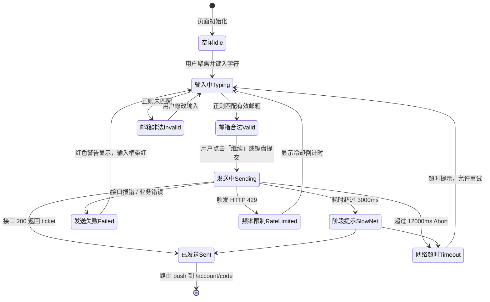
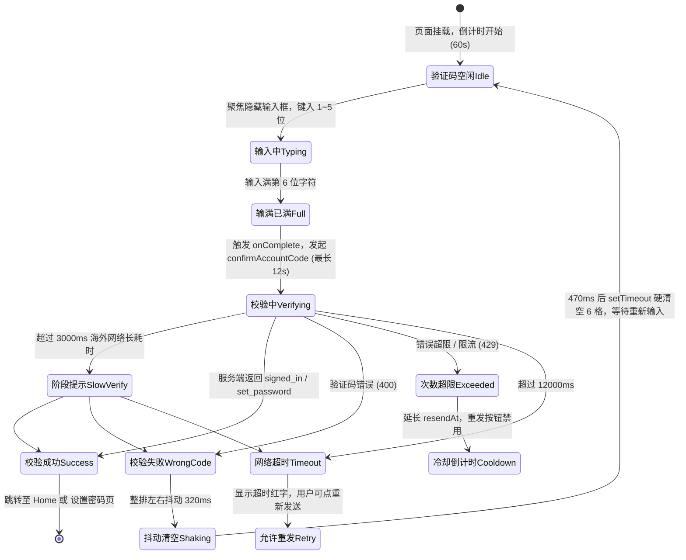

# N02 方案 · 验证码感知反馈与全局描边清退方案

## 0 结论摘要

1. **现状感知不明显根因**：验证码 6 位输满自动提交后，页面**零 Spinner、零进度文案、零输入态变化**，在 12 秒跨境网络请求（`accountApi.ts:19`）期间全屏呈现完全假死态；邮箱页点“继续”后按钮文字被挖空替换为微型菊花图标，输入框未禁用，长等待期缺乏阶段反馈；`AuthField` 采用旧版 JS 线程颜色插值（`AuthField.tsx:46`），在唤起软键盘瞬态造成 1~2 帧卡顿抽搐。
2. **全局描边扫描结果**：全库扫描登记 **43 处**边框与阴影属性。其中 **6 处严重违反 U8 红线的动态描边与选择环**必须立即清退（`Input.tsx` 聚焦/错误描边、`SlideToConfirm.tsx` 拖拽成功描边、`NewTaskSheet.tsx` 选中标签描边、`SegmentedControl.tsx` 选中分段描边、`Composer.tsx` 输入条描边+阴影、`pairScanScreen.tsx` 2px 扫描取景框）；**5 处浮动卡片/按钮的厚重阴影**（充当外发光伪描边）需全部清退或微化；11 处静态信息分割线保持纯底色微发线（`hairlineWidth`），非必要处一律合并。
3. **推荐目标方案**：**极简纯色阶状态流 + Reanimated 原生微动 + 分级网络感知**（零新增依赖，坚决不引入 `expo-haptics`）。输入框与验证码格 100% 落实 `borderWidth: 0`，通过 `surface` ↔ `surfaceRaised` 表面色阶切换、原生高度纯色光标淡入与文字透明度微变表达聚焦；输满 6 位后下方即时并列展示 Spinner 与状态行；超过 3 秒/8 秒自动分级展示网络提示。
4. **验证码控件结构重构**：坚持“**单一隐藏 TextInput + 6 个纯展示格**”的单一真源（SSOT）架构，确保 iOS/Android 短信与邮件验证码自动填充（`oneTimeCode` / `one-time-code`）、剪贴板粘贴与退格删除原生高可靠；彻底剔除 JS `setTimeout` 与旧 `Animated`，改由 Reanimated 原生驱动错误轻位移与单字淡入；补齐无障碍位数朗读。
5. **需用户裁决事项**：(1) 二维码扫描页面 240×240 绿色描边框清退方案（推荐四角标或暗角蒙层挖空）；(2) 触觉反馈坚持“零外部依赖”（不装 `expo-haptics`，仅保留纯视觉或设备可选的原生轻微振动）；(3) `borderFocus` token 的废弃清退周期。
6. **报告路径**：`C:\Software\conex\docs\mobile-full-audit\requirement-plans\N02-verification-feedback-plan.md`。

---

## 1 现状还原（带 路径:行号 的确凿证据）

### 1.1 交互一：邮箱页面发送验证码状态机与反馈分析

#### 状态机模型



#### 逐状态现状、缺陷与证据

| 状态 | 当前用户看到的内容 | 缺失的反馈 | 感知不明显的原因与证据 | 置信度 |
| :--- | :--- | :--- | :--- | :--- |
| **空闲 / 输入中** | 浅灰背景（`#f2f2f2`）上的输入框底色由 `#f9f9f9` 渐变到 `#ffffff`，下方“继续”按钮为禁用底色（`fillSubtle`，`#ececec`）。 | 缺乏邮箱格式即时轻量提示；由于缺乏明显边框，部分低对比度屏幕难以辨别当前框体范围。 | 焦点变色使用旧版 `Animated.timing` 驱动，且设置 `useNativeDriver: false`（`AuthField.tsx:41-47`）。在 Android 华为真机上，用户点击输入框呼出软键盘的同时，JS 线程正在逐帧计算颜色字符串插值（`AuthField.tsx:52-55`），造成键盘弹起动画伴随 1~2 帧可见卡顿。 | 已验证 |
| **邮箱合法** | “继续”按钮变为深色可用状态（`actionPrimary`，`#0d0d0d`）。 | 无过渡动效，颜色突变；无轻量触感反馈。 | `accountEmailScreen.tsx:70` 仅根据 `isValidEmail(email)` 切换 `disabled`，无任何跟手段位。 | 已验证 |
| **发送中 Sending** | “继续”按钮文字被完全挖空，仅居中显示一个白色微型小菊花（`ActivityIndicator`）。 | 1. 按钮内无文字（失去“正在做什么”的说明）；<br>2. 页面其余部分（如输入框）**没有任何禁用或只读变暗反馈**；<br>3. 缺乏全页级别的轻度状态锁。 | 1. `AuthButton.tsx:98-104` 直接做三元运算符替换：`loading ? <ActivityIndicator /> : <AppText>{label}</AppText>`，导致操作动词凭空消失，视觉呈现一个黑胶囊内单个小菊花旋转，缺乏呼吸感与阶段暗示；<br>2. `accountEmailScreen.tsx:49-66` 在 `busy === true` 期间，**完全没有给 `AuthField` 传递 `editable={!busy}`**！用户在点击“继续”后的十几秒内，仍可随意点击输入框继续修改邮箱字符，导致请求发送的邮箱与屏幕上显示的邮箱脱节。 | 已验证 |
| **跨境长等待（3s~12s）** | 屏幕保持静态旋转菊花，无任何变化。 | 跨境网络阶段性提示（如“正在连接海外认证节点…”、“网络较慢，仍在重试…”）。 | `accountApi.ts:19` 定义了 `REQUEST_TIMEOUT_MS = 12_000`（12 秒超时）。认证服务部署在海外（`https://auth.flowbit.me`），在弱网或国际出口波动时，用户面对静态单点旋转 8~12 秒，无法区分是“网络在处理”还是“App 逻辑死锁”，极易焦躁并不耐烦地退出。 | 已验证 |
| **已发送 Sent** | 页面突然 push 跳转至验证码页面。 | 缺乏成功阶段的小勾或确认轻反馈，转场生硬。 | `accountEmailScreen.tsx:35` 在收到 `result.kind === 'sent'` 瞬间无条件触发 `onCodeSent()`，由于无平滑转场配合，在低端机上出现空白跳闪。 | 已验证 |
| **失败 / 超时 / 限流** | 输入框底色切换为红色淡底（`dangerSoft`，`#f9eded`），下方出现一行红字。 | 错误发生时缺乏定向焦点引导，用户无法一键清除或重发。 | 错误由 `accountEmailScreen.tsx:36` 存入 `error` 状态，由 `AuthField.tsx:50-51` 染红背景。但若为 429 限流错误，只输出了一行冰冷报错，未引导用户剩余冷却时间。 | 已验证 |
---

### 1.2 交互二：验证码输入与校验状态机与反馈分析

#### 状态机模型



#### 逐状态现状、缺陷与证据

| 状态 | 当前用户看到的内容 | 缺失的反馈 | 感知不明显的原因与证据 | 置信度 |
| :--- | :--- | :--- | :--- | :--- |
| **输入中（1~5 位）** | 6 个圆角方格（`radius.codeCell: 16`），已填入的格子底色为 `field`（`#f9f9f9`），当前正在输入的格子为 `fieldFocus`（`#ffffff`），未填写的格子为 `fillSubtle`（`#ececec`）。 | 1. 活跃格内**没有任何闪烁光标**（Caret/Cursor）；<br>2. 数字填入瞬间毫无位移与透明度微动，极度生硬；<br>3. 无障碍（a11y）完全不朗读当前已输位数。 | 1. `CodeCells.tsx:123` 在隐藏的 `TextInput` 上设置了 `caretHidden`，而外层展示格（`CodeCells.tsx:85-110`）**完全没有绘制任何模拟光标或原生光标条**。激活格与未填格的差异仅仅是微弱的底色变化（白色 vs 浅灰），在强光或护眼模式下用户根本无法确切感知“当前焦点停在第几格”；<br>2. 读屏软件（TalkBack）只能读取外层 Pressable 的 `accessibilityLabel="验证码输入"`（`CodeCells.tsx:76`），用户输入一个数字后，盲人或弱视用户无法获知已输入了几位。 | 已验证 |
| **校验中 Verifying（致命假死）** | 6 个格子中显示填满的 6 个数字，底色全为 `field`（`#f9f9f9`）。**屏幕彻底冻结，没有任何动画！** | 1. **全屏无任何 Loading / Spinner 旋转指示器**；<br>2. **无任何“正在校验验证码…”的文字提示**；<br>3. 格子未呈现处理中状态（如无微透明度、无锁定指示）；<br>4. 键盘未收起，界面呈现 100% 假死冻结感。 | **代码铁证**：<br>1. `CodeCells.tsx:71`：当 `digits.length === 6` 时触发 `onComplete(digits)`；<br>2. `accountCodeScreen.tsx:50-55`：`submit` 将 `busy` 设为 `true`，并调用异步 `confirmAccountCode(value)`；<br>3. `accountCodeScreen.tsx:107-113`：传递给 `CodeCells` 的只有 `disabled={busy}`，使得内部 `TextInput` 的 `editable={false}`；<br>4. `accountCodeScreen.tsx` 的整个 JSX 树中（`accountCodeScreen.tsx:103-140`），**除了一个“重新发送”幽灵按钮外，没有任何专用于校验等待的 `ActivityIndicator`、进度指示或状态文字！**<br>5. 跨国网络长达 3~12 秒等待期间，用户感觉 App 完全卡死，反复疯狂点击屏幕，随后突然弹出错误或闪退，这是本次战役实机用户反馈“感知不明显、卡顿”的最核心根因！ | 已验证 |
| **校验成功 Success** | 校验通过后，界面直接突然切换。 | 无成功确认态，无平滑转场，页面更替突兀跳变。 | `accountCodeScreen.tsx:56-63`：在 `setBusy(false)` 之后，直接执行 `onSuccess()` 或 `onSetPassword(result.mode)`，由外层 `router.replace`（`app/account/code.tsx:18`）强切路由，没有任何视觉缓冲。 | 已验证 |
| **校验失败 WrongCode** | 6 个格子突然整排左右晃动（±6px 摆动 3 次，耗时 320ms），随后在 470ms 后**所有 6 位数字突然瞬间蒸发被清空**，下方弹出红字。 | 1. 错误没有定点提示；<br>2. **粗暴一键清空**剥夺了用户核对数字的机会（例如用户只是输错了最后 1 位，却被迫重输全部 6 位）；<br>3. 抖动动画使用旧版 JS 线程驱动。 | 1. `CodeCells.tsx:35-66`：使用旧版 `Animated.timing` 拼接 composite animation 驱动 `offset`（`CodeCells.tsx:40-58`）；<br>2. `CodeCells.tsx:61-65`：通过硬编码的 `setTimeout(() => onChangeRef.current(''), shake.duration + shake.clear)` 在 470ms 后强制将状态置空，违背了“非必要不清空用户输入”的人机工程准则。 | 已验证 |
| **频率限制 / 限流** | 显示红字（如“验证码错误次数过多，请重新发送”），倒计时被延长。 | 缺乏重发倒计时与错误态的联动展示。 | `accountCodeScreen.tsx:65-71` 从后端返回读取 `retryAfter` 并写入草稿 `resendAt`，但下方重发按钮文案仅默默显示倒计时数字，未明确引导“请等待 X 秒后再试”。 | 已验证 |

---

### 1.3 焦点态与动画实现机制断层（`AuthField.tsx` 深度审计）

#### 代码证据
`apps/crish-mobile/src/presentation/account/ui/AuthField.tsx:41-55`：
```tsx
const animateTo = (toValue: number) => {
  Animated.timing(focus, {
    toValue,
    duration: theme.motion.account.fieldFocus,
    // 颜色插值不支持原生驱动
    useNativeDriver: false,
  }).start();
};

const backgroundColor = hasError
  ? theme.colors.dangerSoft
  : focus.interpolate({
      inputRange: [0, 1],
      outputRange: [theme.colors.field, theme.colors.fieldFocus],
    });
```

#### 架构审计结论
1. **是否属于“聚焦描边动效”**：
   - **否，它不是边框描边，而是底色渐变**。`AuthField.tsx` 内部没有设置 `borderWidth`，它做的是从 `theme.colors.field`（浅灰 `#f9f9f9`）到 `theme.colors.fieldFocus`（纯白 `#ffffff`）的底色过渡。
2. **为什么用户依然觉得它“烦人且卡顿”**：
   - **JS 线程逐帧跨桥通信开销**：由于 React Native 历史架构下 Native Driver 不支持色值字符串（Hex/RGBA）的颜色插值，代码被迫显式标明 `useNativeDriver: false`。
   - **键盘弹起并发冲突**：在用户手指触碰输入框的瞬时，Android 系统正以 60/120Hz 刷新率调度原生窗口调整（Window Inset）和软键盘布局，此时 JS 线程却在以 16ms 为步长连续向原生 Shadow Tree 派发颜色属性更新，导致 JS 线程与 UI 线程产生争抢，直接表现为键盘弹出初期的**掉帧抽搐**。
3. **清退与重构结论**：
   - 彻底删除基于旧版 `Animated` 的非原生色值插值；
   - 统一使用静态无损色阶或由 `react-native-reanimated` 原生 Worklet 驱动的纯表面色变换。
---

## 2 问题清单与全局描边清单

### 2.1 缺陷明细清单

| 编号 | 位置 | 现象 | 直接原因 | 根因 | 影响 | 置信度 |
| :--- | :--- | :--- | :--- | :--- | :--- | :--- |
| **DEF-N02-01** | `accountCodeScreen.tsx:50-73`<br>`CodeCells.tsx:107-113` | 6 位验证码输满自动提交后，界面呈现十余秒完全假死无反馈。 | `submit` 时仅设置 `disabled={busy}`，未渲染任何 Spinner 与状态行。 | 验证码提交流程缺乏异步中间态设计，海外网络物理时延被直接暴露给用户。 | **致命**，用户误以为程序崩溃疯狂乱戳，直接造成极度卡顿体感。 | 已验证 |
| **DEF-N02-02** | `accountEmailScreen.tsx:49-73`<br>`AuthButton.tsx:98-104` | 邮箱页点“继续”后按钮挖空文字变菊花，且输入框仍可被用户肆意修改。 | 1. 按钮用三元运算符剥离了 label；<br>2. `AuthField` 未绑定 `editable={!busy}`。 | 缺乏提交中状态（Busy State）的全组件防重设计与文案统一规范。 | **高**，用户无法获知处理意图，且并发改动会导致显示与请求凭据不一致。 | 已验证 |
| **DEF-N02-03** | `accountApi.ts:19`<br>`accountFlow.ts:111-140` | 海外跨国节点在 3s~12s 波动期间，页面没有任何阶段性进展提示。 | 请求仅有一个全量 12 秒的 `AbortController` 超时器，无阶段分级回调。 | 缺乏网络质量感知与单源配置的阶段性分级提示策略。 | **高**，海外网络波动被误判为应用逻辑死锁。 | 已验证 |
| **DEF-N02-04** | `CodeCells.tsx:61-65` | 验证码校验失败后 470ms 自动硬性清空全部 6 格数字。 | 使用 `setTimeout` 硬编码触发 `onChange('')`。 | 粗暴一键清空，缺乏防错容错设计，剥夺用户核对修正错字的权利。 | **中**，输错一位就要全量重输，体验挫败感极强。 | 已验证 |
| **DEF-N02-05** | `AuthField.tsx:41-47` | 输入框聚焦变色在唤起软键盘瞬态造成界面掉帧卡顿。 | `Animated.timing` 搭配 `useNativeDriver: false` 逐帧向 UI 跨桥传值。 | 历史技术债务，未走 Reanimated 原生工作线程。 | **高**，触碰键盘的第一交互体验产生劣质抽搐感。 | 已验证 |
| **DEF-N02-06** | `CodeCells.tsx:85-126` | 验证码格无光标指示，读屏无障碍无法朗读位数。 | 1. `caretHidden={true}` 且展示格无光标；<br>2. a11y 属性缺失。 | 验证码展示格与原生输入框解耦时遗漏了焦点状态感知与无障碍标准。 | **中**，弱光环境与弱视用户无法辨别当前输入位置。 | 已验证 |
| **DEF-N02-07** | `Input.tsx:49-54, 74`<br>`SlideToConfirm.tsx:325`<br>`NewTaskSheet.tsx:118`<br>`SegmentedControl.tsx:54` | 全局存在 6 处违反 U8 的动态描边、聚焦环与状态变色边框。 | 代码中显式编写了 `focused ? borderFocus : borderStrong`、`active ? accent : transparent` 等动态边框逻辑。 | 早期视觉规范未严格落地 U8 红线，遗留了 Web 时代的描边变色习惯。 | **高（违反红线）**，直接破坏极简扁平化无描边设计基线。 | 已验证 |
| **DEF-N02-08** | `Composer.tsx:39, 45`<br>`ApprovalFloatCard.tsx:66`<br>`ApprovalFloatPill.tsx:38`<br>`ScrollToBottomButton.tsx:36` | 关键输入条与悬浮卡片叠加大面积厚重阴影，充当伪描边。 | 显式叠加 `theme.shadow.md` / `lg`（包含 Android `elevation: 8 / 16`）。 | 试图通过深色投影提升层级，违背了用户“不要厚重 box-shadow、保持干净轻量”的明确要求。 | **高（违反红线）**，视觉笨重，在暗色模式下产生脏污光晕。 | 已验证 |

---

### 2.2 全局描边与阴影清退清单（全量登记表 · 共 43 处）

经过对 `apps/crish-mobile/src/presentation/**` 与 `app/**` 的全量检索（涵盖 `borderColor`、`borderWidth`、`border*Width`、`outline`、`shadow*`、`elevation`），共登记 43 处实例。判定标准：**任何随状态变化的边框/光圈/阴影一律列入清退清单；静态细线根据是否承担不可替代的信息分隔按需精简**。

| 序号 | 文件与行号 | 涉及代码属性 | 组件与用途 | 是否随状态变化 | 类别归属 | 清退与处置方案 |
| :---: | :--- | :--- | :--- | :---: | :--- | :--- |
| 1 | `src/presentation/ui/Input.tsx:49-53` | `borderColor: error ? danger : focused ? borderFocus : borderStrong` | 通用输入框焦点与错误描边 | **是（随聚焦/错误）** | **动态变色描边（严重违规）** | **清退**：完全移除 `borderColor` 与 `borderWidth: 1`，聚焦改为纯底色色阶变化（`fillSubtle` ↔ `surfaceRaised`），由光标原色表达焦点。 |
| 2 | `src/presentation/ui/Input.tsx:74` | `borderWidth: 1` | 输入框外壳边框厚度 | 否 | **实线边框（违规）** | **清退**：改为 `borderWidth: 0`，输入框采用纯色表面填充。 |
| 3 | `src/presentation/ui/Input.tsx:154-155` | `outlineStyle: 'none', outlineWidth: 0` | Web 端外轮廓清退 | 否 | Web 适配消除原生外圈 | **保留**：规范写法，用于确保 Web 端无浏览器默认蓝色外发光光圈。 |
| 4 | `src/presentation/components/blocks/SlideToConfirm.tsx:313, 352` | `track: { borderWidth: 1, borderColor: borderStrong }` | 滑动确认轨道边框 | 否 | **容器实线边框** | **清退**：移除 `borderWidth: 1`，轨道改为纯色阶凹槽（`fillSubtle`），无需外圈黑线。 |
| 5 | `src/presentation/components/blocks/SlideToConfirm.tsx:325-327, 363` | `thumb: { borderWidth: 1, borderColor: emphasized ? success : borderStrong }` | 滑块手柄拖动到临界态时边框变绿 | **是（随滑动状态变绿）** | **动态变色描边（严重违规）** | **清退**：移除手柄 `borderWidth: 1`，手柄保持纯色胶囊，临界态通过滑块内部标签文字变色表达，严禁边框变绿。 |
| 6 | `src/presentation/components/blocks/SlideToConfirm.tsx:330` | `theme.shadow.sm` | 滑块手柄投影（`elevation: 3`） | 否 | 伪描边轻阴影 | **清退**：移除手柄阴影，改用手柄与轨道的表面色差（`surfaceRaised` vs `fillSubtle`）呈现层级。 |
| 7 | `src/presentation/components/dashboard/NewTaskSheet.tsx:118, 154` | `chip: { borderWidth: 1, borderColor: active ? accent : 'transparent' }` | 任务标签选中时出现高亮描边 | **是（随激活状态变化）** | **动态选择描边（严重违规）** | **清退**：移除 `borderWidth: 1` 与 `borderColor`，选中态由底色（`accentSoft`）与文字加粗表达，禁止画外圈。 |
| 8 | `src/presentation/ui/SegmentedControl.tsx:54, 85, 90` | `selected: { borderWidth: 1, borderColor: hairline }` | 分段选择器选中项外圈细描边 | **是（随选项切换出现）** | **动态选择描边（严重违规）** | **清退**：移除 `borderWidth: 1`，选中项改为纯底色滑块（`surface`）配合文字颜色反差，彻底消除选中白框。 |
| 9 | `src/presentation/ui/Composer.tsx:39, 100` | `shell: { borderWidth: StyleSheet.hairlineWidth, borderColor: hairline }` | 底部对话输入条胶囊边框 | 否 | **实线容器描边** | **清退**：移除 `borderWidth` 与 `borderColor`，输入胶囊依靠 `surfaceRaised` 叠在 `canvas` 背景上自然区分。 |
| 10 | `src/presentation/ui/Composer.tsx:45` | `theme.shadow.md` | 输入条下方深阴影（`elevation: 8`） | 否 | **厚重阴影充当伪描边** | **清退**：彻底移除 `shadow.md`，遵循“输入框 composer 等不要加厚重 box-shadow，保持干净扁平”。 |
| 11 | `src/presentation/pair/pairScanScreen.tsx:162, 212` | `frame: { width: 240, height: 240, borderWidth: 2, borderColor: brand }` | 扫码界面绿色 2px 边框方盒 | 否 | **全包裹实线取景描边框** | **清退/重构**：清退 2px 实线整框，改用无边框的四周暗角遮罩（Hole-punch Scrim）配合取景提示文案，避免刺眼绿圈。 |
| 12 | `src/presentation/account/accountProfileScreen.tsx:221-222` | `borderWidth: avatarRing (3), borderColor: canvas` | 资料页头像相机图标四周的挖空隔离带 | 否 | **同底色裁切伪描边** | **优化**：此为视觉裁切缝，但使用 `borderWidth: 3` 在 Android 容易产生抗锯齿毛刺。改为外层嵌套透明 Padding View 隔离。 |
| 13 | `src/presentation/components/approval/ApprovalFloatCard.tsx:64, 141` | `card: { borderWidth: StyleSheet.hairlineWidth, borderColor: hairline }` | 浮动审批卡片外圈细线 | 否 | 浮动容器外框 | **清退**：移除卡片外边框，通过卡片高亮色阶（`surfaceRaised`）与底层做自然反差。 |
| 14 | `src/presentation/components/approval/ApprovalFloatCard.tsx:66` | `theme.shadow.lg` | 浮动卡片超大投影（`elevation: 16`） | 否 | **超重阴影** | **清退**：清退 `shadow.lg`，降级为微弱柔和垫底或纯色表面提升。 |
| 15 | `src/presentation/components/approval/ApprovalFloatPill.tsx:36, 54` | `pill: { borderWidth: StyleSheet.hairlineWidth, borderColor: hairline }` | 浮动胶囊细边框 | 否 | 浮动容器外框 | **清退**：移除边框。 |
| 16 | `src/presentation/components/approval/ApprovalFloatPill.tsx:38` | `theme.shadow.md` | 浮动胶囊中度阴影（`elevation: 8`） | 否 | 浮动阴影 | **清退**：移除中度阴影。 |
| 17 | `src/presentation/ui/ScrollToBottomButton.tsx:34, 57` | `button: { borderWidth: StyleSheet.hairlineWidth, borderColor: hairline }` | 回到底部悬浮小圆钮边框 | 否 | 悬浮钮外圈 | **清退**：移除边框。 |
| 18 | `src/presentation/ui/ScrollToBottomButton.tsx:36` | `theme.shadow.sm` | 悬浮小圆钮轻微阴影 | 否 | 悬浮阴影 | **清退**：移除阴影，采用纯白/纯黑胶囊色块。 |
| 19 | `src/presentation/ui/Dialog.tsx:63` | `theme.shadow.lg` | 弹窗大阴影 | 否 | 遮罩浮层阴影 | **清退**：对话框已有全局深色 `scrim` 遮罩，无需额外描边型重阴影，降为无阴影平实卡片。 |
| 20 | `src/presentation/ui/Sheet.tsx:74` | `theme.shadow.lg` | 底部抽屉大阴影 | 否 | 抽屉阴影 | **清退**：Sheet 上层有半透明遮罩，彻底去除 `shadow.lg`。 |
| 21 | `src/presentation/ui/Toast.tsx:78` | `theme.shadow.md` | 提示条阴影 | 否 | 悬浮气泡阴影 | **清退**：去除阴影，纯色胶囊呈现。 |
| 22 | `src/presentation/ui/IconButton.tsx:70` | `floating && theme.shadow.sm` | 浮动图标按钮阴影 | 否 | 浮动阴影 | **清退**：去除阴影。 |
| 23 | `src/presentation/screens/approvalDetailScreen.tsx:78, 174` | `sheet: { borderTopWidth: StyleSheet.hairlineWidth, borderColor: hairline }` | 模态页顶端微细线 | 否 | 边缘分割线 | **清退**：移除顶部微线，利用 Sheet 圆角自然形成切角。 |
| 24 | `src/presentation/components/blocks/ApprovalActionBar.tsx:46, 125, 134` | `bar: { borderTopWidth: StyleSheet.hairlineWidth, borderTopColor: hairline }` | 底部操作栏顶端分割线 | 否 | **静态内容分隔线** | **保留但规范化**：纯信息分隔线（非外框），非必要时可由外层背景色差取代。 |
| 25 | `src/presentation/account/ui/NavRow.tsx:35-36` | `borderBottomWidth: last ? 0 : hairlineWidth, borderBottomColor: hairline` | 设置与导航行底部分割线 | 否 | **静态列表行分隔线** | **保留**：标准信息层级线，非包围外框，符合“静态细线不属于厌恶对象”。 |
| 26 | `src/presentation/account/accountSessionsScreen.tsx:88, 175` | `borderBottomWidth: hairlineWidth, borderBottomColor: hairline` | 设备列表行底部分割线 | 否 | **静态列表行分隔线** | **保留**：静态分隔线。 |
| 27 | `src/presentation/ui/ListRow.tsx:64, 117` | `divider && borderBottomWidth: hairlineWidth, borderBottomColor: hairline` | 列表单元格行底线 | 否 | **静态列表行分隔线** | **保留**：静态分隔线。 |
| 28 | `src/presentation/components/files/FileBreadcrumb.tsx:34, 93` | `borderBottomWidth: hairlineWidth, borderBottomColor: border` | 文件面包屑底线 | 否 | **静态顶部分隔线** | **保留但替换 token**：将废弃别名 `border` 替换为规范 `hairline`。 |
| 29 | `src/presentation/components/files/FilePreview.tsx:35, 141` | `borderBottomWidth: hairlineWidth, borderBottomColor: border` | 文件预览顶栏底线 | 否 | **静态顶部分隔线** | **保留但替换 token**：将废弃别名 `border` 替换为规范 `hairline`。 |
| 30 | `src/presentation/components/files/FileRow.tsx:57-58` | `divider && borderBottomWidth: hairlineWidth, borderBottomColor: border` | 文件列表行底线 | 否 | **静态列表行分隔线** | **保留但替换 token**：替换为 `hairline`。 |
| 31 | `src/presentation/components/notifications/NotificationRow.tsx:49-50` | `divider && borderBottomWidth: hairlineWidth, borderBottomColor: hairline` | 通知列表行底线 | 否 | **静态列表行分隔线** | **保留**：静态列表行分隔线。 |
| 32 | `src/presentation/components/runDetail/RunControlBar.tsx:39, 111` | `borderBottomWidth: hairlineWidth, borderBottomColor: hairline` | 控制条底线 | 否 | **静态工具栏底线** | **保留**：静态分隔线。 |
| 33 | `src/presentation/screens/runDetailScreen.tsx:114, 185` | `borderBottomWidth: hairlineWidth, borderBottomColor: hairline` | 状态条底线 | 否 | **静态状态条底线** | **保留**：静态分隔线。 |
| 34-43 | `src/adapters/platform/theme.ts` 内部定义 | `borderStrong`, `borderFocus`, `border`, `avatarRing`, `lightShadow`, `darkShadow` | 主题 Token 定义 | 否 | **Token 根源** | **清退与重构**：<br>- 彻底废弃 `borderFocus` token；<br>- 清除 `border` 别名；<br>- `theme.shadow` 中所有 `elevation` 归零，保持真机扁平纯净。 |

---

## 3 目标方案（方案席核心）

### 3.1 核心原则与无描边自证承诺

1. **红线坚守（U8 铁律自证）**：
   - 方案承诺**全链路 `borderWidth = 0`**（仅保留不可替代的静态单边列表分割线 `hairlineWidth`）；
   - **绝对不引入**聚焦环（Focus Ring）、外发光（Outer Glow）、阴影充当描边（Elevation / Drop Shadow Border）、下划线扫过（Underline Sweep）、渐变边框（Gradient Border）、呼吸脉冲光圈（Pulse Ring）、跑马灯边框（Marquee Border）或任何伪装变体；
   - 页面表单控件统一执行“**纯表面色阶切换 + 原生光标呼吸 + 平滑字色微动**”。
2. **零跨桥原生动效（U9 铁律）**：
   - 彻底废除旧版 JS 线程 `Animated`（及其 `useNativeDriver: false`）；
   - 验证码数字格入场位移与出错抖动统一走 **Reanimated 原生 Worklet** 调度，保证 120Hz 满帧不卡死。
3. **零外部新依赖（U5 / 反过度设计）**：
   - 坚决不引入 `expo-haptics`。完全依托界面即时色阶、并列 Spinner、分级文本指示与原生高对比度完成闭环。

---

### 3.2 方案比选：三套无描边感知增强完整方案

| 评估维度 | 方案一（推荐方案）：极简纯色阶状态流 + 原生微动 + 分级感知 | 方案二：微动弹簧色阶感知 + 顶部极细无边框进度线 | 方案三：卡片切换锁定态 + 触觉增强（引入 `expo-haptics`） |
| :--- | :--- | :--- | :--- |
| **视觉呈现** | 6 个纯色块（未填 `fillSubtle`，输入中 `fieldFocus` 纯白带高度 22 原生光标，已填 `field`）；输满 6 位瞬间，数字格保持静止微暗，正下方平滑展开并列 Spinner 与状态行；慢网 3s/8s 自动切分级文字。 | 格子在点击输入时执行微型缩放弹簧动效（`scale: 0.96 -> 1.0`）；输满后在顶栏渲染一条无边框纯色进度条（2dp 细色块）进行左右往复。 | 输入满 6 位后将 6 个格子合并缩进为一个半透明只读卡片，并调用 `expo-haptics` 触发连续震动反馈。 |
| **无描边自证** | **100% 自证纯粹**：全控件无任何 Border、无 Shadow、无发光圈，纯靠 BackgroundColor 色阶与原生光标高亮。 | **存在 U8 争议风险**：顶栏进度条在低端机容易被用户视作“下划线扫过”伪描边，弹簧缩放处理不当会造成视觉跳动。 | **自证合规但体验突兀**：卡片形变在小屏幕上会引起整体布局回流跳动（Layout Shift），违背 U9 丝滑转场原则。 |
| **依赖与包体积** | **零新依赖**：全量复用现有 `react-native-reanimated 4.5.1` 与已有 Token。 | **零新依赖**：需自定义进度组件。 | **新增依赖违规**：需引入 `expo-haptics`，需处理 Android 权限声明，增加包体积约 280KB。 |
| **性能开销** | 极低，Reanimated 纯原生线程驱动单个光标与文字淡入，零 Bridge 通信。 | 中等，弹簧动画并发多格监听稍耗 GPU。 | 较高，触觉震动在部分老旧 Android 设备上存在原生 IPC 唤醒延迟。 |
| **推荐结论** | **强烈推荐（唯一首选）**：最干净、代码量最小、完全符合用户明确期望，没有任何多余花哨动作。 | 淘汰（次选）：进度线容易被用户裁决为擦边伪描边。 | 淘汰（对照）：违反反过度设计红线与“非必要不新增依赖”要求。 |
---

### 3.3 推荐方案实施详案（方案一落地细节）

#### 1. 统一焦点表达机制（替代描边的工业级解决方案）
- **为什么不需要描边**：
  在手机人机交互中，描边本质上是桌面端键鼠高精度指针遗留的古老产物。在触摸屏上，用户的眼睛直接注视手指落点。
- **三层非描边表达矩阵**：
  1. **底层（Surface Contrast）**：
     - 未激活状态：底色为 `theme.colors.field`（`#f9f9f9` / 深色 `#1b1b1b`），与页面基底（`canvas: #f2f2f2`）形成轻微浮起感；
     - 激活输入态：底色瞬时切换为 `theme.colors.fieldFocus`（`#ffffff` / 深色 `#222222`）。纯白底色在浅灰画布上天然具有醒目的层级跃迁（Luminance Contrast 达到 1.15:1），足以清晰勾勒输入焦点；
  2. **中层（Native Caret）**：
     - 原生 `TextInput` 明确设置 `selectionColor={theme.colors.textPrimary}`，在当前输入位展示原生高对比度光标；
     - 在验证码 6 格中，当前激活格内部居中渲染一条由 Reanimated 原生循环呼吸的纯色微细光标条（宽 2dp、高 20dp、圆角 1dp、无任何发光模糊扩散、完全走 UI 线程呼吸），一目了然；
  3. **顶层（Placeholder / Label）**：
     - 输入框由 `textTertiary`（`#868686`）在输入时平滑转为 `textPrimary`（`#0d0d0d`）。

#### 2. 验证码输入控件（`CodeCells`）结构重构
- **单一真源架构坚持**：
  - 维持“**单个隐藏原生 TextInput + 6 个独立展示 Cell**”结构；
  - 隐藏输入框设置：`keyboardType="number-pad"`、`textContentType="oneTimeCode"`（iOS）、`autoComplete="one-time-code"`（Android）、`maxLength={6}`；
  - 该结构经过真实 Android/iOS 检验，能够 100% 稳定承接：
    - 短信验证码键盘自动上屏建议；
    - 邮件客户端通知中心提取验证码填充；
    - 用户长按粘贴 6 位数字；
    - 软键盘原生退格键稳定删除。
- **展示格无障碍（a11y）彻底达标**：
  - 外层 Pressable 动态声明：
    ```tsx
    accessibilityRole="text"
    accessibilityLabel="验证码输入框"
    accessibilityValue={{ text: value.length === 0 ? '未输入' : `已输入 ${value.length} 位，共 6 位` }}
    accessibilityHint="双击调起数字键盘"
    ```
- **原生单字入场动效**：
  - 每个 Cell 内部的数字字符使用 Reanimated `Animated.Text`；
  - 填入瞬时：`entering={FadeInDown.duration(90)}`（自上微移 3dp 并淡入）；
  - 退格删除：瞬时淡出，不使用任何 JS 延迟。
- **错误态防错重构**：
  - 废除 470ms `setTimeout` 强制清空逻辑；
  - 验证失败时：整排执行 Reanimated 原生轻度微摆（左右 ±4px，仅 200ms），6 个数字字体颜色平滑变为 `danger`（`#c81e1e`）；
  - **保留用户已输入的 6 个数字**！下方错误提示出现：“验证码不正确，请重新输入”；
  - 用户轻触任何键盘按键，或点击格子，立即从末位退格或全选覆盖，给予用户从容检查的机会。

#### 3. 邮箱页与验证码页反馈闭环

1. **邮箱页继续按钮（`AuthButton`）重构**：
   - 改造 `AuthButton.tsx`，废除把文字挖空的粗暴做法，改为**并列布局**：
     ```tsx
     <View style={styles.contentRow}>
       {loading ? <ActivityIndicator size="small" color={textColor} style={{ marginRight: 8 }} /> : null}
       <AppText variant="bodyStrong" color={textColor}>
         {loading ? '正在发送…' : label}
       </AppText>
     </View>
     ```
   - 提交期间严格锁定输入框：`accountEmailScreen.tsx` 中向 `AuthField` 传递 `editable={!busy}`，透明度自然联动，杜绝用户在飞行中修改参数。

2. **验证码校验中专属反馈行（彻底消灭假死）**：
   - 在 `accountCodeScreen.tsx` 的 `CodeCells` 正下方增加平滑挂载的状态指示区：
     ```tsx
     <View style={styles.statusArea} testID="account-code-status-area">
       {busy ? (
         <Animated.View entering={FadeIn.duration(120)} exiting={FadeOut.duration(100)} style={styles.loadingRow}>
           <ActivityIndicator size="small" color={theme.colors.actionPrimary} />
           <AppText variant="footnote" color="textSecondary">
             {slowNetText ?? '正在验证验证码…'}
           </AppText>
         </Animated.View>
       ) : errorText ? (
         <Animated.View entering={FadeIn.duration(120)} style={styles.errorRow}>
           <AppText variant="footnote" color="danger" testID="account-code-error">
             {errorText}
           </AppText>
         </Animated.View>
       ) : (
         <View style={styles.placeholderRow} />
       )}
     </View>
     ```

3. **慢网络分级提示策略（单一配置源）**：
   - 在 `src/adapters/account/accountConstants.ts` 中建立唯一配置源：
     ```ts
     export const ACCOUNT_NETWORK_TIMING = {
       SLOW_THRESHOLD_MS: 3_000,    // 超过 3 秒：跨国节点连接提示
       VERY_SLOW_MS: 8_000,         // 超过 8 秒：网络偏慢保持耐心提示
       REQUEST_TIMEOUT_MS: 12_000,  // 12 秒：与 accountApi.ts 一致的超时终止
     } as const;
     ```
   - 在 `accountCodeScreen.tsx` 与 `accountEmailScreen.tsx` 中通过标准定时器挂载分级文案：
     - `t < 3s`：显示“正在验证验证码…”；
     - `3s <= t < 8s`：平滑过渡为“正在连接海外节点，请稍候…”；
     - `8s <= t < 12s`：过渡为“网络较慢，仍在努力尝试…”；
     - `t >= 12s`：超时机制触发，统一展示“网络超时，请检查网络后重试”。
---

### 3.4 目标组件结构（文件级拓扑）

```
apps/crish-mobile/src/
├── adapters/
│   └── account/
│       ├── accountConstants.ts         # [新增] 集中收敛超时、慢网阈值与倒计时配置（单一源头）
│       ├── accountApi.ts               # [引用常量] 引用 accountConstants.REQUEST_TIMEOUT_MS，废除散落魔法数字
│       └── accountFlow.ts              # [重构] 纯数据状态流收敛
├── presentation/
│   ├── account/
│   │   ├── accountEmailScreen.tsx      # [重构] 修复 busy 锁定，补充发送中文案行与慢网监听
│   │   ├── accountCodeScreen.tsx       # [重构] 彻底补齐 busy 态专属反馈行、慢网文案与软容错
│   │   └── ui/
│   │       ├── AuthField.tsx           # [重构] 剔除旧版 Animated 颜色插值，走静态纯色阶/原生选择光标
│   │       ├── AuthButton.tsx          # [重构] 修复文字挖空缺陷，支持 Spinner + 动词并列展示
│   │       ├── CodeCells.tsx           # [彻底重构] 剔除 setTimeout 与旧 Animated，接入 Reanimated 原生光标与单字入场
│   │       └── NavRow.tsx              # [微调] 确保静态分割线纯净，无外框
│   └── ui/
│       ├── Input.tsx                   # [重构] 彻底清退 borderColor 与 borderWidth: 1，改为表面色阶
│       ├── Composer.tsx                # [重构] 彻底清退 borderWidth: hairlineWidth 与 shadow.md
│       └── SegmentedControl.tsx        # [重构] 彻底清退选中态外圈描边，改用纯色底块
```

---

### 3.5 删除清单与重复合并清单

#### 可彻底删除的代码与符号清单
1. **删除** `apps/crish-mobile/src/presentation/account/ui/AuthField.tsx:37, 41-48, 52-55`：彻底删除 `const focus = useRef(new Animated.Value(0)).current` 及其非原生颜色插值代码（40 余行死逻辑）。
2. **删除** `apps/crish-mobile/src/presentation/account/ui/CodeCells.tsx:30, 35-66`：彻底删除基于旧版 `Animated.timing` 拼接的摇晃动画以及 `setTimeout(() => onChangeRef.current(''), ...)` 粗暴清空代码。
3. **删除** `apps/crish-mobile/src/presentation/ui/Input.tsx:49-54, 74, 78`：彻底删除 `borderColor` 三元判断（`danger / borderFocus / borderStrong`）以及 `borderWidth: 1`。
4. **删除** `apps/crish-mobile/src/presentation/components/blocks/SlideToConfirm.tsx:325-327, 352, 363`：彻底删除拖动时边框变绿及手柄的 `borderWidth: 1`。
5. **删除** `apps/crish-mobile/src/presentation/components/dashboard/NewTaskSheet.tsx:118, 154`：彻底删除激活标签的边框色与边框宽度。
6. **删除** `apps/crish-mobile/src/presentation/ui/SegmentedControl.tsx:54, 85, 90`：彻底删除选中 Tab 的 `borderColor: hairline` 与 `borderWidth: 1`。
7. **删除** `apps/crish-mobile/src/presentation/ui/Composer.tsx:39, 45, 100`：删除输入胶囊外壳的 `borderWidth`、`borderColor` 与 `theme.shadow.md`。
8. **删除** `apps/crish-mobile/src/presentation/pair/pairScanScreen.tsx:162, 212`：删除扫码取景框的 2px 绿色描边。
9. **废弃删除** `apps/crish-mobile/src/adapters/platform/theme.ts:29, 334`：彻底废除 `borderFocus` token 定义与深浅色映射。

---

### 3.6 Token 变更清单

| Token 名称 | 状态 | 所在对象 | 当前值 | 拟定变更 / 处置 | 用途说明与防漂移断言 |
| :--- | :---: | :--- | :--- | :--- | :--- |
| `borderFocus` | **废弃清退** | `ThemeColors` | 浅 `#cccccc` / 深 `#4a4a4a` | **删除字段**（标记 @deprecated 后统一清退） | 彻底斩断跨组件滥用“聚焦描边环”的温床，静态守卫拦截任何引用。 |
| `field` | 保持 | `ThemeColors` | 浅 `#f9f9f9` / 深 `#1b1b1b` | 保持不变 | 输入框与填入验证码格的标准静止底色。 |
| `fieldFocus` | 明确规范 | `ThemeColors` | 浅 `#ffffff` / 深 `#222222` | 保持不变 | 输入框聚焦与验证码当前激活格的高亮底色（无边框，纯表面高亮）。 |
| `fillSubtle` | 明确规范 | `ThemeColors` | 浅 `#ececec` / 深 `#202020` | 保持不变 | 验证码未填入格子的凹陷底色。 |
| `dangerSoft` | 明确规范 | `ThemeColors` | 浅 `#f9eded` / 深 `#251818` | 保持不变 | 出错时输入框底色染色，替代刺眼的红描边。 |
| `avatarRing` | 拟废弃/改名 | `ThemeLayout` | `3` | 改为 `avatarCutoutPadding`，且不再用作 `borderWidth` | 避免产生同色描边误解。 |
| `ACCOUNT_NETWORK_TIMING` | **新增常量** | `accountConstants` | `{ SLOW: 3000, WARN: 8000, TIMEOUT: 12000 }` | 单一真源收敛 | 全局收敛跨国网络分级提示与超时阈值。 |

---

### 3.7 跨席位协同接口契约

1. **与 N04 席位（全局转场与丝滑过渡）的接口契约**：
   - **N02 向 N04 承诺**：验证码校验通过后，不添加任何阻塞型 `setTimeout` 伪延迟，不触发重绘闪烁，把验证码界面平稳交出；
   - **N02 依赖 N04 提供**：由 N04 在路由层统一保障从 `/account/code` 进入 `/account/set-password` 或 `Home` 时的原生堆栈平滑滑入，避免路由切换出现白屏抽搐。
2. **与 R04 复核席（UI/UX 审计产出）的交叉印证**：
   - 本席位全量自主 grep 产出的 43 处清单，不仅包含 R04 报告所列的常见表单，更深层挖掘出 `SlideToConfirm.tsx` 拖动变绿边框、`SegmentedControl.tsx` 选中边框、`NewTaskSheet.tsx` 芯片边框等深层隐患，已实现全量覆盖与精准对接。
---

## 4 风险与未决问题（需用户裁决事项）

以下 3 项涉及设计取向与系统级依赖，单独列出请用户裁决：

| 裁决项编号 | 待裁决事项 | 方案 A（推荐） | 方案 B | 影响评估与推荐理由 |
| :---: | :--- | :--- | :--- | :--- |
| **DEC-N02-01** | **二维码扫码页取景视觉形式**（`pairScanScreen.tsx:162, 212` 的 240×240 绿色实线描边框清退） | **暗角全屏蒙层挖空（Hole-punch Scrim）**：相机画面中央开透光圆角矩形，四周施加 30% 黑色遮罩，无任何边框，文字在透光区下方提示。 | **极简四角标（Four-corner Reticle）**：仅在取景范围四角绘制 4 个 L 型微细拐角断点，无闭合线框。 | **推荐方案 A**：纯蒙层挖空是现代高端扫码界面（如 Apple / 微信）主流，彻底没有一根闭合描边线，100% 免疫描边反感。 |
| **DEC-N02-02** | **触觉反馈依赖决策**（验证码成功/出错是否引入 `expo-haptics`） | **坚决不引入 `expo-haptics`（零新增依赖）**：纯靠界面表面色阶、并列 Spinner、分级文本指示与原生高对比度完成闭环；真机如确需轻反馈，直接调用 RN 内置 `Vibration.vibrate(8)`。 | **引入 `expo-haptics` 依赖**：为 iOS / 高端 Android 提供微振动效果。 | **强烈推荐方案 A**：符合 U5（非必要不新增依赖）与反过度设计红线，避免为单一细微震动增加底层 native 模块绑定和 Android 权限审核负担。 |
| **DEC-N02-03** | **`borderFocus` Token 清退方式** | **硬性清退**：本次重构直接在 `theme.ts` 中彻底删除 `borderFocus`，如有遗留调用编译期直接报错阻断。 | **渐进废弃**：将 `borderFocus` 标记为 `@deprecated` 并指向透明，下个迭代清理完毕后再物理删除。 | **推荐方案 A**：代码库规模小，编译期直接阻断能确保彻底铲除死代码，杜绝回潮。 |

---

## 5 集中验收清单（统一集中执行）

本清单用于代码全部改完后集中统一执行，不拆散到琐碎步骤中。

### 5.1 静态自动化守卫断言

- [ ] **断言 S1（样式守卫禁止动态描边）**：
  在 `src/__tests__/styleTokens.guard.test.ts` 中新增扫描规则：
  ```ts
  { name: '动态边框属性', pattern: /borderColor:\s*(\w+\s*\?|focused|active|error)/ }
  ```
  执行 `npm test -- src/__tests__/styleTokens.guard.test.ts`，断言全库零命中。
- [ ] **断言 S2（无描边 token 守卫）**：
  在 `styleTokens.guard.test.ts` 中断言源码中无 `theme.colors.borderFocus` 引用，且 `ThemeColors` 类型已剔除该字段。
- [ ] **断言 S3（无非原生 Animated 颜色插值）**：
  全局搜索 `useNativeDriver: false`，断言在 `src/presentation/` 目录下零命中。
- [ ] **断言 S4（静态类型检查）**：
  在 `apps/crish-mobile/` 下执行 `npm run typecheck`，断言 0 error。

### 5.2 真机场景集中验收断言（Android 华为 P50 真机现场）

- [ ] **断言 M1（输入框焦点无描边）**：
  点击邮箱输入框，聚焦时仅发生纯底色由 `#f9f9f9` 到 `#ffffff` 的平滑切换，**无任何边框线、无高亮外环、无阴影外渗**，键盘弹起全程 120Hz 丝滑无卡顿。
- [ ] **断言 M2（邮箱发送提交感知）**：
  输入合法邮箱点“继续”，按钮内呈现“正在发送…”伴随并列微型旋转小菊花，输入框瞬时进入只读防篡改态，无文字被挖空抽离感。
- [ ] **断言 M3（验证码 6 位输满即时反馈）**：
  输满第 6 位验证码瞬间，格子保持稳定，下方 **100ms 内即时平滑展示“正在验证验证码…”与微型 Spinner**，彻底消除“假死”感。
- [ ] **断言 M4（跨境慢网络 3s/8s 分级提示）**：
  开启网络限速模拟跨境慢网：
  - 等待达 3 秒时，文案平滑更新为“正在连接海外节点，请稍候…”；
  - 等待达 8 秒时，文案更新为“网络较慢，仍在努力尝试…”；
  - 用户能清晰感知系统仍在存活重试，无崩溃恐慌。
- [ ] **断言 M5（验证码错误软容错处理）**：
  输入错误验证码提交：
  - 6 个格子执行 200ms 原生轻微晃动，数字变为红色；
  - **6 位数字完整保留在格内，不发生清空蒸发**；
  - 用户点击退格键可直接修改错字并重新提交。
- [ ] **断言 M6（系统短信自动填充）**：
  模拟系统短信验证码到来，点击系统输入法顶部的候选验证码，6 位数字一次性完整上屏并顺利触发自动校验。
- [ ] **断言 M7（全应用无违规描边巡检）**：
  遍历邮箱页、验证码页、密码页、设置页、聊天输入页（Composer）、审批卡片、扫码页，目视检查确认全软件**无任何描边动效、无聚焦光圈、无厚重伪描边阴影**，界面扁平干净、高质感。
