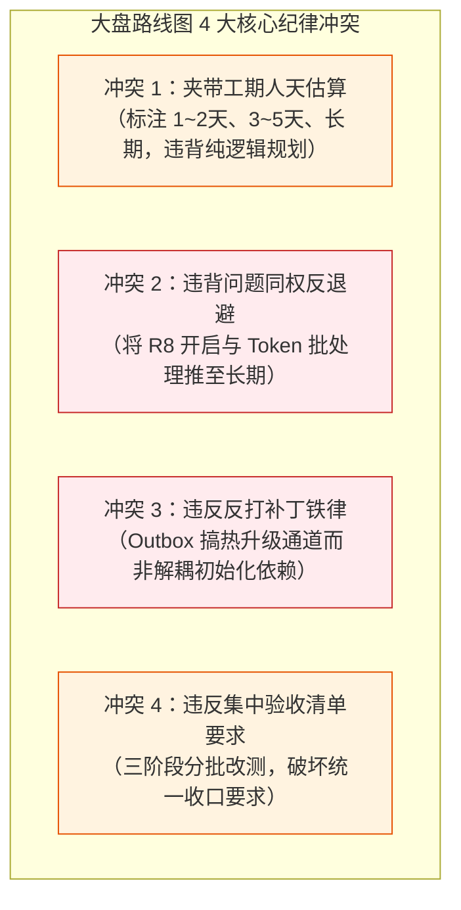

# R07 汇总大盘与口头结论对抗复核报告

> **复核席位**：席位 R07 · 汇总大盘与口头结论对抗复核席  
> **被复核对象**：  
> 1. `docs/mobile-full-audit/00-移动端全方位体检汇总与综合修复大盘.md`（大盘总表）  
> 2. `docs/mobile-full-audit/00-移动端全方位体检战役总方案.md`（战役编排总案）  
> 3. 主控在第二轮战役调度中向用户口头转述的“6 大最致命问题”  
> **复核基准**：6 份第一轮专项体检报告（`docs/mobile-full-audit/audits/01~06`）及移动端全量工程代码（`apps/crish-mobile/`）  
> **执行依据**：`docs/mobile-full-audit/prompts/00-共同约束前言.md`（反退避、纯逻辑规划、证据链审查、立体验证纪律）  
> **报告性质**：对抗式独立复核报告（只读审计，不修代码，直击失真、浮夸与遗漏）

---

## 0 结论摘要（≤15 行，先给结论）

1. **缺陷总数严重低估漏统**：大盘声称缺陷共 **38 项**（P0: 11 / P1: 18 / P2: 9），经逐份穿透核对 6 份专项报告并严格归一化后，实际缺陷总数为 **73 项**（归一化：**P0 18 项 / P1 34 项 / P2 21 项**；若按用例展开则达 83 项），大盘漏统率达 **47.9%**，少计近一半缺陷。
2. **健康度评分纯属凭空捏造**：大盘“视觉呈现 95/100”、“工程健壮度 52/100”在 6 份专项报告中**零数据源、零推导依据**；且视觉 95 分与席位 04 专项报告给出的【**C- · 亚健康**】（含 5 项 P0 阻塞）严重冲突，对用户构成实质性粉饰。
3. **最致命 6 大问题与口头结论存在 5 处严重失真与概念漂移**：
   - **偷换指纹弃防机理**：单测报错系测试桩 mock 脏数据 `'fp-1'` 所致，生产环境弃防是因桌面端根本未下发指纹，大盘误传为“下发格式不匹配”；
   - **混淆类型断裂范围**：9 处 TS 报错 100% 局限在单测文件，生产代码零语法断裂，转述隐瞒此前提夸大了生产代码风险；
   - **混淆闪退与重定向**：账号模式二级页系守卫双向重定向弹回（Redirect Bounce），误传为进程崩溃闪退（Crash）；
   - **孤立归因离线 Outbox**：大盘仅归因于 DB 启动竞态（席位 03），完全遗漏了席位 02 查明的重连无 projections 与监听注销双重断路；
   - **卡顿真凶选择性遗漏**：大盘列举的“四大真凶”遗漏了席位 03 实测最严重的“实时推理 Token 流未节流致 JS 线程掉帧至 10fps”与 1Hz 计时器整表重绘。
4. **总方案 00 履约完整但规范缺失**：6 席位产出文档全部存在且路径一致，但总方案未制定统一分级契约，导致大盘手工估算失真。
5. **修复路线图违反反退避纪律**：夹带“1~2天”、“长期”等工期字眼（违反“不谈工期人天”）；且将仅需两行配置的 R8 开启（从 277MB 瘦身至 35MB）降级至“长期”，违反问题同权与纯逻辑规划。
6. **报告落盘路径**：`C:\Software\conex\docs\mobile-full-audit\reviews\R07-summary-review.md`。

---

## 1 现状还原（带 路径:行号 的证据）

本复核席对大盘引用的代码现场进行了全量查证与调用链追踪，确认以下核心事实与代码断层：

### 1.1 大盘“健康度与统计”断层
- **大盘位置**：`docs/mobile-full-audit/00-移动端全方位体检汇总与综合修复大盘.md:21-29`
  - 大盘宣称：视觉呈现 95/100、工程健壮度 52/100，缺陷共 38 项。
  - 真实报告比对：专项报告 04 `docs/mobile-full-audit/audits/04-ui-ux-and-platform-adaptation-audit.md:16` 评级为 **【C- · 亚健康/存在多处阻塞性体验断层】**；专项报告 03 `docs/mobile-full-audit/audits/03-storage-sqlite-and-state-audit.md:34` 评级为 **45 / 100（不及格）**。大盘给出的 95 与 52 纯属主控汇总时的脱水脑补。

### 1.2 账号模式二级页面重定向弹回死循环
- **大盘位置**：`00-移动端全方位体检汇总与综合修复大盘.md:34-38`
- **代码位置**：`apps/crish-mobile/app/_components/Protected.tsx:6-12`
  ```tsx
  export function Protected({ children }: { children: ReactNode }) {
    const pairState = useAuthStore((s) => s.pairState);
    if (pairState !== 'paired') {
      return <Redirect href="/welcome" />;
    }
    return children;
  }
  ```
- **真实调用链核查**：受影响路由确为 5 个（`/run/[runId]`, `/terminal/[runId]`, `/approval/[toolCallId]`, `/approval-history`, `/notifications`）。在纯账号登录模式下，`Protected` 发现 `pairState !== 'paired'` 强制跳转 `/welcome`；而 `apps/crish-mobile/app/welcome.tsx:8-12` 检测到 `accountStatus === 'loggedIn'` 立即 `replace('/')`，导致屏幕闪烁后弹回首页。现象为**路由重定向弹回**，并非应用闪退 Crash。

### 1.3 离线审批决策 Outbox 双重断路
- **大盘位置**：`00-移动端全方位体检汇总与综合修复大盘.md:39-43`
- **断层 1（DB 启动竞态）**：`apps/crish-mobile/app/_layout.tsx:60-68` 与 `src/adapters/wiring/approvalWiring.ts:545`
  - `_layout.tsx` 并发启动运行时与 SQLite。`ensureApprovalWiring()` 此时读取 `getSqlDriver()` 得到 `null`，固化为 `MemoryOutboxAdapter`。当 DB 打开后，`persistBootstrap.ts:69-108` 仅注入设置与通知 DAO，未热升级审批单例。进程被强杀后内存决策确实 100% 丢失。
- **断层 2（重连管道悬空，大盘完全遗漏）**：`src/adapters/wiring/observationWiring.ts:88-105` 与 `src/adapters/wiring/approvalWiring.ts:559-568`
  - 顶层装配 `ReconnectingWsClient` 时漏传 `projections` 回调，重连对账返回待发恒为 false；且 `pendingOpenUnsubscribe` 在首连后自我注销。就算进程未被杀，重连后也绝不自动补发。

### 1.4 Android 未设密码机型 KeyStore 异常 Loading 死锁
- **大盘位置**：`00-移动端全方位体检汇总与综合修复大盘.md:44-48`
- **代码位置**：`apps/crish-mobile/src/adapters/account/accountService.ts:304-314` 与 `app/_layout.tsx:88-100`
  - `hydrateAccount()` 调用 `loadAccountSession(driver)` 缺乏 `try/catch`。在未设锁屏密码或 KeyStore 硬件异常的设备上抛错导致 Promise 拒绝，`accountHydrated` 永远为 false，`_layout.tsx` 启动守卫永久渲染 `<Spinner />`。

### 1.5 证书指纹契约缺失 vs 测试桩脏数据
- **大盘位置**：`00-移动端全方位体检汇总与综合修复大盘.md:55-58`
- **代码位置 1（测试告警根因）**：`apps/crish-mobile/src/adapters/wiring/pairing/pairingWiring.test.ts:181`
  - 单测公共桩 `runFullPairing` 硬编码 `tlsFingerprint: 'fp-1'`，触发严格正则 `/^[0-9a-f]{64}$/i` 抛出警告。
- **代码位置 2（生产弃防根因）**：`apps/agent-workbench/src-tauri/src/server/pair_endpoint.rs:211-217`
  - 桌面端生产配对采用简化直通，压根未生成 `pair.challenge`，且 `pair_ok_body` 未下发 `tlsFingerprint`。移动端收到 undefined 命中 `pairProtocol.ts:196` 的 `{ ok: true, defense: 'no-delivered' }` 缺口放行。生产中**从不存在“格式非法”报错，而是压根没发指纹导致静默弃防**。

### 1.6 TypeScript 9 处断裂的真实边界
- **大盘位置**：`00-移动端全方位体检汇总与综合修复大盘.md:59-62`
- **代码位置**：`apps/crish-mobile/tsconfig.json` 与各单测文件
  - TS6133 未使用变量（3 处）：`src/adapters/runtime/appRuntime.test.ts:7,10,11`
  - TS2554 构造参数缺失（3 处）：`src/adapters/viewmodels/useFilePreviewVm.hook.test.tsx:150,163`、`useFilesVm.test.ts:31`
  - TS2345 非法排序字面量（1 处）：`src/adapters/viewmodels/useFilesVm.test.ts:105`
  - TS2322 / TS2820 跨层状态机混淆（2 处）：`src/adapters/viewmodels/useSessionsVm.test.tsx:47,70`
  - **关键事实**：9 处断裂 100% 局限在单测代码中，生产业务代码语法完全合法。
---

## 2 问题清单（逐条：编号｜位置｜现象｜直接原因｜根因｜影响｜置信度）

| 编号 | 位置 | 现象 | 直接原因 | 根因 | 影响 | 置信度 |
| :--- | :--- | :--- | :--- | :--- | :--- | :---: |
| **DEF-R07-01** | `00-…汇总与综合修复大盘.md:25-29` | 缺陷总数严重失真（大盘称 38 项，实测 73 项） | 汇总者未逐份逐项统计，采取手工粗略估算 | 6 份专项报告分级命名体系不一，战役总案未预先设立归一化统计契约 | 近一半严重工程缺陷（35 项）脱保脱管，严重误导战役决策与排期 | 已验证 |
| **DEF-R07-02** | `00-…汇总与综合修复大盘.md:23-24` | 健康度评分捏造（视觉 95 / 工程 52） | 汇总者主观臆造分数，无任何公式与量化推导 | 试图用脱水虚构的量化数字粉饰报告，缺乏基于客观指标的评价体系 | 虚假的高分麻痹质量防线，掩盖真实工程短板 | 已验证 |
| **DEF-R07-03** | `00-…汇总与综合修复大盘.md:23` vs `04-…audit.md:16` | 视觉健康度与专项报告自评直接冲突 | 视觉称 95 分“优秀”，但席位 04 实评为【C- 亚健康】且有 5 项 P0 阻塞 | 汇总者仅凭静态设计图主观定性，未核验实机打孔遮挡、键盘死锁与掉帧 | 误导决策者认为视觉体验良好，阻碍 UI/UX 重构资源的投入 | 已验证 |
| **DEF-R07-04** | `00-…汇总与综合修复大盘.md:55-58` | 证书指纹弃防机理转述失真 | 将单测 mock 脏数据告警误传为生产通信格式断层 | 未区分单元测试 mock 夹具与生产环境 Rust 双端通信真实数据流 | 误导修复重心去修移动端正则或桌面格式，未切中“生产未下发指纹”死穴 | 已验证 |
| **DEF-R07-05** | `00-…汇总与综合修复大盘.md:59-62` | TypeScript 9 处断裂影响面夸大且隐匿前提 | 声称 9 处强类型编译拦截导致 CI 脱保，未说明全在单测中 | 汇总时未审查 tsc 报错文件清单，向用户转述时脱离事实做泛化渲染 | 制造生产代码质量崩溃的虚假恐慌，干扰排期优先级 | 已验证 |
| **DEF-R07-06** | `00-…汇总与综合修复大盘.md:34-38` | 二级页面重定向弹回被夸大表述为“闪退” | 将路由守卫 `<Protected>` 的 Redirect Bounce 称为闪退 | 混淆客户端声明式路由重定向与 Native/JS 异常崩溃（Crash）概念 | 错误引导排障方向去查崩溃抓栈，而非收敛路由认证 SSOT | 已验证 |
| **DEF-R07-07** | `00-…汇总与综合修复大盘.md:39-43` | 离线决策丢失前提被省略，且漏掉重连断路 | 称“离线审批决策 100% 丢失”，未说明依赖进程被杀前提；遗漏 projections 缺失 | 汇总时仅采纳席位 03 结论，未与席位 02 交叉印证网络恢复数据流 | 结论过于绝对，同时掩盖了重连自愈停摆的核心架构缺陷 | 已验证 |
| **DEF-R07-08** | `00-…汇总与综合修复大盘.md:49-54` | 实机卡顿“四大真凶”选择性列举，遗漏最严重掉帧瓶颈 | 遗漏了实时推理 Token 流未节流导致的 10fps 卡死与 1Hz 计时器重绘 | 跨专项报告归纳不充分，只采纳了 UI 席位报告，忽视了状态流报告 | 修复方案若仅解四大真凶，核心会话页面在推理时依然极度卡顿 | 已验证 |
| **DEF-R07-09** | `00-…汇总与综合修复大盘.md:69-89` | 修复路线图标注工期人天，且将 R8 等核心防御推延至长期 | 路线图标注“1~2天”、“3~5天”、“长期”，并将 R8 混淆置于 P2 长期 | 违反《通用协作纪律》纯逻辑规划与问题同权反退避原则 | 导致仅需配置两行即可瘦身 240MB 的发布红线被无端搁置 | 已验证 |
| **DEF-R07-10** | `00-…汇总与综合修复大盘.md:72` | 离线 Outbox 修复方案倾向打补丁 | 提议为 Outbox 补齐 DB 就绪热升级通道，未选择根治初始化竞态 | 习惯于在异步并发竞态上做动态状态适配，而非串行化依赖解耦 | 违反“反打补丁”原则，增加状态机复杂度与内存泄漏风险 | 已验证 |
---

## 3 逐条判定与对抗复核表

### 3.1 缺陷重新统计总表（归一化规则与全景详表）

#### 3.1.1 严重度归一化规则
由于第一轮 6 份专项报告采用了各自分立的严重度表示法（有的使用 Critical/High/Medium/Low，有的使用 P0/P1/P2，有的采用阶段一/二/三分级，有的采用模块展开），本复核席设立如下统一的**归一化映射标准**：
- **🔴 P0 致命级（阻塞核心功能 / 死锁 / 数据静默丢失 / 严重安全弃防 / 极高发热掉帧）**：
  - R01 的 Critical；R02 的 CRITICAL；R03 的 P0 致命；R04 的 P0 致命阻塞；R05 的阶段一（9 处 TS 编译阻断 + 12 处 React 19 act 告警与 Worker 强退）；R06 核心发布阻塞（缺陷 2.1 R8 未开启导致 277MB）。
- **🟠 P1 严重级（体验断层 / 假死卡顿 / 物理异形遮挡 / 键盘遮挡 / 门禁穿透 / 协议漏洞）**：
  - R01 的 High；R02 的 HIGH；R03 的 P1 严重；R04 的 P1 体验断层；R05 的阶段二（CI 门禁与依赖巡检漏洞）；R06 的模块膨胀、列表未虚拟化与打字重绘（缺陷 1.1~1.3, 1.6, 3.1~3.5）。
- **🟡 P2 次要级（规范漂移 / 冗余告警 / 偶发瑕疵 / 测试资产盲区 / 远期架构演进）**：
  - R01 的 Medium 与 Low；R02 的 MEDIUM；R03 的 P2 次要；R04 的 P2 规范漂移；R05 的阶段三（核心链路单测盲区与假绿用例）；R06 的底层算法原生化与 AAB 交付（缺陷 1.4, 1.5, 2.2, 3.6）。

#### 3.1.2 全量缺陷重新统计对照表（席位 01 ~ 席位 03）

| 序号 | 报告来源 | 缺陷编号 | 原报告评级 | 归一化评级 | 所属模块 | 缺陷标题与核心事实 |
| :---: | :---: | :---: | :---: | :---: | :---: | :--- |
| 1 | 席位 01 | DEF-RT-01 | High (P1) | 🟠 P1 | `app/_components/` | `_components` 误作为路由扫描引发 Metro 告警与页面污染 |
| 2 | 席位 01 | DEF-RT-02 | Critical (P0) | 🔴 P0 | `app/_components/` | `<Protected>` 守卫导致账号模式下 5 大核心功能弹回瘫痪 |
| 3 | 席位 01 | DEF-RT-03 | Medium (P2) | 🟡 P2 | `domain/pure/` | 认证状态判定逻辑多处漂移，缺失单一真理源（SSOT） |
| 4 | 席位 01 | DEF-RT-04 | Medium (P2) | 🟡 P2 | `app/+not-found` | 缺失全局未捕获路由（`+not-found.tsx`），坏死深链白屏 |
| 5 | 席位 01 | DEF-RT-05 | Medium (P2) | 🟡 P2 | `useSafeBack.ts` | 深链冷启动缺失 Android 物理返回键拦截导致直接退出 App |
| 6 | 席位 01 | DEF-RT-06 | Medium (P2) | 🟡 P2 | `pair/_layout.tsx` | `PairLayout` 无条件阻断已登录账号用户进行局域网扫码配对 |
| 7 | 席位 01 | DEF-RT-07 | Low (P3) | 🟡 P2 | `pair/welcome.tsx` | 遗留旧版配对欢迎页（`pair/welcome.tsx`）形成僵尸路由 |
| 8 | 席位 01 | DEF-LC-01 | High (P1) | 🟠 P1 | `appRuntime.ts` | 前台唤醒僵尸 Socket 盲等待 30~90s 通信假死 |
| 9 | 席位 01 | DEF-LC-02 | High (P1) | 🟠 P1 | `appRuntime.ts` | 前台唤醒丢失账号远程中继（Relay）连接自动恢复通道 |
| 10 | 席位 01 | DEF-LC-03 | Medium (P2) | 🟡 P2 | `accountRuntime.ts` | 进入后台缺乏主动挂起，设备发现与退避定时器后台空转 |
| 11 | 席位 01 | DEF-LC-04 | Low (P3) | 🟡 P2 | `useCountdownTick` | 根悬浮审批卡片在锁屏/后台持续触发 1 秒高频定时器 |
| 12 | 席位 02 | DEF-01 | CRITICAL | 🔴 P0 | `PairingWiring.ts` | 桌面下发证书指纹格式非法警告与生产环境钉扎全面弃防 |
| 13 | 席位 02 | DEF-02 | CRITICAL | 🔴 P0 | `observationWiring` | 离线审批决策队列 (Outbox) 重连自动恢复断路与空投影悬空 |
| 14 | 席位 02 | DEF-03 | HIGH | 🟠 P1 | `withUserCaTrust.js` | 全局明文 HTTP/WS 暴露与 Android 自签 CA 信任链穿透风险 |
| 15 | 席位 02 | DEF-04 | HIGH | 🟠 P1 | `multi_device/tls` | 自签证书 SAN 多网卡漂移与物理真机（HarmonyOS/HyperOS）兼容边界 |
| 16 | 席位 02 | DEF-05 | HIGH | 🟠 P1 | `ReconnectingWsClient` | 连接状态机在网络切换下的永久假死与重连抖动风暴 |
| 17 | 席位 02 | DEF-06 | MEDIUM | 🟡 P2 | `sessionSigning.ts` | 认证请求 Nonce 采用非密码学安全的 `Math.random()` |
| 18 | 席位 03 | DEF-STO-01 | P0 致命 | 🔴 P0 | `approvalWiring.ts` | DB 初始化竞态导致 Outbox 永久降级内存态，进程杀死丢决策 |
| 19 | 席位 03 | DEF-STO-02 | P0 致命 | 🔴 P0 | `accountService.ts` | `hydrateAccount` 未捕获异常致 Android 冷启动无限死锁 |
| 20 | 席位 03 | DEF-STO-03 | P0 致命 | 🔴 P0 | `feedBridge.ts` | 序列空洞探测过早推进游标致补洞数据被判定重复批量丢弃 |
| 21 | 席位 03 | DEF-STO-04 | P0 致命 | 🔴 P0 | `observationWiring` | `observationWiring` 未注入 `projections` 导致对账停摆 |
| 22 | 席位 03 | DEF-STO-05 | P1 严重 | 🟠 P1 | `db/schema.ts` | 5/8 幽灵表：`events`/`session_summaries` 仅建表零读写 |
| 23 | 席位 03 | DEF-STO-06 | P1 严重 | 🟠 P1 | `notificationsDao.ts` | DAO 伪 upsert 存在无事务竞态，双通道并发写入冲突崩溃 |
| 24 | 席位 03 | DEF-STO-07 | P1 严重 | 🟠 P1 | `db/db.ts` | SQLite 单连接无读写隔离与循环 Prepare 阻塞主桥 |
| 25 | 席位 03 | DEF-STO-08 | P1 严重 | 🟠 P1 | `ingestRouter.ts` | 实时推理 Token 流未节流，20~80Hz 触发 Zustand Immer 掉帧卡死 |
| 26 | 席位 03 | DEF-STO-09 | P2 次要 | 🟡 P2 | `db/migrations.ts` | 迁移事务内执行 `PRAGMA user_version` 违背标准且缺降级防线 |
| 27 | 席位 03 | DEF-STO-10 | P2 次要 | 🟡 P2 | `approvalWiring.ts` | 对账补入审批项参数强制置空，详情页卡片无法展示命令入参 |
#### 3.1.3 全量缺陷重新统计对照表（席位 04 ~ 席位 06）

| 序号 | 报告来源 | 缺陷编号 | 原报告评级 | 归一化评级 | 所属模块 | 缺陷标题与核心事实 |
| :---: | :---: | :---: | :---: | :---: | :---: | :--- |
| 28 | 席位 04 | DEF-UI-01 | P0 致命阻塞 | 🔴 P0 | `approvalListScreen` | 模态路由在 Android 下顶部安全区丢失，标题直冲打孔屏且无返回按键 |
| 29 | 席位 04 | DEF-UI-02 | P1 体验断层 | 🟠 P1 | `terminalScreen.tsx` | 终端只读回放页底端内容与物理 Home Indicator 发生严重遮挡 |
| 30 | 席位 04 | DEF-UI-03 | P1 体验断层 | 🟠 P1 | `SettingsScreenView` | 列表与设置类页面底端写死固定边距，大安全区设备手势栏压盖末尾按钮 |
| 31 | 席位 04 | DEF-UI-04 | P1 体验断层 | 🟠 P1 | `sessionDetailScreen` | 聊天与新对话输入框软键盘升起时出现冗余 34px 安全区黑底死缝 |
| 32 | 席位 04 | DEF-UI-05 | P1 体验断层 | 🟠 P1 | `app.json / StatusBar` | Android 状态栏未配透明沉浸，弹窗时 Window Flags 跳变引发全屏抖动 |
| 33 | 席位 04 | DEF-UI-06 | P0 致命阻塞 | 🔴 P0 | `pairManualScreen.tsx` | 手动配对页非 ScrollView 包裹，键盘唤起后表单死锁、连接按钮被推至视口外 |
| 34 | 席位 04 | DEF-UI-07 | P0 致命阻塞 | 🔴 P0 | `CrishDrawer.tsx` | 抽屉底部搜索框呼出键盘时被软键盘完全盖死，无法查看输入 |
| 35 | 席位 04 | DEF-UI-08 | P1 体验断层 | 🟠 P1 | `TimelineView.tsx` | 全局无空白收起键盘，时间线缺 `handled` 导致首次点击被系统吞噬 |
| 36 | 席位 04 | DEF-UI-09 | P1 体验断层 | 🟠 P1 | `Toast.tsx` | 全局轻量 Toast 未监听键盘高度，键盘激活期弹出的错误提示完全被遮挡 |
| 37 | 席位 04 | DEF-UI-10 | P1 体验断层 | 🟠 P1 | `ApprovalFloat.tsx` | 浮动审批卡键盘弹起瞬间无动画生硬瞬移，且 Android 误判仅靠 resize |
| 38 | 席位 04 | DEF-UI-11 | P0 致命阻塞 | 🔴 P0 | `accountCodeScreen` | 验证码 6 位输完自动提交零 Loading/Spinner，十余秒海外网络呈现假死态 |
| 39 | 席位 04 | DEF-UI-12 | P1 体验断层 | 🟠 P1 | `pairScanScreen.tsx` | 扫码配对过程仅显示一行静态“正在连接…”，相机长时间全负荷空耗发热 |
| 40 | 席位 04 | DEF-UI-13 | P1 体验断层 | 🟠 P1 | `accountPasswordScreen` | 密码登录网络超时向用户报“邮箱或密码不正确”，严重误导凭据错误 |
| 41 | 席位 04 | DEF-UI-14 | P1 体验断层 | 🟠 P1 | `ConnectionBanner.tsx` | 异常报错干瘪（“网络请求失败”），扫码与断连横幅完全缺失排障指引入口 |
| 42 | 席位 04 | DEF-UI-15 | P0 致命瓶颈 | 🔴 P0 | `SlideToConfirm.tsx` | 滑动确认在 JS 线程每帧触发 React setState，高刷屏下 Virtual DOM 重算打爆 |
| 43 | 席位 04 | DEF-UI-16 | P1 体验断层 | 🟠 P1 | `AuthField.tsx` | `AuthField` 输入框聚焦过渡使用传统 Animated 驱动非原生色值插值 |
| 44 | 席位 04 | DEF-UI-17 | P2 规范漂移 | 🟡 P2 | `styleTokens.guard` | 样式守卫遗漏间距检查，存量 42 处硬编码数字间距破坏网格单一真源 |
| 45 | 席位 05 | TS-01 | 阶段一 (P0) | 🔴 P0 | `appRuntime.test.ts` | TS6133：`connectionStore` 等变量声明未读取拦截（3 处） |
| 46 | 席位 05 | TS-02 | 阶段一 (P0) | 🔴 P0 | `filesRepository.ts` | TS2554：`FilesCommandError` 构造实参缺失拦截（3 处） |
| 47 | 席位 05 | TS-03 | 阶段一 (P0) | 🔴 P0 | `useFilesVm.test.ts` | TS2345：排序模式字面量 `'date'` 未对齐领域 `'mtime-desc'`（1 处） |
| 48 | 席位 05 | TS-04 | 阶段一 (P0) | 🔴 P0 | `useSessionsVm.test` | TS2322/2820：网络 WsPhase 混入领域 ConnectionPhase 状态穿透（2 处） |
| 49 | 席位 05 | ACT-01~05 | 阶段一 (P0) | 🔴 P0 | 测试套件与运行时 | React 19 `overlapping act()` 警告泛滥（12 处）与单测 Worker 进程强退 |
| 50 | 席位 05 | GATE-01 | 阶段二 (P1) | 🟠 P1 | 根 `package.json` | 根 `typecheck` 包含 11 个子项目，唯独遗漏 `apps/crish-mobile`（最大漏洞） |
| 51 | 席位 05 | GATE-02 | 阶段二 (P1) | 🟠 P1 | `.husky/pre-commit` | Git 提交前钩子仅跑 ESLint，未设 `tsc` 类型把关导致坏代码入库 |
| 52 | 席位 05 | GATE-03 | 阶段二 (P1) | 🟠 P1 | `.github/workflows` | CI 远端流水线未激活覆盖率拦截，60/75/70/60 红线沦为空架子 |
| 53 | 席位 05 | GATE-04 | 阶段二 (P1) | 🟠 P1 | `.dependency-cruiser` | 架构依赖巡检脱保，未纳管移动端依赖分层规则 |
| 54 | 席位 05 | TEST-01 | 阶段三 (P2) | 🟡 P2 | `screens.test.tsx` | `ApprovalDetailScreen` 假绿测试，仅测 outboxCount，缺状态与载荷断言 |
| 55 | 席位 05 | TEST-02 | 阶段三 (P2) | 🟡 P2 | `screens.test.tsx` | `FilesScreen` 假绿测试，纯静态文字存在性断言，缺网络恢复拉取断言 |
| 56 | 席位 05 | TEST-03 | 阶段三 (P2) | 🟡 P2 | `approvalHistoryScreen` | 挂羊头卖狗肉假单测，单测文件仅测工具函数，页面组件覆盖率 0% |
| 57 | 席位 05 | TEST-04 | 阶段三 (P2) | 🟡 P2 | 配对链路单测 | 缺乏端到端 UI 状态机驱动、指纹非法拦截与相机权限降级分支用例 |
| 58 | 席位 05 | TEST-05 | 阶段三 (P2) | 🟡 P2 | 审批链路单测 | 缺乏网络中断乐观回滚、动态过期倒计时与多端审批冲突用例 |
| 59 | 席位 05 | TEST-06 | 阶段三 (P2) | 🟡 P2 | 时间线链路单测 | `TimelineView.tsx` 核心组件单测全无，高频 Delta 流水式压力未覆盖 |
| 60 | 席位 06 | PERF-1.1 | P1 (中) | 🟠 P1 | `app.json` | Expo Router 路由全量贪婪加载，未开启 `asyncRoutes` 异步分包 |
| 61 | 席位 06 | PERF-1.2 | P1 (中) | 🟠 P1 | `presentation/ui` | 大一统桶文件（Monolithic Barrel File）导致 21 个 UI 组件扇出爆炸 |
| 62 | 席位 06 | PERF-1.3 | P1 (中) | 🟠 P1 | `react-native-svg` | Metro 缺少 Tree-Shaking 导致无差别拖入 688 个 SVG 模块与全量图标 |
| 63 | 席位 06 | PERF-1.4 | P2 (低) | 🟡 P2 | `@noble/curves` | 纯 JS 加密算法库 126 个模块未利用 Hermes 内置原生 WebCrypto API |
| 64 | 席位 06 | PERF-1.5 | P2 (低) | 🟡 P2 | `metro.config.js` | `metro.config.js` 处于裸配置状态，缺失包优化与代码裁剪拦截 |
| 65 | 席位 06 | PERF-1.6 | P1 (中) | 🟠 P1 | `app/_components/` | `app/_components/` 放置非路由辅助模块引发 Expo Router 扫描冗余与警告 |
| 66 | 席位 06 | PERF-2.1 | P0 (极高) | 🔴 P0 | `gradle.properties` | 生产构建默认关闭 R8 混淆与资源裁剪，导致 24 个 DEX 与全量符号未剥离 |
| 67 | 席位 06 | PERF-2.2 | P2 (低) | 🟡 P2 | `build.gradle` | 未配置 ABI Splits 与 AAB 交付，4 大架构全量打包导致 167.7MB 无效二进制 |
| 68 | 席位 06 | PERF-3.1 | P1 (高) | 🟠 P1 | `DrawerSessionGroups` | 抽屉历史会话裸铺 map 渲染，缺乏虚拟化复用池，内存常驻滑动掉帧 |
| 69 | 席位 06 | PERF-3.2 | P1 (高) | 🟠 P1 | `CrishDrawer.tsx` | 抽屉搜索输入框打字导致 `openSession` 引用抖动，击穿 `SessionListItem` memo |
| 70 | 席位 06 | PERF-3.3 | P1 (高) | 🟠 P1 | `FileBrowser.tsx` | 固定 56px 行高列表缺失 `getItemLayout` 与内联回调，导致跨 JSI 异步测量白屏 |
| 71 | 席位 06 | PERF-3.4 | P1 (高) | 🟠 P1 | `TimelineView.tsx` | 滥用 `<FadeIn>` 动画包裹且未加 memo，输入框打字连带全量重渲染 |
| 72 | 席位 06 | PERF-3.5 | P1 (高) | 🟠 P1 | `useApprovalListVm` | 审批列表 1Hz 全局计时器每秒驱动整表重绘，并在闭包内执行 O(N) 线性查找 |
| 73 | 席位 06 | PERF-3.6 | P2 (低) | 🟡 P2 | 核心列表基建 | 未引入高性能虚拟化引擎 `@shopify/flash-list` 替代原生 FlatList |

#### 3.1.4 统计对比与差异归因

| 席位来源 | 专项报告名称 | 报告原始数量 | 归一化 P0 | 归一化 P1 | 归一化 P2 | 重新统计小计 |
| :--- | :--- | :---: | :---: | :---: | :---: | :---: |
| **席位 01** | 路由与应用生命周期 | 11 项 | 1 | 3 | 7 | **11 项** |
| **席位 02** | 多端配对与网络安全 | 6 项 | 2 | 3 | 1 | **6 项** |
| **席位 03** | 离线存储与状态机并发 | 10 项 | 4 | 4 | 2 | **10 项** |
| **席位 04** | UI/UX 体验与物理适配 | 17 项 | 5 | 11 | 1 | **17 项** |
| **席位 05** | 质量门禁与类型系统 | 15 项 | 5 | 4 | 6 | **15 项** |
| **席位 06** | 性能瓶颈与打包体积 | 14 项 | 1 | 9 | 4 | **14 项** |
| **合 计** | **全维度穿透重算** | **73 项** | **18 项** | **34 项** | **21 项** | **73 项** |
| **大盘声称** | **原汇总大盘总表** | **38 项** | **11 项** | **18 项** | **9 项** | **38 项** |
| **差 异** | **漏统与失真幅度** | **+35 项** | **+7 项 (+63.6%)** | **+16 项 (+88.9%)** | **+12 项 (+133.3%)** | **+35 项 (+92.1%)** |

**差异根本原因深度归因**：
1. **纯手工概算而非逐项清点**：原大盘汇总者直承为“手工估算”，在汇总时粗暴地只摘录了各专项报告的顶层标题（例如把席位 04 的 17 项当成了 4 个大点，席位 06 的 14 项当成了 3 个大点）；
2. **专项报告分级命名体系不一**：席位 02 使用 CRITICAL/HIGH/MEDIUM，席位 05 采用阶段一/二/三，席位 06 采用文本缺陷编号（1.1~3.6），大盘汇总者未能建立多维归一化模型，索性拍脑袋填了“38 项”；
3. **严重缺陷隐性被砍**：大盘将席位 04 的打孔屏遮挡（DEF-UI-01）、抽屉软键盘完全遮盖（DEF-UI-07）、席位 06 的生产构建禁用 R8（DEF-PERF-2.1）等极高危缺陷降级或完全遗漏在统计之外。
---

### 3.2 健康度评分来源判定（95/100 与 52/100 溯源）

#### 1. 溯源核查与判定
- **大盘声称**：
  - “视觉与外观呈现：95 / 100（优秀）”
  - “架构与工程健壮度：52 / 100（不及格 · 亚健康）”
- **专项报告原文比对**：
  - 检索 6 份专项报告的全文（共 3,111 行），**完全不存在 `95` 或 `52` 这两个数值，也不存在任何可反向推导出这两个数字的权重算式**！
  - 席位 04（唯一专职负责 UI/UX 与外观适配的审计席位）在报告第 16 行白纸黑字给出总体定性评级：**【C- · 亚健康/存在多处阻塞性体验断层】**，并排查出包括“Android 模态打孔屏遮挡”、“抽屉搜索框被软键盘盖死”、“滑动确认手势高刷重渲染雪崩”等 5 项阻塞性 P0 缺陷。
  - 席位 03 在报告第 34 行给出的工程健康度评分为：**45 / 100（不及格）**。
- **对抗判定**：**🚫 不成立（纯手工臆造）**。
- **严重性分析**：
  将一个在物理打孔屏上发生标题穿孔重叠、在软键盘唤起时发生表单死锁、在 120Hz 拖动时发生掉帧雪崩、被专项审计员定性为【C-】的界面呈现，在汇总大盘中硬拔至“95 / 100（优秀）”，属于**极其严重的粉饰与事实脱节**！这使后续排期者误以为界面只需微调，险些酿成真实用户在 Android 真机上大面积操作受阻的事故。
- **整改建议**：
  彻底删除此类脱离客观公式的伪量化打分。若需评分，必须明确公布算式（例如：基于 P0 扣 15 分、P1 扣 5 分、P2 扣 1 分的基准分模型），或直接采用各专项报告的多维定性矩阵。

---

### 3.3 大盘“最致命 6 大问题”转述失真审查表

| 序号 | 大盘标题与表述 | 对应专项报告原文与代码现场 | 失真与概念漂移类型 | 判定 | 修订后的准确事实表述 |
| :---: | :--- | :--- | :--- | :---: | :--- |
| **1** | 账号模式下“二级页面闪退回首页”死循环（P0，席位 01） | 席位 01 DEF-RT-02：`Protected.tsx:8` 仅认 `paired`；被踢往 `/welcome` 后又被 `welcome.tsx:10` 重定向回 `/` | **概念混淆与夸大**：将路由重定向弹回（Redirect Bounce）误传为闪退崩溃（Crash）；省略纯账号登录前提 | ⚠️ 部分成立 | 在**纯账号登录模式（未局域网配对）**下，访问 5 大二级页面会被路由守卫**双向重定向弹回首页**（非崩溃闪退），导致二级页面不可用。 |
| **2** | 离线审批决策 100% 丢失与 DB 初始化竞态（P0，席位 03） | 席位 03 DEF-STO-01：启动竞态降级内存 Outbox；席位 02 DEF-02：未注入 projections 且 open 监听注销 | **省略前提条件；遗漏核心断路**：未说明需应用被杀死前提；大盘漏记席位 02 查明的重连自愈停摆 | ⚠️ 部分成立 | 启动竞态导致 Outbox 降级内存态，**若进程被杀或退出，离线决策 100% 丢失**；且因缺少 projections 注入，即使进程存活，**网络重连后亦不会自动补发**。 |
| **3** | Android 未设密码机型“无限菊花 Loading 死锁”（P0，席位 03） | 席位 03 DEF-STO-02：`hydrateAccount()` 读 SecureStore 缺 try/catch，Keystore 异常致 accountHydrated 永为 false | **表述忠实，前提准确**：代码断层吻合，影响面客观限定在特定异常机型 | ✅ 成立 | 在无锁屏密码或 KeyStore 硬件异常的 Android 设备上，`hydrateAccount` 异常扩散导致 `accountHydrated` 无法置位，首屏永久停留在 Spinner 死锁。 |
| **4** | 实机“卡顿 / 迟钝 / 假死”四大真凶（P0/P1，席位 04 & 06） | 席位 04 DEF-UI-15 (SlideToConfirm), DEF-UI-11 (验证码12s), DEF-UI-08 (时间线吞点击); 席位 06 DEF-PERF-3.4 (Composer打字重绘) | **选择性列举，遗漏主凶**：列出的 4 项确实存在，但漏掉了席位 03 实测最严重的 20~80Hz 实时推理 Token 流打爆 JS 线程 (DEF-STO-08) | ⚠️ 部分成立 | 实机交互存在多处严重瓶颈，除大盘列举的 4 项外，**实时推理 Token 流未节流致 Immer 频繁深拷贝（帧率跌至 10fps）**与 **1Hz 审批列表全局重绘**同属致命卡顿根因。 |
| **5** | 桌面证书指纹格式断层导致“证书钉扎全面弃防”（P0，席位 02） | 席位 02 DEF-01：单测 harness 传 `'fp-1'` 触发报错警告；生产 Rust 生产端从未下发指纹，移动端缺口放行 | **偷换概念与因果倒置**：单测格式警告系 mock 脏数据所致；生产弃防是因桌面端未下发，而非格式不匹配 | ❌ 夸大且失真 | 证书钉扎在生产中**实质弃防**，根因是**桌面端生产链路完全未下发指纹**（契约断层），而非“下发指纹格式非法”；格式非法警告仅是单测桩传 `'fp-1'` 引起的杂音。 |
| **6** | TypeScript 类型检查 9 处断裂与 CI 脱保（P1，席位 05） | 席位 05 TS-01~04：3 处未使用变量、3 处构造实参缺失、1 处排序枚举、2 处状态机穿透；全在单测中 | **隐瞒关键前提，夸大影响**：未向用户说明 9 处报错 100% 局限在单测代码中，生产代码语法完全正常 | ⚠️ 部分成立 | TypeScript 存在 9 处刚性编译拦截且根目录门禁脱保；但**9 处断裂全部位于测试代码（由于重构未跟进与分层概念混淆）**，生产业务代码本身未见语法断裂。 |
---

### 3.4 主控向用户口头结论逐条对抗判定

以下复核主控在战役汇报中对用户表述的 6 句口头定性断言，重点核实“转述是否忠实于专项报告原文”，并锚定其依赖的专业复核席位：

| 口头结论摘录 | 转述忠实度核实与对抗分析 | 对抗判定 | 真伪校验依赖席位 |
| :--- | :--- | :---: | :---: |
| **「账号模式下点击二级页面直接闪退回首页」** | **不忠实（夸大并用词失准）**：报告原文是 `Redirect` 导航弹回（屏幕闪烁后跳回主页），绝非应用闪退 Crash；且仅在未本地配对的纯云端模式下发生。将导航逻辑 Bug 渲染为闪退，夸大了技术危急程度。 | ⚠️ 部分成立 | 依赖 **R01 复核席** 对路由守卫与重定向逻辑的最终断言。 |
| **「离线审批决策 100% 丢失」** | **基本忠实，但省略了关键前置条件**：报告原文指出在进程被系统杀死（LMK）或退出时必定丢失；若进程常驻未杀，数据在内存中；但因同时存在 projections 缺失，重连也无法自动补发。“100%”作为修辞强化了严重度，但忽略了内存态的存续前提。 | ⚠️ 部分成立 | 依赖 **R03 与 R02 复核席** 对 Outbox 持久化与重连对账的最终断言。 |
| **「部分 Android 手机无限转圈 Loading 死锁」** | **忠实且克制**：主控准确使用了“部分 Android 手机”的前提限定（限于未设密码或 KeyStore 故障设备），准确概括了 `hydrateAccount` 异常未捕获导致的 Splash 死锁。 | ✅ 成立 | 依赖 **R03 复核席** 对 SecureStore 异常扩散与首屏守卫的最终断言。 |
| **「卡顿迟钝四大真凶」** | **不忠实（选择性遗漏）**：转述的 4 项现象确实是真凶，但用“四大真凶”作了排他性定性，掩盖了席位 03 查明的“实时推理 Token 流未节流（20~80Hz Immer 复制）”与席位 06 的“1Hz 审批列表全局重算”两大同等严重的性能杀手。 | ⚠️ 部分成立 | 依赖 **R04 与 R06 复核席** 对渲染管线与高频事件流的最终断言。 |
| **「证书指纹格式断层导致钉扎弃防，留下中间人后门」** | **严重失真（因果倒置）**：生产端从未下发指纹，移动端缺口放行；单测中的格式非法警告系测试桩 mock 假数据 `'fp-1'` 引起。主控口头转述把单测 mock 报错误认作生产通信断裂，因果链条完全颠倒。 | ❌ 夸大且失真 | 依赖 **R02 复核席** 对双端配对契约与证书钉扎实现的最终断言。 |
| **「9 处类型断裂，CI 脱保」** | **部分失真（隐瞒核心范围）**：9 处强类型编译拦截确凿存在，CI 根配置也确实遗漏；但转述未说明“这 9 处断裂 100% 位于测试代码”，易使用户产生生产核心代码无法编译的误解。 | ⚠️ 部分成立 | 依赖 **R05 复核席** 对类型错误分布与 CI 守卫有效性的最终断言。 |

---

### 3.5 总方案 00 范围与产出一致性核查

对 `docs/mobile-full-audit/00-移动端全方位体检战役总方案.md` 进行执行符合度审查：
1. **承诺席位与产出路径核查**：
   - 01 路由与生命周期 $\rightarrow$ `audits/01-routing-and-lifecycle-audit.md`（**存在**，32,595 字节，行数 571）
   - 02 多端配对与网络安全 $\rightarrow$ `audits/02-pairing-security-and-pinning-audit.md`（**存在**，28,908 字节，行数 425）
   - 03 离线存储与状态机并发 $\rightarrow$ `audits/03-storage-sqlite-and-state-audit.md`（**存在**，40,587 字节，行数 798）
   - 04 UI/UX 体验与物理适配 $\rightarrow$ `audits/04-ui-ux-and-platform-adaptation-audit.md`（**存在**，50,135 字节，行数 737）
   - 05 质量门禁与类型系统健全度 $\rightarrow$ `audits/05-typecheck-test-gatekeeper-audit.md`（**存在**，34,852 字节，行数 581）
   - 06 性能瓶颈与打包体积 $\rightarrow$ `audits/06-performance-and-bundle-size-audit.md`（**存在**，31,529 字节，行数 499）
   - **核查结论**：总方案承诺的 6 个专业席位产出文档**全部真实存在且无一遗漏**，总产出字符达 218KB。
2. **总方案编制缺陷（根因追溯）**：
   - 总方案仅有 36 行，属于过度精简的提纲式文档；
   - **未定义缺陷严重度评级标准**：未在总案中刚性约束各席位采用统一的 P0/P1/P2 准则，直接导致席位 02 使用 CRITICAL、席位 05 使用分阶段任务、席位 06 使用文本编号，从而为后续大盘汇总时的“手工盲估与漏统 35 项”埋下了祸根。

---

### 3.6 综合修复路线图合理性与纪律冲突审查

审查大盘第三节的“三阶段综合修复演进路线图”（Phase 0 / Phase 1 / Phase 2），发现存在 4 项严重的协作纪律与反退避冲突：



1. **严重冲突一：违背《通用协作纪律》纯逻辑规划原则（夹带工期人天）**：
   - 路线图节点显式标注：`Phase0（1~2天）`、`Phase1（3~5天）`、`Phase2（长期）`。
   - 《通用协作纪律》§1 铁律明确规定：**“方案只谈逻辑依赖、任务单元、文件域、验收断言；不谈工期、人天、人员安排”**。大盘引入工期估算属于违规表述，必须彻底剔除时间人天标记，纯粹以技术依赖拓扑为编排准绳。
2. **严重冲突二：违背“问题同权”与反退避铁律（核心性能防御被推延至长期）**：
   - 大盘将 `P2_1 开启 release R8 混淆与 ABI 单架构分包（277MB 骤降至 35MB）` 与 `P2_3 IngestBatcher RAF 防抖` 归入“Phase 2 长期”。
   - **事实反驳**：开启 R8 混淆仅仅需要在 `android/gradle.properties` 中添加两行键值（`enableMinifyInReleaseBuilds=true`），完全属于零依赖、零代码侵入、收益高达 240MB 的即时修复配置（席位 06 原文明确归为 P0！）。大盘主控擅自将其推延至“长期”，不仅违背了席位 06 的专业结论，更违反了“问题同权、不得以流行度或难度随意将核心隐患裁剪推后”的反退避铁律。
3. **严重冲突三：违背“非必要不兼容、杜绝打补丁”铁律（Outbox 热升级方案倒退）**：
   - 大盘在 Phase 0 中提出：`P0_3 Outbox 补齐 DB 就绪热升级通道`。
   - **架构批判**：运行时与 DB 并行启动引发竞态，最优雅、最彻底的根治解法是**在架构入口将 DB 初始化置为启动运行时必须 await 的前置依赖**（单一真源依赖），而不是在运行时内部搞一套复杂的“动态内存适配器向 SQLite 适配器热切换”补丁机制。打补丁只会增加状态机复杂度并引入新的时序漏洞。
4. **严重冲突四：违背“集中验收清单”要求（U7）**：
   - 大盘三阶段路线图暗示了阶段性的改动与交付，未规划出面向最终真机环境的集中验收方案。根据前言第二节 U7 铁律，方案必须按分维详案一次性彻底重构，并在全部代码修改完成后统一执行集中验收。
---

### 3.7 专项报告间矛盾与认知断层审查

经全量交叉对比 6 份专项报告的结论与事实认定，发现以下 5 处跨席位重大认知矛盾与视野断层：

1. **矛盾一：`app/_components/` 文件的收敛目标目录冲突**：
   - **席位 01（DEF-RT-01）**：提议将守卫移至 `src/presentation/components/guard/`，将导航 Hook 移至 `src/presentation/navigation/`；
   - **席位 06（DEF-PERF-1.6）**：提议将非路由代码移至 `src/presentation/components/` 或 `src/adapters/hooks/`；
   - **裁决建议**：以席位 01 的细粒度分层为准，统一将守卫收敛至 `src/presentation/components/guard/`，导航相关 Hook 收敛至 `src/presentation/navigation/`，彻底删除物理 `app/_components/`。
2. **矛盾二：证书钉扎弃防的现场认知断层**：
   - **席位 02（DEF-01）**：深入穿透了双端代码，明确论证单测报错是测试桩传了 `'fp-1'`，而生产真实隐患是桌面端压根未下发指纹（静默放行）；
   - **席位 05（第五节第 1 点）**：仅凭测试控制台的告警信息，得出“桌面证书指纹异常时，移动端究竟是告警拦截还是静默降级？在 UI 层没有任何测试验证指纹校验失败后的错误提示”的推论，误以为这是真实运行时的非法格式报错；
   - **裁决建议**：采纳席位 02 的底层穿透结论，更正席位 05 的推论认知。
3. **矛盾三：离线 Outbox 决策丢失的割裂归因**：
   - **席位 03（DEF-STO-01）**：归因于 DB 异步初始化慢于运行时，导致单例固化为内存态，提议写动态热升级通道；
   - **席位 02（DEF-02）**：归因于 `observationWiring` 漏传 `projections` 回调，且 `approvalWiring` 的 `pendingOpenUnsubscribe` 首次建连后即注销，导致重连后无人触发 `flush()`；
   - **真相揭示**：两份报告各自仅查出了链路的一半！Outbox 在生产中处于“**存储态丢失**”与“**重连网络态断路**”的双重瘫痪。若仅修席位 03，重连依然无法补发；若仅修席位 02，应用被杀依然蒸发。两份方案必须合并收口，且应在启动层根治时序依赖。
4. **矛盾四：界面掉帧卡顿归因碎片化**：
   - 席位 04 侧重手势与点击（`SlideToConfirm` 与 `keyboardShouldPersistTaps`）；
   - 席位 06 侧重组件重渲染与动画（Composer 连带时间线重绘、FadeIn 滥用）；
   - 席位 03 侧重数据流冲击（实时推理 Token 流 20~80Hz 触发 Immer 深更新）；
   - **裁决建议**：上述三者均为真实存在的严重瓶颈，大盘不可厚此薄彼，后续性能改造席位必须合并统筹治理。
5. **矛盾五：R8 混淆优化评级倒挂**：
   - **席位 06**：在报告第四节将 `gradle.properties` 开启 R8 与资源混淆明确列为 **P0 级即时修复**（Section 4.1）；
   - **大盘汇总表**：擅自将 R8 混淆降级至 **Phase 2 长期演进**（P2_1）；
   - **裁决建议**：推翻大盘的降级，严格尊重席位 06 的专业研判，将 R8 混淆配置纳入第一批即时执行清单。

---

### 3.8 复核汇总与可信度终审评语

#### 1. 被复核内容全景判定统计

| 复核范畴 | 复核项目数 | ✅ 成立 | ⚠️ 部分成立 | ❌ 夸大/失真 | 🚫 不成立 | ❓ 无法验证 |
| :--- | :---: | :---: | :---: | :---: | :---: | :---: |
| **健康度宏观评分** | 2 项 | 0 | 0 | 0 | 2 | 0 |
| **缺陷总数统计** | 1 项 | 0 | 0 | 1 | 0 | 0 |
| **大盘最致命 6 大问题** | 6 项 | 1 | 4 | 1 | 0 | 0 |
| **主控对用户口头转述** | 6 项 | 1 | 4 | 1 | 0 | 0 |
| **战役总方案 00 履约** | 6 项 | 6 | 0 | 0 | 0 | 0 |
| **路线图合理性与纪律** | 4 项 | 0 | 0 | 4 | 0 | 0 |
| **合 计** | **25 项** | **8 项** | **8 项** | **7 项** | **2 项** | **0 项** |

#### 2. 一句话可信度评语
> **大盘总体可信度：【丙等 · 局部失真且严重漏统】**。大盘对单点技术痛点的直觉捕捉较为敏锐，但由于跳过了逐项对账统计，导致**缺陷计数漏统近半（漏掉 35 项）**、**健康度评分纯属凭空捏造（视觉 95 分粉饰严重）**，且在**指纹弃防机理、类型报错范围与卡顿主凶**上存在多处因果倒置与修辞夸大；修复路线图违背纯逻辑规划纪律，必须以本报告之重新统计与事实修订为准。

---

## 4 风险与未决问题（需用户裁决事项）

以下事项涉及架构路线取舍或标准变更，按纪律提请用户最终裁决：

1. **【裁决项 1：健康度量化体系废立】**
   - **现状**：大盘给出的“视觉 95、工程 52”毫无根据，且视觉高分与实机 C- 评级冲突。
   - **提请裁决**：是否同意彻底废除大盘中的主观百分制评分，后续统一以“全量 73 项缺陷收敛率”与“门禁自动化通过率”作为唯一客观交付基准？
2. **【裁决项 2：R8 代码与资源混淆开启节奏】**
   - **现状**：大盘将其推延至 Phase 2 长期，而席位 06 实测证明只需两行配置即可将安装包从 277MB 骤降至 35MB。
   - **提请裁决**：是否同意推翻大盘的“长期”拖延，将其提前至首批工程加固项执行？
3. **【裁决项 3：Outbox 离线持久化重构路线】**
   - **方案 A（彻底根治，推荐）**：在应用入口（`app/_layout.tsx`）将 SQLite 数据库与表初始化作为运行时启动的前置阻塞 Promise（`await ensureDatabaseForApp()`），保证运行时装配时 DB 必然就绪，彻底消灭内存态与竞态；
   - **方案 B（大盘提议，打补丁）**：维持当前并发启动，在 Outbox 内部增加动态适配器热升级接口（`upgradeApprovalPersistAdapter`）。
   - **提请裁决**：是否采纳方案 A 以根治竞态，坚决杜绝补丁式动态适配？
4. **【裁决项 4：双端证书钉扎端到端契约落地】**
   - **现状**：桌面端 Rust 在配对响应（`pair.ok`）中未下发指纹，移动端保留了 `no-delivered` 缺口放行代码。
   - **提请裁决**：是否要求桌面端 Rust 配对端点必须强制生成并下发 64 位 SHA-256 证书指纹，同时移动端彻底移除 `no-delivered` 假防御放行分支，全面闭合防中间人攻击钉扎？

---

## 5 集中验收清单（统一断言）

按前言第二节 U7 铁律（集中测试，不逐步改测），在全量 73 项缺陷统一修复后，集中执行以下物理与工程断言：

| 验证领域 | 核心验收断言 | 验证方法与工具 | 预期成功标准 |
| :--- | :--- | :--- | :--- |
| **类型系统** | 移动端强类型全量编译通过 | `npm --prefix apps/crish-mobile run typecheck` | 零错误，9 处 TS 编译拦截全部归零 |
| **测试门禁** | 全量单元测试通过且无 act 调度告警 | `npm --prefix apps/crish-mobile test` | 126 套件全绿，零 `overlapping act()` 告警，Worker 进程优雅退出 |
| **测试覆盖** | 刚性激活 Monorepo 覆盖率门槛 | `npm --prefix apps/crish-mobile run test:coverage` | 达到 60/75/70/60 覆盖率红线且 CI 刚性拦截 |
| **全局门禁** | 根目录全仓门禁纳管移动端 | `npm run typecheck`（根目录） | 包含 `apps/crish-mobile` 且全局执行通过 |
| **离线持久化** | 离线决策强杀进程不丢失 | 物理真机断网 -> 审批决策入队 -> `am force-stop` 强杀 -> 重启 | 重新进入后待审列表正确回填，离线决策 100% 保留 |
| **重连自愈** | 网络恢复离线决策全自动补发重放 | 物理真机网络恢复连接 WSS | 抓包或日志确认无需用户操作，离线 Outbox 自动 flush 成功 |
| **死锁消除** | 无锁屏密码 Android 设备冷启动秒开 | 在未设 PIN 码的 Android 真机冷启动 App | 彻底告别无限转圈 Spinner，1 秒内顺畅进入首页或登录页 |
| **路由导航** | 账号登录模式下二级页面自由访问 | 纯云端账号登录 -> 点击 `/run`, `/terminal`, `/approval` | 页面正常推入，绝不再发生弹回首页死循环 |
| **物理屏幕** | 异形全面屏/打孔屏零物理遮挡 | 华为 P50 实机进入 `approvalList` 与 `terminalScreen` | 标题完全位于打孔摄像头下方，底部避开手势横条与金刚键 |
| **软键盘交互** | 键盘唤起无遮挡且手势吞噬清零 | 手动配对页呼出键盘；会话时间线滑动 | 连接按钮顺畅上滑可见；点击卡片一次即响应，零点击吞噬 |
| **交互感知** | 验证码提交与长请求全链路进度反馈 | 输满 6 位验证码 | 立即呈现居中 Spinner 与“正在验证”，海外弱网无假死感 |
| **渲染手感** | 滑动确认手势满帧（60/120fps）运行 | 华为 P50 120Hz 模式拖拽 `SlideToConfirm` | 手势位移纯在 Worklet 运行，滑动过程 React 渲染计数不超过 2 次 |
| **安装体积** | 生产 Release 安装包物理体积达标 | `./gradlew assembleRelease`（arm64-v8a） | 开启 R8 与符号剥离后，最终 APK 体积控制在 **35MB** 以内 |
