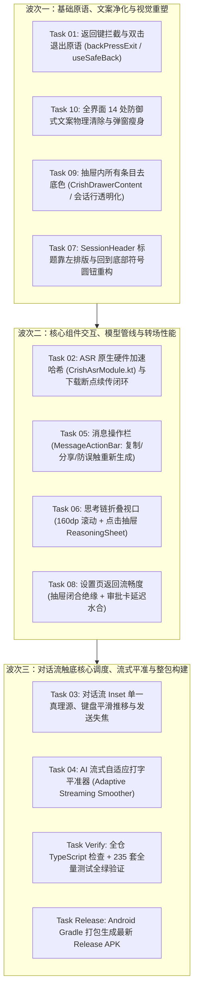

# 移动端交互精细化战役总方案与交付蓝图

> **战役名称**：`mobile-interaction-refine`（移动端交互体验精进战役）  
> **面向工程**：`apps/crish-mobile`（Android / React Native / Expo）  
> **方案状态**：主控裁决定案 / 全速实施中  
> **对齐日期**：2026-11-04  
> **核心原则**：效果锁死（不砍功能、不退避）、架构纯净（杜绝补丁）、立体验证（全量单测 + Release APK 打包交付）。

---

## 一、战役背景与用户最高裁决

在真机走查与高频使用过程中，用户针对移动端提出了十项极具痛感的原声反馈与刚性要求：
1. **返回键死循环与登录态误退**：登录方式选择页双击退出桌面；已登录状态下返回键永远只退到主对话界面，主界面双击退出桌面（不杀进程），绝对不能退回登录界面；退出登录仅限设置内显式触发。
2. **语音输入模型下载死循环**：下载进度无反馈；校验中途卡死/崩溃并物理误删模型；再次长按反复提示下载死循环。
3. **对话流视口避让与触底逻辑打架**：输入框遮挡文字；接近底部时点击“回到底部”未真正触底；点击输入框文字平滑上移；发送完成后失焦收起键盘并回到底部；流式输出平稳上推且不锁死上滑。
4. **AI 流式匀速自然输出**：消除突发爆字与断帧僵死，人眼阅读舒适匀速输出；流式平滑平推视口，上滑回看时 0ms 释放手势。
5. **AI 消息底部工具栏**：复制（带状态回弹）、系统分享、More 按钮（二级确认弹出重新生成，防误触）；文字图标浅淡，不喧宾夺主。
6. **思考链深度交互**：固定高度视口（160dp）区域内滚动；思考完毕默认折叠；点击区域呼出抽屉（Sheet）全量沉浸阅读；仿代码块底色与浅色文字。
7. **顶栏标题与回到底部按钮**：标题紧随菜单左侧排列，取消强制居中，自然截断；回到底部改造为符号圆钮（向下箭头），锚定在输入框左上角。
8. **设置返回主界面卡顿**：根除闭合抽屉在转场时的隐式重算重排（`buildDrawerRows`），审批卡延时水合，保障原生栈满帧顺滑。
9. **抽屉选项行去底色与丝滑度**：所有会话行、操作按钮彻底清退背景色（恒 `transparent`），文字加粗高亮，极简通透。
10. **全端多余防御式文案彻底净化**：物理删除 `LocalModelSheet`、`PermissionModeSheet` 等 14 处免责辩解废话与技术说明书，还原自明呼吸感。

用户最高指示：“方案生成完之后，你来定夺，然后分配 agent 执行即可，我要去睡觉了，再醒来我要看到你所有的内容都做完，并且已经打包好安装包等我检查了”。

---

## 二、十维子方案架构裁决一览

| 编号 | 维度 | 方案文档 | 核心决策与架构动作 |
| :--- | :--- | :--- | :--- |
| **01** | **返回键路由与登录守护** | `proposals/01-返回键拦截与登录态防回退方案.md` | 双根节点（`/welcome` 与 `(main)`）双击退出状态机（2000ms 黄金防抖窗口，放行原生 `moveTaskToBack(false)`）；登录成功 `dismissAll()` + `replace('/')` 原子清栈；主界面绝对锁定为栈底基石；认证子路由装配 `RequireGuest`。 |
| **02** | **语音模型下载闭环** | `proposals/02-语音模型下载与校验闭环修复方案.md` | 在 `CrishAsrModule.kt` 扩展 `fileSha256` 原生硬件加速哈希（耗时从 35s+OOM 降至 <200ms）；增量落盘 `verified.json`；非破坏性校验（绝不误删已下载模型）；国内镜像优先；`VoiceModelGate` 增加量化看板（`已下载 XX MB / XX MB`）。 |
| **03** | **视口避让与触底逻辑** | `proposals/03-对话流视口避让与触底逻辑彻底理顺方案.md` | `timelineBottomInset` 重构为精确高度 SSOT；双阈值迟滞（≤32px 进，>64px 出）根治上下滑动打架；聚焦输入框平滑整体上推；发送时 `blur()` 失焦收起键盘落底；惯性滑动与手势期绝对不拉扯。 |
| **04** | **AI 流式匀速打字平准** | `proposals/04-AI流式匀速输出与智能跟随滚动方案.md` | 自适应打字机平准器（Adaptive Streaming Smoother）：黄金阅读速度 25~45 字符/秒；低通滤波加减速；Unicode 字符簇安全边界；视口微步向上平推，上滑浏览 0ms 暂停跟随。 |
| **05** | **消息工具栏与防误触** | `proposals/05-消息工具栏与重新生成操作方案.md` | 消息末尾渲染 `AssistantMessageActionBar`：复制（绿意对号回弹）、系统分享、More（更多）；二级防护弹窗确认重新生成；字体图标浅灰（`textTertiary`），无外框无背景。 |
| **06** | **思考链交互升级** | `proposals/06-思考链折叠滚动与抽屉展示方案.md` | `ReasoningView` 视口截断 `maxHeight: 160dp` 区域滚动；思考完毕自动收折为紧凑状态行；点击唤出 `ReasoningSheet` 全屏大视野阅读；仿代码块沙盒底色（`canvasDrawer`）与偏浅文字（`textSecondary`）。 |
| **07** | **标题排版与悬浮按钮** | `proposals/07-标题左对齐与回到底部符号按钮方案.md` | `SessionHeader` 标题左移紧贴菜单按钮，最大宽度提升 90%；`ScrollToBottomButton` 改造为 Ø36dp 符号按钮（向下折角），定位在输入框左上角（`left: 16dp, bottom: composerHeight + 8dp`）。 |
| **08** | **设置返回流畅度优化** | `proposals/08-设置页转场与主屏返回流畅度方案.md` | `CrishDrawerContent` 闭合态绝缘 `pathname` 变动（阻断隐式 `buildDrawerRows` 重绘风暴）；`ApprovalFloat` 离开设置页后延迟水合；弹窗懒加载与 `freezeOnBlur`。 |
| **09** | **抽屉选项去底色** | `proposals/09-Cherry抽屉顺滑度深度对照与选项行去底色方案.md` | 抽屉内所有会话行、设置项、操作按钮背景色恒设为 `transparent`，选中项以字重 `600` 与主文字色高亮区分，彻底消除矩形色块；优化手势与动画时钟。 |
| **10** | **全端防御式文案净化** | `proposals/10-移动端全界面多余防御式文案净化方案.md` | 物理删除 `LocalModelSheet`、`PermissionModeSheet` 等 14 处防御式辩解废话与技术说明书，弹窗高度减少 50px，回归极简清爽。 |

---

## 三、实施调度批次编排

为了保证多 Agent 并发无冲突、同文件串行、分层解耦与可验证性，全战役划分为 **三个执行波次（Waves）**：

---

## 四、验收断言与交付清单

1. **功能闭环**：
   - 登录页与主界面连续按两次返回键平滑退回桌面（后台驻留，不杀进程）；已登录状态下返回键绝不回退至登录页；
   - 语音模型下载显示实时 MB / 总 MB 进度与百分比，原生 SHA-256 毫秒级校验，状态持久落盘，长按立即开录；
   - 会话标题左对齐舒展，回到底部符号按钮悬浮于输入框左上角；
   - 消息底部带轻量工具栏（复制/分享/重新生成）；
   - 思考链默认折叠、视口限高滚动、点击呼出抽屉大视野阅读；
   - 对话流无文字遮挡，点击输入框顺滑上推，发送后失焦收起键盘，流式平滑匀速输出且上滑浏览自由释放；
   - 设置页返回主屏 0 卡顿，抽屉内选项无色块底色，14 处防御式文案彻底清退。
2. **测试守卫**：
   - `npm --prefix apps/crish-mobile run typecheck`: 0 错误；
   - `npm --prefix apps/crish-mobile test`: 全量单测 100% 通过；
3. **交付产物**：
   - 最新的 Android Release APK：`apps/crish-mobile/android/app/build/outputs/apk/release/app-release.apk`。
