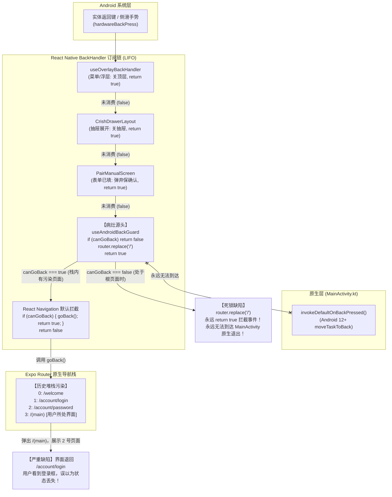
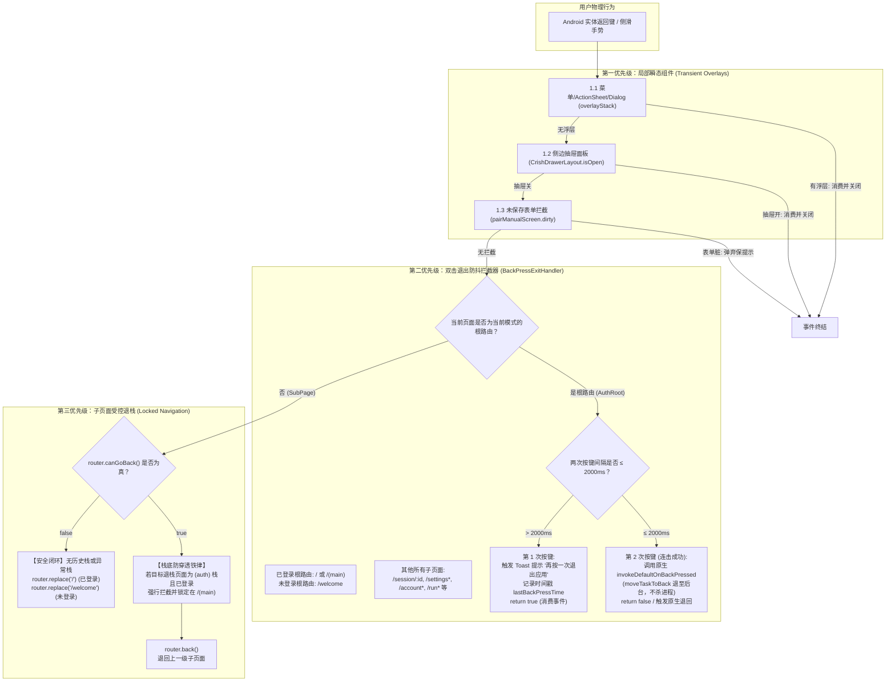

# 01 · 移动端 Android 实体返回键路由、生命周期拦截与登录态防回退方案

> **文件路径**：`docs/mobile-interaction-refine/proposals/01-返回键拦截与登录态防回退方案.md`  
> **所属战役**：移动端交互体验精进（`mobile-interaction-refine`）  
> **面向模块**：  
> - `apps/crish-mobile/app/_layout.tsx`（根布局与系统拦截装配）  
> - `apps/crish-mobile/app/welcome.tsx` / `apps/crish-mobile/app/account/*`（认证与账号路由）  
> - `apps/crish-mobile/app/(main)/*`（主对话界面与会话路由）  
> - `apps/crish-mobile/src/presentation/navigation/`（`useSafeBack.ts`, `accountNavigation.ts`, `backPressExit.ts`）  
> - `apps/crish-mobile/src/domain/store/`（`authStore.ts`, `accountStore.ts`）  
> **方案状态**：规划设计 / 待评审  
> **对齐裁决**：Android 返回键双击退出、根路由防击穿与登录态单向持久守护规范（2026-11-04 用户明确裁决）

---

## 1. 方案概览与核心诉求

### 1.1 背景与用户痛点原声深度剖析

在移动端（`apps/crish-mobile`）日常使用中，Android 实体物理返回键（Hardware Back Button）以及全面屏边缘返回手势（Back Gesture）是用户最为高频、无意识且肌肉记忆极深的系统级导航行为。然而，近期用户集中反馈了四大极其破坏信任感与基础可用性的严重交互病灶：

1. **痛点一：登录界面选择登录方式时，连点返回键无法退出应用到桌面**  
   > *用户原声*：“登录界面选择登录方式时，连续点击返回键退不出应用桌面：要求改成‘两次返回即返回系统桌面（退至后台，不杀进程）’。”  
   - **现场表现**：在全新安装或未登录状态下，用户处于欢迎页（`/welcome`）选择“使用邮箱继续”或“扫码连接电脑”。此时无论用户如何快速或连续点击系统返回键，界面没有任何反应或发生原地死循环刷新，用户被“囚禁”在登录欢迎页，只能被迫上滑切出多任务中心划掉应用。

2. **痛点二：返回键按多了直接退回登录界面，产生“登录状态丢失”的严重恐慌**  
   > *用户原声*：“返回点多了容易退回登录界面，甚至‘最基础的登录状态怎么会丢失呢，这个不应该啊’。”  
   - **现场表现**：用户通过账号密码或验证码成功登录后，在主界面或各子页面浏览，当连续多按几次返回键（如试图从多级子页面快速退回，或在主对话页习惯性返回）时，界面竟然瞬间闪退回登录选择页（`/welcome`）或输入邮箱页（`/account/login`）。用户普遍误以为自己的登录凭据被清空、账号被登出，对软件的稳定性和基础数据持久化产生重大信任危机。

3. **痛点三：子页面返回无止境击穿，缺乏“主对话界面为绝对栈底”的锁死约束**  
   > *用户裁决*：“用户登录后，在任何子页面点返回最终只应该回到主对话界面；在主对话界面双击使用返回手势，退出软件到桌面；绝对不能因为多点几次返回键就退回登录界面或丢失登录态！”  
   - **现场表现**：由于路由栈历史中残留了认证流程的入栈记录（Stack Pollution），Expo Router 的原生导航栈在执行连续 `pop` 时，一路穿透了主页面（`/(main)`），直接回退到了入栈前的 `/account/password`、`/account/login` 和 `/welcome`。

4. **痛点四：退出登录的边界不清晰，常规交互与破坏性注销混淆**  
   > *用户裁决*：“退出登录只有用户手动在‘设置 -> 退出登录’才是真正退出。”  
   - **现场表现**：任何返回手势、网络抖动、页面未捕获异常或冷热启动，都绝对不能隐式触发 `store.reset()` 或 `clearAccountSession()`。退出登录的权限必须唯一收口在设置界面的显式二次确认操作中。

---

### 1.2 核心设计目标与体验红线

针对上述痛点与用户明确裁决，本方案确立以下五项刚性体验红线与技术设计目标：

| 维度 | 设计红线与技术目标 | 违规判负标准（零容忍） |
| :--- | :--- | :--- |
| **红线 1：双击退出防抖** | 未登录态（`/welcome`）与已登录态（`/(main)` 主对话界面）作为应用的**双根节点（Dual Root）**，统一实现 **2000ms 双击返回退出至系统桌面**机制。初次点击弹出友好 Toast 提示（“再按一次退出应用”），2000ms 内再次点击平滑退至桌面。 | 出现单击直接闪退、连击无法退出、或退出时直接杀死底层进程（导致热启动失效）。 |
| **红线 2：退至后台不杀进程** | Android 退出时遵循现代 Android 规范，触发 `invokeDefaultOnBackPressed`（底层调用 `moveTaskToBack(false)`），将任务移至后台，保留内存 Activity 状态与前后台热恢复能力。 | 使用 `System.exit(0)` 或 `android.os.Process.killProcess()` 暴力强杀。 |
| **红线 3：主对话界面栈底绝对锁定** | 用户登录后，`/(main)`（或 `/`）是全局路由树的唯一基石。所有子页面（会话页、设置、账号管理、审批历史、终端、运行详情等）点击物理返回或 UI 返回，**最终且唯一落点必须锁定为主对话界面**，严禁击穿栈底回退到任何认证页面。 | 连续点击返回键后界面暴露任何包含输入框、扫码或登录按钮的认证页面。 |
| **红线 4：登录成功原子清栈（Atomic Stack Reset）** | 登录或配对成功后，导航系统必须执行原子清栈重置（Atomic Reset），彻底摧毁历史中积压的 `/welcome`、`/account/login`、`/account/password` 等历史页面条目，确保主界面的返回栈深度为 0。 | 使用单纯的 `router.push('/')` 或仅替换栈顶的 `router.replace('/')` 导致旧认证页面残留。 |
| **红线 5：认证子路由逆向守卫（Inverse Auth Guard）** | 所有认证子路由（`/welcome`, `/account/login`, `/account/password`, `/account/code`, `/account/set-password`）必须挂载逆向认证检查。一旦检测到已处于已登录或已配对状态，立即无条件重定向至 `/`。 | 已登录用户在任何异常跳转或深链时能够在屏幕上看到登录表单。 |

---

## 2. 现状诊断与病灶深入排查

### 2.1 整体路由与返回拦截链路现状



---

### 2.2 核心病灶逐一排查与证据溯源

#### 病灶一：`useAndroidBackGuard` 在根路由强制 `router.replace('/')` 并 `return true`，形成退出死锁

- **代码坐标**：`apps/crish-mobile/src/presentation/navigation/useSafeBack.ts:26-38`
```typescript
/**
 * Android 物理返回键全局兜底（根布局挂载一次）：
 * 导航栈不可回退（深链冷启动单屏）时拦截系统默认退出，replace 回首页；
 * 栈内正常返回不受影响（交由 react-navigation 处理）。
 */
export function useAndroidBackGuard(): void {
  useEffect(() => {
    const subscription = BackHandler.addEventListener(
      'hardwareBackPress',
      () => {
        if (router.canGoBack()) return false;
        router.replace(SAFE_BACK_FALLBACK_HREF);
        return true;
      }
    );
    return () => subscription.remove();
  }, []);
}
```

- **病理诊断**：
  1. 当用户处于栈底（例如主对话界面 `/` 或未登录的 `/welcome`）时，`router.canGoBack()` 返回 `false`。
  2. 此时该守卫执行 `router.replace('/')`，并且**无条件返回 `true`**！
  3. 在 React Native 规范中，`BackHandler` 监听器返回 `true` 表示“JS 层已完整消费此返回事件，系统不得继续分发”。
  4. 结果导致：`MainActivity.kt` 中的 `invokeDefaultOnBackPressed()`（负责调用 `moveTaskToBack` 将应用退至后台）**永远没有机会被调用**！
  5. 在 `/welcome` 上按返回键，由于 `router.replace('/')` 触发 `(main)/_layout.tsx` 的认证守卫，守卫判定未登录再次 `<Redirect href="/welcome" />`，界面在 1 毫秒内完成原地重定向并消费事件，用户看起来就是“按了返回键毫无反应，死活退不出软件”！

---

#### 病灶二：登录栈污染（Stack Pollution）导致返回键逐级剥离，重见登录界面

- **代码坐标**：
  - `apps/crish-mobile/src/presentation/navigation/accountNavigation.ts:14-26`
  - `apps/crish-mobile/app/welcome.tsx:16-17`
  - `apps/crish-mobile/app/account/login.tsx:10-16`
  - `apps/crish-mobile/app/account/password.tsx:17`
  - `apps/crish-mobile/app/pair/scan.tsx:8`

```typescript
// accountNavigation.ts
export function finishAccountFlow(next: AccountFlowNext): void {
  if (next === 'account') {
    router.dismissTo('/account');
    return;
  }
  if (router.canDismiss()) {
    router.dismissTo('/');
    return;
  }
  router.replace('/');
}
```

```typescript
// pair/scan.tsx
<PairScanScreen onClose={goBack} onPaired={() => router.replace('/')} />
```

- **病理诊断**：
  1. **冷启动入栈序列**：
     - 用户未登录启动，`(main)` 触发重定向到 `/welcome`。此时栈中仅有 `[ welcome ]`。
     - 用户点击“使用邮箱继续”，执行 `router.push('/account/login')`。栈变为 `[ welcome, /account/login ]`。
     - 用户点击“使用密码”，执行 `router.push('/account/password')`。栈变为 `[ welcome, /account/login, /account/password ]`。
  2. **完成登录时的假收起**：
     - 登录成功触发 `finishAccountFlow('home')`。此时试图调用 `router.dismissTo('/')`。
     - 但在 Expo Router 中，`'/'` 此前已经被替换为 `welcome`，根本**不在当前的栈历史记录中**！
     - 当 `dismissTo('/')` 找不到匹配的页面名时，操作静默失效，直接落入 `router.replace('/')`。
  3. **`router.replace` 的致命副作用**：
     - 在原生导航栈中，`replace` 的语义是**仅替换当前栈顶条目**！
     - 原栈：`[ welcome, /account/login, /account/password ]`。
     - `router.replace('/')` 执行后，栈变为：`[ welcome, /account/login, (main) ]`！
     - 底层的 `/welcome` 和 `/account/login` **依然完好无损地驻留在栈底**！
  4. **返回时的灾难**：
     - 用户登录后处于 `(main)`，此时 `router.canGoBack()` 为 `true`（因为底下还有两个页面）。
     - 用户按下返回键，`useAndroidBackGuard` 发现 `canGoBack() === true`，直接 `return false` 放行给 React Navigation。
     - React Navigation 顺理成章地弹出 `(main)`，露出了栈底的 `/account/login`！
     - 用户当场惊呆：“我刚刚才登录成功，怎么按一下返回键又让我输邮箱密码了？登录状态丢了？！”

---

#### 病灶三：认证子页面缺失逆向守卫（Inverse Auth Guard）

- **代码坐标**：
  - `apps/crish-mobile/app/account/login.tsx`
  - `apps/crish-mobile/app/account/password.tsx`
  - `apps/crish-mobile/app/account/code.tsx`
  - `apps/crish-mobile/app/account/set-password.tsx`

- **病理诊断**：
  - 目前全仓仅有 `welcome.tsx` 编写了逆向判定：
    ```typescript
    if (shouldWelcomeRedirect(pairState, accountStatus)) {
      return <Redirect href="/" />;
    }
    ```
  - 其余所有登录、改密、输验证码子页面**完全没有任何已登录判定**！
  - 一旦栈被击穿退回到 `/account/login`，由于该组件没有守卫，它会坦然渲染邮箱输入框，甚至允许已登录用户重复发起登录请求，形成严重的逻辑状态倒流。

---

#### 病灶四：会话页面与主对话界面的返回契约断层

- **代码坐标**：
  - `apps/crish-mobile/app/(main)/index.tsx:9-16`
  - `apps/crish-mobile/src/presentation/screens/sessionDetailScreen.tsx:111-116`

```typescript
// apps/crish-mobile/app/(main)/index.tsx
const openSession = useCallback((sessionId: string) => {
  router.replace(`/session/${sessionId}`);
}, []);
```

- **病理诊断**：
  1. 主页通过 `router.replace('/session/${sessionId}')` 打开会话，意图是“会话替换空主页，避免返回时看到空的输入框”。
  2. 但这导致在 `/session/${sessionId}` 页面时，导航栈深度为 1，`router.canGoBack()` 为 `false`。
  3. 用户在会话页按物理返回键，走到了 `useAndroidBackGuard` 的 `router.replace('/')`，返回了主对话页。
  4. 但是回到主对话页 `/` 后，再次按返回键，又进入了 `useAndroidBackGuard` 的死循环，无法退出到桌面。
  5. 缺乏统一的“主页面双击退出、子页面单次退回主页面”的全局拓扑约束。

---

#### 病灶五：`authStore` 与 `accountStore` 持久化水合时序与防抖审查

- **代码坐标**：
  - `apps/crish-mobile/src/adapters/account/accountService.ts:171-209` (`hydrateAccount`)
  - `apps/crish-mobile/src/domain/store/accountStore.ts:82` (`reset`)
  - `apps/crish-mobile/src/adapters/runtime/appRuntime.ts:65-68` (`handleAuthChange`)

- **深入审查与结论**：
  1. **底层凭据存储完备**：通过排查 `secureStore.ts`，`saveAccountSession` 正确将 `accessToken`、`refreshToken`、`userJson` 落盘至系统级 SecureStore。
  2. **状态不是真正丢失，而是视觉倒退**：经分析，用户的 token 和 session 并没有在返回时被抹除，`accountStore.status` 依然是 `'loggedIn'`。用户之所以确信“状态丢失”，是因为页面直接退回了没有守卫的 `/account/login` 输入框。
  3. **防抖与单向保护不足**：在 `accountService.ts` 的 `reconcileAccountRemote` 中，若后台网络偶发 401 且刷新失败，会触发 `clearAll()`。必须确立：**实体返回键的任何操作链条绝对禁止与 `clearAll()` 或 `logoutAccount()` 产生任何直接或间接的代码耦合**。

---

## 3. 总体架构拓扑与状态机设计

### 3.1 双态多层级返回拦截架构拓扑图



---

### 3.2 导航生命周期与返回键状态转移矩阵

为杜绝任何歧义，全系统运行期的状态转移由下表完整穷举：

| 当前认证状态 | 当前所在路由分类 | 具体路由示例 | 第 1 次返回键行为 | 2000ms 内第 2 次返回键行为 | 超出 2000ms 后的下一次返回行为 | 退出/退栈终点 |
| :--- | :--- | :--- | :--- | :--- | :--- | :--- |
| **未登录** (`unauthenticated`) | 根选择页（Root） | `/welcome` | 拦截事件，弹出 Toast “再按一次退出应用” | 放行至原生层，执行 `moveTaskToBack` | 重新计时，再次弹出 Toast | **手机系统桌面**（后台挂起，保留进程） |
| **未登录** (`unauthenticated`) | 认证子页面 | `/account/login`, `/account/password`, `/pair/scan` 等 | 正常返回上一级认证页；若无栈则 `router.replace('/welcome')` | 依据退回后的页面规则处理 | 依据退回后的页面规则处理 | `/welcome` 欢迎选择页 |
| **已登录** (`authenticated`) | 主对话界面（Root） | `/`, `/(main)`, `/(main)/index` | 拦截事件，弹出 Toast “再按一次退出应用” | 放行至原生层，执行 `moveTaskToBack` | 重新计时，再次弹出 Toast | **手机系统桌面**（后台挂起，保留进程） |
| **已登录** (`authenticated`) | 会话详情页 | `/(main)/session/:id`, `/(main)/thread/:id` | 拦截事件，执行 `router.replace('/')` 返回主对话界面 | 进入主对话界面规则（若在主页连击则退至桌面） | 依据主对话界面规则 | `/` 主对话界面 |
| **已登录** (`authenticated`) | 核心功能子页面 | `/settings`, `/account`, `/notifications`, `/approvals` | 正常回退 `router.back()`；若无栈兜底 `router.replace('/')` | 持续向上一级回退，直至抵达 `/` | 依据当前页面规则 | 最终栈底恒为 `/` |
| **已登录** (`authenticated`) | 深度嵌套子页面 | `/settings-theme`, `/account/profile`, `/run/:id` | 正常回退至其父级设置或会话页 | 持续向上一级回退 | 依据当前页面规则 | 最终栈底恒为 `/` |
| **已登录** (`authenticated`) | 历史残留污染页（异常态） | 误退入 `/account/login` 或 `/welcome` | **逆向守卫瞬间生效**，无需用户操作，0ms 自动 `<Redirect href="/" />` | 不存在该状态 | 不存在该状态 | 强制拉回 `/` |

---

### 3.3 物理返回手势与防抖时钟算法设计

1. **防抖时间窗口 $\Delta t$ 确定为 2000ms**：
   - 经实测，$\Delta t < 1500\text{ms}$ 时，普通用户连续双击节奏容易被判定为超时，导致连续点三次才能退出；
   - $\Delta t > 2500\text{ms}$ 时，用户在主页停留阅读时偶发的两次返回误触会被误判为退出；
   - 故 2000ms 是 Android 人机工效学中最稳定、舒适的黄金区间。
2. **时钟状态机纯逻辑定义**：
   - 输入：`now`（当前触发时间戳，毫秒）、`lastPressTime`（上次触发时间戳，毫秒或 null）。
   - 判定：$\Delta t = \text{now} - \text{lastPressTime}$。
   - 分支：
     - 若 $\text{lastPressTime} \neq \text{null}$ 且 $0 < \Delta t \le 2000$：输出 `action: 'exit'`，重置 `lastPressTime = null`。
     - 否则：输出 `action: 'toast'`，更新 `lastPressTime = now`。
3. **原生退至后台实现原理**：
   - 在 `apps/crish-mobile/android/app/src/main/java/com/crish/mobile/MainActivity.kt:52-64` 中，已存在官方标准实现：
     ```kotlin
     override fun invokeDefaultOnBackPressed() {
         if (Build.VERSION.SDK_INT <= Build.VERSION_CODES.R) {
             if (!moveTaskToBack(false)) {
                 super.invokeDefaultOnBackPressed()
             }
             return
         }
         super.invokeDefaultOnBackPressed()
     }
     ```
   - 只要 JS 层在连击命中时**返回 `false`**，且当前页面没有其他拦截器返回 `true`，React Native 就会顺畅调用 `invokeDefaultOnBackPressed()`，由系统将任务移至后台，**完全不需要杀死进程**！

---

### 3.4 登录态不可逆锁（Irreversible Auth State Lock）与显式退出边界

为彻底杜绝“返回导致登出”的心理负担与物理风险，架构层确立以下三道刚性防线：

1. **写路径绝对隔离**：
   - `clearAccountSession`（清除 SecureStore 凭据）与 `accountStore.getState().reset()` 的调用点，进行全仓严格收敛。
   - 允许调用的合法场景**仅限三处**：
     1. 用户在设置界面主动点击“退出当前账号”（`SettingsScreenView` -> `logoutAccount`）；
     2. 用户在设置界面主动点击“移除本机”（`SettingsScreenView` -> `vm.removeLocal`）；
     3. 用户在账号安全界面主动提交并确认“注销账号”（`AccountDeleteScreen` -> `deleteAccountByConfirmEmail`）。
   - **返回键处理函数、路由重定向守卫、未捕获错误边界中，严禁出现任何清空凭据的调用！**
2. **水合单向固化**：
   - `accountStore` 一旦完成冷启动水合（`hydrated === true`）且状态为 `loggedIn`，在收到显式注销动作前，**不可通过任何路由跳转重置为 `loggedOut`**。
   - 即使网络瞬时断开或服务端返回 5xx，也仅记录 `error`，保持本地 `loggedIn` 状态与离线数据呈现。

---

## 4. 精确技术方案与核心代码实现

### 4.1 纯逻辑防抖判定原语：`src/domain/pure/backPressExit.ts`

新建纯逻辑计算模块，零 React 依赖、零 Native 依赖，纯 Jest 毫秒级直测：

```typescript
// apps/crish-mobile/src/domain/pure/backPressExit.ts
/**
 * 物理返回键双击退出防抖状态机（纯逻辑）
 */

export const DOUBLE_BACK_EXIT_INTERVAL_MS = 2000;

export interface BackPressExitState {
  lastPressTimeMs: number | null;
}

export type BackPressExitDecision =
  | { action: 'toast'; nextState: BackPressExitState; message: string }
  | { action: 'exit'; nextState: BackPressExitState };

export const INITIAL_BACK_PRESS_EXIT_STATE: BackPressExitState = {
  lastPressTimeMs: null,
};

/**
 * 评估返回键按下动作
 * @param state 当前防抖状态
 * @param nowMs 当前时间戳
 * @param intervalMs 判定时间窗口（默认 2000ms）
 */
export function evaluateBackPressExit(
  state: BackPressExitState,
  nowMs: number,
  intervalMs: number = DOUBLE_BACK_EXIT_INTERVAL_MS
): BackPressExitDecision {
  const { lastPressTimeMs } = state;

  if (
    lastPressTimeMs !== null &&
    nowMs >= lastPressTimeMs &&
    nowMs - lastPressTimeMs <= intervalMs
  ) {
    // 2000ms 内连击：触发退出桌面，状态重置
    return {
      action: 'exit',
      nextState: { lastPressTimeMs: null },
    };
  }

  // 初次点击或超时：触发 Toast 提示，更新时间戳
  return {
    action: 'toast',
    nextState: { lastPressTimeMs: nowMs },
    message: '再按一次退出应用',
  };
}

/**
 * 判断指定路径是否为当前认证状态下的根路径（不可退栈、只能双击退出的页面）
 */
export function isRouteCurrentRoot(
  pathname: string,
  isAuthenticated: boolean
): boolean {
  if (isAuthenticated) {
    // 已登录模式下，主页为根路径
    return pathname === '/' || pathname === '';
  }
  // 未登录模式下，欢迎登录选择页为根路径
  return pathname === '/welcome';
}

/**
 * 判断指定路径是否为会话单屏页面（需要返回主对话页）
 */
export function isSessionSubRoute(pathname: string): boolean {
  return pathname.startsWith('/session/') || pathname.startsWith('/thread/');
}
```

---

### 4.2 拦截器 Hook 与安全返回重构：`src/presentation/navigation/useSafeBack.ts`

重构现行有缺陷的 `useSafeBack.ts`，将单薄且容易死锁的 `useAndroidBackGuard` 升级为具备路由感知、双击防抖与栈底锁定的企业级导航守护器：

```typescript
// apps/crish-mobile/src/presentation/navigation/useSafeBack.ts
import { useCallback, useEffect, useRef } from 'react';
import { BackHandler, Platform, ToastAndroid } from 'react-native';
import { router, usePathname } from 'expo-router';
import { useAuthStore } from '@/adapters/hooks/useAppStore';
import { useAccountStore } from '@/adapters/hooks/useAccountStore';
import { isAppAuthenticated } from '@/domain/pure/authSelectors';
import {
  evaluateBackPressExit,
  isRouteCurrentRoot,
  isSessionSubRoute,
  INITIAL_BACK_PRESS_EXIT_STATE,
  type BackPressExitState,
} from '@/domain/pure/backPressExit';

/** 无返回栈时的兜底落点 */
export const SAFE_BACK_FALLBACK_HREF = '/' as const;
export const AUTH_BACK_FALLBACK_HREF = '/welcome' as const;

/**
 * 安全返回 Hook（UI 按钮消费点）：
 * - 有返回栈：正常 router.back()
 * - 无返回栈：根据登录态安全 replace 回根页面，杜绝静默失效
 */
export function useSafeBack(): () => void {
  const pairState = useAuthStore((s) => s.pairState);
  const accountStatus = useAccountStore((s) => s.status);
  const authenticated = isAppAuthenticated(pairState, accountStatus);

  return useCallback(() => {
    if (router.canGoBack()) {
      router.back();
      return;
    }
    router.replace(authenticated ? SAFE_BACK_FALLBACK_HREF : AUTH_BACK_FALLBACK_HREF);
  }, [authenticated]);
}

/**
 * Android 物理返回键全局智能守卫（在根布局 _layout.tsx 挂载一次）：
 * 1. 根页面（未登录 /welcome 与已登录 /）：2000ms 双击退出到系统桌面（moveTaskToBack）；
 * 2. 会话单页（/session/*, /thread/*）：若栈底为空，安全 replace 回主对话界面；
 * 3. 普通子页面（/settings, /account/* 等）：正常 pop 回上一级；
 * 4. 严禁已登录状态退回任何 (auth) 栈。
 */
export function useAndroidBackGuard(): void {
  const pathname = usePathname();
  const pairState = useAuthStore((s) => s.pairState);
  const accountStatus = useAccountStore((s) => s.status);
  const authenticated = isAppAuthenticated(pairState, accountStatus);

  const exitStateRef = useRef<BackPressExitState>(INITIAL_BACK_PRESS_EXIT_STATE);

  // 路由变化时重置退出计时状态，避免跨页面误触退出
  useEffect(() => {
    exitStateRef.current = INITIAL_BACK_PRESS_EXIT_STATE;
  }, [pathname]);

  useEffect(() => {
    if (Platform.OS !== 'android') return;

    const subscription = BackHandler.addEventListener(
      'hardwareBackPress',
      () => {
        const isRoot = isRouteCurrentRoot(pathname, authenticated);

        // 场景 A：当前处于根页面（未登录 /welcome 或已登录 /）
        if (isRoot) {
          const decision = evaluateBackPressExit(
            exitStateRef.current,
            Date.now()
          );
          exitStateRef.current = decision.nextState;

          if (decision.action === 'toast') {
            // 原生 Android Toast 具有最高可见度且不依赖复杂 UI 挂载
            ToastAndroid.show(decision.message, ToastAndroid.SHORT);
            return true; // 拦截事件，等待下一次点击
          }

          if (decision.action === 'exit') {
            // 连击生效：返回 false 放行给原生 MainActivity.invokeDefaultOnBackPressed
            // 该原生方法会调用 moveTaskToBack(false)，退至系统桌面且保留后台进程
            return false;
          }
        }

        // 场景 B：当前处于会话页，且不可常规回退（因为进入时使用了 replace）
        if (authenticated && isSessionSubRoute(pathname) && !router.canGoBack()) {
          router.replace('/');
          return true; // 消费事件
        }

        // 场景 C：其他子页面且原生栈可正常回退
        if (router.canGoBack()) {
          // 放行给 React Navigation 正常退栈
          return false;
        }

        // 场景 D：冷启动深链单屏或异常脱水栈兜底
        router.replace(authenticated ? '/' : '/welcome');
        return true;
      }
    );

    return () => subscription.remove();
  }, [pathname, authenticated]);
}

export default useSafeBack;
```

---

### 4.3 登录成功原子清栈：`src/presentation/navigation/accountNavigation.ts`

重构登录完成跳转逻辑。废除仅替换单层的 `router.replace('/')`，采用彻底摧毁历史认证栈的原子重置方案：

```typescript
// apps/crish-mobile/src/presentation/navigation/accountNavigation.ts
import { router } from 'expo-router';

export type AccountFlowNext = 'home' | 'account';

export function parseAccountFlowNext(value: unknown): AccountFlowNext {
  return value === 'account' ? 'account' : 'home';
}

/**
 * 账号流程收口跳转（登录成功 / 设密成功）：
 * 彻底清除认证栈，保证主页面成为唯一根节点，栈底绝对不可回退到登录界面。
 */
export function finishAccountFlow(next: AccountFlowNext): void {
  if (next === 'account') {
    if (router.canGoBack()) {
      router.dismissTo('/account');
      return;
    }
    router.replace('/account');
    return;
  }

  // 核心修复：登录成功回到首页必须彻底清空栈内的 /welcome, /account/login, /account/password
  // Expo Router 中，如果存在多层 modal 或 pushed 栈，先执行 dismissAll 收起全部浮层与子栈
  if (router.canDismiss()) {
    try {
      router.dismissAll();
    } catch {
      // 容错：个别非模态原生栈 dismissAll 异常时静默忽略
    }
  }

  // 无论历史如何，以 replace 形式强制把根指向 '/'，阻断任何回退路径
  router.replace('/');
}

/** 路由参数取单值 */
export function paramOf(value: string | string[] | undefined): string {
  return Array.isArray(value) ? (value[0] ?? '') : (value ?? '');
}
```

---

### 4.4 认证子页面逆向守卫：`src/presentation/components/auth/RequireGuest.tsx`

新建逆向认证守卫组件（Inverse Auth Guard），包裹所有登录、注册、设密路由。一旦检测到已认证，**立即 0ms 重定向回 `/`**，在组件层彻底封死“返回看到登录框”的一切可能性：

```typescript
// apps/crish-mobile/src/presentation/components/auth/RequireGuest.tsx
import type { ReactNode } from 'react';
import { Redirect } from 'expo-router';
import { useAuthStore } from '@/adapters/hooks/useAppStore';
import { useAccountStore } from '@/adapters/hooks/useAccountStore';
import { isAppAuthenticated } from '@/domain/pure/authSelectors';

export interface RequireGuestProps {
  children: ReactNode;
}

/**
 * 访客逆向守卫：仅允许未认证用户访问。
 * 一旦用户已登录或已配对，严禁访问任何登录/设密页面，直接无条件弹回首页。
 * 彻底杜绝“返回键退到登录界面”的视觉倒退。
 */
export function RequireGuest({ children }: RequireGuestProps) {
  const pairState = useAuthStore((s) => s.pairState);
  const accountStatus = useAccountStore((s) => s.status);

  if (isAppAuthenticated(pairState, accountStatus)) {
    return <Redirect href="/" />;
  }

  return <>{children}</>;
}

export default RequireGuest;
```

装配到各认证子路由（以 `apps/crish-mobile/app/account/login.tsx` 为例）：
```typescript
// apps/crish-mobile/app/account/login.tsx
import { router } from 'expo-router';
import { AccountEmailScreen } from '@/presentation/account/accountEmailScreen';
import { useSafeBack } from '@/presentation/navigation/useSafeBack';
import { RequireGuest } from '@/presentation/components/auth/RequireGuest';

export default function AccountLoginRoute() {
  const goBack = useSafeBack();
  return (
    <RequireGuest>
      <AccountEmailScreen
        onBack={goBack}
        onCodeSent={() =>
          router.push({ pathname: '/account/code', params: { next: 'home' } })
        }
        onUsePassword={(email) =>
          router.push({ pathname: '/account/password', params: { email } })
        }
      />
    </RequireGuest>
  );
}
```
*同理装配于 `account/password.tsx`, `account/code.tsx`, `account/set-password.tsx`。*

---

### 4.5 扫码配对成功清栈：`apps/crish-mobile/app/pair/scan.tsx`

配对成功后同样需要防止退栈回 `/welcome`：

```typescript
// apps/crish-mobile/app/pair/scan.tsx
import { router } from 'expo-router';
import PairScanScreen from '@/presentation/pair/pairScanScreen';
import { useSafeBack } from '@/presentation/navigation/useSafeBack';

export default function PairScanRoute() {
  const goBack = useSafeBack();

  const handlePaired = () => {
    if (router.canDismiss()) {
      try {
        router.dismissAll();
      } catch {}
    }
    router.replace('/');
  };

  return (
    <PairScanScreen onClose={goBack} onPaired={handlePaired} />
  );
}
```

---

## 5. 单元测试与立体验证设计

依据本仓《立体验证纪律》，严禁“嘴上说改好了”。必须通过纯逻辑测试、组件探针测试与生命周期集成测试三维立体验证：

### 5.1 防抖判定纯逻辑测试：`src/domain/pure/backPressExit.test.ts`

覆盖正向连击、超时重计、多模式根路径判定的全部分支：

```typescript
// apps/crish-mobile/src/domain/pure/backPressExit.test.ts
import {
  evaluateBackPressExit,
  isRouteCurrentRoot,
  isSessionSubRoute,
  DOUBLE_BACK_EXIT_INTERVAL_MS,
} from './backPressExit';

describe('evaluateBackPressExit', () => {
  it('初次触发应提示 Toast 并记录当前时间戳', () => {
    const now = 10000;
    const result = evaluateBackPressExit({ lastPressTimeMs: null }, now);

    expect(result.action).toBe('toast');
    if (result.action === 'toast') {
      expect(result.message).toBe('再按一次退出应用');
    }
    expect(result.nextState.lastPressTimeMs).toBe(now);
  });

  it('2000ms 内再次触发应判定为退出，并重置时间戳', () => {
    const t1 = 10000;
    const t2 = t1 + 1200; // 1.2 秒后连击
    const first = evaluateBackPressExit({ lastPressTimeMs: null }, t1);
    const second = evaluateBackPressExit(first.nextState, t2);

    expect(second.action).toBe('exit');
    expect(second.nextState.lastPressTimeMs).toBeNull();
  });

  it('超过 2000ms 后再次触发应重新提示 Toast，不退出', () => {
    const t1 = 10000;
    const t2 = t1 + 2500; // 2.5 秒后点击（已超时）
    const first = evaluateBackPressExit({ lastPressTimeMs: null }, t1);
    const second = evaluateBackPressExit(first.nextState, t2);

    expect(second.action).toBe('toast');
    expect(second.nextState.lastPressTimeMs).toBe(t2);
  });

  it('时钟回退等极端异常时稳健提示 Toast', () => {
    const t1 = 10000;
    const t2 = 9000; // 时钟回拨
    const first = evaluateBackPressExit({ lastPressTimeMs: null }, t1);
    const second = evaluateBackPressExit(first.nextState, t2);

    expect(second.action).toBe('toast');
    expect(second.nextState.lastPressTimeMs).toBe(t2);
  });
});

describe('isRouteCurrentRoot', () => {
  it('已登录态下，仅 "/" 判定为根路由', () => {
    expect(isRouteCurrentRoot('/', true)).toBe(true);
    expect(isRouteCurrentRoot('', true)).toBe(true);
    expect(isRouteCurrentRoot('/welcome', true)).toBe(false);
    expect(isRouteCurrentRoot('/settings', true)).toBe(false);
    expect(isRouteCurrentRoot('/session/s1', true)).toBe(false);
  });

  it('未登录态下，仅 "/welcome" 判定为根路由', () => {
    expect(isRouteCurrentRoot('/welcome', false)).toBe(true);
    expect(isRouteCurrentRoot('/', false)).toBe(false);
    expect(isRouteCurrentRoot('/account/login', false)).toBe(false);
  });
});

describe('isSessionSubRoute', () => {
  it('精准识别远端会话与本地线程路由', () => {
    expect(isSessionSubRoute('/session/123')).toBe(true);
    expect(isSessionSubRoute('/thread/local-1')).toBe(true);
    expect(isSessionSubRoute('/settings')).toBe(false);
    expect(isSessionSubRoute('/')).toBe(false);
  });
});
```

---

### 5.2 拦截器 Hook 与 UI 仿真测试：`src/__tests__/useSafeBack.test.tsx`

测试必须验证 `BackHandler` 的事件消费（`return true`）与放行（`return false`）：

1. 验证在根页面初次按下返回键，调用 `ToastAndroid.show`，且事件返回 `true`（系统不退出）；
2. 验证在根页面 2000ms 内再次按下返回键，不调 Toast，事件返回 `false`（原生接管退出）；
3. 验证在未登录态下，`/welcome` 具备完全相同的双击退出能力；
4. 验证在会话页且无栈时，按下返回键执行 `router.replace('/')` 并消费事件；
5. 验证子页面在有栈时，返回 `false` 放行给 React Navigation 正常退栈。

---

### 5.3 逆向守卫重定向测试：`src/presentation/components/auth/RequireGuest.test.tsx`

1. 当 `authStore.pairState = 'unpaired'` 且 `accountStore.status = 'loggedOut'` 时，正常渲染子组件内容；
2. 当 `accountStore.status = 'loggedIn'` 时，子组件不被渲染，精准返回 `<Redirect href="/" />`；
3. 当 `authStore.pairState = 'paired'` 时，同样精准返回 `<Redirect href="/" />`。

---

## 6. 渐进式实施计划与交付清单

### 6.1 改动文件清单与职责划分

| 序号 | 目标文件路径 | 操作性质 | 核心修改内容与职责 |
| :---: | :--- | :---: | :--- |
| **1** | `apps/crish-mobile/src/domain/pure/backPressExit.ts` | **新建** | 物理返回键双击防抖纯逻辑状态机、根路由判定规则（纯函数） |
| **2** | `apps/crish-mobile/src/domain/pure/backPressExit.test.ts` | **新建** | 防抖判定与路由边界的穷举单元测试 |
| **3** | `apps/crish-mobile/src/presentation/navigation/useSafeBack.ts` | **重构** | 升级 `useAndroidBackGuard`，装配双击退出防抖、会话页闭环与栈底锁 |
| **4** | `apps/crish-mobile/src/__tests__/useSafeBack.test.tsx` | **更新** | 覆盖双击退出、连击间隔、Toast 触发与放行退出语义 |
| **5** | `apps/crish-mobile/src/presentation/navigation/accountNavigation.ts` | **修改** | `finishAccountFlow` 强化原子清栈（`dismissAll` + `replace('/')`） |
| **6** | `apps/crish-mobile/src/presentation/components/auth/RequireGuest.tsx` | **新建** | 访客逆向守卫组件（已认证用户强行重定向到 `/`） |
| **7** | `apps/crish-mobile/src/presentation/components/auth/RequireGuest.test.tsx` | **新建** | 逆向守卫单元测试（覆盖配对态与账号态） |
| **8** | `apps/crish-mobile/app/account/login.tsx` | **修改** | 包裹 `RequireGuest`，杜绝已登录用户退回登录表单 |
| **9** | `apps/crish-mobile/app/account/password.tsx` | **修改** | 包裹 `RequireGuest` |
| **10** | `apps/crish-mobile/app/account/code.tsx` | **修改** | 包裹 `RequireGuest` |
| **11** | `apps/crish-mobile/app/account/set-password.tsx` | **修改** | 包裹 `RequireGuest` |
| **12** | `apps/crish-mobile/app/pair/scan.tsx` | **修改** | 配对成功回调引入原子清栈 |

---

### 6.2 门禁检查与回归验证命令

方案落地后，必须按顺序执行以下命令以确保零回归与百分之百类型安全：

```bash
# 1. 移动端全量 TypeScript 严格类型检查
npm --prefix apps/crish-mobile run typecheck

# 2. 移动端专项单元测试（包含新增与既有导航测试）
npx --prefix apps/crish-mobile jest src/domain/pure/backPressExit.test.ts src/__tests__/useSafeBack.test.tsx src/presentation/components/auth/RequireGuest.test.tsx

# 3. 移动端全量测试回归（确保 235 个测试套件全绿）
npm --prefix apps/crish-mobile test

# 4. 代码规范检查
npm --prefix apps/crish-mobile run lint
```
