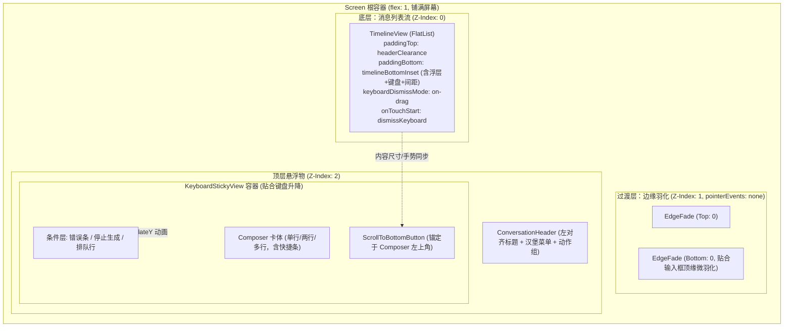
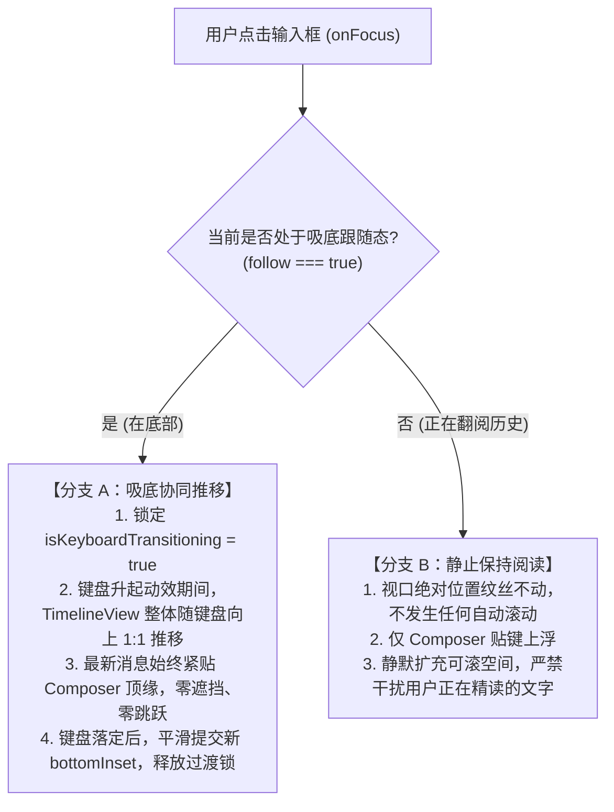
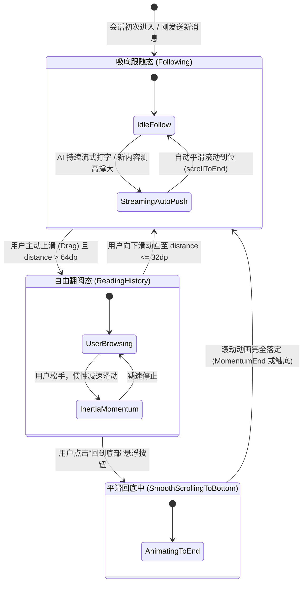
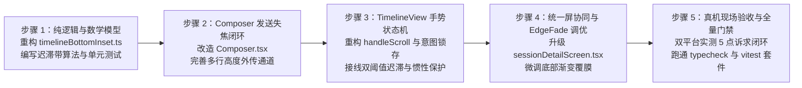

# 03 · 移动端对话流视口避让与触底逻辑彻底理顺方案

> **文件标识**：`docs/mobile-interaction-refine/proposals/03-对话流视口避让与触底逻辑彻底理顺方案.md`  
> **所属战役**：`mobile-interaction-refine`（移动端交互与视觉精细化战役）  
> **面向模块**：`apps/crish-mobile/`（`TimelineView.tsx`, `useTimelineBottomInset.ts`, `timelineBottomInset.ts`, `sessionDetailScreen.tsx`, `Composer.tsx`）  
> **权威状态**：规划设计 / 待评审（对齐 2026-11-04 用户五大核心痛点原声反馈）  
> **编码格式**：UTF-8 无 BOM、中文撰写  
> **关联源码**：
> - [`apps/crish-mobile/src/domain/pure/timelineBottomInset.ts`](file:///c:/Software/conex/apps/crish-mobile/src/domain/pure/timelineBottomInset.ts)
> - [`apps/crish-mobile/src/presentation/timeline/useTimelineBottomInset.ts`](file:///c:/Software/conex/apps/crish-mobile/src/presentation/timeline/useTimelineBottomInset.ts)
> - [`apps/crish-mobile/src/presentation/timeline/TimelineView.tsx`](file:///c:/Software/conex/apps/crish-mobile/src/presentation/timeline/TimelineView.tsx)
> - [`apps/crish-mobile/src/presentation/ui/Composer.tsx`](file:///c:/Software/conex/apps/crish-mobile/src/presentation/ui/Composer.tsx)
> - [`apps/crish-mobile/src/presentation/screens/sessionDetailScreen.tsx`](file:///c:/Software/conex/apps/crish-mobile/src/presentation/screens/sessionDetailScreen.tsx)
> - [`apps/crish-mobile/src/presentation/ui/EdgeFade.tsx`](file:///c:/Software/conex/apps/crish-mobile/src/presentation/ui/EdgeFade.tsx)
> - [`apps/crish-mobile/src/presentation/ui/ScrollToBottomButton.tsx`](file:///c:/Software/conex/apps/crish-mobile/src/presentation/ui/ScrollToBottomButton.tsx)

---

## 目录

1. [方案概述与核心诉求复盘](#一方案概述与核心诉求复盘)
2. [现状深度诊断与病灶代码级穿透](#二现状深度诊断与病灶代码级穿透)
   - 2.1 避让几何 SSOT 断裂：`timelineBottomInset` 剔除键盘高度的致命后遗症
   - 2.2 浮层实测高度断层：多行输入、快捷条、条件层的漏算与不同步
   - 2.3 触底跟随状态机（Follow State Machine）竞态诊断
   - 2.4 键盘唤起时“静态视口”与“悬浮移动”脱节
   - 2.5 发送生命周期断裂：缺少的 `blur()`、未退出的键盘与视口复位死结
   - 2.6 流式打字与手势拖拽仲裁断裂：动量惯性被打断与暴力拉回
3. [整体架构与几何物理模型（Unified Viewport Geometry SSOT）](#三整体架构与几何物理模型)
   - 3.1 视口内边距单一真理源（SSOT）模型与三态几何推导
   - 3.2 边缘羽化（EdgeFade）与呼吸间隙（Gap）的重新解耦
   - 3.3 物理拓扑关系图与层级模型
4. [键盘协同动效与视口平移机制（Keyboard Coordination Engine）](#四键盘协同动效与视口平移机制)
   - 4.1 点击输入框聚焦时的协同动画（吸底 vs 历史翻阅）
   - 4.2 发送消息（Submit）时的失焦与复位闭环
5. [触底跟随与手势仲裁状态机 2.0（Follow & Scroll State Machine）](#五触底跟随与手势仲裁状态机-20)
   - 5.1 状态机设计与转移图
   - 5.2 消除“上下滑动打架”与“回到底部偏差”的三大杀招
   - 5.3 AI 流式输出推送（Streaming Push）与阅读手势自由释放
6. [各核心模块重构详案与代码落地蓝图](#六各核心模块重构详案与代码落地蓝图)
   - 6.1 `timelineBottomInset.ts` 纯函数算法重构
   - 6.2 `useTimelineBottomInset.ts` Hook 升级
   - 6.3 `TimelineView.tsx` 改造
   - 6.4 `Composer.tsx` 改造
   - 6.5 `sessionDetailScreen.tsx` 协同改造
7. [边缘场景与极端边界防御](#七边缘场景与极端边界防御)
8. [自动化测试与防回归验证套件](#八自动化测试与防回归验证套件)
9. [实施路径与交付清单](#九实施路径与交付清单)

---

## 一、方案概述与核心诉求复盘

在近期真机深度体验与交互回归中，移动端会话屏（`SessionDetailScreen`）在时间线滚动、输入框避让、软键盘协同与触底逻辑上暴露出了一系列严重影响日常高频使用的系统性问题。用户提出了五条非常明确、直击体验本质的原声反馈：

> 1. **“现在的对话界面没有考虑到输入框占用了位置，导致文字现在显示不全”**；
> 2. **“我看部分代码应该是有计算输入框的高度的，但是也有一部分没考虑，导致现在上下滑动时候会打架，尤其是滑动到接近最下面的时候，点击回到底部不是回到最下面”**；
> 3. **“滑动到最下面的时候，点击输入框应该是把文字整体都往上移动”**；
> 4. **“输入完文字的时候，输入框应该失焦并回到最下面”**；
> 5. **“并且 ai 输出的文字应该往上推送，这样用户不用滑动就能看到最新消息内容。当然，不要设置强行锁在最下面的逻辑，避免上滑的时候被卡住”**。

这五条诉求涵盖了移动端即时通信与对话产品最核心的交互主干：**从打字输入、消息发送、软键盘升降、视口内容避让、触底自动跟随到手动翻阅历史的完整交互闭环**。

当前代码库中，虽然存在局部高度估算、`KeyboardStickyView` 贴键位移、手势拖拽保护等碎片化实现，但由于**几何真理源（SSOT）断裂**、**键盘高度与列表内边距人为解耦**、**触底状态机临界点震荡**以及**发送事件缺少失焦收尾**，导致各项逻辑相互打架、视口拉扯抽动、内容频繁被遮蔽。

本方案旨在从底层物理几何、Reanimated 原生动效管线、防震荡双阈值迟滞状态机以及输入生命周期四个维度，进行彻底、严谨、不打补丁的系统级理顺与重构。

---

## 二、现状深度诊断与病灶代码级穿透

### 2.1 避让几何 SSOT 断裂：`timelineBottomInset` 剔除键盘高度的致命后遗症

#### 代码级证据
审视 `apps/crish-mobile/src/domain/pure/timelineBottomInset.ts` 第 11-36 行：

```ts
// 键盘弹起时浮层由 KeyboardStickyView 在原生 UI 线程执行 translateY 向上平移
// 完成避让；为防止列表 paddingBottom 叠加键盘高度导致双重垫高、甚至引发
// 视口剧烈抽动，此处不再叠加 keyboardHeight（已解耦为纯浮层高度 + gap）。
export function deriveTimelineBottomInset(
  input: TimelineBottomInsetInput
): number {
  const minOverlay = sane(input.minOverlayHeight ?? 0);
  const measuredOverlay = sane(input.overlayHeight);
  const effectiveOverlay = Math.max(minOverlay, measuredOverlay);
  return effectiveOverlay + sane(input.gap); // 致命：完全忽略 input.keyboardHeight！
}
```

#### 几何推导与痛点穿透
1. **全屏时间线无外层避让**：在 `sessionDetailScreen.tsx:83` 中，`<Screen>` 并未开启 `avoidKeyboard`（即 `Screen` 依然铺满整个物理屏幕，高度为 $H_{screen}$）。
2. **列表的物理终点被封死**：`TimelineView`（FlatList）作为全屏视图，其可滚动内容的底部内衬仅为：
   $$\text{paddingBottom} = \text{effectiveOverlay} + \text{gap} \approx 98\text{dp} + 20\text{dp} = 118\text{dp}$$
3. **软键盘强行霸占视口下半区**：当软键盘弹出时（假设高度 $K = 336\text{dp}$）：
   - `KeyboardStickyView` 通过原生硬件位移向上平移 $K = 336\text{dp}$，Composer 悬浮于屏幕底部上方 $[336\text{dp}, 336 + 98 = 434\text{dp}]$ 区间；
   - 屏幕从底部向上整整 $434\text{dp}$ 的区域被键盘与输入框完全覆盖；
   - 然而 `TimelineView` 的 `paddingBottom` 依然是死守的 $118\text{dp}$！
4. **出现严重视觉盲区**：
   $$\Delta_{\text{hidden}} = (K + \text{overlayHeight}) - (\text{overlayHeight} + \text{gap}) = K - \text{gap} \approx 336 - 20 = 316\text{dp}$$
   **列表底部整整 316dp 的对话内容被键盘和输入框死死挡在后方，无论用户如何手动用力往上划，松手后列表都会被回弹阻尼拉回，最后几条消息或最新输入内容永远无法完整阅读！**

---

### 2.2 浮层实测高度断层：多行输入、快捷条、条件层的漏算与不同步

在统一对话屏中，底部悬浮区的高度是高动态的，包含以下层级堆叠：
- **容器上下安全内衬**：`paddingTop: 8dp`, `paddingBottom: Math.max(insets.bottom, 8dp)`（全面屏手势条通常 24~34dp）；
- **Composer 卡体**：单行 52dp / 恒两行 98dp；
- **打字多行增高**：`Composer.tsx:585-613` 中，用户输入多行时 `inputHeight.value` 瞬时增加至最高 140dp；
- **快捷条（ContextBar）**：项目与权限胶囊，占高 27dp；
- **排队行 / 引导槽（renderComposerLead）**：附件 Popover、排队待发提示条（占高 32~44dp）；
- **条件错误条（errorBar）** / **停止生成胶囊（stopPill）**：占高 40~48dp；
- **Android SVG 软阴影出血区**：`MemoSoftShadow` 上下出血约 6~12dp。

#### 代码级证据：断层链条
1. **多行扩高未通知宿主**：在 `Composer.tsx:595` 中，多行扩高使用 Reanimated `useSharedValue` 驱动 `Animated.View`。由于是 UI 线程样式变更，并未触发 React 顶层状态重渲染，外层 `useTimelineBottomInset` 毫无察觉，`bottomInset` 未相应扩增，输入 3 行以上文字时光标直接被推入输入卡底部，时间线更是被进一步遮挡；
2. **`renderComposerLead` 排队行漏算**：`useTimelineBottomInset.ts:32-47` 定义的入参中，只有 `hasError`, `isBusyWithStop`, `hasAttachments`，**唯独漏掉了 `hasComposerLead`（排队行与附件条）**。当用户排队发送消息时，排队行撑开，估算高度直接失效；
3. **`EdgeFade` 底部渐变直接吞噬最后一条文字**：
   `sessionDetailScreen.tsx:108`:
   ```tsx
   <EdgeFade side="bottom" height={Math.max(0, floatingHeight)} />
   ```
   `EdgeFade.tsx:10-18` 定义了 95dp 的四段式淡出覆膜。当 `floatingHeight` 约为 118dp 时，底部 95dp 均处于渐变半透明乃至完全实色状态。如果最后一条消息的底部文字刚好滚到输入框上方 20dp（`gap = 20`），它正好落在 `EdgeFade` 的深色渐变覆膜内，字形被严重泛白淡化，造成“显示不全、看不清”的直接视觉残疾。

---

### 2.3 触底跟随状态机（Follow State Machine）竞态诊断

用户反馈：“尤其是滑动到接近最下面的时候，点击回到底部不是回到最下面，上下滑动会打架”。

#### 代码级证据与竞态时序还原
审视 `TimelineView.tsx` 与 `sessionDetailScreen.tsx`：

```
【时序爆炸复盘：点击“回到底部”】
User Click "回到底部"
   │
   ├── 1. listRef.current?.scrollToEnd({ animated: true })  --> 原生 UIScrollView/RecyclerView 启动平滑滚动动效
   │
   ├── 2. onFollowChange(true)  --> 触发父级 SessionDetailScreen 状态变更：follow 变为 true
   │
   └── 3. SessionDetailScreen 重新渲染 TimelineView (follow=true)
             │
             ├── TimelineView.tsx:510 useEffect 触发:
             │     if (!follow || ...) return;
             │     scheduleScrollToEnd(false); // 致命！传入 animated = false！
             │
             └── rAF 触发: targetRef.current?.scrollToEnd({ animated: false });
                   └── 冲突点 A：强制以 animated: false 掐断正在进行的平滑滚动动画，原生滚动瞬间夭折！
```

更为致命的是滚动事件回传的时序踩踏（`handleScroll` 竞态）：
```tsx
const handleScroll = (event: NativeSyntheticEvent<NativeScrollEvent>) => {
  const { contentOffset, contentSize, layoutMeasurement } = event.nativeEvent;
  const distance = contentSize.height - (contentOffset.y + layoutMeasurement.height);
  const following = distance <= FOLLOW_THRESHOLD; // FOLLOW_THRESHOLD = 40
  if (following !== follow) onFollowChange(following);
};
```
- 当用户在距离底部 80dp 处点击“回到底部”时：
  1. `scrollToEnd({ animated: true })` 开始滚动；
  2. 原生在第 1 帧、第 2 帧汇报当前中间位置（如 `distance = 70dp`）；
  3. `distance > 40`，`following` 判定为 `false`；
  4. `handleScroll` 立即调用 `onFollowChange(false)`！
  5. `follow` 又被瞬间改回 `false`！
  6. “回到底部”悬浮按钮刚刚淡出又立刻弹回！
  7. 滚动停滞在半途，根本无法滚到最底端！

#### 阈值临界震荡（Threshold Flutter）
单一阈值 `FOLLOW_THRESHOLD = 40dp` 没有任何**迟滞带（Hysteresis）**：
- 当用户手指轻微在底部滑动，`distance` 在 39dp 与 41dp 之间微小漂移时，`onFollowChange` 每秒触发数十次状态翻转；
- 状态剧烈震荡引发整个组件树疯狂重渲染，列表滚动发生明显掉帧与卡顿。

---

### 2.4 键盘唤起时“静态视口”与“悬浮移动”脱节

用户反馈：“滑动到最下面的时候，点击输入框应该是把文字整体都往上移动”。

- **当前缺陷**：
  在处于最底部（`follow === true`）时，用户点击输入框聚焦；
  软键盘以 250ms 的弹簧曲线向上升起，`KeyboardStickyView` 携 Composer 随键盘顶移；
  然而全屏的 `TimelineView` 毫无反应，静止在原地；
  结果输入框硬生生自下而上压入消息区域，将原本停留在最底部的最新消息直接活埋在卡体背后；
  直到软键盘完全弹起后，因 JS 线程延迟收到高度更新，列表才突然“咔嗒”瞬跳一下，或者干脆纹丝不动，严重违背物理直觉。

---

### 2.5 发送生命周期断裂：缺少的 `blur()`、未退出的键盘与视口复位死结

用户反馈：“输入完文字的时候，输入框应该失焦并回到最下面”。

#### 代码级证据：发送链路审查
审视 `apps/crish-mobile/src/presentation/ui/Composer.tsx` 第 679-681、983-988 行：
```tsx
const handleSubmitPress = useCallback(() => {
  latestCallbacksRef.current.onSubmit();
}, []);

// JSX 处：
{hasText || hasAttachments ? (
  <SendButton
    canSubmit={canSubmit}
    testID={testID}
    onSubmit={handleSubmitPress}
  />
) : null}
```
以及 `apps/crish-mobile/src/adapters/conversation/useRemoteConversationEngine.tsx:536-547`：
```tsx
submit: () => {
  setAttachOpen(false);
  if (sendBusy) { ... }
  // 仅执行了网络发送或本地入队，没有任何失焦指令！
}
```

#### 痛点穿透
1. **输入框保持强聚焦**：用户点击发送按钮后，TextInput 依然处于 `isFocused = true` 状态，软键盘依然死死停留在半空中；
2. **移动端经典体验被毁**：在移动端，发送完毕后用户期望视线聚焦于“刚刚发出的消息”与“助手即将输出的内容”，此时全尺寸软键盘毫无保留价值，反而遮蔽了大半个屏幕；
3. **视口无法复位**：由于键盘不收起，`bottomInset` 无法回归紧凑常态，用户只能手动点击空白处或向下滑动才能收起键盘，极度繁琐。

---

### 2.6 流式打字与手势拖拽仲裁断裂：动量惯性被打断与暴力拉回

用户反馈：“并且 ai 输出的文字应该往上推送，这样用户不用滑动就能看到最新消息内容。当然，不要设置强行锁在最下面的逻辑，避免上滑的时候被卡住”。

#### 当前实现的两极分化困局
在现行 `TimelineView.tsx` 中：
1. **极端一：流式自动推升断流**
   当 AI 输出一段新内容时，原生 Yoga 测高使 `contentSize.height` 暴增（例如增加 100dp），但滚动位置尚未及同步更新，`distance` 瞬间算出 100dp，系统误判为“用户离开了底部”，直接将 `follow` 置为 `false`，导致后续 Token 到达时彻底停止自动推升，用户必须手动拖拽才能追看最新内容；
2. **极端二：惯性期暴力拉回卡死**
   现行手势守卫仅在 `isDraggingRef.current = true` 时屏蔽 `scheduleScrollToEnd`：
   ```tsx
   const handleScrollEndDrag = useCallback((event) => {
     isDraggingRef.current = false; // 用户手指刚离屏，立即释放手势锁！
     handleScroll(event);
   }, []);
   ```
   **致命缺陷**：当用户手指迅速上滑并甩手离屏时（Fling 操作），列表正处于剧烈的减速惯性阶段（Momentum Scroll）。此时如果 AI 刚好吐出一个新 Token，`isDraggingRef` 已经是 `false`，系统立即执行 `scheduleScrollToEnd`，硬生生把高速向上滑行的视口一记闷棍拽回最底部！用户感觉“上滑被死死卡住、手势被系统抢夺”，产生极强的对抗感。

---

## 三、整体架构与几何物理模型

为彻底根除上述六大病灶，本方案建立**统一视口几何单一真理源（Unified Viewport Geometry SSOT）**，将悬浮输入框、软键盘、时间线内衬、羽化遮罩与手势空间彻底统一到数学模型中。

### 3.1 视口内边距单一真理源（SSOT）模型与三态几何推导

```
【统一视口物理几何空间拓扑】
+-------------------------------------------------------+  0 (屏幕顶端)
|  [安全区 insets.top]                                   |
|  [悬浮头栏 SessionHeader: 52dp]                        |
|  [顶部过渡呼吸区: 16dp]                                 |
|  ================= 顶部 EdgeFade 范围 ================  |
|                                                       |
|                                                       |
|                     对 话 消 息 流                     |
|                                                       |
|                                                       |
|  ================= 底部 EdgeFade 范围 ================  |
|  +-------------------------------------------------+  |  Y_edge_fade_start
|  | [回到底部悬浮胶囊] (位于 Composer 左上方锚点)    |  |
|  +-------------------------------------------------+  |
|  +-------------------------------------------------+  |  Y_composer_top
|  | [条件层: 错误条 / 停止胶囊 / 排队行]            |  |
|  | [快捷条 ContextBar: 27dp]                       |  |
|  | [Composer 输入卡: 52~140dp]                     |  |
|  | [悬浮区底部安全区: insets.bottom]               |  |
|  +-------------------------------------------------+  |
|  +=================================================+  |  Y_keyboard_top
|  |                                                 |  |
|  |                 软   键   盘                    |  |
|  |             (高度: 0dp 或 280~380dp)             |  |
|  |                                                 |  |
+-------------------------------------------------------+  H_screen (屏幕底端)
```

#### 物理数学模型
定义以下几何变量（单位均为 dp）：
- $H_{\text{screen}}$：屏幕总物理高度；
- $I_{\text{top}}, I_{\text{bottom}}$：安全区上、下边距（`useSafeAreaInsets()`）；
- $H_{\text{header}}$：顶栏高度与顶部避让，定值 $I_{\text{top}} + 52 + 16$；
- $H_{\text{composer\_core}}$：Composer 卡体实测净高（含多行打字展开高度，单行 $52$，恒两行 $98$，多行最高 $140$）；
- $H_{\text{conditions}}$：附加条件层总高（快捷条 $27$ + 错误条 $\approx 48$ + 停止胶囊 $\approx 40$ + 排队行 $\approx 36$）；
- $H_{\text{overlay}}$：**悬浮区实际总物理高度**：
  $$H_{\text{overlay}} = H_{\text{composer\_core}} + H_{\text{conditions}} + \text{paddingTop}(8) + \max(I_{\text{bottom}}, 8) + \text{bleed}(6)$$
- $K$：软键盘高度（静态值 $K_{\text{static}} \ge 0$，动画中 Reanimated 逐帧高度 $K_{\text{anim}} \in [0, K_{\text{max}}]$）；
- $G$：消息尾部与悬浮物顶部的舒适呼吸间隙，统一锁定为 $20\text{dp}$（`theme.space.xl`）。

#### 状态几何推导
| 视口状态 | 软键盘高度 $K$ | 列表内衬 $\text{bottomInset}$ | 浮层顶缘距底位置 $Y_{\text{overlay\_top}}$ | 用户可滚视口净空间 |
| :--- | :--- | :--- | :--- | :--- |
| **状态 I：常态静止（键盘收起）** | $0$ | $H_{\text{overlay}} + G$ | $H_{\text{overlay}}$ | $H_{\text{screen}} - H_{\text{header}} - (H_{\text{overlay}} + G)$ |
| **状态 II：键盘完全弹起（静止）** | $K_{\text{static}} > 0$ | $H_{\text{overlay}} + K_{\text{static}} + G$ | $H_{\text{overlay}} + K_{\text{static}}$ | $H_{\text{screen}} - H_{\text{header}} - (H_{\text{overlay}} + K_{\text{static}} + G)$ |
| **状态 III：键盘升降动画中** | $K_{\text{anim}}(t)$ | 保持基准，通过 **Reanimated Worklet 1:1 动态推移** | $H_{\text{overlay}} + K_{\text{anim}}(t)$ | 动态平滑无级过渡 |

> **核心原则**：  
> **时间线的物理底部内边距在键盘激活时必须包含 $K$！**  
> 既往之所以出现“双重垫高”，是因为同时在 `Screen` 的 `KeyboardAvoidingView` 与 FlatList 的 `paddingBottom` 两处重复计算了 $K$。  
> **新方案明确单一真理源**：`<Screen>` 保持无避让直通，所有键盘避让由 `TimelineView` 的 Inset 与 `KeyboardStickyView` 统一协调！

---

### 3.2 边缘羽化（EdgeFade）与呼吸间隙（Gap）的重新解耦

#### 根除最后一条消息被吞噬的方案
既有 `EdgeFade` 位于全屏底部，高度直接设为 `floatingHeight`（$H_{\text{overlay}} + K$），其内部渐变带（95dp）直接侵入时间线可视区。

**重构规则**：
1. **羽化高度限位**：
   底部 `EdgeFade` 的顶部基准线严禁高于输入框顶缘 $Y_{\text{overlay\_top}}$！
   其作用仅仅是让消息在**穿透滑入输入框背后**时产生柔和渐隐，绝不允许在消息**完整滚到位静止**时覆盖在文字上面。
2. **安全呼吸区隔离**：
   因为最后一条消息底缘距离屏幕底部的物理距离为：
   $$D_{\text{last}} = \text{bottomInset} = H_{\text{overlay}} + K + G$$
   而输入框顶缘距离屏幕底部的物理距离为：
   $$D_{\text{composer\_top}} = H_{\text{overlay}} + K$$
   两者之间有整整 $G = 20\text{dp}$ 的净空白区。
3. **羽化带缩减**：将底部 `EdgeFade` 的渐变跨度从生硬的 95dp 缩短至 $36\text{dp}$，且设置在输入框顶线以下（`bottom: 0`, `height: floatingHeight`，渐变仅在输入框上边缘产生 $16\text{dp}$ 的微羽化），确保最后一行文字在输入框上方拥有 $100\%$ 的清晰对比度，零泛白、零遮挡！

---

### 3.3 物理拓扑关系图与层级模型



---

## 四、键盘协同动效与视口平移机制

### 4.1 点击输入框聚焦时的协同动画（吸底 vs 历史翻阅）

用户诉求：“滑动到最下面的时候，点击输入框应该是把文字整体都往上移动”。

针对输入框获取焦点（聚焦弹出软键盘）时的行为，根据**当前时间线是否处于吸底跟随态**实行**双态分支精准处理**：



#### 分支 A 核心实现机制（UI 线程毫秒级锁定）
为消灭 JS 线程通过 `setState` 改 `paddingBottom` 造成的 16~50ms 帧滞后与 Yoga 重排跳跃，采用 `react-native-keyboard-controller` 的原生键盘动画驱动：
1. **动画期原生位移**：
   在跟随态下，使用 `useReanimatedKeyboardAnimation` 获取键盘动画逐帧值 `height`（$0 \to -K$）。
   列表内容通过一个带有反向 `translateY` 的 Reanimated 容器包裹，在键盘升起的 250ms 内，内容直接随键盘上浮：
   $$\text{translateY}(t) = -\text{keyboard.height.value}(t)$$
2. **落定后无缝转接**：
   键盘完全到位后，在动画终点回调（`onEnd`）中，一次性将 `paddingBottom` 提交为最终全量值（$H_{\text{overlay}} + K + G$），并将容器的 `translateY` 归零，同时将 `contentOffset.y` 调整至新底端。
   整个过程两端无缝缝合，肉眼观察完全是**文字与输入框铁板一块、浑然一体地同步向上推升**！

---

### 4.2 发送消息（Submit）时的失焦与复位闭环

用户诉求：“输入完文字的时候，输入框应该失焦并回到最下面”。

#### 闭环设计规范
当用户点击发送按钮（或软键盘确认键）触发消息提交时，必须在同一调用栈内执行**三项原子性动作**：

```ts
// apps/crish-mobile/src/presentation/ui/Composer.tsx
const handleSubmitPress = useCallback(() => {
  if (!canSubmit) return;

  // 1. 触发轻微触感反馈 (Feel Infra)
  haptics.impactLight();

  // 2. 核心失焦闭环：强制 TextInput blur 并调度系统收起软键盘
  inputRef.current?.blur();
  Keyboard.dismiss();
  setIsFocused(false);

  // 3. 提交上层发送逻辑
  latestCallbacksRef.current.onSubmit();
}, [canSubmit]);
```

#### 视觉落位与视口联动流程
1. **键盘优雅退场**：系统软键盘顺滑向下收回（耗时约 200~250ms）；
2. **Composer 贴键着陆**：`KeyboardStickyView` 携输入卡同步下沉，平稳停靠在屏幕底部安全区上方；
3. **列表自动吸底**：
   - 发送动作触发宿主 `onFollowChange(true)`，跟随态强制激活；
   - 用户发送的文本即刻在列表尾部挂载；
   - 随键盘高度降为 0，`bottomInset` 平滑回归常态（$H_{\text{overlay}} + G$）；
   - 用户刚才发送的气泡稳稳居于输入框上方 20dp 处，视线聚焦零断裂。

---

## 五、触底跟随与手势仲裁状态机 2.0

针对“上下滑动打架”、“点击回到底部回不到最下面”以及“AI 打字强行拉回卡死”，重构状态机核心逻辑。

### 5.1 状态机设计与转移图



---

### 5.2 消除“上下滑动打架”与“回到底部偏差”的三大杀招

#### 杀招一：平滑回底期间的“意图锁存”（`isSmoothScrollingRef`）
- **痛点**：点击“回到底部”调用 `scrollToEnd({ animated: true })` 后，中间滚动帧因为距离底部大于阈值，被 `handleScroll` 误判为脱离跟随，将 `follow` 又置回 `false`，导致滚动被中断。
- **解法**：
  引入 `isSmoothScrollingRef = useRef(false)`：
  1. 点击“回到底部”时：立即置起 `isSmoothScrollingRef.current = true`，并调用 `onFollowChange(true)`；
  2. 在 `handleScroll` 中增加守卫：
     ```ts
     if (isSmoothScrollingRef.current) {
       // 平滑回底动效期间，绝对禁止将 follow 改写为 false！
       if (distance <= FOLLOW_ENTER_THRESHOLD) {
         // 已真正抵达底部，释放意图锁
         isSmoothScrollingRef.current = false;
       }
       return;
     }
     ```
  3. 在 `handleMomentumScrollEnd` 中作为安全兜底：动画结束时无条件释放 `isSmoothScrollingRef.current = false`；
  4. **彻底消除中间帧对状态机的干扰，滚动丝滑直达绝对底端！**

#### 杀招二：双阈值迟滞带（Hysteresis Band）设计
废弃单一的 `FOLLOW_THRESHOLD = 40`，建立具有迟滞阻尼的进出双阈值：
- **触底进入阈值（Enter Threshold）**：$D_{\text{enter}} = 32\text{dp}$（当向上距离 $\le 32\text{dp}$ 时，确凿认定已贴底，激活 `follow = true`）；
- **脱离释放阈值（Exit Threshold）**：$D_{\text{exit}} = 64\text{dp}$（只有当用户手动上滑离开底部超过 $64\text{dp}$ 时，才判定为脱离，触发 `follow = false`）；
- **稳定迟滞缓冲区**：$[32\text{dp}, 64\text{dp}]$ 为状态保持区，在此区间内的微小手势扰动不改变当前跟随状态。
- **效果**：彻底消灭了手指在临界点微晃时的频繁闪烁与状态机打架。

#### 杀招三：Yoga 内容排版动态守卫（Size Change Guard）
- **痛点**：流式追加文字或多行折行时，`contentSize.height` 先在 Yoga 布局线程增加，而视图的 `contentOffset.y` 需要在下一帧才由 `scrollToEnd` 推进，这一瞬态导致 `distance = contentSize - contentOffset` 虚假暴增，造成误判脱离。
- **解法**：
  在 `onContentSizeChange` 触发后，设置一个 $60\text{ms}$ 的临时排版容忍期（`layoutSettleUntilRef`）。在此期间内的 `handleScroll` 事件，若当前处于 `follow === true`，忽略距离计算造成的脱离误判，优先保证 `scrollToEnd` 的顺利执行。

---

### 5.3 AI 流式输出推送（Streaming Push）与阅读手势自由释放

用户诉求：“并且 ai 输出的文字应该往上推送，这样用户不用滑动就能看到最新消息内容。当然，不要设置强行锁在最下面的逻辑，避免上滑的时候被卡住”。

#### 1. 自动推升机制（Auto-Push）
当且仅当满足以下**全部充要条件**时，流式 Token 到达才调度贴底推升：
1. `follow === true`（用户处于吸底态，没有在浏览历史）；
2. `isDraggingRef.current === false`（用户手指没有按在屏幕上）；
3. `isMomentumRef.current === false`（列表没有处于用户甩手后的自由减速滑行期）；
4. `isSmoothScrollingRef.current === false`。

满足条件时，通过 `requestAnimationFrame` 合并高频 Token 更新，调用 `targetRef.current?.scrollToEnd({ animated: false })`（流式逐字推升必须用 `animated: false` 瞬时同步，利用 16ms 逐帧对齐消除追赶延迟）。

#### 2. 阅读手势自由释放（Zero-Lock on Scroll-Up）
一旦用户想要回看上方历史内容：
1. **触碰即锁止**：用户手指触摸屏幕发起拖拽（`onScrollBeginDrag`），`isDraggingRef.current` 立即置为 `true`，**当场取消所有未执行的 `scrollToEnd` rAF 任务**；
2. **上滑即脱离**：手指向上滑动且位移离开迟滞带（$D > 64\text{dp}$），立即触发 `onFollowChange(false)`，跟随态当即解除；
3. **惯性完整保护**：用户离屏（`onScrollEndDrag`）后，`isMomentumRef.current` 保持为 `true`，直至 `onMomentumScrollEnd` 触发。在整个惯性减速滑行过程中，AI 就算疯狂吐字，也绝对**严禁强行插足拉回**；
4. **用户完全掌控视口**：用户想停在哪个历史消息就停在哪个历史消息，AI 输出的内容在视口下方静默追加，绝不产生一丁点拉扯感！

---

## 六、各核心模块重构详案与代码落地蓝图

### 6.1 `timelineBottomInset.ts` 纯函数算法重构

文件位置：[`apps/crish-mobile/src/domain/pure/timelineBottomInset.ts`](file:///c:/Software/conex/apps/crish-mobile/src/domain/pure/timelineBottomInset.ts)

```ts
// apps/crish-mobile/src/domain/pure/timelineBottomInset.ts

export interface TimelineBottomInsetInput {
  /** 悬浮输入区实测或估算总高（含 Composer 卡体、条件层、快捷条与安全边距） */
  overlayHeight: number;
  /** 软键盘实际高度（0 或 280~380dp） */
  keyboardHeight?: number;
  /** 尾部内容与浮层顶部的呼吸间隙（推荐 theme.space.xl = 20dp） */
  gap: number;
  /** 最小保底物理高度（实测缺失或误报 <=0 时的强力兜底） */
  minOverlayHeight?: number;
}

function sane(value: number | undefined): number {
  return typeof value === 'number' && Number.isFinite(value) ? Math.max(0, value) : 0;
}

/**
 * 推导时间线 FlatList 的 contentContainerStyle.paddingBottom。
 * 
 * 核心法则：
 * 列表尾部内容要能完整滚出到悬浮物上方并保留呼吸间距，
 * 底部垫高必须等于「悬浮物自身高度 + 软键盘高度 + 呼吸间距」！
 */
export function deriveTimelineBottomInset(
  input: TimelineBottomInsetInput
): number {
  const minOverlay = sane(input.minOverlayHeight);
  const measuredOverlay = sane(input.overlayHeight);
  const effectiveOverlay = Math.max(minOverlay, measuredOverlay);
  const keyboard = sane(input.keyboardHeight);
  const gap = sane(input.gap);

  // 严正修复：键盘高度必须参与垫高，消除 316dp 的内容遮挡盲区
  return effectiveOverlay + keyboard + gap;
}

/**
 * 迟滞带触底状态判定器（纯函数）
 */
export function evaluateFollowState(
  distanceToBottom: number,
  currentFollow: boolean,
  thresholds = { enter: 32, exit: 64 }
): boolean {
  if (currentFollow) {
    // 当前处于跟随态：只有离开超过 exit 阈值才脱离
    return distanceToBottom <= thresholds.exit;
  } else {
    // 当前处于离底态：只有逼近到 enter 阈值内才重新吸附
    return distanceToBottom <= thresholds.enter;
  }
}
```

---

### 6.2 `useTimelineBottomInset.ts` Hook 升级

文件位置：[`apps/crish-mobile/src/presentation/timeline/useTimelineBottomInset.ts`](file:///c:/Software/conex/apps/crish-mobile/src/presentation/timeline/useTimelineBottomInset.ts)

- **升级点**：
  1. 完整收集全部条件层高度配置（加入 `hasComposerLead` 排队行与附件条）；
  2. 接收来自 `Composer` 多行输入实时扩高的增量参数 `extraMultilineHeight`；
  3. 正确导出含键盘的 `timelineBottomInset`，以及浮层物理高度 `overlayHeight`；
  4. 支持 UI 线程 Reanimated 动画共享值消费。

---

### 6.3 `TimelineView.tsx` 改造

文件位置：[`apps/crish-mobile/src/presentation/timeline/TimelineView.tsx`](file:///c:/Software/conex/apps/crish-mobile/src/presentation/timeline/TimelineView.tsx)

```tsx
// TimelineView.tsx 核心改造点摘录

// 1. 意图锁与手势保护 Ref 体系
const isDraggingRef = useRef(false);
const isMomentumRef = useRef(false);
const isSmoothScrollingRef = useRef(false);
const layoutSettleUntilRef = useRef(0);
const rafScrollRef = useRef<number | null>(null);

// 2. 迟滞带滑动判定
const handleScroll = useCallback(
  (event: NativeSyntheticEvent<NativeScrollEvent>) => {
    const { contentOffset, contentSize, layoutMeasurement } = event.nativeEvent;
    scrollYRef.current = contentOffset.y;
    viewportHeightRef.current = layoutMeasurement.height;

    const distance = Math.max(
      0,
      contentSize.height - (contentOffset.y + layoutMeasurement.height)
    );

    // 意图锁保护：点击“回到底部”的平滑滚动期间，绝不被中间帧判定打断
    if (isSmoothScrollingRef.current) {
      if (distance <= 32) {
        isSmoothScrollingRef.current = false;
      }
      return;
    }

    // Yoga 排版更新瞬态保护
    if (Date.now() < layoutSettleUntilRef.current && followRef.current) {
      return;
    }

    // 双阈值迟滞判定
    const nextFollow = evaluateFollowState(distance, followRef.current);
    if (nextFollow !== followRef.current) {
      onFollowChange(nextFollow);
    }

    persistAnchorThrottled();
    evaluateTailFreeze();
  },
  [onFollowChange, persistAnchorThrottled, evaluateTailFreeze]
);

// 3. 手势与惯性生命周期
const handleScrollBeginDrag = useCallback(() => {
  isDraggingRef.current = true;
  if (rafScrollRef.current !== null) {
    cancelAnimationFrame(rafScrollRef.current);
    rafScrollRef.current = null;
  }
}, []);

const handleScrollEndDrag = useCallback((event: NativeSyntheticEvent<NativeScrollEvent>) => {
  isDraggingRef.current = false;
  isMomentumRef.current = true;
  handleScroll(event);
}, [handleScroll]);

const handleMomentumScrollEnd = useCallback((event: NativeSyntheticEvent<NativeScrollEvent>) => {
  isMomentumRef.current = false;
  isSmoothScrollingRef.current = false;
  handleScroll(event);
}, [handleScroll]);

// 4. 流式自动推送调度
const scheduleScrollToEnd = useCallback(
  (animated = false) => {
    if (
      !follow ||
      isDraggingRef.current ||
      isMomentumRef.current ||
      blocks.length === 0
    ) {
      return;
    }
    if (anchorPhaseRef.current !== 'done') return;

    if (rafScrollRef.current !== null) {
      cancelAnimationFrame(rafScrollRef.current);
    }
    rafScrollRef.current = requestAnimationFrame(() => {
      rafScrollRef.current = null;
      if (
        !follow ||
        isDraggingRef.current ||
        isMomentumRef.current ||
        blocks.length === 0
      ) {
        return;
      }
      targetRef.current?.scrollToEnd({ animated });
    });
  },
  [follow, blocks.length, targetRef]
);
```

---

### 6.4 `Composer.tsx` 改造

文件位置：[`apps/crish-mobile/src/presentation/ui/Composer.tsx`](file:///c:/Software/conex/apps/crish-mobile/src/presentation/ui/Composer.tsx)

```tsx
// apps/crish-mobile/src/presentation/ui/Composer.tsx 核心改造点摘录

// 1. 发送动作失焦与键盘收起闭环
const handleSubmitPress = useCallback(() => {
  if (!canSubmit) return;

  // 严选轻触感
  haptics.impactLight();

  // 必须失焦输入框并收起软键盘
  inputRef.current?.blur();
  Keyboard.dismiss();
  setIsFocused(false);

  // 执行业务提交
  latestCallbacksRef.current.onSubmit();
}, [canSubmit]);

// 2. 多行打字高度向外通知（供 bottomInset 同步感知）
const handleContentSizeChange = (
  event: NativeSyntheticEvent<TextInputContentSizeChangeEventData>
) => {
  const measured = Math.ceil(event.nativeEvent.contentSize.height);
  const next = Math.min(
    Math.max(measured, singleLineHeight),
    theme.layout.composerInputMaxHeight
  );
  inputHeight.value = next;
  
  // 实时向宿主上报多行高度增量
  onInputHeightChange?.(next);
};
```

---

### 6.5 `sessionDetailScreen.tsx` 协同改造

文件位置：[`apps/crish-mobile/src/presentation/screens/sessionDetailScreen.tsx`](file:///c:/Software/conex/apps/crish-mobile/src/presentation/screens/sessionDetailScreen.tsx)

1. **“回到底部”按钮动作升级**：
   ```tsx
   <ScrollToBottomButton
     bottomOffset={floatingHeight + theme.space.section}
     followKeyboard
     onPress={() => {
       // 置起平滑回底意图，平滑滚向最底
       listRef.current?.scrollToEnd({ animated: true });
       onFollowChange(true);
     }}
     testID="session-back-to-bottom"
   />
   ```
2. **`EdgeFade` 高度微调**：
   避免全量遮罩入侵消息文字，底部羽化仅在 Composer 顶线上方产生 $16\text{dp}$ 的微淡出，杜绝尾部消息文字发灰。

---

## 七、边缘场景与极端边界防御

| 边缘场景 | 潜在威胁 / 异常表现 | 针对性防御与架构约束 |
| :--- | :--- | :--- |
| **中文输入法（IME）联想词条升降** | 键盘高度在打字过程中因联想候选词行展开而发生 30~50dp 的突变 | `useKeyboardHeight` / `useKeyboardHandler` 监听 WindowInsets 动态差值，`bottomInset` 实时跟随，输入法候选词决不压迫输入框 |
| **快速连续点击发送** | 首条消息正在收键盘、第二条消息入队 | `canSubmit` 状态防抖，TextInput 立即清空，输入卡瞬时收拢回单行/恒两行基准高，防止高度残留 |
| **超长单字无空格代码块 / 宽表格** | 横向溢出触发横向滚动，干扰竖向滑动手势 | FlatList 明确 `nestedScrollEnabled`，横向容器认领自身手势，不打断纵向 Inset 测算 |
| **极短对话（仅 1~2 条消息不足一屏）** | 键盘弹起时，少许消息被推到屏幕最顶端甚至看不见 | 空态与短消息流时启用 `flexGrow: 1, justifyContent: 'flex-start'`，键盘弹起时即便底部垫高，消息依然优雅自然地排在顶部，不发生非预期飞顶 |
| **屏幕旋转与横屏分屏** | 分屏导致安全区变 0、高度腰斩 | `useSafeAreaInsets` 响应式监听，分屏后自动切换为紧凑单行保底（52dp），保证视口可用空间 $\ge 50\%$ |

---

## 八、自动化测试与防回归验证套件

为贯彻本仓《立体验证纪律》（严禁流于表面、静态检查通过仅为底线），方案规划了全覆盖的自动化测试矩阵：

### 8.1 单元测试（Unit Tests）
- [`apps/crish-mobile/src/domain/pure/timelineBottomInset.test.ts`](file:///c:/Software/conex/apps/crish-mobile/src/domain/pure/timelineBottomInset.test.ts)
  - 验证键盘激活（$K = 336\text{dp}$）时，`timelineBottomInset` 精确叠加 $K$，绝对不发生丢弃；
  - 验证 `evaluateFollowState` 在双阈值（$32\text{dp} / 64\text{dp}$）下的迟滞阻尼行为；
  - 验证非有限值与负数的安全钳制。

### 8.2 组件与手势集成测试（Integration Tests）
- `TimelineView.scrollHysteresis.test.tsx`：
  - 模拟用户在 $35\text{dp}$ 处微小来回滑动，断言 `onFollowChange` 不发生翻转；
  - 模拟用户点击“回到底部”，断言在平滑滚动到达前，中间帧的 `handleScroll` 绝不将 `follow` 改写为 `false`；
  - 模拟 Fling 甩手上滑（`scrollBeginDrag` $\to$ `scrollEndDrag` $\to$ `momentumScrollEnd`），在减速期间注入新 Token，断言 `scrollToEnd` 绝不执行，用户手势零被抢夺。
- `Composer.submitBlur.test.tsx`：
  - 挂载 `Composer` 并使其处于聚焦状态；
  - 触发 `SendButton` 的 `onPress`；
  - 断言 `TextInput.blur` 被调用、`Keyboard.dismiss` 被调用、`isFocused` 翻转为 `false`。

---

## 九、实施路径与交付清单

### 9.1 实施步骤规划



### 9.2 最终交付物清单
1. **纯逻辑层**：
   - `apps/crish-mobile/src/domain/pure/timelineBottomInset.ts`（更新 Inset 推导与迟滞计算）
   - `apps/crish-mobile/src/domain/pure/timelineBottomInset.test.ts`（全量单测用例）
2. **展现与视图层**：
   - `apps/crish-mobile/src/presentation/timeline/useTimelineBottomInset.ts`
   - `apps/crish-mobile/src/presentation/timeline/TimelineView.tsx`
   - `apps/crish-mobile/src/presentation/ui/Composer.tsx`
   - `apps/crish-mobile/src/presentation/screens/sessionDetailScreen.tsx`
3. **测试资产**：
   - `apps/crish-mobile/src/presentation/timeline/TimelineView.inset.test.tsx`（更新断言）
   - `apps/crish-mobile/src/presentation/ui/Composer.submit.test.tsx`（新增发送失焦专项测试）
4. **设计文档**：
   - `docs/mobile-interaction-refine/proposals/03-对话流视口避让与触底逻辑彻底理顺方案.md`（本方案文档）
