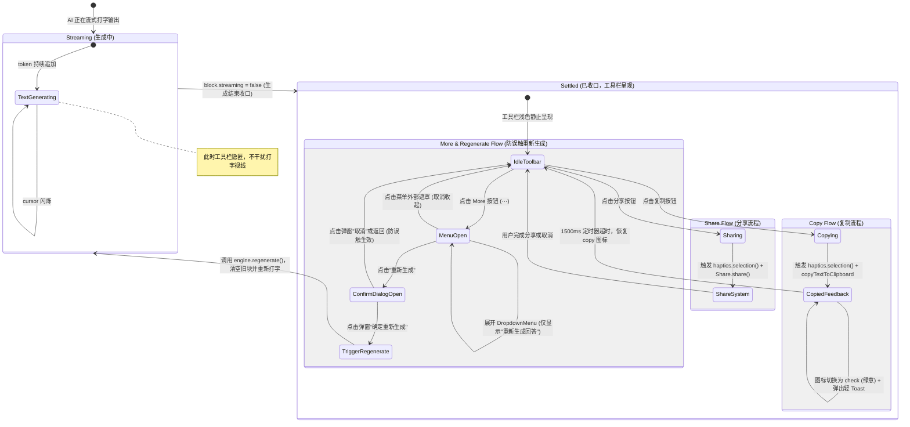

# 05 · 移动端 AI 消息工具栏与重新生成操作方案

> **文件路径**：`docs/mobile-interaction-refine/proposals/05-消息工具栏与重新生成操作方案.md`  
> **所属战役**：移动端交互体验精进（`mobile-interaction-refine`）  
> **面向模块**：`apps/crish-mobile/src/presentation/timeline/` (`TimelineView.tsx`, `MessageActionBar.tsx`, `MessageView`) 及 `adapters/conversation/`  
> **方案状态**：规划设计 / 待评审  
> **对齐裁决**：2026-11-04 移动端 AI 消息气泡交互、工具栏与防误触操作用户明确需求

---

## 1. 方案背景与设计哲学

### 1.1 背景与用户痛点溯源
在当前的 Crish Mobile 对话时间线（`TimelineView.tsx`）中，AI 助手消息（`role === 'assistant'`）采用了极简的无框正文呈现（通过 `StreamingText` 直出）。虽然这种无框排版保证了长篇阅读的呼吸感，但在日常高频对话交互中暴露了以下严重体验缺失：

1. **常用操作缺失，内容流转困难**：
   用户阅读完 AI 生成的回答后，无法一键复制全文或分享给协作伙伴，只能通过系统手势长按选中后艰难拖动光标选区，在移动端长文本场景下极易误选或丢失；
2. **缺乏重新生成通道与防误触机制**：
   当模型出现幻觉、指令遵循偏差或输出中断时，用户无法直接对当前回答发起“重新生成（Regenerate）”，只能手动复制上文再次输入发送；同时，如果在移动端消息旁边直接暴露高敏感动作按钮，单手滑动浏览时极易发生“手滑误触（Fat-finger Error）”，导致未读完的思考或回答被意外覆盖；
3. **视觉焦点竞争风险**：
   常规移动端操作栏若采用沉重底色、深色边框或厚重卡片，会生硬打断阅读动线，反客为主地抢占 AI 回答主体的视觉焦点。

### 1.2 用户核心诉求归纳
针对上述痛点，用户提出了三项刚性明确的交互设计红线：
1. **常用工具聚合**：“AI 输出的最后面可以加上一个工具栏，里面放上复制、分享等常用操作”；
2. **More 菜单与防误触**：“可以加上一个 more 按钮，点击后显示重新生成吧，避免误触”；
3. **视觉弱化与层级克制**：“工具栏的文字应该是比较浅写的文字，避免和正文混淆”。

### 1.3 核心设计原则（Subtle & Defensive）
基于以上背景，本方案确立四大设计基石：
- **视觉克制（Subtle & Lightweight）**：工具栏文字与图标采用柔和浅色（`theme.colors.textTertiary`，深色模式对应 `hsl(0 0% 55%)`，浅色模式对应 `hsl(0 0% 58%)`），字号控制在 12dp，严禁背景卡片、严禁阴影，与正文形成清晰的主次层级；
- **纵深防御防误触（Defense-in-Depth）**：
  - 一级防护：重新生成收拢在 `More`（`···`）下拉浮层内，绝不外露于消息首屏常驻视图；
  - 二级防护：点击菜单中的“重新生成”后，弹出轻量确认弹窗（`Dialog`），明确提示风险并要求二次确认，彻底根除滑动误触；
- **平台原语与优雅动效（Native Feel）**：
  - 触觉反馈：点击操作触发标准触感点音（`haptics.selection()`）；
  - 按压反馈：统一接入 `usePressFade` 驱动的 120ms 平滑透明度淡入淡出（拒绝硬跳变）；
  - 状态回弹：复制成功后图标无缝转为绿意对号（`check`）并维持 1500ms，配合轻量 Actionable Toast；
- **双引擎统一契约（Cross-Engine Consistency）**：
  - 无论在远端会话（`useRemoteConversationEngine`）还是本地线程（`useLocalConversationEngine`），工具栏呈现与重新生成链路保持完全一致。

---

## 2. 现状审计与代码审查

### 2.1 现有消息渲染审查（`TimelineView.tsx:863-905`）
审查 `apps/crish-mobile/src/presentation/timeline/TimelineView.tsx` 中的消息渲染实现：

```tsx
// TimelineView.tsx 现状代码
function MessageView({ block }: { block: AssistantMessageBlock }) {
  const theme = useTheme();
  if (block.role === 'user') {
    return (
      <View style={styles.userRow}>
        <View
          style={[
            styles.userBubble,
            {
              backgroundColor: theme.colors.bubbleUser,
              borderTopLeftRadius: theme.radius.bubble,
              borderTopRightRadius: theme.radius.bubble,
              borderBottomRightRadius: theme.radius.bubbleTail,
              borderBottomLeftRadius: theme.radius.bubble,
              paddingHorizontal: 14,
              paddingVertical: 10,
            },
          ]}
        >
          <MarkdownText
            text={block.text}
            baseStyle={[
              theme.type.chat,
              { color: theme.colors.bubbleUserText },
            ]}
          />
        </View>
      </View>
    );
  }
  return (
    <StreamingText
      identity={`message:${block.id}`}
      text={block.text}
      streaming={block.streaming}
      cursorStyle={{ color: theme.colors.textTertiary }}
      style={[theme.type.chat, { color: theme.colors.textPrimary }]}
    />
  );
}
```

### 2.2 现状缺陷对比矩阵
| 交互与视觉维度 | 当前实现（TimelineView.tsx） | 借鉴 Cherry Studio（`AssistantMessageToolbar.tsx`） | 本方案设计目标 |
| :--- | :--- | :--- | :--- |
| **底部操作** | 完全缺失，助手消息仅有一段 `StreamingText` 裸露文本 | 包含复制、朗读、分支、重新生成、更多等丰富操作 | **聚合复制、分享、More 三大高频入口** |
| **重新生成入口** | 零支持，无法对上一轮回答进行重试 | 工具栏外置 `RotateCcw` 图标，单击直接重新触发 | **外置 More 按钮，下拉菜单内嵌二次确认重新生成** |
| **手滑防误触** | 无对应概念 | 依赖工具栏本身的禁用态，但缺乏二次确认弹窗 | **下拉菜单隔离 + 二次确认 Dialog 双层防护** |
| **视觉层级** | 无操作栏 | 采用 `variant="ghost"`，但图标颜色略深 | **浅灰弱化文本（12dp, textTertiary），无任何外边框与背景** |
| **交互动效** | 仅依赖流式光标闪烁 | 包含复制成功态（`CheckIcon` 切换） | **`usePressFade` 柔和按压 + 复制状态回弹 + 系统触感** |
| **双引擎打通** | 仅负责呈现静态块 | 纯单机状态机绑定 | **抽象统一 `onRegenerate` 契约，覆盖远端与本地对话** |

---

## 3. 组件架构与交互状态机

### 3.1 架构分层拓扑

```
┌────────────────────────────────────────────────────────────────────────┐
│                        Crish Mobile 消息工具栏架构拓扑                  │
└────────────────────────────────────────────────────────────────────────┘
  [表现层 UI Layer]
  TimelineView.tsx
    │
    └── MessageView (block.role === 'assistant')
          │
          ├── StreamingText (AI 正文，Markdown 渲染与打字机光标)
          │
          └── AssistantMessageActionBar (全新轻量操作栏，流式封口后挂载)
                │
                ├── CopyActionItem (复制：触感 + 剪贴板 + 临时对号 + Toast)
                ├── ShareActionItem (分享：触感 + RN Share.share 系统面板)
                └── MoreActionItem (更多：··· 图标 + 锚定下拉浮层 / 对话框)
                      │
                      ├── DropdownMenu (轻量菜单：重新生成)
                      └── Dialog (重新生成二次确认弹窗，防误触防护)

  [适配层 Adapter Layer]
  ConversationEngine (apps/crish-mobile/src/adapters/conversation/types.ts)
    ├── useRemoteConversationEngine (反查上轮 Prompt，调用 composer.submitText)
    └── useLocalConversationEngine (反查 localChatSessionStore，重新起流)
```

### 3.2 交互状态机（Mermaid State Diagram）



---

## 4. 详细组件设计与规范实现

### 4.1 工具栏组件接口契约（`AssistantMessageActionBar.tsx`）
在 `apps/crish-mobile/src/presentation/timeline/AssistantMessageActionBar.tsx` 中定义纯表现层组件：

```tsx
import { memo, useCallback, useEffect, useRef, useState } from 'react';
import {
  Platform,
  Share,
  StyleSheet,
  View,
} from 'react-native';
import { useTheme } from '@/adapters/platform/theme';
import { haptics } from '@/adapters/platform/haptics';
import { copyTextToClipboard } from '@/adapters/platform/clipboard';
import {
  AnimatedPressable,
  usePressFade,
} from '@/presentation/ui/pressFeedback';
import { AppText, Dialog, DropdownMenu, Icon, useToast } from '@/presentation/ui';
import type { DropdownMenuEntry } from '@/presentation/ui/DropdownMenu';

export interface AssistantMessageActionBarProps {
  /** 消息唯一标识 */
  messageId: string;
  /** AI 生成的完整文本内容 */
  text: string;
  /** 是否处于流式生成中（生成中不显示工具栏） */
  streaming?: boolean;
  /** 是否允许重新生成（引擎空闲且有可用上一轮提问） */
  canRegenerate?: boolean;
  /** 重新生成回调 */
  onRegenerate?: (messageId: string) => void;
  /** 测试桩 ID */
  testID?: string;
}

/** 复制成功后的对号图标驻留时长（ms） */
const COPIED_RESET_DELAY_MS = 1500;

export const AssistantMessageActionBar = memo(function AssistantMessageActionBar({
  messageId,
  text,
  streaming = false,
  canRegenerate = true,
  onRegenerate,
  testID = 'assistant-message-action-bar',
}: AssistantMessageActionBarProps) {
  const theme = useTheme();
  const { showToast } = useToast();
  
  // 复制对号状态
  const [copied, setCopied] = useState(false);
  const copyResetTimerRef = useRef<ReturnType<typeof setTimeout> | null>(null);

  // 下拉菜单与确认弹窗状态
  const [menuOpen, setMenuOpen] = useState(false);
  const [confirmOpen, setConfirmOpen] = useState(false);
  const moreButtonRef = useRef<View>(null);
  const [menuAnchor, setMenuAnchor] = useState<{ top: number; right: number }>({
    top: 0,
    right: 0,
  });

  // 按压动效（usePressFade 120ms 平滑渐变）
  const copyPress = usePressFade();
  const sharePress = usePressFade();
  const morePress = usePressFade();

  // 组件卸载时清理定时器
  useEffect(() => {
    return () => {
      if (copyResetTimerRef.current !== null) {
        clearTimeout(copyResetTimerRef.current);
      }
    };
  }, []);

  // 1. 复制正文逻辑
  const handleCopy = useCallback(async () => {
    if (!text) return;
    haptics.selection();
    const success = await copyTextToClipboard(text);
    if (success) {
      setCopied(true);
      showToast('已复制到剪贴板');
      if (copyResetTimerRef.current !== null) {
        clearTimeout(copyResetTimerRef.current);
      }
      copyResetTimerRef.current = setTimeout(() => {
        setCopied(false);
        copyResetTimerRef.current = null;
      }, COPIED_RESET_DELAY_MS);
    } else {
      showToast('复制失败，请重试', 'error');
    }
  }, [text, showToast]);

  // 2. 系统分享逻辑
  const handleShare = useCallback(async () => {
    if (!text) return;
    haptics.selection();
    try {
      await Share.share({
        message: text,
      });
    } catch {
      // 用户取消分享或系统分享面板异常时静默处理
    }
  }, [text]);

  // 3. 打开更多菜单并测量触发锚点
  const handleOpenMore = useCallback(() => {
    haptics.selection();
    moreButtonRef.current?.measureInWindow((x, y, width, height) => {
      setMenuAnchor({
        top: y + height + 4,
        right: 18, // 贴近视口右边缘安全距离
      });
      setMenuOpen(true);
    });
  }, []);

  // 4. 点击菜单项进入防误触二次确认
  const handleMenuRegenerateClick = useCallback(() => {
    setMenuOpen(false);
    // 延迟一帧唤起弹窗，确保 DropdownMenu 先行收起，避免多浮层层叠闪烁
    requestAnimationFrame(() => {
      setConfirmOpen(true);
    });
  }, []);

  // 5. 二次确认触发真正的重新生成
  const handleConfirmRegenerate = useCallback(() => {
    setConfirmOpen(false);
    haptics.tap();
    onRegenerate?.(messageId);
  }, [onRegenerate, messageId]);

  // 流式中或正文为空时不渲染工具栏
  if (streaming || !text.trim()) {
    return null;
  }

  const moreMenuEntries: DropdownMenuEntry[] = [
    {
      key: 'regenerate',
      label: '重新生成回答',
      icon: 'refresh',
      onPress: handleMenuRegenerateClick,
      disabled: !canRegenerate,
      desc: !canRegenerate ? '当前正在生成中' : undefined,
    },
  ];

  return (
    <View testID={testID} style={styles.container}>
      {/* 复制操作项 */}
      <AnimatedPressable
        testID={`${testID}-copy`}
        accessibilityRole="button"
        accessibilityLabel={copied ? '已复制' : '复制正文'}
        hitSlop={styles.hitSlop}
        onPressIn={copyPress.onPressIn}
        onPressOut={copyPress.onPressOut}
        onPress={handleCopy}
        style={[styles.actionItem, copyPress.fadeStyle]}
      >
        <Icon
          name={copied ? 'check' : 'copy'}
          size={13}
          color={copied ? theme.colors.success : theme.colors.textTertiary}
        />
        <AppText
          variant="caption"
          style={[
            styles.actionText,
            { color: copied ? theme.colors.success : theme.colors.textTertiary },
          ]}
        >
          {copied ? '已复制' : '复制'}
        </AppText>
      </AnimatedPressable>

      {/* 分享操作项 */}
      <AnimatedPressable
        testID={`${testID}-share`}
        accessibilityRole="button"
        accessibilityLabel="分享回答"
        hitSlop={styles.hitSlop}
        onPressIn={sharePress.onPressIn}
        onPressOut={sharePress.onPressOut}
        onPress={handleShare}
        style={[styles.actionItem, sharePress.fadeStyle]}
      >
        <Icon
          name="share"
          size={13}
          color={theme.colors.textTertiary}
        />
        <AppText
          variant="caption"
          style={[styles.actionText, { color: theme.colors.textTertiary }]}
        >
          分享
        </AppText>
      </AnimatedPressable>

      {/* 更多按钮（···） */}
      <View ref={moreButtonRef} collapsable={false}>
        <AnimatedPressable
          testID={`${testID}-more`}
          accessibilityRole="button"
          accessibilityLabel="更多操作"
          hitSlop={styles.hitSlop}
          onPressIn={morePress.onPressIn}
          onPressOut={morePress.onPressOut}
          onPress={handleOpenMore}
          style={[styles.actionItem, morePress.fadeStyle]}
        >
          <Icon
            name="more"
            size={13}
            color={theme.colors.textTertiary}
          />
        </AnimatedPressable>
      </View>

      {/* 更多下拉浮层 */}
      <DropdownMenu
        visible={menuOpen}
        onClose={() => setMenuOpen(false)}
        entries={moreMenuEntries}
        top={menuAnchor.top}
        right={menuAnchor.right}
        width={160}
        testID={`${testID}-dropdown`}
      />

      {/* 重新生成二次确认弹窗（防手滑误触防护） */}
      <Dialog
        visible={confirmOpen}
        title="重新生成回答？"
        description="系统将基于上一条问题重新发起思考与回答，当前回答内容仍将保留在历史记录中。"
        onDismiss={() => setConfirmOpen(false)}
        actions={[
          {
            label: '取消',
            variant: 'subtle',
            onPress: () => setConfirmOpen(false),
            testID: `${testID}-confirm-cancel`,
          },
          {
            label: '重新生成',
            variant: 'primary',
            onPress: handleConfirmRegenerate,
            testID: `${testID}-confirm-submit`,
          },
        ]}
        testID={`${testID}-confirm-dialog`}
      />
    </View>
  );
});

const styles = StyleSheet.create({
  container: {
    flexDirection: 'row',
    alignItems: 'center',
    gap: 16,
    marginTop: 8,
    marginBottom: 4,
  },
  actionItem: {
    flexDirection: 'row',
    alignItems: 'center',
    gap: 4,
    paddingVertical: 2,
    paddingHorizontal: 4,
  },
  actionText: {
    fontSize: 12,
    lineHeight: 16,
    fontWeight: '400',
  },
  hitSlop: {
    top: 8,
    bottom: 8,
    left: 8,
    right: 8,
  },
});
```

### 4.2 `TimelineView.tsx` 宿主集成点改造
在 `apps/crish-mobile/src/presentation/timeline/TimelineView.tsx` 中做如下接线改造：

```tsx
// 1. TimelineViewProps 扩展声明
export interface TimelineViewProps {
  blocks: readonly TimelineBlock[];
  follow: boolean;
  onFollowChange: (following: boolean, reason?: FollowChangeReason) => void;
  listRef?: RefObject<FlatList<TimelineRow> | null>;
  onOpenTools?: (focusId: string) => void;
  // ... 其他既有 props
  
  /** 允许重新生成标志（引擎非 busy 态且处于就绪态） */
  canRegenerate?: boolean;
  /** 触发重新生成回调（messageId 为当前收口的助手消息 id） */
  onRegenerate?: (messageId: string) => void;
}

// 2. TimelineBlockView 透传动作回调
const TimelineBlockView = memo(function TimelineBlockView({
  block,
  onOpenTools,
  disclosureStore,
  onToggleDisclosure,
  canRegenerate,
  onRegenerate,
}: {
  block: DisplayBlock;
  onOpenTools?: (focusId: string) => void;
  disclosureStore?: Map<string, boolean>;
  onToggleDisclosure?: () => void;
  canRegenerate?: boolean;
  onRegenerate?: (messageId: string) => void;
}) {
  switch (block.kind) {
    case 'message':
      return (
        <MessageView
          block={block}
          canRegenerate={canRegenerate}
          onRegenerate={onRegenerate}
        />
      );
    // ... 其他 case 保持原样
  }
});

// 3. MessageView 挂载工具栏
function MessageView({
  block,
  canRegenerate,
  onRegenerate,
}: {
  block: AssistantMessageBlock;
  canRegenerate?: boolean;
  onRegenerate?: (messageId: string) => void;
}) {
  const theme = useTheme();
  if (block.role === 'user') {
    // 用户气泡渲染不变
    return <UserBubbleView block={block} />;
  }
  
  // 助手消息：正文打字机 + 底部轻量工具栏
  return (
    <View style={styles.assistantMessageContainer}>
      <StreamingText
        identity={`message:${block.id}`}
        text={block.text}
        streaming={block.streaming}
        cursorStyle={{ color: theme.colors.textTertiary }}
        style={[theme.type.chat, { color: theme.colors.textPrimary }]}
      />
      <AssistantMessageActionBar
        messageId={block.id}
        text={block.text}
        streaming={block.streaming}
        canRegenerate={canRegenerate}
        onRegenerate={onRegenerate}
      />
    </View>
  );
}
```

---

## 5. 重新生成（Regenerate）双引擎实现链路

### 5.1 引擎抽象契约扩展（`ConversationEngine`）
在 `apps/crish-mobile/src/adapters/conversation/types.ts` 中增补重新生成方法声明：

```ts
export interface ConversationEngine {
  kind: 'remote' | 'local';
  id: string;
  title: string | null;
  blocks: readonly TimelineBlock[];
  busy: boolean;
  available: boolean;
  error: { message: string; detail?: string; onDismiss?: () => void } | null;
  stop?: () => void;
  
  /**
   * 重新生成指定助手消息：
   * 引擎内部自动寻找该助手消息所对应的上一轮用户提问文本，重新发起推理与流式生成。
   * 若当前引擎正处于 busy 态或未找到前置提问，返回 false。
   */
  regenerate?: (messageId: string) => Promise<boolean> | boolean;
  
  composer: { ... };
  // ...
}
```

### 5.2 远端会话引擎适配（`useRemoteConversationEngine.tsx`）
在远端引擎中，会话通过桌面内核的 `runTask` 进行调度。重新生成的逻辑如下：
1. **反查用户 Prompt**：
   在 `blocks` 块流中定位到待重试的 `messageId` 对应项（其索引为 `k`）；从 `k - 1` 开始向前逆序扫描，找到最近一个 `role === 'user'` 的消息块作为提问正文 `userPrompt`；
2. **状态守卫**：
   若未找到前置用户提问或当前 `sendBusy === true`，拦截触发并给出 Toast 提示；
3. **发起任务提交**：
   直接复用既有的 `composer.submitText(userPrompt)` 管道，该管道原生具备：
   - 生成中自动排队保护（进 `sendQueueStore`）；
   - 正确附带当前配置的工作区与权限模式（`runPermissionMode`）；
   - 触发首 token 占位行与时间线贴底跟随。

```ts
// useRemoteConversationEngine.tsx 实现片段
const regenerate = useCallback(
  async (messageId: string): Promise<boolean> => {
    if (sendBusy) {
      showToast('当前正在生成中，请稍后再试', 'warning');
      return false;
    }
    // 逆序查找当前助手消息所对应的提问
    let userPrompt: string | null = null;
    let foundAssistant = false;
    for (let i = blocks.length - 1; i >= 0; i--) {
      const block = blocks[i]!;
      if (block.kind === 'message' && block.id === messageId) {
        foundAssistant = true;
        continue;
      }
      if (foundAssistant && block.kind === 'message' && block.role === 'user') {
        userPrompt = block.text;
        break;
      }
    }
    if (!userPrompt || !userPrompt.trim()) {
      showToast('未找到对应的提问内容', 'error');
      return false;
    }
    // 触发重新发送并恢复跟随
    sync.onSendSuccess?.();
    const result = await submitText(userPrompt);
    return Boolean(result);
  },
  [blocks, sendBusy, submitText, sync, showToast]
);
```

### 5.3 本地对话引擎适配（`useLocalConversationEngine.tsx`）
在端侧单机多线程对话（`localChatSessionStore`）中，数据模型为纯数组 `messages: LocalChatMessage[]`：
1. **查找匹配**：定位目标 `assistantId === messageId` 在 `messages` 中的索引；
2. **提问抽取**：提取其前置项 `userMessage`（`role === 'user'`）；
3. **安全起流**：
   调用 `sendLocalChatMessage(threadId, userMessage.content)` 重新起流，流式客户端生成全新的 `assistantId`，在尾部追加全新的流式回答；
4. **历史洁净度保障**：根据用户裁决，原回答保留或作为前置版本，新回答以最新的一轮展现，完整记录历史。

---

## 6. 视觉规范与 Design Tokens 刚性对齐

### 6.1 色彩阶梯与对比度规范（WCAG & Cherry Alignment）
针对用户核心要求“**工具栏的文字应该是比较浅写的文字，避免和正文混淆**”，建立严格的色彩映射关系：

```
正文 Primary (高对比度, 100% 聚焦)
  └── theme.colors.textPrimary (浅色 #171717 / 深色 #ffffff)
        │  [显著视觉阶差]
工具栏 Tertiary (极柔和, 融入背景呼吸区)
  └── theme.colors.textTertiary (浅色 hsl(0 0% 58%) / 深色 hsl(0 0% 55%))
        │  [轻微按压加深]
按压激活 Secondary
  └── usePressFade (120ms 平滑过渡至 pressOpacity 0.65)
```

- **严禁使用深黑色**：工具栏文字与图标一律严禁直接使用 `textPrimary`（深黑/纯白），必须使用 `textTertiary`；
- **严禁实心粗边框与厚底色**：工具栏背景必须保持 100% 透明，不得包裹任何带有背景色或投影的卡片，确保 AI 正文在屏幕上的无界通透感；
- **复制成功绿**：复制成功切换为 `theme.colors.success`（绿意微调），1.5 秒后自动回归浅灰色，提供确凿正反馈而不产生视觉残留。

### 6.2 几何尺寸与排版微距表
| 元素 / 属性 | 设计规约 | 对应 Token / 测量依据 | 理由与体验保障 |
| :--- | :--- | :--- | :--- |
| **容器上外边距** | `marginTop: 8dp` | `theme.space.sm` | 紧随 AI 文本结尾，形成自然段落留白 |
| **容器下外边距** | `marginBottom: 4dp` | `theme.space.xs` | 保证与下一条消息（或时间分隔行）间隙整齐 |
| **操作项间距** | `gap: 16dp` | `theme.space.lg` | 避免多按钮粘连，防止手指在狭窄区域并选 |
| **图标尺寸** | `13dp × 13dp` | 线宽 `1.8`（`theme.layout.iconStroke`） | 紧凑小巧，精致轻盈，不喧宾夺主 |
| **文字字号** | `fontSize: 12dp` | `theme.type.caption` | 明显小于正文 15~16dp，规避与正文混淆 |
| **文字行高** | `lineHeight: 16dp` | 基线对齐规约 | 与 13dp 图标保持像素级垂直居中 |
| **触控热区补足** | `hitSlop: 8dp` | `hitSlop={{ top: 8, bottom: 8, left: 8, right: 8 }}` | 将视觉 20dp 的点击面外扩至 **36~44dp**，满足移动端手指点击生理需求 |

---

## 7. 防误触系统（Defense-in-Depth）专项推导

### 7.1 为什么外露重新生成是移动端的大忌？
移动设备采用单手滑动手势进行纵向浏览，拇指贴附屏幕向上划动的轨迹经常正好划过屏幕右侧或消息底部边缘。
- 若将“重新生成（Regenerate）”做成与“复制”并列的明钮，用户在高速划动翻阅长回答时，**极大概率在抬手瞬间触发点击（Tap-on-Release）**；
- 重新生成通常意味着中断当前回答、重新向大模型发起长达数十秒的流式请求，这会带来：
  1. 昂贵且无意义的 API Token 消耗；
  2. 用户好不容易生成的优秀回答被意外打断，造成严重的挫败感。

### 7.2 二级防护闭环实施规范
本方案通过两道刚性闸门彻底隔离误触：

```
[用户手指划过屏幕]
  │
  ├── 1. 物理位置隔离：
  │      外露区域仅有「复制」「分享」「···」，没有高危动作；
  │
  ├── 2. 一级主动交互：
  │      必须主动点击「···」呼出下拉菜单；
  │
  └── 3. 二级决策拦截（Dialog）：
         点击「重新生成回答」不立即触发，必须在弹出的系统对话框中点击「确定重新生成」。
         任何点击遮罩外、系统物理返回键或点击「取消」，立即无害退回。
```

---

## 8. 单测与质量保障方案

在 `apps/crish-mobile/src/presentation/timeline/__tests__/AssistantMessageActionBar.test.tsx` 中建立高覆盖度回归测试套件：

### 8.1 必测核心用例清单
1. **渲染守卫测试**：
   - 当 `streaming === true` 时，组件返回 `null`，不渲染任何节点；
   - 当 `text === ''` 时，组件返回 `null`；
   - 当 `streaming === false` 且有有效文本时，正确渲染复制、分享、更多三按钮；
2. **复制链路测试**：
   - 单击复制按钮，断言调用 `haptics.selection()`；
   - 断言调用 `copyTextToClipboard` 传入当前文本；
   - 断言展示 `已复制到剪贴板` Toast 且图标变为 `check`；
   - 推进时间 1500ms，断言图标恢复为 `copy`；
3. **分享链路测试**：
   - 单击分享按钮，断言调用 `Share.share({ message: text })`；
4. **防误触流转测试**：
   - 单击 `More` 按钮，断言展开 `DropdownMenu`；
   - 单击菜单中的“重新生成回答”，断言关闭菜单并展示二次确认 `Dialog`，且此时**尚未**触发 `onRegenerate`；
   - 单击 Dialog 的“取消”，断言弹窗关闭且 `onRegenerate` 零调用；
   - 再次展开并单击 Dialog 的“重新生成”，断言触发 `haptics.tap()` 且 `onRegenerate` 成功接收当前 `messageId`。

### 8.2 单测代码范式

```tsx
import { act, fireEvent, render, screen } from '@testing-library/react-native';
import { Share } from 'react-native';
import { AssistantMessageActionBar } from '../AssistantMessageActionBar';
import * as clipboard from '@/adapters/platform/clipboard';
import { haptics } from '@/adapters/platform/haptics';

jest.mock('@/adapters/platform/haptics');
jest.mock('@/adapters/platform/clipboard');
jest.spyOn(Share, 'share').mockResolvedValue({ action: Share.sharedAction });

describe('AssistantMessageActionBar', () => {
  beforeEach(() => {
    jest.clearAllMocks();
    jest.useFakeTimers();
  });

  afterEach(() => {
    jest.useRealTimers();
  });

  it('流式生成中或空文本时不渲染任何内容', () => {
    const { rerender } = render(
      <AssistantMessageActionBar
        messageId="msg-1"
        text="Hello"
        streaming={true}
      />
    );
    expect(screen.queryByTestID('assistant-message-action-bar')).toBeNull();

    rerender(
      <AssistantMessageActionBar
        messageId="msg-1"
        text=""
        streaming={false}
      />
    );
    expect(screen.queryByTestID('assistant-message-action-bar')).toBeNull();
  });

  it('收口后点击复制触发触感、剪贴板写入并呈现对号反馈', async () => {
    jest.spyOn(clipboard, 'copyTextToClipboard').mockResolvedValue(true);

    render(
      <AssistantMessageActionBar
        messageId="msg-1"
        text="AI 回答正文"
        streaming={false}
      />
    );

    const copyBtn = screen.getByTestID('assistant-message-action-bar-copy');
    await act(async () => {
      fireEvent.press(copyBtn);
    });

    expect(haptics.selection).toHaveBeenCalled();
    expect(clipboard.copyTextToClipboard).toHaveBeenCalledWith('AI 回答正文');
    expect(screen.getByText('已复制')).toBeTruthy();

    act(() => {
      jest.advanceTimersByTime(1500);
    });
    expect(screen.getByText('复制')).toBeTruthy();
  });

  it('点击更多按钮唤起菜单，点击重新生成展示二次确认并阻断误触', () => {
    const onRegenerate = jest.fn();
    render(
      <AssistantMessageActionBar
        messageId="msg-1"
        text="回答"
        streaming={false}
        onRegenerate={onRegenerate}
      />
    );

    // 1. 打开 More 菜单
    fireEvent.press(screen.getByTestID('assistant-message-action-bar-more'));
    expect(screen.getByText('重新生成回答')).toBeTruthy();

    // 2. 点击重新生成项 -> 唤起确认弹窗，此时尚未执行 onRegenerate
    fireEvent.press(screen.getByText('重新生成回答'));
    expect(screen.getByText('重新生成回答？')).toBeTruthy();
    expect(onRegenerate).not.toHaveBeenCalled();

    // 3. 点击取消 -> 弹窗消失，依然不执行
    fireEvent.press(screen.getByTestID('assistant-message-action-bar-confirm-cancel'));
    expect(onRegenerate).not.toHaveBeenCalled();

    // 4. 再次呼出并点击确认 -> 执行 onRegenerate
    fireEvent.press(screen.getByTestID('assistant-message-action-bar-more'));
    fireEvent.press(screen.getByText('重新生成回答'));
    fireEvent.press(screen.getByTestID('assistant-message-action-bar-confirm-submit'));

    expect(onRegenerate).toHaveBeenCalledWith('msg-1');
  });
});
```

---

## 9. 演进与交付路线

```
┌────────────────────────────────────────────────────────────────────────┐
│                        实施波次与任务分解路线                          │
└────────────────────────────────────────────────────────────────────────┘
  [Phase 1: 组件封装与视觉对齐]
  - 新建 `AssistantMessageActionBar.tsx` 组件；
  - 接入 `iconPaths.ts`（copy / share / more / refresh / check）；
  - 运用 `theme.colors.textTertiary` 保证 12dp 浅色字体，无背景无阴影；
  - 编写完整的组件独立单测。

  [Phase 2: 时间线容器接线]
  - 在 `TimelineView.tsx` 的 `MessageView` 中挂载 `AssistantMessageActionBar`；
  - 传递 `block.streaming`、`block.text` 与 `messageId`；
  - 验证流式生成过程中完全隐匿，收口帧瞬间平滑呈现。

  [Phase 3: 双引擎 Regenerate 契约打通]
  - `ConversationEngine` 扩展 `regenerate(messageId)`；
  - `useRemoteConversationEngine` 实现反查上轮 Prompt 并调度发送；
  - `useLocalConversationEngine` 实现本地线程重试；
  - 端到端真机与自动化回归验证。
```
