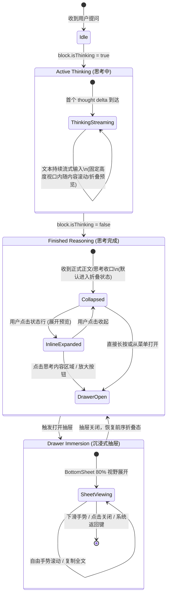
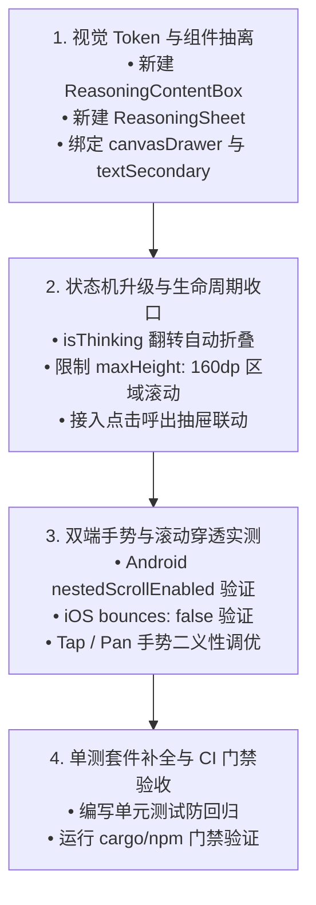

# 06 · 移动端思考链折叠滚动与抽屉展示方案

> **文件路径**：`docs/mobile-interaction-refine/proposals/06-思考链折叠滚动与抽屉展示方案.md`  
> **所属战役**：移动端交互体验精进（`mobile-interaction-refine`）  
> **面向模块**：`apps/crish-mobile/src/presentation/timeline/` (`TimelineView.tsx`, `ReasoningView`, `Sheet`)  
> **方案状态**：规划设计 / 待评审  
> **对齐裁决**：移动端思考链生命周期与视觉规范（2026-11-04 用户明确需求）

---

## 1. 方案概述与背景

### 1.1 背景与用户痛点
随着 DeepSeek-R1、Claude 3.7 Sonnet Thinking、OpenAI o1/o3 等深度思考模型的普及，模型在输出正式回答前往往会产生数千字乃至上万字的思考过程（Thinking / Reasoning Process）。

在移动端有限的屏幕纵向空间下，目前移动端的思考链呈现面临严重体验断层：
1. **内联无限撑高，冲毁主聊天流**：目前 `ReasoningView` 一旦展开，以纯文本块无限制渲染，导致用户回答被推到数屏之外，严重破坏了对话阅读的连续性；
2. **缺乏固定高度与内嵌滚动截断**：长思考内容缺少视口高度约束，缺少“微窗口局部翻阅”能力；
3. **移动端深度阅读体验缺失**：缺乏大视口沉浸式阅读载体，长篇思考过程在聊天气泡中难以舒适精读；
4. **思考完毕后的默认状态不当**：用户明确要求“默认思考完毕后是折叠状态”，避免完成输出后依然占用显要视野；
5. **视觉层级模糊**：既有实现仅有简陋的 `borderLeftWidth: 2` 竖线，背景完全透明，缺乏代码块般的“沙盒容器质感”，且文字颜色过深，未能与正式回答拉开层级。

### 1.2 用户核心诉求归纳
用户对移动端思考块的交互与呈现提出了三项明确红线：
1. **固定高度与区域滚动**：“思考内容是有固定高度的，超过之后就在固定区域内滚动显示，点击该区域变成抽屉显示全部思考内容”；
2. **终态默认折叠**：“默认思考完毕后是折叠状态”；
3. **仿代码块质感与浅色文字**：“思考内容是和代码块差不多的背景样式，所以文字应该是偏浅一些的颜色”。

---

## 2. 现状诊断与架构断层分析

### 2.1 现有 `ReasoningView` 实现审查（`TimelineView.tsx:800-861`）
当前代码库中的实现形态如下：

```tsx
function ReasoningView({
  block,
  disclosureStore,
  onToggleDisclosure,
}: {
  block: ReasoningBlock;
  disclosureStore?: Map<string, boolean>;
  onToggleDisclosure?: () => void;
}) {
  const theme = useTheme();
  const [expanded, setExpanded] = useState(
    () => disclosureStore?.get(block.id) ?? false
  );
  const seconds = Math.max(1, Math.round((block.durationMs ?? 0) / 1000));
  const rawLabel = block.isThinking ? '正在思考...' : `已思考 ${seconds} 秒`;
  const label = useMinResidencyText(rawLabel, block.isThinking);

  return (
    <View style={styles.reasoningContainer}>
      <Pressable onPress={toggle} style={[styles.inlineRow, styles.reasoningHeader]}>
        <AppText variant="caption" color="textTertiary">{label}</AppText>
        <Icon name={expanded ? 'chevron-down' : 'chevron-right'} size={12} color={theme.colors.textTertiary} />
      </Pressable>
      {expanded && block.text.trim().length > 0 ? (
        <View style={[styles.reasoningBody, { borderLeftColor: theme.colors.borderStrong }]}>
          <AppText variant="footnote" color="textSecondary">{block.text}</AppText>
        </View>
      ) : null}
    </View>
  );
}
```

### 2.2 核心断层诊断
| 维度 | 当前实现 | 用户要求与设计目标 | 缺陷定级 |
| :--- | :--- | :--- | :--- |
| **高度控制** | 无限制撑大，内容有多少就撑多高 | **固定高度视口（如 `maxHeight: 160dp`）**，超限内部滚动 | **P0 体验阻断** |
| **阅读深度** | 仅能在时间线行内阅读，体验逼仄 | **点击区域联动底部抽屉（BottomSheet）**，80% 或全屏大视野沉浸阅读 | **P0 体验阻断** |
| **完成态收拢** | 仅依赖流式期默认折叠，完成时若被展开过则保持撑开 | **思考完毕刚性默认折叠**为单行紧凑状态行，保持对话整洁 | **P1 规则对齐** |
| **容器背景** | 无背景（透明），仅左边线 2dp | **仿代码块底色**（`canvasDrawer` / `surfaceGrouped`），12dp 柔和圆角与微边框 | **P1 视觉降级** |
| **字体阶梯** | 使用常规次级色，未形成科技/沙盒质感 | **偏浅文字阶**（`textSecondary` / `textTertiary`），紧凑排版，与回答形成清晰反差 | **P1 视觉降级** |
| **手势冲突** | 无内部滚动，无冲突处理 | 需在 FlatList 与内部 ScrollView 之间做 **手势/滚动穿透防护与单击仲裁** | **P0 稳定性** |

---

## 3. 思考链生命周期与状态机设计

### 3.1 状态转移模型（State Machine）



### 3.2 阶段行为规格

#### 1. 阶段 A：Active Reasoning（正在思考中）
- **触发条件**：`block.isThinking === true` 且 `block.streaming === true`；
- **状态行表现**：
  - 动态展示活动文案与计时，经 `useMinResidencyText` 整形避免闪烁，展示秒级跳动或脉冲动画；
  - 默认展示形态：紧凑状态行。用户若点击展开，则展示固定高度（`maxHeight: 160dp`）的类代码块沙盒；
  - **流式自动跟随（Tail-Follow）**：在固定高度区域内，当新思考文本不断涌入时，内部 `ScrollView` 自动平滑滚动到底部（`scrollToEnd({ animated: true })`），用户可直观感知思维模型的推理演进；
  - 提供右上角“展开为抽屉”按钮，允许在思考过程中实时挂起抽屉全屏观摩。

#### 2. 阶段 B：Finished Reasoning（思考完毕，默认折叠）
- **触发条件**：`block.isThinking === false`（首个回复正文到来，或引擎发送思考闭合事件）；
- **核心铁律**：**默认思考完毕后强制进入折叠状态（Collapsed）**；
  - 即使用户在“思考中”阶段临时展开了内联预览，在思考正式完成（收口）时，状态机也将平滑收拢为单行折叠胶囊状态行；
  - 状态行文案格式：“已深度思考 (用时 3.2s)” 或 “思考过程 · 耗时 4 秒”，带右侧展开箭头 `chevron-right` 与大脑/闪烁微图标；
  - 不抢占回答正文首屏视野，实现极致的信息降噪。

#### 3. 阶段 C：Inline Expanded（就地展开态，固定高度+区域滚动）
- **触发条件**：用户在思考完成后，点击折叠状态行；
- **展示特性**：
  - **固定高度上限**：设置 `maxHeight: 160dp`（约可容纳 6–7 行思考文字）；
  - **内部滚动**：超出 `160dp` 的思考内容，被约束在固定容器内通过滚动条（`ScrollView`）上下查阅；
  - **边缘截断渐变（Edge Fade）**：当内容超出视口且未触底时，容器底部出现 24dp 高度的微弱半透明渐变遮罩，并在底栏居中提示“点击展开完整思考”，直观传递可下潜信号；
  - **点击唤起抽屉**：用户轻触卡片内容区域的任意位置（或点击底栏引导条、右上角全屏图标），立即触发呼出沉浸式抽屉。

#### 4. 阶段 D：Drawer Immersion（沉浸式底部抽屉）
- **触发条件**：点击固定高度区域、点击右上角全屏按钮或点击底栏“查看全部”；
- **展示特性**：
  - 复用成熟的 `@/presentation/ui/Sheet` 组件，设置 `size="large"`（占据屏幕高度的 80%）；
  - **标题栏规范**：左侧/居中显示“深度思考过程”，右侧带有“耗时 3.2s”紧凑 Badge；
  - **操作工具条**：右上角提供“一键复制思考内容”（Copy Reasoning）按钮，点击触发触感反馈（`haptics.selection()`）与轻提示；
  - **大视口自由滚动**：抽屉内采用完整 `ScrollView`，无固定高度截断，排版舒展；
  - **手势收起协同**：支持原生的下拉拖拽关闭（`sheetDragCloseDecision`）、遮罩点击关闭、Android 系统返回键拦截（`overlayStack`），并完美避让软键盘。

---

## 4. 视觉样式与 Design Tokens 规范

### 4.1 仿代码块的内嵌沙盒质感（Background & Borders）
思考链本质上是模型的内部认知计算与推演，与正式交付给用户的自然语言回答具有截然不同的信息性质。因此，视觉上必须参照“代码块（CodeBlock）”建立清晰的物理容器隐喻：

```
┌────────────────────────────────────────────────────────┐
│  🧠 已深度思考 (耗时 3.2s)                          ⛶  │
├────────────────────────────────────────────────────────┤
│  1. 用户询问移动端思考链设计规范...                   │
│  2. 分析 TimelineView 的组件结构与生命周期状态...      │
│  3. 评估 Android/iOS 双端嵌套滚动的边界条件...         │
│  4. 需解决点击与拖动手势仲裁，避免手势穿透...          │
│  ░░░░░░░░░░░░░░░░ 渐变半透明截断层 ░░░░░░░░░░░░░░░░░░░│
│              [ 点击展开完整思考抽屉 ↗ ]                 │
└────────────────────────────────────────────────────────┘
```

#### Token 映射表
| 视觉要素 | 浅色模式（Light Theme） | 深色模式（Dark Theme） | 设计意图 |
| :--- | :--- | :--- | :--- |
| **容器背景色 (`backgroundColor`)** | `theme.colors.canvasDrawer` (`#f0f0f0`) 或 `theme.colors.surfaceGrouped` | `theme.colors.surfaceGrouped` (`#1c1c1c`) 或 `theme.colors.canvasDrawer` (`#0e0e0e`) | 仿代码块底色，比聊天背景深一档，形成内嵌凹槽质感 |
| **容器边框 (`borderColor`)** | `theme.colors.borderSubtle` (`rgba(0,0,0,0.06)`) | `theme.colors.borderSubtle` (`rgba(255,255,255,0.08)`) | 极细发丝线（`hairlineWidth`），界定内容边界 |
| **圆角弧度 (`borderRadius`)** | `theme.radius.md` (14dp) 或 12dp | `theme.radius.md` (14dp) 或 12dp | 与气泡、代码块统一的柔和几何弧度 |
| **外边距与内衬 (`padding`)** | 垂直 `space.sm` (10dp)，水平 `space.md` (14dp) | 同浅色 | 保证内嵌文字呼吸空间，不局促 |

### 4.2 浅色文字阶梯与排版系统（Typography & Colors）
为了避免思考链内容过度吸引视觉注意力，文本颜色必须弱化为浅色阶：
- **思考正文颜色**：严格使用 `theme.colors.textSecondary`（浅色 `#666666`，深色 `#a3a3a3`）；
  - 对比度保证：在 `#f0f0f0` 底色上，`#666666` 达到 4.8:1 对比度；在 `#1c1c1c` 底色上，`#a3a3a3` 达到 6.2:1 对比度，均完全超越 WCAG AA（4.5:1）标准；
- **状态行与辅助信息**：使用 `theme.colors.textTertiary`（浅色 `#999999`，深色 `#666666`）；
- **字体样式**：采用 `theme.type.footnote`（字号 13dp，行高 18dp），并可注入轻微的等宽字体家族（`theme.type.mono.fontFamily`），营造科技推演沙盒的专注氛围。

### 4.3 边缘截断渐变（Edge Fade）
- 当思考内容高度测量值 > `160dp` 且当前滚动位置未达到底部时，在容器底部覆盖一层高度为 `28dp` 的渐变蒙层；
- 渐变色：从 `transparent` 平滑过渡到 `theme.colors.canvasDrawer`；
- 蒙层中央悬浮极其轻量的“点击展开全部”微型提示药丸，带 `Icon: chevron-down`。

---

## 5. 手势仲裁与滚动穿透防护机制

### 5.1 双端嵌套滚动（Nested Scroll）冲突与根治方案
在 React Native 中，在主时间线 `FlatList` 内部放置固定高度的 `ScrollView`，极其容易产生滚动冲突与滚动劫持（Scroll Contention）。

#### 冲突防护铁律
1. **内容自适应滚动使能（Adaptive Scroll Enabled）**：
   - 监听内部文本的 `onContentSizeChange(w, h)`；
   - 只有当内容实际高度 `h > 160` 时，才激活 `scrollEnabled={true}`；
   - 当 `h <= 160` 时，刚性设置 `scrollEnabled={false}`，使外层触摸事件 100% 直通外层 `FlatList`，杜绝一切伪滚动干扰。
2. **Android 嵌套滚动契约**：
   - 内部 `ScrollView` 必须显式声明：
     ```tsx
     nestedScrollEnabled={true}
     overScrollMode="never"
     scrollEventThrottle={16}
     ```
   - 避免 Android 原生过度滚动的波纹效果（overscroll glow/bounce）干扰外层列表。
3. **iOS 弹性边界隔离**：
   - 设置 `bounces={false}`，防止 iOS 橡皮筋回弹导致外层列表跳动。

### 5.2 点击与拖拽的手势二义性仲裁（Tap vs Pan）
用户要求：“点击该区域变成抽屉显示全部思考内容”，而该区域又支持滚动。如何优雅区分“用户是想在固定区域内上下滑动预览”还是“用户想点击呼出全屏抽屉”？

#### 仲裁机制设计
- **原生 Pressable 运动容差机制**：
  - React Native 的 `Pressable` 内部内置了触摸位移死区判定（Slop & Movement Threshold）；
  - 当手势发生纵向位移超过 8dp 时，`Pressable` 自动判定为手势滑动，取消 `onPress` 触发；
  - 只有当触摸接触到离开位移不超过阈值且停留时间 < 300ms 时，判定为有效点击，唤起抽屉。
- **显式热区双重兜底**：
  - 为防隐式点击对部分用户不够直观，设计**双重交互触点**：
    1. **直接点按卡片**：在固定区域内的任意轻触（Tap）直接触发抽屉；
    2. **右上角全屏操作钮**：卡片右上方常驻轻量图标按钮（`maximize-2` / `external-link`），点击直接打开抽屉；
    3. **底部渐变截断条**：超高被截断时，底部渐变条附带“查看完整思考 ↗”文字胶囊，点击直达抽屉。

### 5.3 虚拟化列表（FlatList）重挂载与跟随协同
1. **脱离跟随协同（⑰ 规则）**：
   - 用户点击展开/折叠思考块，或打开抽屉时，统一触发 `onToggleDisclosure?.()`，通知 `TimelineView` 暂停底端自动吸顶跟随（`follow = false`），避免用户查看思考时界面被新生成的正文推走；
2. **状态持久与跨重挂载（Remount Resilience）**：
   - 用户的折叠/展开与阅读偏好保存在外层注入的 `disclosureStore: Map<string, boolean>` 中；
   - 但在生命周期转换时，遵循“思考结束瞬间强行折叠”规则：当检测到 `prevIsThinking === true && nextIsThinking === false` 时，清空该 blockId 在 `disclosureStore` 中的展开值，强行置为 `false`。

---

## 6. 核心组件设计与代码级实现

本方案采用模块化分层解耦结构：
- `ReasoningView`: 调度状态机、计时器与折叠/抽屉触发；
- `ReasoningContentBox`: 负责固定高度限制、内部嵌套滚动、渐变截断与手势仲裁；
- `ReasoningSheet`: 独立的沉浸式大视口抽屉（包装 `Sheet` 组件）。

### 6.1 `ReasoningContentBox.tsx`（固定高度内嵌视口）

```tsx
import { useCallback, useRef, useState } from 'react';
import {
  Pressable,
  ScrollView,
  StyleSheet,
  View,
  type NativeScrollEvent,
  type NativeSyntheticEvent,
} from 'react-native';
import { useTheme } from '@/adapters/platform/theme';
import { AppText, Icon } from '@/presentation/ui';

export const REASONING_BOX_MAX_HEIGHT = 160;

export interface ReasoningContentBoxProps {
  text: string;
  isThinking?: boolean;
  onOpenDrawer: () => void;
  testID?: string;
}

export function ReasoningContentBox({
  text,
  isThinking = false,
  onOpenDrawer,
  testID = 'reasoning-content-box',
}: ReasoningContentBoxProps) {
  const theme = useTheme();
  const scrollRef = useRef<ScrollView>(null);
  const [contentHeight, setContentHeight] = useState(0);
  const [isScrolledToBottom, setIsScrolledToBottom] = useState(false);

  const isOverflowing = contentHeight > REASONING_BOX_MAX_HEIGHT;

  // 流式思考中自动跟随滚到底部
  const handleContentSizeChange = useCallback(
    (_width: number, height: number) => {
      setContentHeight(height);
      if (isThinking && height > REASONING_BOX_MAX_HEIGHT) {
        scrollRef.current?.scrollToEnd({ animated: true });
      }
    },
    [isThinking]
  );

  const handleScroll = useCallback(
    (e: NativeSyntheticEvent<NativeScrollEvent>) => {
      const { contentOffset, layoutMeasurement, contentSize } = e.nativeEvent;
      const atBottom =
        contentOffset.y + layoutMeasurement.height >= contentSize.height - 12;
      setIsScrolledToBottom(atBottom);
    },
    []
  );

  return (
    <View
      testID={testID}
      style={[
        styles.boxContainer,
        {
          backgroundColor: theme.colors.canvasDrawer,
          borderColor: theme.colors.borderSubtle,
          borderRadius: theme.radius.md,
          maxHeight: REASONING_BOX_MAX_HEIGHT,
        },
      ]}
    >
      {/* 顶部轻量浮动操作栏：支持一键进入沉浸抽屉 */}
      <View style={styles.topToolbar}>
        <AppText variant="caption" color="textTertiary" style={styles.monoLabel}>
          THINKING LOG
        </AppText>
        <Pressable
          accessibilityRole="button"
          accessibilityLabel="放大至抽屉查看全部"
          hitSlop={8}
          onPress={onOpenDrawer}
          style={styles.maximizeButton}
        >
          <Icon name="maximize-2" size={13} color={theme.colors.textTertiary} />
        </Pressable>
      </View>

      {/* 滚动区域：点击卡片可触发抽屉，拖拽可区域滚动 */}
      <Pressable
        onPress={onOpenDrawer}
        style={styles.scrollWrapper}
        accessibilityRole="button"
        accessibilityLabel="点击打开思考抽屉"
      >
        <ScrollView
          ref={scrollRef}
          nestedScrollEnabled
          overScrollMode="never"
          bounces={false}
          scrollEnabled={isOverflowing}
          scrollEventThrottle={16}
          onScroll={handleScroll}
          onContentSizeChange={handleContentSizeChange}
          showsVerticalScrollIndicator={isOverflowing}
          style={styles.scrollArea}
        >
          <AppText
            variant="footnote"
            color="textSecondary"
            style={[styles.reasoningText, theme.type.mono]}
          >
            {text}
          </AppText>
        </ScrollView>
      </Pressable>

      {/* 超出且未到底部时的截断提示与微遮罩 */}
      {isOverflowing && !isScrolledToBottom ? (
        <Pressable
          onPress={onOpenDrawer}
          style={[
            styles.fadeMask,
            {
              backgroundColor: theme.colors.canvasDrawer,
              borderBottomLeftRadius: theme.radius.md,
              borderBottomRightRadius: theme.radius.md,
            },
          ]}
        >
          <AppText variant="caption" color="textTertiary" style={styles.fadeText}>
            点击查看完整思考
          </AppText>
          <Icon name="chevron-down" size={11} color={theme.colors.textTertiary} />
        </Pressable>
      ) : null}
    </View>
  );
}

const styles = StyleSheet.create({
  boxContainer: {
    borderWidth: StyleSheet.hairlineWidth,
    overflow: 'hidden',
    marginTop: 6,
    position: 'relative',
  },
  topToolbar: {
    flexDirection: 'row',
    justifyContent: 'space-between',
    alignItems: 'center',
    paddingHorizontal: 12,
    paddingTop: 8,
    paddingBottom: 4,
  },
  monoLabel: {
    fontSize: 10,
    letterSpacing: 0.8,
    fontWeight: '600',
    opacity: 0.75,
  },
  maximizeButton: {
    padding: 2,
  },
  scrollWrapper: {
    flexShrink: 1,
  },
  scrollArea: {
    paddingHorizontal: 12,
    paddingBottom: 10,
  },
  reasoningText: {
    fontSize: 12.5,
    lineHeight: 18,
  },
  fadeMask: {
    position: 'absolute',
    bottom: 0,
    left: 0,
    right: 0,
    height: 26,
    flexDirection: 'row',
    alignItems: 'center',
    justifyContent: 'center',
    gap: 4,
    opacity: 0.94,
  },
  fadeText: {
    fontSize: 10.5,
  },
});
```

### 6.2 `ReasoningSheet.tsx`（沉浸式全量抽屉）

```tsx
import { useCallback } from 'react';
import { ScrollView, StyleSheet, View } from 'react-native';
import { useTheme } from '@/adapters/platform/theme';
import { copyToClipboard } from '@/adapters/platform/clipboard';
import { haptics } from '@/adapters/platform/haptics';
import { AppText, Button, Icon, Sheet } from '@/presentation/ui';

export interface ReasoningSheetProps {
  visible: boolean;
  onClose: () => void;
  text: string;
  durationMs?: number;
  testID?: string;
}

export function ReasoningSheet({
  visible,
  onClose,
  text,
  durationMs,
  testID = 'reasoning-sheet',
}: ReasoningSheetProps) {
  const theme = useTheme();
  const seconds = Math.max(1, Math.round((durationMs ?? 0) / 1000));

  const handleCopy = useCallback(async () => {
    await copyToClipboard(text);
    haptics.selection();
  }, [text]);

  const headerTitle = durationMs ? `思考过程 (${seconds}s)` : '思考过程';

  return (
    <Sheet
      visible={visible}
      onClose={onClose}
      title={headerTitle}
      size="large"
      testID={testID}
      footer={
        <View style={styles.footerRow}>
          <Button
            variant="secondary"
            size="small"
            onPress={handleCopy}
            leadingIcon={<Icon name="copy" size={14} color={theme.colors.textPrimary} />}
          >
            复制思考内容
          </Button>
          <Button variant="primary" size="small" onPress={onClose}>
            完成阅读
          </Button>
        </View>
      }
    >
      <ScrollView
        showsVerticalScrollIndicator
        contentContainerStyle={styles.scrollContent}
        style={styles.container}
      >
        <View
          style={[
            styles.sheetBox,
            {
              backgroundColor: theme.colors.canvasDrawer,
              borderRadius: theme.radius.md,
              borderColor: theme.colors.borderSubtle,
            },
          ]}
        >
          <AppText
            variant="footnote"
            color="textSecondary"
            style={[styles.sheetText, theme.type.mono]}
            selectable
          >
            {text}
          </AppText>
        </View>
      </ScrollView>
    </Sheet>
  );
}

const styles = StyleSheet.create({
  container: {
    flex: 1,
  },
  scrollContent: {
    paddingHorizontal: 16,
    paddingVertical: 12,
  },
  sheetBox: {
    padding: 14,
    borderWidth: StyleSheet.hairlineWidth,
  },
  sheetText: {
    fontSize: 13,
    lineHeight: 20,
  },
  footerRow: {
    flexDirection: 'row',
    justifyContent: 'flex-end',
    gap: 10,
    paddingHorizontal: 16,
    paddingVertical: 10,
  },
});
```

### 6.3 `ReasoningView.tsx` 整合与生命周期收口

在 `TimelineView.tsx` 中对 `ReasoningView` 进行全面升级重构：

```tsx
export function ReasoningView({
  block,
  disclosureStore,
  onToggleDisclosure,
}: {
  block: ReasoningBlock;
  disclosureStore?: Map<string, boolean>;
  onToggleDisclosure?: () => void;
}) {
  const theme = useTheme();

  // 1. 抽屉开启状态
  const [drawerOpen, setDrawerOpen] = useState(false);

  // 2. 展开状态管理
  const [expanded, setExpanded] = useState(
    () => disclosureStore?.get(block.id) ?? false
  );

  // 3. 记忆上一次的 isThinking 状态，在思考收口瞬间强制折叠
  const prevThinkingRef = useRef(block.isThinking);
  useEffect(() => {
    // 状态机翻转：从 thinking(true) -> finished(false) 时，刚性收拢为折叠
    if (prevThinkingRef.current && !block.isThinking) {
      setExpanded(false);
      disclosureStore?.set(block.id, false);
    }
    prevThinkingRef.current = block.isThinking;
  }, [block.isThinking, block.id, disclosureStore]);

  const seconds = Math.max(1, Math.round((block.durationMs ?? 0) / 1000));
  const rawLabel = block.isThinking ? '正在深度思考...' : `已深度思考 (用时 ${seconds} 秒)`;
  const label = useMinResidencyText(rawLabel, block.isThinking);

  const toggle = () => {
    const next = !expanded;
    setExpanded(next);
    disclosureStore?.set(block.id, next);
    // ⑰：折叠区切换即脱离跟随
    onToggleDisclosure?.();
  };

  const handleOpenDrawer = () => {
    setDrawerOpen(true);
    // 打开抽屉同样暂停滚动跟随，保障用户阅读
    onToggleDisclosure?.();
  };

  return (
    <View style={styles.reasoningContainer}>
      {/* 折叠状态行/触发头 */}
      <Pressable
        accessibilityRole="button"
        accessibilityLabel={label}
        onPress={toggle}
        style={[styles.inlineRow, styles.reasoningHeader, { gap: theme.space.xs }]}
      >
        <Icon
          name="cpu"
          size={12}
          color={theme.colors.textTertiary}
        />
        <AppText variant="caption" color="textTertiary">
          {label}
        </AppText>
        <Icon
          name={expanded ? 'chevron-down' : 'chevron-right'}
          size={12}
          color={theme.colors.textTertiary}
        />
      </Pressable>

      {/* 展开态：固定高度、区域滚动、仿代码块卡片 */}
      {expanded && block.text.trim().length > 0 ? (
        <ReasoningContentBox
          text={block.text}
          isThinking={block.isThinking}
          onOpenDrawer={handleOpenDrawer}
        />
      ) : null}

      {/* 沉浸式大视口抽屉 */}
      <ReasoningSheet
        visible={drawerOpen}
        onClose={() => setDrawerOpen(false)}
        text={block.text}
        durationMs={block.durationMs}
      />
    </View>
  );
}
```

---

## 7. 立体化验证与测试套件规划

为防止交互行为在后续迭代中退避或被意外破坏，必须建立完善的自动化单测防护网（`TimelineView.reasoning.test.tsx` 与相关组件测）：

### 7.1 单元测试断言矩阵

| 序号 | 测试用例名称 | 核心验证断言 | 对应规则 |
| :--- | :--- | :--- | :--- |
| **T-RS-01** | **思考中至完成状态转移** | `isThinking=true` 时展示跳动文案；当 `isThinking` 变为 `false` 时，即使原先展开，**默认状态必须收拢为折叠**（`queryByTestId('reasoning-content-box') === null`） | 用户诉求 2 |
| **T-RS-02** | **固定高度与内部滚动限制** | 挂载超过 1000 字符的长文本，断言 `reasoning-content-box` 的样式高度限制为 `maxHeight: 160`，且 `nestedScrollEnabled === true` | 用户诉求 1 |
| **T-RS-03** | **点击卡片呼出沉浸抽屉** | 点击 `reasoning-content-box`，断言 `reasoning-sheet` 呈现且 `visible === true`，文字完整展示在 Sheet 内部 | 用户诉求 1 |
| **T-RS-04** | **代码块底色与浅色文字阶梯** | 检查容器背景使用了 `theme.colors.canvasDrawer`，正文颜色使用了 `theme.colors.textSecondary`，圆角为 `theme.radius.md` | 用户诉求 3 |
| **T-RS-05** | **⑰ 规则保持：交互脱离跟随** | 点击展开折叠箭头或打开抽屉，均断言 `onToggleDisclosure` 被调用，时间线吸底跟随被安全解除 | 架构不变量 |
| **T-RS-06** | **长文本流式自动吸底** | 在 `isThinking=true` 下触发内容高度变化，断言 `scrollToEnd` 成功触发 | 流式手感 |

### 7.2 单测样例代码框架

```tsx
describe('ReasoningView 交互与抽屉呈现专项验证', () => {
  it('思考完毕后默认处于折叠状态', async () => {
    const block = reasoning('r-1', '极长推理过程内容...', {
      streaming: true,
      isThinking: true,
    });
    const view = render(<TimelineView blocks={[block]} />);

    // 点击展开
    await fireEvent.press(view.getByLabelText(/正在深度思考/));
    expect(view.getByTestId('reasoning-content-box')).toBeTruthy();

    // 思考完毕收口 (isThinking=false)
    const finishedBlock = { ...block, streaming: false, isThinking: false, durationMs: 3200 };
    await view.rerender(<TimelineView blocks={[finishedBlock]} />);

    // 验证刚性折叠：正文卡片已自动收起
    expect(view.queryByTestId('reasoning-content-box')).toBeNull();
    expect(view.getByText('已深度思考 (用时 3 秒)')).toBeTruthy();
  });

  it('就地展开后点击内容卡片呼出抽屉', async () => {
    const finishedBlock = reasoning('r-2', '详细分析步骤...', {
      streaming: false,
      isThinking: false,
      durationMs: 4000,
    });
    const view = render(<TimelineView blocks={[finishedBlock]} />);

    // 展开就地视口
    await fireEvent.press(view.getByLabelText(/已深度思考/));
    const box = view.getByTestId('reasoning-content-box');
    expect(box).toBeTruthy();

    // 点击该区域
    await fireEvent.press(view.getByLabelText('点击打开思考抽屉'));

    // 断言抽屉打开
    expect(view.getByTestId('reasoning-sheet')).toBeTruthy();
  });
});
```

---

## 8. 实施路径与演进路线



1. **第一阶段：视觉与基础组件构建**
   - 提取 `ReasoningContentBox.tsx` 与 `ReasoningSheet.tsx`，对齐代码块背景色 `theme.colors.canvasDrawer`、边框、圆角与偏浅文字阶梯 `textSecondary`；
2. **第二阶段：状态机与联动接线**
   - 在 `TimelineView.tsx` 中升级 `ReasoningView`，落地思考完成时自动收折逻辑；
   - 注入点击呼出 `Sheet`（`size="large"`）并接入剪贴板复制；
3. **第三阶段：滚动冲突与手感调优**
   - 确保 `maxHeight: 160dp` 截断、渐变层 `fadeMask` 渲染，并在真机/模拟器验证 FlatList 与内嵌 ScrollView 的顺滑度；
4. **第四阶段：测试入库与门禁验收**
   - 编写并跑通 `TimelineView.reasoning.test.tsx`，确保测试资产永久入库，防范后续退化。

---

> **结论与交付**：  
> 本方案严格穿透用户提出的三大痛点，以纯逻辑与原生架构方式解决了移动端超长思考链对时间线的挤占难题，兼顾了紧凑内联概览、局部微滚动查阅与大视口沉浸阅读的三层渐进需求，为移动端高质量 Agent 交互奠定了坚实基础。
